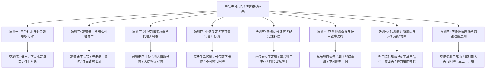

在商业社会与企业组织的长周期运转中，表面的业务增长、代码架构和考核 KPI 往往只是冰山浮于水面的十分之一。真正主宰企业排兵布阵、岗位兴衰、预算流向与个人晋升命运的，是水面之下无时无刻不在剧烈运转的组织博弈、权力重构与利益分配法则。

很多技术大拿、业务骨干乃至初任管理者，常常陷入“唯专业论”或“道德受害者”的认知盲区：

- 为什么自己业绩拿了第一、得奖最多，升职的却是业务能力平平的“老四”？
- 为什么自己为公司立下汗马功劳，却在拿到巨额提成后遭遇全公司跨部门围剿？
- 为什么空降到新部门兢兢业业解决技术债，最后却成了替罪羊被体面“请神出庙”？
- 为什么外部技术浪潮（中台化、AI大模型）一来，自己苦心经营的核心业务线就被兄弟部门整锅端走？

《产品老曾》职场专题系列大课，通过十余场深度连麦答疑与真实大厂商业战役复盘，提炼确立了这套体系。

很多听众初听老曾的连麦，会被其江湖气的粗粝比喻（如“正妻与小妾”、“孙权砍桌子”、“老四上位”、“请神出庙”、“死士操作系统”）所吸引。然而，**这些生动俗称的背后，绝非主播随口编造的个人谈资，而是现代组织行为学、博弈论与大厂政治学在真实商战中的具象映射**。

为了帮助读者穿透表层修辞、直达组织运转的底层本质，本手册建立起**“双层博弈知识架构”**：

1. **顶层：8 大底层职场博弈元法则（Meta-Principles）**：统摄科层制权力平衡、利益索取权、避责替罪羊、信息流进化等组织运行终极法则；
2. **底层：57 个实战场景推论与战术卡片（Tactical Playbook Cards）**：保留老曾最具穿透力的大厂实战黑话与操作对策，双向锚定具体的 16 场连麦实录案卷。

---

## 全景架构导图：8 大博弈元法则与 57 场景推论体系

---

## 8 大底层博弈元法则体系全览

| 序号 | 核心博弈元法则 | 英文学术对照 | 覆盖场景数 | 核心破局命题 |
| :---: | :--- | :--- | :---: | :--- |
| **01** | [平台租金垄断与剩余索取权分水定律](#meta-1) | Platform Rent Monopoly & Surplus Sharing | 4 项实战模型 | 突发红利如何分水避免跨部门联合绞杀 |
| **02** | [高管避责政治学与结构性替罪羊法则](#meta-2) | Executive Blame Avoidance & Scapegoating | 5 项实战模型 | 重大危机与神仙打架中如何免成替罪羊 |
| **03** | [科层制博弈均衡与代理人制衡法则](#meta-3) | Bureaucratic Equilibrium & Multi-agent Balance | 6 项实战模型 | 为什么老二老三被冷落、弱势老四反上位 |
| **04** | [业务锁定与不可替代性晋升悖论](#meta-4) | Irreplaceable Lock-in Paradox & Transition | 10 项实战模型 | 为什么得奖最多骨干升不上去、死士如何换脑 |
| **05** | [危机信号博弈与确定性补偿定律](#meta-5) | Crisis Signaling & Upward Alignment | 13 项实战模型 | 老板狂躁定翻倍目标背后在恐惧什么、如何向上脱困 |
| **06** | [存量地盘蚕食与技术叙事洗牌定律](#meta-6) | Internal Cannibalism & Turf Wars | 9 项实战模型 | 外部技术概念如何演变为内部地盘清洗令箭 |
| **07** | [信息流阻断淘汰与人机超级协同定律](#meta-7) | Information Flow Obstruction & Coordination | 6 项实战模型 | 守旧中层为何必被清洗、如何自立AI新部门 |
| **08** | [空降政治着陆与速胜动量法则](#meta-8) | Executive Parachute Dynamics & Momentum | 4 项实战模型 | 空降高管如何打破软抵抗、走出蜜月期大头兵陷阱 |

---

## 57 大实战场景推论模型速查索引表

| 序号 | 模型名称 | 英文标识（无下划线） | 核心分类 | 对应案卷笔记 |
| :---: | :--- | :--- | :--- | :---: |
| **01** | [正妻与小妾跳槽座次模型](#model-1) | First Wife Vs Concubine | 职场跃迁与权力格局 | [直达案卷](/knowledge/notes/live-20261102-laozeng-01/) |
| **02** | [老板的系统失控恐惧与去中心化](#model-2) | Boss Loss Of Control Fear | 老板心理与权力动力学 | [直达案卷](/knowledge/notes/live-20261102-laozeng-01/) |
| **03** | [从提成雇佣军转向风险共担合伙人](#model-3) | Mercenary To Equity Partner | 薪酬设计与利益对齐 | [直达案卷](/knowledge/notes/live-20261102-laozeng-01/) |
| **04** | [支撑研发与测试的生产价值穿透法](#model-4) | Support Dept Revenue Penetration | 向上管理与价值显性化 | [直达案卷](/knowledge/notes/live-20261102-laozeng-01/) |
| **05** | [打工人情绪隔离与反向下自证陷阱](#model-5) | Emotional Isolation And Anti Self Justification | 心智重塑与情绪隔离 | [直达案卷](/knowledge/notes/live-20261102-laozeng-01/) |
| **06** | [年轻化直属领导补位协同心法](#model-6) | Younger Leader Complementary | 领导力协同与向上补位 | [直达案卷](/knowledge/notes/live-20261102-laozeng-01/) |
| **07** | [孙权砍桌子定律（一号位危机生存法则）](#model-7) | Sun Quan Slashing Desk | 一把手心理与危机管理 | [直达案卷](/knowledge/notes/live-20261028-laozeng-01/) |
| **08** | [草台班子生存法则与反消灭傻叉误区](#model-8) | Grassroots Company Reality | 组织政治与草台班子生存 | [直达案卷](/knowledge/notes/live-20261028-laozeng-01/) |
| **09** | [对赌目标Double与存量压榨陷阱](#model-9) | Targets Doubling Game | 对赌博弈与存量压榨防线 | [直达案卷](/knowledge/notes/live-20261028-laozeng-01/) |
| **10** | [微观掌控与AI选择题汇报法](#model-10) | AI Multiple Choice Reporting | 微观掌控与结构化汇报 | [直达案卷](/knowledge/notes/live-20261028-laozeng-01/) |
| **11** | [企业自上而下政治型转型与反劝诫大动脉自保法则](#model-11) | Topdown Political Transformation | 政治型转型与自保策略 | [直达案卷](/knowledge/notes/live-20261026-laozeng-01/) |
| **12** | [AI像赵括模型（商业思维抗周期护城河）](#model-12) | AI As Zhao Kuo | 核心壁垒与商业思维护城河 | [直达案卷](/knowledge/notes/live-20261026-laozeng-01/) |
| **13** | [大厂高管永不认错政治学与替罪羊规避术](#model-13) | Executive Never Admit Mistake | 高管权力学与避责机制 | [直达案卷](/knowledge/notes/live-20261026-laozeng-01/) |
| **14** | [研发跨界破局与递刀借力模型](#model-14) | Cross Functional Breakthrough | 跨部门战略与破局借力 | [直达案卷](/knowledge/notes/live-20261020-laozeng-01/) |
| **15** | [创始老臣情感负资产清洗定律](#model-15) | Founder Veteran Entitlement Trap | 组织生命周期与老臣清洗 | [直达案卷](/knowledge/notes/live-20261020-laozeng-01/) |
| **16** | [突发红利独吞围剿陷阱与利益分水法](#model-16) | Windfall Profit Sharing | 跨部门博弈与突发红利分水 | [直达案卷](/knowledge/notes/live-20261020-laozeng-02/) |
| **17** | [企业转型中台化割据与地盘博弈定律](#model-17) | Middle Platform Turf Wars | 企业转型割据与地盘博弈 | [直达案卷](/knowledge/notes/live-20261020-laozeng-02/) |
| **18** | [晋升源于组织重构定律（总监升VP核心法则）](#model-18) | Promotion Requires Reorganization | 高管晋升与组织架构设计 | [直达案卷](/knowledge/notes/live-20261019-laozeng-01/) |
| **19** | [+2越级对话意图识别模型](#model-19) | Skip Level Dialogue Intent | 越级对齐与权力卡位 | [直达案卷](/knowledge/notes/live-20261019-laozeng-01/) |
| **20** | [空降高管速胜破局三部曲](#model-20) | Executive Parachute Quick Win | 空降管理与速胜政治生存 | [直达案卷](/knowledge/notes/live-20261019-laozeng-02/) |
| **21** | [职场达尔文水滴定律（去情怀化生存法则）](#model-21) | Workplace Darwin Droplet Law | 市场竞争与去情怀化生存 | [直达案卷](/knowledge/notes/live-20261019-laozeng-02/) |
| **22** | [刺头团队大促背锅防御与暗渡陈仓置换法则](#model-22) | Parachute Toxic Team Scapegoat | 空降管理与危机公关 | [直达案卷](/knowledge/notes/live-20261014-laozeng-01/) |
| **23** | [宵小毁誉装傻与借力打力请神出庙明升暗降模型](#model-23) | Rumor Isolation Sponsor Driven Offboarding | 高管神仙打架与人事博弈 | [直达案卷](/knowledge/notes/live-20261014-laozeng-01/) |
| **24** | [以退为进与为团队请赏暗度陈仓模型](#model-24) | Advance By Retreat Team Reward | 向上管理与升职谈判 | [直达案卷](/knowledge/notes/live-20261014-laozeng-02/) |
| **25** | [大额股权红利私下一对一分水模型](#model-25) | Equity Allocation Private One On One | 团队激励与利益分配 | [直达案卷](/knowledge/notes/live-20261014-laozeng-02/) |
| **26** | [跨国平调出海的组织通知与筹码锁死模型](#model-26) | Overseas Reassignment Leverage | 组织轮调与高管外派 | [直达案卷](/knowledge/notes/live-20261014-laozeng-02/) |
| **27** | [横向支持陷阱与反被害妄想定律](#model-27) | Cross Functional Support Trap | 岗位困境与跨级亮剑 | [直达案卷](/knowledge/notes/live-20261013-laozeng-01/) |
| **28** | [管理虚诺穿透与主动招人造位法则](#model-28) | Management Void Staffing Seat | 职业跃迁与编制创造 | [直达案卷](/knowledge/notes/live-20261013-laozeng-01/) |
| **29** | [空降民企向上汇报三二一倒置法则](#model-29) | Inverted 321 Upward Reporting | 向上管理与高管汇报 | [直达案卷](/knowledge/notes/live-20261013-laozeng-02/) |
| **30** | [空降管理者蜜月期一线大头兵陷阱](#model-30) | Honeymoon Solo Contributor Trap | 空降高管与组织着陆 | [直达案卷](/knowledge/notes/live-20261013-laozeng-02/) |
| **31** | [求职面试全知全能幻觉破局模型](#model-31) | Interview Omniscience Illusion | 职业跃迁与面试博弈 | [直达案卷](/knowledge/notes/live-20261013-laozeng-02/) |
| **32** | [并购整合跨部门战略立项借力收编术](#model-32) | M&A Project Kickoff Leverage | 组织重组与并购整合 | [直达案卷](/knowledge/notes/live-20261012-laozeng-01/) |
| **33** | [晋升组织排兵布阵与阵眼选择定律](#model-33) | Promotion As Tactical Hub Deployment | 高管跃迁与晋升哲学 | [直达案卷](/knowledge/notes/live-20261012-laozeng-01/) |
| **34** | [直属领导物色替补的权力试探自保准则](#model-34) | Superior Seeking Replacement Probe | 权力博弈与敏感情境自保 | [直达案卷](/knowledge/notes/live-20261012-laozeng-01/) |
| **35** | [高管权力平衡与老四上位定律](#model-35) | The Fourth Dark Horse Selection | 高管制衡与晋升权力学 | [直达案卷](/knowledge/notes/live-20261012-laozeng-02/) |
| **36** | [总监升VP战略棋局定位模型](#model-36) | Strategic Chessboard Positioning | 高管跃迁与战略卡位 | [直达案卷](/knowledge/notes/live-20261012-laozeng-02/) |
| **37** | [经理晋升总监组织结构跃迁定律](#model-37) | Manager To Director Organizational Shift | 管理晋升与组织架构 | [直达案卷](/knowledge/notes/live-20261012-laozeng-03/) |
| **38** | [外包转正存量重缺心智卡位定律](#model-38) | Contractor Headcount Window Positioning | 编制博弈与生态位破局 | [直达案卷](/knowledge/notes/live-20261012-laozeng-03/) |
| **39** | [超级牛马死士操作系统换脑破局模型](#model-39) | Diehard Executor Vs General Mindset | 认知重塑与心智跃迁 | [直达案卷](/knowledge/notes/live-20261012-laozeng-03/) |
| **40** | [关键业务锁定与组织不可替代性悖论](#model-40) | Irreplaceable Lock In Paradox | 组织博弈与授权晋升 | [直达案卷](/knowledge/notes/live-20261012-laozeng-03/) |
| **41** | [“实在人”道德标榜与创新短板投射陷阱](#model-41) | Honesty Moral Projection Trap | 胜任力归因与心理投射 | [直达案卷](/knowledge/notes/live-20260929-laozeng-01/) |
| **42** | [职场受害者叙事与负向召唤法则](#model-42) | Victim Narrative And Negative Summoning | 职场心理与生态位博弈 | [直达案卷](/knowledge/notes/live-20260929-laozeng-01/) |
| **43** | [黑暗森林商业剿杀与赢家叙事垄断定律](#model-43) | Dark Forest And Narrative Monopoly | 战略竞争与职场达尔文 | [直达案卷](/knowledge/notes/live-20260929-laozeng-01/) |
| **44** | [好人高管组织悲剧与下属遗忘定律](#model-44) | Benevolent Leader Tragedy And Subordinate Amnesia | 领导力与权力博弈 | [直达案卷](/knowledge/notes/live-20260929-laozeng-01/) |
| **45** | [完美主义逃避与零摩擦夺权幻觉](#model-45) | Perfectionism Avoidance And Zero Friction Illusion | 权力交接与中高层上位 | [直达案卷](/knowledge/notes/live-20260929-laozeng-01/) |
| **46** | [外部收购业务周期卡位翻盘定律](#model-46) | Acquired BU Cyclical Turnaround | 战略周期与边缘业务跃迁 | [直达案卷](/knowledge/notes/live-20260923-laozeng-01/) |
| **47** | [科研学者挂帅商业操盘手战略错位](#model-47) | Scientist To Commercial Manager Mismatch | 领导力胜任模型与能力错位 | [直达案卷](/knowledge/notes/live-20260923-laozeng-01/) |
| **48** | [领军人物个人野心与集团资本战略背离牺牲](#model-48) | Founder Ambition Vs Group Strategy Clash | 资本博弈与大盘战略 | [直达案卷](/knowledge/notes/live-20260923-laozeng-01/) |
| **49** | [大厂高管明升暗降体面请神出庙模型](#model-49) | Executive Demotion Via Honorary Promotion | 高管更迭与政治权术 | [直达案卷](/knowledge/notes/live-20260923-laozeng-01/) |
| **50** | [技术新概念下的组织大洗牌与兄弟部门蚕食定律](#model-50) | Tech Concept Purge And Internal Cannibalism | 组织政治与权力洗牌 | [直达案卷](/knowledge/notes/live-20260922-laozeng-01/) |
| **51** | [算力抽血与AI岗位替代优先级路线图](#model-51) | AI Displacement Priority Roadmap | 技术变革与岗位演进 | [直达案卷](/knowledge/notes/live-20260922-laozeng-01/) |
| **52** | [售前专家与行业线PM“出道即巅峰”天花板模型](#model-52) | Pre Sales And Vertical Pm Promotion Ceiling | 职业规划与职级跃迁 | [直达案卷](/knowledge/notes/live-20260922-laozeng-01/) |
| **53** | [金字塔部门墙阻碍与AI时代中层清洗真相](#model-53) | Middle Management Info Flow Obstruction Purge | 组织进化与管理转型 | [直达案卷](/knowledge/notes/live-20260922-laozeng-01/) |
| **54** | [大厂带人管理溢价与升迁确定性优先法则](#model-54) | Management Mobility Premium And Certainty First | 职级跃迁与确定性锁定 | [直达案卷](/knowledge/notes/live-20260922-laozeng-02/) |
| **55** | [顶尖算法天才买断逻辑与大众工程师错位突围模型](#model-55) | Algorithm Genius Buyout Vs Regular Engineer Niche | 技术竞争与生态位错位 | [直达案卷](/knowledge/notes/live-20260922-laozeng-02/) |
| **56** | [工具产品化与借老板焦虑自立山头法则](#model-56) | Tool Productization And Boss Anxiety Arbitrage | 组织夺权与向上管理 | [直达案卷](/knowledge/notes/live-20260922-laozeng-02/) |
| **57** | [AI业务缺陷反向放大定律](#model-57) | AI Business Judgment Deficit Amplification | 专业能力与人机协同 | [直达案卷](/knowledge/notes/live-20260922-laozeng-02/) |

---

## 法则一：平台租金垄断与剩余索取权分水定律

- **英文对照**：Platform Rent Monopoly, Surplus Sharing & Equity Dynamics
- **底层管理学与博弈论机理**：
  在现代企业组织中，大额业务突破与突发红利本质上是公司品牌声誉、垄断资质与基础设施沉淀的‘平台租金（Economic Rent）’，而非单纯归功于个人的英雄主义。业务骨干如果将平台红利视同单兵私产独吞天价奖金，必然触发跨部门零和博弈与管理层道德风险警报，招致联合绞杀。唯有在兑现前主动‘分水’、将短期提成转化为组织同盟筹码，才能确立长治久安的权力地位。

### 本法则下辖实战场景推论模型（共 4 项）：

### 1. 正妻与小妾跳槽座次模型

- **英文标识**：First Wife Vs Concubine
- **核心分类**：职场跃迁与权力格局

📌 **底层博弈逻辑**：
评估追随老领导创业或跳槽的风险。若老领导新公司已有核心班底（正妻已娶），后来追随的老部下往往丧失初创溢价，沦为干脏活且无核心管辖权的小妾；决策必须依据'书面确定现金溢价 + 独立业务管辖权 + 最坏退路'，切忌感性义气依附。

💡 **实战操作对策**：
正妻与小妾、老领导创业、追随跳槽、座次格局、核心班底

🔗 **关联实战案卷**：[查阅完整连麦案例与深度复盘笔记](/knowledge/notes/live-20261102-laozeng-01/)

---

### 3. 从提成雇佣军转向风险共担合伙人

- **英文标识**：Mercenary To Equity Partner
- **核心分类**：薪酬设计与利益对齐

📌 **底层博弈逻辑**：
成熟存量业务中，老板不愿持续支付高昂的开拓提成。销售或业务总监若想突破收入天花板，不能继续做单边拿提成的雇佣军，必须主动向老板提议承接新孵化业务、自负盈亏，以业绩对赌争取期权或合伙人份额。

💡 **实战操作对策**：
提成天花板、雇佣军思维、合伙人期权、风险共担、自负盈亏

🔗 **关联实战案卷**：[查阅完整连麦案例与深度复盘笔记](/knowledge/notes/live-20261102-laozeng-01/)

---

### 16. 突发红利独吞围剿陷阱与利益分水法

- **英文标识**：Windfall Profit Sharing
- **核心分类**：跨部门博弈与突发红利分水

📌 **底层博弈逻辑**：
单一部门遭遇突发时代/市场红利获天价利润若心安理得独吞重奖，直接破坏跨部门心理平衡，必遭全公司同僚联合政治围剿。高段位领导者第一动作是将功劳归因于全链路协同，主动开闸分水设立跨部门特别激励，化敌为友奠定全局领袖地位。

💡 **实战操作对策**：
天价奖金围剿、利益分水法、意外红利独吞、全链路协同、政治自保

🔗 **关联实战案卷**：[查阅完整连麦案例与深度复盘笔记](/knowledge/notes/live-20261020-laozeng-02/)

---

### 25. 大额股权红利私下一对一分水模型

- **英文标识**：Equity Allocation Private One On One
- **核心分类**：团队激励与利益分配

📌 **底层博弈逻辑**：
财富分配遵循不患寡而患不均的人性铁律。大额奖金或期权池严禁大锅饭平均分配，严禁公开公示。必须按层级、战略权重与贡献拉严密底表，逐个进行1on1私下沟通；高阶领袖更须主动让出眼前小利换取团队铁血忠诚与战略威望。

💡 **实战操作对策**：
不搞平均主义、不公开公示；制定层级贡献测算表并进行逐一单面私聊；核心操盘手让小利收拢骨干死党人心。

🔗 **关联实战案卷**：[查阅完整连麦案例与深度复盘笔记](/knowledge/notes/live-20261014-laozeng-02/)

---

## 法则二：高管避责政治学与结构性替罪羊法则

- **英文对照**：Executive Blame Avoidance, Scapegoating & Demotion Tactics
- **底层管理学与博弈论机理**：
  科层制金字塔结构中，高管的权力合法性直接挂钩于其‘英明决策与战略正确’的人设。面对商业败局或重大危机，高管体系存在不可逆的‘永不认错本能’。当不可挽回的系统性损失发生时，组织必然寻找替罪羊以吸收政治震荡。面对声望极高但管理错位的核心大佬，直接开除成本过高，大厂标准解法是名义赋予极高荣誉虚职（顾问/科学家），实质移交人事与考核权，实现零震荡‘请神出庙’。

### 本法则下辖实战场景推论模型（共 5 项）：

### 13. 大厂高管永不认错政治学与替罪羊规避术

- **英文标识**：Executive Never Admit Mistake
- **核心分类**：高管权力学与避责机制

📌 **底层博弈逻辑**：
在企业最高决策层，公开认错等同于丧失政治合法性。高管必将历史亏损与战略挫折合理化包装为'底层基建改造与能力蓄力'。下属切勿拿客观亏损数据戳破高管，而应主动为高管的基建叙事补充局部确定性战果，成为政治同盟军以规避替罪羊风险。

💡 **实战操作对策**：
永不认错、战略蓄力叙事、政治同盟、替罪羊规避、向上对齐

🔗 **关联实战案卷**：[查阅完整连麦案例与深度复盘笔记](/knowledge/notes/live-20261026-laozeng-01/)

---

### 15. 创始老臣情感负资产清洗定律

- **英文标识**：Founder Veteran Entitlement Trap
- **核心分类**：组织生命周期与老臣清洗

📌 **底层博弈逻辑**：
商业分工遵循阶段性匹配原则。初创期老臣若能力停滞，所谓的'感情与苦劳'在正规化扩张阶段不仅不是功劳，反而会沦为破坏管理、挟恩图报的政治负资产。老臣必须主动去光环化并交付新增长，否则必遭高层冷酷清洗。

💡 **实战操作对策**：
职场无感情、老臣清洗定律、阶段性匹配、挟恩图报陷阱、去光环化

🔗 **关联实战案卷**：[查阅完整连麦案例与深度复盘笔记](/knowledge/notes/live-20261020-laozeng-01/)

---

### 22. 刺头团队大促背锅防御与暗渡陈仓置换法则

- **英文标识**：Parachute Toxic Team Scapegoat
- **核心分类**：空降管理与危机公关

📌 **底层博弈逻辑**：
老员工抵触源于安全感剥夺与被摘桃子心理；空降兵大促前夕急于立威必落入大促暴雷的背锅陷阱。必须暗渡陈仓：前台稳住刺头抗指标，后台火速招聘嫡系预备队，大促落定后体面换血。

💡 **实战操作对策**：
对刺头保持业务主抗职责，不逼迫交出底牌激化矛盾；火速通过HR招聘自己团队作为大促冗余；双11结束后借上级历史包袱顺理成章完成组织迭代。

🔗 **关联实战案卷**：[查阅完整连麦案例与深度复盘笔记](/knowledge/notes/live-20261014-laozeng-01/)

---

### 23. 宵小毁誉装傻与借力打力请神出庙明升暗降模型

- **英文标识**：Rumor Isolation Sponsor Driven Offboarding
- **核心分类**：高管神仙打架与人事博弈

📌 **底层博弈逻辑**：
下属造黄谣毁誉是正规军博弈失败后的下三滥动作。当事人公开辟谣或自证立刻落入下乘。高位者必须从容装傻；开不掉的派系刺头设计跨部门明升暗降通道，但必须借刺头信任的派系后台之手开口推荐，方能实现无痛请神出庙。

💡 **实战操作对策**：
舆论装傻不应战，聚焦业务产出让高层爽；联合HR与上级设计竞聘出口；借对方派系高管（三号位）之口劝其赴任，无痛拔除刺头扫清晋升障碍。

🔗 **关联实战案卷**：[查阅完整连麦案例与深度复盘笔记](/knowledge/notes/live-20261014-laozeng-01/)

---

### 49. 大厂高管明升暗降体面请神出庙模型

- **英文标识**：Executive Demotion Via Honorary Promotion
- **核心分类**：高管更迭与政治权术

📌 **底层博弈逻辑**：
面对行业名望极大、资历深厚但商业与管理不善的核心高管（如周靖人），直接撤职会引发行业震荡、公关海啸与团队哗变。成熟大厂标准解法是名义上给予极高荣誉（首席科学家/终身顾问），保留虚职与尊严，实质上彻底剥离人事权、考核权、预算权与业务指挥权，让其“回归学术”，以零公关震荡完成权力平稳过渡。

💡 **实战操作对策**：
敏锐识别“被授予光鲜荣誉虚职”背后的剥权信号；一旦发现下属汇报线与考核权被移交，必须清醒面对现实，体面完成职业退出。

🔗 **关联实战案卷**：[查阅完整连麦案例与深度复盘笔记](/knowledge/notes/live-20260923-laozeng-01/)

---

## 法则三：科层制博弈均衡与代理人制衡法则

- **英文对照**：Bureaucratic Equilibrium, Multi-agent Balancing & Succession Dynamics
- **底层管理学与博弈论机理**：
  组织一号位在挑选代理人与排兵布阵时，其终极追求并非单点‘能力最强’，而是‘权力制衡与绝对可控’。锋芒过盛、功高震主的老二与老三由于拥有独立地盘与班底，往往难以成为接班最优解；相反，资历稍浅、完全依附于最高层的‘老四’由于缺乏造反资本，反而成为高层维系大盘平衡的最佳棋子。在战略棋盘中，你必须看清自己究竟是被当作破敌利刃、防御重盾，还是随时可丢弃的绑带。

### 本法则下辖实战场景推论模型（共 6 项）：

### 2. 老板的系统失控恐惧与去中心化

- **英文标识**：Boss Loss Of Control Fear
- **核心分类**：老板心理与权力动力学

📌 **底层博弈逻辑**：
当业务骨干的个人贡献过大（如贡献超50%毛利或掌握核心客户），老板的第一反应不是感激，而是对业务被单点绑架的终极恐惧。老板会通过提成封顶、流程拆解、挑刺团队管理等手段削减其权重。

💡 **实战操作对策**：
功高震主、安全感缺失、提成封顶、单点绑架、去关键人化

🔗 **关联实战案卷**：[查阅完整连麦案例与深度复盘笔记](/knowledge/notes/live-20261102-laozeng-01/)

---

### 33. 晋升组织排兵布阵与阵眼选择定律

- **英文标识**：Promotion As Tactical Hub Deployment
- **核心分类**：高管跃迁与晋升哲学

📌 **底层博弈逻辑**：
晋升从来不是对历史战功、忠诚苦劳的奖品（加薪发奖金才是奖励）。晋升是组织针对下一阶段战役的排兵布阵与阵眼挑选。高层考察的唯一标准是候选人是否具备未来阵法所需的战略穿透力。老骨干必须去功劳化，主动将自身重塑为新阵法攻坚所需的阵眼要素。

💡 **实战操作对策**：
绝不拿历史功劳向老板讨价还价；洞察老板未来三年核心战役意图；递交充当进攻突破口的新业务战术方案，争夺新战法阵眼位。

🔗 **关联实战案卷**：[查阅完整连麦案例与深度复盘笔记](/knowledge/notes/live-20261012-laozeng-01/)

---

### 34. 直属领导物色替补的权力试探自保准则

- **英文标识**：Superior Seeking Replacement Probe
- **核心分类**：权力博弈与敏感情境自保

📌 **底层博弈逻辑**：
直属领导私下要求下属物色接替自身职位的外部候选人时，切忌自作聪明向高层抢跑邀功。必须识别其深层意图（真跳槽、高管施压还是忠诚度试探），严格在直属领导把关下按常规程序推进，绝不越权向大老板私下告密，防范沦为高层博弈替罪羊。

💡 **实战操作对策**：
维持常规招聘进度与专业把关；所有候选人向直属领导正面汇报闭环；严禁越级向大老板做任何倾向性表态。

🔗 **关联实战案卷**：[查阅完整连麦案例与深度复盘笔记](/knowledge/notes/live-20261012-laozeng-01/)

---

### 35. 高管权力平衡与老四上位定律

- **英文标识**：The Fourth Dark Horse Selection
- **核心分类**：高管制衡与晋升权力学

📌 **底层博弈逻辑**：
部门高管缺位且多强相争时，提拔实力最强候选人往往导致团队分裂与失控。最高领导者出于权力制衡本能，往往避开前三位刺头，破格提拔资历稍浅、派系中立且绝对忠诚的第四人作为平衡缓冲垫，实现老板间接的御驾亲征与绝对掌控。

💡 **实战操作对策**：
避免卷入多强内耗较劲；展现对大老板大局的绝对顺从；在多方势力争斗中保持中立超然，成为最高层眼中最安全可靠的组织棋子。

🔗 **关联实战案卷**：[查阅完整连麦案例与深度复盘笔记](/knowledge/notes/live-20261012-laozeng-02/)

---

### 36. 总监升VP战略棋局定位模型

- **英文标识**：Strategic Chessboard Positioning
- **核心分类**：高管跃迁与战略卡位

📌 **底层博弈逻辑**：
总监被冷落沟通频次骤降是即将被架空降级的危险预警。破局必须告别被动等待，认清公司当前攻守大势，将自身精准卡位为高层棋盘上的利刃（进攻抢增量）、重盾（防守控现金流）或绑带（跨部门协同），以投资方案主动路演争取新高管编制。

💡 **实战操作对策**：
捕捉沟通冷淡预警；识别大盘攻守战局；制定可落地的业务增量/控本方案，主动向老板立军令状主抗关键战略战役。

🔗 **关联实战案卷**：[查阅完整连麦案例与深度复盘笔记](/knowledge/notes/live-20261012-laozeng-02/)

---

### 44. 好人高管组织悲剧与下属遗忘定律

- **英文标识**：Benevolent Leader Tragedy And Subordinate Amnesia
- **核心分类**：领导力与权力博弈

📌 **底层博弈逻辑**：
管理者的首要职责是夺取高层资源、打赢外部硬仗、为团队拓展编制。放弃权力争夺的“对下属无微不至的好人主义”，一旦失势被免，团队必被肢解瓜分。下属不仅不会感恩，反而因丧失前途而选择性遗忘。无权者的善良毫无价值，带队打胜仗夺取利益才是最大的仁慈。

💡 **实战操作对策**：
摒弃自恋式好人主义；将核心精力聚焦于高层资源争取与战功交付，用真金白银与晋升通道为团队构筑护城河。

🔗 **关联实战案卷**：[查阅完整连麦案例与深度复盘笔记](/knowledge/notes/live-20260929-laozeng-01/)

---

## 法则四：业务锁定与不可替代性晋升悖论

- **英文对照**：The Irreplaceable Lock-in Paradox & Competency Transition
- **底层管理学与博弈论机理**：
  彼得原理在技术执行领域的残酷反向变体：越是在单一执行工位上做到极致‘不可替代’，组织越不敢让你离开现有岗位去晋升，因为提拔你的沉没替换成本远高于维持原状。技术骨干的晋升不是源于‘执行苦劳的线性累加’，而是源于‘组织结构的重构契机’。必须主动割舍单兵死士操作系统，退居二线搭建标准化流程与人员梯队，完成从‘打粮食的士兵’向‘分蛋糕的将军’的胜任力跨越。

### 本法则下辖实战场景推论模型（共 10 项）：

### 4. 支撑研发与测试的生产价值穿透法

- **英文标识**：Support Dept Revenue Penetration
- **核心分类**：向上管理与价值显性化

📌 **底层博弈逻辑**：
研发与测试等支撑部门向上汇报不能停留在技术工时，老板无法感知其商业价值。必须将技术产出穿透并折算为硬核生产指标：良品率提升比例、系统停机资损减少金额、排产周期缩短小时数。

💡 **实战操作对策**：
支撑部门边缘化、生产指标穿透、良品率折现、资损拦截、技术汇报

🔗 **关联实战案卷**：[查阅完整连麦案例与深度复盘笔记](/knowledge/notes/live-20261102-laozeng-01/)

---

### 18. 晋升源于组织重构定律（总监升VP核心法则）

- **英文标识**：Promotion Requires Reorganization
- **核心分类**：高管晋升与组织架构设计

📌 **底层博弈逻辑**：
从总监跃迁至VP，业务苦劳与绩效边际收益归零。金字塔顶层坑位绝对锁死，无组织重组便无高管编制。破局核心是主动向+2决策者提出一套切实可行的《组织阵型再造方案》（如业务分区、裂变新事业部），把个人升迁包装为解决公司扩张瓶颈的结构性解法，为自己创造编制。

💡 **实战操作对策**：
总监升VP、组织重构定律、阵型再造、编制创造、经营面卡点

🔗 **关联实战案卷**：[查阅完整连麦案例与深度复盘笔记](/knowledge/notes/live-20261019-laozeng-01/)

---

### 27. 横向支持陷阱与反被害妄想定律

- **英文标识**：Cross Functional Support Trap
- **核心分类**：岗位困境与跨级亮剑

📌 **底层博弈逻辑**：
职场中的边缘化不是蓄意迫害，而是战略权重不足引起的自然忽视。困死在横向支持的技术骨干往往有自怨自艾的被害妄想。破局必须停止内耗，培养徒弟解脱日常杂活，向+2总监展现端到端对客商业能力，主动亮剑争夺独立垂类业务。

💡 **实战操作对策**：
戒除玻璃心与被害妄想；培养新人接管70%技术杂务；面向总监汇报商业与客户认知，立军令状主抗垂类新项目。

🔗 **关联实战案卷**：[查阅完整连麦案例与深度复盘笔记](/knowledge/notes/live-20261013-laozeng-01/)

---

### 28. 管理虚诺穿透与主动招人造位法则

- **英文标识**：Management Void Staffing Seat
- **核心分类**：职业跃迁与编制创造

📌 **底层博弈逻辑**：
高管口头的"下次再聊"就是坚决的委婉拒绝。没有下属的光杆司令在组织中绝不可能获批管理编制。返乡骨干切忌用"哥有好事想着我"乞求施恩，必须抓住业务扩张痛点主动递交性价比招人方案；先有人头事权，后顺理成章拿下主管Title。

💡 **实战操作对策**：
穿透"回头再聊"的拒绝本质；围绕全渠道业务超负荷现状撰写提效方案；申请招揽1-2名性价比新人，以实际管辖人头坐实管理位。

🔗 **关联实战案卷**：[查阅完整连麦案例与深度复盘笔记](/knowledge/notes/live-20261013-laozeng-01/)

---

### 37. 经理晋升总监组织结构跃迁定律

- **英文标识**：Manager To Director Organizational Shift
- **核心分类**：管理晋升与组织架构

📌 **底层博弈逻辑**：
基层经理晋升考量单一员工的个人业务战力与执行力；中高层总监提拔彻底脱离个人评价，转向组织层面的排兵布阵与结构健康度。决策者考量的是提拔谁能重构团队阵型、稳定军心并实现全局效率倍增，而非谁平时最勤奋、业务最拔尖。

💡 **实战操作对策**：
跳出基层执行视角；从单点搞定任务跃迁为全局业务阵型设计，向高层展示跨模块资源调配与组织协同效能。

🔗 **关联实战案卷**：[查阅完整连麦案例与深度复盘笔记](/knowledge/notes/live-20261012-laozeng-03/)

---

### 38. 外包转正存量重缺心智卡位定律

- **英文标识**：Contractor Headcount Window Positioning
- **核心分类**：编制博弈与生态位破局

📌 **底层博弈逻辑**：
大厂招募外包源于集团HC编制硬性受限，管理者绝不可能专门向集团单独特批新增编制。转正的唯一现实窗口是团队自然流动产生的存量重缺（离职/转岗/淘汰）急需快速补位。外包骨干切忌因干活太熟产生虚幻归属感，必须在日常复盘中主动向上埋点种草转正意愿，防范HC出现时被领导习惯性社招而遗忘。

💡 **实战操作对策**：
利用周会与季度复盘节点，向甲方决策层温和表达转正意愿与攻坚意愿；一旦存量HC出现，第一时间成为无需招聘周期的首选替代者。

🔗 **关联实战案卷**：[查阅完整连麦案例与深度复盘笔记](/knowledge/notes/live-20261012-laozeng-03/)

---

### 39. 超级牛马死士操作系统换脑破局模型

- **英文标识**：Diehard Executor Vs General Mindset
- **核心分类**：认知重塑与心智跃迁

📌 **底层博弈逻辑**：
遇事六亲不认、拼命硬刚搞定业务、在专业能力过硬中寻找自嗨正反馈，是典型的死士/探子操作系统。老板极度喜欢不需要鞭策的超级牛马，但死士在组织里是刺秦王的耗材与救火队，绝不可能提拔为掌兵中军的将军。向老板抱怨事情太多要加人，在老板听来只是探子要小探子放哨。破局必须卸载死士系统，换成直属领导与+2高层的利益考核与安全感视角。

💡 **实战操作对策**：
停止自我感动式苦干；戒除玻璃心与诉苦；将向上沟通从抱怨事多人少转变为承接高层核心战略目标的立项方案。

🔗 **关联实战案卷**：[查阅完整连麦案例与深度复盘笔记](/knowledge/notes/live-20261012-laozeng-03/)

---

### 40. 关键业务锁定与组织不可替代性悖论

- **英文标识**：Irreplaceable Lock In Paradox
- **核心分类**：组织博弈与授权晋升

📌 **底层博弈逻辑**：
员工误以为自己对关键存量业务（如欧系大客户）无可替代便能升职，但老板的真实算盘是将无可替代的骨干调走风险极高、留在原地收益最稳。不可替代直接演变为“不可晋升”，老板倾向于用零成本的荣誉资产安抚并将其永久锁死在原地。破局的关键是将下属当成解放自己的钥匙与跳板，把核心流程SOP化彻底授权交接，证明业务离开自己也能健康运转，方能释放管理晋升弹性。

💡 **实战操作对策**：
将手中不可替代的业务流程化、标准化，制定新人接盘培养计划；以坦诚姿态发起向上穿透谈话逼出组织底牌，主动申请开拓更大区域盘子。

🔗 **关联实战案卷**：[查阅完整连麦案例与深度复盘笔记](/knowledge/notes/live-20261012-laozeng-03/)

---

### 52. 售前专家与行业线PM“出道即巅峰”天花板模型

- **英文标识**：Pre Sales And Vertical Pm Promotion Ceiling
- **核心分类**：职业规划与职级跃迁

📌 **底层博弈逻辑**：
商务售前与行业PM属于‘支持型专业工具人’，岗位设立之初就缺乏向上管理通道。一入职即享受行业专家高薪导致‘出道即巅峰’，长期漂泊客户一线远离总部权力中枢，导致信息脱节且极易在人事动荡中被无声清洗。

💡 **实战操作对策**：
成熟期必须主动横向跨界破局：要么转入一线销售序列扛起大区业务营收做带兵大将，要么调回总部中台掌控标准产品规划与战略，赢回组织话语权。

🔗 **关联实战案卷**：[查阅完整连麦案例与深度复盘笔记](/knowledge/notes/live-20260922-laozeng-01/)

---

### 54. 大厂带人管理溢价与升迁确定性优先法则

- **英文标识**：Management Mobility Premium And Certainty First
- **核心分类**：职级跃迁与确定性锁定

📌 **底层博弈逻辑**：
大厂纯技术大头兵面临应届卷王与技术迭代的双重挤压。相比之下，在巨头内部独立带队（带5人以上团队、背负团队交付与考核）的PL/Leader实操管理履历具备极高的跨大厂通用流动溢价，可直接对接外部Team Leader或跨级定级。面对外部新兴技术风口诱惑，若内部存在确定的带人升迁窗口，应优先锁定确定性管理实权。

💡 **实战操作对策**：
绝不为外部虚火概念轻弃眼前已锁定的PL管理编制；先拿稳大厂带人管理背书完成身份跃迁，再以管理者身份伺机跨界。

🔗 **关联实战案卷**：[查阅完整连麦案例与深度复盘笔记](/knowledge/notes/live-20260922-laozeng-02/)

---

## 法则五：危机信号博弈与确定性补偿定律

- **英文对照**：Crisis Signaling, Anxiety Arbitrage & Upward Alignment
- **底层管理学与博弈论机理**：
  在宏观下行周期与存量竞争中，老板定出的看似非理性的激进指标（如目标翻倍、强制转型），其本质并非基于精密算术，而是面对系统失控风险时的‘合法性宣誓与焦虑外溢（Signaling Game）’。此时下级若以理性算账当面质疑，无异于公开摧毁老板的战略威信；卓越的下属懂得情绪隔离，绝不在技术细节上下自证，而是主动充当提供确定性的急先锋，用选择题汇报与实操战果替老板吸收失控恐惧。

### 本法则下辖实战场景推论模型（共 13 项）：

### 5. 打工人情绪隔离与反向下自证陷阱

- **英文标识**：Emotional Isolation And Anti Self Justification
- **核心分类**：心智重塑与情绪隔离

📌 **底层博弈逻辑**：
职场是分工体系而非情绪疗伤所。面对老板挑刺管理或下属摩擦，切勿陷入'向下严厉整肃下属以向老板自证管理能力'的自证陷阱；应建立情绪隔离，只对商业结果负责，把精力放在业务卡点和向上利益对齐上。

💡 **实战操作对策**：
情绪隔离、自证陷阱、向上管理、抓下属自证、职业成熟度

🔗 **关联实战案卷**：[查阅完整连麦案例与深度复盘笔记](/knowledge/notes/live-20261102-laozeng-01/)

---

### 6. 年轻化直属领导补位协同心法

- **英文标识**：Younger Leader Complementary
- **核心分类**：领导力协同与向上补位

📌 **底层博弈逻辑**：
当下属资历深而新领导年轻时，最大的禁忌是流露'资历傲慢'。年轻领导核心诉求是在上级面前立足与出彩。老骨干最佳生存策略是放下架子，做'脏活托底与方案补位'，把前台光芒留给领导，换取自身的安全与资源倾斜。

💡 **实战操作对策**：
年轻领导、资历傲慢、幕后托底、方案补位、信任获取

🔗 **关联实战案卷**：[查阅完整连麦案例与深度复盘笔记](/knowledge/notes/live-20261102-laozeng-01/)

---

### 7. 孙权砍桌子定律（一号位危机生存法则）

- **英文标识**：Sun Quan Slashing Desk
- **核心分类**：一把手心理与危机管理

📌 **底层博弈逻辑**：
赤壁之战孙权斩案立誓'敢言降者同此案'。在下行周期或危机面前，老板作为一号位退无可退，必须全力转型求生；此时二号位试图扮演下属保护伞、向老板要资源讲困难，在老板眼里等同于动摇军心、变相要挟，老板的第一反应必定是拔刀换人。二号位必须敢于刺破团队幻想，以自负盈亏姿态带敢死队突破。

💡 **实战操作对策**：
孙权砍桌子、退无可退、保护伞陷阱、一号位思维、转型攻坚

🔗 **关联实战案卷**：[查阅完整连麦案例与深度复盘笔记](/knowledge/notes/live-20261028-laozeng-01/)

---

### 8. 草台班子生存法则与反消灭傻叉误区

- **英文标识**：Grassroots Company Reality
- **核心分类**：组织政治与草台班子生存

📌 **底层博弈逻辑**：
绝大多数商业公司本质上都是草台班子在运转；管理者能上位，核心是长期留守建立的老板政治信任与组织协同，而非懂具体技术细节。员工最大的致命误区是试图'消灭傻叉/证明领导是个外行傻叉'，这不仅毫无收益还会招致毁灭。离职后再回老东家座次归零，必须以新人心态重新对齐。

💡 **实战操作对策**：
草台班子、消灭傻叉误区、二进宫、座次归零、政治信任

🔗 **关联实战案卷**：[查阅完整连麦案例与深度复盘笔记](/knowledge/notes/live-20261028-laozeng-01/)

---

### 9. 对赌目标Double与存量压榨陷阱

- **英文标识**：Targets Doubling Game
- **核心分类**：对赌博弈与存量压榨防线

📌 **底层博弈逻辑**：
当骨干开辟出新成果后，老板将超额成果翻倍设为下月常规基线（'完不成不罚，完成了目标Double'），通过测试极限产能封顶提成池。应对策略是切断单点提成对抗，主动承接老板战略焦虑（如AI转型的小闭环），转向业务对赌或自立核算。

💡 **实战操作对策**：
目标Double、对赌陷阱、存量压榨、战略焦虑对齐、提成封顶

🔗 **关联实战案卷**：[查阅完整连麦案例与深度复盘笔记](/knowledge/notes/live-20261028-laozeng-01/)

---

### 10. 微观掌控与AI选择题汇报法

- **英文标识**：AI Multiple Choice Reporting
- **核心分类**：微观掌控与结构化汇报

📌 **底层博弈逻辑**：
外行领导因缺乏安全感会本能抓按钮大小、排版等浅层细节微观干预；下属切勿与其争论美学，应利用AI工具批量生成5~10套方案备选供其选择，把审定权与掌控感留给领导，自己拿业务结果并省出核心精力。

💡 **实战操作对策**：
选择题汇报、微观掌控、AI批量生成、安全感供给、向上汇报

🔗 **关联实战案卷**：[查阅完整连麦案例与深度复盘笔记](/knowledge/notes/live-20261028-laozeng-01/)

---

### 11. 企业自上而下政治型转型与反劝诫大动脉自保法则

- **英文标识**：Topdown Political Transformation
- **核心分类**：政治型转型与自保策略

📌 **底层博弈逻辑**：
高层推行AI或业务转型首先是应对外部资本压力的政治自证动作。员工苦劝'不要盲目裁员、会切断大动脉'不仅无效，还会被判定为旧利益守旧派祭旗。明智策略是公开拥护大势，将自身非标业务拆解为'不可替代的核心安全中枢'，以边缘业务提效帮助领导完成指标。

💡 **实战操作对策**：
政治型转型、裁员大动脉、忠言逆耳陷阱、政治自证、安全中枢

🔗 **关联实战案卷**：[查阅完整连麦案例与深度复盘笔记](/knowledge/notes/live-20261026-laozeng-01/)

---

### 19. +2越级对话意图识别模型

- **英文标识**：Skip Level Dialogue Intent
- **核心分类**：越级对齐与权力卡位

📌 **底层博弈逻辑**：
顶层大老板（+2）越级找业务骨干沟通从来没有普通闲聊，唯一意图是暗中考察能够跨过中间层、直接为最高层所用的直系干将。若只会聊细碎业务细节会被直接判定为格局低下的纯工具人；必须提前备好不可替代护城河、组织优化建议与冲锋姿态。

💡 **实战操作对策**：
越级对话、+2大老板、组织幼稚病、嫡系物色、战略野心呈现

🔗 **关联实战案卷**：[查阅完整连麦案例与深度复盘笔记](/knowledge/notes/live-20261019-laozeng-01/)

---

### 24. 以退为进与为团队请赏暗度陈仓模型

- **英文标识**：Advance By Retreat Team Reward
- **核心分类**：向上管理与升职谈判

📌 **底层博弈逻辑**：
打赢局部小胜仗后直接索要高管任命与期权必触发老板被勒索的防御警惕。高维打法是归因于老板英明与团队拼死，拿未定稿粗草案大公无私为团队核心骨干请赏，让老板做选择题满足施恩欲；最后以阵型协同需要顺理成章拉齐自己Title与授权，实现名利双收。

💡 **实战操作对策**：
汇报首句归功于老板战略英明与下属拼命；递交团队激励粗草案让老板亲批；顺带提出为带好阵型需要匹配官方Title与授权。

🔗 **关联实战案卷**：[查阅完整连麦案例与深度复盘笔记](/knowledge/notes/live-20261014-laozeng-02/)

---

### 26. 跨国平调出海的组织通知与筹码锁死模型

- **英文标识**：Overseas Reassignment Leverage
- **核心分类**：组织轮调与高管外派

📌 **底层博弈逻辑**：
高层跨区域外派动员表面上是促膝长谈画大饼，底层本质是接替者已就位的既定组织通知。中层管理者试图抗拒留原地必遭迅速边缘化。破局关键是立即顺从大局，并在高层心理亏欠的动员窗口期，白纸黑字锁死海外免死宽限期、嫡系自带人权、超额预算与回流直通VP路径。

💡 **实战操作对策**：
绝不抗命拒绝；利用高层动员期索要6-12个月考核宽限期、带走1-2名骨干，并书面锁定外派期满回流晋升承诺。

🔗 **关联实战案卷**：[查阅完整连麦案例与深度复盘笔记](/knowledge/notes/live-20261014-laozeng-02/)

---

### 31. 求职面试全知全能幻觉破局模型

- **英文标识**：Interview Omniscience Illusion
- **核心分类**：职业跃迁与面试博弈

📌 **底层博弈逻辑**：
候选人自卑与过度自证源于将面试官神化为全知全能者。面试本质是验证到新岗位能否摆平问题的未来交付力，而非道德审计。只要能将复杂项目的商业逻辑、底层挑战与解法用严密闭环讲透，面试官即默认具备胜任力。

💡 **实战操作对策**：
停止内心戏与瑕疵自证；用STAR与商业ROI闭环还原业务打法；证明在新岗位具备立刻上手摆平烂摊子的解题能力。

🔗 **关联实战案卷**：[查阅完整连麦案例与深度复盘笔记](/knowledge/notes/live-20261013-laozeng-02/)

---

### 41. “实在人”道德标榜与创新短板投射陷阱

- **英文标识**：Honesty Moral Projection Trap
- **核心分类**：胜任力归因与心理投射

📌 **底层博弈逻辑**：
骨干将新业务开拓失败归咎于同事作假受宠、自身过于实在吃亏，本质是用道德优越感掩饰自身缺乏0到1从零创新探索能力的短板。顺境做存量放大时无视甚至轻视平庸同事，逆境遇挫时却怨天尤人将其树立为受害替罪羊。破局必须直面能力边界，停止自我感动。

💡 **实战操作对策**：
戒除用道德实在掩饰业务产出不足；客观拆解自身是属于1到N的存量规模化人才还是0到1的探索创新人才，回归业务商业闭环。

🔗 **关联实战案卷**：[查阅完整连麦案例与深度复盘笔记](/knowledge/notes/live-20260929-laozeng-01/)

---

### 42. 职场受害者叙事与负向召唤法则

- **英文标识**：Victim Narrative And Negative Summoning
- **核心分类**：职场心理与生态位博弈

📌 **底层博弈逻辑**：
在组织中持续强化弱者、受欺负、实在吃亏的自怨自艾标签，会向外界释放零成本踩踏信号。正向愿望需要付出巨大代价方可兑现，而负向标签会吸引掠夺者以极低代价抢占功劳与生态位。甘居下位绝不会唤起同情，只会引发同事争夺上位空间的本能踩踏。

💡 **实战操作对策**：
彻底从受害者叙事中抽离；拒绝公开抱怨与示弱，在团队中展现守卫自身生态位与利益的坚决姿态。

🔗 **关联实战案卷**：[查阅完整连麦案例与深度复盘笔记](/knowledge/notes/live-20260929-laozeng-01/)

---

## 法则六：存量地盘蚕食与技术叙事洗牌定律

- **英文对照**：Internal Cannibalism, Turf Wars & Strategic Restructuring
- **底层管理学与博弈论机理**：
  存量竞争时代，内部兄弟部门比外部友商更具毁灭性。友商最多争夺市场份额，而兄弟部门会直接兼并整个业务线、HC 编制与年度预算。大厂频繁推行的新技术概念（如中台化、敏捷化、AI 化），表面是前沿技术的进化，本质是最高决策层借以打破存量山头利益固化、启动全面洗牌与地盘清洗的合法政治令箭。谁能主动将业务与大盘宏观叙事绑定，谁就能在蚕食与反蚕食中逆势上位。

### 本法则下辖实战场景推论模型（共 9 项）：

### 14. 研发跨界破局与递刀借力模型

- **英文标识**：Cross Functional Breakthrough
- **核心分类**：跨部门战略与破局借力

📌 **底层博弈逻辑**：
支撑部门被单一客户垄断与软弱商务绑架时，内部技术优化是无解的死循环。技术高管拥有方案拍板能力的降维杀伤力，主动跨界拿外部大单能打破外部垄断，并为老板打破内部利益垄断提供政治利剑，顺势完成部门翻身与话语权再造。

💡 **实战操作对策**：
跨界破单、超级商务、打破客户绑架、为老板递刀、逆向突围

🔗 **关联实战案卷**：[查阅完整连麦案例与深度复盘笔记](/knowledge/notes/live-20261020-laozeng-01/)

---

### 17. 企业转型中台化割据与地盘博弈定律

- **英文标识**：Middle Platform Turf Wars
- **核心分类**：企业转型割据与地盘博弈

📌 **底层博弈逻辑**：
企业技术变革（如数据中台、AI转型）推进的真正阻力从来不是技术本身，而是部门权力与利益格局的再分配。缺乏利益平衡的转型最终必沦为各部门争抢编制与预算、各自自建独立工具的政治割据闹剧。

💡 **实战操作对策**：
中台化闹剧、地盘割据、AI转型伪命题、利益再分配、预算保卫战

🔗 **关联实战案卷**：[查阅完整连麦案例与深度复盘笔记](/knowledge/notes/live-20261020-laozeng-02/)

---

### 32. 并购整合跨部门战略立项借力收编术

- **英文标识**：M&A Project Kickoff Leverage
- **核心分类**：组织重组与并购整合

📌 **底层博弈逻辑**：
企业并购部门合并时被收购方老骨干因自尊防御产生软抵抗。在无实质人事解雇权时强发行政命令必被架空。破局做法是将事务升级为高曝光战略业务立项，将对方前老板拉入委员会站台，在评审会上当众将老骨干推上关键交付位并定死军令状，借对方原领袖之口使其彻底丧失推脱退路完成收编。

💡 **实战操作对策**：
不以日常派工名义发令；包装公司级跨部门战略项目；拉对方前老板入项目委员会并在会上亲口向老臣下达攻坚指令。

🔗 **关联实战案卷**：[查阅完整连麦案例与深度复盘笔记](/knowledge/notes/live-20261012-laozeng-01/)

---

### 43. 黑暗森林商业剿杀与赢家叙事垄断定律

- **英文标识**：Dark Forest And Narrative Monopoly
- **核心分类**：战略竞争与职场达尔文

📌 **底层博弈逻辑**：
大厂惧怕未知团队技术爆炸而将危险消灭在萌芽期。极致危机感自上而下逐级下压，职场本质是一场生存淘汰赛。商业社会不关心赢家的来时路，胜者享有对规则与历史的绝对解释权；弱者即便高尚道德，连进入历史叙事的资格都被彻底剥夺。

💡 **实战操作对策**：
树立强烈的身位优先意识；跳出平庸的道德犹豫，先走一步抢占关键生态位与业务阵眼，赢取最终叙事权。

🔗 **关联实战案卷**：[查阅完整连麦案例与深度复盘笔记](/knowledge/notes/live-20260929-laozeng-01/)

---

### 45. 完美主义逃避与零摩擦夺权幻觉

- **英文标识**：Perfectionism Avoidance And Zero Friction Illusion
- **核心分类**：权力交接与中高层上位

📌 **底层博弈逻辑**：
幻想存在一种“既上位掌权又让被替代的原直属领导毫无怨言、高层毫无非议”的完美无痛方案，本质是对政治摩擦的懦弱逃避。任何管理层上位都是存量权力的重新洗牌与利益剥夺。追求零摩擦必然导致在临门一脚前犹豫不决、自卡原地数年丧失身位。

💡 **实战操作对策**：
直面权力洗牌必然伴随的阵痛与利益剥夺；敏锐识别高层跨级吐槽的借刀意图，主动递送方案充当换血马前卒，果断上位。

🔗 **关联实战案卷**：[查阅完整连麦案例与深度复盘笔记](/knowledge/notes/live-20260929-laozeng-01/)

---

### 46. 外部收购业务周期卡位翻盘定律

- **英文标识**：Acquired BU Cyclical Turnaround
- **核心分类**：战略周期与边缘业务跃迁

📌 **底层博弈逻辑**：
外部收购的业务（如高德）起初多被边缘化为单一合规/资质支撑工具。但部门权重并非永恒不变，关键看领军者能否在宏观科技与消费周期（O2O、本地生活、网约车）中主动捕捉风口，将自身打造成大盘攻防核心，实现由边缘支撑向集团战略阵眼的权力反噬。

💡 **实战操作对策**：
戒除工具人自卑心态；紧密关注集团战略重心转移与消费周期变迁，主动将业务向主战场延伸，打出不可替代战功。

🔗 **关联实战案卷**：[查阅完整连麦案例与深度复盘笔记](/knowledge/notes/live-20260923-laozeng-01/)

---

### 47. 科研学者挂帅商业操盘手战略错位

- **英文标识**：Scientist To Commercial Manager Mismatch
- **核心分类**：领导力胜任模型与能力错位

📌 **底层博弈逻辑**：
上行期巨头以巨资养基础科研与全球名望（如达摩院）；下行期全面转向算账造血。纯学术科学家擅长前沿论文与单点技术探索，但普遍缺乏商业算账、复杂跨部门利益平衡与带兵管理能力。强推学者掌舵数千亿商业大盘，极易导致管理失焦、业务亏损与核心技术天才出走。

💡 **实战操作对策**：
技术专家晋升商业管理层必须主动换脑；放下纯学术执念，引入专业商业合伙人与强运营政委，狠抓ROI与团队组织凝聚力。

🔗 **关联实战案卷**：[查阅完整连麦案例与深度复盘笔记](/knowledge/notes/live-20260923-laozeng-01/)

---

### 48. 领军人物个人野心与集团资本战略背离牺牲

- **英文标识**：Founder Ambition Vs Group Strategy Clash
- **核心分类**：资本博弈与大盘战略

📌 **底层博弈逻辑**：
业务负责人的宏大愿景是独立融资上市打全世界（如钉钉无招）；但集团战略委员会的核心算盘是将其作为支撑旗舰主力资产（阿里云）估值的协同垫脚石。当个人愿景与集团资本局发生不可调和的矛盾时，集团绝不可能妥协，领军者要么放弃野心当附属，要么被剥离出局。

💡 **实战操作对策**：
深刻领会自身业务在集团资本棋局中的真实生态位；避免将个人英雄主义置于最高决策层的核心利益之上。

🔗 **关联实战案卷**：[查阅完整连麦案例与深度复盘笔记](/knowledge/notes/live-20260923-laozeng-01/)

---

### 50. 技术新概念下的组织大洗牌与兄弟部门蚕食定律

- **英文标识**：Tech Concept Purge And Internal Cannibalism
- **核心分类**：组织政治与权力洗牌

📌 **底层博弈逻辑**：
存量竞争时代内部兄弟部门比外部友商更具毁灭性。友商争夺市场份额，兄弟部门直接兼并整个业务线、HC编制与年度预算。大厂频繁推行的新技术概念（敏捷化、中台化、AI化），表面是技术跃迁，本质是最高决策层借以打破存量利益固化、启动全面洗牌与地盘清洗的合法政治令箭。

💡 **实战操作对策**：
绝不以技术保守主义消极对抗新概念；敏锐识别高层借技术旗号整肃的政治意图，主动将自身业务与大盘新战略绑定，成为新秩序开路先锋而非守旧陪葬派。

🔗 **关联实战案卷**：[查阅完整连麦案例与深度复盘笔记](/knowledge/notes/live-20260922-laozeng-01/)

---

## 法则七：信息流阻断淘汰与人机超级协同定律

- **英文对照**：Information Flow Obstruction, Capex Siphon & Super Coordination
- **底层管理学与博弈论机理**：
  企业竞争的本质是组织内部数据与决策指令的高速流动反馈。中层管理者被裁撤的核心原因，不是管理职能本身消失，而是传统金字塔中层为人为维护地盘而设立的‘部门墙与信息壁垒’阻碍了 AI 时代的数据流动效率。算力基础设施的大规模抽血加速了规则化岗位的淘汰；未来的赢家必须顺应信息自由流动，将单点脚本产品化为企业平台，进化为‘管流程 + 管人 + 管 AI 智能体’的超级协作者。

### 本法则下辖实战场景推论模型（共 6 项）：

### 12. AI像赵括模型（商业思维抗周期护城河）

- **英文标识**：AI As Zhao Kuo
- **核心分类**：核心壁垒与商业思维护城河

📌 **底层博弈逻辑**：
大语言模型熟读万亿Token兵法但在真实商业中从未打过实仗，犹如数字时代的赵括。真实商业回报依赖信息差、线下未被数字化的幽微人性信任与利益分配博弈。即便数年不碰前沿工具，深谙商业底层运行规律者依然具备无法被代码取代的决策价值。

💡 **实战操作对策**：
AI像赵括、商业思维、抗周期护城河、非标信任、信息差博弈

🔗 **关联实战案卷**：[查阅完整连麦案例与深度复盘笔记](/knowledge/notes/live-20261026-laozeng-01/)

---

### 51. 算力抽血与AI岗位替代优先级路线图

- **英文标识**：AI Displacement Priority Roadmap
- **核心分类**：技术变革与岗位演进

📌 **底层博弈逻辑**：
巨额资金投向万卡算力机房底座引发CAPEX严重抽血，导致缺乏造血与阵眼价值的边缘业务加速断头。岗位替代遵循严密路线：从第一梯队（基础外包审核、黑盒测试、切图前端、平面设计）向第二梯队（脱离业务场景、仅靠SQL跑固定看板的纯中台数据分析师）蔓延；深扎业务一线、沉淀复杂人际信任与非标问题处置的业务BP替代抗性最强。

💡 **实战操作对策**：
警惕标准交付物陷阱；坚决剥离纯中台取数思维，主动下沉到一线业务场景，构建‘非标决策+人际信任+业务解题’不可替代护城河。

🔗 **关联实战案卷**：[查阅完整连麦案例与深度复盘笔记](/knowledge/notes/live-20260922-laozeng-01/)

---

### 53. 金字塔部门墙阻碍与AI时代中层清洗真相

- **英文标识**：Middle Management Info Flow Obstruction Purge
- **核心分类**：组织进化与管理转型

📌 **底层博弈逻辑**：
中层被裁撤的本质并非管理职能消失，而是传统金字塔组织中层为巩固地盘人为设立‘部门墙与信息壁垒’，阻碍了AI时代组织数据的自由流动与实时反馈。阻碍信息流动即阻碍公司进化，此类守旧管理者必被坚决切除。现代赢家必须进化为‘人+流程+AI’超级协作者（Super Coordinator）。

💡 **实战操作对策**：
主动充当跨部门破壁人，拆除部门墙并打通数据接口；停止单纯派单盯考勤，转型为工作流架构师，编排‘员工+AI智能体’高效协同交付。

🔗 **关联实战案卷**：[查阅完整连麦案例与深度复盘笔记](/knowledge/notes/live-20260922-laozeng-01/)

---

### 55. 顶尖算法天才买断逻辑与大众工程师错位突围模型

- **英文标识**：Algorithm Genius Buyout Vs Regular Engineer Niche
- **核心分类**：技术竞争与生态位错位

📌 **底层博弈逻辑**：
大模型核心训练与顶层算法属于全球Top 3顶级智商与学术资本买断的极端小众市场（Meta/Google百万美元买断）。大众技术人员盲目扎堆算法赛道必遭全球博士集群降维打击。大众工程师的最优破局点不是卷算法创新，而是转向大模型落地中的长链任务稳定性、长上下文成本控制、ERP数据拉通与业务场景工程化。

💡 **实战操作对策**：
戒除对底层算法的盲目学术崇拜；全面转向垂类业务场景的AI工作流编排、提示词系统构建与工程化降本落地。

🔗 **关联实战案卷**：[查阅完整连麦案例与深度复盘笔记](/knowledge/notes/live-20260922-laozeng-02/)

---

### 56. 工具产品化与借老板焦虑自立山头法则

- **英文标识**：Tool Productization And Boss Anxiety Arbitrage
- **核心分类**：组织夺权与向上管理

📌 **底层博弈逻辑**：
普通员工通过将个人日常自动化提效脚本（如电商批量生图与测款）升维封装为企业级赋能工具平台，并越级向+2/+3高层进行‘降本增效+跨部门赋能’战略汇报，精准切中大老板对AI落地的极度焦虑，促成高层破格批准成立独立AI提效部并任命其为部门一号位，完成从边缘员工向核心负责人的权力跃迁。

💡 **实战操作对策**：
个人提效脚本绝不仅用于自我摸鱼；立即进行标准化、图形化封装为企业平台，抓住战略会契机越级向大老板做量化汇报，争取独立编制自立山头。

🔗 **关联实战案卷**：[查阅完整连麦案例与深度复盘笔记](/knowledge/notes/live-20260922-laozeng-02/)

---

### 57. AI业务缺陷反向放大定律

- **英文标识**：AI Business Judgment Deficit Amplification
- **核心分类**：专业能力与人机协同

📌 **底层博弈逻辑**：
AI大模型是顺从性极强的话语生成机器。缺乏一线业务判断力和严谨校验能力的从业者使用AI，只会生成看似逻辑严密、实则完全脱节的空洞废话。AI无法弥补专业无知，反而会将个人原本只有20分的业务硬伤和偷懒短板在领导面前放大3至5倍，招致‘不上心、不专业’的毁灭性职业信任危机。

💡 **实战操作对策**：
坚守业务第一性原理；方案产出必须以一线真实客户访谈与实操数据为锚点，以专业框架约束AI发散，严禁直接照抄AI黑话报告。

🔗 **关联实战案卷**：[查阅完整连麦案例与深度复盘笔记](/knowledge/notes/live-20260922-laozeng-02/)

---

## 法则八：空降政治着陆与速胜动量法则

- **英文对照**：Executive Parachute Dynamics, Political Landing & Momentum
- **底层管理学与博弈论机理**：
  外部空降管理者面临着极度脆弱的‘政治蜜月期’。团队表面顺从背后软抵抗，老板处于高期许与高焦虑的摇摆期。空降兵最致命的误区是沉迷于技术细节抓一线‘大头兵式打杂’。必须在着陆前 90 天内通过三二一倒置汇报快速统一向上预期，通过抓小胜仗建立动量势能；同时保持去情怀化的达尔文清醒，建立嫡系阵营与利益绑定，完成从外来异物向组织中枢的平稳着陆。

### 本法则下辖实战场景推论模型（共 4 项）：

### 20. 空降高管速胜破局三部曲

- **英文标识**：Executive Parachute Quick Win
- **核心分类**：空降管理与速胜政治生存

📌 **底层博弈逻辑**：
空降高管核心角色是加速器与破局刀，切忌试图感化旧团队当好好先生。老板的生存耐心通常只有2~3个月。破局三部曲：①寻找20%可用之人集中兵力打出2~3周见效的速胜仗；②对带头软抵抗的刺头抓准失职铁证果断撤换立威；③高频同步阶段性战果，锁死老板政治信任。

💡 **实战操作对策**：
空降高管、速胜仗、好好先生陷阱、杀一儆百、老板耐心倒计时

🔗 **关联实战案卷**：[查阅完整连麦案例与深度复盘笔记](/knowledge/notes/live-20261019-laozeng-02/)

---

### 21. 职场达尔文水滴定律（去情怀化生存法则）

- **英文标识**：Workplace Darwin Droplet Law
- **核心分类**：市场竞争与去情怀化生存

📌 **底层博弈逻辑**：
商业组织遵循绝对的效率达尔文主义。时代淘汰旧体系犹如三体水滴穿透恒星级舰队——毁灭你与你何干。讲情怀、讲苦劳、讲既有专业经验的四部曲最终必被碾碎。职场人必须彻底戒除道德与温情索求，聚焦于自身水滴般的硬核穿透力与外部流动性。

💡 **实战操作对策**：
三体水滴隐喻、毁灭你与你何干、职场达尔文、去情怀化、不可替代硬核穿透

🔗 **关联实战案卷**：[查阅完整连麦案例与深度复盘笔记](/knowledge/notes/live-20261019-laozeng-02/)

---

### 29. 空降民企向上汇报三二一倒置法则

- **英文标识**：Inverted 321 Upward Reporting
- **核心分类**：向上管理与高管汇报

📌 **底层博弈逻辑**：
中层向上汇报最忌从下往上抱怨团队积极性差、带不动。高层具有投资人心态只看ROI与代价。高阶汇报必须倒置：首聊商业增量与端到端交付ROI，次聊核心流程机制抓手，最后将人员阻力包装为索取高层站台与组织人事调整权的必要条件。

💡 **实战操作对策**：
开门见山汇报端到端业务提效与降本ROI；呈现流程打通方案；顺势向老板申请对亲戚老员工的正式人事调整与考核授权。

🔗 **关联实战案卷**：[查阅完整连麦案例与深度复盘笔记](/knowledge/notes/live-20261013-laozeng-02/)

---

### 30. 空降管理者蜜月期一线大头兵陷阱

- **英文标识**：Honeymoon Solo Contributor Trap
- **核心分类**：空降高管与组织着陆

📌 **底层博弈逻辑**：
入职前1~3个月是高层对空降兵最具耐心与新鲜感的政治蜜月期。切忌为表亲和或被交接琐事拖累而一头扎入一线具体杂务沦为大头兵。必须在蜜月期内锁定汇报线主轴，穿透裙带背景，以操盘手姿态确立管理威信。

💡 **实战操作对策**：
拒绝过度承接具体事务性杂活；入职两周内直接与一把手对齐权责；在蜜月期窗口期内完成组织阵型立威。

🔗 **关联实战案卷**：[查阅完整连麦案例与深度复盘笔记](/knowledge/notes/live-20261013-laozeng-02/)

---

## 终章：超越专业偏执，掌握终身不败的组织博弈心智

商业社会的演进永远遵循双层法则：**表层是不断翻新的技术、工具与业务赛道；底层则是千百年来未曾改变的资本逻辑、权力博弈与人际信任。**

熟练的代码、精湛的销售技巧或精美的方案，充其量是你在牌桌上的入场筹码；而对组织结构演进的敏锐嗅觉、对利益分水格局的精准把控、以及在关键战役中借力打力的政治智慧，才是决定你能否在风急浪高的职场竞争中长治久安的核心竞争力。

愿这 8 大博弈元法则与 57 大实战推论模型，成为你在每一次职业十字路口、每一次组织剧烈重构中，洞察迷局、避坑防雷、破局晋升的最强战术地图。
