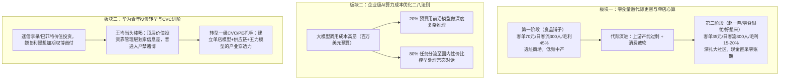
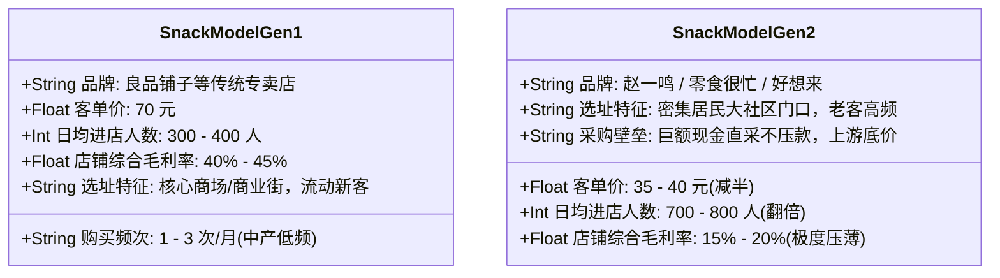
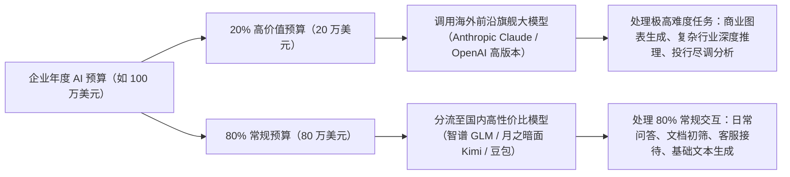

# 2026-07-30 · 王岑：零食量贩代际变迁与单店模型穿透、大模型分层调用心算法、二级价值投资信息差与CVC转型

> **场次说明**：本篇基于 2026-07-30 晚（录制时间：2026-07-30 20:47:07 至 21:25:06，录音时长 38.0 分钟）王岑抖音直播《科技创新 + 消费智慧》完整 180 段 ASR 逐字稿全息蒸馏。作为中国消费零食领域最早的一级市场顶级投资人（曾布局良品铺子、盐津铺子、周黑鸭、绝味、煌上煌等），王岑深度拆解了零食量贩赛道从“良品铺子高毛利中产模式”向“赵一鸣/零食很忙/好想来低毛利规模周转模式”的代际演进与单店财务心算模型；剖析了企业在 2026 年大模型 Token 成本压力下的“20% 前沿高端模型 + 80% 国内平价模型分流”架构；并针对华为员工关于“二级价值投资复利太慢欲加杠杆期权博首付，以及转型应聘一级 CVC/PE 部门”的职业困惑，给出了投行级产业认知建模与信息差壁垒的当头点拨。

---

## 核心商业全景导航

---

## 一、零食赛道三十年代际变迁：良品铺子 vs 赵一鸣/零食很忙投行穿透

### 1. 投资背景与行业演进
王岑作为国内最早重仓消费品及零食连锁的投资机构合伙人，早期投资并陪伴了良品铺子、盐津铺子、劲仔小鱼、周黑鸭、绝味鸭脖等多家上市企业。他在直播中复盘了零食行业三十年经历的两次结构性巨变：

### 2. 单店模型关键指标投行穿透

| 商业维度 | 第一阶段：传统零食专卖店（以良品铺子为代表） | 第二阶段：平价量贩零食店（赵一鸣/零食很忙/好想来） | 投行底层逻辑对比 |
| :--- | :--- | :--- | :--- |
| **客单价** | 约 **70 元** | **35～40 元**（减半） | 量贩店大幅拉低试错门槛，激发家庭大包装冲动消费 |
| **单店日客流** | 300～400 人 | **700～800 人**（翻倍） | 靠超低单价形成强聚客效应，高客流弥补低客单 |
| **单店日营业额** | $350\,\text{人} \times 70\,\text{元} \approx 2.45\,\text{万元}$ | $750\,\text{人} \times 38\,\text{元} \approx 2.85\,\text{万元}$ | 终端单店日流水差距不大，但**坪效与周转率量贩店完胜** |
| **产品毛利率** | **40%～45%** | **15%～20%** | 量贩店主动将毛利压到传统零售的一半，构筑极深价格壁垒 |
| **门店选址** | 商业中心、核心商场、大型中岛 | **大型成熟社区门口、城镇居住区临街** | 商业中心流动客以新客冲动为主；社区店则锁定家庭高频刚需 |
| **采购供应链** | 账期结算，代工贴牌溢价 | **巨量现金采购、零账期压款** | 上游蜜饯、膨化、肉类工厂产能严重过剩，对现金现款采购给出极限底价 |

### 3. 宏观周期的必然选择
王岑指出，赵一鸣与零食很忙的爆发不是营销偶然，而是**宏观周期供需错配的必然结果**：
1. **上游产能严重过剩**：全国食品代工厂面临产线闲置，谁能带来海量稳定走量并用现金结算，谁就能掌握供应链定价权；
2. **中产消费下行与刚需回归**：在消费意愿放缓的周期下，大众对 70 元中高端零食的“品牌溢价与过度包装”敏感度骤增，而 15%-20% 微利但品质不降的量贩模式彻底成为下沉市场的主导形态。

---

## 二、企业级 AI 大模型调用分层架构：Token 成本优化二八法则

在直播开篇，王岑拆解了企业在 2026 年下半年落地 AI 应用时的真实算力开销与分层部署策略：

- **认知纠偏**：普通人或初创公司以为落地 AI 必须全盘使用昂贵的海外顶尖模型，导致 Token 费用飙升；
- **实用法则**：普通人与企业绝大多数日常对话属于“浅层需求”，国内大模型在中文语境和基础任务上性价比极高，通过工程化分流路由，可在保证业务体验的同时将算力采购成本降低 **70% 以上**。

---

## 三、职业与投资迷局点拨：华为青年二级杠杆迷思与一级 CVC 转型

### 1. 连麦画像与焦虑
- **连麦人**：华为广告销售团队年轻员工；
- **投资焦虑**：业余研究二级市场价值投资，长期跟踪李录（喜马拉雅资本）和巴菲特的每季度持仓变动。但感觉价值投资年化 15%～20% 的复利太慢，无法满足未来几年在深圳买房、结婚的数百万资金缺口，计划利用高风险**期权（Option）或激进成长股**加杠杆搏一把；
- **职业诉求**：希望从广告销售转型进入华为旗下一级产业投资部门（如哈勃投资）或外部知名 VC/PE 机构。

### 2. 投资人王岑的当头棒喝：认清信息差壁垒
王岑对该年轻人的激进想法进行了严厉叫停与底层剖析：
1. **价值投资顶层大佬的“不可复制信息差”**：
   - 散户在公开市场看到的持仓往往滞后数月；
   - 像李录、巴菲特这样百亿美元体量的价值投资者，其核心护城河是**能直接与企业一把手、董事会闭门深谈，掌握行业最前沿格局与极强的信息差**；普通散户仅凭几张财务三表做价值投资，缺乏抗风险壁垒；
2. **严禁拿刚性需求资金博期权**：
   - 买房结婚的首付是“绝对输不起的钱”，用期权加杠杆赌方向本质是概率极低的赌博，违背了投资的第一原则“保住本金”。

### 3. 转型一级投资机构（CVC/PE）的实战建言
王岑为其指明了由销售向产业投资人转型的关键能力模型：
- **一级市场不适合个人自掏腰包做**：一级股权投资是极高失败率的概率游戏，普通人切忌用个人积蓄做天使投资；但可以作为职业进入产业 CVC（如华为哈勃、Intel Capital）或大型 PE 机构；
- **建立实战产业建模能力**：一级投资机构不缺只会背财务指标的书呆子，极度稀缺能够**穿透上游供应链、看透终端单店算账、拆解企业五力模型（行业壁垒/定价权/复购率/资本开支/现金流）**的实战复合型人才。

---

## 四、王岑消费投资与商业决策对照表

| 场景 | 典型误区 | 王岑投行避坑铁律 |
| :--- | :--- | :--- |
| **量贩零食创业** | 盲目按传统 40% 高毛利定价，开进租金昂贵的商场 | 适应低毛利（15%-20%）、高周转、下沉社区模式，靠供应链现金规模采购压低成本 |
| **企业 AI 落地** | 盲目全量调用昂贵海外旗舰 API | 实施“二八分层”：20% 预算用前沿模型攻克复杂推理，80% 任务分流至国内性价比模型 |
| **二级市场投资** | 盲信大模型/名家研报，用结婚买房钱加期权杠杆 | 散户不具备顶层管理层信息差，严禁拿刚性生活资金博期权杠杆，回归资产配置 |
| **一级投资转型** | 仅背诵财务三表与理论估值公式 | 必须下沉到产业一线，掌握单店模型心算、供应链成本穿透与产业竞争壁垒分析 |

---

## 五、数据校验与源资产凭证

- **源录音文件**：`抖音录制库/王岑/2026-07-30 20-47-07/2026-07-30 20-47-07.m4a`（时长 38.0 分钟，对应本地 `outputs/latest-2026-07-30-wangcen/`）；
- **ASR 转写段数**：180 segments（覆盖 F01-L001 至 F01-L004 共 4 个完整切片，重叠区按时间中点严格去重）；
- **一致性审计**：Flagged chunks = 0，音频时间截断校验通过，全量还原零食量贩单店心算数据与投资转型对话实录。
