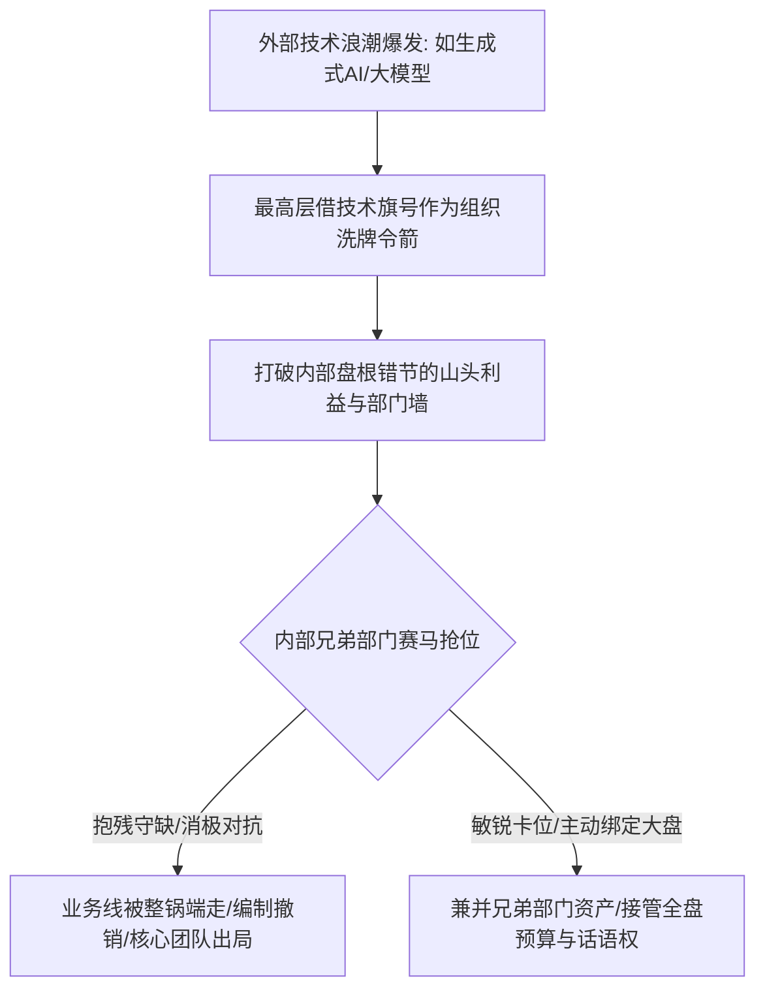
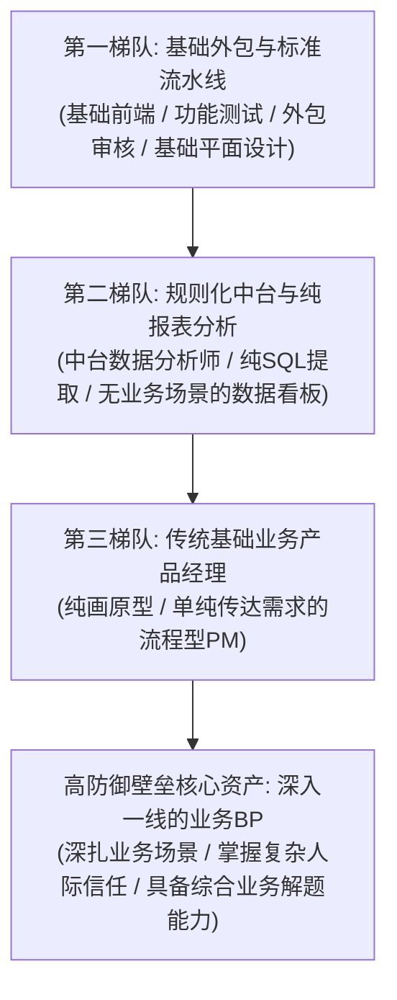
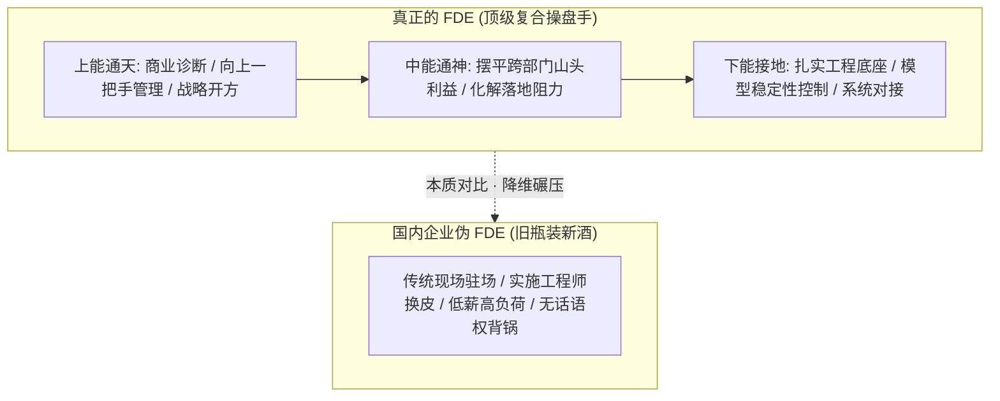
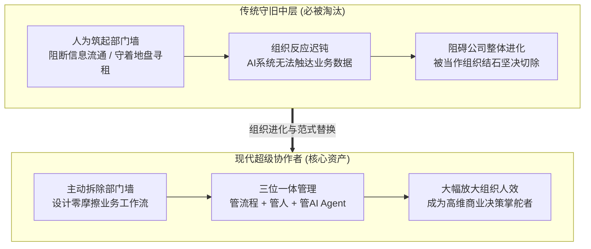

在商业竞争的舆论场中，企业往往将聚光灯打在与外部竞争对手的“市场争夺战”上。然而，对于任何身处中大型组织内部的业务单元、中层管理者和骨干员工而言，一个残酷却普遍存在的隐秘法则是：**在很多时候，蚕食你生存空间、甚至直接终结你职业生涯的，根本不是外部友商，而是坐在你隔壁工位的兄弟部门！**

外部竞争对手最多只是在公开市场上争夺客户份额，大家在商言商、你来我往；而内部兄弟部门一旦发起突袭，往往是连皮带骨地将你的整个业务线、HC 编制与年度预算连根拔起，直接让你和你的团队在公司内部彻底出局。每一次行业技术浪潮（无论是当年的敏捷化、中台化，还是如今席卷一切的 AI 大模型），表面上是高大上的技术跃迁，本质上都是公司最高层借以启动组织重构、重新划定势力地盘与清洗冗余中层的绝佳政治契机。

2026年9月22日晚《产品老曾》职场专题连麦直播中，老曾与原腾讯总监、现企业 AI 转型顾问 Alex（杰哥）展开了一场极具杀伤力的深度对话。两位长期在大厂权力中枢与产业前沿摸爬滚打的老兵，从大厂赛马机制与内部蚕食的血腥博弈切入，手术刀般层层剖解了算力基础设施抽血下的岗位替代路线图、硅谷大火的 FDE（前置部署工程师）在中国企业落地的真相与售前专家天花板，以及传统金字塔部门墙瓦解下中层管理者的生死自救之道。

---

## 一、 兄弟部门蚕食与技术概念大洗牌：技术变革期大厂地盘重构契机

### 1. 现象拆解：内部赛马与“自相残杀”的生存法则
在腾讯、字节、阿里等互联网科技巨头中，“赛马机制”一直被视作激发自下而上创新活力的制度法宝。然而，赛马机制的适用前提是**市场处于爆发性增长的增量空间，公司的预算池与资源池充沛无虞**。
- **存量时期的赛马异化**：一旦市场进入收缩与存量争夺期，多条业务线、多个事业群（BU）抢做同一类业务，赛马便立刻退化为“你死我活”的内部蚕食；
- **兄弟部门的致命杀伤力**：
  > 📌 **兄弟部门蚕食定律**：
  > 友商与你竞争，即便丢了部分客户，业务底座尚在；但兄弟部门一旦在向高管汇报时跑出了更漂亮的 PPT 或稍微领先的数据，高层为了“集中资源办大事”，往往会快刀斩乱麻地下达业务合并令。
  > 胜出方顺理成章兼并败方的全部预算、代码资产与人员编制，败方的业务负责人与骨干则沦为“边缘弃子”或直接遭遇清洗出局。

### 2. 老曾底层诊断：技术新概念本质是组织洗牌的合法令箭
许多一线员工和业务骨干常常抱怨：“公司隔两三年就要折腾一次新概念，前年搞中台化，去年搞降本增效，今年又全民搞 AI，业务根本没法持续深耕！”

老曾一针见血地指出了技术概念洗牌背后的组织权力逻辑：
- **新概念是打破存量利益固化的工具**：大型组织在平稳运行几年后，各部门山头林立、利益盘根错节、部门墙坚不可摧，常规的行政指令根本调不动利益格局；
- **最高层借题发挥重划势力范围**：每一次外部技术浪潮的涌现（如生成式 AI、大模型），恰恰为公司一把手提供了合法、正当且不容抗拒的“改革令箭”。最高层可以理直气壮地要求所有业务重新接受 AI 化审视，借机裁撤那些发展停滞但盘踞大量资源的“老白兔”部门，将核心编制和算力资源倾斜给听话、有战斗力的新锐派系；
- **骨干生存法则**：身处变革期的核心骨干，切忌以“技术保守主义”对抗新概念。你必须第一时间识别出高层借此技术旗号意欲整肃的真实意图，主动将自身业务与新概念进行战略绑定，成为高层推行新秩序的先锋，而非被旧势力捆绑陪葬的守旧派。

---

## 二、 算力抽血与AI岗位替代优先级路线图：从外包客服到中台分析

### 1. 宏观资本逻辑：算力基础设施的“抽血效应”
当前很多大厂员工感到困惑：明明 AI 概念大火、公司天天开大会讲大模型，为什么很多非核心业务和边缘产品线反而被大批裁撤、HC 彻底冻结？

老曾揭示了商业组织内部残酷的财务硬约束：
- **万卡集群机房的吞金黑洞**：企业自建 AI 大模型底座，采购英伟达或国产高端算力芯片、搭建智算中心机房，动辄需要数十亿乃至上百亿的真金白银；
- **预算天花板下的资本抽血**：在公司整体资本开支（CAPEX）受限的背景下，投向底层算力的钱，必然是从各个边缘业务、探索性创新部门强行抽血抽出来的；
- **边缘业务加速断头台**：投入产出比不高、商业化前景不明朗、缺乏集团战略阵眼价值的边缘产品线，会被高层毫不犹豫地集中关停，以此腾挪出宝贵的资金供养核心大模型基础设施。

### 2. 岗位替代顺序表：规则化流水线向非标中台蔓延
在算力基础设施逐步落地的过程中，岗位受冲击与被替代的顺序遵循着严密的“成本-复杂度-标准度”阶梯：

#### ① 第一梯队：基础外包与高度标准化的规则流水线
- **覆盖岗位**：外包内容审核、功能性黑盒测试、基础页面切图前端、纯美工与平面设计师；
- **替代逻辑**：交付物标准清晰、容错边界固定，大模型结合自动化脚本或多模态生图工具能够以百分之一的边际成本实现同等甚至更稳定的产出，企业直接以“取消外包合作、收回内部代码库”的方式成建制削减。

#### ② 第二梯队：规则化中台与缺乏业务独占性的纯数据分析
- **覆盖岗位**：传统中台数据分析师、取数工程师、纯依赖 SQL 跑固定看板报表的分析岗位；
- **替代逻辑**：
  > ⚠️ **中台数据分析师的虚假安全感**：
  > 许多数据分析师误以为自己手握高门槛的数据资产，但在 Code Interpreter 和 Text-to-SQL 工具普及后，业务主管只需输入自然语言即可实时调取清洗好的数据。
  > **脱离一线业务场景、不背负实际业绩指标、单纯作为“数据中继器”的中台分析岗位，替代抗性极差**！

#### ③ 高防御壁垒资产：深扎业务一线的业务合作伙伴（Business Partner）
- **覆盖岗位**：深扎业务一线的运营负责人、掌握非标客情关系的业务 BP、具备跨部门强勾兑能力的核心骨干；
- **免疫逻辑**：商业世界中真正核心的难题，永远不是“写一段 SQL”或“画一张原型图”，而是**非标复杂问题的多方利益协调、高价值客户的人际情感信任、以及黑天鹅突发事件的现场拍板与责任兜底**。AI 能够提供算力方案，但绝不敢替老板背负法律责任与政治代价，这一生态位具有无可替代的强韧生命力。

---

## 三、 硅谷 FDE 神话与售前/行业 PM 的“出道即巅峰”天花板

### 1. 概念剥茧：硅谷 Palantir 炒热的 FDE 到底是什么？
近年来，由硅谷大数据巨头 Palantir 确立的 **FDE（Forward Deployed Engineer，前置部署工程师）** 概念在国内外企、国企和科技圈大受追捧。很多国企员工和科技从业者纷纷跃跃欲试，试图向 FDE 方向转型。

原腾讯总监 Alex 与老曾对 FDE 的商业落地真相进行了毫不留情的祛魅：
- **真正的 FDE 门槛极高**：
  1. **上能通天（商业与战略诊断力）**：能够直接对话企业最高决策层（CEO/一把手），一眼看穿企业的核心病灶与商业痛点，开出让老板信服的数字化/AI 转型药方；
  2. **下能接地（极致工程与模型控制力）**：深入底层工程架构，精通算力芯片选型、私有化部署、老旧 ERP 系统数据打通、大模型幻觉边界控制与人机介入阈值设定；
  3. **中能通神（深谙组织政治与山头利益）**：老板最多给你授权和预算，但落地推行必须触碰各业务部门的核心利益。真正的 FDE 必须具备极高的人际情商，左右逢源、摆平各路山头顾虑，否则项目必死无疑。
- **中国企业落地的“旧瓶装新酒”**：老曾指出，国内绝大多数高喊招募 FDE 的企业，给出的薪资和定位本质上就是十年前的“数字化/信息化实施工程师”。企业借着 AI 的新包装，试图用低成本招揽廉价的现场驻场技术员，盲目跟风转型极易沦为项目现场背锅的“实施苦力”。

### 2. 售前顾问与行业线 PM 的“出道即巅峰”死穴
在 B 端与产业互联网领域，商务售前、技术售前与行业线产品经理（PM）是直接面向客户一线的先锋部队，但这一群体往往在入职三至五年后遭遇窒息般的职业天花板：
- **制度设计缺陷：没有向上的管理通道**：
  - 纯销售岗可以凭借持续成单跃升为大区销售总监乃至 VP；
  - 研发与中台产品可以凭借团队规模和技术职级晋升为技术总监、事业群负责人；
  - 而售前与行业 PM 在岗位设立之初，就是作为“专业支持工具人”存在的。你一入职可能就拿着行业专家的高薪（“出道即巅峰”），但由于不直接背负业绩硬指标、也不掌握研发核心编制，管理职级被彻底锁死；
- **远离总部权力中枢的“失联风险”**：售前与行业 PM 天天在全国各地出差跑客户，物理空间与心理距离彻底脱离总部高管视野。一旦公司启动人事清洗或架构整合，身在异地的售前骨干往往是最后一批知晓政策变动的人，极易遭遇无声裁撤；
- **突围破局路径**：售前专家若想打破天花板，必须在经验成熟期主动寻求横向跨界：
  - **路径 A**：凭借积累的深厚客户信赖，主动转入一线销售序列，扛起大区业务营收指标，从“技术谋士”跃迁为“带兵大将”；
  - **路径 B**：调回总部中台，转型为掌控标准产品线演进规划的产品总监或战投战略专家，将一线碎片化非标需求抽象为标准资产，赢回总部核心话语权。

---

## 四、 金字塔部门墙阻碍与 AI 时代中层清洗真相：进化为超级协作者

### 1. 认知纠偏：中层被裁撤的本质不是“管理消失”
近来媒体热炒“大厂去中层化”、“AI 让中层管理彻底绝种”。许多业务主管整日惶恐不安，以为管理岗位不再被公司需要。

老曾对此给出了极其通透的底层剖析：
- **金字塔组织的信息壁垒罪证**：在过去传统的科层制金字塔组织中，信息自上而下逐级传递、自下而上层层过滤。许多中层管理者为了巩固自己的部门势力与地位，**故意人为设立部门墙，阻碍数据的自由流动，把信息当成自己的私人领地和寻租筹码**；
- **AI 时代的组织新形态：数据必须零摩擦流动**：
  > 🚨 **阻碍信息流动者的淘汰定律**：
  > AI 时代企业竞争的核心是数据在组织内部的零摩擦流通与极速反馈。如果一个中层管理者依然习惯于把持信息、推诿跨部门协作、封锁业务数据以保护部门编制，**他被裁撤的根本原因绝不是因为他顶着“管理者”的名头，而是因为他的行为阻碍了组织的数据流动效率，阻碍了公司的战略进化！**

### 2. 生存进化：转型为“流程 + 人 + AI”的超级协作者（Super Coordinator）
管理工作从来没有消失，反而对所有知识工作者提出了更高的全员管理要求：
- **从单一管人到统筹人机生态**：过去的管理是管考勤、分任务、盯进度；未来的卓越管理者是**工作流架构师**——管复杂业务流程设计，指挥人与 AI Agent 在流水线上高效并行；
- **主动拆除部门墙**：未来的管理赢家不仅不会筑墙，反而会主动充当打通部门墙的“超级破壁人”，通过搭建标准化、自动化的 AI 工作流，让跨部门协同摩擦降到最低；
- **处理高维非标决策**：将大量低阶执行交给 AI 托管，把自身精力极致聚焦于商业战略拍板、组织文化凝练与跨阵营利益勾兑，薪资与组织权重不仅不会下降，反而会在人机协同的大时代迎来指数级飙升。

---

## 五、 职场破局实操落地清单：大厂中层与骨干突围手册

### 1. 十项自检原则（10-Point Checklist）
身处技术浪潮与组织剧烈重构期，每一位职场人均需对照以下十条准则定期审视自我：

| 序号 | 自检原则 | 关键自省问题 | 预警信号与自救动作 |
| :---: | :--- | :--- | :--- |
| **01** | **识别内部兄弟蚕食威胁** | 隔壁兄弟部门近期是否在跨界试探你的核心业务？ | 警惕对方用 AI 升级等新叙事向上汇报，必须先发制人立项占领高地 |
| **02** | **洞察技术概念政治本质** | 高层本轮推行的新概念，真实意图是清洗哪个山头？ | 切勿做技术顽固派，主动将部门工作包装融入大盘新战略叙事 |
| **03** | **评估部门算力抽血风险** | 你所在的部门是否属于消耗资金但无直接产出的非核心边缘？ | 算力机房建设期非核心业务高危，尽快将业务绑定造血主航道 |
| **04** | **警惕规则化工作替代陷阱** | 你的日常产出是否是一段代码、一张原型图或固定 SQL 报表？ | 交付物越标准死得越快，立即向业务前端与复杂非标决策迁移 |
| **05** | **打破纯中台数据分析幻觉** | 你是否脱离具体一线业务场景，只负责被动做看板取数？ | 放弃纯中台思维，主动申请下沉为业务线带枪打仗的数据 BP |
| **06** | **拒绝伪 FDE 换皮画饼陷阱** | 外部所谓高薪 FDE 岗位，是否本质只是驻场实施苦力？ | 审视项目是否有向上一把手诊断权与架构权，谨防沦为低端驻场 |
| **07** | **售前专家主动规划天花板** | 你是否已经连续三年跑在客户一线、远离总部且职级不再晋升？ | “出道即巅峰”已达上限，必须在成熟期主动转销售管理或总部中台 |
| **08** | **全面检视自身信息壁垒行为** | 你是否为了部门私利在日常工作中推诿跨部门数据共享？ | 阻碍信息流动即阻碍公司发展，立刻主动发起数据与流程打通 |
| **09** | **进化为超级工作流架构师** | 你能否用自然语言编排“员工 + AI 智能体”完成端到端任务？ | 停止单纯的手工派单，掌握人机协作 SOP 编排与模型边界控制 |
| **10** | **建立核心高层情感信任链接** | 发生重大业务黑天鹅或组织变动时，高层是否视你为自己人？ | 技能永远可被机器替换，唯有人际信任与政治站位具备长久生命力 |

### 2. 骨干突破三阶段执行清单（3-Stage Implementation Checklist）

#### 阶段一：防御止血期（第 1 - 30 天）—— 摸清大盘底牌与剥离可替代存量
- [ ] **审计自身业务脆弱度**：盘点当前业务中属于标准代码编写、基础测试、规则化审核与纯报表取数的任务占比；
- [ ] **引入 AI 工具全面托管基础低阶事务**：将团队日常 50% 以上的基础文档、原型和报表工作流接入 AI 自动化，释放人力编制；
- [ ] **侦测兄弟部门动向**：摸排集团其他部门是否在用大模型技术抢占你所在业务的话语权，评估防线漏洞。

#### 阶段二：进攻卡位期（第 31 - 90 天）—— 绑定最高层战略与重构人机协作流
- [ ] **向上一把手汇报 AI 赋能新蓝图**：将部门核心业务重新封装为大盘 AI 战略下的先锋阵地，向高层争取编制与预算支持；
- [ ] **构建“人 + 流程 + AI”示范业务流**：在部门内部树立 1-2 个端到端的人机协同样板案例，验证人效提升两倍以上的硬核数据；
- [ ] **拆除部门墙建立横向协同同盟**：主动向业务上下游部门开放数据接口与协作工具，树立跨部门超级协作者的开明专业声誉。

#### 阶段三：组织跃迁期（第 91 - 180 天）—— 破除专家天花板与跨界核心掌权
- [ ] **完成从专业顾问向业务操盘手跨越**：脱离单纯的售前/中台支持身份，争取独立负责大区业务或核心商业化产品大盘；
- [ ] **沉淀不可篡改的组织影响力**：在公司内部建立关键业务节点的人脉信任网，成为复杂非标问题与突发危机唯一的解题人与掌舵者。

---

## 六、 总结：在不确定的浪潮中掌握确定性的生存法则

商业世界的残酷性在于，它从来不按照单向的技术乌托邦剧本演进。大厂内部的技术新概念更迭、资本对算力基础设施的狂热抽血、兄弟部门在暗处的磨刀霍霍、以及对守旧中层部门墙的无情清洗，构成了职场生态中最真实的生态竞争。

真正的职场清醒者，从来不把安全感寄托在过去掌握的熟练技能上，也绝不在技术概念的狂欢中盲目跟风。他们深知：**技能会贬值、概念会退潮、兄弟部门会争抢、资本的流向会转移；唯有对组织权力脉络的深度洞察、拆除部门壁垒的开阔胸怀、以及将人、流程与机器融汇贯通的超级协调能力，才是穿越任何技术周期与政治风浪的最强护城河。**
