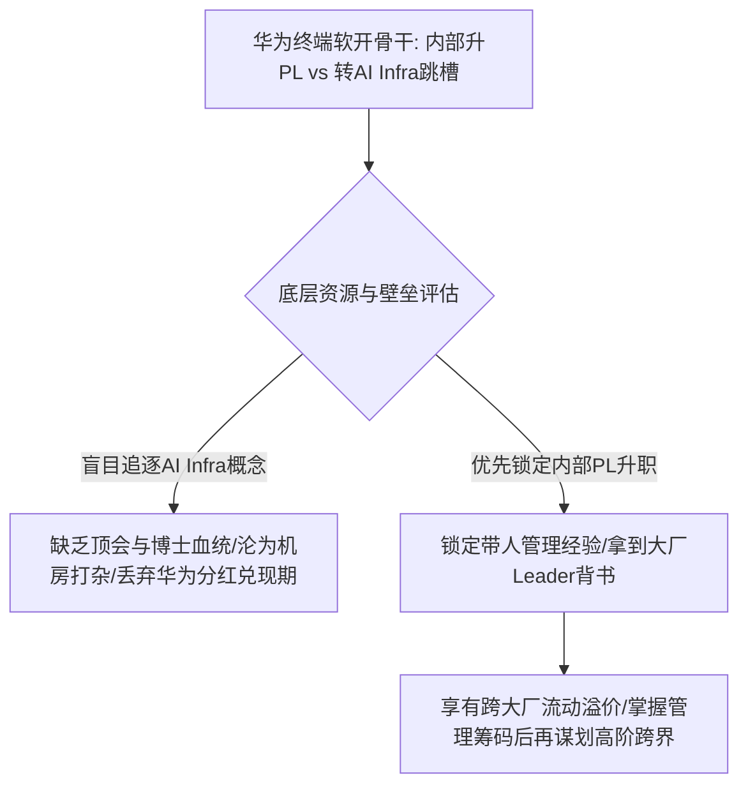
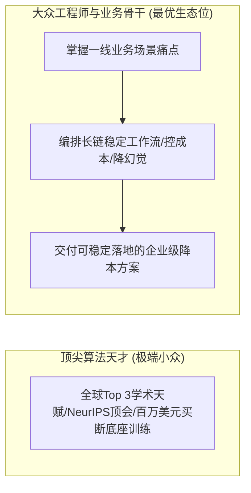
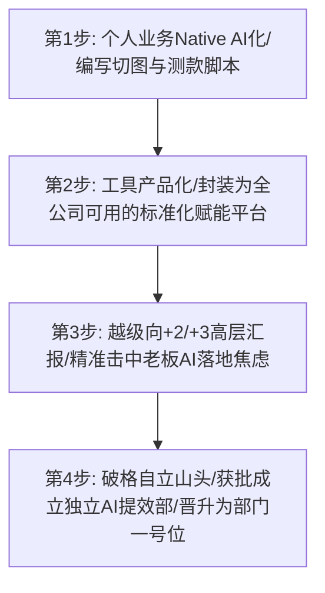
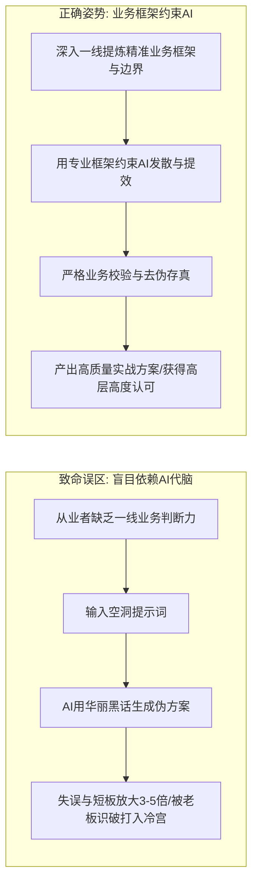

在生成式人工智能席卷全行业的狂潮下，几乎每一位技术研发、中层管理者和普通职场人，都在经历前所未有的“时代眩晕与定位焦虑”：

一边是行业媒体天天渲染万亿级算力投资、硅谷顶尖算法天才拿走千万年薪、新兴技术概念层出不穷；另一边则是普通工程师和业务骨干面对日常繁重琐碎的需求排期、大厂分红股票的漫长锁定期、以及“转还是不转新兴赛道”的两难抉择。

很多人陷入了一种致命的技术投机心态：看到外部某个技术概念大火（如 AI Infra、大模型训练），便急切地想要抛弃手头积累的存量业务，盲目跟风跳槽；或者在日常工作中把大模型当作偷懒的“黑盒生成器”，敷衍应付领导汇报，结果被老板一眼识破并严厉打压。

2026年9月22日深夜《产品老曾》职场专题连麦直播中，老曾针对华为终端资深软开工程师的连麦抉择、硅谷顶级算法天才的买断逻辑、普通打工人借“自动化脚本产品化”越级自立山头的经典突围战役、以及 AI 对个人业务短板的“三到五倍放大效应”，展开了一场极具现实针对性、直击人性和组织本质的深度拆解。

---

## 一、 华为终端软开 PL 升迁与 AI Infra 诱惑：大厂期权兑现、管理溢价与学历壁垒博弈

### 1. 真实连麦案例拆解：985硕软开骨干的十字路口
连麦者是一位入职华为终端两年的 985 计算机硕士：
- **存量基本盘**：在华为终端做手机底层软件开发，绩效优异，直属主管已明确承诺半年后提拔其为 **PL（Project Leader，项目组长）**，独立带 5 人团队；
- **增量外部诱惑**：看到外部 AI Infra（集群通信、算力调度与分布式训练）极其火爆，市场声量极大，自己内心深感终端软开日常工作枯燥繁重，犹豫是否应该放弃即将到手的 PL 管理位，转向 AI Infra 赛道跳槽外部寻求短期爆发。

### 2. 老曾底层诊断：看透大厂资本锁定期与“管理通用流动溢价”
面对打工人的技术浪漫主义，老曾直接用冷峻的算账逻辑撕开了表面浮华：

#### ① 算清大厂利益兑现的生命周期
在大厂混，必须算清自己的时间资本与收益兑现周期：
- **路径 A（短期镀金跳槽）**：在大厂内部迅速换到一个光鲜方向镀金，利用大厂光环在1-2年内快速跳槽外部中小型独角兽谋求高管；
- **路径 B（兑现长期资本红利）**：大厂内部的股票分红、配股和递延奖金，往往需要工作满 3-5 年以上才能迎来指数级兑现爆发期。若为了一个外部炒作的虚火概念在兑现前夜仓促离场，无异于将快要成熟的胜利果实拱手让人；
- **路径 C（干到终老）**：在当今大厂 35 岁优化线与高压考勤下，绝大多数人无法实现。

#### ② “带人管理经验（PL）”的巨大流动性溢价
许多搞技术的工程师往往陷入“唯技术论”的狭隘认知，认为掌握某项新算法比带人更重要。老曾给予了严厉警醒：
> 📌 **带人管理经验的跨组织通用溢价法则**：
> 在大型互联网巨头与科技企业（如阿里、腾讯、字节）的社招定级中，一个纯技术大头兵无论代码写得多好，往往只能被定在对标的资深研发档位，随时面临被应届卷王替代的风险；
> 但如果你在简历上拥有**在大厂核心体系内独立带队（带 5 人以上小团队、背负团队交付与考核指标）的 PL/Leader 实操履历**，你在跨大厂跳槽时就能直接对接 Team Leader、业务线研发主管乃至跨级定级！
> **“确定性的管理实权”永远高于“概念性的技术画饼”**。在明确的升迁窗口期，首要战略任务是先死死咬住 PL 编制与管理头衔，拿到管理身份的终身背书。

#### ③ 警惕技术赛道的隐形学术壁垒
外部热炒的 AI Infra 和核心算法训练赛道，本质上是一场**极其残酷的智商、顶级学术背景与博士血统的内卷游戏**。普通 985 硕士如果缺乏国际顶会（NeurIPS、ICML）论文背书与导师资源，盲目扎入算法深水区，极易沦为给清北、海归博士打杂的“算力机房搬砖工”，在晋升天花板面前撞得头破血流。

---

## 二、 硅谷 700 万年薪天才买断逻辑与大众职场人的错位突围

### 1. 揭秘顶级天才的买断逻辑：非大众职场的线性游戏
在连麦过程中，老曾首次披露了一则他在硅谷接触的真实案例：
- 一位在垂直 AI 算法领域做到全球 Top 3 的青年科学家，毕业仅两三年，便被 Meta 开出 **100 万美元（折合约 700 万人民币）** 的年薪强行买断；
- 该天才对老曾坦言：“在这个细分算法领域，全世界我只输两个人。正因如此，巨头才愿意支付买断溢价。”

老曾强调：**这种依赖极端智商天赋、在世界顶级擂台上杀入前三的天才生态，根本不在大众职场人的晋升演进轨道上！** 普通工程师若盲目将这类天才作为对标对象，只会在高强度的学术内卷中产生严重的自我怀疑与精神内耗。

### 2. 大众打工人的破局路径：从“卷理论”转向“卷业务工程落地”
大众职场人若想在 AI 浪潮中分享红利，核心战略是**彻底放弃与天才拼底层算法创新，全面转入“垂类业务场景的 AI 工作流重构”**：
- **大模型趋同与长链任务困境**：当前各大科技巨头的基础大模型能力日益趋同，企业真正在落地时关心的根本不是哪家模型跑分高了0.5分，而是**哪家大模型调用成本更低、长链路自动化任务是否稳定、输出结果是否具有确定性**；
- **工程化与场景化的巨大生态位**：能够将不稳定的大模型与企业既有的老旧业务系统、ERP、数据库无缝拉通，通过提示词工程、RAG 检索增强和工作流编排将任务成功率提升至工业级可用的人才，才是当下企业最渴求、最愿意给出实权和溢价的核心骨干。

---

## 三、 从切图脚本到自立山头：出海电商大厂骨干越级汇报晋升“AI 提效部负责人”战役复盘

在整场直播中，最具实战穿透力的是老曾复盘的一位出海电商大厂普通女员工的惊天逆袭战役。该案例堪称职场人借势 AI、向上管理与组织夺权的教科书级范本。

### 1. 起点：看似廉价的日常单点脚本
该员工入职一家知名出海电商巨头时，仅仅是一名普通的业务技术人员。出海电商的日常业务中充斥着海量的低阶机械劳动：
- 美工和运营团队每天需要针对不同国家、不同类目手工制作数万张商品宣传图；
- 运营人员需要频繁将图片上传至不同跨境电商平台，手动测算点击率与转化率。

该员工敏锐地利用生成式生图工具结合 Python 脚本，在自己的工作岗位上完成了自动化批量生图与自动推流测款。

### 2. 升维关键步：将“个人工具”升维为“企业赋能平台（产品化）”
绝大多数普通打工人写完脚本后，要么藏着掖着自己摸鱼，要么仅仅在组内做个简单的技术分享。而这位员工做出了一个决定职业命运的惊天举动：
> 📌 **工具产品化与企业级封装**：
> 她没有停留在“自己用脚本提效”，而是将这套工作流**进行标准化、图形化封装，做成了一个全公司其他部门的运营、美工均可一键使用的“AI 赋能平台”**！
> 她把原本只属于自己的一行行代码，升维成了整个事业群可以通用的“业务基础设施”。

### 3. 破局制胜招：越级向 +2 / +3 大老板汇报，精准击中老板焦虑
工具做出来之后，她没有向直接领导（往往会抢功或压制）按部就班汇报，而是抓住一次战略研讨会或述职机会，**直接越级向事业群 VP 乃至集团大老板（+2 / +3）进行战略演示**：
- **切中高管核心焦虑**：当前大厂最高层对“AI 落地”充满极度焦虑，高层整天在行业大会上听大模型概念，但回到公司看到的却是一帮人毫无动静、各项业务成本居高不下；
- **降本增效的量化硬数据**：她向大老板直接展示：“这套 AI 赋能平台已经在某业务线试点，将原本 20 人的美工切图周期从 3 天压缩到 10 分钟，效率提升数倍，并且具备向全集团复制的能力”；
- **战略叙事的降维打击**：她不仅讲了降本，还描绘了基于此平台未来拓展全自动投放与数据闭环的宏伟蓝图。

### 4. 战役结果：自立山头，破格晋升一级部门一号位
大老板听完大为震撼与兴奋，当场拍板做出重大组织调整：
- **从原部门彻底独立**：直接将她从原有的边缘业务组中剥离出来；
- **成立独立“AI 提效部”**：由大老板亲自直接过问，直接任命该员工为新设部门的负责人，直接向大老板汇报；
- **下达全员协同军令**：要求全公司所有业务部门必须全面配合其 AI 提效部的流程改造与工具落地。

一个原本毫无背景的普通技术员工，凭借**“业务工作流重构 $\to$ 工具产品化 $\to$ 越级击中老板焦虑 $\to$ 借力打力自立山头”**的四步法，完成了从底层打工人向核心部门一把手的跨越式升维。

---

## 四、 业务判断力与 AI 缺陷放大定律：为什么盲目用 AI 会使职场失误放大 3-5 倍

### 1. 认知陷阱：以为“用 AI 生成”就是职场捷径
在当前职场中，大量打工人存在一种严重的偷懒投机心理：领导布置一个行业调研、战略方案或汇报 PPT，自己完全不动脑子，直接把题目扔给 ChatGPT 或大模型，然后把模型吐出来的几千字套话原封不动地交上去。

老曾对此发出了极具穿透力的警示：
> ⚠️ **AI 业务缺陷放大定律**：
> AI 大模型本质上是一个“顺从性极强的话语生成机器”。当你自身缺乏扎实的一线业务判断力、缺乏对行业实质规则的洞察时，你给出的提示词必然是空洞且偏颇的；
> 大模型会用极其优美、流畅、看似无懈可击的商业黑话，将你的偏颇和漏洞严丝合缝地包装起来。
> **AI 不会弥补你的业务无知，它只会将你原本只有 20 分的业务短板与逻辑硬伤，放大 3 到 5 倍，变成一份看似洋洋洒洒、实则满纸荒唐的致命毒药！**

### 2. 老板视角的“偷懒死刑判决”
经验丰富的大厂高管与老板，常年在商业风浪中摸爬滚打，一眼就能看穿哪些内容是经过深度思考的实战方案，哪些是用 AI 拼凑的空洞套话：
- **被打上“不上心、不专业”的死标签**：当老板看到一份充斥着“赋能、闭环、抓手、协同”但没有任何具体客户数据、没有任何一线排期落地的 AI 生成报告时，内心做出的判决不仅是对方案的否定，更是对你个人职业操守的彻底拉黑；
- **正确的人机协作心智**：
  - **人负责“业务诊断、战略判断与边界控制”**：你必须深入业务一线，搞清楚真正的痛点是什么、各方利益阻力在哪里、底线成本是多少；
  - **AI 负责“要素填充、方案发散与效率提速”**：用你扎实的业务框架去约束 AI，让 AI 作为你的参谋与秘书，而非让 AI 代替你做商业决断。

---

## 五、 职场实操破局清单：大厂中层与技术骨干突围手册

### 1. 十项自检原则（10-Point Checklist）

| 序号 | 自检原则 | 关键自省问题 | 预警信号与自救对策 |
| :---: | :--- | :--- | :--- |
| **01** | **管理确定性优先于技术概念** | 内部确定性的 PL 晋升机会，是否正被外部虚火概念动摇？ | 坚决咬住带人管理实权，拿到跨大厂通用溢价后再谋划跨界 |
| **02** | **算清长期资本兑现周期** | 你当前在大厂的股票、分红与递延奖金是否处于关键成熟期？ | 严禁在资本兑现前夜盲目离场，算清机会成本与沉没代价 |
| **03** | **认清技术赛道学术内卷壁垒** | 你是否在缺乏顶会和博士背景的情况下硬卷底层算法训练？ | 避开全球天才擂台，转入业务场景的长链工程化与成本优化 |
| **04** | **警惕单点脚本的自我摸鱼** | 你写出的提效自动化脚本，是否仅局限在自己电脑上摸鱼？ | 立即将个人脚本进行图形化、标准化封装，升维为企业级工具 |
| **05** | **主动寻找跨部门赋能杠杆** | 你的提效工具能否帮助兄弟部门的运营和美工大幅提升人效？ | 找到全公司公认的痛点流程，用工具平台建立跨部门协同声誉 |
| **06** | **敏锐捕捉高层的 AI 落地焦虑** | 集团大老板近期是否在战略会议上频繁催促业务 AI 化落地？ | 将团队工作包装为高管焦虑的“解药”，主动准备向上一级汇报 |
| **07** | **掌握越级汇报的战略叙事** | 你的汇报是停留在代码技术细节，还是讲透降本增效大盘数据？ | 用“效率提升数倍 + 节约几十人编制”的量化商业语言打动老板 |
| **08** | **借势自立新部门与争取编制** | 受到高层赏识后，你是否有勇气提出独立成立专门提效部门？ | 借老板的推力彻底脱离原部门边缘生态，确立自身为部门一号位 |
| **09** | **戒除 AI 偷懒的“代脑”恶习** | 你交给领导的方案，是否包含大段未经校验的 AI 空洞套话？ | 严禁直接复制 AI 文本，方案必须附带一线客户访谈与真实数据 |
| **10** | **确立“业务判断力”第一性原理** | 剥离了所有 AI 工具之后，你对所在行业的运转本质是否精通？ | 机器永远替代不了非标商业判断与现场拍板，死磕业务护城河 |

### 2. 技术骨干自立山头三阶段执行清单（3-Stage Implementation Checklist）

#### 阶段一：单点闭环与个人提效（第 1 - 30 天）
- [ ] **梳理本岗位机械流水线环节**：找出占用日常工作 50% 以上时间但附加值极低的切图、审核、取数或排版流程；
- [ ] **完成第一个 Native AI 提效脚本**：结合特定开源模型或商业 API 编写自动化流水线，将个人任务耗时压缩 70% 以上；
- [ ] **沉淀实测数据与投入产出比**：详细记录提效前后的时间开销、成本对比与准确率数据，形成可量化指标底稿。

#### 阶段二：工具产品化与横向渗透（第 31 - 90 天）
- [ ] **开发图形化操作界面（GUI/WebUI）**：将底层脚本封装为零技术门槛的内部网页工具，让非技术业务人员能够一键使用；
- [ ] **拉拢上下游核心业务员进行种子内测**：免费提供给相邻部门的骨干运营使用，收集好评反馈并打磨长链任务稳定性；
- [ ] **编写《企业级 AI 提效白皮书》**：将跨部门试点效果提炼为极具视觉冲击力的商业汇报材料，重点呈现全公司推广价值。

#### 阶段三：战略越级汇报与自立部门（第 91 - 180 天）
- [ ] **锁定关键汇报契机（战略会/全员会/老板述职）**：通过正式或非正式渠道直接向事业群负责人（+2/+3）展示现场演示；
- [ ] **现场直击老板落地痛点并提出组织构想**：主动建议设立“AI 协同/提效办公室”，自告奋勇承担跨部门落地责任；
- [ ] **完成编制划转与权力接管**：在大老板正式下达任命后，迅速接管公司重点流程改造权限，奠定自身在核心权力层的不可替代性。

---

## 六、 总结：从被动的技术追随者，进化为主动的组织操盘手

在技术突飞猛进的今天，许多打工人之所以痛苦和焦虑，是因为他们总是将自己定位为“被动的技术追随者”：行业流行什么就盲目学什么，公司推行什么就机械应付什么，一旦风向转变便陷入无尽的恐慌之中。

然而，那些真正在浪潮中脱颖而出的职场赢家，从来不被表面的技术概念牵着鼻子走。他们深刻明白：**技术的本质是资本的工具，而商业的本质是权力的重组。**

普通打工人最坚不可摧的护城河，永远不是某行时髦的代码或某个短暂的概念，而是将手头的单点工作升维为企业平台的产品化视野、精准洞察高层焦虑并借力打力的政治智慧、以及在任何技术冲击下都能一针见血看穿商业本质的硬核业务判断力。当你能够驾驭技术而非被技术奴役，你才能在风起云涌的时代大潮中，真正立于不败之地。
