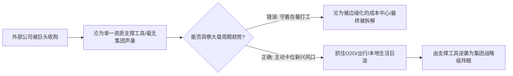
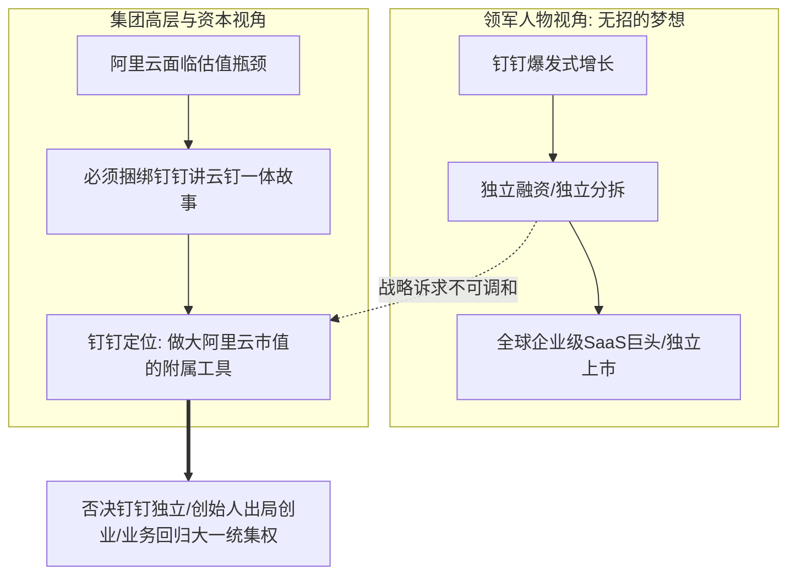

在科技巨头与大型企业集团的高层更迭中，每一次组织架构的“分拆与收拢”、每一场核心高管的“升降沉浮”，表面上往往被包装成冠冕堂皇的“拥抱变化”与“战略升级”，然而在水面之下，却充斥着极其精密、残酷的资本算盘、权力博弈与政治阳谋。

许多身处业务一线或中层管理岗位的骨干，常常看不懂高层看似“前后矛盾”的离奇操作：
为什么集团当年高调宣布要独立拆分上市的业务，会在短短数月后突然被紧急叫停并全面撤回？
为什么曾经不可一世、手握重权的核心领军人物，会在一夜之间被解除实权、黯然离场？
为什么深得最高层器重、名满天下的科学家和顶级学者，被推上商业化大盘的一把手后，反而引发骨干出走与阵脚大乱？

2026年9月23日晚《产品老曾》职场专题大课，老曾以其深谙大厂高层权力运作的内部亲历者视角，对近年来中国商业科技史上最具标杆意义的经典战役——阿里巴巴集团分拆与集权收拢、阿里云分拆撤回、钉钉独立上市被否、达摩院科研商业化错位、通义千问（Qwen）核心功臣出走、以及大厂高管“明升暗降”标准操作法，展开了一场手术刀般冷峻深邃的复盘与拆解。

---

## 一、 外部收购业务的周期卡位与边缘逆袭

### 1. 现象拆解：边缘资质工具的翻盘奇迹
当一家大厂斥巨资收购一家外部公司时，被收购的业务往往在集团内部面临极度尴尬的生态位：
- **无声量与边缘化**：作为“养子”，在集团各路根正苗红的核心嫡系事业群面前毫无政治话语权；
- **最初的工具人定位**：以阿里当年收购高德地图为例，集团最初的核心诉求仅仅是为了获取极其稀缺的地图测绘合规资质，高德在相当长一段时间内被视作电商物流与集团底座的支撑工具，属于绝对的边缘部门。

### 2. 老曾底层诊断：部门权重从来不是恒定的，全在周期卡位
老曾一针见血地指出：**在大型商业集团中，从来没有哪个业务单元（BU）是一成不变、永远最重要的，也绝没有哪个部门注定是永远边缘的！**
- **踩中周期风口实现权力反噬**：高德之所以能够从边缘支撑工具逆袭为集团核心阵眼，根本原因在于其领军团队极其敏锐地抓住了移动互联网由单纯“线上电商”向“本地生活、O2O、网约车聚合”全面演进的历史大周期；
- **从成本中心跃迁为战略阵眼**：高德不再仅仅提供地图底层数据，而是主动进攻切入打车、酒旅与本地生活，将自身打造为大盘直面美团围剿的关键重盾与利刃，最终在集团内部赢得了超然的独立战功与话语权；
- **启示**：中层管理者若身处边缘部门，切忌自暴自弃或怨天尤人。商业组织的排兵布阵永远随着战略大盘的周期而剧烈摆动，谁能预判未来的趋势浪潮并提前卡位，谁就能完成由边缘向中枢的惊天逆袭。

---

## 二、 达摩院与阿里云：科研学者挂帅商业操盘手的战略错位

### 1. 达摩院的诞生与理想主义上行期
在资本狂热与互联网黄金增长周期中，阿里成立了举世瞩目的“达摩院”（汇聚了周靖人等13位国际顶级科学家与学者）。
马云当时给予达摩院极其优渥的战略定位：“集团每年无底线砸钱，让科学家们去搞纯粹的前沿技术探索，活得比阿里巴巴长”。在充沛的现金流支撑下，大厂愿意用巨额预算供养纯粹的技术学者，以此换取全球顶尖的学术声望与技术光环。

### 2. 下行周期来临与“科学家治商”的残酷错位
然而，随着宏观下行周期与全球 AI 爆发式竞争到来，商业巨头的生存逻辑发生了根本性逆转：
- **从“不考核商业化”到“死磕造血盈利”**：集团再也无力供养不计成本的基础科研，达摩院必须强行与阿里云等商业化业务全面合并、背负沉重的营收与利润 KPI；
- **能力错位的致命伤**：
  > [!CAUTION]
  > **科学家挂帅商业操盘手的宿命错位**：
  > 顶尖科学家（如周靖人）在学术界与科研前沿拥有极高的技术名望，他们擅长的是论文突破、算法预研与技术信仰；
  > 但**大型商业云平台的一把手，本质上是极致复杂的商业操盘手、财务精算师与铁腕政治家**！它需要算清每一笔算力投入产出比、处理极其复杂的跨部门利益博弈、向投资人交出漂亮的财报，并且要统领数万名性格各异的狼性工程师与销售团队。强推纯学术派学者去掌管数千亿规模的商业大盘，无异于让秀才去当陷阵厮杀的兵团司令，阵脚大乱是必然的结局。

---

## 三、 个人野心与集团资本战略的背离冲突：钉钉分拆被否绝密复盘

### 1. 领军人物的宏大梦想：独立上市打全球
老曾首度深度复盘了钉钉当年在分拆浪潮中的生死博弈：
- **钉钉创始人（无招）的雄心壮志**：将钉钉像当年的支付宝一样从集团体系中彻底独立出来，引入外部独立风险投资，独立走向全球资本市场 IPO，其终极愿景是“让全世界所有的企业都运行在钉钉之上”；
- 这是一个极具企业家企业家精神与个人英雄主义的宏伟蓝图。

### 2. 集团资本大盘的冷酷算盘：死保主力资产
然而，在最高决策层与资本战略委员会眼中，算账逻辑完全相反：
- **阿里云分拆上市的估值压力**：当时集团的核心战略是推动“阿里云”作为头号旗舰资产分拆独立上市，以此提振整个阿里的资本市场估值；
- **钉钉的附属工具属性**：在投资人眼里，如果阿里云仅仅是一个卖算力和存储的“IDC包工头”，其估值倍数极低；只有把钉钉作为企业级 PaaS/SaaS 的超级入口牢牢捆绑在阿里云身上，讲出“云钉一体”的宏大协同故事，阿里云的估值才能翻倍！
- **不可调和的背离**：集团对钉钉的核心考核，从来不是让你独立做大做强去上市，而是**“牺牲你的独立性，充当做大阿里云市值的附属垫脚石”**！

### 3. 终局博弈：个人愿景在集团大局面前的必然出局
当领军人物的个人宏愿与最高决策层的资本算盘发生正面碰撞时，集团绝不可能妥协：
- 集团果断否决了钉钉的独立分拆与融资诉求；
- 理念破裂之下，创始人团队最终只能黯然离开阿里体系，走向外部另行创业。
- **职场启示**：中高层管理者必须时刻清醒意识到自身业务在集团大盘棋局中的“真实资本定位”。切勿将个人虚幻的扩张野心，凌驾于最高统治阶层的核心利益之上。

---

## 四、 技术天才出走与大厂高管“明升暗降”操作手册

### 1. 通义千问（Qwen）核心功臣离职的背后推手
开源大模型 Qwen 在全球开源社区斩获奇功，被誉为国内唯一能与 Meta Llama 正面硬抗的顶级技术资产。然而，其核心灵魂人物林俊旸却在巅峰时期突然离职创业，引发全行业剧烈震动。
老曾揭示了背后的深层管理逻辑：
- 真正的技术天才往往具有极强的技术偏执与独立思考；
- 当上层由缺乏实战商业理解与同理心的科研派高管把持、管理手段粗暴、部门内部协同摩擦不断时，技术天才的施展空间被严重挤压；
- 最终，核心技术栋梁被迫出走，甚至高层内部员工都茫然不知就里，逼得集团最高掌舵者（吴泳铭）不得不亲自下场兼任业务一把手来收拾烂摊子。

### 2. 大厂高管“明升暗降”请神出庙标准操作法
面对周靖人这类有重大功勋、行业名望极高、但在关键岗位上暴露出严重管理短板的元老高管，大厂最高层是如何体面操作的？老曾详细拆解了这一套登峰造极的大厂政治话术与手段：

> [!IMPORTANT]
> **体面请神出庙模型（Demotion via Honorary Promotion）**：
> 1. **严禁直接免职与公关羞辱**：核心高管在行业内具有巨大影响力，若直接降职或撤销岗位，无异于公开羞辱，必然引发资本市场剧烈抛售、竞对疯狂挖角与舆论海啸；
> 2. **面子给满，虚职奉上**：名义上给予其更加光鲜亮丽的称号（如集团首席科学家、终身技术顾问、名誉研究院长），公开通报感谢其卓越历史贡献，在所有通稿中给足尊严；
> 3. **权力彻底剥离，一刀切除**：在暗中，**彻底剥离其实际的团队管理权、考核权、预算审批权、业务指挥权与招聘权**，将其办公室安排至核心决策圈之外，让其“安心回归纯粹学术探索”；
> 4. **完成零震荡权力交接**：高层由真正的亲信操盘手接管实权，被架空者在数月或一年后，往往因无所事事而体面选择“自主退休或离职”，整个过程平滑如水、零公关风险。

---

## 五、 认知升维：老曾职场博弈四大核心模型

### 1. 模型一：外部收购业务的周期卡位与逆风翻盘定律 (`model_acquired_bu_cyclical_turnaround`)
- **核心逻辑**：收购业务起初多被边缘化为单一资质工具。但部门权重并非恒定，关键看领军者能否在科技与消费周期演进中主动捕捉风口，实现由边缘支撑向集团核心业务的权力反噬与重塑。

### 2. 模型二：科研派学者挂帅商业操盘手的战略错位 (`model_scientist_to_commercial_manager_mismatch`)
- **核心逻辑**：学术探索重在单点技术突破与论文声誉，商业操盘重在算账盈利、跨部门博弈与团队铁腕管理。在下行周期强推学者挂帅核心业务线一把手，必然产生能力与维度的结构性错位，诱发骨干流失与管理失焦。

### 3. 模型三：领军人物个人野心与集团资本战略的背离牺牲 (`model_founder_ambition_vs_group_strategy_clash`)
- **核心逻辑**：子业务负责人的独立上市愿景，往往与集团死保主力资产估值的资本算盘冲突。在不可调和的矛盾面前，集团绝不可能妥协，领军者要么放弃野心当附庸，要么被剥离出局。

### 4. 模型四：大厂高管“明升暗降”操作手册与体面请神出庙模型 (`model_executive_demotion_via_honorary_promotion`)
- **核心逻辑**：面对行业名望极大但管理不善的核心高管，直接撤职代价极高。大厂成熟解法是名义上给予极高荣誉（首席科学家/名誉顾问），保留虚职与尊严，实质上彻底剥离实际人事权、考核权、预算权与业务指挥权，以零震荡完成权力更迭。

---

## 六、 实战行动工具包（Actionable Checklists）

### 1. 边缘业务与技术专家转型自查清单（Specialist to Operator Checklist）

| 序号 | 自查维度 | 核心评估要点 | 达标打勾 |
| :---: | :--- | :--- | :---: |
| 1 | **打破工具人定位** | 自身所负责的边缘或支撑模块，是否已开始主动链接集团大盘的未来战略主战场？ | [ ] |
| 2 | **周期敏感度** | 是否能准确识别当前行业所处的技术与消费大周期，顺应趋势向高价值业务延伸？ | [ ] |
| 3 | **商业算账能力** | 自身是否已从单纯追求“技术先进性”，转变为能清晰算清投入产出比（ROI）与毛利贡献？ | [ ] |
| 4 | **管理情商修炼** | 面向团队骨干尤其是技术天才，是否具备倾听与包容度，避免以粗暴行政命令逼走核心战将？ | [ ] |
| 5 | **看清资本定位** | 是否清楚自身业务在集团高层眼中的真实定位是“利润中心”、“增长引擎”还是“估值垫脚石”？ | [ ] |

### 2. 高管权力变动与明升暗降预警自查清单（Executive Transition & Demotion Checklist）

| 序号 | 危险预警信号 | 发生概率 | 背后政治真相 | 避坑应对法则 |
| :---: | :--- | :---: | :--- | :--- |
| 1 | **被授予光鲜虚荣头衔** | 极高 | 组织启动“明升暗降”，用面子换取你交出实权 | 敏锐关注下属汇报线与考核权是否被悄悄切除 |
| 2 | **业务汇报线被大一统收紧** | 高 | 集团进入集权收拢周期，独立山头即将被清洗拆分 | 放弃独立融资或山头野心，主动协同融入集权体系 |
| 3 | **核心人事审批权被移交** | 极高 | 权力已被彻底架空，沦为傀儡听差 | 不再留恋虚职，体面利用现有光环寻找外部新战局 |
| 4 | **个人宏愿凌驾集团算盘** | 中 | 触发最高层警惕与打压，面临被换血风险 | 深刻领会集团大盘的财务诉求，确保战略步调一致 |
| 5 | **被要求“潜心学术与前沿探索”** | 极高 | 已被彻底踢出商业与人事核心决策圈 | 接受权力剥离现实，借名誉头衔完成体面退出准备 |
