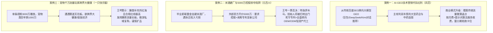
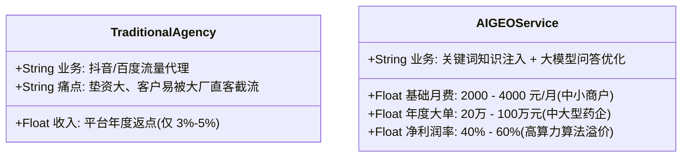
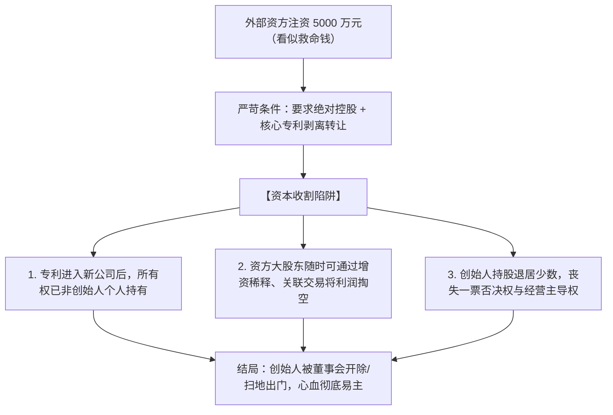

# 2026-09-25 · 王岑：AI-GEO营销代际红利、米酒建厂重资产陷阱与5000万控股掠夺、宠物千万流量扩展大健康

> **场次说明**：本篇基于 2026-09-24 晚至 09-25 凌晨（录制时间：2026-09-24 23:41:28 至 2026-09-25 01:57:38，录音时长 136.2 分钟）王岑抖音直播《科技创新 + 消费智慧》完整 894 段 ASR 逐字稿全息蒸馏。涵盖从传统百度 SEO 到 AI-GEO（生成式引擎推荐优化）在东北药企落地的代际红利与商业模式、大学毕业自建米酒工厂陷入亏损被拆迁的教训、外部资本 5000 万投资索要控股权与剥离核心专利的掠夺陷阱拆解与 OEM 轻资产破局、以及宠物赛道头部爆款玩家（年销 1000 万、单条视频 3000 万播放）跨界大健康与银发经济的战略抉择。

---

## 核心商业全景导航

---

## 一、AI 时代技术营销红利：从传统百度 SEO 到大模型 GEO 落地

### 1. 行业代际跨越：GEO（生成式引擎推荐优化）
- **连麦人**：风范（一诺，深耕企业营销服务，从北京成熟团队学成回东北开拓市场）；
- **业务本质定位**：
  - **传统 SEO/SEM 时代**：针对百度等搜索引擎抓取网页关键词，购买竞价排名或做外链软文；
  - **AI 时代的 GEO 时代**：当消费者向豆包、DeepSeek、ChatGPT、Kimi 等主流大模型提问“2026年东北心血管中药哪个好”或“户外男鞋前五名推荐”时，通过提示词算法、行业语料注入和权威内容沉淀，使大模型在生成答案时**优先推荐并正面引用客户的品牌与产品**。

### 2. 药企大客户画像与付费逻辑
风范团队在北京和东北重点主攻中大型**医药企业**，王岑对其行业选择给予高度肯定并补充深度投行洞察：
1. **集采医改下的存量挤出效应**：
   - 过去几年国家医保集中采购与医药反腐，将大批靠带金销售的中小药企淘汰；
   - 存活下来的中大型药企（如同仁堂、亚太药业等头部连锁）具备充沛现金储备，单家药企每年的全国品牌宣传与市场推广预算普遍在 **1,000 万至数千万元** 以上；
2. **强功能性与高解释成本**：
   - 药品与大健康产品具有严格的功能性与信任门槛，消费者在大模型问答中极度依赖专业背书，药企对“功能性关键词权威卡位”具有强烈的付费意愿。

### 3. 商业模式与利润结构对比

- **规避大厂挤压的窗口期法则**：王岑提醒，2026 年随着 315 对 AI 虚假营销的监管介入，主流大模型厂商也将逐步下场自建官方商用推荐规则。目前正处于规则固化前的 **1～2 年黄金红利期**，服务商必须用结果交付迅速抢占行业标杆大客户。

---

## 二、重资产建厂死穴与 5000 万控股掠夺陷阱：元百川米酒的血泪救赎

### 1. 创业痛点还原：毕业建厂与拆迁沉重打击
- **连麦人**：年轻创业者，2019 年大学毕业创立“元百川米酒”品牌；
- **重大战略失误**：缺乏商业周期认知，初创期直接投资重金自己购置发酵罐、流水线自建米酒工厂；
- **后续连锁崩塌**：产品动销不及预期，厂房折旧与日常运维固定开支巨大；后遇北京工厂拆迁整改，资产受损，其父心态遭受沉重打击，企业陷入流动性枯竭与迷茫。

### 2. 5000 万投资的“特洛伊木马”深度拆解
连麦者透露，数月前有一位福建做智能家居的老板表示愿意出资 **5,000 万元** 注资拯救米酒项目，但提出了两个极其严苛的前提条件：
1. **投资方必须在新公司中实现“绝对控股”**；
2. **要求创始人将米酒所有的核心专利与知识产权无偿转移割让至新公司**。

王岑听闻当场拍案痛批，严厉警告连麦者一票否决：

> **王岑投行诫勉**：“在资本圈，打着投 5000 万甚至几个亿的旗号，要求控股并抽走底层核心专利的，十有八九是特洛伊木马！钱可以慢慢投、分期投，甚至只投几百万，但你的核心知识产权一旦脱离家族老公司，你就彻底沦为给别人做嫁衣的马仔！”

### 3. 王岑救命三策：轻资产代工与动销突围
1. **股权与专利死守底线**：专利必须永久留在创始人及父亲完全控股的母体公司中，绝不对外转移；
2. **唤醒父辈人脉与产业资源**：其父亲在北京酿造行业深耕多年，应迅速调整心态，依托老关系在山东、河北等地寻找具备富余产能的正规酒厂进行 **OEM/ODM 代工合作**；
3. **彻底卸下重资产包袱**：不再投一分钱自建工厂，将有限资金全部聚焦于米酒低度潮饮的包装设计、餐饮渠道铺货和短视频动销测试。

---

## 三、宠物赛道千万玩家跨界大健康：一只快乐猫的流量变现抉择

### 1. 经营现状与核心壁垒
- **连麦人**：“一只快乐猫”，数年前曾连麦听从王岑指点切入宠物消费赛道；
- **骄人成绩**：
  - 具备极强的内容原创能力与算法网感，单条短视频实现 **3,000 万免费播放量**；
  - 宠物品牌年销售额突破 **1,000 万元**；
- **瓶颈诉求**：感觉宠物赛道增长放缓，欲跨界切入当前热门的“大健康与银发经济”。

### 2. 王岑对赛道周期的冷峻研判
1. **宏观行业分化现实**：在当前宏观环境下，绝大多数传统吃喝玩乐类目处于不增长甚至整体下滑状态；
2. **大健康赛道的长坡厚雪与暗礁**：
   - 银发经济（老年人健康、防衰、膳食补充剂）长期需求庞大且刚性；
   - 但**准入门槛与竞争烈度极高**：海外跨境保健品（如 Swisse、GNC）巨头盘踞，国内老牌药企全线入场；
   - 虚假宣传红线严厉：老年人健康产品极易被监管部门认定为夸大疗效或欺诈销售，内容创作者若缺乏专业医学背景，极易触发法律与封号风险。

### 3. 破局打法：守正出奇
王岑建议该团队千万不要盲目丢弃已建立的宠物心智长板去硬碰硬做白牌保健品：
- **做深宠物私域高客单**：宠物主具备极高黏性与情感溢价，通过私域运营开发宠物高毛利保健品、定制化处方粮；
- **内容为刃，合作切入**：若要试水人类大健康，严禁自研建产线，必须选择具备国药准字或正规蓝帽子资质的成熟品牌进行联名带货，发挥自身 3000 万爆款内容的杠杆价值。

---

## 四、王岑消费投资与商业决策清单

### 1. 早期股权合作与融资审查铁律

| 风险维度 | 危险信号（资方诉求） | 王岑投行避坑铁律 |
| :--- | :--- | :--- |
| **控制权** | 要求在初创/早期阶段取得 51% 以上绝对控股 | 早期项目创始人必须保持绝对控股（$\ge 67\%$ 拥有一票否决权，最底线 $\ge 51\%$） |
| **核心资产** | 要求将核心发明专利、商标过户给新合资公司 | 核心专利与知识产权必须锁定在创始人独资公司，仅授权新公司使用 |
| **资金到位** | 口头承诺几千万，但合同绑定分期苛刻考核条件 | 严防“对赌协议陷阱”，不以失去公司控制权为代价换取非确定性资金 |

### 2. 消费创业重资产红线速查

$$\text{初创消费品牌固定资产投入}(\text{厂房/设备}) \le 10\% \times \text{总可用自有资金}$$

- **代工第一原则**：中国制造业产能严重过剩，任何消费品（酒水、饮料、食品、个护）均能找到顶级代工厂。自建工厂是规模达到数亿之后的供应链整合动作，绝非初创企业的生存武器。

---

## 五、数据校验与源资产凭证

- **源录音文件**：`抖音录制库/王岑/2026-09-24 23-41-28/2026-09-24 23-41-28.m4a`（时长 136.2 分钟，对应本地 `outputs/latest-2026-09-25-wangcen/`）；
- **ASR 转写段数**：894 segments（覆盖 F01-L001 至 F01-L014 共 14 个完整切片，重叠区按时间中点严格去重）；
- **一致性审计**：Flagged chunks = 0，音频时间截断校验通过，完整保留 AI-GEO、米酒建厂股权陷阱与千万级宠物内容打法等实战记录。
