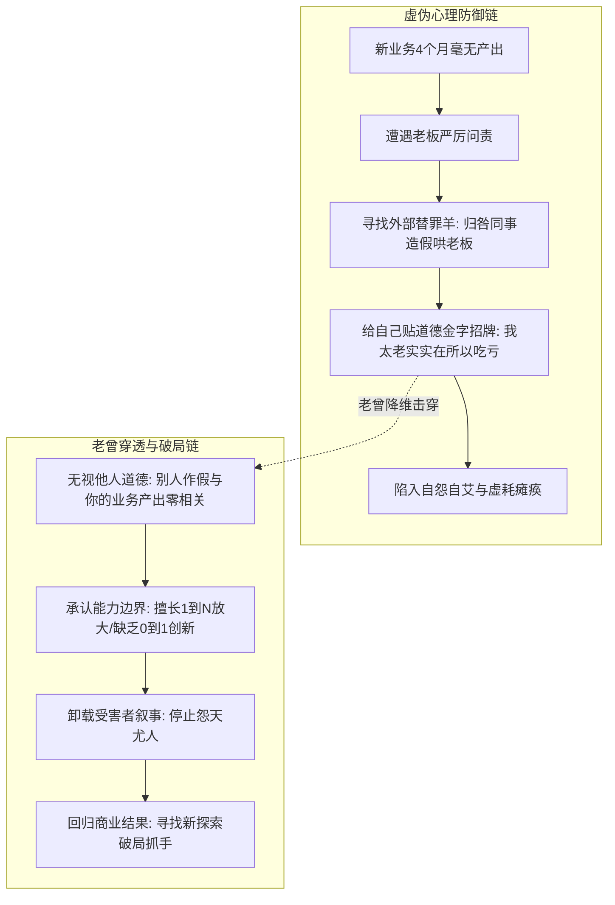
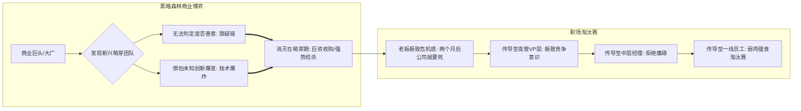

在职场的丛林与权力更迭中，弥漫着大量温情脉脉却极具毁灭性的“道德幻觉”：
很多骨干常常向外界哀叹：“我这个人就是太实在、太正直，开会一五一十说实话，而别人编造假数据哄老板却受重用，老实人在职场总是被逆淘汰”；
有些中高层管理者甚至发下宏愿：“我对下属特别好，不抢功、不争名夺利，希望大家都能舒服体面地工作”；
而在晋升掌权的临门一脚前，许多与老板私交甚笃的老臣却原地卡壳数年，借口是“我不知道怎么说，我希望能找到一个既能让我升上去、又不得罪原直属领导、毫无摩擦的完美方案”。

2026年9月29日晚《产品老曾》职场连线，以极其锋利、冷彻入骨的视角，层层剥离了打工人的道德防御机制，全面揭开了商业竞争的黑暗森林法则与高管夺权的残酷底层逻辑。

---

## 一、 “实在人”道德标榜与心理投射陷阱

### 1. 现象复盘：老实人被逆淘汰的委屈迷局
连麦学员负责公司某城市的新业务开拓，向老曾大吐苦水：
“曾哥，我觉得我太实在了。每天开会，老板问数据，我都一五一十照实汇报；而同团队的其他人明明做不到，却拍脑袋编造漂亮假数据哄老板开心，老板不仅信了还夸他们。而我因为新业务没结果，天天被老板痛骂，我内耗得快崩溃了，难道在职场做实在人注定要被淘汰吗？”

### 2. 老曾层层穿透：撕开道德防御的三大假象
老曾连发数问，直击学员心理防线的本质破绽：

#### （1）事实归因剥离：无交集的业务何来因果？
老曾首先核实事实：“别人汇报的业务，跟你的新项目有任何流程交集或利益冲突吗？”
学员承认：“完全没有，各自独立。”
老曾一针见血：“既然没有交集，**别人做不做假、老板信不信，跟你被老板骂毫无因果关系！** 老板骂你，纯粹是因为你的新项目干了4个月毫无结果。你把自己的业务败局强行归咎于‘别人作假受宠’，本质上是在为自己的无能寻找道德替罪羊！”

#### （2）心理投射剥离：顺境时的目中无人 vs 逆境时的怨天尤人
“四五个月前，你在城市里负责存量业务做全城第一名、当业务扛把子时，那些同事也在编造数据，你当时在乎吗？你当时怎么不内耗？你怎么不向老板举报他们？”
学员坦承：“当时不在乎，因为当时不影响我的心情。”
老曾厉声指出：“**你在成功顺境时，眼睛里根本没有这些被你视为‘loser’的平庸同事；而一旦你自己‘虎落平阳’受挫，你就立刻把他们翻出来，把自己的困境包装成‘奸臣当道、老实人受害’！这就是典型的人性虚伪！**”

#### （3）底层能力缺陷：缺乏“0到1创新探索力”
为什么当事人从昔日的业务骨干沦为今日的被骂对象？
- **擅长存量放大（1到10、10到100）**：过去之所以做得好，是因为商业模式和打法已经成熟，当事人靠勤奋、拼命推进、人际关系将盘子做大；
- **缺乏从零探索（0到1）**：老板误以为当事人是全城第一就“全知全能”，把未知的新业务交给他；当事人也信心爆棚接下，但实际上完全不具备在迷雾中找方向、做创新的底层认知；
- **破局准则**：**立刻停止用“我是实在人”的道德标榜来掩盖“我业务无能”的真相！** 坦然直面0到1创新能力的缺陷，从单点突破寻找破局抓手。

---

## 二、 受害者叙事的“负向召唤”与本能踩踏定律

### 1. 负向召唤法则：你越示弱，外界越踩踏
老曾指出，打工人在职场中最忌讳沉溺于“受害者叙事”：
- **正向召唤需要付出高昂代价**：天天喊成功学口号（“我要发财、我要当高管”）根本无法自动兑现，因为正向结果必须付出极大的认知跃迁与浴血代价；
- **负向召唤却毫无阻力、必定实现**：
  当你整天在团队中向外散发“我是弱者、我是老实人、我不懂防备、我总被欺负”的信号时，**你是在向整个组织发布‘掠夺我无需付出代价’的公开邀请！**
  同事会下意识判定：“既然你标榜自己是实在的老实人，那我抢你功劳、甩锅给你、在老板面前贬低你，你也不会暴力反击！”——于是负向恶性踩踏必定接踵而至！

### 2. 生态位空缺与本能踩踏
在任何集体组织中，人性的本能都是向上争夺生存空间与话语权：
> [!IMPORTANT]
> **自愿下位定律**：
> 当你决定在团队里退缩、展现出甘居下位的弱者姿态时，身边的其他人绝不会因为“同情和良善”拉你一把；相反，**他们会本能地跨上你的头顶，把你当作垫脚石来巩固自己的生态位！** 这甚至不是出于处心积虑的道德恶意，而是组织重力法则下的必然物理反应。

### 3. 大厂 AI 团队的“光芒压制幻觉”
- **个案**：某大厂核心 AI 算法团队，一个中厂跳槽过来的骨干硕士，身边全是清华、中科院的算法博士。当事人开会时感到极度压抑，觉得博士同事们每一次发言都是在针对他、挤压他、贬低他的价值，陷入严重内耗；
- **老曾穿透**：清华中科院的博士们开会各显身手，眼睛里只有彼此竞争的高维战局，**他们根本不在乎、也不屑于针对一个新来的硕士！**
  当事人的痛苦，完全源于自身能力脆弱与自卑诱发的**“受害者幻觉”**；把别人的正常竞争与卓越表现，主观投射为对自己的刻意打压，最终作茧自缚。

---

## 三、 商业黑暗森林法则与赢家垄断叙事权

### 1. 商业巨头为何把《三体》奉为圣经？
刘慈欣《三体》中的“黑暗森林法则”（猜疑链 + 技术爆炸），为何受到几乎所有企业家、投资人乃至大国首脑的狂热推崇？
老曾指出，这是因为该理论给大公司的残酷垄断提供了底层商业逻辑支撑：
- **猜疑链与潜在颠覆**：小公司或创新团队在萌芽期看起来人畜无害，但大公司无法预判其何时会发生“技术爆炸”；
- **大厂百草枯生存公理**：等到对手长成参天大树，它眼中的大厂不过是可以被随时踩死的虫子。因此，巨头（如早期腾讯、阿里、字节）的生存本能就是**把危险消灭在萌芽无形中**！
  走你的路让你无路可走，要么迅速像素级仿制以规模优势绞杀，要么巨资收购控股变为附庸，绝不给潜在技术爆炸任何反噬大厂的机会！

### 2. 职场淘汰赛真相：赢家垄断叙事权
- **危机逐级下压**：商业公司的老板每天活在“公司再过两个月就要死”的极端危机感中（任正非、雷军的生存警报），这种危机感从 CEO 逐级残酷下压至一线；
- **赢家叙事特权**：商业竞争从来不关心赢家的来时路。只要赢了，你就可以按照你的逻辑定义一切规则，成为万人敬仰的导师；而失败者无论多么实在、多么道德，连进入历史叙事的资格都被彻底剥夺；
- **身位优先律**：不要在道德犹豫中内耗。只要敢于跳出思想枷锁，抢先一步采取行动卡占身位，你就已经甩开了 80% 还在沉睡的平庸同僚！

---

## 四、 “好人高管”的悲剧与零摩擦夺权幻觉

### 1. “好人高管”的下属遗忘定律
老曾痛批了职场中自诩“好人”的管理者：
- **个案**：某副总裁成天发宏愿，自称“我对下属特别好，我从不逼他们，希望大家都舒服”，从不参与高层权力争夺；
- **结局**：因缺乏核心业务战功和政治话语权，该 VP 被大老板直接免职，部门被彻底拆散瓜分；
- **残酷真相**：老曾事后询问其昔日下属，下属无一怀念其“温情”，甚至冷淡回复：“前领导是谁我们都不太记得了，我现在只想保住自己的饭碗”；
- **老曾痛斥**：
  > “你连自己的权力和位置都保不住，让团队颠沛流离、前途尽失，你那种不痛不痒的好人态度有什么用？**在职场中，无权者的善良毫无价值，更是对团队最大的残忍！** 唯有带队打胜仗、拿到资源和编制的强者，才有资格谈善良与庇护！”

### 2. 破除“盼青天好皇帝”的投射毒药
底层员工最容易犯的错误是把希望寄托在外部：“盼望换一个好老板、盼望青天大老爷降临”。
老曾给出清醒准则：
- **严以律己，宽以待人（无期待）**：你可以要求自己做一个正直的人，但**绝不可对外部环境和他人抱有任何道德期待！**
- **手段与实力的辩证法**：当个人能力断层领先对手时，确实可以“一力降十会”；但现实中 99% 的竞争都是势均力敌的利益角逐，规制设计、手段博弈、战略借刀才是决定生死的关键。

### 3. 完美主义逃避与“零摩擦夺权”的荒谬幻觉
面对民企老臣被年轻后辈反超、国企中层被高管天天私下吐槽直属上级（+1）的困境，老曾指出了他们共同的致命死穴：
- **荒谬的完美方案**：当事人跟老板关系极好，却在夺权临门一脚前犹豫数年，幻想存在一种方案：**“我升上去取代+1，但+1被我换掉后对我没有任何怨恨，高层没有任何非议，所有人都皆大欢喜”**；
- **组织权力铁律**：**任何管理层的上位与重构，本质都是权力的重新洗牌与存量利益的剥夺！** 你上去，别人就得下来，世上绝不存在毫无摩擦的夺权方案！
- **高层跨级吐槽的借刀本质**：国企高管天天找你吐槽你的直属上司，绝非找你当听众，而是**高层受制于体制不便亲自撕破脸，需要你充当马前卒、主动立项递炮弹！**
  听懂了就该借机要权要编制，借高层之势完成换血；听不懂而抱怨高层无能，则暴露出极度的政治幼稚。

---

## 五、 认知升维：老曾职场博弈五大核心模型

### 1. 模型一：“实在人”道德标榜与创新短板投射陷阱 (`model_honesty_moral_projection_trap`)
- **核心逻辑**：骨干将业务受挫归咎于“同事作假受宠、自身过于实在”，本质是用道德优越感掩饰自身缺乏 0 到 1 从零创新能力的短板。顺境时无视平庸，逆境时怨天尤人，必须戒除心理替罪羊机制。

### 2. 模型二：职场受害者叙事与负向召唤法则 (`model_victim_narrative_and_negative_summoning`)
- **核心逻辑**：在组织中持续强化弱者与实在受害标签，会向外界释放零成本踩踏信号。正向愿望需要付出巨大代价，而负向标签会吸引掠夺者以极低代价抢占功劳与生态位，引发恶性踩踏。

### 3. 模型三：黑暗森林商业剿杀与赢家叙事垄断定律 (`model_dark_forest_and_narrative_monopoly`)
- **核心逻辑**：大厂将危险消灭在萌芽期。职场是一场极致的淘汰赛，成王败寇，胜利者享有对规则与历史的绝对解释权；弱者即便高尚道德，连进入历史叙事的资格都被剥夺。

### 4. 模型四：好人高管的组织悲剧与下属遗忘定律 (`model_benevolent_leader_tragedy_and_subordinate_amnesia`)
- **核心逻辑**：管理者的首要职责是夺取资源、打赢战役、为团队拓展编制。放弃权力争夺的“好人主义”在失势后只会遭到下属的迅速遗忘。无权者的善良毫无价值，能打胜仗才是最大的仁慈。

### 5. 模型五：完美主义逃避与零摩擦夺权幻觉 (`model_perfectionism_avoidance_and_zero_friction_illusion`)
- **核心逻辑**：幻想存在“既上位掌权又让被替代者毫无怨言”的无痛方案，本质是对政治冲突的懦弱逃避。任何上位都是存量利益的剥夺，畏惧摩擦必然导致自卡原地数年丧失身位。

---

## 六、 实战行动工具包（Actionable Checklists）

### 1. 骨干员工胜任力自省与反道德投射清单（Anti-Moral Projection Checklist）

| 序号 | 自查维度 | 核心评估要点 | 达标打勾 |
| :---: | :--- | :--- | :---: |
| 1 | **戒除道德标榜** | 业务汇报遇阻时，是否已彻底停止用“我太实在、不懂阿谀造假”来解释业绩不达标？ | [ ] |
| 2 | **能力边界定位** | 是否清楚区分自身是擅长“1到N的存量规模化推进”，还是真正具备“0到1从零破局”的创新能力？ | [ ] |
| 3 | **拒绝受害者叙事** | 在团队日常沟通中，是否已完全停止发出自怨自艾、扮演弱者角色的负向召唤信号？ | [ ] |
| 4 | **摆脱光芒压制** | 面对高学历或高背景同行时，是否能清醒意识到“对方只是在打自己的仗”，戒除过度敏感内耗？ | [ ] |
| 5 | **摒弃盼青天幻想** | 是否已彻底放弃“期待领导良心发现或换个好皇帝主持公道”的幻想，转为以实力与筹码自保？ | [ ] |

### 2. 管理者高层夺权与冲阵自查清单（Power Transition Checklist）

| 序号 | 致命行为禁忌 | 发生概率 | 违背后果 | 纠偏替代方案 |
| :---: | :--- | :---: | :--- | :--- |
| 1 | **追求零摩擦完美夺权方案** | 极高 | 畏惧得罪原领导，临门一脚犹豫不决，在原地卡死数年丧失晋升窗口 | 认清权力洗牌本质，直面存量剥夺必然伴随的摩擦，果断向上推进 |
| 2 | **沉迷当不争不抢的“好人高管”** | 高 | 缺乏核心业务战功和话语权，被高层清洗免职，下属前途尽毁且被遗忘 | 将核心精力投入夺取资源和打硬仗，以胜仗与编制为团队构筑护城河 |
| 3 | **将高层跨级吐槽当知心家常** | 极高 | 错失借力打力的政治机遇，甚至抱怨领导不作为，暴露自身政治幼稚 | 敏锐识别高层借刀意图，主动立项递送业务方案，承接换血马前卒任务 |
| 4 | **顺境时目中无人逆境时怨天尤人** | 高 | 丧失客观中立视角，在顺逆境切换中精神内耗，被同事本能踩踏 | 始终保持中立客观，顺境居安思危，逆境承认短板迅速迭代方法论 |
| 5 | **被动等待年限熬资历升职** | 极高 | 被懂规划、敢要位的年轻新锐弯道超车，空有私交却沦为被管理下属 | 主动带着团队未来架构与商业规划约谈最高决策者，明确索要管理权 |
