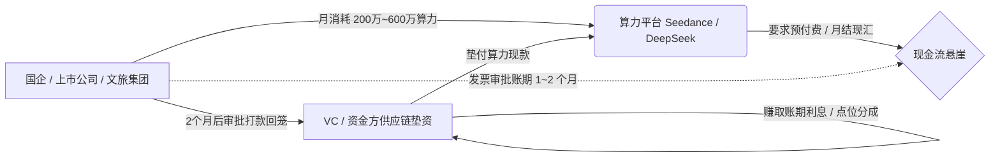
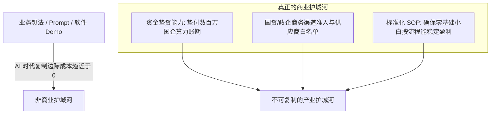

# 2026-10-05 · 夜间直播知识沉淀：算力供应链金融、国企大额账期垫资与 AI 时代投资赛马闭环

> **场次背景**：本次交流汇聚了硬件研发独立开发者（小明）、资深商务开拓者（樱桃）以及深耕产业的资深风险投资人（VC）。核心议题聚焦于大模型算力消耗生态的底层商业秘密：国企与上市公司 1–2 个月账期催生的“算力供应链金融（垫资）”、文旅与国企培训期高额算力消耗与接口倒卖灰产、以及在“代码与想法极易被 AI 迅速复制”的时代，VC 机构如何用“标准化 SOP 赛马”与“垫资资质/商务渠道壁垒”构建真正的护城河。

---

## 1. 算力供应链金融：国企账期错配与大额垫资生意

在 AI 大模型（如字节跳动 Seedance 视频生成模型、DeepSeek 高并发推理算力）落地的生态链条中，最赚钱的往往不是自研模型的底层极客，也不是单纯跑业务的应用开发商，而是利用资本杠杆解决现金流错配的**算力供应链金融服务商**。

### 1.1 业务发生机理与现金流悬崖
1. **先消耗后审批的国企流程**：
   - 国企、文旅集团和上市公司引入大模型时，通常具有严格的财务报销和请款流程。从发起采购、工程验收、申请发票到最终付款下账，周期普遍在 **1 至 2 个月**；
   - 但大模型算力（特别是云端 API 与智算集群）不支持无限期欠款运行，通常要求预充值、按周扣费或严格的按月现结。
2. **中小服务商的资金瓶颈**：
   - 国企大客户单月算力消耗体量极大，轻则两三百万，多则五六百万；
   - 承接国企 AI 项目的中小型技术供应商，根本没有数百万甚至上千万元的流动资金去硬扛 1–2 个月的资金占用周期，随时面临资金链断裂风险。
3. **资金方的商业模式**：
   - 具备充裕现金流的专业投资机构（VC）以“算力供应链金融”方式介入：由资金方出资为国企垫付每月的模型算力账单（如垫付 500 万）；
   - 国企在 1–2 个月流程走完后，将款项与利息直接回款给资金方。资金方不承担技术研发风险，仅通过资金周转赚取无风险/低风险的垫资利息与服务费。

---

## 2. 公共算力消耗黑洞与转售套利灰产

在国企与地方文旅集团大规模推进“数字化与 AI 赋能”过程中，因考核机制与成本意识的错位，催生出高额消耗黑洞及额度转售灰产。

### 2.1 培训阶段的“失控式消耗”
- **全员涌入与无节制调用**：国企员工往往在项目未正式上线生产前，以“全员数字化技能培训”的名义接入大模型。一个部门五六十号人同时使用，“下手没轻没重”，每人无节制生成视频和图片；
- **公款补贴托底**：由于享有产业政策扶持和专项数字化补贴，部门对单月消耗缺乏敏锐的成本核算。仅在员工培训和概念验证阶段，单月算力消耗即可轻松突破 **100 万元**；
- **真实生产价值脱节**：前端高额的 Token/视频时长消耗与后端的实际业务产出（ROI）严重脱节。

### 2.2 账户额度外流与二级灰产倒卖
- **额度溢出与转售**：由于国企采购的大模型额度（如 Seedance 视频配额）存在预算花不完、过期作废等情况，衍生出二级转售链条；
- **API 接口转接与代生成**：部分人员通过搭建代理中转服务（Reverse Proxy）将国企内部的免审批算力接口拉出，以远低于官方的市场折扣向个人工作室、MCN 机构倒卖；或利用闲置额度帮外部承接批量视频代生成业务，将公共补贴转化为私人灰色利润。

---

## 3. AI 时代 VC 的投资赛马与不可复制护城河

提问者提出核心疑虑：“在 AI 工具极大普及的今天，一个好的业务想法在直播间一公开，别人第二天就能用 AI 迅速做出来，那投资人和创业者的壁垒究竟在哪里？”资深投资人剖析了工业化投资赛马与商业护城河的本质。

### 3.1 投资机构的多项目“赛马跑测”机制
- **并行启动与小成本试错**：机构通常同时立项 10 个轻量级项目，分别配备标准化人员进行闭环测试；
- **新人盈利验证（SOP 复制性）**：判断一个项目是否值得复投的核心指标不是“创始人的个人技术天花板有多高”，而是**“没有经验的小白进来，按照操作 SOP 执行，能否稳定跑通正现金流”**。
- **阶段性加注**：一旦验证小白团队能复制盈利，机构立即追加投资、扩充团队规模；对于表现突出的标的，合伙人亲自下场跟进孵化；平均一个季度能沉淀出 1–2 个长期健康、具备多分支延展性的核心项目。

### 3.2 真正的护城河：从纯技术转向商务与重资本
AI 工具彻底击穿了纯软件代码与产品原型的技术壁垒：
1. **想法不值钱，执行门槛已被 AI 抹平**：任何能够被 15 分钟口头讲清楚的软件逻辑，竞品都能在 48 小时内用 AI 编程还原；
2. **排他性护城河的三大支柱**：
   - **大客户信用垫资资质**：面对动辄数百万的账期，竞品即便有代码，若无雄厚的自有资金垫付，就根本入不了国企和上市公司的招投标门槛；
   - **政企商务关系与渠道白名单**：取得行业准入资质与采购决策链的深层信任，远比优化一个模型算法重要；
   - **线下履约与标准化交付体系**：能够将混乱的现实业务封装成傻瓜式交付流程的组织力。

---

## 4. 硬件工作室内核与微信控制 Agent 的现实边界

### 4.1 个人硬件工作室的工程样机路径
- **架构选型**：硬件开发者小明分享了单片机（MCU，如 ESP32）结合本地/边缘算力（Edge AI）的开发模式；
- **敏捷样机验证**：规避重度企业化运作的高昂固定开销，以个人工作室的形式低成本完成从原理图设计、打板焊接、固件烧录到工程样机跑通的完整闭环；
- **量产与交付考量**：工程样机跑通仅是第一步，后续需严格考量边缘算力芯片发热、外壳模具公差、BOM 成本控制与量产良率。

### 4.2 微信自动化控制（WorkBuddy 与小微）的真实状态
- **客观辨析 WorkBuddy 能力**：社区讨论提及 WorkBuddy 控制微信。实操中必须清醒认识到：任何未经官方开放 API 授权的桌面接管工具，主要依赖无障碍服务（Accessibility）、图像定位或 RPA 拟人点击，无法实现底层无感注入；
- **官方助手“微信小微”的内测边界**：参与者实测微信官方小微内测，其在“全自动微信客服回复、复杂长上下文上下文自动分发”等关键任务上依然无法稳定闭环；
- **落地反思**：评估 AI Agent 控制系统时，切勿盲信营销概念，必须落到“确定性边界条件”、“端到端任务成功率”与“封号风控红线”来进行实机验收。

---

## 5. 行动指南：算力垫资风控与 AI 业务护城河评估清单

### 清单一：面向技术服务商/资金方的算力采购垫资风控 Checklist
- [ ] **客户信用与招采预算确权**：是否已核实国企客户该笔 AI 采购列入本年度硬性财务预算，而非口头承诺或弹性课题经费？
- [ ] **三方协议锁权**：是否签署明确的“客户-服务商-垫资方”三方垫资确权协议，锁定国企下账款项直接进入监管共管账户？
- [ ] **账期上限与违约利率**：是否明确锁定 30/60 天回款宽限期，并设定超出账期的逐日逾期利息与惩罚性条款？
- [ ] **算力提供商的折让空间**：能否凭借单月数百万的集中采买体量，直接向 Seedance、DeepSeek 等官方争取 10%~25% 的大客户批量返佣，扩大利润安全垫？
- [ ] **实时额度熔断开关**：服务商后台是否建立 Token/时长用量预警系统？当国企员工培训调用超出核准月预算红线时，能否做到自动降频或熔断？

### 清单二：AI 初创项目防抄袭与商业闭环评估 Checklist
- [ ] **业务逻辑抗 AI 复制性**：脱离自研代码与 Prompt，团队是否掌握竞品 3 个月内无法用钱买到的独家供应链资源或线下渠道？
- [ ] **SOP 傻瓜化程度**：将核心业务拆解为 10 步以内的标准化作业指导书，招募无技术背景的新人能否在 3 天内按照 SOP 跑通盈利？
- [ ] **重资产/商务准入壁垒**：该业务是否需要特定的国资招采资质、大额保证金或定制化硬件现场调试？
- [ ] **单项目止损周期**：赛马阶段是否设定了 2 周~4 周的硬性止损窗口？若无正现金流即果断终止，严防沉没成本拖累现金流。
