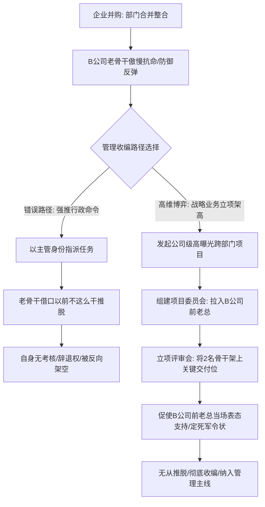
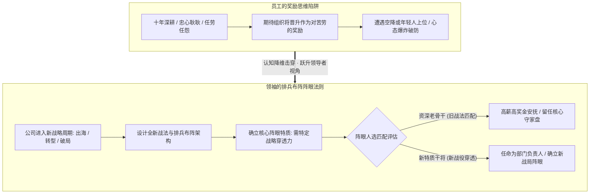

在职场中层跃迁至高管层、以及经历复杂组织重组（如业务合并、企业并购）时，管理者最容易遭遇两类触及权力底层本质的“硬核天花板”：
第一类是**“被并购团队的虚职整合危机”**：A公司收购B公司后合并部门，A公司主管被任命为新团队负责人，但手下的B公司骨干自恃“强强联合”的尊严傲慢，拒不配合；A公司主管既无绩效考核权又无辞退权，稍有不慎便被对方反向架空；
第二类是**“年薪数百万资深骨干的晋升天花板”**：工作十余年、年薪100~300万的资深总监（-2），对老板忠心耿耿、任劳任怨把持隐秘要务，却屡屡眼睁睁看着空降兵或年轻骨干当上部门一把手（-1/CXO），自己苦等五到八年心态彻底崩盘。

2026年10月12日晚《产品老曾》的职场深度实战连线，针对这两起经典命题，给出了极具穿透力的底层诊断与破局策略。

---

## 一、 案例一：企业并购重组整合——“跨部门立项架高”借力收编术

### 1. 个案原貌：虚职经理与被并购老臣的傲慢对抗
连线学员在A公司担任业务经理，近期A公司全资收购了同行B公司：
- **部门合并与虚衔**：高层决定将两家公司职能重叠的业务部门合并为一个新部门，任命连线学员为新部门负责人。新团队中并入了B公司的两名核心业务老骨干；
- **老骨干的尊严防御与软抗拒**：B公司两名骨干心存强烈的傲慢心理，坚信“我们被收购不是因为我们不行，而是强强联合”。在连线学员向其派发工作时，老骨干直接推脱：“以前在B公司我们不这么干、这个事情不在我们职责范围内”；
- **管理者的软肋**：连线学员虽然头顶新部门负责人虚衔，但**无权开除他们、无权动其薪酬、且B公司的原一把手（老总）仍在公司任职高管**。直接硬刚不仅推不动，反而容易被B公司前老总向董事会反咬一口“破坏并购整合”。

### 2. 老曾底层诊断：被并购者的心理防线与借力之道
老曾一针见血地指出被并购团队的抵抗机制与行政命令的局限：
- **自尊心防御机制**：被收购团队在心理账户上处于脆弱的自卑与代偿期。任何来自合并方主管的直接行政命令，都会被其解读为“胜者对败者的侮辱”，必定激起弹簧般的强烈反弹；
- **行政命令的无效性**：在没有独立人事权和绩效裁量权时，试图以“我是你们主管”的姿态发号施令，只会自曝其短、威信扫地。

### 3. 破局实战：跨部门业务立项“四步借力收编法”
老曾给出了极其高明的“借刀打力、立项架高”实操方案：
1. **第一步：将日常部门事务包装为“公司级战略立项”**
   - 不要以“部门日常派工”的名义找他们谈，而是结合并购后两家业务互补的核心诉求，发起一个高曝光、高优先级的《新业务跨域协同攻坚项目》；
2. **第二步：组建联合项目委员会，把对方前老板“供”上去**
   - 将B公司的原一把手（老总）、A公司高管全部拉入项目评审委员会或指导委员会，给足B公司前老总面子；
3. **第三步：在公开立项会上“借势架高”**
   - 在各方高管都在场的立项评审会上，连线学员作为项目总牵头人，当众将B公司的这两名骨干推到“核心攻坚交付人”的关键节点上，大加赞赏其不可替代的专业价值；
4. **第四步：借对方前老板之口定死军令状**
   - 现场促请B公司前老总发言表态：“某总，这块核心攻关需要您原团队的两位大将挑大梁，您看是否合适？”；
   - B公司前老总在公众场合为了顾及自身格局与政治站位，必定当场表态全力支持，并要求两名老部下全力以赴；
   - **收编闭环**：两名骨干在老领导的亲口命令下，彻底丧失推脱退路，只能乖乖在连线学员的节奏下打硬仗，顺理成章完成实质性收编！

---

## 二、 核心专论：年薪百万骨干为何永远升不上部门负责人？——晋升的排兵布阵与阵眼逻辑

在当晚的直播中，老曾针对很多做到大厂总监/核心骨干（老板的-2）、年薪 100~300 万却卡死在天花板上五到八年的资深人才，刺破了温情脉脉的管理学幻觉：

### 1. 现象复盘：资深老臣的心态崩塌
很多骨干在公司深耕十余年，手握重要业务、任劳任怨、加班顾不上家、知道公司很多隐秘旧事，与老板私交甚笃。他们一直坚信：“只要我忠心耿耿、业绩稳定、对老板好，下一个升部门负责人（-1/CXO）的一定是我！”
然而现实极其残酷：老板要么从外部高薪空降一个年轻的高管，要么提拔了一个过去战功远不如自己、但具有某种新特质的人上去做阵眼。资深骨干心态彻底炸裂：“凭什么？我打了十几年江山，老板凭什么负我？大不了老子不干了！”

### 2. 老曾底层诊断：晋升从来不是奖励，而是组织的排兵布阵

#### （1）认知颠覆：晋升从来不是对“历史战功与苦劳”的奖励！
- **什么是奖励？** 加薪是奖励、发大额年终奖是奖励、年底戴大红花评优是奖励、老板私下称兄道弟请吃饭是奖励；
- **晋升绝非奖励！** 没有任何一个理性的大商业组织会用“最高决策指挥权”来当做奖品送给功臣。把指挥权当奖品，是对整支军队和企业生命的犯罪。

#### （2）排兵布阵法则：高层只看“下一个战役阶段需要什么阵眼”
老曾引入了古代军队的“排兵布阵与阵眼模型”：
- **阵眼的本质**：高层管理者在做组织任命时，盘算的从来不是“谁立的功多”，而是**“在未来三年公司的新战略目标下，我们需要一个什么样的阵法？谁最适合当这个阵型的阵眼？”**；
- **全面平庸的陷阱**：资深老臣虽然样样精通、综合素质高，但在新周期中往往缺乏新战略所需的**“极化穿透力”**（例如：公司要从传统制造转型跨境出海，阵眼需要的是具有全球化视野和狼性地推经验的特种兵，而不是熟稔国内旧流程的老臣）；
- **残酷的组织逻辑**：年轻的空降兵虽然资历浅、战功不如你，但他的特质与新战役的“阵眼要求”完全吻合。从组织大局出发，他能当阵眼，而你从组织逻辑上看——**就是不行！**

### 3. 老骨干跃迁破局之道：主动成为新阵型的战略阵眼
资深骨干若想打破天花板，必须彻底抛弃“功臣委屈心态”：
1. **停止拿历史战功向老板讨价还价**：过去的战功公司已经通过年薪百万和期权给你结清了；
2. **洞察老板未来三年的“阵法更迭”**：搞清楚老板未来最焦虑的战略增长极到底是什么（如降本增效、数字化转型、海外开荒）；
3. **重塑自身的“阵眼属性”**：不要只当一个守成的内务管家，主动向老板递交能够充当新战役阵眼的战术进攻方案，证明自己不仅能守旧城，更能充当新阵眼破局攻坚！

---

## 三、 认知升维：老曾职场博弈三大核心模型

### 1. 模型一：并购整合的“跨部门战略立项架高”借力收编术 (M&A Project Kickoff Leverage)
- **核心逻辑**：面对被并购团队老臣因尊严防御而产生的软抵抗，在无实质人事罢免权时，切忌强推行政命令。必须将部门事务升级为公司级战略立项，将对方前老板拉入委员会站台，在公开立项评审会上将老臣推上关键交付位并定死军令状，借对方原领袖之口使其彻底失去推脱借口，完成降维收编。

### 2. 模型二：晋升组织排兵布阵与阵眼选择定律 (Promotion As Tactical Hub Deployment)
- **核心逻辑**：晋升从来不是对历史战功、忠诚苦劳的奖励（加薪表彰才是奖励），晋升是组织新战役的排兵布阵与阵眼选择。高层考察的唯一标准是候选人能否支撑未来新阵法的战略穿透力。老臣必须去功劳化，主动将自身能力重塑为匹配未来阵法的阵眼要素。

### 3. 模型三：上级让下属物色替补的权力试探与自保准则 (Superior Seeking Replacement Probe)
- **核心逻辑**：直属领导私下指示下属物色接替自身职位的外部候选人时，切忌自作聪明向高层递人。必须识别其深层意图（是真想跳槽、面临高管施压、还是暗中试探下属忠诚度），保持常规招聘节奏留痕，坚决不越过直属上级向大老板通风报信，避免沦为神仙打架的替罪羊。

---

## 四、 实战行动工具包（Actionable Checklists）

### 1. 跨部门/并购整合人员收编自查清单（M&A Integration Checklist）

| 序号 | 自查维度 | 核心评估标准 | 达标打勾 |
| :---: | :--- | :--- | :---: |
| 1 | **权力底牌摸底** | 自身是否拥有对被整合人员的独立绩效打分权、调岗权与辞退权？若无，是否已放弃单纯行政命令？ | [ ] |
| 2 | **尊严防线识别** | 是否充分预判并照顾了被整合团队“强强联合”的心理诉求，避免语言上出现“胜败居高临下”字眼？ | [ ] |
| 3 | **战略立项包装** | 是否已将部门摩擦转化为公司级高曝光战略业务项目，设立明确里程碑与量化成果？ | [ ] |
| 4 | **关键赞助人绑定** | 是否成功将对方原领导（如B公司前老总）拉入项目评审委员会，并使其在立项会上公开表态支持？ | [ ] |
| 5 | **军令状公开定死** | 是否在多方高管见证下，将关键交付责任明确赋予老骨干，使其无法推脱抗命？ | [ ] |

### 2. 资深骨干突破晋升天花板阵眼自查清单（Tactical Hub Self-Checklist）

| 序号 | 致命认知与行为禁忌 | 发生概率 | 违背后果 | 纠偏替代方案 |
| :---: | :--- | :---: | :--- | :--- |
| 1 | **以忠诚与加班苦劳索要晋升** | 极高 | 被老板视为格局低下、把权力当人情奖励，彻底丧失高管考察资格 | 聚焦于向老板证明自己能够作为新战法的“阵眼”解决未来核心危机 |
| 2 | **遭遇空降兵上位当场破防怨怼** | 极高 | 被贴上“抗拒大局、心胸狭窄”标签，直接成为新阵型清洗首选目标 | 冷静分析空降兵的“阵眼属性”，寻找互补协同位稳固核心盘 |
| 3 | **固守守城思维缺乏战略进攻性** | 高 | 无论战功多高，永远被锁死在“优秀的内务大管家”定位，无法晋升CXO | 主动跨界承担具有战略穿透力的新业务攻关，展现帅才格局 |
| 4 | **擅自向上递交直属领导替补简历** | 中 | 卷入派系政治，被直属领导视为反叛，高层洗牌时最先被弃子出局 | 严格按既有合规流程报备，在直接上级把关下推进，绝不越权抢跑 |
| 5 | **拿历史贡献试图对抗组织调整** | 极高 | 阻碍新阵型落地，沦为组织进化车轮下的阻力，必遭无情清洗 | 顺应阵型变化，主动为新阵法贡献配套支撑，实现价值再造 |
