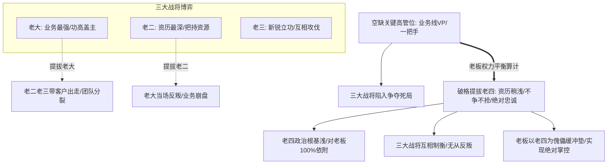
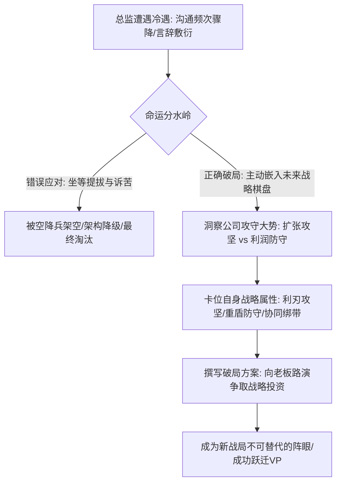

在企业高层政治与组织布阵的深水区，总监晋升副总裁（VP）往往伴随着最残酷、最扑朔迷离的权力制衡：
很多战功赫赫的资深总监常常困惑不解：明明自己在公司拼杀多年、立下汗马功劳，在争夺部门一把手或业务线VP时，前三名实力派战将打得头破血流，最终老板却把宝座赐给了一个资历稍浅、平时不显山露水、甚至战功不如自己的**“第四号人物”**；
与此同时，不少资深总监在任职两三年后，突然发现大老板对自己的态度从过去的无话不谈、高频沟通，骤降至一两个月才见一次面，且言辞敷衍客套。当事人仍心存幻想“等待老板良心发现提拔自己”，殊不知自己已经被组织悄悄排挤出了未来的战略版图。

2026年10月12日深夜《产品老曾》的职场专题大课，以其亲历大厂高层权力博弈的冷酷视角，全面撕开了高管任命背后的制衡机制与战略棋局本质。

---

## 一、 高管权力平衡与“老四上位定律”

### 1. 现象复盘：三大战将火拼，为何“老四”渔翁得利？
当一个核心事业部空出副总裁（VP）或业务线一把手的高管席位时，部门内部通常盘踞着三位实力强大的老臣：
- **老大（业务最强）**：手握核心客户与关键大单，自视甚高，认为除了自己无人配坐这个位置；
- **老二（资历最深）**：跟随老板时间最长，把持着内部资源与团队脉络；
- **老三（新锐黑马）**：近期在某一突破性项目中斩获奇功，深得部分高层赏识。

三员大将在暗中或明面上疯狂较劲，互相找茬攻讦，甚至各自向老板暗示“如果立他不立我，我就带团队跳槽”。
然而，最终的任命结果往往让全行业大跌眼镜：老板既没用老大，也没用老二老三，而是将桂冠直接戴在了资历较浅、能力并非顶尖、平时低调顺从的**“老四”**头上！

### 2. 老曾底层诊断：看透最高决策者的权力平衡算计
老曾一针见血地指出：**商业组织的最高决策者在提拔高管时，核心考量从来不是“谁的业务能力最牛逼”，而是“谁能保证组织不崩塌、政权不失控”！**

#### （1）前三位实力派的“零和死局”
- **如果提拔老大**：老二和老三会判定上升通道永久锁死，极可能在数月内带着骨干和核心客户跳槽投奔竞对，甚至暗中使绊子让老大暴雷；
- **如果提拔老二或老三**：战功最强的老大必定当场反叛或消极怠工。对于老板而言，立前三者中的任何一人，都意味着另外两股强大势力的瞬间分裂；
- **前三者尾大不掉的威胁**：这三员大将在部门深耕太久，羽翼丰满，任何一人上位，都会迅速将该部门变成其独立王国，直接架空最高老板。

#### （2）“老四”的核心政治价值：傀儡、缓冲垫与绝对掌控
- **老四能力适中、根基浅薄**：老四深知自己能坐上大位纯属老板破格提拔，因此对老板具有**100%的绝对忠诚与政治依赖**；
- **压制三大刺头的最佳武器**：立老四为头，老大、老二、老三虽然内心不服，但在明面上谁也挑不出老四在派系上的偏私，因为老四从来没有站过队。三大战将互相牵制，谁也不敢轻举妄动；
- **老板实现间接“御驾亲征”**：老四实际上充当了老板在前台的传声筒与执行傀儡。老板通过老四牢牢把持着部门的实际控制权，以最小的组织震荡平定了内耗。

---

## 二、 总监遭遇冷淡的清洗降级信号与战略棋局破局

### 1. 危险信号识别：沟通频次骤降背后的“边缘化预警”
很多总监在向老曾咨询时抱怨：“以前老板每周找我喝茶、商量大事；最近两三个月，老板对我极其客套冷淡，一两个月都不找我一次，主动约他也总推说有事。”
老曾厉声警示：**“别再心存幻想了！这在职场高层语境中，是极其危险的预警信号——在老板未来的战略棋盘里，已经没有你的位置了！”**
随之而来的通常只有两种冷酷结局：
1. **暗中降级**：不久后公司从外部空降一个VP做你的直属上级，你的部门从一级架构降为二级部门，被要求与空降兵“做好交接”，直至剩余价值被榨干；
2. **边缘化清洗**：公司通过组织调整、业务拆分，将你的核心预算与人头慢慢剥离，最终逼你体面离职。

### 2. 破局之道：把自己主动“塞入”未来的组织战略棋盘
面对被冷落的死局，很多总监采取“被动等待提拔”或“找老板诉苦忠诚”的低情商做法，结果加速阵亡。老曾给出了降维的“战略棋盘三步自救法”：

#### （1）第一步：识别公司的战略攻守大势
- 商业公司的生存状态永远只有两种：**攻（扩张增量）** 与 **守（防守存量）**；
- 例如互联网大厂在即时零售领域的厮杀，巨头在主战场面临围剿时，战略重心可能随时从盲目扩张转为利润防守；你必须准确判断老板眼下的头号焦虑到底是在“攻”还是在“守”。

#### （2）第二步：明确自己在棋局中的角色属性（刀、盾、绑带）
在老板的战略棋盘上，高管通常承担三种核心功能，你必须根据自身禀赋迅速卡位：
- **利刃（刀）**：负责杀向未知战场打硬仗、抢新客户、开荒辟地（适合狼性进攻型总监）；
- **重盾（盾）**：负责在下行周期稳住存量现金流、合规风控、精细化降本增效（适合稳健运营型总监）；
- **战略绑带（绑带）**：充当刀与盾之间的组织黏合剂，负责跨部门利益协调、多业务中台协同与复杂人事平衡（适合高情商大将）。

#### （3）第三步：向老板主动递交“进攻/防守投资方案”
- 永远不要被动等待提拔！带着白纸黑字的战略方案主动找老板约谈：
  “老板，我知道公司接下来的核心战役是某某方向。针对这个战局，我制定了一套打通新增长/守死利润底线的方案；**我愿意充当这把刀（或这面盾），带领团队立军令状主抗！**”
- **博弈本质**：你不是在向老板讨要VP的赏赐，而是在像创业者向投资人路演一样，向老板证明：**“投资我担任新业务线VP，能为你攻下这盘棋最关键的战略据点！”**——唯有将自身价值深度嵌入老板的未来版图，方能绝处逢生！

---

## 三、 认知升维：老曾职场博弈两大核心模型

### 1. 模型一：高管权力平衡与老四上位定律 (`model_the_fourth_dark_horse_selection`)
- **核心逻辑**：部门关键高管位出现空缺且内部多强相争时，提拔实力最强的候选人往往会导致团队撕裂与失控。最高领导者出于权力制衡与绝对控制本能，往往避开前三位刺头，破格提拔资历稍浅、派系中立且绝对忠诚的“第四人”作为缓冲垫与代言人。

### 2. 模型二：总监升VP的战略棋局角色定位模型 (`model_strategic_chessboard_positioning`)
- **核心逻辑**：总监跃迁VP的关键不是过去的业务苦劳，而是未来战略棋局中的定位匹配。管理者必须准确识别公司攻守大势，将自身精准定位为“利刃（进攻突破）、重盾（利润防守）或绑带（跨域协同）”，以商业投资方案主动向老板争取授权，为自己创造高管编制。

---

## 四、 实战行动工具包（Actionable Checklists）

### 1. 多强竞争高管位防暴雷自查清单（Promotion Anti-Trap Checklist）

| 序号 | 自查维度 | 核心评估要点 | 达标打勾 |
| :---: | :--- | :--- | :---: |
| 1 | **多强相争态势** | 部门内部是否已出现2~3名资深老臣火拼高管位的恶性对抗局面？ | [ ] |
| 2 | **去极化防暗箭** | 自身是否已停止与竞争对手公开撕扯，避免成为老板眼中破坏大局的刺头？ | [ ] |
| 3 | **展示中立忠诚** | 是否在派系斗争中保持超然，展现对最高决策者战略大局的绝对顺从与协同？ | [ ] |
| 4 | **防做他人嫁衣** | 是否预判到了“老四上位”的可能性，提前与潜在黑马及各方建立良好兜底关系？ | [ ] |
| 5 | **多重退路准备** | 若高层最终任命外部空降兵或黑马，是否已保持外部猎头接触，随时具备体面跳槽实力？ | [ ] |

### 2. 总监战略棋盘主动卡位自查清单（Strategic Positioning Checklist）

| 序号 | 致命行为禁忌 | 发生概率 | 违背后果 | 纠偏替代方案 |
| :---: | :--- | :---: | :--- | :--- |
| 1 | **老板冷淡时自怨自艾** | 极高 | 错失最后自救窗口期，几个月后直接收到降级交接通知 | 敏锐捕捉被冷淡信号，一周内完成战略方案复盘 |
| 2 | **被动等待高层施恩提拔** | 极高 | 组织大棋盘落定后彻底被遗忘在角落，丧失高管上升机会 | 主动发起约谈，带着业务解决方案向老板申请攻坚任务 |
| 3 | **角色定位模糊不攻不守** | 高 | 既不能打硬仗又不能控成本，沦为首批被优化淘汰的平庸中层 | 明确自身“利刃/重盾/绑带”战略标签，打穿单一核心属性 |
| 4 | **向老板汇报只谈个人诉求** | 极高 | 触发老板反感，被视为自私狭隘、缺乏全盘格局的打工人 | 站在投资人视角汇报，将个人晋升绑定为公司新战略成功的保障 |
| 5 | **陷入单一部门孤立主义** | 中 | 缺乏横向盟友，高层调整阵型时因无协同价值被直接切除 | 充当战略绑带，主动链接跨部门协同，构筑组织安全网 |
