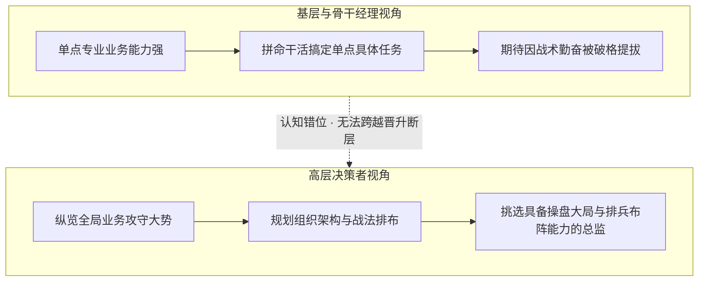
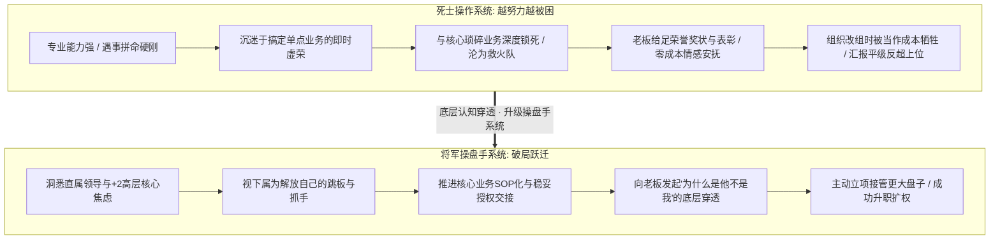

在职场中，许多业务能力出众、任劳任怨的骨干常常陷入一种极其痛苦的认知困局：
他们像古代死士一样忠心耿耿，遇事六亲不认、通宵拼命救火，深得老板口头赏识，年年荣誉奖项拿满，甚至部门缩编大裁员时也被当成“不可或缺的心腹”死保留下；
然而，一旦组织架构发生改组、出现管理层提拔机会时，升官发财的桂冠却往往戴在了平时看起来“没自己能干”的平级同事头上，自己不仅没升职，甚至被莫名其妙地降为平级同事的下属！当事人委屈落泪、愤愤不平，甚至心存幻想“只要我再拼命干，老板迟早会良心发现”。

2026年10月12日深夜《产品老曾》职场连线，面对一位在大厂做外包运维接口人的学员，以及一位在汽车行业深耕十余年、深得老板赏识却在组织改组中被平级同事反超降维的明星产品骨干，老曾以其极度冷酷、直击骨髓的组织学与权力视角，展开了一场痛快淋漓的降维痛批与心智重塑。

---

## 一、 经理跃迁总监的分水岭：从单一战力到组织排兵布阵

### 1. 提拔考量的底层跃迁
老曾在直播开篇便指出了基层主管升职为业务负责人的认知死穴：
- **基层/经理层考核逻辑**：依赖于对**单一员工、个人绩效**的评价（谁的活干得又快又好，谁就能当骨干或小组长）；
- **总监/高管层考核逻辑**：**彻底脱离了对单一个人的评价，进入“组织架构与团队战力排布”层面！**

### 2. 老板眼中的组织哲学
在最高决策者心中，组织就是承载业务的骨架结构：
- **组织结构健康、排兵布阵合理**：效率就高，员工心气就顺，公司就能打胜仗；
- **组织混乱、责权利冲突**：即便个别员工是超级英雄，整体战斗力依然溃散。
因此，老板提拔一个总监，考虑的核心永远不是“这个员工平时有多努力、专业有多拔尖”，而是：**“提拔他上位，能否重构并优化现有的团队阵型？能否带来全局组织稳定与效率倍增？”**

---

## 二、 大厂外包转正的核心窗口与“防遗忘”心智卡位

### 1. 学员个案：大厂外包的虚幻归属感迷局
连麦学员在大厂做纯外包工程师，驻场协助甲方的“+2（部门主管）”负责十几个据点的系统稳定性、变更SOP审批与一线运维，每周直接与+2进行复盘汇报；由于表现极佳，甚至获批了昂贵的AI大模型Token额度。
学员因此产生了一种虚幻的归属感，觉得“大厂对我很好、给的资源跟正式员工无异”，但同时受困于外包身份的晋升天花板，在迷茫中纠结如何转正。

### 2. 老曾底层诊断：看透外包生态位的本质
老曾一针见血地戳破了当事人的温水煮青蛙幻觉：
- **为什么大厂要用外包？** 核心红线是**集团 Headcount（正式工编制）严格受限**！大厂为了控制固定人力成本与法律风险，才将支撑与运维性业务外包出去；
- **绝无可能单独特批 HC**：没有任何一个大厂管理者会因为外包员工干得好，就专门向集团董事会去申请一个额外正式工 HC，这种概率无限接近于零；
- **唯一的转正机会窗口：存量重缺的紧急顶编**！
  大厂内部存在自然流动（正式工离职、转岗、淘汰出局），当团队突发空出一个正式编制且业务急需有人立即上手、无法承受外部漫长招聘周期时，外包员工才迎来绝佳的历史窗口期！

### 3. 致命盲区与破局心智：“防太熟被遗忘定律”
外包员工最大的致命盲区，正是**“平时干得太熟、太靠谱”**：
- **认知错位**：因为你常年驻场干活，甲方领导习惯了你的存在，潜意识甚至默认你就是正式团队的一员；
- **被遗忘风险**：一旦某个正式工离职出现 HC 空缺，领导脑海中的第一反应通常是“去外部社招或找HR推简历”，**他压根想不起来你其实只是个外包人员**！
- **破局话术与日常埋点**：
  必须在日常工作复盘、考核等非正式沟通节点，主动向甲方决策人进行温和试探与心智种草：
  > “领导，团队现在这套运维与稳定性体系我已经帮您彻底打通。未来如果组内有正式编制流动或者急难重险的岗位出现空缺，我特别希望能转正继续跟随您冲锋，任何新坑位我都全力顶上！”

让领导在出现重缺的毫秒瞬间，脑海中跳出的第一候选人就是你，方能顺理成章实现转正！

---

## 三、 骨干员工的“死士操作系统”与不可替代性悖论

### 1. 学员个案：外企资深汽车工程师的“降维之痛”
某外企资深产品工程师从业十余年，在现公司任职4年，深得直属领导“赏识”：
- **荣誉资产拿满**：每年都是大工程部唯一的标杆员工，各种荣誉证书拿到手软；
- **关键业务绑定**：负责最重要的欧美系核心主机厂客户，直连海外；
- **裁员死保**：部门从20多人大裁员缩编至仅剩4人时，领导无论如何也死保他留下；
- **组织重组惨遭反超**：最近部门架构重新调整，同级别的另外两人双双升职（其中一人直接变成他的直属领导，原领导退居+2），自己不仅没升，还被分配了两个生手让他带着干活，理由是“暂时没有HC”。

### 2. 老曾降维痛批：超级牛马的“死士操作系统”
老曾直接打断学员委屈的倾诉，毫不留情地揭露其思维模式的致命缺陷：
- **你在组织里把自己演成了“死士”和“探子”**：
  做事六亲不认、拼了命熬夜死扛、不需要鞭策就会自我驱动、在“搞定高难度业务、专业技术过硬”中寻求虚荣的正反馈与自嗨；
- **组织为什么绝不提拔死士做管理？**
  在军队逻辑里，探子和死士的宿命就是去刺秦王、当救火队员，死了就换下一个。死士靠的是一腔热血和个人蛮力，而将军靠的是运筹帷幄、资源调度与全局算盘。**你身上流淌着满格的死士血液，老板怎么可能把统兵十万的帅印交给你？**
- **低情商沟通的笑话**：
  当事人在事多接不下来时向老板申请支援，说“工作量太大了能不能加人”——老曾嘲讽道：“在老板听来，这就是一个探子向大帅汇报‘前面地形太大我探不过来，给我配两个小探子帮我放哨，我继续去拼命’。你从头到尾聊的都是底层干活，没有任何角色转换的将军思维！”

### 3. 商业组织的残酷算盘：关键业务锁定与“不可替代性悖论”
为什么深得赏识、业务最强的骨干，在升迁时反而最容易被牺牲？老曾揭示了极其冷酷的组织博弈逻辑：

> ⚠️ **组织不可替代性悖论（Irreplaceable Trap）**：
> 员工误以为“我不可替代，老板离不开我，我就一定会升职”；
> 而老板的真实算盘是：**“你在核心客户上极其专业且不可替代，如果把你抽调升走去管大区，核心客户崩盘的风险谁来承担？新业务你能否做好充满未知！因此，把你动了成本极高、收益极不确定；把你锁死在原地，成本最低、收益最稳！”**

- **不可替代直接演变为“不可晋升”**：老板为了稳住你继续当牛马，会把“荣誉、优秀员工表彰、口头赞赏”等无成本的情感资产给满，但绝不会给你任何管理编制；
- **别人为什么能升？** 因为别人没有被单一关键业务锁死，具有调动弹性，公司开拓新市场需要大区负责人，自然优先提拔他们！

### 4. 破局之道：下属是钥匙，能交接才能被提拔

#### （1）下属是跳板，绝非分担琐事的帮工
- 很多骨干把领导派给自己的下属当成“替自己干杂活的小兵”，甚至潜意识防备下属抢功；
- **操盘手思维**：**这两个新人是拯救你脱离死士苦海的唯一钥匙！** 你必须拼命在三个月内将手中核心业务的标准、流程、SOP全部教会他们，把客户关系制度化沉淀到团队，实现“没有你，这个盘子也照样运转”！

#### （2）发起向上穿透，直击领导底牌
不要被动委屈，约直属领导进行一对一深谈，用坦荡、客观的姿态穿透组织评价机制：
> “领导，这次架构调整，我看到XX升上去了。我非常支持团队的决定，但我内心很坦诚地想向您请教一个成长问题：**从组织与业务全局来看，为什么目前是他升上去管理，而不是我？我身上到底欠缺哪维度的能力？** 我希望听到您最真实的意见，以便在接下来的季度里彻底弥补这项短板，承担更大的责任！”

**目的不是当场掀桌子争权，而是彻底逼出领导的底牌与顾虑，看清他在考量提拔时的核心诉求，从而完成由死士向操盘手的底层脑子置换！**

---

## 四、 认知升维：老曾职场博弈四大核心模型

### 1. 模型一：经理晋升总监的组织结构跃迁定律 (Manager To Director Organizational Shift)
- **核心逻辑**：经理看个人战力，总监看组织架构。提拔总监不再考量单一员工的勤奋与优秀，而是考量提拔该人选是否能重构健康的团队阵型并带来组织战力倍增。

### 2. 模型二：外包转正的核心窗口与心智卡位定律 (Contractor Headcount Window Positioning)
- **核心逻辑**：外包受制于编制红线，绝无可能单独特批新增 HC。唯一机会在于团队内部自然流动出现的存量重缺。破局核心在于日常复盘向上埋点种草，防范因“平时太熟”而在招人时被领导遗忘。

### 3. 模型三：超级牛马“死士操作系统”与将军视角的换脑破局 (Diehard Executor Vs General Mindset)
- **核心逻辑**：遇事硬刚、拼命搞定、沉迷于专业自嗨是死士操作系统的典型特征。死士是组织的救火耗材，将军才是操盘手。破局必须卸载死士系统，换成直属领导与+2高层的全局考核与安全感视角。

### 4. 模型四：关键业务锁定与组织不可替代性悖论 (Irreplaceable Lock In Paradox)
- **核心逻辑**：不可替代即不可晋升。员工将自身与关键存量深度绑定时，调动成本极高，老板倾向于以零成本荣誉安抚并将其永久锁死在原地。唯有推进业务SOP化、将下属培养为替身实现授权交接，方能释放晋升弹性。

---

## 五、 实战行动工具包（Actionable Checklists）

### 1. 骨干员工告别“超级牛马死士操作系统”自查清单（Executor to General Checklist）

| 序号 | 自查维度 | 核心评估要点 | 达标打勾 |
| :---: | :--- | :--- | :---: |
| 1 | **正反馈来源** | 自身成就感是否仍停留在“我专业能力强、我又搞定了一个难活”，而非“我带出了能够独当一面的骨干”？ | [ ] |
| 2 | **情绪内耗隔离** | 当遭遇评优或晋升落空时，是否已彻底戒除向领导“诉苦、表忠心、表达委屈”的低效儿童期行为？ | [ ] |
| 3 | **理解老板考核** | 是否清楚直属领导以及+2大老板今年的头号考核KPI、战略焦虑以及向上汇报的核心痛点？ | [ ] |
| 4 | **资源索取表达** | 向领导申请资源时，是否从“我干不过来要人分担”转变为“我为了帮您攻下XX战略目标，需要组建突击队”？ | [ ] |
| 5 | **向上穿透勇气** | 是否敢于带着坦诚学习的姿态向老板直接请教“为什么是他升职不是我，我欠缺哪项能力”，逼出组织底牌？ | [ ] |

### 2. 关键业务解绑与晋升防锁死自查清单（Anti-Lock-in & Promotion Checklist）

| 序号 | 致命行为禁忌 | 发生概率 | 违背后果 | 纠偏替代方案 |
| :---: | :--- | :---: | :--- | :--- |
| 1 | **沉迷单一核心客户无法自拔** | 极高 | 形成组织锁定，老板因惧怕业务动荡而永久禁止你转岗或升职 | 将客户关键对接流程、技术参数、异常SOP全面标准化沉淀 |
| 2 | **把分配的下属当成抢功对手** | 高 | 陷入存量内卷，无法从执行事务中抽身，被高层视为缺乏管理胸襟 | 视下属为解放自己的钥匙，制定3个月培养计划并全盘授权 |
| 3 | **用荣誉证书麻痹自我** | 极高 | 沦为廉价“精神股东”，只拿无成本表彰，核心权力与真金白银全归别人 | 认清荣誉资产本质，将关注点转向管理职权、人头预算与考核权 |
| 4 | **外包员工坐等领导恩赐转正** | 极高 | 存量重缺出现时被领导遗忘，眼睁睁看着HC被外部社招抢走 | 在日常复盘汇报中主动向上种草转正意愿，抢占第一顺位 |
| 5 | **汇报只谈苦劳不谈组织贡献** | 中 | 强化领导对你“高级工具人”的刻板印象，升职通道彻底关闭 | 站在组织架构视角，向领导递交业务阵型优化与效率倍增方案 |
