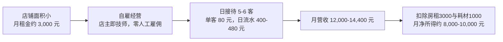
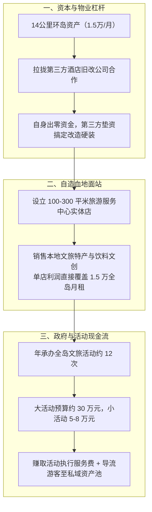
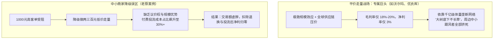
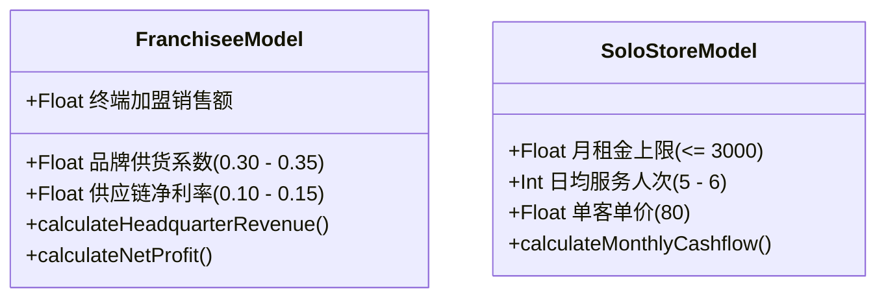

# 2026-10-12 · 王岑：加盟流水虚胖心算、文旅轻资产逆向套利、电商降级低价之死与日本大萧条品牌镜鉴

> **场次说明**：本篇基于 2026-10-12 晚（录制时间：2026-10-12 21:56:56 至 23:51:32，录音时长 114.6 分钟）王岑抖音直播《创业解惑与消费投行算账》完整 729 段 ASR 逐字稿全息蒸馏。涵盖万店加盟 8 亿流水背后的真实供应链分成心算、文旅重资产破局与 14 公里环岛低租轻资产套利、杭州采耳小微创业单人经济学、辽宁朝阳四五线卫浴经销商压货装修陷阱、抖音装饰画从 1000 元高客单盲目降级至低价微利亏损的底层病根，以及日本失落三十年中“平价巨头通吃与小而美个性化并存”的品牌二元分化规律。

---

## 核心商业全景导航

```mermaid
flowchart TD
    subgraph S1["案例一：加盟泡沫与文旅上市心算（黄总）"]
        A1["宣称陪跑餐饮万店，年做8亿流水"] --> B1["投行心算：加盟商流水≠品牌收入<br/>供应链供货占30%-35%，品牌真实营收仅2亿+"]
        B1 --> C1["文旅服务难标准化，重资产慢回报<br/>港股/北交所看重30亿+体量或合规净利，拒收虚幻概念"]
    end

    subgraph S2["案例二：小微创业单人经济学（采耳女学徒）"]
        D1["杭州滨江采耳学徒欲自创品牌"] --> E1["单人算账模型：房租≤3000元/月，1人自雇店主兼技师"]
        E1 --> F1["客单80元，日均5-6客，月流水1.2-1.5万<br/>逆周期最理智范式：极低投入+极低预期+正向现金流"]
    end

    subgraph S3["案例三：文旅轻资产逆向套利（佛山老兵）"]
        G1["承包14公里环岛，月租仅1.5万无违约金"] --> H1["借力打力：拉第三方酒店旧改公司出硬装"]
        H1 --> I1["盈利飞轮：100-300平服务中心单店利润覆盖租金<br/>年承接12场文旅活动赚预算并沉淀私域"]
    end

    subgraph S4["案例四：下沉渠道压货陷阱（朝阳卫浴）"]
        J1["辽宁四五线代理品牌，厂家逼迫扩店升级"] --> K1["全款垫资压货+两年一小改三年一大装<br/>沦为给厂家和装修公司免费打工"]
    end

    subgraph S5["案例五：电商价格战降级之死（装饰画老蔡）"]
        L1["1000元高客单受阻，主动降至两三百元低客单"] --> M1["表象：销量金额增加；实质：投流激增，净利归零"]
        M1 --> N1["日本失落三十年镜鉴：平价战场属于巨头（如优衣库/沃尔玛）<br/>中小商家唯有反向做深个性溢价与小而美"]
    end
```

---

## 一、加盟流水泡沫心算与文旅资本化真相：黄总 15 年咨询“结果兵法”剖析

### 1. 连麦画像与资本化诉求
- **连麦人**：黄延辉（黄总，深耕企业培训与咨询 15 年，自创融合儒释道法兵的“结果兵法”，曾辅导上海多个万店餐饮连锁品牌）；
- **核心诉求**：寻求将国内文旅项目（结合疗愈、康养、国学研学等概念）推向港股、美股或国内北交所上市的路径与可行性评估。

### 2. “8 亿流水”的投行心算与脱水
连麦中黄总提及辅导的某烧仙草与小餐饮品牌短时间内做到了 8 亿营收。王岑当场进行了投行层面的穿透心算：
- **终端零售流水 vs 品牌方真实营业额**：许多加盟连锁对外宣称的数亿、数十亿流水，本质是所有加盟门店前端收银机的**终端累计销售额**；
- **供应链分成系数**：品牌方（总部）如果主要靠给加盟商供给原物料（如茶饮的果酱、茶叶、包材、粉料），供应链原料采购款通常占终端流水的 **30% 至 35%**：
  $$\text{品牌方真实营收} \approx 8\,\text{亿元} \times 30\% \approx 2.4\,\text{亿元}$$
- **净利润测算**：小餐饮供应链即使按 10%～15% 的净利率心算，品牌方净利润仅在 2400 万至 3600 万元左右，绝非外界想象的 8 亿暴利；
- **核心驱动力还原**：此类万店品牌的真正核心壁垒不是产品研发或高深兵法，而是**强招商加盟能力、高饱和度渠道营销、以及针对外行或大学生创业者的标准化降维流程输出**。

### 3. 文旅赛道的上市硬伤与退出门槛
王岑曾深度参与过国内头部上市公司文旅基金（曾布局古北水镇、乌镇等顶级文旅资产），针对黄总提出的“文旅+疗愈+研学”概念，给出了极其冷静的资本画像：

| 评估维度 | 文旅资产常规现状 | 资本市场（港股/主板/北交所）硬门槛 | 王岑投行审视要点 |
| :--- | :--- | :--- | :--- |
| **行业属性** | 纯服务业，依赖线下物理场景 | 偏好具备工业化、高复制、高标准化的资产 | 服务业比产品更难做全国无缝标准化复制，服务质量极易随人员流失波动 |
| **资产结构** | 重资产投入、设备土建大、回收周期极长 | 要求低资本开支、轻资产高 ROE、抗风险能力强 | 大量文旅项目沉淀重金搞基建，一旦客流不及预期即成坏账死钱 |
| **收入与利润规模** | 门票、摆渡车、索道及衍生品，坪效与复购受限 | 传统行业主板/港股通常要求 30 亿+营收或几千万到上亿合规净利 | 无论加上疗愈还是研学，体量做不大就无法承担上市昂贵的合规审计成本 |
| **资本路径抉择** | 概念满天飞，但缺乏真实交割利润 | 北交所青睐“专精特新”与真实合规利润 | 资本市场已告别“讲概念买单”时代，必须拥有经得起审计的真金白银现金流 |

> **王岑警示**：“光有概念的人很多，能交出真实收入和经得起审计利润的人少之又少。在当前资本周期下，任何不能带来健康正向现金流的服务业概念，都很难在二级市场获得高估值。”

---

## 二、小微创业与单人经济学：杭州女学徒自创“可视采耳”小店

### 1. 业务场景与模式迭代
- **连麦人**：杭州采耳女学徒，曾在滨江区连锁采耳店工作数月，掌握可视采耳技术，计划在杭州自创品牌开单店；
- **品类升级差异**：
  - **古法采耳**：传统客单价约 60–70 元，顾客无法感知耳道内部情况，缺乏视觉冲击；
  - **可视采耳**：客单价提高到 80 元左右，通过内窥镜探头实时将耳道投屏在顾客面前，兼具耳道清洁与挠痒放松的情绪经济属性。

### 2. 极简单人单店模型心算
王岑引导连麦者现场测算单店单人盈亏平衡点与经营上限：

- **服务频次极限**：一名技师精细化操作，单日服务 5～6 名顾客已近极限；
- **租金红线**：绝不能为了所谓的“排场”租赁大面积商铺或昂贵商场中岛，单店月租金必须严格控制在 **3,000 元** 以内；
- **衍生增量**：主要依靠老客高频复购，以及由熬夜耳道发炎带来的耳道护理液、草本洗耳等小额增量服务。

### 3. 消费冰冻期的小微创业哲学
王岑对该女学徒的规划给予高度肯定，并提炼了逆周期创业的核心法则：
1. **控制单店初始投资**：单店硬装与设备投入压到几万元以内，绝不背负大额负债；
2. **降低收益心理期望值**：不追求一年暴富或连锁扩张，将目标锚定在每月稳定获得 8,000～10,000 元的自雇现金流收益；
3. **自雇经营规避劳资风险**：一人当店主兼技师，省去管理内耗与社保工资固定开支，抗周期能力远超盲目招工的小老板。

---

## 三、文旅轻资产逆向套利：佛山老兵 14 公里环岛“借力打力”

### 1. 核心资源盘子与反常识租金
- **连麦人**：佛山连续创业十年的创业者，拿下当地一处全长 14 公里的环岛文旅运营权；
- **核心反常识优势**：
  - **超低月租**：整条 14 公里环岛月租金仅 **1.5 万元**；
  - **无大额违约金约束**：合同具备灵活退场机制，经营半年若不及预期可随时止损撤出。

### 2. 破解文旅“重资产、大投入、慢回报”的三重杠杆
连麦者深谙文旅死于重资产的教训，采用了王岑极其推崇的“借鸡生蛋”轻资产打法：

### 3. 投资人王岑的研判要点
1. **兜底能力极强**：月固定成本仅 1.5 万元，即便只靠一家服务中心小卖部或几十个单车租赁点，也能做到收支平衡；
2. **防范隐形人力开支**：全长 14 公里线路维护、保洁、安保容易产生隐形人员费用，必须严格核算人均产出，避免管理半径过长吞噬利润；
3. **重在私域沉淀**：文旅活动是公域引流抓手，必须将登岛游客通过扫码、打卡引导沉淀至自有私域社群，开发全季复购价值。

---

## 四、下沉渠道压榨陷阱：辽宁朝阳卫浴经销商的“被动装修”与垫资困境

### 1. 经营场景与渠道业态
- **连麦人**：辽宁朝阳市（四五线城市）卫浴经销商，在当地经营卫浴代理生意多年；
- **门店形态并存**：
  - **单品牌专卖店**：厂家授权，店内仅陈列该知名品牌卫浴；表面毛利率较高（接近 40%）；
  - **多品牌杂品综合店**：自营集合店，陈列多品牌中低端卫浴单品，主打性价比。

### 2. 四五线建材零售的经典死穴
连麦者陷入了品牌厂家不断催促“扩店升级、重新装修”的焦虑中。王岑当场为其拆解渠道压榨本质：
- **资金全款垫资**：厂家不提供任何形式的代销、铺货或售完结算，经销商必须全款打款拿货，库存风险全部转嫁至经销商终端；
- **被动频繁装修**：建材卫浴行业品牌方为了维持品牌形象与完成区域业绩，通常每 2～3 年就逼迫经销商按最新标准重新装修：
  > **王岑痛批**：“很多四五线开建材卫浴店的老板，辛苦干了几年，账面上一算赚了点毛利，一转身全掏出来给店面重新砸钱装修了。到头来根本不是给自己赚钱，而是一直在给品牌厂家压库存、给装修施工队打工！”
- **单品牌专卖店坪效陷阱**：在下沉市场，单品牌专卖店因价格偏高、客流频次低，坪效反而不如多品牌综合店；一旦被品牌方捆绑大面积展厅，固定房租与折旧将彻底锁死流动性。

### 3. 破局警示
王岑建议经销商切勿在行业周期下行期盲目扩店，坚决拒绝无补贴的高额重装要求；优先保障现金储备，多通过安装售后增值服务留存老客户。

---

## 五、电商价格战降级之死：老蔡装饰画 1000 元降至 200 元“卖量亏本”当头棒喝

### 1. 连麦案例还原
- **连麦人**：老蔡（装饰画抖音电商创业者，经营三年）；
- **原经营状态**：主打 **1,000 元以上的高客单装饰画**，通过抖音短视频和直播电商销售，利润率良好；
- **遭遇瓶颈**：随着消费意愿放缓、电商税务合规成本提升，高客单人群规模见顶，获客成本抬升；
- **致命选择**：为了追求表面的销量和人气，老蔡主动将主力产品客单价**大幅下调至 200～300 元**；
- **惨烈结果**：下调客单价后，平台销售金额看似上涨，但**扣除高昂的付费投流费用、运费破损及电商税费后，净利润几乎彻底归零**。

### 2. 商业规律：为什么中小商家“价格战降级往下走”必死无疑？

### 3. 日本大萧条三十年的商业镜鉴
王岑结合日本经济低迷期数十个消费品类兴衰史，给出了深刻的商业底层洞察：
1. **平价赛道高度寡头化**：
   - 在经济疲软周期，优衣库（迅销）、平价居酒屋等极低毛利巨头疯狂扩张，大树底下不长草；
   - 沃尔玛年营收数千亿美元，毛利不足 20%，净利仅 3%，普通中小企业进入平价战场没有任何活路；
2. **存活并盈利的永远是“小而美高端极客”**：
   - 在日本经历消费降级的几十年中，能够在单一垂直品类中持续高盈利的，恰恰是十几个拥有鲜明审美个性、极高品质和调性溢价的高端小众品牌；
3. **破局解法——绝不降价，反向做强品牌溢价**：
   - **坚守价格底线**：价格不仅是收益来源，更是品牌的护城河与用户圈层筛选器；
   - **转移投流预算至产品调性**：宁可把给平台的买量投流预算拿出一部分，用于产品极致工艺打磨、艺术家联名和圈层情绪价值建设；
   - **做有灵魂的高端**：品牌如人，平价产品往往面目模糊，高端品牌必须像街上有鲜明个性的人一样，专注服务好 5% 的忠实客群，做小而美的高净利王者。

---

## 六、商业算账模型与决策清单

### 1. 王岑消费项目投行穿透速算公式

$$\text{总部真实营收} = \text{加盟商终端流水} \times (30\% \sim 35\%)$$

$$\text{单人单店保本月租金} \le \text{单客实收} \times \text{日均有效接待量}(5\sim6) \times 30\,\text{天} \times 25\%$$

### 2. 创业者逆周期决策避坑清单

| 创业领域 | 常见致命诱惑与错误 | 王岑实战避坑铁律 |
| :--- | :--- | :--- |
| **小微服务（如采耳/美业）** | 盲目租大店、高薪雇工做甩手掌柜 | 严格压低房租（$\le 3000$ 元），店主自雇兼技师，低初始投入、求正向现金流 |
| **加盟连锁（招商/求加盟）** | 迷信数亿加盟流水画饼 | 穿透心算供应链分成（仅 30%），识别招商营销包装，警惕无复购接盘 |
| **文旅运营与研学** | 自己重资产垫资搞土建、砸大钱做硬装 | 借力打力拉物业/旧改公司出资，依靠服务中心自造血与承接政府活动造血 |
| **下沉建材经销商** | 听信厂家画饼全款压货，频繁砸钱重装 | 拒绝重装剥削，无铺货账期不盲目压货，死守流动性 |
| **电商与消费品** | 增长乏力时盲目降级打低价走量价格战 | 平价战场属于规模化巨头，中小商家绝不降价，反向做透个性调性与高溢价 |

---

## 七、数据校验与源资产凭证

- **源录音文件**：`抖音录制库/王岑/2026-10-12 21-56-56/2026-10-12 21-56-56.m4a`（时长 114.6 分钟，对应本地 `outputs/latest-2026-10-12-wangcen/`）；
- **ASR 转写段数**：729 segments（覆盖 F01-L001 至 F01-L012 共 12 个完整切片，重叠区按时间中点严格去重）；
- **一致性审计**：Flagged chunks = 0，音频时间截断校验通过，全量保留商业算账数字与连麦对话实战精髓。
