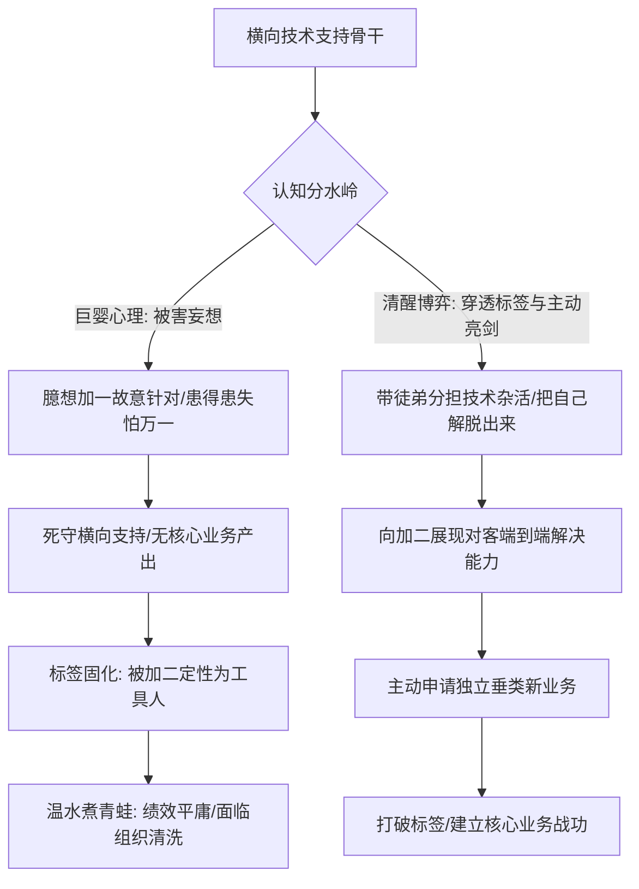
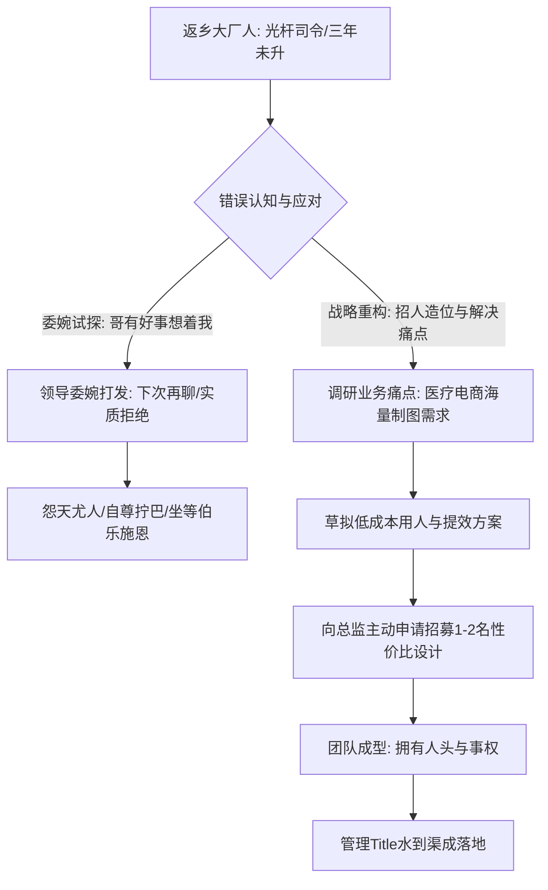

在职场中，专业能力过硬的骨干往往会陷入两类极具隐蔽性的“发展泥潭”：
第一类是**“横向技术支持陷阱”**：自恃专业过硬，却被直属领导死死按在横向技术支持的岗位上，主干业务和项目汇报全由领导的商务嫡系把持。当事人陷入深度的“领导故意给我使绊子、针对我”的被害妄想与患得患失中，温水煮青蛙；
第二类是**大厂骨干返乡后的“管理虚诺与光杆司令陷阱”**：从一线大厂回到二三线企业，领导曾在会上口头承诺“提拔你当主管”，然而随着手下下属离职，当事人沦为光杆司令，找领导试探只得到一句冷冰冰的“回头再聊”，陷入自傲又自卑的拧巴委屈中动弹不得。

2026年10月13日晚《产品老曾》的职场深度连线答疑，针对这两起经典困境，撕开了温情脉脉的表面话术，直击组织利益、人性弱点与破局底层逻辑。

---

## 一、 案例一：百人团队横向技术支持的边缘化死局与反被害妄想

### 1. 个案原貌：技术大拿被边缘化与被害妄想症
连线学员在一家大型企业（总监下辖100多人、分若干业务组）担任资深技术支持：
- **被架空的现状**：直属领导（加一）在重大百万级大项目中，安排自己的商务型嫡系担任核心项目负责人，并由加一带着该嫡系向大总监（加二）汇报。连线学员只被分配做底层的横向技术接口，无法主导独立项目，拿不到核心业务绩效；
- **学员的认知与纠结**：学员坚信“加一是故意防着我、针对我，不想让我出头”。当老曾建议其跨过加一向加二亮剑争取垂类项目时，学员立刻陷入极度焦虑：“万一加一阻拦我怎么办？万一我失败了加一给我打低绩效怎么办？”陷入“万一”的内耗死循环。

### 2. 老曾底层诊断：刺破幻觉的三大冷酷真相

#### （1）商业组织的“反针对论”与反被害妄想
老曾当头棒喝：“职场上根本没有人闲得没事干专门针对你！加一自己要升职、要赚钱、要向上汇报，他神经病啊天天琢磨怎么整你？”
- **“针对”的本质是“重要性不足引起的忽视”**：加一在调配资源、分配利益和安排人事时，之所以没有考虑你，仅仅是因为你在组织大局中的**战略权重太低、标签太单一**，所以你被自然“忽视”了；
- 很多员工之所以觉得全世界都在针对自己，本质是**巨婴式的脆弱自尊与过度敏感**，拿自己的内心戏代替了冷冰冰的组织利益衡量。

#### （2）标签锁死：加一在总监面前给你贴的“死标签”
- 加一在加二（总监）面前，已经把你的人设彻底定型了：**“技术确实不错，但人有点轴、不懂商务人情世故、无法独立端到端搞定客户”**；
- 只要这个标签在加二脑海里没有被打破，加二就永远不会把核心垂类大项目交给你带队，你做再多的横向支持，也只是个可有可无的“修电脑工具人”。

#### （3）“万一”陷阱与温水煮青蛙
- 学员纠结“万一加一阻拦怎么办、万一失败影响绩效怎么办”。老曾直接点破：**“你现在有绩效吗？你现在被边缘化在角落里，早晚也是被组织自然淘汰，不过是早死还是晚死的区别，你有什么好怕失去的？”**
- 越是害怕“万一”，越是在恐惧中被温水煮青蛙，最终丧失所有市场议价能力。

### 3. 破局实操法则：打破边缘化的双轨行动
1. **培养替代者，解脱自身精力**：
   - 抓紧带出一个能够应付日常横向支持的下属或新人，把自己的日常技术琐事交接出去；
   - 只有从繁杂的横向支持中脱身，你才有带宽去接触客户、理解商务，为接管垂类业务腾出空间。
2. **跨级向加二（总监）重塑标签**：
   - 不必向加一乞求项目，寻找业务契机直接向总监展现你除了技术之外对行业、客户与商业闭环的深刻洞察；
   - 明确向加二表达：“某垂类新业务我愿意立军令状主抗，跑通端到端”。打赢了建立新山头，打输了大不了换部门或跳槽，彻底摆脱寄生在他人庇护下的工具人宿命。

---

## 二、 案例二：大厂人返乡“管理虚诺”与光杆司令破局法

### 1. 个案原貌：返乡设计师的委屈与迷茫
连线学员曾在深圳大厂担任骨干设计师，后因家庭原因回到安徽老家，就职于一家 600 人的医疗电商企业，任职三年：
- **历史画饼**：一年前，学员手下带过一名美工，业务总监曾在大群和内部会议上口头承诺：“帮你内推提拔为设计主管（M序列）”；
- **沦为光杆**：不久后，该美工离职，设计部门只剩学员一人，公司并未补人。学员的职级依然停留在专业线（T），三年未获晋升；
- **委婉碰壁**：学员私下找总监试探：“哥，公司有业务发展的事，有好事多想着我”，总监轻描淡写回了一句“下次再跟你聊”，随后一年彻底没了动静；
- **心理崩塌**：学员陷入严重的拧巴状态——自命不凡觉得“我大厂回来的专业很牛”，又自卑敏感觉得“二三线环境不行、领导在打压我”，委屈巴巴地坐等公司施舍编制。

### 2. 老曾底层诊断：看透权力的冷酷算计

#### （1）穿透“下次再跟你聊”的真实潜台词
老曾一语道破玄机：“你以为领导说‘下次再聊’是真打算找时间跟你促膝长谈？在职场黑话里，**‘下次再聊 / 回头再说’就是最坚决、最明确的回避与拒绝！**”
- 领导之所以不直接挑明“你根本不配当主管”，是因为你在这个位置上还能老老实实画图干杂活；领导怕一旦说出大实话，你当场脆弱破防，连仅有的画图积极性都没了。所以用一句“回头再聊”哄着你继续当廉价劳动力。

#### （2）光杆司令铁律：没有下属，就没有管理编制！
- 组织设立一个管理层岗位（M序列），必须具备两个基本前提：**管辖团队的规模（人头）** 与 **对业务指标的承揽（事权）**；
- 领导当初承诺提拔你，是因为你当时手下带了一个美工，可以包装成一个设计小组；现在美工离职了，就你一个光杆司令，“管谁呢？管你自己画图吗？给一个光杆发管理津贴和主管title，HR和老板会直接问责总监！”
- 只要你手下没有人，任何管理职务的晋升都是镜花水月。

#### （3）大厂返乡人的“受害者自恋陷阱”
- 许多大厂回二三线的人才，身上带有一种极度致命的毛病：**自恋又自卑，委屈又拧巴**。自恃在大厂见过世面，每天觉得自己屈才，遇到利益诉求不敢大大方方据理力争，反而用“哥有什么好事想着我”这种低情商的讨好与委婉话术；
- 领导要的是能独当一面、帮其分担业务扩张压力的干将，而不是一个每天愁眉苦脸、需要领导照顾脆弱心理的“委屈老黄牛”。

### 3. 落地破局行动：主动提“招人方案”为自己造位
老曾给出了立竿见影的“造位二步法”：
1. **第一步：主动向总监递交《设计提效与招人方案》，打破光杆僵局**
   - 医疗电商业务正在扩张，天猫、京东、拼多多等渠道的药品详情页、大促海报需求巨大。不要等领导安排，主动梳理当前设计产出的瓶颈；
   - 拿着具体的方案找总监：“领导，现在全渠道设计任务超负荷，严重影响新品上线转化。我物色了本地一两个性价比非常高的年轻设计（或前大厂外包），月薪只需三四千。我把他们带起来，把流水线制图接过去，我来主抓核心转化率和视觉升级，整体产出能提效 50%！”
   - **核心逻辑**：只要总监批准你招人，你手下就有了 2~3 人的兵马。兵马一旦到位，总监自然顺水推舟将你的主管（M）Title 落实下来。
2. **第二步：彻底与过去的拧巴自尊决裂**
   - 彻底戒除“委屈受害者心态”，停止在角落里自怨自艾；
   - 职场不讲眼泪，也不讲为什么。把所有纠结“Why”的心思收起来，聚焦于“Do”——用主动出击为领导解决真问题，换取属于自己的权力与编制。

---

## 三、 认知升维：老曾职场博弈两大核心模型

### 1. 模型一：横向支持陷阱与反被害妄想定律 (`model_cross_functional_support_trap`)
- **核心逻辑**：职场中的“边缘化”绝大多数不是源于蓄意迫害，而是源于自身战略价值单一导致的“自然忽视”。长期困于横向支持必然沦为温水青蛙。破局的唯一出路是克服对“万一失败”的恐惧，培养替代者解脱自身，主动向高层亮剑争夺垂类业务主导权。

### 2. 模型二：管理虚诺穿透与主动招人造位法则 (`model_management_void_staffing_seat`)
- **核心逻辑**：高管口头承诺的“下次再聊”是对无价值纠缠的委婉拒绝。没有下属的人永远不可能获得管理编制。管理者不可坐等组织施舍，必须围绕业务扩张的痛点，主动向领导提出低成本招人方案。**先有人头和事权，后有管理Title**——用招人主动为自己创造管理抓手。

---

## 四、 实战行动工具包（Actionable Checklists）

### 1. 摆脱横向支持边缘化自查清单（Cross-Functional Escape Checklist）

| 序号 | 自查维度 | 核心评估标准 | 达标打勾 |
| :---: | :--- | :--- | :---: |
| 1 | **认知脱敏** | 是否已彻底破除“领导在针对我”的被害妄想，认识到边缘化本质是重要性不足？ | [ ] |
| 2 | **精力解脱** | 是否已在内部物色并培养新人，能接管自己 70% 以上的日常横向技术杂活？ | [ ] |
| 3 | **标签重塑** | 是否已准备好面向 +2（总监）展现商业闭环、客户对接与端到端交付的综合认知？ | [ ] |
| 4 | **主动亮剑** | 是否敢于摆脱“万一失败”的内耗，主动向总监申请独立负责垂类新项目？ | [ ] |
| 5 | **退路准备** | 若业务突围受阻，是否已提前更新简历、保持外部猎头触达，具备随时跳槽的资本？ | [ ] |

### 2. 返乡骨干打破“管理虚诺”行动禁忌清单（Management Seat Anti-Trap Checklist）

| 序号 | 致命禁忌行为 | 发生概率 | 违背后果 | 纠偏替代方案 |
| :---: | :--- | :---: | :--- | :--- |
| 1 | **把“回头再说”当成真承诺** | 极高 | 陷入无休止的被动等待，在画饼中白白耗费一年又一年青春 | 认清委婉拒绝本质，立即停止口头试探，转向行动突破 |
| 2 | **作为光杆司令索要主管Title** | 极高 | 领导在制度上无从下手，被视为不切实际、情商低下的空谈者 | 绝口不提个人Title，先提出招人方案解决业务瓶颈 |
| 3 | **使用“哥有好事想着我”委婉乞求** | 高 | 暴露出乞讨式心态与软弱形象，领导彻底丧失提拔意愿 | 携带白纸黑字的业务提效与人员预算方案，专业化汇报 |
| 4 | **带着大厂优越感自怨自艾** | 中 | 既融入不了二三线组织土壤，又无法产出超越他人的业务增量 | 彻底放下身段与玻璃心，用接地气的商业产出证明自身价值 |
| 5 | **停留在想Why而不去Do** | 极高 | 终日内耗在“为什么领导不重用我”中，精神破防丧失行动力 | 停止一切内心戏，火速搜集人才与方案，用执行力打穿死局 |
