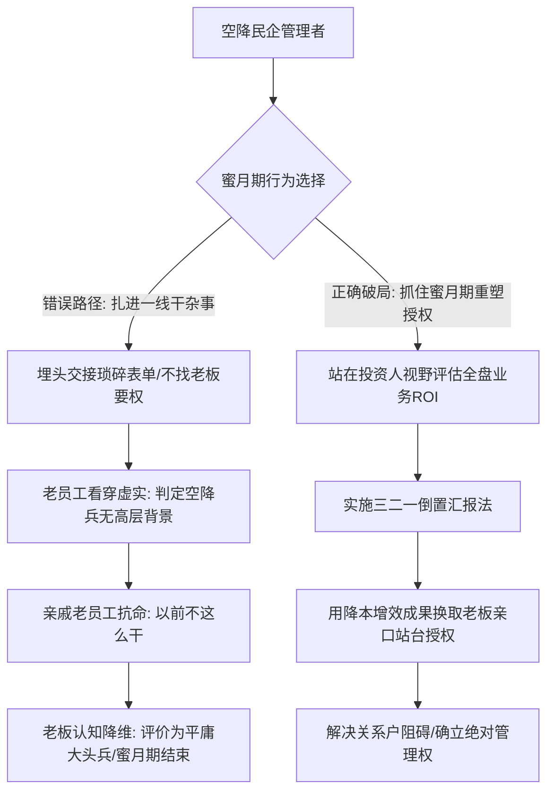

在民营企业与家族型企业的管理实战中，空降管理者常常会遭遇两类极其致命的“隐形绞杀”：
第一类是**“蜜月期沦为一线大头兵陷阱”**：空降兵刚入职就被拉着去交接繁杂的日常杂务，为了展现“接地气”，一头扎进具体细节里灭火，结果连自己的直接汇报线上级是谁都没搞清楚，白白耗尽了最宝贵的前 1~3 个月信任蜜月期；
第二类是**“亲戚老员工的软抵抗与授权真空”**：手下的老主管在公司盘踞多年，甚至与老板有亲戚裙带关系。空降兵由于缺乏高层明确的正式站台与事权边界，向下分配任务推不动，老员工直接以“以前不这么干”顶撞抗拒。

2026年10月13日深夜《产品老曾》的职场深度连线答疑，针对这起典型的空降民企困境，进行了极其透彻的利益拆解与认知重构。

---

## 一、 案例深度复盘：空降供应链经理与亲戚老员工的抗命死局

### 1. 个案原貌：一头扎进一线杂事的空降管理者
连线学员罗女士刚空降至一家民营制造企业（限塑行业）担任供应链经理满一个月：
- **组织关系模糊**：她是总经理助理招聘进来的，直接向谁汇报、老板究竟对其有何期待，从未与总经理进行过正式对齐；
- **老员工盘踞抗命**：手下两个主管在公司任职超 10 年，其中一个更是老板的亲戚关系户。罗女士尝试推进业务规范，两个老主管态度消极抗拒，借口“以前的经理不这么干”拒不执行；
- **自己沦为大头兵**：前任经理离职，罗女士被推着接手大量琐碎交接工作，每天忙于对单、催料、填表，陷入无休止的事务性劳动；
- **罗女士的向上困惑**：罗女士计划找老板汇报，打算按以下顺序陈述：“第一，团队积极性不高；第二，我计划怎么提升效率；第三，怎么理顺从接单、生产到出货的端到端流程”。

### 2. 老曾底层诊断：看透民企空降的致命盲区

#### （1）管下属太简单，向上要授权才最难！
老曾当头棒喝：“你以为管几个人很难吗？管人太简单了！你现在推不动，根本不是你管人能力的问题，而是**上面根本没有给你授权！**”
- 亲戚老主管在公司盘踞十年，深谙权力运作。他们往上一看：**“你自己站位都不稳、上面老板没替你站台、连你是总助的人还是总经理的人都没人清楚，你算个什么东西？凭什么听你的？”**
- 在民企家族企业里，没有大老板亲口授予的“兵权和尚方宝剑”，任何向下管理的动作都是自取其辱。

#### （2）空降兵的“一线大头兵陷阱”
- 许多空降兵误以为“先低头干活、把事情做熟了再要权”。老曾指出：**这是最致命的慢性自杀！**
- 入职的前 1~3 个月是极其宝贵的**“政治蜜月期”**。此时老板对你有新鲜感、有高期待、有耐心。如果你在这段时间把自己做成了一个每天填单子的一线操作工，老板对你的评价立刻从“破局管理者”降级为“不过是个普通办事员”；
- 一旦蜜月期耗尽，你就彻底丧失了重塑组织架构、清洗刺头的历史窗口。

### 3. 破局实战：向上汇报的“三二一倒置法则”
针对罗女士准备的汇报思路，老曾当场叫停，指出其顺序完全颠倒：
- **罗女士的错误顺序（从下往上，苦劳视角）**：
  1. 团队积极性不高（诉苦抱怨，暴露自己无能）；
  2. 怎么提升效率（空洞方法论）；
  3. 怎么理顺端到端流程交付业务（把核心价值压在最后）。
  > **后果**：老板听完第一句就皱眉头：“我花钱请你来是解决团队问题的，你一上来就跟我抱怨团队不行，那要你干什么？”

- **老曾的正确顺序（三二一倒置法则，投资人视角）**：
  - **第一步（聊结果与收益，原第三点前置）**：
    “老板，我这一个月摸清了全盘业务。当前从接单、生产到出货的交付周期存在严重堵点，供应链损耗率偏高。如果把这套端到端流程理顺，预计能帮公司缩短 20% 交付周期，每年直接降本增效数百万元！”
    （*瞬间抓住老板的投资人神经，老板只看代价和 ROI！*）
  - **第二步（聊流程与抓手，原第二点居中）**：
    “为了达成这几百万的收益，核心是重塑三大流程节点：接单排产防呆、生产物料精细化跟踪、出货协同预警。”
  - **第三步（要授权与排兵布阵，原第一点垫底并转化为组织诉求）**：
    “但在落地这套新流程时，原有的十年老机制和部分老员工习惯形成了较大阻力。为了保证公司这笔核心收益落地，**我需要老板您在组织架构上正式明确我的直接汇报线与人事考核权**。对于不符合新流程的人员，需要您支持我做必要的岗位轮换与立规！”

---

## 二、 认知升维：求职面试的“全知全能幻觉”破局

在当晚的硬核连线中，老曾针对很多中高层在跳槽面试中的心理障碍，撕开了面试的认知真相：

### 1. 现象复盘：候选人的“全知全能幻觉”
许多人在面试大厂或高阶总监岗位时，内心戏极多、患得患失：
- “这个项目我只是核心参与者，不是唯一主导者，如果面试官深挖我是不是在吹牛怎么办？”
- “我以前公司的业务有很多瑕疵和失败，面试官是不是全知道？”
- 候选人本能地假想面试官是“全知全能的上帝”，因而过分放大自己的缺点与过失，在面试中唯唯诺诺、过度自证。

### 2. 老曾核心诊断：面试官要的是“解决能力证明”，而不是“诚信公证处”
老曾一针见血地指出：
- **面试官不是全知全能的神**：面试官每天面十几个人，根本不知道你前东家的全部鸡毛蒜皮，更没有上帝视角去核实项目里每一行代码、每一页方案是不是你亲手写的；
- **只要你能讲透，他就默认是你做的**：对于面试官而言，只要你能把该业务的**商业逻辑、面临挑战、破局策略、执行抓手与最终数据量化结果**用极为专业严谨的闭环讲得明明白白，面试官就默认你具备这项能力；
- **核心本质**：面试官不是道德法官，他唯一的使命是确认：“如果我把你招进公司，面对眼前这档子烂摊子，你能不能帮我摆平！”——停止脆弱自证，将精力放在证明自身的商业交付力上。

---

## 三、 认知升维：老曾职场博弈三大核心模型

### 1. 模型一：向上汇报三二一倒置法则 (`model_inverted_321_upward_reporting`)
- **核心逻辑**：中层向上汇报最忌讳从下往上诉苦（抱怨团队积极性差、工具落后）。高层领导具有投资人心态，只关注投入产出比（ROI）。高阶汇报必须倒置：首聊**商业收益与业务大盘增量**，次聊**核心抓手与流程机制**，最后将团队问题包装为**“索取组织授权与人事调整权”**的必要条件。

### 2. 模型二：空降管理蜜月期一线陷阱 (`model_honeymoon_solo_contributor_trap`)
- **核心逻辑**：空降前 1~3 个月是政治蜜月期。管理者绝不能为了展现亲和力或被交接琐事裹挟而沦为“一线大头兵”。必须在蜜月期内，用最短时间穿透权力架构，锁定核心汇报线与正式授权，以管理操盘手姿态立威。

### 3. 模型三：求职面试全知全能幻觉破局 (`model_interview_omniscience_illusion`)
- **核心逻辑**：面试中的自卑与唯唯诺诺源于将面试官神化为全知全能者。面试本质是“未来解决力”的买卖，而非“历史履历”的道德审计。只要能以严密的商业闭环还原复杂业务的打法与解法，便能瞬间确立专业权威。

---

## 四、 实战行动工具包（Actionable Checklists）

### 1. 空降管理着陆蜜月期自查清单（Landing Honeymoon Checklist）

| 序号 | 自查维度 | 核心评估标准 | 达标打勾 |
| :---: | :--- | :--- | :---: |
| 1 | **权力主线确认** | 入职前两周内，是否已与一把手（总经理/老板）面对面对齐直接汇报关系，摆脱总助等中间层的模糊界定？ | [ ] |
| 2 | **事务性劳动隔离** | 是否已拒绝被前任遗留的杂务填满日程，确保 60% 以上精力投入高层意图摸底与业务全盘调研？ | [ ] |
| 3 | **亲戚关系户摸排** | 是否摸清了部门内老员工的家族裙带与高管暗线背景，避免在无上方授权时发生正面硬撞？ | [ ] |
| 4 | **ROI方案筹备** | 是否在首月内草拟出一套聚焦“降本增效/交付周期缩短”的业务优化方案，准备向上汇报？ | [ ] |
| 5 | **正式站台落实** | 是否借方案汇报契机，促成老板在大群或公开会议上亲口宣布自身的事权边界与主导权？ | [ ] |

### 2. 向上管理逆向汇报避坑禁忌清单（Inverted Reporting Anti-Trap Checklist）

| 序号 | 致命禁忌行为 | 发生概率 | 违背后果 | 纠偏替代方案 |
| :---: | :--- | :---: | :--- | :--- |
| 1 | **开口先抱怨团队不行** | 极高 | 瞬间被老板定性为“管理能力差、推卸责任、制造负能量” | 先抛出业务大盘收益，把人员问题转化为实现收益的配套条件 |
| 2 | **向老板汇报长篇大论细节** | 高 | 老板失去耐心，判定当事人缺乏高层视野与抓大放小能力 | 严格遵循“三二一倒置法则”，提炼三项核心数据与落地结论 |
| 3 | **在面试中过度坦白自身瑕疵** | 极高 | 自曝其短，破坏面试官建立的专业信任感 | 聚焦在如何摆平问题，用严密商业逻辑证明自身交付能力 |
| 4 | **无上方授权强行对老员工开刀** | 中 | 遭遇全团队软抵抗，甚至惊动老板亲戚高层，导致自身瞬间下课 | 借业务ROI向老板索取授权，让高层制度与老板意志充当裁决利剑 |
| 5 | **把“投资人老板”当“保姆”** | 极高 | 老板因感受不到商业价值，迅速撤回对空降兵的所有资源投入 | 凡事带着ROI账本与解决方案沟通，让老板做选择题而非思考题 |
