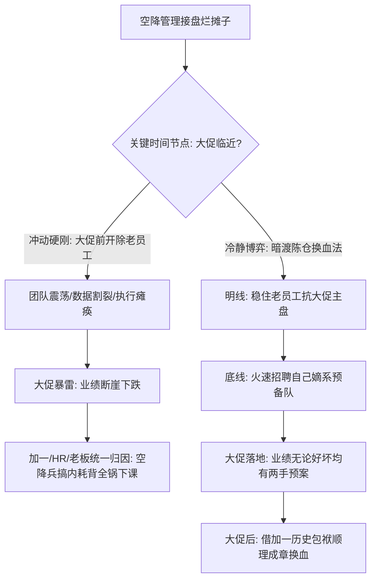
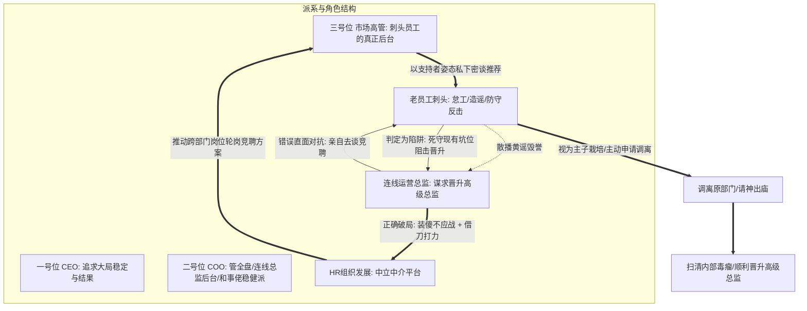

在职场管理实战中，空降管理者最容易踏入两类看似不同、实则底层相通的“雷区”：
第一类是**接盘业务动荡的烂摊子**：下面盘踞着“连克数任领导”的老油条刺头，关键节点（如大促、年度交付）迫在眉睫，空降兵急于立威搞清算，结果瞬间激化矛盾，不仅没换掉人，反而让大促暴雷的锅全扣在自己头上；
第二类是**卷入高管神仙打架的深水区**：自己信任的下属背后其实绑定了另一位实权高管的暗线，当下属因绩效受挫正面刚不过时，转而使用抹黑、造黄谣等下三滥手段毁誉，管理者若亲自下场撕扯自证，便立刻落入下乘。

2026年10月14日晚《产品老曾》的职场深度连线答疑，针对这两起典型的“空降接烂摊子与老油条刺头”个案，进行了手术刀式的利益拆解与博弈重塑。本文进行系统化知识蒸馏，还原冷酷博弈本质与高级破局法门。

---

## 一、 案例一：空降渠道负责人接烂摊子与大促前背锅陷阱

### 1. 个案原貌：连克五任领导的下属与大促生死劫
连线学员刚空降某消费品企业一周，担任核心天猫渠道负责人，向上汇报给全渠道总负责人（+1）：
- **历史烂摊子**：该岗位过去动荡剧烈，已连续换过 5 任领导。团队里有一名老员工，此前代理过业务，业绩虽然能完成目标的 80%~90%，但利润率从历史的 30% 暴跌至 10%。
- **抗命与对立**：新领导到岗后，该老员工态度傲慢，不仅明确拒绝交接历史业务数据与运营档案，甚至在一对一沟通中直言“不需要、不用、不服”。
- **空降兵的冲动**：新领导自恃甲方乙方经验丰富，向老板拍胸脯保证季度目标能做突破，入职仅一周便向加一与 HR 提出要求“必须立刻干掉该老员工”。加一则给出了硬核限制：“你要换他就必须全盘自己搭，现在的班底一个都不给你留”。
- **致命时间节点**：眼下距离双11大促仅剩数周，老员工把持着核心投放与运营节奏。连线学员陷入焦虑与怒火，急于在大促前摊牌清算。

### 2. 老曾底层诊断：看透各方心理账户与背锅机制
老曾当头棒喝，直接揭示了连线者盲目行动背后的致命盲区：

#### （1）老员工的心态真相：防御机制与委屈反弹
- 该老员工在公司资源不足、加一支持有限的恶劣环境下，拼死把业绩守在 80%~90%，其内心自视甚高，认为自己是“救火英雄”；
- 加一在招空降兵前，大概率曾给该老员工许诺过晋升，最后却因老板看不上老员工的格局与利润表现，毁约并空降了新领导；
- 对老员工而言，新领导未经他参与面试就突然空降其头上，且一上来就吹嘘“交出数据我能干到 100%”。在老员工看来，这是赤裸裸的窃取果实与摘桃子。老员工的态度必然是：“你牛逼你自己做，凭什么要我的家底？我倒要看你怎么死！”

#### （2）大促动荡的“背锅第一定律”
- 在双11大促来临前几周搞人事大地震，是最愚蠢的自杀行为；
- **如果大促做好了**，功劳被视为大促基本盘和加一底盘，空降兵未必能独占；
- **如果大促做崩了**，加一、HR 和老员工会惊人一致地把全部责任甩给空降兵：“本来老员工干得好好的，新领导一来大搞内耗、团队动荡，导致大促销毁！”——空降兵入职三个月直接成为“第六任阵亡领导”。

### 3. 破局实战策略：暗渡陈仓与两手预案
1. **停止情绪内耗，把老员工当“临时雇佣军”**：
   - 不要在当下逼迫老员工“心悦诚服”或交出所有权，明确告诉他双11的指标依然由他主抗；
   - 对外维持稳定大局，对内彻底放弃感化幻想。
2. **加速招聘自己的嫡系班底**：
   - 充分利用 HR 和加一给出的“自行组建团队”权限，在一周到两周内火速把新人招募到位；
   - 借“备战大促补充人手”为名切入，让新人熟悉业务，作为双11期间和双11之后的接管梯队。
3. **与加一结成同盟，帮加一卸下道德包袱**：
   - 加一之所以既不想留刺头又不敢硬裁，是因为加一对刺头有历史承诺的亏欠；
   - 空降兵的定位是帮加一干脏活，但必须在“业绩大局不受损”的前提下。等双11大促结束，无论结果好坏，刺头该抗的指标全部落定，此时再由加一与新领导配合，体面地将其移出核心盘，实现平稳过渡。

---

## 二、 案例二：高管神仙打架与借三号位之手“请神出庙”明升暗降模型

### 1. 个案原貌：神仙打架、心腹背刺与造黄谣毁誉
连线学员在一家生产型企业担任运营总监已两年多，向公司二把手（COO，管公司全盘运营）汇报；公司三把手负责市场核心业务（老板极度看重）：
- **心腹变刺头**：总监过去两年一直重用的一名老员工（实为前朝元老，且与三把手有深厚私交暗线），近期交付频频延误、态度懈怠找借口，耽误了老板的大事；
- **考核引发报复**：总监秉公办事，打低了该员工的绩效。该员工正面抗衡不了，先是向上越级打小报告抓总监的流程小漏洞，随后在公司内部大肆散播针对总监的“恶性黄谣”，利用性别与道德舆论意图彻底搞臭总监；
- **晋升敏感期**：此时总监头顶上正空缺着一个“高级总监”的关键上升位，该刺头试图通过毁誉阻止总监晋升，趁机上位；
- **总监的困惑**：该员工动不得（老员工、涉及神仙打架），自己又被谣言困扰，想知道能否给该员工搞个“明升暗降”调去其他部门。

### 2. 老曾底层诊断：高维博弈的三大冷酷法门

#### （1）清白装傻法则：高位者绝不向宵小自证
- 面对下三滥的谣言与人身攻击，许多管理者的第一反应是气愤找其当面对质，或在公司公开群发澄清声明。老曾指出：**这是最愚蠢的降维挨打！**
- **自证陷阱**：清者自清，浊者自浊。一个身份堂堂正正、手握业务权力的高管，如果因为宵小的几句谣言就跳脚解释，不仅在所有人眼中坐实了“你心里发虚”，更是将自己拉到了跟宵小一个泥潭里摔跤；
- **装傻充愣的威力**：只要谣言没有形成正式的纪律指控，当事人就要假装完全不知道。在高层汇报和业务协同中，保持绝对的从容与若无其事。你越不接招，造谣者的攻击势能就越像打在棉花上，反而暴露出其自身的卑劣与焦躁。

#### （2）二号位与三号位的派系定位
- **二号位（COO）**：属于连线总监的后台，主管全盘，但性格稳健、偏和事佬，有更高远的权力图谋，绝不愿为了部门内部的小摩擦亲自下场与三号位撕破脸，更不愿惊动一号位 CEO；
- **三号位（市场高管）**：是该刺头员工真正的后台与“信任靠山”。该员工十几年升不上去，正是因为其能力局限只能当暗线棋子。

#### （3）“明升暗降”的致命陷阱：谁去开这个口？
连线学员原本想自己去找刺头谈，建议他竞聘其他部门的负责人。老曾指出了其中最关键的人性死穴：
- **当事人去谈 = 必死之局**：刺头与你已经反目成仇，你主动找他谈“我支持你去别的部门竞聘做主管”，刺头第一反应绝对是：“你设圈套阴我！等我放弃了现有编制去竞聘，你反手在背后给我使绊子让我落选，我就彻底两头空被你扫地出门！”——刺头必定死死抱住现有岗位绝不挪窝；
- **破局钥匙：借三号位与 HR 之手**：只有让刺头最信任的后台——**三号位**，去私下找刺头谈：“公司有新组织调整，另外那个核心坑位我给你争取了，你赶紧去竞聘”，刺头才会视其为“后台力挺的晋升良机”，欣然笑纳并火速搬离现有部门！

### 3. 落地实施路线：无痛“请神出庙”四步法
1. **第一步：冷处理谣言，在二把手面前展现大度格局**
   - 绝不因私愤在日常工作中露出破绽，将精力全部放在能让一号位和二号位“爽”的核心运营成果上；
   - 面对二把手，汇报工作客观严谨，甚至在二把手提及时轻描淡写，展现“专注公司价值、不屑于宵小攻讦”的高阶领导者心性。
2. **第二步：设计跨部门竞聘通道（明升暗降）**
   - 联合 HR 规划一次横向部门负责人的竞聘或轮岗机会，该岗位级别略升或平移，但必须彻底脱离当前运营部门的核心权责。
3. **第三步：借三号位私下施力**
   - 避开公开对抗，通过二号位或 HR 释放风声给三号位，表达“该员工在运营部门空间受限，三号位若能提携他去新平台，各方都能共赢”；
   - 促成三号位亲自出面成为推动者，让刺头欢天喜地主动申请调离。
4. **第四步：中立流程落地，完成物理隔离**
   - 由 HR 作为合规中立部门完成编制调动与交接，实现不费一兵一卒、不惊动 CEO、不结下死仇的高维破局。

---

## 三、 认知升维：老曾职场博弈两大核心模型

### 1. 模型一：刺头员工的大促背锅陷阱与预备队置换法则
- **本质**：老员工的抵触本质上是对**“安全感剥夺”与“功劳被窃”**的本能防御；空降兵的急躁本质上是对**“急于立威证明自我”**的权力焦虑。
- **法则**：在企业核心战役（如大促、上线）前夕，**绝对不能激化团队的人事对抗**。必须维持“前台老员工主扛、后台火速招募自己班底”的双轨制。把大促风险锁定在业务本身，绝不给老员工和上级任何将失败甩锅给“管理动荡”的借口。

### 2. 模型二：借力打力“请神出庙”与谣言装傻法则
- **本质**：当下属开始使用造黄谣等下三滥手段时，证明其在业务与制度正规军层面已经彻底黔驴技穷。高阶管理者切忌自降维度去公开撕扯。
- **法则**：
  - **舆论装傻**：不接招、不解释、不自证；越是心怀坦荡，越要视其如空气；
  - **借刀送神**：开不掉的人不要强开，用“明升暗降”给予体面出口；但开口的人必须是其**信任的派系后台**，而非敌对的当事人。借别人的手，送走自己的刺。

---

## 四、 实战行动工具包（Actionable Checklists）

### 1. 空降管理接盘“刺头团队”着陆自查清单（Landing Checklist）

| 序号 | 自查维度 | 深度评估标准 | 达标打勾 |
| :---: | :--- | :--- | :---: |
| 1 | **节点风险隔离** | 距离大促/关键战役是否不足2个月？若是，是否已停止所有激化人事矛盾的公开清洗？ | [ ] |
| 2 | **心理账户换位** | 是否搞清楚了加一曾给刺头许诺过什么？加一目前的真正包袱和软肋在哪里？ | [ ] |
| 3 | **自立班底推进** | 是否已启动 HR 通道火速面试并招募属于自己的核心嫡系梯队？ | [ ] |
| 4 | **两手交付预案** | 双11等大促方案，是否保留了刺头执行与新人替补的双重冗余保障？ | [ ] |
| 5 | **功过归因闭环** | 是否确保业务指标口径白纸黑字留痕，杜绝大促后被倒打一耙扣上“破坏团队导致溃败”的黑锅？ | [ ] |

### 2. 遭遇下属背刺与舆论毁誉破局禁忌清单（Anti-Trap Checklist）

| 序号 | 致命禁忌行为 | 发生概率 | 违背后果 | 纠偏替代方案 |
| :---: | :--- | :---: | :--- | :--- |
| 1 | **公开辟谣与发怒自证** | 极高 | 瞬间落入下乘，给外界留下“心虚跳脚”印象，将自己拉入泥潭 | 保持常态装傻，业务汇报若无其事，展现大将格局 |
| 2 | **亲自找刺头谈明升暗降** | 高 | 刺头直接判定为“除掉自己的陷阱”，死守现有岗位决不妥协 | 联合 HR 设计竞聘方案，借刺头后台（三号位）之口劝导 |
| 3 | **强行逼迫直属高管出面清洗** | 中 | 直属高管因和事佬心态或权力自保拒绝，导致自身政治地位被边缘化 | 帮高管分忧，提供多方共赢、不动干戈的调离脚本 |
| 4 | **私自收集材料搞正面清算** | 中 | 牵一发而动全身，激化高管神仙打架，惊动老板被视为制造事端 | 通过合规审计与正常业务绩效考核留痕，交由组织系统自然解决 |
| 5 | **因内耗延误高层核心期望** | 极高 | 丢掉基本盘与老板核心爽点，直接葬送高级总监晋升资格 | 聚精会神抓业务产出，用不可替代的业绩夯实晋升护城河 |
