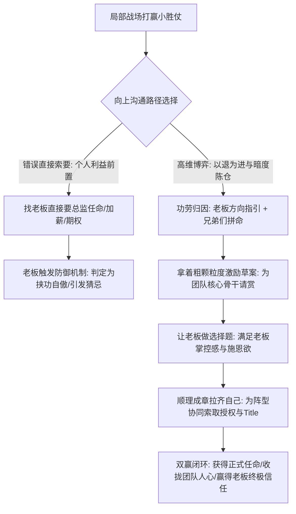
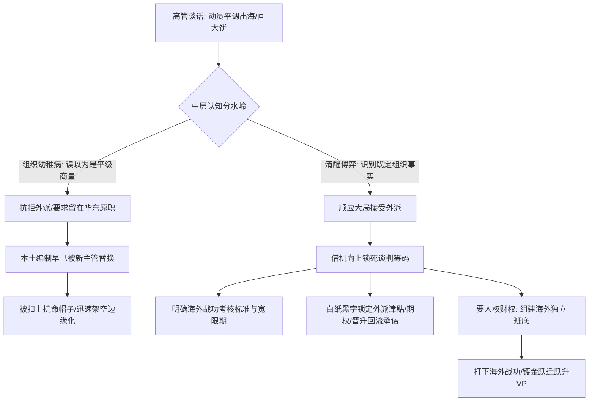

在职场晋升与组织轮调的深水区，管理者往往会面临两大致命考验：
第一个是**打了胜仗后如何向上要官要钱**：许多中层管理者在局部战场打赢了一两场硬仗，便迫不及待地找老板讨要大区总监的正式任命、大幅加薪与股权期权，结果不仅没要到，反而引起老板的防备与猜忌；
第二个是**遭遇高层的突发“平调轮换”（尤其是外派海外）**：高管找你促膝长谈、画大饼、称兄道弟，许多管理者误以为老板是在“征求我的意见”，甚至心存“如果我不愿意就可以留在原地”的天真幻想，最终沦为政治对抗的弃子。

2026年10月14日深夜《产品老曾》的职场深度连线答疑，针对这两起极具代表性的高管升迁与轮调命题，进行了极其冷峻透彻的权力解剖。

---

## 一、 案例一：大区负责人小胜之后要任命的“以退为进”破局术

### 1. 个案原貌：初战告捷后的晋升冲动
连线学员原为某消费品业务省区负责人，因能力突出，近期被加派兼管相邻两个省份的业务：
- **初步战果**：接盘后几个月内，业务出现回暖势头，该学员打赢了第一场扭亏的小仗，且自认有信心在接下来的一两个季度把增长提升 30%；
- **管理者的冲动诉求**：学员觉得自己实际上已经承担了三大省份（实质上的大区总监）的权责，希望立刻找大老板要正式的区域总监任命，同时争取 20%~30% 的现金调薪并索要公司期权；
- **核心顾虑**：担心大老板只是拿自己当临时救火队员，一旦未来两个省业务顺了，老板再空降别人来摘桃子。

### 2. 老曾底层诊断：信任账户与向上要价的四大死穴
老曾一针见血地指出学员此时直接找老板要任命的极高风险：

#### （1）曾国藩法则：打小胜仗容易，但单次小胜不足以支撑绝对托付
- 曾国藩并非百战百胜的绝世名将，但他治军的核心是“打小仗打胜仗，结硬寨打呆仗，报喜不报忧”。朝廷之所以最终把兵权钱权彻底交给他，是因为他用**一系列连续的小胜利**，持续累积出朝廷对他的终极安全感；
- 连线学员只打赢了第一仗，在老板眼里，这可能只是“运气、基数低或短期反弹”。如果你在信任根基未稳时就急不可耐地上门索要官位和期权，老板内心会立刻警惕：“你到底是为了公司打仗，还是在挟功要挟我？”

#### （2）致命失误：以“个人诉求”代替“组织逻辑”
- 向老板提要求最忌讳的是站在“我想要什么、我付出了什么”的角度。老板天然具有反抗被勒索的本能；
- 高明的诉求必须包装为**“组织发展的客观必然”**：不是我个人贪恋大区总监的虚名，而是因为三军用命接管三个省，如果没有正式的组织任命，在跨区域协同、招募高阶骨干、外部商务谈判时会严重滞后，导致公司业绩恢复延宕一年。

#### （3）“为团队请赏，暗度陈仓夹带自己”的高阶话术
老曾给出了教科书级的向上管理操盘脚本：
- **以退为进，功劳归因**：见到老板，千万不要炫耀“我有多牛逼”。第一句话必须是：“老板，这半年的起色，主要是您当初定的大方向英明；前任没做好是因为没理解透您的战略意图；再就是下面这帮兄弟真的太拼命了，没日没夜地干。”
- **大公无私，为下属请赏**：接着提出：“老板，为了把接下来的仗打赢，我建议必须狠狠激励这帮兄弟！这是我跟 HR、财务初步摸底的一份激励草案，给核心骨干加薪、发战役奖金、给晋升任命。”
- **粗颗粒度草案，让老板做选择题**：草案不要写太死，把下属的激励放在最前面，让老板亲自勾选和拍板，给足老板掌控感；
- **水到渠成夹带自己**：当老板对团队激励达成共识后，顺理成章地提一句：“老板，为了带领这支新阵型打硬仗，我的 title 和授权如果能跟阵型拉齐，下面人会更有主心骨，您看组织上怎么安排合适？”——此时，老板不仅会毫不犹豫给你任命，更会在心底认定你是一个“有大局观、懂组织、不自私”的帅才！

---

## 二、 案例二：高管期权与大额红利分配实战心法（蚂蚁拆分案例）

### 1. 现象拆解：大额红利分配的“不患寡而患不均”
很多晋升到总监、合伙人级别的中高层，在手握一大笔期权池或突发年终奖金池时，常常陷入管理盲区：有人试图“搞大锅饭平均分”，有人试图“完全公开透明公示”，结果导致全团队内讧、怨声载道。

### 2. 老曾核心经验：蚂蚁金服拆分找补老员工的深层逻辑
老曾以当年亲历支付宝从阿里拆分独立时的期权红利分配为例，揭示了顶级商业组织的核心分配机制：
1. **绝不平均分配**：平均主义是对核心骨干最大的打击。期权和超额红利必须严格按“战略重要性、层级职级、历史贡献度”进行三维加权；
2. **私下找补，绝不公开公示**：利益分配是绝对的敏感区。任何形式的公示都会引发“他凭什么比我多 5 万/0.1%”的无限撕扯。标准必须由核心管理层拉出详细测算表格，逐个进行一对一（1 on 1）密谈沟通；
3. **老员工的历史找补机制**：企业重组拆分时，元老员工往往面临既有利益被稀释的恐慌。高段位操盘者必须在红利池中单列一部分，专用于向元老员工做“历史心理补偿”，稳住公司大后方；
4. **领袖的让利法则**：高阶管理者如果图谋更大的战略版图，在眼前的局部小红利上一定要舍得“让”。自己少拿一点甚至主动不拿，把大部分利益分给骨干与老员工，换来的是铁血忠诚的死党班底与不可撼动的威望。

---

## 三、 案例三：技术总监遭遇跨国“平调出海”的组织真相与筹码锁死

### 1. 个案原貌：华东总监的“外派困惑”
连线学员在一家跨国技术服务企业担任国内华东区运营总监，手下管着 20 人的核心成熟团队：
- **突发谈话**：公司大领导找他私下长谈，各种称兄道弟、画未来出海战略的大饼，提议将他调往“海外中国公司”同样担任运营总监；
- **学员的幻觉**：学员觉得自己在国内干得好好的，平调出海级别没升，还要远离家庭去人生地不熟的地方救火，便心生退意，甚至认为“反正我还没正式签字，如果我不愿意去，我就拒绝，继续留在原地管华东团队”。

### 2. 老曾底层诊断：刺破中层管理者的“组织幼稚病”

#### （1）刺破第一层幻觉：老板不是在跟你商量，这是“组织通知”！
- 老曾厉声喝醒连线者：“上班上傻了！你真觉得老板是在跟你商量？大领导跟你喝酒、称兄道弟、甚至在办公室跟你哭诉难处，都只是高阶管理者的**软性执行手段**！”
- 事实的残酷真相是：**华南部门负责人调来华东接替你位置的人事安排早已在组织层面全部锁死！** 你的位置已经被腾出来了。此时如果你跳出来说“我不去，我要留在原地”，你在公司高层眼中立刻被定性为“不服从组织大局的刺头”，接下来等待你的就是被迅速架空、边缘化甚至借故开除！

#### （2）平调出海的本质识别：是外放镀金还是借刀杀人？
- 组织外派只有两种可能：
  - **战略重用（镀金跳板）**：海外是公司未来两三年的核心战略增长极，老板派自己的嫡系去开疆拓土，打赢了回来直接进核心董事会或升VP；
  - **明升暗降（调虎离山）**：国内业务进入存量调整，高层派系发生更迭，通过外派把你从深耕多年的本土根据地剥离，以便腾出编制给新的嫡系接管。

### 3. 出海谈判破局法则：绝不赤身肉搏，必须锁死“三大安全垫”
既然去海外是不可抗拒的组织既定事实，聪明的管理者绝不纠结“去不去”，而是将全部谈判精力放在**“去海外的条件与退路”**上：
1. **锁定业绩考核宽限期（免死金牌）**：海外市场存在法律、文化、供应链等多重不确定性。必须在动身前向老板白纸黑字明确：“海外开拓期前 6~12 个月不考核短期营收，以渠道跑通、团队搭建为核心里程碑”，避免刚着陆就被国内指标问责；
2. **锁死回流机制与晋升阶梯**：外派最怕“出得去、回不来”。必须在大领导最需要你顶上去的蜜月期，把回流通道敲定：“外派任期 2 年，海外项目达到约定指标后，回国对应安排副总裁/事业部总经理编制”；
3. **索要人事权与超额财权**：绝不能一个人单枪匹马去海外当光杆司令。必须带走一到两名国内绝对忠诚的骨干，同时索取独立的外派期权池与差异化考核预算，手握资源方能在海外立足。

---

## 四、 认知升维：老曾职场博弈三大核心模型

### 1. 模型一：以退为进与为团队请赏模型 (Advance By Retreat Team Reward)
- **核心逻辑**：打赢胜仗后向上要权要官，直接索要必激发老板的戒备心与被勒索感。高维做法是将功劳归于领袖与团队，拿着未定稿的粗颗粒度草案以“大公无私为团队请赏”为由切入，让老板做选择题满足其支配欲；最后以“阵型协同需要拉齐授权”顺带解决个人职位，实现名利双收。

### 2. 模型二：突发红利与期权私下一对一分水法 (Equity Allocation Private One On One)
- **核心逻辑**：财富分配遵循“不患寡而患不均”的人性规律。大额奖金与期权池绝对不可搞平均主义，更不可公开透明公示。必须通过层级、贡献拉出严密底表，通过私下一对一密谈落地；领袖更需通过主动让小利，结成稳固的政治死忠盟友。

### 3. 模型三：跨国平调出海的组织通知与筹码锁死法则 (Overseas Reassignment Leverage)
- **核心逻辑**：高层对中层骨干的跨区域调动从来不是平级商量，而是阵型调整完毕后的组织通知。试图留在原地的抵抗必定沦为炮灰。唯有迅速接受既定事实，趁高层具有心理亏欠感与动员窗口期，将外派津贴、免死宽限期、回流晋升承诺等战略筹码彻底锁死。

---

## 五、 实战行动工具包（Actionable Checklists）

### 1. 局部小胜向上争取任命自查清单（Promotion Landing Checklist）

| 序号 | 自查维度 | 评估要点与标准 | 达标打勾 |
| :---: | :--- | :--- | :---: |
| 1 | **信任厚度评估** | 当前胜利是否只是首战告捷？是否已有 2~3 次连续见效的战役支撑起老板的绝对托付？ | [ ] |
| 2 | **归因话术校准** | 向上汇报时，是否已剔除所有个人吹嘘，将战果归因于“老板战略指引”与“团队拼死执行”？ | [ ] |
| 3 | **组织逻辑支撑** | 索要任命的理由是否从“个人想要”转化为“不任命会导致三军动荡、影响公司大局”？ | [ ] |
| 4 | **草案留白设计** | 激励方案是否保持粗颗粒度？是否留出空间让老板亲自修改拍板？ | [ ] |
| 5 | **团队人心收拢** | 是否确保把核心骨干的加薪晋升列在自己前面，让团队视你为真正能扛事、能分肉的老大？ | [ ] |

### 2. 遭遇高层“平调出海/跨区域轮调”避坑禁忌清单（Reassignment Anti-Trap Checklist）

| 序号 | 致命禁忌行为 | 发生概率 | 违背后果 | 纠偏替代方案 |
| :---: | :--- | :---: | :--- | :--- |
| 1 | **误把通知当商量公开抗命** | 极高 | 华东本土编制早已腾出，抗命直接被贴上“不服管”标签扫地出门 | 顺应大局，第一时间表态服从组织，展现大局观 |
| 2 | **单枪匹马光杆司令赴任** | 高 | 到了海外被当地原团队合力架空，语言文化不通导致交付瘫痪 | 申请带走 1~2 名国内嫡系骨干，形成管理铁三角 |
| 3 | **不设考核免死宽限期** | 极高 | 海外落地环境恶劣，前两个季度数据暴跌直接沦为替罪羊 | 出发前白纸黑字锁定 6~12 个月战略投入期免死考核 |
| 4 | **未敲定回流通道与晋升位** | 中 | 外派海外数年后被公司遗忘，国内山头被占尽，彻底边缘化 | 在动员蜜月期白纸黑字约定任期满后回流直通 VP 路径 |
| 5 | **仅凭口头兄弟情承诺动身** | 极高 | 高管换届或老板变卦后，口头大饼全部失效，陷入海外绝境 | 所有补贴、期权、预算与回国待遇形成正式书面任命函 |
