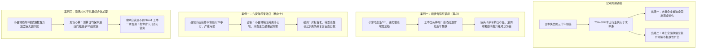
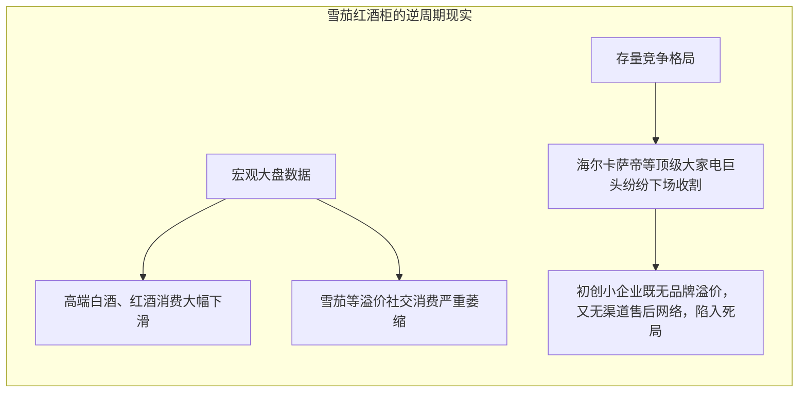
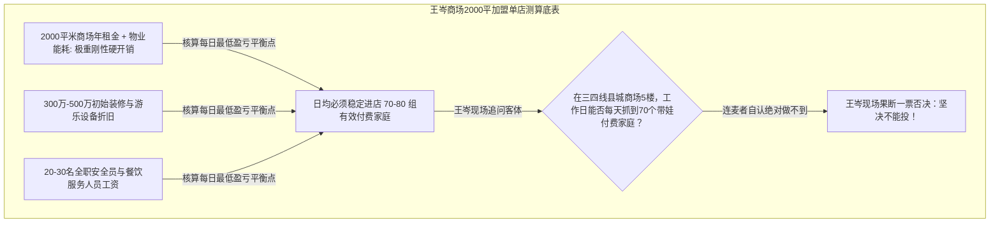

# 2026-10-14 · 王岑：日本低迷周期镜鉴、高端雪茄柜逆周期陷阱、县城鲜榨果汁自救与商场巨额加盟否决

> **场次说明**：本篇基于 2026-10-14 晚至深夜（录制时间：2026-10-14 21:57:26 至 23:42:44，总时长 105.3 分钟）王岑抖音直播《科技创新 + 消费智慧》完整 657 段 ASR 逐字稿全息蒸馏。全程包含日本大萧条消费周期镜鉴、顺德雪茄红酒柜逆周期盲目升级、六安小县城 20 万装修鲜榨果汁自救账本、商场 2000 平米大型加盟巨坑现场一票否决等多个重磅商业交锋。

---

## 核心商业全景导航

---

## 一、宏观消费周期镜鉴：日本“失去三十年”与企业生存出路

### 1. 消费企业的核心护城河：自由现金流与低资本开支
王岑在开场深入拆解了资本眼中的“消费品本质”：
- **抵御周期的唯一指标是自由现金流**：很多制造业看似千亿产值，但每年必须投入几百亿更新设备、做产线技改（高 CapEx），最后股东账面全是折旧；
- **好生意的定义**：**无需巨额资本开支，凭借品牌议价权能够持续涨价，并能将利润以真金白银连年分红派发给股东**。

### 2. 日本大萧条（1990–2020）低迷周期的两极化法则
在回答连麦观众关于经济环境的提问时，王岑结合自身调研，深度剖析了日本在过去三十年低迷周期中的企业生死格局：
- **本土供需格局彻底反转**：楼市跌去 75%–80%，股市腰斩，全社会利率降至负利率，但本土 70%–80% 的传统行业依然停滞不前。根源在于人口老龄化与内需严重“供大于求”；
- **破局路径一（被迫全球化出海）**：日本优秀企业（如丰田、索尼、优衣库、大金空调）的大部分利润与营收全部来自海外市场，依靠全球化对冲本土低迷；
- **破局路径二（本土极致刚需化）**：留守本土的消费品走向两极——要么是百元店（如大创）、萨莉亚这种将供应链效率压到极致的**绝对平价刚需**；要么是带有精神抚慰、健康养老属性的微小业态。

---

## 二、高端雪茄柜逆周期陷阱：顺德小家电创业者的“认知盲区”

### 1. 客体画像与项目诉求
- **连麦人**：黄总（广东顺德，进入小家电行业 5 年，自称“学者型商人”）；
- **核心业务**：聚焦细分定制赛道，开发面向极高净值人群的“高端智能雪茄柜、红酒柜”；
- **支撑逻辑**：引用上市公司会长名言，认为“避开中腰部大众红海，专攻高端细分就是蓝海”。

### 2. 王岑战略诊断：逆周期奢靡消费是“虚假蓝海”

> **王岑**：“你在顺德‘一镇一产业’的家电高地，本应最有成本优势。但你选的赛道，是在**消费下行期逆势去赌高净值人群的奢侈溢价**，这是典型的战略误判！”

### 3. 实战避坑建议
1. **警惕“学者型商人”的理论自嗨**：大企业高管的名言往往针对千亿集团的多元化防守，初创与成长型企业套用此逻辑，很容易选到一个“盘子极小、巨头压境、市场快速萎缩”的死胡同。
2. **顺德家电的正道在“实用出海”与“极致性价比”**：依托佛山顺德无与伦比的塑料、模具、压缩机供应链，真正有生命力的是厨房微小家电的跨境出海（面向东南亚、拉美、中东新兴市场），而不是在国内内卷萎缩的高端雪茄柜。

---

## 三、县城鲜榨果汁店自救：20 万装修亏损与复合业态模型改造

### 1. 客体画像与经营惨状
- **连麦人**：杨女士（安徽六安小县城，原从事美容与电商直播）；
- **开店初衷**：本想小本轻创业，结果租下临街店铺后，在硬装、门头、冷藏展示柜与果蔬榨汁设备上不知不觉砸入 **20 多万元**；
- **当前危机**：开业后门可罗雀，纯鲜榨果蔬汁单杯定价 18–25 元，县城消费者极少复购，每天营业额甚至无法覆盖店铺房租与水电。

### 2. 王岑商业诊断：小县城没有“纯果蔬汁”的生存土壤

> **王岑**：“你在美容行业赚过钱，跨界到餐饮就犯了常识错误。小县城的主力消费人群要的是**便宜、好喝、能社交的刚需饮品**，根本没有纯生榨果蔬汁的心智！”

### 3. 单店急救落地实操
1. **迅速下调价格带，对标古茗等大众品牌**：
   - 彻底废除 20 元以上纯果汁主菜单，将主推产品切换为“鲜果茶 + 经典轻乳茶”，将主力价格带锚定在 10–14 元；
2. **利用现有鲜果供应链做复合动销**：
   - 县城水果损耗极大，必须推出“鲜切水果果捞拼盘、办公室下午茶套餐”，通过小红书与微信朋友圈做本地私域拼团配送，提高单店周转率；
3. **认清“装修是不可逆沉没成本”**：
   - 绝不可因为装修花了 20 万就试图通过高客单价把装修费“赚回来”，市场只认产品当下的即时价值。放下身段做大众生意，才能保住店铺现金流。

---

## 四、商场 2000 平米巨额加盟项目：投行级现场心算与一票否决

### 1. 客体画像与商业诱惑
- **连麦人**：爱吃小鸡块（某三四线县城投资者）；
- **拟投项目**：当地核心商场综合体 5 楼餐饮娱乐层，拟整租 **2000 平方米大平层**，加盟某知名大型儿童乐园与亲子餐饮综合体；
- **资金暴露**：品牌方给出三套加盟方案，总投资额高达 **数百万元**，连麦者举棋不定前来咨询。

### 2. 王岑现场算账：破除招商幻觉的生死测算

王岑连麦中不做任何虚浮探讨，直接要求其拿出商场的真实人流动线与单店财务测算底表：

#### 投行级保本测算拆解台账
| 财务指标项 | 参数测算与行业标准 | 县城真实情境约束 | 判定结果 |
| :--- | :--- | :--- | :--- |
| **场地面积与坪效压力** | 2000 平方米综合体 | 县城商场 5 楼工作日客流断崖式下跌，仅周六日下午有集中客流 | 严重不匹配 |
| **保本进店门槛** | 日均有效进店家庭 $\ge 70$ 组 | 县城总人口与新生儿基数有限，工作日日均进店通常不足 15 组 | 无法越过 BEP |
| **资本开支风险** | 数百万元加盟费、硬装与游乐特种设备 | 属于特种专用设备，一旦商场经营不善闭店，二手残值不足 10% | 资产暴亏 |
| **最终投资决策** | **坚决否决，立即终止加盟谈判** | **“这一通连麦直接为你省下了几百万元债务和未来几年的官司”** | **PASS（一票否决）** |

---

## 五、王岑商业实战心法台账总结

| 商业场景 | 传统创业陷阱 | 王岑穿透性法则 | 避坑检验底线 |
| :--- | :--- | :--- | :--- |
| **宏观认知** | “大家都说环境不好，但高端有钱人不受影响，做高端一定行。” | 周期下行期，奢靡社交与小众消费跌幅最惨烈。逆势做高端是缺乏大盘常识的自杀行为。 | 查验细分品类近两年全国总销量同比增速（若 $< -15\%$ 坚决不碰） |
| **县城餐饮** | “把一二线大城市的时尚生活方式搬到县城，降维打击。” | 县城没有轻奢尝鲜心智。县城餐饮的命根子是“高性价比、大分量、能社交、高频刚需”。 | 客单价严控在 10–15 元区间，坚决不做纯小众健康概念 |
| **大店加盟** | “商场黄金大面积、品牌方背书，做大乐园一定震撼全城。” | 面积越大，刚性租金与人员固定开销越重。县城商业严禁做超过 500 平以上的重资产加盟。 | 严格用“工作日客流保本线”而非“周末客流峰值”来倒推投资回报 |
| **资产守护** | “手里有几百万现金，闲着也是贬值，不如投资搏一把大的。” | 现金在周期调整期是极其宝贵的战略弹药。不盲目负债、不盲目投重资产，就是最大的理财。 | 凡不能在 12 个月内用真实经营净现金流回本的项目，一律免谈 |

---

## 六、数据校验与源资产凭证

- **源录音资产**：`抖音录制库/王岑/[2026-10-14 21-57-26][王岑][科技创新 + 消费智慧].m4a` 等 3 个连续片段
- **采样参数**：24,000 Hz 单声道，总时长 6317.9 秒（105.3 分钟）
- **切片与 ASR 凭证**：13 个 600 秒切片，VibeVoice-ASR-7B 远端 GPU（H100）本地转录完成
- **有效发言段落数**：657 段，flags 校验 0 异常
- **中间资产目录**：`outputs/latest-2026-10-14-wangcen/`
