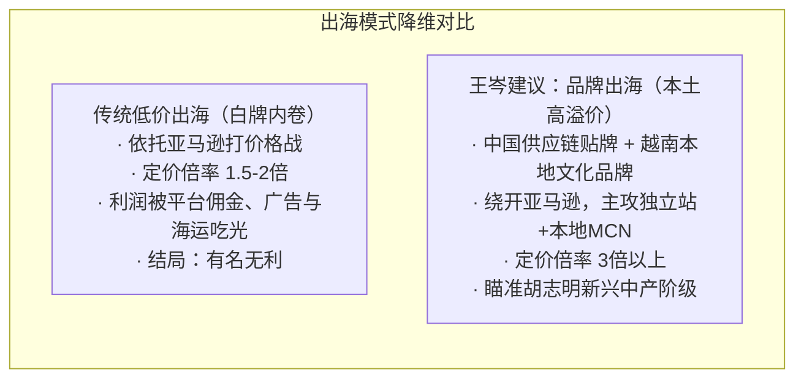
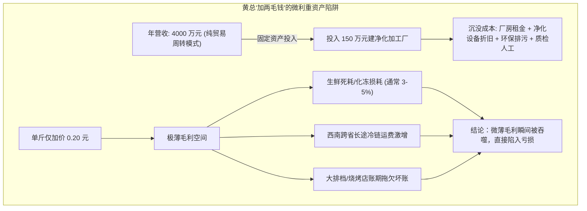

# 2026-10-16 · 王岑：巴菲特消费投资哲学、越南跨境品牌溢价、生蚝供应链重资产避坑与传统行业资本真相

> **场次说明**：本篇基于 2026-10-16 晚（录制时间：2026-10-16 22:15:37 至 23:34:20，录音时长 78.7 分钟）王岑抖音直播《科技创新 + 消费智慧》完整 493 段 ASR 逐字稿全息蒸馏。涵盖巴菲特投资底层模型、AI 应用投资趋势、跨界快餐与社区美发资本退潮真相、越南本土跨境 MCN 品牌化突围、生蚝 4000 万供应链加工厂固定资产投资风险等多个实战级连麦案例。

---

## 核心商业全景导航

```mermaid
flowchart TD
    subgraph M1["宏观投资与资本趋势"]
        A1["巴菲特投资极高回报底层"] --> B1["低资本开支 + 高ROE + 强品牌 + 连年增长分红"]
        A2["当下AI应用投资风向"] --> B2["低成本接入智谱/Kimi API，面向垂直行业落地极度降本增效"]
    end

    subgraph S1["案例一：跨界新手快餐'平台梦'"]
        C1["跨界做微利快餐连锁，前期不赚钱求投资"] --> D1["王岑警示：消费资本极度冰冻，必须先算清单店造血，严禁做平台梦"]
    end

    subgraph S2["案例二：越南跨境MCN转型品牌出海（李总）"]
        E1["50-70人本地MCN + 依托TikTok/Shopee"] --> F1["中国极致供应链贴牌 $\\to$ 越南注册本土品牌"]
        F1 --> G1["品类抉择：高复购高毛利睡眠周边 vs 耐用品匹克球装备"]
        G1 --> H1["王岑五力破局：做透3倍以上溢价，独立站打中产，去解释成本"]
    end

    subgraph S3["案例三：社区美发理发求风投（类似优剪）"]
        I1["44岁创业者借钱开店，幻想引入风投冲上市"] --> J1["王岑当头棒喝：传统低门槛服务业退出通道已关闭，严禁拿养老钱博资本"]
    end

    subgraph S4["案例四：4000万生蚝供应链投建加工厂（黄总）"]
        K1["年入4000万轻资产批发，欲投150万建生蚝净化厂"] --> L1["王岑算账拆解：'单斤加2毛'极度脆弱，生鲜损耗+冷链运费将吞噬净利"]
        L1 --> M2["破局警示：有家底老板最大的护城河是'不盲目重资产转型'"]
    end
```

---

## 一、宏观消费投资哲学与 AI 落地投资动向

### 1. 巴菲特消费投资核心真谛
直播开场，王岑结合数十年的资本实战，拆解了巴菲特投资收益最顶尖的案例（如可口可乐、喜诗糖果）：
- **低资本开支（Low CapEx）**：无需每年投入巨额资金购买新设备或进行昂贵的产线技改，工厂建好后可长期运转；
- **高净资产收益率（High ROE）与强心智溢价**：品牌拥有极强的消费者排他性，具备通胀对抗能力与提价权；
- **充沛现金流与持续分红**：能够连年向股东派发现金分红，且分红金额保持年均复合增长。

### 2. 2026 年初秋资本对 AI 应用的真实态度
- **投资赛道分化**：相比底层超大模型的万卡烧钱大战，一级市场产业资本与早期基金在九、十月份高度关注垂直领域的 **AI 应用落地**；
- **务实选型架构**：国内创业团队普遍基于国内成熟商用 API（如智谱 GLM、月之暗面 Kimi 等），结合特定垂直行业数据，实现极致的降本增效。

---

## 二、越南本土 MCN 突围：从“白牌走量”跨入“高溢价品牌出海”

### 1. 客体画像与资源盘子
- **连麦人**：李总（深耕越南胡志明市，经营 50–70 人规模的本土 MCN 机构）；
- **核心抓手**：拥有成建制的越南本土签约主播、达人短视频制作团队与 Shopee/TikTok 电商带货网络；
- **转型诉求**：依托国内极强的供应链贴牌，准备在越南打造两个自主品牌：
  1. **中高端睡眠耳塞及睡眠周边**（受自身鼻炎打鼾睡眠困扰启发，已在部分诊所试点）；
  2. **新兴匹克球（Pickleball）运动装备**（胡志明市匹克球场近期爆发式增长至上万块）。

### 2. 王岑“五力模型”诊断：产品出海 vs 品牌出海

> **李总**：“我深圳做手机壳的头部朋友，在海外名气打出去了，但其实没挣到钱，利润全被物流、平台和白牌内卷吃了。我不想再走低价白牌老路。”  
> **王岑**：“从‘产品出海’向‘品牌出海’跃迁，核心不在于产地，而在于**溢价倍率与心智占领**！”

### 3. 品类与打法全息拆解
1. **耐用品 vs 耗材属性对比**：
   - **匹克球拍**：属于半耐用品（“打十几次打不坏”），用户复购周期长，前期依靠潮流红利，后期容易陷入库存积压；
   - **睡眠耳塞及睡眠周边**：具有极强的易耗品属性与时尚衍生空间，毛利率和纯利率操作空间远大于运动硬装备。
2. **“去解释成本”的本土化品牌包装**：
   - 不必刻意宣传“中国品牌”。跨国消费中，消费者对海外非本地品牌的解释存在天然认知抗拒；
   - 在越南本土注册独立商标、结合当地语言文化包装，以“越南本土中高端时尚睡眠品牌”切入，能以最低成本消除文化隔阂。
3. **独立站 + 3 倍定价倍率锁定中产**：
   - 越南经济处于快速工业化阶段，大批白领、创业者与经商人群涌现，睡眠障碍正是典型中产痛点；
   - 必须通过 Instagram、Facebook 与自营独立站构筑私域阵地，坚持 3 倍以上加价倍率（Margin），以充沛毛利支撑本地主播内容种草。

---

## 三、传统行业资本残酷真相：严禁盲目拿家庭老本博风投

### 1. 案例一：跨界新手的快餐“平台梦”
- **客体妄念**：毫无餐饮实战经验的创业者，试图开办“前期不赚钱、靠微利薄利多销的中式快餐店”，并希望“引入外部风投资金做成大连锁平台”。
- **王岑当头棒喝**：
  - **餐饮资本已彻底离场**：当下外部投资机构对线下实体餐饮基本关闭投资窗口，新入局者绝无可能凭 PPT 或概念拿到风险投资；
  - **快餐链条极其沉重**：中式快餐对前置供应链集采、中央厨房配运、单店标准化出品有极高资金门槛；新手跨界必须“先做小、再做精”，如果连单店都无法自我造血盈利，盲目谈平台扩张就是自欺欺人。

### 2. 案例二：44 岁美发创业者的“资本化执念”
- **客体妄念**：44 岁深圳创业者，模仿“优剪”等快剪连锁模式，开出 1–2 家美发店，试图借贷或拉风投盲目扩张数万家店冲刺上市。
- **王岑深度剖析**：
  - **传统低门槛服务业没有资本溢价**：美发行业技术门槛低、技师流动性极大、极度依赖手艺人个体，缺乏科技护城河。资本市场的注册制收紧后，根本不会为此类商业形态提供高估值退出通道；
  - **创业防守第一准则**：人到中年，上有老下有小，首要任务是守好家庭资产负债表。踏踏实实抓牢两家店的现金流回报，赚取安全利润，严禁拿养老救命钱去博虚无缥缈的资本神话。

---

## 四、4000 万生蚝供应链转型：重资产加工厂与“单斤加 2 毛”的微利陷阱

### 1. 客体画像与财务结构
- **连麦人**：黄总（山东生蚝供应链老兵，从业 8 年，初创仅投入 3 万多元）；
- **当前盘子**：年营业额约 4000 万元，作为一级批发贸易商，主要供货给全国烧烤店、大排档，综合净利率约 5%–8%（年净利 200–300 万元）；
- **转型意图**：计划投资 150 万元自建生蚝清洗、净化与分级加工厂，单斤仅加价 0.2 元；同时计划向西南片区扩张冷链，并扶持残疾人生蚝地摊公益项目。

### 2. 王岑现场深度算账与重资产穿透

#### 关键经营指标对比表
| 经营维度 | 现状（轻资产贸易模式） | 拟转型（自建 150 万净化工厂） | 王岑风险提示 |
| :--- | :--- | :--- | :--- |
| **资本开支（CapEx）** | 极低（数万元流动资金即可周转） | **150 万元沉没固定资产投入** | 资产由流动变刚性，退出成本极高 |
| **毛利核算机制** | 贸易买卖差价（5%–8% 净利率） | **单斤加价 0.20 元** | 微利模型容错率极低，抗风险能力脆弱 |
| **盈亏平衡点（BEP）**| 随行就市，无固定厂房人员硬摊销 | 必须保持每月极高加工吞吐量才能打平折旧 | 旺季尚可，一旦进入秋冬淡季，折旧将导致净亏 |
| **跨区域冷链半径** | 区域成熟稳定客户 | 远赴西南长距离运输 | 损耗率提升 2% 即可吃光单斤 2 毛钱的利润 |

### 3. 王岑给成长期企业家的防守箴言
1. **珍惜轻资产模式的自由现金流**：从 3 万元做到 4000 万元营收，核心依靠的是敏锐的买卖周转与客情信任。自建工厂是“从赚周转的钱跳入赚辛苦加工费的泥潭”。
2. **“加两毛钱”是制造业最大幻觉**：工业加工必须覆盖设备的综合折旧、水电能耗、人工工伤与生鲜不可预见的变质损耗。微利模式必须建立在千万吨级的大宗标准化上，非标海鲜生鲜绝不可轻易尝试。
3. **守成大于盲目折腾**：在民营经济与消费周期的调整期，年年稳定获取 200–300 万现金分红的企业已经跑赢绝大多数同行。**“克制住扩产盲动、不瞎投资”，是成熟企业家最难能可贵的定力**。

---

## 五、王岑商业实战心法台账总结

| 商业场景 | 典型认知盲区 | 王岑穿透性法则 | 落地执行底线 |
| :--- | :--- | :--- | :--- |
| **消费选品** | “只要需求刚性，耐用品和快消品都可以做大。” | 耐用品复购周期过长，耗材与时尚周边生命力更久。消费选品优先看复购频次与定价倍率。 | 优选复购周期 <3 个月、定价倍率 >3 倍的品类 |
| **出海战略** | “依托亚马逊打低价，中国供应链所向披靡。” | 白牌出海有名无利。必须结合目标国文化打造本土化品牌，利用独立站与本土社媒收割中产。 | 避免在海外做无意义的原产地解释，注册本土商标 |
| **传统借力** | “先做规模、找投资人接盘，上市退出。” | 传统低门槛服务业资本大门已关。不要用自家的生活底牌去对赌资本的神话。 | 坚持单店 6–12 个月收回投资并持续产生自由现金流 |
| **供应链升级**| “从贸易往上游建厂，才能把利润抓在手里。” | 重资产加工厂折旧重、工人管理烦琐。轻资产高周转的贸易商绝不可草率背上重资产包袱。 | 新增固资投入必须测算淡季停工期的刚性折旧承受力 |

---

## 六、数据校验与源资产凭证

- **源录音资产**：`抖音录制库/王岑/[2026-10-16 22-15-37][王岑][科技创新 + 消费智慧].m4a`
- **采样参数**：24,000 Hz 单声道，总时长 4725.1 秒（78.7 分钟）
- **切片与 ASR 凭证**：8 个 600 秒切片，VibeVoice-ASR-7B 远端 GPU（H100）本地转录完成
- **有效发言段落数**：493 段，flags 校验 0 异常
- **中间资产目录**：`outputs/latest-2026-10-16-wangcen/`
