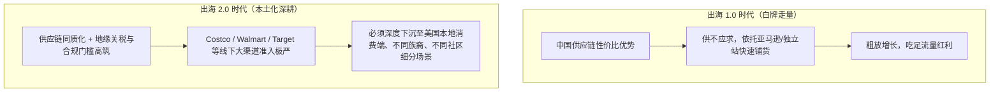

# 2026-10-19 · 王岑：山东文体直供校边店地推心算、出海下半场北美渠道深水区、钛合金骑行配件高客单瓶颈与30万美元GTM软件悖论

> **场次说明**：本篇基于 2026-10-19 晚（录制时间：2026-10-19 22:32:13 至 2026-10-20 00:32:46，录音时长 120.6 分钟）王岑抖音直播《科技创新 + 消费智慧》完整 781 段 ASR 逐字稿全息蒸馏。涵盖山东文体 30 年制造二代组建 10 人地推军团直切全国 20 万家校边店的单店与履约心算、善言 APP 遗嘱小众伪需求死穴、国内 3000 万钛合金 3D 打印骑行配件对标闪电（Specialized）出海受挫反思、十年北美智能硬件老兵转型 30 万美元高价出海 GTM 软件的商业模式悖论，以及出海 2.0 从“白牌铺货”迈入“本地化深度运营”的深水区规律。

---

## 核心商业全景导航

```mermaid
flowchart TD
    subgraph S1["案例一：文体制造二代直供校边店（山东临沂）"]
        A1["30年家族工厂，8月起组建10人地推团队"] --> B1["心算模型：10人×3家/天=30家/天，月覆盖近900家"]
        B1 --> C1["工厂4-5折直供，校边店留50%-60%毛利<br/>300元起送包邮，先款后货，现金流极度稳健"]
    end

    subgraph S2["案例二：伪需求与极低频死穴（善言APP）"]
        D1["遗嘱与最后留言软件，不到1万用户送出12封信"] --> E1["王岑当头棒喝：极低频+违背人性避讳+无复购网络效应<br/>劝退伪需求，转向高价值AI应用或务实实业"]
    end

    subgraph S3["案例三：骑行配件高客单出海困境（3D打印坐垫）"]
        F1["国内做到3000万，推出钛合金3D打印件对标闪电"] --> G1["国内消费承压，出海找第三方代运营因不懂圈层打水漂"]
        G1 --> H1["王岑警示：新创业者前期必须弯腰先挣钱，切忌盲目硬做高端品牌"]
    end

    subgraph S4["案例四：出海2.0深水区与30万美元软件悖论（北美十年老兵）"]
        I1["北美10年老兵，自研GTM出海竞争分析软件年费30万美元"] --> J1["商业模式悖论：AI无主体性，高价靠圈子熟人买单无法SaaS化规模复制"]
        J1 --> K1["王岑指引：出海下半场拼本地化深耕，扬长北美买手渠道长板"]
    end
```

---

## 一、地推破局与小 B 渠道革命：山东文体制造二代直供全国校边店

### 1. 行业痛点还原：多层批发的萎缩
- **连麦人**：山东文体制造业二代（家族工厂在山东临沂深耕文体用品生产 30 余年）；
- **传统流通弊端**：过去几十年依赖省级代理、地市级批发商多层转手，随着整体消费需求减弱与渠道扁平化，中间商压价垫资严重，工厂利润被极度压榨；
- **破局路径**：2026 年 8 月起，果断绕开中间批发商，直接瞄准全国 20～30 万家中小学校门口的**校边店**（文具店、食杂店），在山东本地组建地推铁军打样。

### 2. 10 人地推团队的极简心算模型

- **极低履约门槛**：采取“**300 元起送包邮**”策略，降低校边店老板初次尝试的进货门槛；
- **让利终端小 B**：
  - 传统批发商给校边店的供货折扣在 65～7 折，小店毛利仅 30% 左右；
  - 家族工厂直供直接给到 **4～5 折**，将 **50%～60% 的丰厚毛利空间** 留给终端店主，极大调动了夫妻老婆店推销自家文体产品的积极性；
- **现金流闭环**：因为单笔订单金额不大（300～500 元），严格执行**先款后货、线上小额直付**，彻底消除了传统做大批发被欠款几十万上百万的死账坏账风险。

### 3. 王岑投行扩张点拨：区域合伙人模式
王岑对该山东小伙的务实打法给予极高评价，并现场支招如何跨省扩张：
1. **不要做重资产全国直营地推**：在山东打透样板跑通单店进销存模型后，不要盲目去河南、河北等地重金招募自营地推团队；
2. **招募本地低风险小 B 合伙人**：当前大量河南、河北的传统建材、快消代理商正处于迷茫寻找转型项目的阶段，将该套“低投入、高毛利、回款快”的直供模式开放给邻近省份的小代理，以轻资产网络快速裂变。

---

## 二、伪需求与商业误区：善言 APP 遗嘱最后留言的低频死穴

### 1. 业务场景还原
- **连麦人**：善言 APP 创始人；
- **业务定位**：主打意外身故前的“遗嘱规划与最后留言存证”，声称关注突发意外人群，用户可在 APP 中预留文字/音视频信件；
- **经营数据**：上线较长时间，注册用户不足 1 万人，累计仅真正送出 12 封“最后留言”。

### 2. 王岑当头棒喝：商业模式三大硬伤
王岑听完果断叫停该项目的盲目投入，现场剖析了该赛道无法成立的本质：
1. **违背人性的心理避讳**：绝大多数健康普通人天然排斥在日常生活中频繁思考和记录死亡，用户心理门槛极高；
2. **极度低频与零网络效应**：人生可能几十年才触发一次交付，既没有日常使用频次，也无法形成用户之间的社交裂变，获客成本（CAC）将无限放大；
3. **商业变现通路断裂**：既无法通过免费流量吸引广告主，又缺乏高客单持续付费场景；
> **王岑诫勉**：“90 后的年轻人懂计算机、懂技术，时间是你们最宝贵的资产！切忌沉浸在‘自我感动的伪需求’中浪费生命。去拥抱当下能赚钱的垂直行业 AI 应用，或者踏踏实实帮传统实业做数字化，都远比做一个没有商业闭环的沉重软件强得多。”

---

## 三、高客单骑行出海困境：钛合金 3D 打印配件对标闪电受挫反思

### 1. 经营场景还原
- **连麦人**：国内骑行配件创业团队负责人；
- **辉煌与转型**：此前深耕国内运动自行车渠道，线上年销售额曾做到 3,000 万元；从去年起研发钛合金 3D 打印轻量化坐垫等高端件，定位对标全球顶尖自行车品牌“闪电”（Specialized），试图以品牌出海攻打北美市场；
- **受挫现状**：国内中高端骑行消费增速回落，出海北美时花高价外包给第三方跨境代运营团队，效果极差，资金严重受损。

### 2. 投资人王岑的痛点剖析与心法
1. **高客单圈层的文化水土不服**：
   - 闪电（Specialized）等国际顶级品牌拥有长达数十年的专业赛事赞助、车队文化和极深的技术信任状；
   - 中国团队仅凭“钛合金 3D 打印轻量化”等单一技术参数，无法在海外中产及专业骑行圈层建立品牌信仰；
2. **代运营陷阱**：北美中高端骑行是深度社群化、俱乐部化的运动，单纯依靠第三方代运营团队投 Facebook/Google 广告，根本无法触达专业玩家，白白烧光推广预算；
3. **弯腰挣钱，放下品牌虚名**：
   > **王岑指导**：“新创业者前期就应该弯腰先挣钱！哪有刚起步就天天想着做高端全球品牌的？一上来必须先算清每单能挣多少钱，把现金流做正。有了足够的利润积累，再考虑深耕小众俱乐部和文化沉淀，严禁为了所谓的品牌逼格背负沉重亏损。”

---

## 四、出海 2.0 深水区与高价软件悖论：十年北美老兵转型 30 万美元 GTM 软件解剖

### 1. 连麦画像与业务演进
- **连麦人**：深耕北美市场十年的智能硬件老兵（曾操盘筋膜枪品类在国内做到行业头部，在迈阿密等美国一线城市开过实体店）；
- **当前业务**：转型开发了一款出海 GTM（Go-to-Market）竞争分析与渠道决策数据软件，直接面向中国出海企业核心高管和创始人，**单客户年费定价高达 30 万美元（约合 210 万人民币）**。

### 2. 出海下半场的宏观真相
王岑与连麦者深入剖析了出海进入 2.0 阶段的本质演变：

### 3. 30 万美元高价软件的商业模式悖论
王岑一针见血地指出了该老兵所谓“30 万美元软件”的逻辑死穴：
1. **AI 时代纯软件缺乏“主体性”与高壁垒**：
   - 数据分析与竞品信息在 AI 时代越来越扁平化，仅靠数据看板无法形成持续的排他性价值；
2. **圈子熟人买单 $\ne$ 商业模式成立**：
   - 现阶段几家出海企业花 30 万美元采购，本质是出于对连麦者十年海外人脉与个人顾问经验的信任，而非软件本身的 SaaS 价值；
3. **规模化诅咒**：
   - 真正的软件业务依靠极低边际成本无限复制；如果每个客户都需要连麦者亲自介入定制交付，那它本质上就是昂贵的外包咨询服务，团队规模永远无法做大，且极易因个人精力受限而出现交付翻车。

### 4. 破局之道：回归渠道本分
王岑建议该团队千万不要弃长就短去跟专业软件公司死磕：
- 连麦者核心护城河是**十年积累的北美买手资源、清关供应链与本土线下开店落地能力**；
- 应当以渠道操盘手或战略合伙人的角色，深度绑定 2～3 家国内具备极致供应链但缺乏海外线下开拓能力的优质消费品，按销售分成或股权合伙赚取实实在在的商品出海增量红利。

---

## 五、王岑消费品渠道与出海决策对照清单

| 商业场景 | 典型致命误区 | 王岑投行避坑铁律 |
| :--- | :--- | :--- |
| **小 B 终端地推** | 迷信全国铺开，高薪养重资产直营地推 | 在成熟基地（如山东）跑通 10 人日均 30 家模型，4-5 折让利终端，以小 B 合伙人模式跨省裂变 |
| **软件与工具创业** | 自我感动于小众低频需求（如遗嘱存证） | 坚决避开反人性避讳与零网络效应赛道，优先选择具备高频刚需、正向现金流的商业闭环 |
| **高客单配件出海** | 盲目对标海外老牌巨头，花重金找代运营买量 | 弯腰先做动销与现金流，严禁靠虚假参数自嗨，必须深耕海外本土小众社群与俱乐部 |
| **出海综合服务** | 包装高价企业级软件，靠圈子人脉割韭菜 | AI 时代纯数据软件无主体性，出海老兵必须将核心护城河锚定在北美本土渠道与落地履约能力上 |

---

## 六、数据校验与源资产凭证

- **源录音文件**：`抖音录制库/王岑/2026-10-19 22-32-13/2026-10-19 22-32-13.m4a`（时长 120.6 分钟，对应本地 `outputs/latest-2026-10-19-wangcen/`）；
- **ASR 转写段数**：781 segments（覆盖 F01-L001 至 F01-L013 共 13 个完整切片，重叠区按时间中点严格去重，F01-L011 通过半切降级机制完美修复）；
- **一致性审计**：Flagged chunks = 0，音频时间截断校验通过，全量保留校边店地推心算与北美出海 2.0 对话细节。
