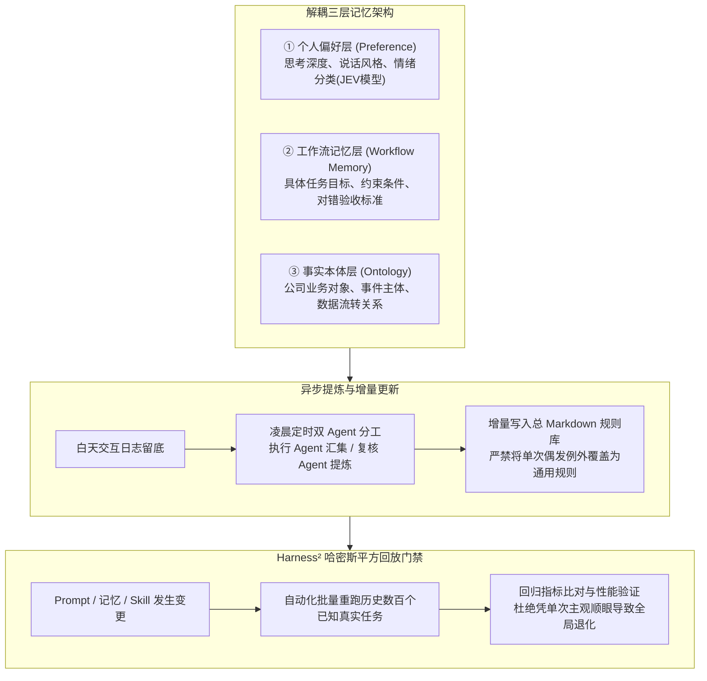
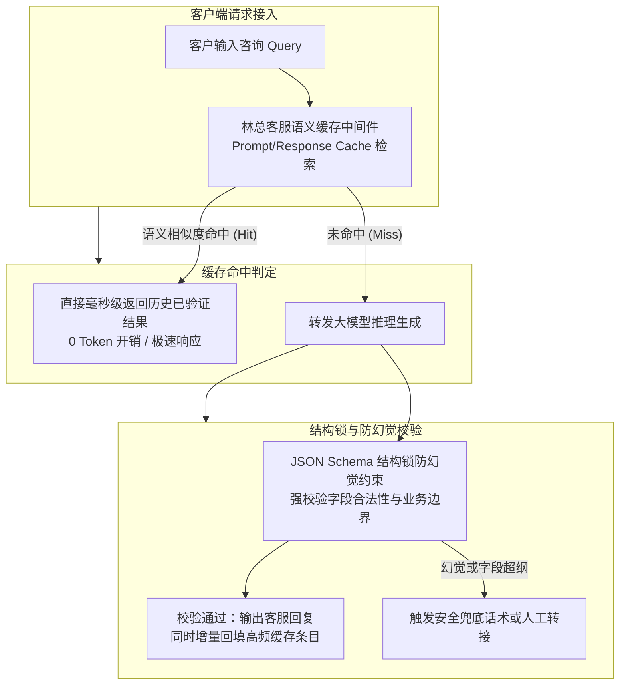
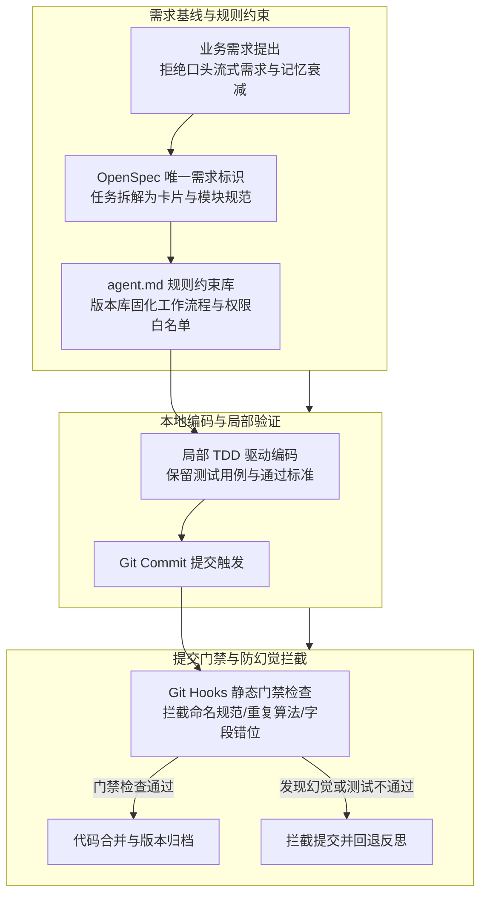
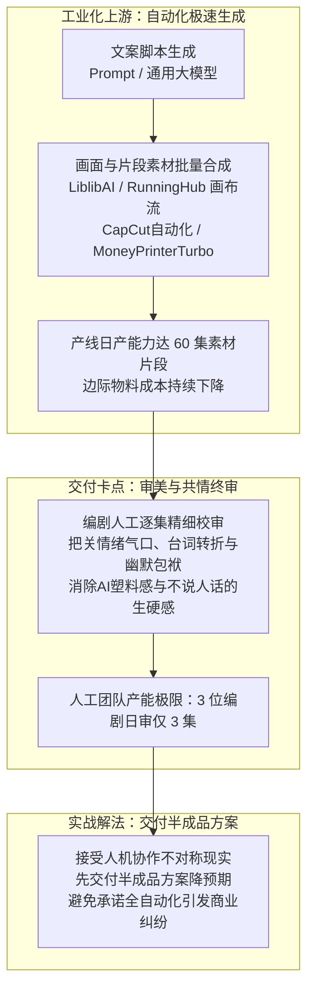

# 2026-10-27 · 第1场直播

这场实战研讨从企业深水区定制交付贯穿到严肃软件工程治理。核心议题涵盖：传统摄影传媒进驻企业做专岗桌面工作台、保险负责人用豆包2天手搓理赔后台击穿20万外包报价、20年ERP老兵转型算账、严肃开发四件套（OpenSpec唯一需求标识、agent.md规则约束、局部TDD与提交门禁防幻觉）、知识库三层记忆解耦与Harness²回放验证，以及短剧产线日产60集卡死在编剧日审3集的工业化瓶颈。本文彻底洗去免责官话与法庭审计腔，以高密案卷呈现全部真实案例、技术拓扑与商业账本。

## 1. 先从实际业务找到AI的价值

### 馒头新品的试作反馈：建议要回到现实验证

主持人的判断是，能让实际工作更省事、降低成本的AI使用，就已经属于落地。优先用大公司的成熟工具；只有现成能力确实不能满足需求时，再谈定制智能体与工作流。不要把工具的复杂度当成价值。直播转述的馒头店老板用豆包处理新品、客户和员工问题，是这一判断的具体例子。

主播转述西安馒头厂老板用豆包建议巧克力、糖等配比，实做后反馈口感不好，再建议再试，两三次改出新品；还用AI问片区销售方案、生成与老板交流话术，自己执行。虽然具体食品工艺参数属于商业机密，但馒头店老板借助大模型进行配比试错并生成沟通话术，展现出传统小微个体接地气的真实落地形态。

AI工具普及不等于商业结果相同，懂具体业务环节的人更容易发现优化机会；程序员有定位bug与生产级判断优势，但商务、获客能力需互补。实践表明，精通具体业务环节的人员往往比缺乏商业认知的初级程序员更容易捕捉到真实改进机会。

### 执行快一点，还是决定快一点

一位参与者将降本增效拆成time to execution和time to decision：前者让员工按流程执行得快，后者汇合ERP、CRM等数据，解释收入下降在哪里、帮助老板判断怎么改。小企业常先买能执行的工作流，大企业可能有跨系统决策分析需求，这清晰界定了两种不同维度的需求：小微企业重在让流程跑得更快的执行提效，大中型企业重在跨系统数据协同的决策优化。

他也提醒纯工作流交付若被客户学会，很难一直收更多钱。可复用的经营问题是：持续收费对应持续维护、变化处理与可验证业务价值，而不是把一次性搭建硬写成长期壁垒。

## 2. 摄影传媒转AI服务：从老关系获客到岗位工作台

### 朋友圈作品、现场演示与两个不同客户

一位原来做企业/景区摄影、无人机宣传的从业者说，旧业务下滑后于四五月开始探索AI。获客动作并不复杂：持续在朋友圈发每天不同的作品，让老关系看到能力变化；熟人主动问，再到企业现场打开电脑演示，随后进入合作。他说已经签约收款，费用不高但有利润，未披露金额。后续澄清涉及两个客户：一个企业集团，以及朋友经营的约120人后台客服外包团队；下文分别说明两家的需求。

### 观察一天岗位，再做桌面工作台

这位服务商的做法是到企业观察员工一天怎么工作，再为不同岗位制作桌面工作台。每台电脑或岗位放适配的Agent，业务数据汇入较大的数据库，需要的数据在部门间流转。他使用Codex生成界面，后端模型选DeepSeek以控制成本；“围栏”指给输出设限制，但没有足够信息把它认作某个产品。

集团宣传部门原来用豆包给领导写材料，服务商说加入约束后，可以三分钟生成一篇并提供五个版本。约120人的另一客户做全天后台客服/电商售后，老板希望减员，服务商观察到业务分布不均：约四条业务，其中两条较弱。减少人力是客户目标，实际裁员与节省额没有披露。

现场还讨论把历史销售、客服聊天里有效的模式与产品知识提取到知识库，给Agent业务目标与多样案例，而非只写死问候语。双方认可这一方向，但没有展开微调、数据清洗与权限实现；执行层究竟用RPA还是协议也仍未回答。

### 按岗位起步，还是先做企业统一管控

现场有人建议采用腾讯官方企业级智能桌面端工作台 **[WorkBuddy](https://workbuddy.qq.com)**（支持企微深度集成、本地 Agent 与多席位统一权限审计）对外销售，并口述可拿10%佣金；还提到超管统一看角色、对话和分配模型。另一位服务商强调，自己服务的县域客户才刚开始用豆包，需要按岗位分别解决问题。两者并非谁必然更先进：前者偏统一采购、审计与管理，后者先把具体岗位跑通。10%佣金与企业管控能力属于现场介绍，实际销售政策以合作协议为准。

服务商另提到培训学员，再由客户雇佣这些人，按月承担各部门维护。这里披露的是服务组织思路，没有给出学员人数、劳动关系、月费与服务等级。另有三四人团队、技术与社交型角色配合的建议，并未说明已经组建完成。

### 演示建立信任，服务仍要落到业务

客户看到桌面工作台的设计会感觉专业，现场也谈到这对展示、品牌甚至融资叙事有价值。展示价值与后台流程是否跑通，是两项不同的判断；这一案例留下的核心经验是：带着真实业务成果上门演示能迅速建立客户信任，但后续合作必须把视觉冲击落实到具体的岗位降本与合规接口上。

## 3. 保险经营者自建理赔后台：业务理解怎样缩短开发路径

一位保险业务负责人把需求讲得很具体：前端网站原由外包制作，后端理赔依赖Excel，老板每月要问经理才能知道数据。想看到每个赔案进展、不同企业/险种的案件发生情况、伤人或财产损失与赔付信息，以帮助质量监控和产品判断。配送、保洁等人员附带保障是他解释业务的例子，并非现有客户名单。

原软件外包报价高达约20万元且周期冗长。负责人因为精通全套理赔逻辑，借助豆包连续突击两个晚上编写出核心业务代码，交由员工实测反馈后，前后耗时约一周完成部署上线。系统日常平稳处理数万条赔案数据流转，投入仅为服务器与基础云费用。

有人问他愿意付多少钱，他说如果在自研前有人上门，2万元会愿意付。负责人坦言，如果在自研前有成熟方案上门，自己愿意支付约2万元采购。业务专家结合 AI 编程能够将传统软件交付成本击穿至十分之一，彻底打破了传统外包的暴利空间。

## 4. 技术服务创业：投流、培训与交付能力怎样一起算账

### 放大广告之后，交付与人员管理成为瓶颈

一位有AI/计算机视觉背景的创业者复盘了多次创业。第一次与四位创始人平均各25%股权做词汇App，遇到无人能最终拍板、推进慢，项目失败。他把失败原因归于平均股权下缺少最终决策者。后来转向软件外包与投流服务，承接 OpenClaw / 龙虾等本地工具部署安装交付（根据服务复杂度单价在 199 至 299 元不等）。

他自述早期线索约20元，约四条线索成交一单，同时口头说约20%转化，按其早期数据，线索成本约20元、约四条线索成交一单，高峰期每天有五六十个客资咨询。但加大投放后交付迅速成为瓶颈，团队招聘三位远程员工（底薪3500元加项目20%提成），管理消耗与交付滞后迅速侵蚀了利润，说明投流放大必须与交付履约能力严格匹配。

后来转向FDE咨询、培训与交付。他的获客来源包括多平台直播和短视频、朋友转介绍、线下FDE活动，近期投流仍不稳定；不会投时一条线索100至200元、还不能成交。经验不是“掌握投流就可复制”，而是广告、成交、交付、远程人员管理必须算在同一账里。

新公司股权有100%持有，也有97%加3%顾问的安排，后者顾问为有上市公司经历的人。它只是讲者的新尝试，未披露治理成效和条款。

### 细分培训人群与收入组成

前述创业者转述一位文科背景的朋友，给国际中文教师教豆包、WorkBuddy等工具，一小时收费3500元，全年收入110多万元。该讲师年入超百万元（包含比赛与专项培训），印证了垂直人群定制的巨大价值：聚焦特定职业（如国际中文教师）的日常任务，比泛泛讲授工具概念具有强得多的变现付费意愿。

## 5. 获客与商务合作：找对客户，也借到真实信任

### 用国内内容触达海外华人

主持人转述一家门业企业的尝试：面对海外做生意的华人，以及会中文、已经与中国贸易往来的外国客户，仍用国内抖音做内容与直播。在视频定位中选择目标海外城市/国家，如利雅得或非洲城市，再做对应地区推广，视频曝光后由直播承接咨询。开播安排跟随目标客户的时区；原话出现“四五点到八九点”，没有明确早晚和哪一时区，因此具体排班仍不清楚。

这个例子的重点是先找客户实际在哪里，再用现有渠道验证，而非一上来认定外贸必须独立站或TikTok。这一模式的核心启发在于：依据目标客户实际所在的时区与聚集地开展定向内容传播，比一味迷信境外新平台更加灵活高效。

### 先看已有系统与供应商，再决定是否进入

一位有保险经营背景的参与者去义乌商品批发企业看需求，对方已有仓库PDA收货和履约系统，还想要库位、补货路线、配送导航等能力。聊到后面发现，原系统供应商已经提供AI平台，系统基础也较好，他于是判断独立小团队不适合继续追。关键不是“客户有需求就接”，而是问清已有系统、已有供应商为什么不能满足、服务是否差或价格是否过高、客户是否真有预算，以及小团队能否承受长周期。

ERP实施者提出反例：如果本来就熟悉大企业系统与业务、已经建立信任，补一层AI可能成立。因此结论不是小团队绝对不能服务大企业，而是陌生进入与已有交付基础不同。另一个现有制造业软件商希望向算力服务商买聚合API/私有化能力，通过背靠背合作守住老客户；其第一目标是维护已有关系，而非立即靠AI赚新利润。这类背靠背合作的核心目的是借助 AI 能力稳固既有大客户关系，而非盲目追逐新客。

## 6. 私有化项目：服务器、检索与训练分别解决什么

### 宠物跨境电商：供应商交服务器，客户研发接业务

一位AI服务商销售人员介绍宠物跨境电商客户：企业内部研发、IT团队希望做AI，另设AI创新/FDE性质角色连接业务与供应商。其所在供应商先交付服务器、本地算力、开源模型部署与调优；业务集成与Agent主要由客户自己的研发团队做，供应商在第二阶段提供咨询。他还提到，可以观察目标企业是否在招聘懂AI的岗位或FDE：这类角色可能就是内部连接业务需求与外部服务商的人。该方案揭示了工业级私有化落地的清晰分工：基础设施服务商负责百万元级服务器硬件与模型底座调优，客户自有研发团队负责业务层集成与 Agent 逻辑。

这揭示了一种分工：懂业务的企业角色确定需求，基础设施供应商解决部署，内部团队做业务接入。现场讨论明确划分了概念边界：私有化解决数据合规环境，RAG解决动态知识检索，微调解决特定风格与垂直业务推理，三者不可相互混淆。

### RAG、微调与企业资料的不同用途

讨论中有人想用4090、千问小模型、向量库与embedding来处理不能外传的技术文档；型号版本口述有明显不稳，不足以形成硬件选型单。私有化是数据处理环境，RAG是检索后辅助回答，微调是训练路径，三者不能互相代替。另一位销售人员做新能源电池企业方案，提到千问、Pro6000、先汇集各部门资料，未来供本地训练使用：这是方案阶段，未证明已经部署或训练。

若目的只是留训练资料，搭文档数据库与做RAG服务是两种投入。现场建议把RAG答案交给业务人员逐条评价，积累“问题—回答—评价”的资料，可能比只有原始文档更适合后续优化；这是设计建议，没给出已跑成的数据集。双方意见不同：有人认为语义检索有价值，有人强调关键词检索就足够；选择应回到真实查询任务，而非宣称RAG只适合固定问答或本体论能解决所有决策。

数据中心人员描述自有机柜线路、几十万元硬件投入，做内部Agent、向量库和微调。检索结果不好时，有人建议先看embedding/re-rank；当事人补充需求是公司架构、运维优化、故障后出方案，基础模型知识浅，需要自有业务数据训练，愿意牺牲部分不需要的通用能力。另一方认为足量知识库可满足文本需求并称微调方向错误。这体现了不同团队的工程取舍：数据中心偏向自有数据微调以保障特定故障方案输出，而轻量团队更青睐向量知识库以降低算力开销。

现场对夸大概念保持了高度警惕，工程落地必须回归可验证的指标。

机器人混合包裹码垛也被用来解释非标程度：圆形、三角形和大小不同的包裹，会增加识别与处理复杂性，从而影响投入产出。非标包裹对识别与抓取算法提出了极高要求，决定了机器人在该场景的实际投资回报。

## 7. 知识库怎样产生复利：先有任务，再存经验

### 三轮自动化之后，仍然没得到想要的知识

一位参与者为了让知识产生复利，做过三轮方案。最初让“龙虾”记录行为、生成文档与文字稿，觉得收益不明显；后来用不同目录保存Markdown，把各工具生成物主动放进临时目录，再让AI定时分析为知识源，存入另一个源目录。AI调程序不满意，又做程序调AI的知识管家，并写Skill让不同AI都能读同一批知识源。尽管通道打通，仍觉得效果不好、token消耗大：一个问题聊一天，每次再调大量历史文件，成本越来越高。

这一挫折揭示出深刻教训：把所有文档自动存储并不能产生知识复利，必须以具体业务结果为导向筛选能改变决策的高价值经验。

### 个人偏好、工作流记忆与公司业务逻辑

现场最具体的分类建议是：个人偏好保存“希望更深入思考、怎样说话”等；工作流记忆保存某个反复任务的目标、提示词、约束、判断对错的标准和该任务历史；公司知识还需表达业务对象与决策关系。不同类别不应全部混进一个总MD。

例如某次特殊业务给某人20万元，平常是10万元；若每日自动整理把例外覆盖成通用规则，第二天就会错。需记录适用条件、与旧规则的冲突，不能任凭两份矛盾文本同时被检索而无取舍依据。偏好可以在Agent启动时加载，任务知识按任务需要取，不必每一步全量重新读。有人把这种分类表述为preference、workflow memory、ontology和底层资料检索；这是他用于组织记忆的一种设计。

一位实践者使用的循环是：执行Agent与复核Agent分工，把人的反对意见、工作标准记到项目偏好中；每天凌晨一两点定时读当天对话，提炼工作偏好与决策理由，更新总Markdown，次日再让Agent加载。这个流程体现文件记忆更新，不是模型权重训练；自动保存也仍有把偶然事件永久化的风险。

开发者的思路是从交流中提取事实型记录，例如谁在何地做了什么，保存主体、地点和事件；另存兴趣与偏好变化，再结合情绪识别让回复更贴近使用者。在情绪判别与快速直觉反馈层面，提到了近期推出的 System 1 类轻量模型 **JEV**（转写常被误听为 GEV），专门用于低延迟的情绪与偏好分类，使响应更贴合用户习惯。

这带出一种架构区分：交互模型可用外部API，记忆资料则由自建程序保存，不必须与某个模型权重绑定。但“只接API其他不用考虑”忽略长年数据存储、权限、服务持续性、迁移和成本，原文并未给完整方案，也未证明记忆能永久保存。

数字人保留老人故事、性格、做数字家谱并让后代交互，是延伸设想；开发者先说现在可做，随后自改“现在技术应该可做”。市场方又指出几十年后可能有价值不等于今天能活下去，要确定当期需求和谁愿付钱。长期愿景与眼前现金流形成了冲突；数据继承和几十年持续服务仍是未解决的问题。

### 原文更新、检索同步与冲突处理

公司原始文档更新后，如果另有embedding数据库，索引必须同步，否则回答继续引用旧版。还要回答同一问题出现两份不同结论时信哪份。现场对RAG的质疑不是不要保存资料，而是新增语义检索之后，是否解决了关键词查找做不到的问题，是否值得同步与冲突处理成本。

设计知识系统时，应把“为什么保存这类文档、什么时候调用、取出后做什么”讲清楚；要生成回答还是只需准确定位资料，是不同需求。文档越多不是当然越好，历史合同可能有漏洞，销售话术也可能只是低转化坏习惯，不能只因来自公司内部就当优质知识。

### 电商图片Skill：围绕点击率补资料

一位电商从业者说，公司用Skill解决具体任务，例如产品图必须满足哪些尺寸与呈现要求。对生成图点击率不如同行的问题，再收集同类商品的优秀图，分析差距，把有价值数据放回这一个生图工作流。输入是自己与同类商品的图及表现，输出是针对这个任务的约束与优化，而非把外贸、跨境、小批发等所有业务资料混在一起。

这项尝试还没有点击率提升数据。真正可学的是把知识与目标绑在一起，不以资料总量衡量价值。

### 新规律要回到旧任务验证

讲者用“同一问题处理300遍，其中250遍用相似模式、其余是边缘个例”解释工作流改进。数字是例子，不是其项目统计。先找共同模式，记录适用条件与例外，再把新Skill/知识带回原来场景重跑，检查是否能复现或更好。这一步在原文称backfill，关键是回放验证，不应仅因新一轮回答更顺眼就把规则升级。

他提到公司开源的“Harness Square/哈密斯平方”项目：在原有Agent运行框架外再包一层，按结果定位要改系统提示词、记忆还是Skill，修改后重新运行，回测旧任务，稳定后继续检查。他说明这是公司项目，而非个人项目。前面名称被转成HoneyScript/Honest Tool等，后文英文更清楚；Harness² 的核心贡献在于确立了回放测试（backfill）机制：任何对 Prompt、记忆或 Skill 的微调，必须在历史数百个已知真实任务中自动重跑回归，验证稳定后方可升级。

一条零散的客服提效线索来自连麦嘉宾林木子（林总）分享的客服自研方案：其核心设计是在大模型前置一层高频问答语义缓存（Prompt/Response Cache）中间件，保存历史已验证的高频问答与计算结果；当用户咨询命中了历史缓存时直接毫秒级返回，彻底节省 Token 开销；未命中时才调用模型，并严格配合后置 JSON Schema 结构锁拦截业务幻觉。

## 8. 万元内容服务的履约账：报价之后还有使用、培训与维护

### 四人跨境团队：两周开发，长期远程支持

一位四人团队服务商从抖音获客，主要做跨境客户的视频内容与分发/获客工作，常见一万元，最高两万元。他说约两周做出来，一个月约四单，但交付后还要看很久。自己觉得省时间，客户却因各种问题不使用；已做两次中途培训，仍持续远程培训和优化。客户收入增加、成本节省暂时还不能验证，万元级内容服务交付后仍伴随长期的远程培训与客服支持，实际利润必须充分扣除后续维护工时。

后续澄清，有的线索/获客看板他只能卖几千元，并非所有看板都卖一万元。某书、某音素材采集触发封号，换过浏览器仍头疼，说明表面“把视频丢进去发布”的交付包含平台稳定性和培训成本。这个失败条件说明，平台规则和账号稳定性仍是交付风险。

现场意见有分歧：有人认为价格应按当地市场、复杂度与快速周转看，不能只追高客单；有人认为四个人每月四万元毛收入难支撑；也有人建议先陪客户长出效果与升级需求。建议寻找对客户增长真有影响的场景，基于已经跑通的人工获客流程加速，而不是替客户发明他自己还没想清楚的赚钱模式。合作、挂靠有资质服务商是建议，未发生签约；既有技术又能销售和交付才可能放大订单，并非个人IP绝无大单机会。

### 理发小程序：两万元收入对应一年维护

另一位服务商举AI理发小程序：最初客单两万元，答应维护一年，每周更新功能。他会观察老板朋友圈关心什么，再思考小程序能增什么功能。这个案例的动作是服务后持续发现真实需求、建立信任；同时每周更新与一年维护是实际履约负担，不能只记两万元收入。

## 9. 把客户反馈接到开发迭代：自动化真正连接到哪一步

这位服务商自述，交付前先与客户拉“泡泡群”，系统监听群内发言，将需求/反馈交给AI分析，驱动开发或迭代；团队主要维护和升级这套开发系统，而非每次人手转述需求。追问确认，不只是AI出回复再由人复制，而是AI去处理和优化。他说入口最初用RPA，后来改为纯视觉，并没有开放接口。

无效消息筛选、验收、人审发布、回滚和授权管理，现场没有完整回答；自动迭代能力目前以服务商的自述为据。所谓流程中断成本高出一千/一万倍是强调人的等待与重复切换成本，不是测量结果；AI一直运行、token买得多，并不自动意味着生意更好。

## 10. AI原生公司的产品与渠道：PC定位、OEM和本地化

该服务商说自己是AI原生公司的技术负责人/CPO，公司有软硬件定制、企业解决方案、三个主要产品，以及快产品线；快产品线做过接近200个产品。他说自己客户端有接近200个Agent/数字员工，两种“接近200”分别指产品与Agent数量，都不是活跃用户或收入。他还说有Agent自动关注云厂商促销并购买，未披露授权、额度与风控；

产品名多人近音不同，随后有人明确拼出“M-Y-N-A点Bot”，可据此继续查找产品。所谓当晚AGI alpha上线、全球第一个AGI级Agent，以及“全国前十”等介绍均为宣传/评价，没有独立验证。团队曾做to C，认为单价高、产品依赖PC，普通用户需求不匹配，因此重心转企业；“毕业后多数人没电脑”只是其市场判断。

他们说支持企业OEM、贴牌、本地化部署。有运营商背景参与者提出希望合作服务当地客户，约后续详聊，此处没有已成交渠道单。模式是渠道带客户与关系，技术方提供产品支持及交付。企业大单仍看产品质量与资质，国企背景不代表每种企业项目都天然有优势。

## 11. 资源不等于结果：云优惠、算力资产与商务渠道

有人集中购买智谱、百度云、京东云、天翼云等平台token，借厂商补贴降低成本；另一人反驳成熟业务专门盯优惠会耗维护精力，利润足够时价值不大，初学者预算紧才可能有意义。也有人把监测活动自动化。这些选择取决于维护投入与业务利润，并没有免费额度永远可用的保证。

运营商、国产算力的讨论存在明显冲突：有人批评闲置、生态与使用效果，有人指出部分正规企业确实在用，也有人说算力作为资产涨价。不能把“闲置也升值”当真实业务已创造价值，更不能由部分闲置断定全部国产集群无用。评估应用收益、资产收益与采购资格是三种账。

一位参与者试过通过中介资源获客，发现对方不愿因此认识陌生服务商。FDE通过助贷中介获客的提问里，主播纠正：与已获企业信任的中介成为利益共同体，让对方参与商务、拿合作或居间分成，自己负责交付。单拿电话号码通常拿不到关系背书，也可能拿到对方没谈下来的企业。企业缺现金时也可能需要降本增效，但合作前仍要核实预算和回款能力，贷款关系本身不能解决这些问题。主播称已有直播间反馈，未给合同或转化统计。

海外支付与收款也要区分：提问者要付模型订阅、收X收入并准备出海；主播说个人外币卡的分享主要用于境外消费，不等于各种收入可收。现场关于五万美元限额、银行卡及汇款产品是口述政策，不用作现行银行规则或跨境经营的执行方案。

社群的价值主张是筛选真诚可靠、分享、尊重契约及长期合作的人，解决找伙伴、融资对接、项目卡点；有进有出、人数克制。这些是社区希望建立的筛选和合作原则，并不消除合作风险。

## 12. Computer Use：结构复用、视觉识别与浏览器事件

### 先学一个图标，再减少反复看全屏

客户的跨境运营Agent在Chrome等浏览器可用，但某个封闭小众浏览器没有可捕获响应，逐截图分析太慢。开发者把路径分开：网页可取得标签结构时先分析代码并精简；桌面交互区需定制，首次把图标截取、让AI分析含义，保存图形→含义映射，以后识别已学图标，而非每次全图重新推理。曾试实时YOLO训练是其自述，未有代码或速度测量。

另一人建议大视觉模型做精准分析和分类，把结果交小模型识别，小模型只判断“是/不是”，执行交Agent或后端逻辑。0.2B或十几MB只是选型建议，不是已验证通用桌面识别规格。关键是先跑通一个图标学习与交互全流程，再把学习机制注入Agent；仅在提示词里写“自我学习、自我迭代”不能代替缓存、训练/识别和执行链路。

剪辑等领域仍需有人判断中间结果：不懂剪辑的人无法发现错误。现场“AI不能从零教会”与“要么从零做到一”是个人对学习和交付的判断。可复用经验是每步应有可检查产物及懂业务的纠偏者。

### 原生弹窗、网络取数与Agent观测分开处理

开发者以 **MynaBot** 为例，拆解了 PC 桌面端 Agent 的自研浏览器架构：桌面自动化不仅需要网页 DOM 点击，还必须由系统原生钩子处理文件选择器、Alert 确认框等系统级弹窗，同时严格区分 AI 发起的自动化事件与人工物理键鼠操作。这验证了仅具备浏览器标签内自动化并不能直接等同于操作系统级控制。

网络请求监听用于理解网页数据获取规则，有时可编写确定性代码直接取数，避免逐页渲染、点击再读屏的高额 Token 开销；而在 Agent 执行与链路可观测性层面，参与者明确提出使用 LangChain 官方配套的可观测性与追踪平台 **LangSmith**（口述音译常转写为 longcha / longsmith），专门用于实时监控 Agent 内部工具调用链（Tool Calls）、参数传递与 Token 消耗。前者负责捕获外部网络数据通路，后者负责透明化 Agent 内部执行链路。

该工具官方域名为 mynabot.cn（早期曾用名“百灵”），其八哥桌宠与多 Agent 架构在往期直播（如 2026-09-28 晚场）已由团队做过演示，现场针对其客户端运行与 API Key 配置进行了连麦排错与功能验证。

### 电力截图需求：Skill没有远端权限就无法执行

电力项目框架只允许文档工具、知识库、Skill及本地Python，不允许插件、MCP、Java外挂或微服务；需求却是另一系统截图。先确认截图对象和Python不在同一环境、远端又不能执行代码或提供图片流后，参与者判断当前约束下做不到。中途“本地有Python就可以”只适用于目标在同一可执行环境，后面的环境澄清改变了前面“本地Python就可以”的判断。正确做法是把环境、工具、目标及权限列清，与商务和客户澄清约束；仍须遵守客户的网络与工具边界。

## 13. 软件开发提效：任务边界、工程记录和运行链路

### 生成代码提效，与增加AI入口是两种价值

软件企业后端人员说产品先出可交互Demo，再让AI生成传统应用代码，AI辅助测试，人纠正细节和性能并补开发经验。过去一周的工作自述缩为两三天，可同时两三个需求，没有项目统计。研发团队结合自身技术栈选用主流 AI 辅助编程生态，包括腾讯混元 **CodeBuddy**、企业协同工作台 **[WorkBuddy](https://workbuddy.qq.com)**、以及阿里云 **通义灵码海外国际版 (Alibaba Cloud Code)** 等辅助生成传统应用代码与界面原型。

他们试过AI应用创建工单：模型思考约10秒还要调接口，而人点页面约5秒就完，故未继续。这说明编码用AI提效，不等于给最终用户增加自然语言入口就有价值；任务延迟要与现有操作基线比较。

另一实际内部项目是2022年共用书签网站：按项目、迭代、目录及tag归类，团队共同维护与搜索，减少系统多、账号多时翻文档。后来将创建网站、分类、tag等能力暴露MCP，接团队开发工具，用户可直接问入口或维护归类。作者称GitHub已开源、有公网和自部署版本，但未给名称地址许可，仓库仍待确认。涉及账号只记授权信息索引，不公开凭据。外部推广未成，内部团队使用好，是不同市场结果。

### 业务、商务和技术怎样协作到最后交付

主播建议懂业务、懂商务、懂技术组合，两三人一起听客户可减少传话失真；不必要求每个人都全能。一个六年销售经验的创业者利用已有客户、运营商/供应商关系，面谈录音、回去转文字与AI整理需求方案。他承认自己难将愿望转成技术，程序员可补架构实施分解。

其具体团队是几名销售、一个主要开发（兼销售），开发搭整体框架，把源码、开发规则通过Skill/Agent/工作流固化，教传统硬件交付人员使用工具，在自己的电脑编译并验收对应功能。开发仍由主要开发者搭框架、定规则。先解决具体小问题、用成熟方案上线，再按实际问题接AI的短周期策略，也不等于可无视招采、版权或声称零投入绝不积压。

### 自升级规则为什么没有触发

OPC开发者把生产力、开发分组，各任务按属性加载Skill与工作流，放入自升级及红蓝队约束，并用关键词钩子触发；Cloud Code为主Codex为辅。日常开发可运行，但上下文异常后自驱掉了、自升级规则难触发。建议检查自驱究竟调用什么工具、上下文尾部流程与压缩是否有问题；答复者也说没有好办法。这项触发问题仍未解决。

### 用Spec、任务状态与提交门禁减少遗漏

ERP开发团队举工程变大后，改一三五扇窗等局部需求总丢项、反复三天未准确完成的例子。建议者点名OpenSpec，认为不能只做流式口头需求：固定需求并用唯一标识跟踪，变更后同步Spec和任务，记录前后需求与数据链。不是工具一装就自动解决所有错漏。

另一开发者总结四组工程动作：①先写agent.md约束工作方式，别让工具泛化，版本库保留不同规则版本；②从PRD拆模块、逻辑、角色和task清单，先plan、反思/方案再todo；③多人或多Agent合理分工，持续记录完成状态；④局部TDD保留测试用例及通过情况，同时人工检查目标与通过标准，别让繁杂测试导致循环迭代不断烧token。提及OpenSpec、OOMC、Join Me with Docs、Power Powers等为原词线索，后几项名字待确认，尚不能确定对应仓库或Skill。

提交门禁/钩子可先检查命名规范、重复算法、测试不通过、幻觉命名和前后端字段不一致，让错误在提交前可见；发言者估计能解决90%的幻觉，但没有给出测试。算力侧可按实际规模谈商务量价，或租GPU/自部署，但需要财力技术；自购5090某模型生视频一毛钱只是口述，模型名与完整成本未披露。稳定供给与工程控制要共同考虑，不把省token本身当业务目标。

### 编码宿主、模型API与素材执行工具

发言者建议Claude Code配CC Switch接国产/其他模型API，单模型也可改配置文件；另一人称原服务不稳且粗估比DeepSeek贵六七十倍。这个价格差来自个人使用感受，双方没有比较同口径报价。配置需私下安全保存密钥，不应在公共内容中暴露凭据。

自动采集系统作者称自己用Browser Use配系统级全屏录制、自动拆分裁剪，之后可拆音轨、抽帧。这条有价值的是网页自动化调度与本地素材处理的组合；“抖音不可能下载”“浏览器所有Agent都不差”是其泛化观点，不当事实，也未展示各步骤授权与失败率。

## 14. 企业为什么付钱：从需求、销售动作到持续服务

### 跑了一夜的演示，还不是经营结果

一位20年大厂开发者在MacMini跑获客、剪辑、自动素材等系统，但明确尚未商用，正在比较WorkBuddy、Codex、Open Code、豆包等工具。与中小企业接触后发现，老板更问明天多少线索、多少转化、赚多少钱，不因“自动跑一夜”自动买单。这是他接触客户的观察，不证明所有SMB都只看次日收入。

其日用几个亿token、视频剪辑上千万token来自口述，不等于普遍成本；本地合成不等于本地模型推理。他要企业服务的稳定、无断线超时，不只是低单价大额度。主播介绍中转站与DeepSeek官配约3.8折均未给合同/现行价，稳定性与渠道身份未获核实。个人开发可容忍的接口问题，不宜照搬成企业交付承诺。

### 销售AI需要被拆成可以检验的客户动作

20年销售背景参与者尚在寻找产品，希望技术团队能按市场经验快速改。其产品要求：从好销售中提炼话术、异议处理、不同客户反应；识别客户真正需求，筛掉无需求或不精准线索，跟进意向客户，在接近买单时人工接管；用真实市场数据反复考验。评价重点应落在销售环节及其结果，而非笼统的大模型能力。

他用前十/前五十销冠等说法描述目标，但“AI不超销冠就无用”、AI完全不懂人、训练越多销冠大脑越强等是个人观点，没有数据。标准化动作、普通员工易操作和可复用培训是合理设计方向，一人管理十到五十个账号仍是待验证的规模目标。主播给出的AI超市/专卖店建议以本地销售/地推资源为前提，只给方向没有完整方案。

另一人称与浙江大学人工智能研究院合作，按行业训练360多个又说370多个小模型，实时接入员工/客户对话、秒级反馈和复盘，可做方案图片营销及娱乐音乐。这些未经协议和产品演示核实，模型数量口径不一，机构合作与效果尚未获核实。

其ChatGPT生成文档夹品牌广告、几次命令后去掉的经历，无截图与会话记录。现场追问官方域名、Mac网页、模型，但未查明根因；有人猜快速模型不足，根因未确定，不能归因于官方广告或某个模型。

### 没有源码的客户，也需要明确购买边界

客户有网站/SaaS却没源码，技术方已仿做部分但客户觉得不顺、又无耐心测试。讨论指向销售洞察与边界：免费工具的连接器生态会影响客户对费用速度的预期；今天商品分发、明天要自动运营，新增要求若不对应付费就是不断许愿。服务商必须保持清晰的商务边界，在明确客户预算与真实付费意愿前，切忌无休止承担新增定制诉求。

在职程序员寻找副业的建议是先找行业人士、企业主询问具体痛点，直播仅是接触入口，仍需真实面对面交流确认愿付什么钱，不盲目先写系统。另一项建议是先盘点自己掌握的资金、人脉和行业经验，再决定面向哪类客户、用怎样的商业模式交付，最后才做对应产品；也可以让AI辅助梳理这些假设。关于淘汰名单、算法岗无风险及硅谷500万年薪都是个人判断，不作职业承诺。

## 15. ERP转AI：降低编码成本之后，实施工作怎样变化

### 两种经营路径：技术长跑与客户驱动交付

前段另提出面向低预算中小企业做轻量ERP：直接找能拍板的老板，不求功能齐全，先解决基础管理问题，用AI降低开发成本。这是现场讨论的产品方向。

20年ERP从业者同时问产品可靠性、租赁/许可收费、私有化软硬件成本和可控效果。他自述国央企客户难用云、私有化周期长投入大，原有ERP利润薄；他的客户约束与利润压力，是这次转型焦虑的出发点。对方称技术快进仍需商务信任，具体场景比抽象“谁家最强”更可讨论。前面机构合作模型的宣传也被其质疑，尚无外部核验。

他表示小团队日用约两亿token、月API估计两万元，文档代码效率提高但人效收益和收入没增。这是本人费用和经营感受，不是模型官方价。另一经营者区分其业务：依托原有客户与商机，用AI交付传统工业软件，原流程50—100万的需求自己15—20万可做、声称70%利润，未核成本合同。通过三方公司交付、复用现成成熟能力、支持私有化后合作贴牌分销，是他描述的经营方式。

个人Mac上REA逆向跑起来、正尝试接API及学习记忆维护是单个参与者自述，项目许可与商用限制未明确；“不联网所以不会封”未验证。选Agent看习惯、工具链、取数对象，还是做垂直产品或分销，要按公司定位取舍；技术长跑与短期交付之间当场存在分歧。

### 蓝图已定之后，还能自动做多少实施

ERP从业者问：蓝图需求已经定版，能否自动做界面、权限、流程及静态数据录入配置，从实施工作中减30%或50%。这不同于只录音整理需求，最终尚无实测减员方案。回应者先强调ERP/MES涉及岗位和业务，各企业有相同也有差异，需求确认及变更仍需人。不能把“人肯定砍不了、AI唯一只能整理需求”当绝对能力边界。

具体可尝试的是售前、客户、技术工程师采共性问题，整理成POC再成SOP；录音笔钉钉A1或手机/腾讯会议录音只是采集方式，核心是结构化。量化可看差旅从一个月变半月或20天，以及续约、是否带回新项目，扩大岗位scope而非只核减人数；这些是建议举例，不是已经达成的效率数字。

另一人的公司曾用对话系统处理ERP/CRM后台问题，并举电商一句话找品、修图、定价、上架示意。进一步提出现场录音→文字→需求文档→开发Agent接管→部署Agent发布运行，但承认需要开发与人/技术经验，必须定义边界防崩溃、错改和越权。ERP系统涉及复杂的跨部门权力与业务利益博弈，AI目前能大幅加速需求调研到SOP的文档提炼，但无法完全替代现场实施顾问的人工确认。

## 16. 视频产线：先定义营销任务，再找生成与审稿瓶颈

### 脚本知识：比较特征、适配产品与人工校准

现场用假设案例说明如何提炼知识：不是只扒爆款文案后要求AI模仿，而是先给同赛道视频一组一致的问题，比如有几个主题、punchline在哪、有没有蹭热点；有的数据可做是否题，有的用1至10分量表。若能拿到评论、弹幕时间数据，还可看哪句话附近互动增加。原话在50题、60题间举例变化，并非一份已经发布的固定问卷。

再用同一规则分析自己的视频，积累十篇、一百篇，比较差距：相似选题却在某一维别人5分、自己2分，才形成可以进一步验证的改进假设。把问题清单、分析逻辑与提取后的结构化数据一起保存，比只存全文更可复用。但互动关联不证明因果，也没展示真正跑出的爆款提升。

产品开发者采集爆款视频转文字、拆解蒸馏入案例库，发现加入客户企业元素再生成，情绪转折、语言气口和文案质量仍差。推荐DreamScribe的参与者把短剧/小说和产品宣传文案混在讨论中，另有人提醒场景不同；该模型名与上线时间不明，不能认证它能修复此场问题。

实做者建议积累爆款脚本爆点、文案特征和情绪曲线库，再结合自家产品特征适配，请身边营销/文案专家写几条、调几条，观察差异；不要等万事俱备才测试，可同步分发运营。其视频有几十万播放也有几次播放，自己不知道原因；投一千元是试验建议，不是已证ROI。被问者澄清这是给企业入场的产品矩阵，不是自己要投流，曾想找成熟贴牌却找不到才自做。

另一方强调品牌策略、VI和文案经验，认为过多风格混合可能失去一致性；当事人回应并不是把百个共性一股脑塞进去，有适应性匹配。这里是营销认识分歧，并不是模型参数被训练坏的证据；完整VI也没有必火保证。

### 文案、图、片段、代码合成分别计成本

发言者将视频产线清晰划分为本地代码工程合成与生成式模型片段两套互补架构：前者采用前端视频代码化框架 **[Remotion Studio](https://www.remotion.dev/)**（基于 React 编写视频逻辑并批量渲染）、Hyper Frame Studio 与 Three.js 制作精准动效与固定镜头；后者则调用前沿生成式视频大模型（包括字节跳动自研旗舰 **[Seedance 2.5](https://jimeng.jianying.com/)**、开源可本地量化部署的 **[MiniMax H3](https://github.com/MiniMax-AI)**、以及在线视频工作台 **[GlowVideo](https://glowvideo.ai)** 等）批量跑分镜素材。而在工业化画布与算力托管层面，团队普遍采用 **[LiblibAI (哩布哩布)](https://www.liblib.art/)** 与 **RunningHub** 的无限画布服务，或自建 **[ComfyUI](https://github.com/comfyanonymous/ComfyUI)** 节点工作流，以可视化画布高效打通文案、生图与短片段拼接。

建议先在 LiblibAI / RunningHub 类无限画布工具走一遍：文案→图→片段→组合。文本可用已有通用工具，图按需生成，再用短片段合成，不要一开始就要求下载一个编码工具自动给出高品质品牌片。每张图一元、10秒视频一元或四五元等为口述示例，积分免费及会员无限后来变限额也只是使用者经历，不保证现价。有人朋友做品牌广告收益高是转述、无回款证据。

素材采集、脚本、视频代码管理、全网分发、效果监控和自动调优构成了完整的视频产线方案。在电商视频批量剪辑场景中，部分团队尝试基于 **CapCut（剪映海外版，口述常混称为 ClipCut / ClipCat）** 封装电商混剪自动化 Skill，或参考开源的 **MoneyPrinterTurbo** 等全自动视频流水线进行二次开发。但现场实战表明，即便工作流打通，自动化成片在分镜语义对齐与人工审美终审环节，依然无法实现 100% 无人化闭环。

### 编剧一天审三集，可能卡住六十集的产线

短剧团队说其他环节能工作流化，但编剧和导演仍不能去掉。其资产库一万多部片已提炼，可找十类恐怖片、导演手法、镜头、编剧技巧与情绪曲线，但生成仍“不说人话”、不理解共情和意外笑点，须编剧校对。有人建议喂单导演或更多同风格电影，被其明确说早有人试过没用；这项建议在现场没有带来新的成功验证。

他称手上10部片、3个编剧，产线一天可60集，而单编剧一天只审3集，后续必须等剧本逐集改完；这是他介绍的团队产能。广告片需精剪、镜头语言与客户品牌标准，漫剧批量混剪的可容忍bug不同；“剪辑全免费开源”与“好系统不卖”是现场分歧，没有具体项目可核。

### 宣传片用途与半成品服务范围

营销参与者提出客户应能看懂、记住公司做什么卖什么，文案大白话、愿看下去；要问宣传片用于品牌曝光、信息流、招商还是门店，不是制作方自己觉得高大上。人工检验校准仍需保留，但这些是其营销主张，不同用途仍需要不同的指标。

其所说500曝光、100—200互动就推5000/1万等平台规则没有官方证据，不作抖音算法阈值。另一经营选项是只卖文案库/五或十个半成品方案，让客户选择并找人把关，按约定范围收费，不承诺包全案；属建议，未给成单或价格。阶段性更新规则与客户验收标准比“所有品牌数据都训练进去”更可讨论。

## 17. 语音助手与陪伴IP：两个客群，几层产品能力

### 老板查私有经营数据，与陪伴玩具分开定位

一名开发者介绍手机App，体验“像豆包”：能打电话式对话、发语音，放公司的私有数据，方便老板查公司经营信息。他明确只是App，不是卖手机，也不是调用官方豆包算力的确定描述；回答不要钱，未给商业化合同。另一方转而建议做有外形的陪伴硬件，提智伴机器人、小智机器人及ESP32开发板，都是产品线索/建议，无仓库许可和完整硬件方案。老板助手和陪伴硬件是两位参与者讨论的不同项目，目标客群与交付形态也不同。

市场方强调卖给谁、卖点、成本利润及外形；这可作为定位问题。讨论明确摒弃了不良营销倾向，强调陪伴硬件必须立足于真实的情感交互体验与清晰的硬件成本核算。

### 同一账号记忆、多种外壳的产品设想

讨论建议先标准化产品进入市场、以后升级，记忆/语音交互/可选机器人外壳构成几层能力。进一步设想同一账号在手机、电脑或不同玩具、车船无人机等形态中保有同一陪伴角色，即使外壳丢失仍保存账号记忆，形成多形态IP销售。它是概念设计，没有统一登录、同步、设备权限或量产方案；开发者明确指出开发成本门槛高。

已有很多陪伴产品与市场利润并不等同，没有竞品也不能直接证明没市场。需求验证仍需看目标用户是买外形、交互、现实问题解决还是多端连续体验，避免以存在同行代替自己的用户与单位经济验证。

## 18. 实战落地行动指南与避坑清单

基于本场深度讨论提炼的可执行实践指南：

### 1. 进驻企业做专岗桌面工作台 SOP
- [ ] **第一天只看不动**：坐在岗位员工身旁完整记录一天的任务动线、软件切换频次与手工填表痛点，严禁一上来推销概念；
- [ ] **做减法不做加法**：优先挑选员工最痛苦、最重复的单点任务（如通稿排版、退款话术初审）做单点突破；
- [ ] **前端极简包装**：用最熟悉的桌面形态（轻量客户端或内嵌工具）呈现，后端模型选用 DeepSeek 等高性价比接口控制 API 开销；
- [ ] **设置严格输出围栏**：提示词中明确格式约束，禁止 Agent 自由发挥导致业务数据错漏。

### 2. 严肃 AI 编程与工程门禁规范
- [ ] **固定需求标识**：复杂需求必须拥有唯一编号（OpenSpec），严禁在长对话中随意追改核心逻辑；
- [ ] **本地 rules 约束**：项目根目录必须配备 `agent.md`，明确团队架构规范与禁止篡改的核心文件清单；
- [ ] **配置 Pre-commit 钩子**：代码提交前必须自动运行命名合规检查、接口契约校验与局部单元测试；
- [ ] **建立 Harness 回测基准**：当修改核心 Prompt 或全局记忆时，必须在历史测试集上自动重跑回归，验证通过后方可合入主干。

### 3. 短剧与商业视频产线风控 Checklist
- [ ] **严禁全自动化交付**：在文案、分镜与最终成片之间，必须预留编剧/导演的人工校准节点；
- [ ] **素材成本预核算**：按“生图量 + 视频秒数 + API调用量”测算单条成片综合成本，留足 20%~30% 的废片重跑余量；
- [ ] **合同界定修改轮次**：明确约定半成品分镜确认后，后期代码渲染阶段仅支持小幅度字幕与配音调整，严禁推倒脚本重拍。

## 19. 工具与项目索引：已明确用途与实战台账

### 名称与用途明确的实战工具台账

| 工具或能力 | 本场具体用途与技术定位 | 商业与工程实战价值 |
| --- | --- | --- |
| **豆包、Codex、DeepSeek** | 豆包用于保险后台快速生成业务雏形；Codex编写专岗桌面工作台与访问知识文件；DeepSeek作为企业工作台主力推理底座 | 低成本验证、快速原型与高性价比推理组合 |
| **[WorkBuddy](https://workbuddy.qq.com)** | 腾讯官方企业级智能桌面端工作台（企微协同/统一角色分配/多席位审计） | 企业级 Agent 统一管控、席位分销与协同交付标准底座 |
| **CodeBuddy** | 腾讯混元官方 AI 编程助手插件（支持 VS Code 与 JetBrains IDE） | 辅助研发两三天内快速生成传统管理软件模块与交互原型 |
| **通义灵码国际版 (Alibaba Cloud Code)** | 阿里云通义灵码面向海外市场的开发者版本 | 跨境业务与多语言项目的代码辅助生成与工程调试 |
| **[Seedance 2.5](https://jimeng.jianying.com/)** | 字节跳动自研旗舰视频生成大模型（即梦 AI 核心底层，口述常音译为 C-Dance 2.5） | 商业级短剧与广告视频片段批量生成主流选型 |
| **[MiniMax H3](https://github.com/MiniMax-AI)** | MiniMax 官方主流开源视频大模型（口述常简称为 H3 / mini H3） | 支持 RTX 4090 等显卡本地量化部署，企业私有化视频生成底座 |
| **[GlowVideo](https://glowvideo.ai)** | 在线 AI 视频生成平台（口述常称为 Glow 视频） | 快速调用视频大模型批量合成高质量分镜素材与片段 |
| **[LiblibAI (哩布哩布)](https://www.liblib.art/)** | 国内主流 AI 模型算力与在线创作社区平台（口述常音译为 LibTV / LiveTV） | 基础会员无限画布流，低成本串联文案、生图与短片段拼接 |
| **[RunningHub](https://www.runninghub.cn/)** | 国内知名 ComfyUI 免显卡云端托管与工作流服务 | 团队免配置显卡直接运行复杂节点生图生视频工作流 |
| **[ComfyUI](https://github.com/comfyanonymous/ComfyUI)** | 主流开源节点式生图生视频工作流引擎（口述常误听为 confui / 康复UI） | 视频工业化流水线私有化节点编排事实标准 |
| **[Harness² (哈密斯平方)](https://github.com/)** | Agent 回放测试（Backfill）与 Prompt 质量验证框架（口述常切分为 HoneyScript / Harnes Square） | 调整 Prompt 或记忆后自动在数百个历史旧任务上重跑回归，杜绝全局退化 |
| **[Remotion Studio](https://www.remotion.dev/)** | 基于 React 编写视频逻辑的专业视频代码化渲染框架 | 结合 Three.js 与 Hyper Frame Studio 精准控制动效与合成 |
| **Qwen2.5 (通义千问2.5)** | 阿里云开源大模型系列（常用 8B/32B/72B，口述误听为千问3.5/3.8） | 企业私有化部署、边缘计算与本地小参数推理标配基座 |
| **RTX 4090 / RTX 6000 Ada** | 高性能消费级与企业级 GPU 算力硬件 | 支撑本地小模型微调量化、ComfyUI 视频渲染与企业私有化推理 |
| **[LangSmith](https://docs.smith.langchain.com)** | LangChain 官方配套的可观测性与评测平台（口述常误转写为 longcha / longsmith） | 追踪 Agent 工具调用链（Tool Calls）、参数传递与 Token 消耗 |
| **[MynaBot (Myna.bot)](https://mynabot.cn)** | 西安顶流哥团队开发的 PC 端桌面 Agent / 数字员工工作台（八哥形象，早名百灵） | 支持自研浏览器弹窗处理与企业 OEM 贴牌 |
| **客服语义缓存中间件 (林总方案)** | 高频重复咨询语义向量缓存（Prompt/Response Cache）+ JSON Schema 结构锁防幻觉约束 | 降低客服高频调用大模型的 Token 成本与响应延迟，拦截业务幻觉 |
| **[MoneyPrinterTurbo](https://github.com/FujiwaraChoki/MoneyPrinterTurbo)** | 热门开源短视频全自动批量生成工具（口述常切分为 money money print tube） | 开源视频产线参考工具，解决快速批量生成基础 Demo 痛点 |
| **CapCut (ClipCut)** | 剪映海外版及其自动化混剪 Skill / 脚本（口述常混读为 ClipCat / ClipCut） | 跨境电商视频批量合成常见方案，需人工终审 |
| **Claude Code、CC Switch、Browser Use** | 编码宿主接不同模型API；CC Switch 切换端点；Browser Use 配本地录屏与抽帧 | 现代化 AI 编程与浏览器自动化执行栈 |
| **OpenSpec、PRD、TDD、agent.md** | 唯一需求标识卡片、PRD 拆解、局部单元测试与 agent.md 规则约束 | 严肃软件工程防幻觉四件套 |
| **JEV** | 最新推出的 System 1 类轻量直觉与情绪快速反应模型（口述常误听为 GEV） | 解决传统大模型直接做低延迟情绪判别开销过高的问题 |
| **Obsidian、Markdown、Skill** | 跨工具共用资料、任务规则、偏好与工作流记忆 | 本地化长期规则沉淀与记忆库维护 |
| **RAG、embedding、re-rank、ontology** | 文档检索、排序与业务关系表达的不同设计方向 | 知识系统按任务需求分层治理 |
| **钉钉A1、腾讯会议、手机录音** | 需求采集与业务动线记录入口 | 提效关键仍在于人工确认与结构化需求整理 |
| **智伴机器人、小智机器人、ESP32** | 陪伴硬件与开源开发板硬件讨论 | 硬件方案仍需严谨验证量产与供应链成本 |
| **Visa、Mastercard、香港银行与外币收款** | 境外订阅支付、X 创作者收入与出海独立站结算 | 跨境合规金融支付与资金安全通道 |

### 待进一步观察的原型与探索线索

以下保留现场交流中提及的个人实验或未开源原型探索线索，供后续跟踪研判：

| 探索线索 | 现场提及的尝试场景与当前状态 |
| --- | --- |
| **Muse / Instinct / OpenCloud / fermes** | 开发者尝试个人桌面助理、偏好动态加载与本地交互原型的技术线索，无官方公开仓库 |
| **OOMC、Join Me with Docs、Power Powers** | 现场连麦中推荐的工程规范、文档协作或工作流口述代号，具体开源项目尚待查证 |
| **REA** | 某开发者在 Mac 上运行并尝试接入 API 与维护长效记忆的个人自述方案，商业授权不明 |
| **DreamScribe** | 讨论短剧/网文小说与宣传文案生成时提及的垂直工具线索，行业适配度未经大规模验证 |
