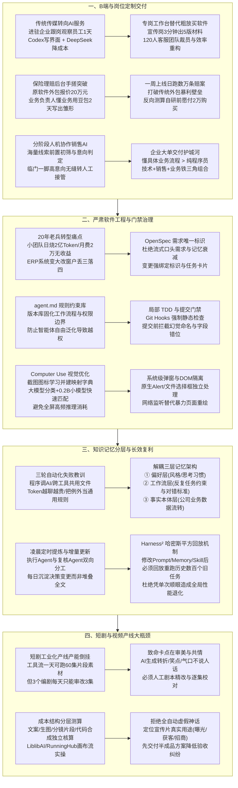

# 2026-10-27 · 第1场直播

这场实战研讨从企业深水区定制交付贯穿到严肃软件工程治理。核心议题涵盖：传统摄影传媒进驻企业做专岗桌面工作台、保险负责人用豆包2天手搓理赔后台击穿20万外包报价、20年ERP老兵转型算账、严肃开发四件套（OpenSpec唯一需求标识、agent.md规则约束、局部TDD与提交门禁防幻觉）、知识库三层记忆解耦与Harness²回放验证，以及短剧产线日产60集卡死在编剧日审3集的工业化瓶颈。本文彻底洗去免责官话与法庭审计腔，以高密案卷呈现真实技术拓扑与商业账本。



## 一、传统摄影传媒转向AI：进驻企业做专岗桌面工作台

一位从事景区宣传片与无人机摄影的传媒创业者，在传统拍摄业务断崖下滑后转型AI企业服务。其破局打法摒弃了虚无缥缈的“全能大模型”，而是直接扎进企业现场。

### 1. 获客与现场成交闭环

- **获客动作**：每天在朋友圈持续同步不同风格的AI商业作品，激活老客户注意力；熟人企业主主动询问后，带着笔记本电脑直接上门现场演示；
- **跟岗观察交付法**：服务商亲自到企业现场，**搬把椅子坐在员工身旁观察一整天**，摸清岗位从早到晚接收什么文件、打开什么软件、输出什么表格；
- **技术栈配置**：使用 Codex 快速搭建前端桌面工作台界面，后端调用 DeepSeek API 控制推理成本，并设置严格的输入输出边界限制（Guardrails）。

### 2. 两类典型企业的定制重构

- **集团宣传部门**：原员工用豆包写通稿，生成质量松散套话连篇。服务商加入企业专属语料约束与结构规范后，实现**3分钟生成一篇高标准通稿并提供5种差异化版本**供领导挑选；
- **120人客服外包团队**：老板核心诉求是减员增效。服务商入驻调研发现四条业务线严重冷热不均，通过提取历史优质客服聊天对话、高频异议处理话术注入知识库，做成专岗工作台辅助人工回复，直接驱动客服人效重组。

---

## 二、保险理赔后台自研突破：业务理解打穿20万外包暴利

一位保险分支机构负责人分享了业务人员借助AI打破软件外包垄断的经典战役。

### 1. 传统软件开发的高壁垒与暴利

该机构理赔业务长期依赖前端网页+后端Excel人工录入，老板每月想看理赔统计只能层层问经理，迫切需要一套能实时监控每个赔案进展、伤残财产损失与出险率的数字化系统。

联系传统软件外包公司，对方开价高达 **20万元**，且开发周期长达数月。

### 2. 业务负责人手搓系统上线

由于负责人自身精通全部保险理赔业务逻辑与合规要点：

- **开发节奏**：使用豆包编程助手，连续突击两个晚上即写出系统核心业务代码；
- **测试投产**：第三天交付内部员工实测并根据反馈迭代细节，**前后仅耗时约一周完成正式部署**；
- **运行成效**：系统平稳运行，每日处理数万条理赔数据流转，彻底摆脱了20万元的外包预算绑架。

> **商业认知**：负责人坦言，如果在自己写代码前有成熟服务商带着好系统上门，自己愿意支付 **2万元** 采购。**懂业务流程的核心人员结合AI编程，能够将传统软件交付的边际成本压至极低，彻底颠覆了传统定制外包的溢价空间**。

---

## 三、严肃软件工程与门禁治理：OpenSpec、agent.md 与提交门禁

针对“随着代码工程变大，AI经常改前忘后、丢三落四、改一处坏三处”的普遍痛点，一线资深开发者总结出了一套工业级工程控制标准。

### 1. OpenSpec：需求唯一标识化

绝不允许流式口头需求或在聊天窗口里随意下达指令。使用类似 OpenSpec 规范：

- 每一条业务需求、逻辑变更均分配全局唯一的 ID 跟踪（如 `REQ-2026-081`）；
- 需求变更必须同步更新 Spec 文档与任务状态卡片，确保 Agent 上下文始终对齐最新需求版本，防止记忆衰减导致功能丢项。

### 2. agent.md：规则版本化契约

在代码仓库根目录维护 `agent.md`：

- 强制规定代码风格、命名字典、禁用依赖、接口返回标准；
- 明确划分 Agent“能做”与“绝对不能做”的红线；
- 像代码一样纳入 Git 版本管理，随着架构演进持续迭代。

### 3. 局部 TDD 与提交门禁（Git Hooks）

- **局部测试驱动**：开发前先由 Agent 或人工编写最小单元测试用例，明确验收标准；
- **Pre-commit 提交门禁**：在代码提交到本地分支前，强制触发自动化静态钩子，重点扫描：
  1. 字段命名幻觉（前后端命名不一致）；
  2. 重复冗余算法与多余导入；
  3. 单元测试未全部通过。
- **实战成效**：提交门禁能够在代码进入分支前拦截 90% 以上的模型幻觉与低级逻辑错误。

---

## 四、知识记忆三层解耦与 Harness² 回放校验机制

很多团队做知识库经历了“三轮自动化折腾”：从最初让Agent自动记所有日志，到定时分析存Markdown，再到程序调AI的知识管家。结果发现**Token消耗越来越大，多轮对话后模型变慢、幻觉剧增，甚至把昨天的偶然例外当成了今天的通用业务规则**。

### 1. 生产级三层记忆架构解耦

严禁将所有资料混在一个总文档中，必须物理级拆分为三层：

| 记忆层级 | 存储内容 | 加载时机 | 更新机制 |
| :--- | :--- | :--- | :--- |
| **偏好层 (Preference)** | 个人的思考习惯、输出风格偏好、沟通语气限制 | Agent启动时全局预加载 | 人工显式修订 |
| **工作流记忆层 (Workflow)** | 某个反复任务的目标、专用Prompt、约束条件与判断标准 | 触发特定工作流任务时按需局部拉取 | 定时任务提取提炼 |
| **事实本体层 (Ontology)** | 企业业务对象关系、客户资料、底层历史真实数据 | 配合 RAG 或数据库结构化查询，避免全量读入上下文 | 系统级事务同步 |

### 2. Harness²（哈密斯平方）回放验证机制

团队在优化工作流时最忌讳“修好一个case，改坏全局系统”。

开源项目 Harness² 提出了严谨的 **回放验证（backfill）机制**：

```
业务发生异常 -> 调整系统提示词 / 修改记忆规则 / 优化 Skill
                        ↓
         从历史库中拉取 300 个已知真实任务
                        ↓
         全自动离线重跑回测（Backfill Testing）
                        ↓
       验证 250 个共性标准任务是否全部稳定通过
                        ↓
     确认无全局性能退化后，方可发布新规则
```

严禁仅凭单次对话回答“看起来更顺眼”，就盲目将提示词或规则提升为全局通用标准。

---

## 五、Computer Use 与桌面视觉自动化优化

在让 Agent 控制桌面或处理复杂网页（如跨境电商后台运营）时，单纯依赖全屏高频截图调用大视觉模型，面临**延迟极高（每轮几秒以上）与 Token 费用爆炸**的双重瓶颈。

### 1. 图标映射字典机制

- **首次学习**：初次遇到封闭小众系统或非标准UI时，对目标图标进行局部截图，由大模型分析其语义（如“这是一个提交按钮”）；
- **建立字典**：本地保存“图形特征/坐标 -> 业务语义”的本地映射字典；
- **后续复用**：再次执行任务时，直接通过轻量小模型进行“是不是”的确定性匹配，无需每次全屏重新发起深度大模型推理，大幅压降推理延迟与开销。

### 2. 系统原生弹窗与 DOM 结构解耦

- 网页内操作优先通过精简 HTML/DOM 结构或直接监听网络请求数据流（API取数），比视觉渲染读屏更稳定且成本为零；
- 涉及本地操作系统原生弹窗（如 Windows/Mac 的文件选择器、系统级 Alert 确认框）时，必须由底层系统级钩子（System Native Events）专门捕获，杜绝用浏览器内的点击逻辑去盲目猜测系统弹窗。

---

## 六、20年ERP老兵转型算账：降低编码成本不等于降低实施成本

一位在传统工业制造与国央企深耕 20 年的 ERP 实施老兵，分享了深水区转型的残酷现实。

### 1. 小团队日烧2亿Token的经营困境

该老兵带领技术小团队全面拥抱 AI：日均调用约 **2亿 Token**，每月 API 账单接近 **2万元**。

真实结果令人警醒：内部编写文档和代码的速度确实大幅提高，但**公司的总营收、客户续约率与人效利润几乎毫无增长**。客户根本不在意代码是谁写的，国央企更看重本地私有化合规、资质背书与长达数月的复杂现场实施。

### 2. 软件蓝图定版后的实施自动化瓶颈

老兵向行业提出核心疑问：在需求蓝图定版后，AI 能否自动完成界面配置、权限分配与静态数据录入，从而在实施环节减少 30%~50% 的驻场人力？

现场给出的客观事实是：**ERP与MES高度非标，涉及复杂的跨部门权力与业务利益协调，现场需求变更是常态**。AI能加速的是从现场访谈录音到需求规格说明书（POC/SOP）的结构化提炼；但指望完全用 AI 替代资深实施顾问现场拍板与流程落地，在当下仍不切实际。

---

## 七、短剧与视频产线大瓶颈：产线日跑60集卡在编剧日审3集

在短剧和企业营销视频的批量工业化产线中，暴露了极具代表性的产能倒挂。

### 1. 产能倒挂与致命审稿卡点

- **工具端产能**：短剧团队通过搭建视频生成工作流，每天能批量流水线生成 **60集** 片段与素材；
- **人工端瓶颈**：团队配置的 3 个专业编剧，**每个人每天最多只能精改和审核 3集 剧本**！整条工业化产线被严重卡死在编剧审查环节；
- **根因分析**：AI 能够批量生成动作与场景，但在剧本台词的情绪转折、语言气口、共情笑点上依然“不说人话”。缺少编剧的一对一人工校准，批量生成的视频直接上线会惨遭极高的跳出率。

### 2. 视频产线分层核算账本

成熟团队建议将视频制作拆为四个独立工序分别算账：

1. **文案脚本**：利用通用大模型与爆款特征库提炼结构；
2. **生图分镜**：在 LiblibAI / RunningHub 等无限画布工具上单图打磨，单张成本约 **0.1~1元**；
3. **视频片段合成**：利用生成式模型合成短片段，10秒片段成本约 **1~4元**；
4. **本地代码组装**：通过 Remotion Studio、Hyper Frame Studio 或 Three.js 脚本批量拼接字幕、特效与音轨。

严禁向客户承诺“全自动一键出高品质品牌大片”。务实的商业交付方式是**向客户交付半成品方案库（文案+多版分镜图）**，由客户确认后再最终渲染，避免全案大包大揽带来的无休止修改纠纷。

---

## 八、实战落地行动指南与避坑清单

基于本场深度讨论提炼的可执行实践指南：

### 1. 进驻企业做专岗桌面工作台 SOP
- [ ] **第一天只看不动**：坐在岗位员工身旁完整记录一天的任务动线、软件切换频次与手工填表痛点，严禁一上来推销概念；
- [ ] **做减法不做加法**：优先挑选员工最痛苦、最重复的单点任务（如通稿排版、退款话术初审）做单点突破；
- [ ] **前端极简包装**：用最熟悉的桌面形态（轻量客户端或内嵌工具）呈现，后端模型选用 DeepSeek 等高性价比接口控制 API 开销；
- [ ] **设置严格输出围栏**：提示词中明确格式约束，禁止 Agent 自由发挥导致业务数据错漏。

### 2. 严肃 AI 编程与工程门禁规范
- [ ] **固定需求标识**：复杂需求必须拥有唯一编号（OpenSpec），严禁在长对话中随意追改核心逻辑；
- [ ] **本地 rules 约束**：项目根目录必须配备 `agent.md`，明确团队架构规范与禁止篡改的核心文件清单；
- [ ] **配置 Pre-commit 钩子**：代码提交前必须自动运行命名合规检查、接口契约校验与局部单元测试；
- [ ] **建立 Harness 回测基准**：当修改核心 Prompt 或全局记忆时，必须在历史测试集上自动重跑回归，验证通过后方可合入主干。

### 3. 短剧与商业视频产线风控 Checklist
- [ ] **严禁全自动化交付**：在文案、分镜与最终成片之间，必须预留编剧/导演的人工校准节点；
- [ ] **素材成本预核算**：按“生图量 + 视频秒数 + API调用量”测算单条成片综合成本，留足 20%~30% 的废片重跑余量；
- [ ] **合同界定修改轮次**：明确约定半成品分镜确认后，后期代码渲染阶段仅支持小幅度字幕与配音调整，严禁推倒脚本重拍。

---

## 九、工具项目台账与待核实线索

### 明确用途与状态的工具库

| 工具/项目 | 本场具体用途与实战经验 | 状态与边界 |
| :--- | :--- | :--- |
| **豆包 (Doubao)** | 保险业务负责人用于理赔系统代码编写，2天完成核心架构 | 业务人员手搓系统实测可用，适合逻辑清晰的中轻量软件 |
| **Codex + DeepSeek** | 摄影传媒转型团队用于企业专岗工作台开发，Codex生成前端UI，DeepSeek作为低成本后端推理 | 工业化降本交付推荐组合 |
| **OpenSpec** | 为复杂软件需求提供唯一标识，确保需求与任务卡片全链路追踪 | 严肃 AI 开发必备工程规范 |
| **Harness² (哈密斯平方)** | 企业开源框架，在调整 Prompt/Memory/Skill 后自动回放重跑历史任务 | 防范全局性能退化的回测利器 |
| **Browser Use + 录屏工具** | 网页自动化采集配系统级全屏录制与音频分离 | 适合素材采集与自动化工作流搭建 |
| **LiblibAI / RunningHub** | 无限画布工具，用于视频分镜的逐张打磨与工作流验证 | 实做者推荐用于前期分镜设计，非一键成片工具 |
| **Remotion / Three.js** | 本地代码驱动的视频合成框架，适合高精度批量拼接字幕与镜头 | 生产级视频合成技术栈 |

### 待核实原词与技术线索

| 原词线索 | 现场讨论背景与用途 | 待核实边界 |
| :--- | :--- | :--- |
| **MYNA点Bot / Manabot** | 团队自述的 PC 端企业级 Agent 平台，声称支持贴牌与本地化部署 | 现场存在多个近音词与访问异常自述，项目具体商业成熟度待核 |
| **longcha / longsmith** | 参与者提到的用于监控 Agent 工具调用、参数传递与 Token 消耗的观测工具 | 讨论线索，需核实具体开源库名称 |
| **ClipCat / ClipCut** | 付费电商视频剪辑 Skill 讨论线索 | 现场仅为口述提及，未披露具体项目主页与授权许可 |
| **GEV 小模型** | 个人助理在做情绪判别时提到的小模型线索 | 口述技术选型，准确模型架构与官方权重待确认 |\n