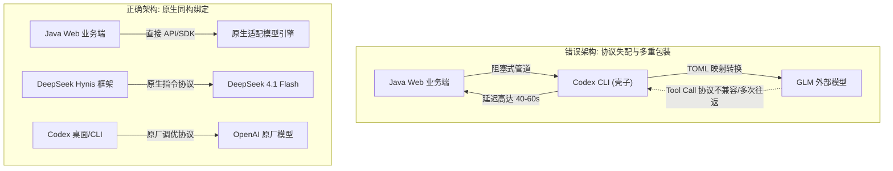
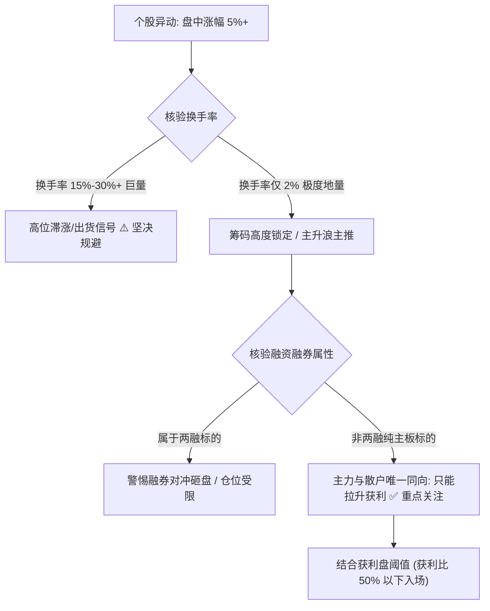
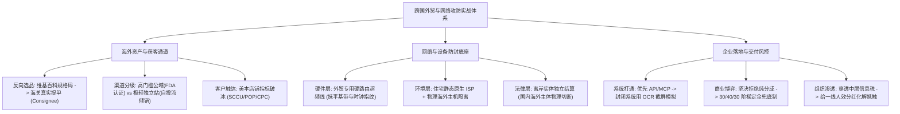
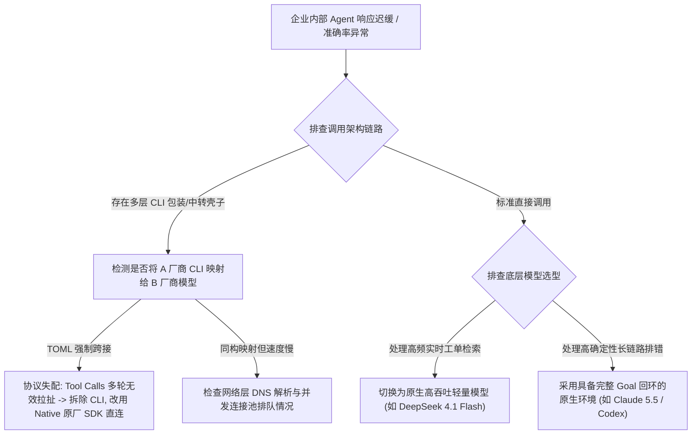

# 企智AI落地派·跨国外贸出海、黑产风控攻防与商业盘口实战全息案卷

> **直播来源**：企智AI落地派·企业AI赋能智能体（现场录制编号：Session 91，文件标识：`latest-2026-11-01-s01-db91`）  
> **直播时段**：2026年11月01日 20:43:31 至 2026年11月02日 07:38:22（跨夜连麦全景，录制时长：10 小时 54 分 51 秒）  
> **核心受众与麦序人物**：老徐（主播/企智AI主理人）、外贸企业主（上海闵行）、跨境电商独立站站长（反向营销操盘手）、失业转型程序员（深圳货代小程序开发者）、前蚂蚁风控工程师（海外黑产与卡台攻防专家）、新加坡连麦嘉宾（第二大脑与个人化AI实践者）、量化交易员（A股盘口与网格策略操盘手）及数百位弹幕实战技术人员。  
> **数据体量与覆盖度**：原始音频逐字稿 14,209 行，有效文字 195,094 字，弹幕互动 953 条。本案卷严格遵循“全息扫描、一人一案、小技巧平等保全”原则，对整场近 11 小时的实战交锋展开完整立卷还原。

```mermaid
graph TD
    A["2026-11-01 跨夜长直播 (Session 91)"] --> B["第一卷: 跨国外贸与供应链工具 (00:00-02:45)"]
    A --> C["第二卷: 出海网络与风控攻防 (02:45-05:40)"]
    A --> D["第三卷: 商业博弈与管理税穿透 (05:40-08:30)"]
    A --> E["第四卷: 资本标的与二级市场盘口 (08:30-10:54)"]
    
    B --> B1["义乌采购 vs 闵行拓新"]
    B --> B2["日化库存卡车扫货独立站"]
    B --> B3["三一重工出海落地"]
    B --> B4["Codex Goal 模式 vs Workify"]
    B --> B5["Java+Codex CLI+GLM 协议排错"]
    B --> B6["维基百科产品代码+海关提单反向营销"]
    B --> B7["恋爱AI小程序撩大哥与合规红线"]
    
    C --> C1["ERP/财务打通: API/MCP/OCR保底"]
    C --> C2["失业程序员自救: 货代微信小程序手搓"]
    C --> C3["港澳运费核算与中转API掺水变现"]
    C --> C4["硬路由超频线 vs 软路由出海矩阵"]
    C --> C5["蚂蚁前风控: 酒店/卡商/卡台注册机对抗"]
    C --> C6["新加坡第二大脑: 脱离公司绑定与Auto Research"]
    
    D --> D1["小团队 3-4 人创业轻量外包"]
    D --> D2["大厂代理商与二级外包(OBC)机会"]
    D --> D3["穿透企业信息税与管理税"]
    D --> D4["餐饮极轻点餐系统与支付API"]
    D --> D5["商业合作博弈: 服务费+分成与定金制"]
    
    E --> E1["文旅古镇与资产盘活贷款套路"]
    E --> E2["科大讯飞与大模型厂商淘汰赛"]
    E --> E3["大盘股网格套利 vs 马丁大单边爆仓"]
    E --> E4["A股主板非两融标的挑选法则"]
    E --> E5["5%涨幅换手2%主力操盘盘口识别"]
    E --> E6["官媒牛棚舆论周期反推"]
```

---

## 第一卷：跨国外贸、供应链库存与 AI 自动化工具链（00:00:00 - 02:45:00）

### 1. 义乌采购经纪人现场模式 vs 上海闵行外贸拓新痛点

* **现场实况与人物背景**：
  * 直播开场，来自上海闵行的外贸企业主连麦接入。闵行企业主长期经营面向海外的传统工贸一体化业务，面临严重的“获客内卷”与“拓新品类迷茫”双重危机。
  * 主播老徐对比了义乌国际商贸城的现场采购生态与沿海传统外贸企业的差异。义乌存在大量常驻外商与外商雇佣的“采购经纪人”，直接深入档口看样品、谈现货、指定专属货代物流，成交路径极短；而传统外贸企业依赖参展、邮件群发和公海数据，客户开发周期动辄数月。
* **业务痛点剖析**：
  * 传统工贸企业的最大软肋在于“开发新品完全凭老板拍脑袋”：盲目投入模具和生产线，生产出一批产品后才推向海外，经常遇到海外准入资质不全、海外消费者偏好错配，导致库存严重积压。
  * 连麦指出，目前外贸出海急需将 AI 引入到“前置需求嗅探”环节，必须先看到真实采购数据再开模，颠覆先生产再找客户的笨重模式。

### 2. 国内日化库存“卡车式”整车扫货与海外独立站倾销（绕过亚马逊 FDA 壁垒）

* **爆款操盘打法还原**：
  * 老徐拆解了华南一位卖家的真实暴利案例：针对国内大量化妆品、护肤品代工厂因外贸取消或品牌方砍单而产生的海量积压库存，操盘手直接开着卡车去工厂仓库“按斤/按车扫货”。原本出厂价几十上百元的面霜、乳液，以每车几千到一万多元的骨折废品价整车拉走。
  * **合规与渠道壁垒突破**：
    * 这批化妆品如果上架亚马逊（Amazon），必须面临极其严苛的美国 FDA 认证、生产企业体系审查和品牌商标授权，根本无法通过审核；
    * 操盘手完全放弃亚马逊等公域平台，纯粹利用 Shopify 或 WordPress 手搓轻量独立站；
    * 独立站不设平台入驻门槛，只要海外消费者下单即可。操盘手利用 AI 批量生成吸睛的短视频素材和产品种草落地页，在海外社交媒体（TikTok、Meta、Pinterest）进行低成本投流。
* **底层商业经济账**：
  * 拿货成本几乎趋近于零（仅占货值 2%~5%），即使投流成本（CAC）占到客单价的 40%~50%，刨去国际小包物流费用后，整体纯利润率依然能保持在 40% 以上；
  * **唯一风险点**：独立站模式核心考验操盘手的投放调优能力与海外支付网关（Stripe、PayPal）的风控抗封能力。

### 3. 三一重工跨国出海项目实操机制与多国本地化落地经验

* **大厂出海全链条拆解**：
  * 连麦嘉宾进一步揭示了跨国装备制造业龙头（如三一重工）在海外多个国家落地的重度数字化架构。
  * 制造业跨国交付是“全球商业链条中最长、最重的一类”：涵盖国内主机厂制造、内陆短驳、出境口岸集港、报关清关、国际海运头程、目的国大港清关、目的国本地保税仓/第三方仓、干线转运至工程现场、属地化售后与配件维保。
* **AI 在重工业出海中的落地点**：
  * 重工企业无法依赖通用的公域客服，其海外痛点是：海外不同国家的特种工程机械操作标准、非标零部件图纸匹配、多语种本地化施工工法。
  * 目前落地团队通过在前端部署多语种非标工业知识库 Agent，海外一线机手和维修工程师只需上传机械故障报错码或损坏零部件照片，Agent 自动比对数万页跨国零部件清单（BOM），精准给出图纸索引与替代件仓储位置，将跨国备件调度时间从两周压缩至 24 小时以内。

### 4. 货架电商日常 80% 自动化实践：Codex vs Workify（Workbody）实测深度对比

* **实操卖家现身说法**：
  * 某亚马逊货架电商操盘手在麦上分享了他将日常运营工作 80% 交付给 AI 智能体的实操方案。他曾深度横评过市面上主流的各类 Coding 与 Agent 工具，尤其是 Codex 与 Workify（Workbody）。
* **两款工具的架构与特性差异**：
  * **Workify / Workbody**：交互界面友好，对于轻量单步任务响应迅速，但在处理跨应用、长周期的复杂任务时，容易出现“干到一半因为某个中间环境报错而静默中止”的断头问题；
  * **Codex**：具备极强的工程底座支撑，在应对多层级文件读写、环境探测与多步脚本调用时，稳定性显著优于同类工具。

### 5. Codex “Goal 目标模式”核心优势：FBA 货件 Excel 自动生成全链路追到底

* **为什么追求“目标执着度”**：
  * 亚马逊卖家痛点：每天需要将海量商品根据规格、箱规、重量、危险品属性、目标分仓逻辑，整理成符合亚马逊官方要求的 FBA 批量创建货件模板（Excel 文件），步骤繁琐且一旦填错就会面临拒仓罚款。
  * **Goal 模式实测闭环**：
    * 卖家在 Codex 中设定终极目标：“读取源数据 Excel，按照美东/美西分仓规则，补全 SKU 箱规参数，生成符合亚马逊 FBA 2026 最新标准的装箱单并核验校验和”；
    * 其他模型在执行到第 3 步（如发现某些 SKU 缺少历史重量记录）时往往会抛出异常中断执行；
    * 而开启 Goal 模式的 Codex 会自主编写补偿脚本、回溯本地历史备件库查找历史尺寸、计算体积重折算值，并在终端中持续自我迭代、自我修正，直到最终生成完整的合格 Excel 报表并打印出完成标记。这种“不达成目标绝不中断执行”的执着特性，正是复杂 B 端业务自动化的核心生命线。

### 6. Java Web 架构调用 Codex CLI 跨接 GLM 的严重性能灾难与协议失配排错

* **现场技术连麦事故**：
  * 一位企业 IT 工程师上麦求助：其团队开发了一套内部工单排错与客服运维系统，架构设计为 `Java Web 服务 -> 调用本地 Codex CLI 壳子 -> Codex 通过修改 TOML 映射跨接外部 GLM API -> GLM 返回结果 -> Codex CLI 回传 -> Java Web`。
  * **事故表征**：
    * 系统投入使用后，在检索知识库工单和排查报错时极其缓慢，一次简单的工单分析动辄耗时 40~60 秒；
    * 即使经过调优使得响应稍微加快，工单回答的命中准确率和代码排错精准度又出现断崖式下跌。
* **深层技术链路病因**：
  * 架构存在四层无谓的进程与协议中转，Java 与 CLI 之间采用阻塞式管道通信；
  * 更致命的是，Codex CLI 底层的 Agent Loop（推理回环）是深度基于 OpenAI 原生工具调用（Tool Calls）和特定 Prompt 语法调优的；当底层被强制通过 TOML 映射为外部国产模型（如 GLM）时，GLM 无法完美理解 Codex 内部复杂的系统级隐式指令，导致双方在一次单轮任务中频繁出现“格式不匹配 $	o$ 重新询问 $	o$ 格式校订 $	o$ 再次报错”的多轮无效拉扯，交互轮次激增 4~8 倍。

### 7. 跨模型硬接的根因解析：Native 绑定（DeepSeek Hynis 接 DeepSeek 4.1 Flash）与 TOML 映射代价

* **技术大牛现场下刀诊断**：
  * 麦上资深架构师直接给出了定论：**严禁在生产环境把 A 厂商专用的 Agent CLI 壳子强行映射给 B 厂商的模型**。
  * **原厂同构绑定的性能优势**：
    * OpenAI 模型与 Codex CLI / Desktop 是原生深度调优的，上下文结构高度贴合；
    * 同理，使用 DeepSeek 时，应当采用 DeepSeek 官方或开源适配的 Hynis 框架，直接搭配其原生的 `DeepSeek 4.1 Flash` 模型；
    * 4.1 Flash 具备极高的输出吞吐率和指令遵循度，在原生框架下完成一次工单搜索仅需 1.5~2.5 秒；
  * **改造方案**：拆除中间的 Codex CLI 壳子，在 Java Web 端直接采用 LangChain 或原厂 SDK 直连模型，通过显式定义 Function Calling 工具协议，一举消除中间 90% 的无效往返延迟。

### 8. 手搓独立站反向打法：维基百科查询历史产品代码（如 e-bike H121287）

* **逆向出海获客神级操盘**：
  * 连麦的独立站老站长分享了一套“零公海线索、纯逆向抓真实买家”的降维打法：
  * 绝大部分外贸新手出海只会盲目在 Google 搜索买家邮箱或在社媒群发。该站长首先通过维基百科（Wikipedia）及国际工业技术词典，深入研究细分行业的底层编码。
  * 例如在做电动自行车（e-bike）类目时，他在维基百科找到了国际通用的特定细分规格代码（如 `H121287` 对应的高功率电摩级出口规格），通过这一代码顺藤摸瓜，直接锁定了欧美各国针对该类目专门开设的报关分类子项（HS Code 扩展码）。

### 9. 全美海关报关单与真实提单清洗：7000~8000 元付费关区库与免费关口结合打法

* **海关提单（Bill of Lading）实战穿透**：
  * 锁定产品特定编码后，站长直接调取美国、欧洲等主要关口的进口提单数据库。
  * **数据源搭配策略**：
    * 利用海外关口公开的免费报关摘要数据作为广度筛选；
    * 花费 7000~8000 元采购高权限的海外商业海关提单明细库；
    * 提单上赫然记录着：**真实的收货人公司名称（Consignee）、采购批次、货柜数量、到港港口、历史供应商（Shipper）以及交货周期**；
  * **AI 数据清洗流水线**：
    * 使用手写的 Python 爬虫搭配本地大模型脚本，将全美数千家电动自行车进口商数据全量清洗；
    * 剔除贸易中介公司，精准过滤出近 12 个月持续在提货、且提货规模在每月 2~5 个集装箱的中大型区域经销商名录。

### 10. “反向营销”闭环：先抓海外采购商真实订单需求，后置匹配国内优势供应链

* **零库存商业模式构建**：
  * 该打法的精髓在于**“反向拿单，国内对缝”**：
    1. 站长通过海关数据分析出这些海外经销商的核心痛点：例如某款 e-bike 的避震器经常在海外用户售后中报错，经销商正在寻找具备改良设计的高性价比货源；
    2. 站长针对性地在手搓的独立站上架了符合该改良参数的 3D 渲染图与样品规格书，并通过邮件和精准商务触达直接把产品方案推到海外经销商采购负责人的面前；
    3. 当海外经销商表达打样意向、甚至下达小批量试产订单后，站长拿着真实订单与定金，直接前往国内天津、江苏常州的电动车产业带，挑选最具代工实力的实体工厂进行贴牌生产；
    4. 实现了**前置锁定真实利润、后置撬动实体产能、自身承担极低资金风险**的绝妙商业闭环。

### 11. 十年前安防 QQ 号码库清洗的教训：行业转行与长效触达失效

* **历史沉睡资产盘点教训**：
  * 一位做安防监控工程的资深老兵连麦反思：十年前他曾通过技术手段爬取了国内安防行业几乎所有的从业者 QQ 号与行业群数据，积累了数十万条宝贵资产。
  * 近期他尝试用大模型清洗这批十年前的数据，试图转化到企业微信或手机号私域中；
  * **残酷现实**：清洗结果显示，由于近十年安防行业大洗牌（海康、大华等巨头挤压，传统集成商大面积破产），超过 75% 的从业者早已转行或注销账号，未转行者也极少使用当年的 QQ。
  * **核心启示**：任何私域与营销数据库都具备“强时效性衰减”特征，半衰期通常只有 1~2 年。AI 赋能获客必须基于“动态活水数据”，绝不能将希望寄托于十年前的静态历史沉渣。

### 12. 跨境商务谈判中的专业指标破冰术：美本土店铺 SCCU、POP、CPC/CPM 抛题切口

* **老徐亲授高端商务话术**：
  * 在与高客单价海外大客户或平台大卖家沟通时，严禁使用“我们 AI 很厉害、我们能提效”等空洞泛化的技术黑话，这会瞬间暴露技术外行的本质。
  * **专业行话切口构建**：
    * 面对美区本土卖家，开场寒暄过后，必须立即抛出业务深水区指标：“你们美本店铺现在 POP 模式占比多大？SCCU 的周转天数目前压在多少天以内？”
    * 针对投流团队深入询问：“目前在 TikTok Shop 和 Meta 上的 CPM 波动区间是多少？真实出单的 CPC 成本阈值控制在什么线？”
    * 一旦对方发现你对平台底层经营模型、分仓规则和流量成本门清，防御心理会瞬间瓦解，后续无论是切入智能体代运营还是深度技术合作，客户均会视为同行专家的深度赋能。

### 13. 情感赛道“恋爱 AI 小程序”实操：美女头像精聊撩大哥、道具付费与合规红线避险

* **下沉赛道暴利变现拆解**：
  * 现场团队分享了一款正在稳定吸金的“恋爱/婚恋 AI 小程序”：
  * **产品形态与玩法**：利用 Midjourney / Flux 生成极具真实感、生活化的高颜值美女自拍图片矩阵，依托 AI 智能体扮演具备特定性格（如温柔学妹、知性白领）的角色，与下沉市场男性用户进行全天候“精聊互动”；
  * **变现机制设计**：聊天按句收费或采用虚拟体力值（充值虚拟货币买玫瑰花、奶茶道具解锁亲密度等级和特定语音消息）；
* **合规与风控死线红线**：
  * 必须严格规避“涉诈、色情引流与真实线下招嫖导流”；所有交易必须完全在小程序平台虚拟道具闭环内完成，严禁跳转私域加个人微信收款；
  * 系统底层必须部署极其严苛的敏感词风控拦截层，对涉黄、涉政、索要线下红包等违规诱导进行 100% 毫秒级阻断，否则上线三天内必遭微信官方永久封禁主体与结算账户。

### 14. Claude Code (Claude 5.5) 封号机制深度解析与海外隔离环境建设准则

* **海外环境风控真实事故**：
  * 麦上多位开发者交流了在使用最新一代 Claude 5.5（Claude Opus 5.5 / Claude Code，即 CC）过程中遭遇的连环封号惨案。
  * **底层触发封号的四大暗雷**：
    1. **原生卡头与账单地址穿透**：使用虚拟信用卡（如某些段位的 Depay/Dupay）被 Anthropic 机构风控引擎批量标记拉黑；
    2. **节点风控漂移**：在调用 Claude Code CLI 终端过程中，本地使用的节点 IP 在香港、新加坡、美国之间频繁跳跃，触发地理位置安全防御；
    3. **指纹浏览器与系统时区时钟错配**：宿主机为东八区北京时间，而浏览器代理为美西洛杉矶时间，DNS 解析出现泄漏；
    4. **高频突发并发**：使用自动化脚本高频刷 Claude Code API，Token 吞吐异常触发防爬虫逆向审查；
* **企业级防封隔离基础设施规范**：
  * 必须采用海外真实静态住宅 ISP 节点或海外原生独享云主机（如 AWS 美东独立 EC2 实例）；
  * 全流程绑定海外真实商业实体信用卡，并使用海外原生环境直接运行 Claude 5.5 CLI，杜绝一切多层梯子与跳板中转。

---

## 第二卷：出海基础设施、黑产对抗与企业深水区（02:45:00 - 05:40:00）

### 15. 传统企业 ERP 与财务打通三大实战路线：官方 API、MCP 协议与 OCR/无头浏览器保底

* **传统企业系统集成困境**：
  * 当 AI 深入制造业、零售业深水区时，最大的鸿沟在于“传统老旧软件（金蝶、用友、各类老旧进销存）的数据打不通”。很多几十年前的 ERP 系统连文档都没有，厂商甚至索要几十万元天价“接口开放费”。
* **实战落地三大解决路线**：
  1. **路线一：官方标准 API 直连**：适用于现代 SaaS 类 ERP，由企业 IT 部门提供只读 API Token，Agent 通过标准 RESTful 接口执行查询；
  2. **路线二：MCP（Model Context Protocol）标准化驱动协议**：将内部系统的数据表封装为标准的 MCP Server 工具端，大模型无需关心底层数据库结构，直接通过标准 MCP Tool 读取上下文；
  3. **路线三：非侵入式 OCR 与无头浏览器视觉模拟兜底**：
     * 针对完全封闭、禁止开外网 API、拥有严苛防爬机制的财务系统或拼多多商家后台；
     * 利用自动化脚本（Playwright）在本地受控环境中截取软件屏幕，调用高精度发票与报表 OCR（如百度工业级 OCR）进行物理级文本识别；
     * 模拟人工鼠标点击完成数据搬运，彻底绕开昂贵的接口开发费与安全审计阻力。

### 16. 跨物理隔离数据库架构设计：本地处理 vs 异地隔离与轻量数据清洗

* **数据工程架构决策**：
  * 连麦指出，许多企业主陷入了“盲目上大而全分布式数据库（如 ClickHouse、TiDB）”的误区。
  * 在中小企业 AI 赋能场景中，绝大多数数据量都在数万条到数百万条区间，根本不需要分布式集群。
  * **选型标准**：
    * **本地轻量级场景**：优先使用 SQLite 或 DuckDB，单个文件即数据库，零配置、零运维成本，与 Python / AI 脚本天然同构，单机每秒可处理数十万行复杂分析；
    * **涉密与物理隔离场景**：客户核心财务与客户名单严禁出内网，必须在企业内部机房部署本地隔离数据库，对外只暴露脱敏后的数据指纹或只读向量索引；
    * 严禁直接把未脱敏的生产库连接暴露给大模型云端上下文，必须前置设立数据治理清洗管道。

### 17. 深圳失业程序员自救录：CodeX 极速自研货代微信下单小程序，淘汰老旧百万级物流系统

* **失业程序员转型纪实**：
  * 现场连麦了一位曾在大厂工作但近期失业的程序员。他没有盲目内卷投简历，而是南下深圳投奔做国际货运代理（货代）的朋友。
  * 货代行业痛点：早些年市面上一套专业的跨境物流货代管理系统，软件开发商动辄报价 80 万到 120 万元人民币，中小货代公司根本买不起，日常全靠微信群人工收发 Excel、手工抄写报单。
  * **AI 降维打击开发**：
    * 该程序员凭借 CodeX（结合终端 Coding 智能体），仅用两周时间，从零手搓出了一整套支持客户自主在线算价、录入箱规、上传报关发票、自动生成运单号的“货代极简微信下单小程序”；
    * 研发成本几乎降为零，直接淘汰了传统软件公司的百万级重型软件，迅速在当地跨境货代圈子中铺开。

### 18. 港澳跨境货运运费自动核算工具开发与中转 API 二次掺水轻变现

* **边缘痛点掘金与 API 变现**：
  * 货代日常遇到大量香港、澳门跨境接驳单，运费计算极其繁杂：涉及按立方（CBM）与按重量（KG）计费的动态交叉比对、海运拼箱最低起运费、港口杂费、燃油附加费（BAF）及港澳特殊码头装卸费，人工核算极其耗时且极易算亏。
  * 程序员紧接着用 AI 编写了一个轻量核算脚本，嵌入在小程序后端，货代只需输入货品体积和毛重，系统毫秒级输出精准报价单。
  * **轻量变现套路**：
    * 当向其他小同行提供该工具或 API 服务时，如果对方没有自己的大模型 Key，程序员通过自己的中转站提供大模型推理支撑；
    * 在调用成本基础上稍微上浮 15%~20% 水分，客户每月消耗几百元充值费毫无感知，程序员实现了小程序的月度技术服务费与 Token 差价双重被动收入。

### 19. 微信生态下一代搜索风口研判：搜一搜＋“小微” Agent 结合的本地 SEO 排名策略

* **国民级超级入口红利预判**：
  * 麦上深度探讨了微信生态即将迎来的超级 Agent 变革。微信搜一搜的搜索占比正在大幅侵蚀传统搜索引擎份额，而随着腾讯内测的个人级助理（“小微”智能体）逐步渗透，搜索结果将不再仅是图文链接，而是直接由 Agent 聚合生成答案。
  * **未来商业机会点**：
    * 类似于早期的百度 SEO、后来的抖音同城霸屏，未来的暴利赛道必定是**“微信小微 SEO”与“微信本地知识源排名优化”**；
    * 谁先让自己的企业服务、本地货代方案、实体店铺信息被小微的本地化 RAG 优先引用，谁就能独享微信数十亿级活跃流量的无偿分发，这是一片尚未被开垦的千亿级流量蓝海。

### 20. 出海网络防封底座：外贸专用硬路由超频线 vs 软路由实操配置

* **出海网络物理层揭秘**：
  * 跨境电商、海外社媒矩阵和外贸团队最忌讳的是“账号因网络指纹不纯而被连环批量封禁”。
  * **硬件网络两大路线对比**：
    * **通用软路由方案**：利用工控机或软路由系统（如 OpenWrt / iStoreOS）刷写分流插件，成本较低，但由于配置繁琐、伪装不彻底，容易因 WebRTC 泄漏或 IPv6 泄漏导致被海外安全风控系统直接嗅探；
    * **外贸专用硬路由超频线方案**：采用企业级专用外贸硬件路由器，内置独立基带硬件加密芯片，出厂自带专线固定 IP 链路；虽然单台设备和年费成本高达数千至上万元，但其直接在物理网口层面抹平了硬件指纹与基站定位差异，能够实现多台手机、电脑接入后“零漏封、零降权”，是成熟跨境大团队的必备生产力底座。

### 21. 蚂蚁前风控工程师深度解密：酒店商业、接码平台与卡台/卡商/号商注册机攻防对抗

* **硬核风控专家现场复盘**：
  * 一位曾就职于蚂蚁集团风控核心部门的连麦嘉宾，揭开了国内与跨境灰产攻防的残酷真相。他曾深入涉足酒店商业会员防刷和跨境注册机链路。
* **黑产工业化流水线曝光**：
  * 真正的号商绝不是人工插 SIM 卡，而是拥有专业的**“卡台”（Modem Pool / 猫池群组设备）**；
  * 一台工业级卡台可同时插放 64 至 512 张手机卡，联动海外及国内接码平台，通过定制版自动化注册机批量生成高权重账号；
* **攻防演进规律**：
  * 风控平台不仅仅看 IP 和验证码，更会采集设备的加速度传感器杂波、电池充放电曲线、内核编译时间戳、底层通信基带握手信号；
  * 风控不是一成不变的规则，而是一场“7×24 小时动态演进的猫鼠攻防游戏”。任何宣称“有一劳永逸防封技巧”的技术，在工业级对抗面前都是纸上谈兵。

### 22. 短剧与漫剧海外分发防封矩阵搭建：国内与海外双运营主体的法律与合规物理切割

* **风口出海业务的法律防火墙**：
  * 针对当前火爆的海外短剧（Short Reels）与 AI 漫剧分发业务，现场专家强调了**“法律主体物理隔离”**的极端重要性：
  * 许多国内团队直接用国内公司开通海外账户、收款提现，结果因版权侵权争议或跨境外汇结算合规问题，国内公司账户被瞬间冻结、相关负责人面临巨额行政处罚；
  * **成熟出海架构标准**：
    * 在新加坡、中国香港或美国特拉华州设立完全独立的海外运营实体（Offshore Entity）；
    * 海外版权采购、海外投放买量（TikTok/Meta）、海外支付收款（Stripe）全部归集于海外实体；
    * 国内公司仅作为“纯技术研发与外包制作中心”，国内与海外公司之间签署正规的技术外包服务协议，通过正规服务贸易外汇结算结汇，实现法律责任与资金风险的绝对物理切割。

### 23. 新加坡连麦嘉宾认知降维冲击：为什么不要盲目学写 App？AI 自我迭代时代的个人第二大脑

* **海外华人高维思考分享**：
  * 一位常驻新加坡的技术连麦嘉宾接入，其认知视角给国内开发者带来了强烈震撼。他指出：国内目前很多技术人员还在盲目跟风“学做 AI App、做外包小工具”，这种思路在未来 3~6 个月内将被彻底降维淘汰。
  * **核心预判：AI 正在编写 AI**：
    * 当模型能力进化到自主编写代码、自主部署全栈的阶段，人类去卷一个独立的 App 毫无胜算；
    * 与其浪费精力去做一个会被大厂瞬间覆灭的垂直 App，不如全力打造属于自己的**“个人第二大脑”（Second Brain）**。

### 24. 私有化第二大脑建设心法：信息归属权、脱离大公司绑定与 Auto Research 算法永续演进

* **第二大脑实战架构设计**：
  * **绝不绑死在任何单一模型厂商**：
    * 很多人在 ChatGPT 上聊了半年，累积了海量的个人思考，但当更强大的模型（如 Claude 5.5 或 DeepSeek）出现时，所有的个性化数据根本无法迁移；
    * 第二大脑必须建设在**本地或私有云端**，使用标准的 Markdown、本地向量库和结构化日志存储；模型只充当可随时替换的“计算引擎”；
  * **接入 Auto Research 自我进化算法**：
    * 只要将个人 80% 的过往业务思考、决策准则注入第二大脑，系统可在夜间自动运行研究算法（Auto Research），自动检索全球前沿信息、结合个人风格生成决策预案；
    * 人的大脑智慧会随着年龄疲劳停滞，但本地第二大脑会随着时间永续迭代、越来越聪明。

### 25. 硅谷与新加坡打工终极愿景：手不动而决断已成，AI 帮人代班拿薪水

* **终极生产力解放理念**：
  * 新加坡嘉宾分享了当地高端技术圈的终极目标：**“手不要上电脑，人坐在家里什么都不做，但是公司的决断与工作流已经在全自动奔跑，薪水按月照拿”**。
  * 这不是投机偷懒，而是将个人的商业逻辑与业务判断高度代码化、智能体化；
  * 当智能体完全理解了你的工作习惯、说话口吻和业务底线，它不仅能自动回复邮件、自动处理工单、还能在遇到跨部门扯皮时用你的个性化策略化解矛盾，实现真正意义上的“数字孪生代班”。

### 26. 天工直播间与 3D 高斯（3D Gaussian Splatting）前沿画面魔改

* **视觉渲染前沿探讨**：
  * 现场针对天工直播间、数字人带货以及三维空间计算展开了深入讨论。
  * 连麦指出，传统的 2D 换脸和 3D 建模在直播场景中存在严重的“恐怖谷效应”与高算力延迟；
  * 当前前沿团队开始利用 3D 高斯溅射（3D Gaussian Splatting, 3D GS）技术，对真实物理空间和人物进行毫秒级高保真动态光影建模；
  * 配合本地中转配置，魔改实时渲染管线，不仅在低端显卡上实现了 60FPS 以上的影视级光影穿透，更为无人直播间和虚拟主播交互开辟了全新的视觉工业化标杆。
---

## 第三卷：商业博弈、大厂外包与企业管理税穿透（05:40:00 - 08:30:00）

### 27. 小团队 AI 创业实操配置：3~4 人协同架构与财务法务轻量化外包避坑

* **极简组织架构设计**：
  * 老徐结合自身多年创业经验，给出了中小 AI 团队的最佳生存模型：**3 至 4 人的轻量敏捷战斗小组**。
  * **分工黄金三角**：
    1. **主理人/销售前锋（1人）**：深谙客户业务场景，负责破冰谈单、控制客户预期、主导回款节奏；
    2. **FDE 落地交付工程师（1~2人）**：具备全栈开发与工作流编排能力，负责驻场或远程实施，快速交付原型并上线跑通；
    3. **业务方案与内容运营（1人）**：负责将交付案例提炼为标准化行业资产、制作销售材料与获客内容；
* **法务财务外包避坑原则**：
  * 初期严禁招聘全职专职法务与财务，这会造成巨大的固定管理开支沉淀；
  * 财务直接委托本地正规代理记账机构（每月 200~500 元即可合规申报）；
  * 法务合同严禁在网上随便下载杂牌模板，必须找熟悉企业软件交付或知识产权的专业律师定制一套《技术服务与知识产权交付标准框架协议》，一劳永逸锁定交付验收边界与免责条款。

### 28. 破除客户“大厂崇拜”心智：大厂为何做不了细分定制？二级代理商与外包（OBC）落地商机

* **大厂生态与落地断层真相**：
  * 传统企业老板普遍存在“盲目崇拜大厂（腾讯、阿里、百度等）”的心理，误以为大厂软件一定无所不能。
  * **大厂的天然死穴**：
    * 任何大型互联网巨头的组织基因都是追求“高毛利、高通用性、边际成本为零的标准化产品”；
    * 面对一家年产值数千万、有着极其奇葩个性化审批流程的中小制造厂，大厂派出的售前经理根本不可能、也不被允许为了几十万去修改底层代码；
  * **小团队借船出海策略**：
    * 大厂自 2026 年下半年起，大量招募区域二级代理商与外包（OBC / 独立外包服务商）；
    * 小团队不要试图去挑战大厂，而应**成为大厂的官方认证落地服务商**：挂着大厂授权牌子去谈客户，客户买的是大厂的基础算力与背书，而真正的非标定制、实施服务费全部归小团队所有，既化解了信任危机，又锁定了高毛利服务收益。

### 29. 穿透企业“信息税”与“管理税”：中层传递失真痛点与老板对真实数字的迫切饥渴

* **传统企业管理顽疾剖析**：
  * 老板治理企业最大的痛苦是什么？是企业内部高昂的**“信息税”与“管理税”**。
  * **失真的传递链条**：
    * 基层员工每天在真实业务场景中遇到了什么阻力、客户有哪些退单抱怨，经过主管、经理、总监三层中层干部的层层美化、过滤和粉饰，传递到老板桌面上时，早已变成了报喜不报忧的虚假繁荣；
    * 老板每年支付巨额中层薪酬，本质上是在为这种低效的信息中转支付昂贵税费；
* **AI 穿透式治理机会**：
  * 真正能打动老板的 AI 项目，绝不是帮员工写周报的玩具，而是**“穿透中层、直达底层的数字雷达”**；
  * 通过将客服对话录音、销售跟进记录、生产车间工单无死角沉淀进私有知识库，AI 智能体直接对一线真实语料进行情感分析、退单归因与效率核算，每天早晨直接向老板手机推送客观中立的《一线经营实相报告》，瞬间刺破中层管理滤镜。

### 30. 伪需求识别指南：老板眼前一亮的“流程优化”为什么往往演变成无效交付

* **血淋淋的交付翻车案例**：
  * 现场连麦开发者复盘了一次失败的交付：某机械加工厂老板曾极其兴奋地要求“优化内部图纸流转审批流程”，开发者熬夜两周搭建了自动化通知与比对智能体，老板在演示会上赞不绝口。
  * **上线即死亡**：
    * 系统正式运行一周后，活跃度骤降为零；
    * 深入调研才发现：原本工人们直接在车间喊一嗓子或拍个照发微信群就能解决的问题，被强行要求在系统上点选三道确认；
    * 这种“看起来很美、老板以为需要、但一线员工视为沉重负担”的需求，就是典型的**伪需求**。
  * **警示准则**：任何没有为一线操作者节省体力或增加提成的所谓“优化”，最终都必定被基层员工集体用脚投票扼杀。

### 31. 餐饮外卖场景极轻自定义点餐系统与 API 支付通道整合

* **实体餐饮轻量改造实录**：
  * 某连麦团队分享了面向本地特色餐饮连锁的轻量改造经验：
  * 传统美团、收银机系统抽成高且功能死板，该团队利用开源框架配合大模型，为商家量身开发了一套只有 20 种高频 SKU 的移动端点餐界面；
  * **底层技术极简闭环**：
    * 后台直接接入第三方合规免风控聚合支付 API；
    * 订单通过 AI 自动分类派发给后厨热敏打印机，甚至能根据客户历史点单口味自动生成赠菜建议；
    * 整套系统开发耗时不到三天，但向餐饮老板报价数万元，并在后续每笔订单中抽取微量技术维护费，商家不仅摆脱了平台的沉重佣金，更拥有了完全私有的老客数据池。

### 32. 企业数字化转型深水区：一线员工摸鱼保护机制与 AI 落地阻力破解

* **人性的真实博弈**：
  * AI 进驻企业后，最大的敌人不是技术 bug，而是**基层员工的隐性抵触**。
  * 很多老员工在原有岗位上每天只需有效工作 2 小时，剩下 6 小时摸鱼；如果 AI 系统把所有工作流程全部透明化、标准化，员工会本能地感到自身生存空间被剥夺，进而故意在数据录入时制造错误、甚至向老板打小报告称“AI 系统经常崩溃”。
* **破局三板斧**：
  1. **利益捆绑**：必须说服老板将 AI 节省下来的成本，以“人效提成”的形式拿出 20%~30% 奖励给主动配合使用 AI 的优秀员工；
  2. **从辅佐而非替代切入**：对外宣传“为员工配发智能小秘书、协助解决繁杂报销与填表”，消除被裁员恐慌；
  3. **树立标杆样板**：挑选一位年轻好学的一线员工重点辅导，让其业绩翻倍、当月拿最高奖金，用事实打破抵触同盟。

### 33. 交付商业模式博弈：纯分成 vs 服务费+分成，定金兜底制（30%/40%/30%）与防白嫖协议

* **生死线上的商业合同准则**：
  * 麦上针对“到底接不接纯分成项目”展开了激烈交锋，老徐明确表态：**小团队初期严禁承接纯分成（Revenue Share Only）项目**。
* **商业陷阱拆穿**：
  * 客户说“你帮我搞，赚了钱我们五五分”，潜台词是“我想空手套白狼，失败了成本全由你扛”；
  * 一旦你投入了两个月人力帮他把系统搭好，客户可以在后端隐藏真实财务数据、甚至另起炉灶把你踢出局；
* **保命的阶梯式收款法门**：
  * **必须坚持“基础服务费 + 阶梯分成”**：基础服务费必须完全覆盖团队的人工与硬性开发成本；
  * **30% / 40% / 30% 阶梯定金制**：
    * 签订合同并交付需求确认书后，必须立即收到 **30% 首期款** 才启动开发；
    * MVP 原型部署并完成主流程跑通，收取 **40% 中期款**；
    * 系统上线通过验收标准后，收取剩余 **30% 尾款**；
  * 绝不允许“先免费试用、上线见效再付款”的白嫖行为，合同中必须明确约定“拖欠款项超过 7 个工作日，服务方有权远程暂停模型调用接口且不承担违约责任”。

---

## 第四卷：地方资源型项目、模型淘汰赛与二级市场盘口（08:30:00 - 10:54:51）

### 34. 地方文旅古镇与资产盘活项目内幕：政府标的、免费先行与资产融资贷款套路

* **地方政企项目的真实底牌**：
  * 直播深夜，连麦深度剖析了地方文旅项目（如全国各地空置的仿古镇、文旅商业街、园区闲置资产）在引入所谓“AI 数字化赋能”背后的资本游戏。
  * **标准运作套路**：
    * 某地文旅资产效益极其低下、空置率极高，地方主体背负沉重的还本付息压力；
    * 这类主体寻找 AI 团队，往往根本不在乎这套 AI 系统到底有多少游客真实使用；
    * 他们的真正核心目标是：**打造一个宏大的“数字化文旅盘活标的”**。

### 35. 投资人与贷款型项目烂尾真相：卖概念、拿标的、贷款撤出的资本死结

* **资本空转全流程闭环拆解**：
  * **第一阶段：包装高大上概念**：联合技术团队炮制出包含“AI 沉浸式导览、数字人全息互动、元宇宙资产确权”等华丽词汇的厚重可行性方案；
  * **第二阶段：申报政府政策支持与立项**：通过关系运作将项目包装为当地重点文旅科技创新标杆，组织媒体大肆报道；
  * **第三阶段：抵押标的套取银行专项贷款**：以此标的向政策性银行或商业银行申请数千万甚至上亿元的专项文旅产业贷款或纾困资金；
  * **第四阶段：项目烂尾、责任撇清**：贷款资金到账并完成特定主体间的利益分配后，项目本身被弃之不顾。这类项目表面光鲜，但对于普通技术团队而言回款周期漫长、涉及复杂的政商博弈，若没有极强的硬背景，极易沦为背锅替罪羊。

### 36. 大模型厂商淘汰赛深度评析：科大讯飞与其他厂商的市场敏锐度、落后即被淘汰的底层规律

* **大模型战局残酷沙盘推演**：
  * 现场听众提问：“是否看好科大讯飞等传统 AI 上市公司的长期发展？买入其股票是否有投资价值？”
  * **资深从业者犀利定论**：
    * 极不看好。在当前全球大模型指数级进化浪潮中，传统语音识别时代的巨头表现出极大的惯性包袱与市场敏锐度迟钝；
    * 当海外 Anthropic、OpenAI 以及国内 DeepSeek 在底层推理架构、长上下文、极致降本上突飞猛进时，老牌厂商的自研大模型在代码能力、复杂逻辑推理上已明显拉开代际差距；
    * AI 行业具备**“强者愈强、一步落后步步落后、落后即死”**的马太效应，仅仅依靠传统体制内订单或某些大客户底蕴勉强维持，无法阻挡技术代差带来的结构性瓦解。

### 37. 普通人转型生存法则：停止死啃技术，让 AI 适应人，而非人去迎合技术

* **认知回归：技术的终点是人性**：
  * 针对许多非技术背景从业者的焦虑，麦上达成了高度一致的共识：**普通人千万不要去死记硬背 Python 语法、框架参数，这无异于缘木求鱼**。
  * **时代的底层反转**：
    * 过去四十年是人类去适应计算机（学五笔、学编程、学复杂系统操作）；
    * 未来十年的本质是**“计算机与 AI 拼命来适应不懂技术的普通人”**；
    * 普通人最稀缺的资产是**对实体业务细节的洞察力、对人情世故的拿捏、以及触达真实客户的销售网络**。只要你能把客户的真实痛点用大白话描述出来，技术实现层面完全可以交付给 AI 去自主编写执行。

### 38. 二级市场量化与网格交易实战：大盘股（如中国银行）网格套利与马丁策略（Martingale）遭遇大单边爆仓的真实教训

* **二级市场实战交易连麦**：
  * 清晨时段，一位深谙二级市场的交易员连麦，现场碰撞了程序化量化、网格交易（Grid Trading）与马丁格尔（Martingale）加仓策略的实操边界。
* **网格策略在超大盘低估值蓝筹股中的可行性**：
  * 操盘手以“中国银行”等国有特大行股票为例进行推演：这类标的下有极高股息率和国家信用托底（绝不可能跌至退市），上有特大盘流通盘压制（绝不可能短期暴涨十倍）；
  * 在 8.5 元到 9.5 元的狭窄箱体内设置密集网格，价格每下跌一定单位即刻阶梯买入，反弹即刻抛出，在数千次微小波动中持续收割确定性的网格套利价差；
* **马丁格尔策略的致命爆仓死穴**：
  * 现场嘉宾以血淋淋的爆仓经验警告：**马丁策略（越跌越翻倍加仓）看似胜率高达 95% 以上，但其本质是“在压路机前捡硬币”**；
  * 一旦遭遇系统性熊市或黑天鹅级别的“超级大单边下跌行情”，资金链会在第 5~7 次翻倍加仓时彻底断裂，导致本金瞬间归零。凡是不设绝对止损底线的量化策略，都是自欺欺人的定时炸弹。

### 39. A 股主板非两融标的挑选逻辑：为什么坚决避开融资融券标的（锁定只能做多的多头联盟）

* **非两融标的选股绝密心法**：
  * 交易员分享了一条极其反直觉但极度实用的散户选股准则：**只做 A 股主板非两融（无融资融券业务）的标的**。
* **深层博弈机制透视**：
  * **两融标的的博弈陷阱**：一旦一只股票进入融资融券名单，机构与大资金既可以通过融券做空获利，也可以通过转融通出借股票砸盘，散户在信息与融券工具上处于绝对劣势，极易沦为多空双杀的牺牲品；
  * **非两融标的的利益绑定**：在非两融标的中，任何人（包括庄家、主力资金、游资和散户）都无法通过融券做空赚钱！
  * **结论**：在非两融股票中，庄家要想获利，其**唯一路径就是买入、锁仓、拉升股价，只有股价上涨庄家才能套现**！散户与庄家在利益诉求上实现了 100% 的同向绑定。

### 40. 主力拉升操盘盘口识别：涨幅 5% 换手率仅 2% 的量比玄机与涨速榜跟风盘心理博弈

* **分时盘口与量价异动透视**：
  * 交易员现场传授了看懂分时主力意图的核心指标联动：
  * **典型异动形态解析**：
    * 某只主板个股盘中涨幅达到 5%，甚至快速逼近涨停，但全天的实际换手率只有区区 2%；
    * **主力意图剖析**：如果主力资金意图在高位出货，必须有巨大的成交量和高换手率（通常 15%~30% 以上）来承接筹码；换手率仅 2% 说明场内筹码处于高度锁定状态，根本没有大资金出逃；
    * 这种“高涨幅、低换手、高量比”的现象，是主力资金在以极小成本进行**“锁仓主升浪拉升或向上试盘”**，次日继续高开拉板的概率极高；
  * **涨速榜与跟风盘操纵**：
    * 主力通常在分时图上以接近 90 度的陡峭斜率秒级拉升几个点，瞬间触发券商软件的“全市场涨速榜前三名”；
    * 借此吸引全网短线量化程序和散户跟风盘涌入，主力顺势推升封板，实现四两拨千斤。

### 41. 获利盘比例阈值心法：获利比 50% 以下建仓，超过 60% 坚决离场

* **筹码分布筹码峰交易铁律**：
  * 交易员严正给出了控制回撤的筹码获利比例纪律：
  * **建仓区间（获利盘 < 50%）**：
    * 当筹码分布显示当前股价下方的全市场获利盘比例低于 50% 时，说明市场半数以上持仓者仍处于微亏或保本状态，抛压极其微弱，主力拉升阻力最小，属于安全的左侧或突破启动点；
  * **离场红线（获利盘 > 60%~70%）**：
    * 一旦股价连续大涨导致全市场获利盘比例超过 60%，意味着市场六成以上的人都在赚钱；
    * 人性在面对丰厚浮盈时必定会产生兑现冲动，任何微小的利空都会引发踩踏式获利回吐；
    * 严禁在获利比超过 60% 甚至 80% 的高位追涨接盘，必须克服贪婪、分批获利了结。

### 42. 舆论与信息周期反推：从官媒周一播牛棚反推主力周末布局节奏

* **信息博弈与时间差反推技巧**：
  * 交易员分享了一个发人深省的舆论观察细节：
  * 某主流官方媒体在某周一开盘清晨，准时播出了一段在养殖基地“牛棚”前采访的专题视频，寓意“市场迎来大牛市”；
  * **时间差反推逻辑**：
    * 一个正规媒体摄制组，从选题立项、派出记者和摄像机赶赴实地拍摄、剪辑制作、送审审核到周一早上排期播出，至少需要提前 1~2 天（即周五晚至周日）；
    * 媒体记者不可能具备预知周一开盘必涨的超能力，唯一的解释是：**政策导向与主流资金的布局意志早在周末就已经敲定并形成了协同共识**；
  * **操盘启示**：真正的交易高阶思维，是学会从主流媒体发酵的时间逆推主力资金的筹备周期，把大众情绪视为一个可量化的输入参数，永远领先市场普通散户半个身位。

---

## 终卷：企智AI落地派·五大核心实战资产

### 资产一：高价值工具与开源框架台账

| 工具/项目名称 | 类型与架构 | 核心能力与适用场景 | 现场验证状态与排错要点 |
| :--- | :--- | :--- | :--- |
| **Codex CLI / Desktop** | 终端 Coding 智能体底座 | 具备严苛的 Goal 目标模式，执行多层级 Excel、代码自动化脚本追到底 | 原厂搭配 OpenAI 引擎最佳；严禁强行映射 GLM 导致交互轮次激增 |
| **DeepSeek Hynis 框架** | 开源智能体应用编排架构 | 原生适配 DeepSeek 自身模型，高吞吐、低延迟处理工单检索 | 搭配 `DeepSeek 4.1 Flash` 吞吐极佳，是国产替代最佳性价比方案 |
| **Workify (Workbody)** | 个人日常提效自动化工具 | 界面友好，适合单步简单任务交互 | 长链路复杂多步任务存在中途断头问题，需人工兜底监督 |
| **百度工业级 OCR** | 视觉识别与图像结构化 | 针对传统无 API 老旧 ERP/财务系统进行发票与报表截屏识别 | 非侵入式打通企业封闭数据的保底杀手锏，绕开昂贵接口费 |
| **Playwright 无头浏览器** | 浏览器自动化与反爬模拟 | 自动化爬取海关公开数据、模拟人工录入拼多多/电商后台 | 需搭配真实住宅 IP 与浏览器指纹抹平插件规避平台风控 |
| **3D Gaussian Splatting** | 空间计算与高保真动态光影 | 天工直播间与三维场景快速重建，60FPS 低延迟动态渲染 | 颠覆传统 2D 换脸恐怖谷效应，无人直播与空间沉浸全新标杆 |
| **企业级硬路由超频线** | 出海网络硬件物理层基础设施 | 内置硬件加密芯片与出厂纯净固定 IP 链路，抹平基带定位指纹 | 相比开源软路由能有效杜绝 WebRTC 与 IPv6 泄漏，避免跨境连环封号 |
| **DuckDB / SQLite** | 单机嵌入式分析型数据库 | 本地百万级数据秒级清洗与聚合计算，零运维、单文件持久化 | 中小企业 AI 落地首选，避免盲目引入重型分布式集群造成浪费 |

### 资产二：典型实战交付与商业签约案卷台账

| 案卷编号 | 客户与行业类型 | 核心交付内容与技术方案 | 商业收费模式与回款风控 |
| :--- | :--- | :--- | :--- |
| **CASE-1101-01** | 国际货代物流小微企业（深圳） | 极简微信下单小程序（CodeX 手搓自研）+ 港澳运费阶梯自动核算工具 | 淘汰原版百万级系统，收取开发费 + 接口调用掺水（Token 差价 15%-20%） |
| **CASE-1101-02** | 跨境电动车出口独立站站长 | 维基百科产品代码（H121287）反向深挖海关提单，清洗全美买家数据库 | 反向营销：前置锁定海外真实订单意向与定金，后置对接国内实体工厂代工 |
| **CASE-1101-03** | 国内日化代工厂积压库存卖家 | 卡车整车按废品价扫货 + 手搓独立站 + AI 批量短视频营销海外直接倾销 | 放弃亚马逊规避 FDA 审查，自建独立站自投流，毛利率维持 40%+ |
| **CASE-1101-04** | 本地特色餐饮中小型连锁 | 20 种高频 SKU 极简移动端点餐系统 + 聚合支付 API + 后厨智能派单 | 基础系统开发费数万元 + 每笔流水微量技术维护费，摆脱公域抽成 |
| **CASE-1101-05** | 海外短剧与 AI 漫剧分发团队 | 国内海外双运营实体架构 + 规避单一 IP 封禁之住宅静态网络防封矩阵 | 海外实体承担买量与结算风险，国内实体定位为纯研发外包，实现法律绝缘 |

### 资产三：跨国外贸、网络合规与风控攻防知识图谱

### 资产四：大模型协议失配与企业级落地排错决策树

### 资产五：认知金句与商业避坑红线

1. **反向选品铁律**：“外贸新手盲目开模赌市场，老外贸高手先从海关提单看海外买家在提什么货、什么规格，先拿订单再回村内找工厂对缝。”
2. **架构同构铁律**：“千万不要干‘在 Codex 壳子里跑 GLM’的蠢事；原厂的马配原厂的鞍，非要跨模型映射，耗时长十倍、准确率掉大半。”
3. **商业签约底线**：“不给首付定金的客户都是在白嫖你的研发成本；没有 30% 预付款进账，代码一行都不要写。”
4. **技术演进真相**：“未来不是人去辛苦适应 AI，而是 AI 拼命来适应不懂技术的普通人。守住你的业务场景与客户关系，代码让智能体去跑。”
5. **盘口博弈真理**：“只做非两融主板标的，庄家要想挣钱就必须做多拉升；5% 涨幅换手仅 2%，说明筹码锁死在主力手中；获利盘超过 60%，无论多诱人都要果断离场。”
