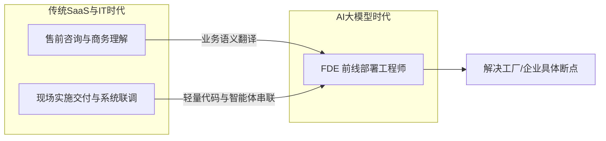
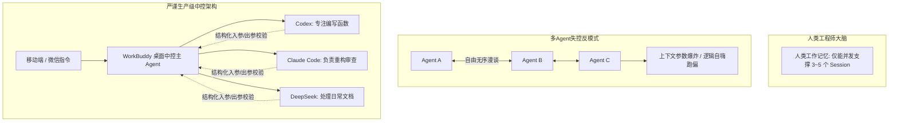

# 2026-11-02 · 第1场直播知识沉淀：FDE交付本质、OPC克制交付、多Agent调度治理与影视视频精度漏斗

> **场次背景**：本次直播为历时 11.3 小时的超长深夜交流（持续至 11月03日清晨），深度复盘了当前 AI 落地深水区的多项硬核真相：概念祛魅下的**“FDE 角色本质论（SaaS 实施交付 + 行业解决方案架构师的融合）”**；李校长分享的一人公司（OPC）**“日接 10–20 单、绝不在陌生行业横跳、千元级独立站让外贸工厂看到真实出单”**的克制打法；多 Agent 研发中**“人脑 3–5 个 Session 瓶颈、DeepSeek Harness Proactive Agent 与 WorkBuddy 移动端中控”**；以及揭露**中转站倒号倒闭潮、Seedance 2.5 假冒 6.5 折内幕与影视级宣传片硬性精度约束**。

---

## 1. FDE 角色本质论：从概念炒作回归工程实施与售前解题

当前市面上充斥着针对 FDE（Forward Deployed Engineer，前线部署工程师）的概念包装与神化。现场实战技术专家通过一线落地经验，剖析了该岗位的真实内核。

### 1.1 概念祛魅：FDE 是实施交付与解决方案的结合体
- **不被新词汇绑架**：FDE 这个词是业界从硅谷 Palantir 借用的工程称谓。剥开自媒体浮夸的包装，其在本质上就是 **SaaS 时代的“现场实施工程师”与“行业解决方案架构师（Solution Architect）”在 AI 时代的高阶融合体**；
- **业务语义的翻译官**：大模型时代，写几行 Python 脚本或调几个 API 的纯技术门槛已被 AI 工具极大抹平。FDE 最稀缺的价值，在于能够身临工厂、仓库或门店，将传统实体老板那些混乱、口语化、充满潜规则的真实业务场景，“翻译”成大模型能够准确理解并处理的结构化数据与工作流。

### 1.2 售前沟通在 FDE 全生命周期中权重占 50%
- **业务沟通决定生死**：现场一位负责技术落地的工程师分享：自己深夜与工厂老板深聊一个半小时，原本计划半小时结束，但业务极其复杂。这正是 FDE 的核心工作常态——**能不能在签单前听懂老板的核心诉求与顾虑，直接决定了项目 50% 以上的成败**；
- **严禁当“坦白全靠 AI 的技术小白”**：与实体老板谈单时，绝不能展现出对业务的一无所知，更不能轻浮地说“我什么都不会，全靠 AI 自动做”。技术人员必须表现出对该垂直行业进销存、损耗率、供应链账期等核心指标的专业理解；
- **第一性原理回归**：不要纠结称呼叫 FDE、EDF 还是 DNF，真正的核心永远是回归商业常识与工程交付：帮企业把具体断点打通、把成本降下来、把效率提上去。

---

## 2. OPC 一人公司的生存哲学：克制交付与精准场景定价

针对技术从业者做轻资产创业常犯的“技术自嗨”与“大炮打蚊子”通病，资深出海创业者李校长分享了极具穿透力的一人公司（OPC）经营心法。

### 2.1 拒绝过度设计：几百元虚拟主机也能撬动海外自然流出单
- **打破“必须搭高防独服”的工程师执念**：
  - 技术新人常认为做一个外贸独立站，必须采购 1~2 万元的独立服务器或昂贵的企业专线，导致成本失控无法成交；
  - 真实的小微外贸工厂，核心痛点是“国内内卷严重，想出海试水，但掏不出上万元做阿里国际站或去线下参展”。他们只需要一个能稳定展示产品、谷歌爬虫能正常抓取收录的站点；
  - 采用成熟的 OpenCart 架构，配合每年几百元的轻量云主机甚至合规虚拟主机，完全足以承接初期的业务访问。
- **3000~4000 元破局定价策略**：
  - 针对市场上动辄开价近万元的软件外包乱象，将首年服务费定在 3000~4000 元，帮工厂把域名解析、建站、基础 SEO 与海外社媒主页一站式全包；
  - 当工厂老板在建站后不久，惊喜地在后台看到通过谷歌自然流带来的第一笔海外真实订单时，工具的信任便彻底立住，后续的口碑裂变转介绍自然水到渠成。

### 2.2 守住认知边界：绝不在陌生行业之间盲目横跳
- **行业跳跃的毁灭性陷阱**：
  - 许多初创团队今天做生鲜、明天做服装、后天做五金机械，自以为手握 AI 工具就能跨界通吃；
  - 每一个新行业都有深不见底的潜规则与认知壁垒。缺乏行业深度的技术人员，盲目接单做出来的软件必定漏洞百出，最终在繁重的定制修改中被客户拖死；
- **有所为有所不为的定力**：
  - 李校长直言：**“就算今天有陌生大客户拿 100 万元大单找上门，只要不是自己熟稔的垂直射程，坚决不接！”** 只有围绕自身最擅长的细分领域深挖，三句话就能切中客户要害，业务才能做得既轻松又高效；
- **一人公司的每日生产节律**：保持极高的人效比，每日稳定承接并交付 10–20 个轻量单子，做不完就明确告知客户排期至次日，绝不盲目招人膨胀固定人力开销。

---

## 3. 多 Agent 协同的注意力上限与移动端中控治理

随着工程师从“单体对话”演进到“多 Agent 异步协作”，多位资深架构师分享了真实工程中的治理卡点与解法。

### 3.1 跨越人脑的“Session 瓶颈”
- **并发注意力过载**：当工程师左右开弓，在终端中同时启动多个并发任务会话时，人类的短期工作记忆上限最多只能维持 **3 到 5 个 Session**。一旦任务超出该阈值，工程师就会在各个窗口的日志和报错之间迷失，反向沦为人肉消息搬运工；
- **DeepSeek Harness 的 Super Agent（主动型 Proactive Agent）探索**：探讨让主控 Agent 具备自主长任务统筹能力，任务阶段性完成后自动调度下游链路，规避每一步都需要人类输入命令的低效等待。

### 3.2 生产级工程防混乱红线：严禁放任 Agent“互聊自嗨”
- **Agent 自由漫谈的灾难性实测**：
  - 现场实测证明：让 3 个 Agent 自由互聊讨论，上下文就已经开始混淆；一旦引入 4 到 5 个 Agent，系统立刻失控陷入无休止的参数死锁与逻辑幻觉；
- **生产级确权架构（主从分层与输入输出硬约束）**：
  - **唯一主控交互（Master-Worker）**：人类工程师只与唯一的主控 Agent 对话，由主控 Agent 将任务拆解为粒度极小的子任务，分别派发给底层子智能体；
  - **每一个关键方法的确定性审查**：不强求逐行肉眼查代码，但**每一个模块接口的入参格式、边界返回值与异常断点，必须由规则网关或人工进行强校验**，严防未经验证的代码污染主分支。

### 3.3 WorkBuddy 桌面中控与移动端远程桥接
- 工程师通过自建 API 中转网关，利用桌面端 WorkBuddy 搭建远程访问通道；
- 离开电脑时，通过手机直接向主控 Agent 发送语音或文本指令，随时随地查看后台长时间编译或数据抓取任务的执行进度，有效释放工位物理绑定。

---

## 4. 视频模型精度漏斗与中转站倒号内幕

围绕短视频与内容出海生态，连麦嘉宾深入揭秘了模型 API 采购的真实黑产与场景精度划分。

### 4.1 中转站与倒号倒卖的“落幕期”
- **二三级中转站利润枯竭**：早期靠搬运海外 API 差价套利的中转站面临全面洗牌；随着国内大模型（DeepSeek、豆包、千问）能力以月为单位高频迭代，普通中转站的需求大幅萎缩；
- **所谓“Seedance 2.5 满血版 6.5 折”的底层骗局**：
  - 资深渠道从业者算账揭秘：字节跳动火山引擎官方给年框 500 万元的大客户，采购折扣仅在 **8.5 折至 9 折**左右；
  - 市面上那些公开叫卖“6.5 折甚至更低”的所谓满血接口，**100% 是用低清 480P 模型伪造参数调用的掺水版，或者是利用盗刷海外云主机凭证的非法逆向黑产**，随时面临被大厂封禁与司法溯源的风险。

### 4.2 视频生成按场景的硬核分级选型
1. **影视级宣传片 / 品牌广告交付（精度为王）**：
   - 必须坚持选用 **Seedance 2.5 官方旗舰画质**；
   - 商业甲方对人脸毛孔质感、复杂动态镜头、文字广告招牌的逼真度要求极高，低阶模型哪怕成本便宜十倍，若成片充斥着扭曲与抽卡瑕疵，也无法通过商业验收。
2. **大众带货 / 矩阵内容冷启动（成本为王）**：
   - 坚决采用 **MiniMax H3 本地量化部署**或轻量级模型打底；
   - 配合密集抽帧与资产替换工作流，将单条视频成本压制在 1 元以内，用极低算力账单支撑起大批量视频测试。

---

## 5. 行动指南：企业FDE轻量落地与多Agent调度风控清单

### 清单一：小微外贸/制造业 FDE 轻量建站与克制交付 Checklist
- [ ] **痛点三句话原则**：能否用 3 句话清晰向工厂老板解释清楚其痛点（如“外贸无官网导致询盘流失”），且对方能立刻听懂并产生共鸣？
- [ ] **拒绝硬件过度配置**：初期是否坚决采用了轻量主机（虚拟主机/轻量云服务器），杜绝盲目搭建数万元的独立高防服务器？
- [ ] **全包式首单定价**：是否设计了 3000~4000 元的低门槛全包试水套餐，包含域名、建站、基础 SEO 与外贸社媒主页？
- [ ] **正反馈闭环周期**：能否在建站交付后 15~30 天内，通过后台让老板看到第一批海外自然流访问记录或真实意向单？
- [ ] **认知边界守卫**：面对超出团队熟悉射程的陌生大额定制需求，是否保持定力坚决不接，防止交付崩盘？

### 清单二：生产级 Multi-Agent 架构防混乱与注意力减负 Checklist
- [ ] **单人并发上限管控**：单个工程师日常并行的终端代码编写 Session 是否严格控制在 3 个以内，避免注意力过载？
- [ ] **严禁多 Agent 自由漫谈**：是否杜绝了让 3 个以上 Agent 互相聊天自嗨的不可控模式？
- [ ] **主从分层派发架构**：是否采用了“人类 $\to$ 唯一主控 Agent $\to$ 专用子 Agent”的确定性调度拓扑？
- [ ] **输入输出契约强校验**：各子 Agent 编写的函数模块，是否配置了针对入参和返回值的自动化单元测试或断言校验？
- [ ] **移动端安全远程监听**：若需外出监管长周期任务，是否通过合规桌面中控工具（如 WorkBuddy）建立安全通信通道，而非在公网裸奔开放端口？
