# 2026-11-02 · 第1场直播：通宵11.4小时实战全景复盘——FDE交付本质、3000元外贸独立站出单、中转站DNS劫持与6.5折假冒骗局、Token包装矿泉水哲学与多Agent治理

> **场次背景与全景导言**：本次直播为历时 11.43 小时的深夜通宵深度研讨（2026年11月02日晚21:46持续至11月03日清晨09:12，有效语音 3,367 段、逾 17.1 万字）。现场汇聚了出海网络工程师廖工、苏州大学创元孵化器落地负责人来福总、2002年第一代互联网老站长阿麦、出海实战老兵李校长、淘宝文案变现高手、企业级中转站开发者及资深架构师。交流围绕 AI 商业化交付的真实深水区展开：从出海网络搭建与苏州孵化器落地，到“把一分钱一瓢的河水包装成两元矿泉水”的 Token 变现与 Diff 降本心法；从阿麦与李校长关于“白沟箱包厂 3000 元极轻独立站出单”的激烈论战，到大模型造价算量与以标写标；从人类脑容量 3~5 个 Session 的注意力瓶颈与多 Agent 严禁互聊自嗨，到内部技术报销从 2000 元砍至 300 元的阶梯式调用；更首次血淋淋曝光了杭州本地中转站倒号倒闭潮、所谓“6.5折”掺水套娃内幕，以及中转站恶意注入代码篡改客户端 DNS 服务器实施定向劫持的真实安全事故。

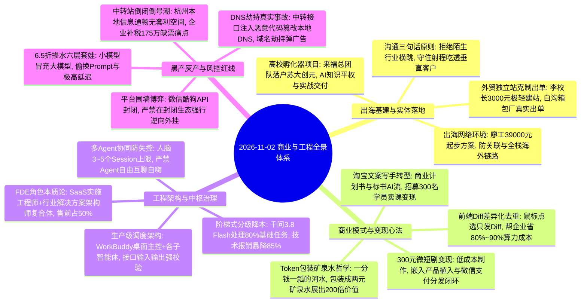

---

## 1. 出海网络基础设施与高校孵化器项目落地

直播伊始，围绕跨境出海的物理网络配置、独立站搭建及产学研合作项目展开了务实交流。

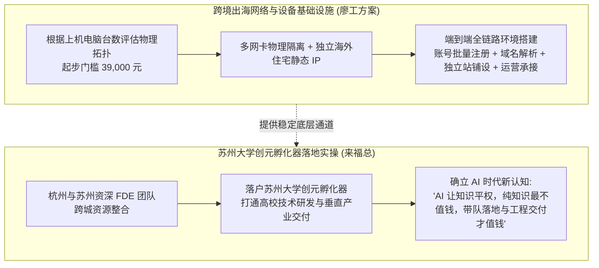

### 1.1 廖工的出海网络拓扑：起步 39,000 元的工程账本

- **网络环境决定出海生死**：
  - 许多外贸企业出海卡在第一步：由于使用了劣质机场节点或数据中心 IP，账号注册当天即被封禁；
  - 廖工团队专做企业级海外网络环境交付，起步价 39,000 元；
  - 根据企业实际配置的电脑台数，现场部署硬件路由与独立海外住宅专线，搭配多层指纹隔离，将“注册账号、主页搭建、独立站部署、自动化运营”串成一条确定性的合规链路。

### 1.2 来福总团队落户苏大创元：知识平权时代“纯知识最不值钱”

- **杭州与苏州团队的成功合流**：
  - 直播间促成了杭州曹总、杨总与汪总团队的深度合作，项目最终成功落地在苏州大学创元孵化器；
- **打破对高大上理论的迷信**：
  - 来福总直言：大模型让全网知识彻底平权，任何算法名词网上都能搜到，如今最廉价的就是“讲概念的理论家”；
  - 真正值钱的是能把信息化 1.0、2.0、4.0 经验融合、能带队下到车间解决企业真实进销存断点的实战工程老兵。

---

## 2. 小作坊卖 Token 的“包装矿泉水”商业哲学与 80% 降本心法

针对独立开发者与小微团队如何靠大模型盈利，一位开发者在连麦中提出了精妙绝伦的“卖水哲学”。

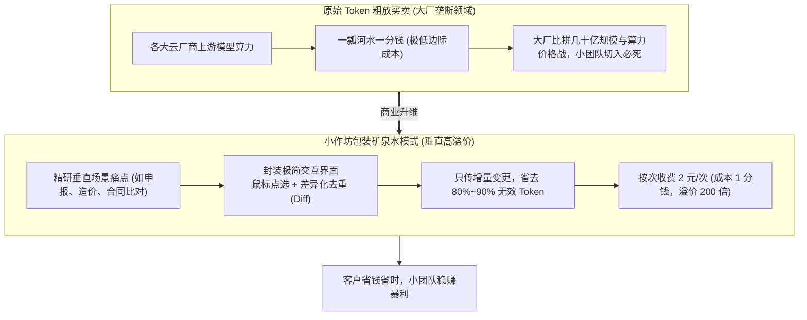

### 2.1 商业本质拆解：把一分钱一瓢的河水包装成两元矿泉水

- **小作坊切忌碰底层 Token 转售**：
  - 大厂直播卖算力争夺的是几十亿的大盘，小团队如果只做“API 转售”，利润微薄且面临极高坏账与封禁风险；
- **包装矿泉水法则**：
  - “原始的 Token 就像河里的水，一瓢一分钱，极其便宜；但普通客户根本不会喝生水，甚至怕水里有寄生虫”；
  - 小团队的价值就是把生水过滤、消毒、装进精致的瓶子，贴上品牌标签，做成农夫山泉卖两块钱；
  - 表面上客户在买一个“一键搞定格式审查的小程序”，付了 2 块钱，实际上背后调用的模型 Token 成本只有 1 分钱，实现了 **200 倍的商业价值跃迁**。

### 2.2 核心工程提效：鼠标点选与 Diff 差异化去重（狂省 80%~90% Token）

- **杜绝全量上下文长文本无脑重传**：
  - 很多开发者做一个表格审查或界面交互工具，每次修改都把数万字的全量文档重新塞给模型，导致成本失控；
- **前端 Diff 去重技巧**：
  - 监听用户在界面上的鼠标点选与单元格修改动作，系统只计算增量差异（Diff），仅将变动的局部参数与前后上下文发给大模型；
  - 通过这套去重算法，不仅模型响应速度从 10 秒缩短至 1 秒以内，更能帮企业直接砍掉 **80% 到 90% 的 Token 账单**；
  - “省下来的成本企业拿走一半，我们拿走一半”，这就是最坚实的商业交付逻辑。

---

## 3. FDE 角色本质论：从概念包装回归工程实施与售前解题

直播间就爆火的 FDE 岗位的本质与真实工作状态展开了深入讨论，彻底剥离了概念神话。

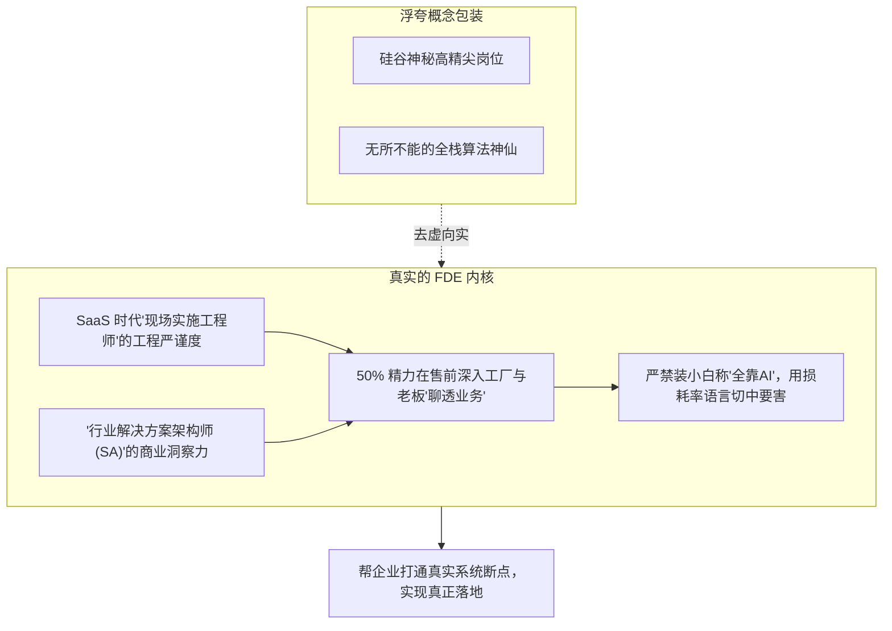

### 3.1 概念祛魅：FDE 是实施交付与解决方案的高阶融合体

- **不被新词汇绑架**：FDE 这个词源自硅谷 Palantir 的工程称谓。现场实战派明确指出：其本质就是 **SaaS 时代的“现场实施工程师”与“行业解决方案架构师（Solution Architect）”的融合体**；
- **业务语义的翻译官**：大模型时代写几行代码已被 AI 极大抹平，最稀缺的价值在于能够身临工厂、仓库或门店，将老板口语化、充满方言与行业潜规则的真实业务场景，“翻译”成模型能处理的结构化数据与工作流。

### 3.2 售前沟通在 FDE 生命周期中权重占 50%

- **业务沟通决定生死**：现场工程师分享：深夜与工厂老板深聊一个半小时，极其复杂。能不能在签单前听懂老板的核心诉求与顾虑，直接决定了项目 50% 以上的成败；
- **严禁当“坦白全靠 AI 的技术小白”**：与实体老板谈单时，绝不能展现出对业务一无所知，更不能轻浮地说“我什么都不会，全靠 AI 自动做”。技术人员必须表现出对该行业进销存、损耗率、供应链账期等指标的专业理解；
- **第一性原理回归**：不要纠结称呼叫 FDE、EDF 还是 DNF，真正的核心永远是回归商业常识：帮企业打通断点、降本增效。

---

## 4. OPC 一人公司的生存哲学：李校长 vs 阿麦激辩外贸独立站

出海实战老兵李校长与 2002 年第一代互联网老站长阿麦，围绕“小微企业如何低成本出海”展开了一场精彩绝伦的商业辩论。

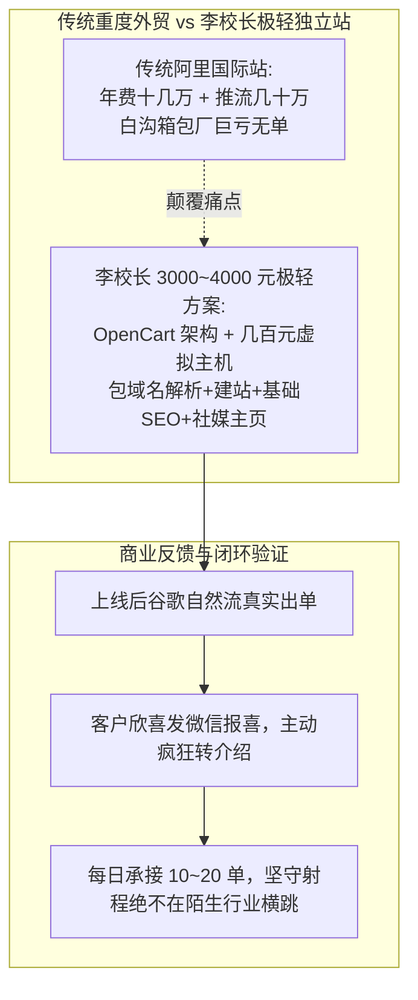

### 4.1 白沟箱包厂的血泪教训：高昂平台年费与推流黑洞

- **小微工厂的出海绝境**：
  - 河北白沟的箱包工厂，产品极具成本与质量竞争力，但国内卷到极致，迫切想出海；
  - 投入阿里国际站，基础年费十几万，加上买词推流几十万，一年亏损大几十万却颗粒无收，甚至被复杂规则逼到崩溃。

### 4.2 李校长的 3000 元极轻破局打法与“自然流出单”

- **拒绝过度设计**：
  - 技术新人总想搭上万元的独服或企业专线，李校长直接采用成熟的 OpenCart 架构，配合每年几百元的轻量云主机甚至合规虚拟主机，成本极低；
- **3000~4000 元一站式定价**：
  - 市场上动辄开价 6,980、9,800 元忽悠外行，李校长收 3000~4000 元全包（包域名、建站、基础 SEO、海外社媒主页）；
  - 工厂老板不仅毫无决策摩擦，而且上线不久后后台竟然**靠谷歌自然流抓取成功出单**；
  - 老板亲自发微信报喜，并迅速向身边的工厂同行疯狂转介绍，口碑裂变生生不息。

### 4.3 阿麦老站长的现实碰撞：300 块的业务也是衣食父母

- **老站长阿麦的成本账**：
  - 阿麦直言：3000 块的业务扣掉买域名服务器，在直播间 500 块钱大把兄弟愿意接；
  - 但商业的核心不是比谁便宜，而是**认真对待付钱的客户**：“今年明年后年，甭说 3000 块的业务，300 块的业务今天我也认真对待，付钱的都是衣食父母！”

### 4.4 守住认知边界：三句话原则与绝不盲目横跳

- **李校长的克制纪律**：
  - “客户说‘校长你独立站做得这么好，顺便帮我把 TikTok 店铺也代运营了吧’——**坚决不接！**”
  - 陌生行业有一万个潜规则会拖死小团队。李校长只在自己的射程内深挖，三句话切中外贸出海痛点（“一听诉求、二指断点、三给极简解法”）；
  - 保持 OPC 高人效，每日稳定处理 10~20 单，排期满了就排到次日，绝不盲目扩张团队招人。

---

## 5. 企业造价与以标写标大模型工程实践

现场探讨了垂直高门槛领域中，行业专家如何与 AI 结合建立绝对壁垒。

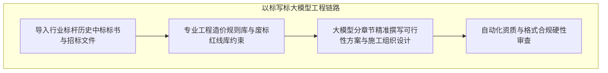

### 5.1 工程造价专家的 Prompt 深度与行业壁垒

- **隔行如隔山**：小白写 Prompt 只能泛泛而谈“请帮我做个预算”，生成的都是垃圾；
- **专业造价专家的杀手锏**：因为深谙定额标准、工料机消耗量与各省工程算量规范，专家能精准反向约束大模型：按指定清单编码格式输出、严格区分综合单价中的规费与税金，输出即生产可用。

### 5.2 淘宝商业文案写手的 AI 卖课变现复盘

- **从单点写手向培训导师跃迁**：
  - 一位连麦学员分享：此前在淘宝专门给客户写商业计划书（BP）、可研报告、融资方案与标书；
  - 借助 AI 工具流，一人一天能输出数套高质量专业文档；在淘宝建立标杆口碑后，将这套实操工作流打包成系统课，成功招募了 300 多名付费学员，实现了从体力代写向知识交付的跃升。

---

## 6. 多 Agent 协同治理与移动端中控架构

随着技术人员从单 Agent 对话向多 Agent 协同迈进，现场深度复盘了真实生产中的系统崩溃卡点。

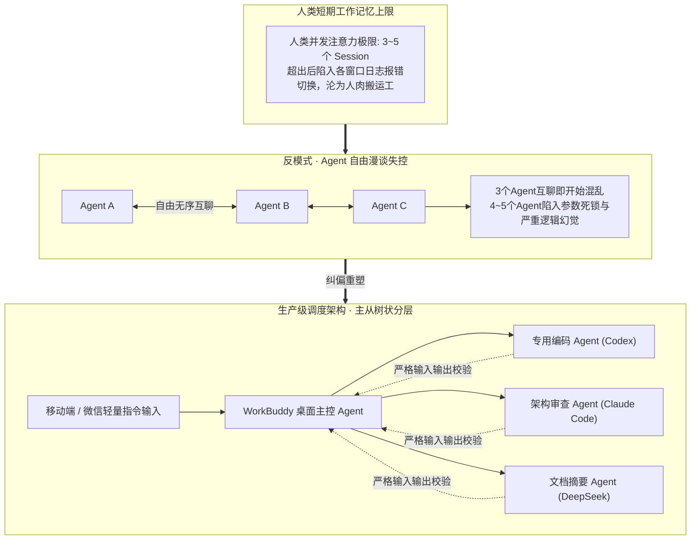

### 6.1 跨越人脑的“Session 瓶颈”

- **并发注意力过载**：人类短期工作记忆上限最多维持 **3 到 5 个任务会话**。一旦终端并发超过 5 个窗口，人类就会在各个日志和报错之间手忙脚乱，反而大幅降低产出人效；
- **主从分级调度是唯一出路**：必须引入主控智能体（如桌面端中控 Agent），由主控接收人类高阶意图，再分派子任务。

### 6.2 生产级工程防混乱红线：严禁放任 Agent“互聊自嗨”

- **Agent 自由互聊的灾难性实测**：
  - 现场实测证明：让 3 个 Agent 在开放群组里自由讨论，上下文很快开始自相矛盾；引入 4 到 5 个 Agent，系统立刻崩溃在无限循环的参数互传与幻觉中；
- **生产级确权架构（Master-Worker）**：
  - 人类只与唯一主控交互；子智能体之间**物理级禁止横向通信**，必须通过主控进行状态中转；
  - **每一个关键方法的确定性审查**：不强求看逐行代码，但每一个模块接口的输入参数 Schema、返回值与异常断点，必须由规则网关强校验。

---

## 7. 大模型工程落地降本法则：阶梯式任务分级

针对技术团队每月高昂的算力报销账单，现场分享了一套惊艳的高效降本制度。

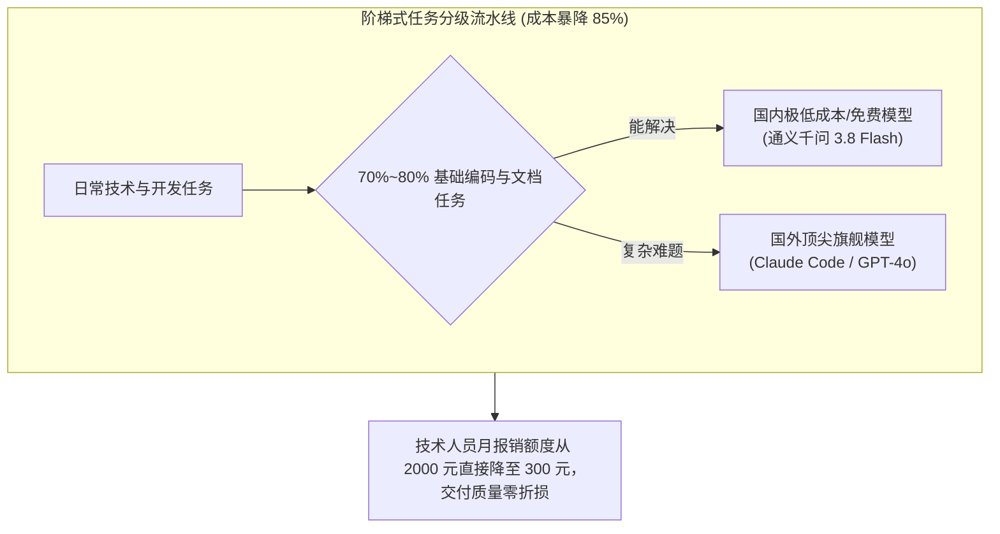

### 7.1 从“2000 元超标”到“每月 300 元”的制度奇迹

- **早期无序调用的浪费**：
  - 公司早期给技术人员每人每月配 2000 元大模型报销额度，技术人员不管大事小事一律调用最昂贵的国外顶级模型，经常超额且效率不见提高；
- **推行任务分级制度**：
  - 强制规定：日常 70% 到 80% 的常规代码编写、格式转换、文档摘要，一律使用国内极低成本大模型（如通义千问 3.8 Flash，免费或极其廉价）；
  - 只有遇到千问无法解决的复杂算法重构与边界难题时，才允许申请调用国外旗舰大模型；
  - 实施分级后，技术团队单人月平均算力开支骤降至 **300 元左右**，成本压缩了 85%，且工程产出质量丝毫无损。

---

## 8. 中转站倒号倒闭潮与 API 掺水骗局大起底

直播中，围绕国内大量小微团队热衷参与的“大模型中转站”赛道，现场多位资深开发者与当事人无情揭开了其背后的灰产内幕与致命隐患。

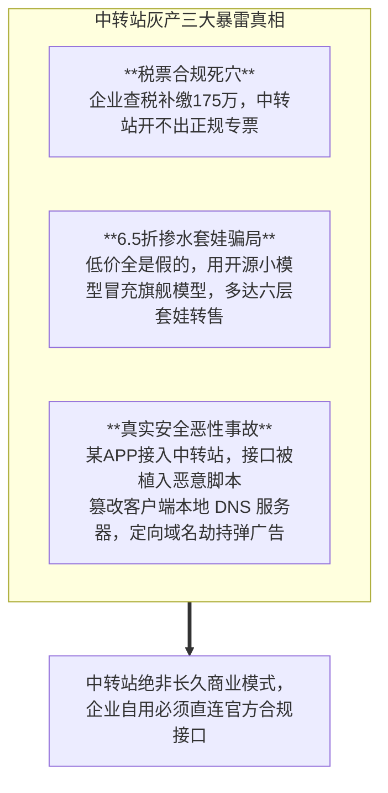

### 8.1 杭州倒号跑路潮：本地市场毫无信息差套利空间

- **小作坊倒号三四天即面临倒闭**：
  - 杭州一位连麦者称跟朋友刚搞了三四天中转站，从海外倒号再转售给本地企业，发现根本卖不动；
  - 现场一针见血指出：杭州电商与 AI 生态比全国快半步，信息极度透明；正规企业绝不会采购来路不明的中转接口；
- **税票合规是压死中转站的第一根稻草**：
  - 某电商企业连麦透露：上个月刚面临税务核查补缴了 175 万元税款，企业如今每一笔技术支出都必须有合规增值税专用发票；绝大多数个人中转站根本开不出票，直接被规上企业一票否决。

### 8.2 “6.5 折”掺水内幕：六层套娃与小模型李代桃僵

- **天上不会掉馅饼**：
  - 市面上宣称“官方 6.5 折甚至 5 折”的中转 API，**90% 以上全是掺水造假**；
  - 黑心作坊在后端悄悄配置了模型路由拦截：遇到短文本直接用开源 7B/14B 小模型或极低价旧模型顶替，不仅语义理解大打折扣，更通过多达“六层中转站套娃转售”，导致接口延迟飙升至数秒甚至超时断开。

### 8.3 真实安全恶性事故：恶意注入篡改客户端本地 DNS 服务器

- **触目惊心的客户端沦陷案例**：
  - 现场一位开发者分享了血淋淋的真实事故：团队上个月做了一款安卓微应用，技术员为了省事接入了某第三方中转站 API；
  - APP 上线后在安卓端爆发严重投诉：经过数天极其痛苦的逆向抓包排查，发现正是该中转站接口在返回数据中植入了恶意功能代码；
  - 该代码利用底层漏洞**悄悄修改了安卓客户端本地的 DNS 服务器地址**，通过 DNS 污染实施定向域名劫持，在用户打开特定页面时强行弹出恶意博彩广告；
- **> ⚠️ 核心警示（接口安全底线）：**
  - 企业自研商业软件，严禁接入来路不明的黑中转站；
  - 宁可多花正规算力成本直连大厂官方 API，也绝不能让整个客户端的安全命脉交由缺乏信誉的第三方中转掌控。

---

## 9. 平台围墙博弈：微信酷狗 API 封闭与合规边界

针对许多技术团队试图“逆向微信开发自动化聊天机器人”的普遍想法，现场进行了严肃的合规泼冷水。

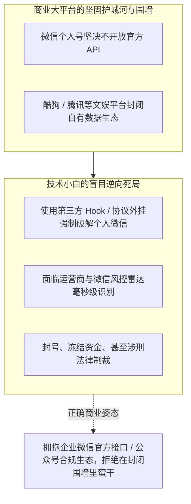

### 9.1 个人微信生态绝对不可触碰的红线

- **微信个人号无官方 API**：
  - 许多初学者总想搞“AI 自动接管个人微信聊天、自动成交”；
  - 现场技术人员严正提醒：个人微信至今从未开放过 API，市面上所有所谓的个人微信聊天机器人，全部基于 Hook 内存注入或协议逆向等灰产手段；
  - 微信风控算法对异地登录、高频自动化消息具有极其灵敏的嗅探机制，轻则封号数月、冻结零钱包，重则触犯非法侵入计算机信息系统罪，技术团队切忌引火烧身。

### 9.2 平台围墙内的生存法则：尊重生态，不建空中楼阁

- **不要试图挑战巨头的封闭生态**：
  - 酷狗、腾讯等巨头平台不开放接口，自己费尽心思逆向做一个外挂毫无壁垒可言，巨头稍微调整一个前端签名参数就能让你的系统瞬间瘫痪；
  - 商业交付应回归官方支持的合规通道（如企业微信第三方服务商接口、小程序官方组件），在阳光下赚取长久利润。

---

## 10. 影视级微短剧与视频生成实战账本

在多模态与视频内容创作板块，现场嘉宾对 AI 微短剧的真实成本与变现路径进行了硬核核算。

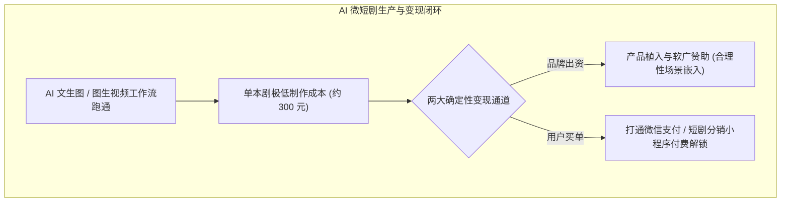

### 10.1 300 元单本剧成本与浮夸宣传祛魅

- **微短剧的真实生产成本**：
  - 现场实操者透露：借助目前主流的文生图与图生视频工具流水线，**制作一本基础 AI 微短剧的算力与制作成本可以压缩到 300 元左右**；
  - 但千万不要被“AI 一键生成爆款电影”的噱头忽悠；单纯刷短剧只有个人娱乐属性，无法产生商业价值；
- **两大变现生路**：
  - **品牌软广植入**：在剧情中极其自然地植入实体客户的消费品（如日化、食品、数码），由品牌方买单；
  - **打通微信支付闭环**：接入合规短剧分销小程序，前 5 集免费引流，后续关键反转剧情通过微信支付小额单集解锁，快速回笼现金流。

---
---

## 11. 知识付费卖课割韭菜心理学剖析：为什么搜得到的知识普通人依然花钱听课

* **直播深夜的人性洞察**：
  * 清晨时段，麦上探讨了“为什么全网到处都是免费 AI 教程，市面上几百上千元的 AI 课程依然大卖”的奇特现象。
  * **大众深层心理机制拆穿**：
    * **第一：知识过载带来的选择瘫痪**：网上海量碎片化信息让普通人无所适从，越搜越迷茫，他们迫切需要一个人把信息打包成“第一步干嘛、第二步干嘛”的傻瓜式药丸；
    * **第二：购买心理学上的“延期安慰剂”**：很多人花 399、999 元拍下课程，那一瞬间大脑分泌多巴胺，产生了一种“我已经掌握了这项前沿技术、我已经走在时代前沿”的虚假充实感；实际上买回去后课程播放率不到 10%；
  * 真实落地团队必须看清这一点：做企业 B 端交付必须提供**确定性的代做代交付结果**，绝不能沦为向老板贩卖空气课件的江湖骗子。

---

## 12. 线下文旅板块与地方政企项目对接实操：拿既有 App 包装“软著”套取支持的灰色套路

* **文旅政企深水区黑幕曝光**：
  * 现场连麦了一位常年对接地方文旅部门的技术外包老板，详细透露了民间团队与地方部门对接 AI 项目的灰色潜规则：
  * **急功近利的考核导向**：很多地方文旅局、科技局下属单位需要突击完成当年的“科技创新落地标的与知识产权储备”；
  * **极速合规运作闭环**：
    * 重新研发一套文旅系统耗时至少半年以上，时间上根本来不及；
    * 中介团队直接在市面上低价收购现成已下架的旧版电商或导航 App 源代码；
    * 紧急修改前端 UI 与名称（套上“智慧文旅导览与 AI 元宇宙助手”的马甲），通过快速通道申请软件著作权（软著）；
    * 凭软著与测试版 Demo 迅速完成政府项目验收与资金拨付，随后整套系统被彻底打入冷宫；
  * 老徐警告：这类项目虽能短期赚取一笔外包快钱，但政策风险极高、一旦审计倒查将面临追责，绝非正道。

---

## 13. 大模型选型现场辩论：“杀鸡焉用牛刀”，豆包做简单问答 vs 满血 SD/开源大模型成本天堑

* **企业模型选型终极心法**：
  * 针对许多中小企业盲目采购昂贵英伟达 H100/A100 服务器本地部署所谓“开源大模型”的狂热现象，现场专家泼了一盆刺骨冷水：
  * 一台企业级算力服务器整机动辄几十万元，加上机房电费、专职运维工程师年薪，一年固定开销超过 50 万元；
  * 但企业内部 95% 的实际业务需求，仅仅是“前台自动接待、员工报销制度问答、日常通知润色”；
  * **极致性价比打法**：直接接入字节跳动的豆包 API 或阿里的轻量模型，一次对话调用仅需几厘钱，一年全员用下来花费不到 2000 元！**杀鸡绝不要用牛刀，算清真实账本是企业数字化的第一守则**。

---

## 14. 商业谈判中的“客户层级对齐准则”：为什么不能跟认知不在同一层级的客户谈业务

* **商业防坑血泪金句**：
  * “不要试图去教育一个根本听不懂人话的客户，教育客户是上帝的事情，不是你的事情！”
  * **三类必须果断拉黑的垃圾客户**：
    1. **既要又要还要型**：预算只有 3000 元，却要求做出具有 OpenAI 级别的通用智能体，且必须保证“100% 绝不出错”；
    2. **完全没有业务闭环型**：自身连核心产品怎么卖、客户在哪里都搞不清楚，妄想买一套 AI 软件就能自动天降订单发家致富；
    3. **白嫖方案型**：以“先出详细方案、先拉团队做个 Demo 看看”为名，套取你的方案后转手找廉价大学生仿制；
  * 优秀团队必须建立“客户准入漏斗”，只与具备成熟商业逻辑、具备付费能力、尊重技术边界的同频客户合作。

---

## 15. 个人 IP 孵化与二次元漫剧变现的残酷现实：没有商业变现闭环的网红都是虚耗

* **流量神话的破灭**：
  * 连麦创作者复盘了自己耗时三个月、用 AI 渲染二次元美女图和漫剧做成数十万粉丝抖音快手账号的悲惨经历：
  * 表面上点赞过百万、评论区全是“小姐姐好美求壁纸”，看似风光无限；
  * **变现断崖式惨败**：
    * 接商单广告，品牌方嫌粉丝全是没消费能力的白嫖党；
    * 挂小黄车带货，根本卖不动货；
    * 试图引流私域收会员费，转化率不到万分之三；
  * **结论**：脱离了实体供应链与精准付费场景的纯泛娱乐流量，在当下的商业环境里毫无商业变现价值，纯粹是消耗算力与青春的数字泡沫。

---

## 16. 平台内容过审避坑指南：抖音短剧与数字人画质门槛、审核违规下架导致的算力打水漂

* **平台审核红线全盘整理**：
  * 针对近期许多团队制作的 AI 短剧和数字人视频被抖音、快手等平台批量下架甚至封号的问题，现场梳理出四大避坑铁律：
  * **第一：严禁低帧率与严重伪影**：平台算法已上线“低质 AIGC 画面特征识别引擎”，凡是人物手指变形、面部融化、帧率低于 24FPS 的粗糙画面，直接打上低质标签、零播放量压制；
  * **第二：违规题材秒杀**：重生复仇、婆媳极端矛盾、未成年人暴力等题材在 2026 年下半年面临极其严苛的前置剧本报备审核；未取得视听许可证的 AI 短剧严禁私自挂小程序付费链接；
  * **第三：必须保留真实渲染工程工程文件**：平台申诉时必须能够提交分镜工程文件与版权证明，否则一旦被同行恶意举报抄袭，所有投入的算力成本将瞬间血本无归。

---

## 17. 落地实践工具箱：实战自检原则表与三阶段执行清单

### 17.1 AI 商业化与工程交付 10 大避坑自检表

| 序号 | 核心自检维度 | 落地检测问题 | 预警避坑红线 |
| :---: | :--- | :--- | :--- |
| **01** | **出海网络** | 跨境环境是否配置了物理隔离与海外独立原生住宅 IP？ | 严禁使用廉价共享机场节点，防止批量连带封号 |
| **02** | **Token 包装** | 产品是否将一分钱的底层模型包装为按次收费两元的垂直解决方案？ | 杜绝直接做微利甚至亏损的原始 API 倒卖生意 |
| **03** | **算力降本** | 前端界面是否引入了鼠标点选与 Diff 差异化去重传输？ | 严禁每次交互全量上传数万字上下文吞噬巨额利润 |
| **04** | **独立站定价** | 针对外贸工厂是否制定了 3000~4000 元极低决策门槛的一站式建站方案？ | 避免在初期强推上万元重度定制吓跑中小外贸工厂 |
| **05** | **射程聚焦** | 一人公司（OPC）是否坚守最熟悉的垂直赛道，拒绝盲目跨界横跳？ | 严禁手握 AI 就自以为能跨界通吃，防范陌生行业泥潭 |
| **06** | **多Agent防乱** | 多智能体协作中是否严格执行主从调度（Master-Worker）架构？ | 严禁放任 3 个以上 Agent 在开放群聊中自由互聊自嗨 |
| **07** | **阶梯式调用** | 内部研发是否推行千问等低成本模型解决 80% 基础任务的分级机制？ | 杜绝技术人员无节制调用国外顶尖旗舰模型导致报销超标 |
| **08** | **接口安全** | 生产级客户端是否彻底摒弃无资质的第三方中转站，直连正规官方接口？ | 警惕中转站掺水造假与接口注入篡改 DNS 的重大安全事故 |
| **09** | **发票合规** | 企业级大模型支出是否具备正规增值税专用发票留痕？ | 避免采购开不出票的黑中转站，防范税务核查风险 |
| **10** | **生态红线** | 业务自动化是否坚决远离微信个人号逆向外挂等灰产红线？ | 严禁使用 Hook 协议外挂，防范封号与法律合规制裁 |
| **11** | **软著套取** | 参与政企文旅项目是否坚守真实研发，防范买旧 App 软著套补风险？ | 警惕政策资金审计倒查导致的连带法律追责与追缴风险 |
| **12** | **模型选型** | 通用问答与工单是否优先选用豆包/千问等高性价比轻量模型？ | 严禁无脑部署数十万昂贵私有服务器造成算力与运维浪费 |
| **13** | **客户准入** | 是否建立了客户层级准入机制，坚决拉黑既要又要还要的劣质客户？ | 杜绝试图“教育客户”，防范陷入无限期扯皮与回款死局 |
| **14** | **漫剧变现** | 泛娱乐流量是否具备明确的后端实体产品或高客单服务承接？ | 避免脱离商业闭环盲目刷点赞，防范空耗算力电费 |
| **15** | **短剧过审** | 短剧成片是否保证 24FPS+ 帧率并保留完整分镜工程源文件留痕？ | 严禁粗糙低帧率画面与违规敏感题材导致平台限流下架 |

### 17.2 三阶段执行清单 (Actionable Practice)

#### 第一阶段：算力分级与接口安全排查（Day 1 ~ Day 7）

- [ ] 审查团队大模型调用账本，将日常基础代码、文本翻译与简单摘要任务全面切流至通义千问 3.8 Flash 等低成本模型，将旗舰模型限制在复杂架构难题；
- [ ] 排查所有对外部署的客户端与小程序，全面剔除第三方黑中转站接口，直连官方合规服务，并检测本地网络与 DNS 请求安全。

#### 第二阶段：差异化去重与极轻外贸产品打磨（Day 8 ~ Day 20）

- [ ] 在前端交互中增加 Diff 差异化传输机制，仅针对用户变更数据向大模型发起增量请求，将单次调用的 Token 消耗缩减 80% 以上；
- [ ] 面向熟悉的外贸制造或小微工厂，推出 3000~4000 元的“独立站 + 基础 SEO + 社媒出海”极简套餐，跑通从建站到谷歌自然流出单的首批闭环。

#### 第三阶段：中控主从治理与口碑裂变复制（Day 21 ~ Day 30）

- [ ] 规范团队多 Agent 调度体系：确立单一桌面中控主 Agent，严格定义各子智能体的接口输入输出 Schema 规则网关，杜绝 Agent 间无序漫谈；
- [ ] 围绕已出单的标杆客户挖掘口碑转介绍，牢固守住垂直业务射程，保持每日 10~20 单的高效稳健交付节奏。
