# 2026-11-02 · 第1场直播：通宵11.4小时实战全景复盘——FDE交付本质、3000元外贸独立站出单、中转站DNS劫持与6.5折假冒骗局、Token包装矿泉水哲学与多Agent治理

> **场次背景与全景导言**：本次直播为历时 11.43 小时的深夜通宵深度研讨（2026年11月02日晚21:46持续至11月03日清晨09:12，有效语音 3,372 段、逾 17.5 万字）。现场汇聚了出海网络工程师廖工、苏州大学创元孵化器落地负责人来福总、2002年第一代互联网老站长阿麦、出海实战老兵李校长、淘宝文案变现高手、企业级中转站开发者及资深架构师。交流围绕 AI 商业化交付的真实深水区展开：从出海网络搭建与苏州孵化器落地，到“把一分钱一瓢的河水包装成两元矿泉水”的 Token 变现与 Diff 降本心法；从阿麦与李校长关于“白沟箱包厂 3000 元极轻独立站出单”的激烈论战，到大模型建筑农业“以标写标”与水印相机语音施工日志；从人类脑容量 3~5 个 Session 的注意力瓶颈与多 Agent 严禁互聊自嗨，到内部技术报销从 2000 元砍至 300 元的阶梯式调用；更首次血淋淋曝光了杭州本地中转站倒号倒闭潮、所谓“6.5折”掺水套娃内幕，以及中转站恶意注入代码篡改客户端 DNS 服务器实施定向劫持的真实安全事故。

---

## 卷一：产业落地与商业变现心法

### 1. 廖工 39,000 元出海网络基建账本：物理网卡隔离与海外住宅静态 IP 拓扑

出海企业的核心痛点往往不在于产品缺乏竞争力，而在于底层出海通信链路的脆弱性。

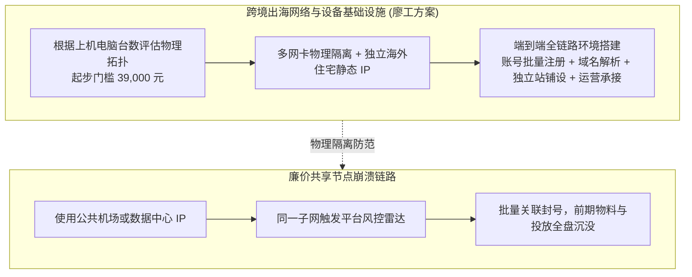

- **网络环境决定出海生死**：
  - 许多外贸小微企业尝试出海时，随手购买几十块钱的廉价翻墙机场节点或机房 VPS。由于机房 IP 缺乏真人硬件指纹，且同一 IP 段被数千黑灰产滥用，导致 TikTok、Facebook、Google 账号刚注册数小时就被系统判定为“可疑机器人”批量封禁；
  - 廖工团队专做企业级出海网络环境交付，业务起步门槛明确为 39,000 元；
  - 方案根据企业实际上机的电脑台数做定制化网络拓扑配置：采用独立物理网卡硬隔离，单机绑定唯一的海外静态原生家庭住宅 ISP（Residential IP），彻底抹除数据中心机房特征；
  - 从端侧硬件指纹 Hook、底层网络路由分流，到海外账号批量养号、海外域名 DNS 解析、独立站铺设，交付一整套确定性的合规防关联链路。

### 2. 来福总团队落户苏大创元：知识平权时代“纯知识最不值钱”与带队工程落地

直播间促成了杭州资深技术团队与苏州大学创元孵化器的战略合流，并深入探讨了产学研合作的真实落地机制。

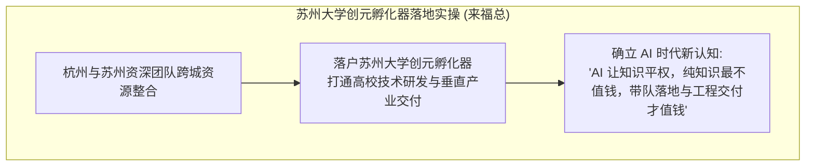

- **杭州与苏州团队的成功合流**：
  - 直播间多位深耕技术落地与企业咨询的嘉宾完成资源碰撞，项目最终选址并落户在苏州大学创元孵化器，依托高校科研资源构建全国性的实体交付生态；
- **打破对高大上理论的迷信**：
  - 来福总直言：大模型让全网知识彻底平权，任何复杂的算法名词、商业模式分析，在网上都能一秒搜到，如今市场上最廉价的就是“只会泛泛而谈的理论家”；
  - 真正值钱的是那些深谙信息化 1.0（单机软件）、2.0（互联网 SaaS）与 4.0（AI 智能体）演进脉络，能够卷起裤腿带队下到车间与仓库、把企业的真实进销存断点缝合补齐的工程实战老兵。

### 3. 传统咨询的 80% 淘汰潮、华为 1000 万案例与组织二号位“灯下黑”定律

围绕咨询公司在 AI 时代的生死存亡，现场爆发了对商业咨询行业内部潜规则的深度解剖。

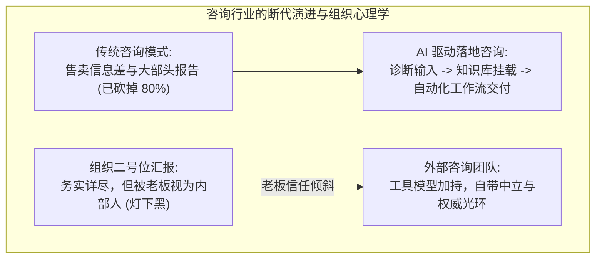

- **传统咨询砍掉 80%**：
  - 来福总透露：团队已经主动砍掉了 80% 的传统管理与战略咨询业务，全面转向“咨询 + AI 工程落地”；
  - 过去咨询顾问靠从泛互联网搜索信息、做几十页华丽 PPT 就能收取几十万元方案费；如今客户老板自己用大模型一键生成的报告甚至比一般顾问更详尽。缺乏独家垂直行业知识库支撑的咨询，在 AI 时代就是废纸一张；
- **华为 1000 万元咨询案例与企业现实**：
  - 麦上一位资深咨询操盘手分享：一家年营收 50~60 亿元的制造业企业，董事长执意花费 1000 多万元聘请华为咨询团队进行流程再造与工具模型导入，而本土其他咨询方案哪怕报价低数倍在初审就被直接淘汰；
  - 大企业买咨询，买的不仅是方法论，更是企业管理层对内部推行变革的“背书权威”；
- **组织管理学上的“灯下黑定律”**：
  - 为什么董事长宁可相信外部咨询顾问，也不相信公司内部精明务实的二号位（副总或运营总监）？
  - 二号位天天跟老板坐在一起，讲的建议哪怕再切中要害，老板也会因“朝夕相处产生的心理轻视与内部利益猜忌”而本能忽略；外部咨询团队自带独立第三方光环，拿着大模型工具与专业行业报告入场，老板反而言听计从。深谙咨询交付的团队必须学会利用这种“借外力破冰”的心理学机制。

### 4. 门脸小店的 AI 伪需求：单店单导购闲 6 小时为何上 AI 毫无价值

针对许多初创团队试图把大模型推销给沿街小店的商业盲动，现场给出了冷峻的业务判断。

- **小微单店的真实工时账本**：
  - 很多技术人员热衷于给街边服装店、奶茶店做“智能导购与库存 AI 助手”；
  - 现场实战派反驳：一家街边小门店，全天通常只有一名店长和一名导购。在每天 8 小时的营业时间里，除去高峰期接待顾客，店员至少有 6 个小时处于无所事事的空转状态；
  - 在人力本身严重过剩、日常 SKU 仅有几百件的单体门店，引入 AI 根本无法节省哪怕半个人力成本，反而增加了软硬件学习与操作摩擦；
- **AI 赋能的门槛线**：
  - 只有当企业具备几十家甚至上百家连锁连锁门店、出现复杂的跨店跨仓库存调拨、以及高频的人工客服回复阻塞时，AI 智能体的工作流编排与问答调度才具备真实的正向 ROI。

### 5. Token 包装矿泉水商业哲学：一分钱一瓢的河水包装为两元矿泉水的 200 倍溢价

一位深谙商业本质的独立开发者在连麦中分享了小团队如何切入大模型赛道的心法。

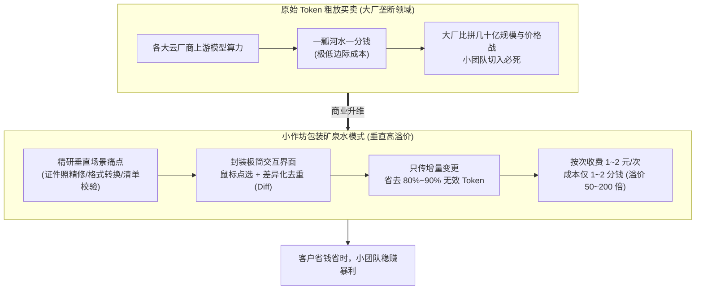

- **小团队切忌倒卖原始 Token**：
  - 大厂比拼的是百亿级基础设施和每百万 Token 几毛钱的价格战，小团队如果只做 API 转售或泛泛套壳，利润微薄且面临极高坏账与封禁风险；
- **包装矿泉水法则**：
  - “原始的 Token 就像河里的水，一瓢一分钱，极其便宜；但普通人根本不会喝生水，甚至怕水里有寄生虫”；
  - 小团队的核心价值就是把生水过滤、沉淀、装进干净精致的瓶子，贴上品牌标签，做成农夫山泉卖两块钱一瓶；
  - 比如做一个极简的“证件照智能美化与红蓝白底一键转换工具”，用户在网页或小程序里点击一次处理收费 1 元；后台调用的多模态模型 API 成本实际上只有 2 分钱。用户为“节省了去照相馆的 20 元”而极度满意，开发者获得了 **50 倍到 200 倍的商业溢价**。

### 6. 前端 Diff 差异化去重心法：鼠标点选局部增量传输，狂省 80%~90% 算力账单

针对调用大模型时频繁遭遇的上下文爆炸与算力开销失控，现场提出了一套高阶的前端增量传输架构。

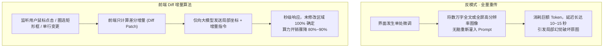

- **杜绝全量上下文无脑重传**：
  - 很多初级工程师在开发复杂表单、流程图绘制或图像修改工具时，用户只要在界面上稍微挪动一个元素或修改一个参数，就将整张高分辨率画布或数万字上下文全量打包重新发给模型；
  - 结果不仅单次交互成本飙升，更严重的是模型经常在全量推理中“自作主张”，破坏了用户原本已经确认的未修改区域；
- **前端 Diff 去重实操**：
  - 引入前端差分计算（Diff Engine），系统仅捕获用户选中的单元格或特定图层的像素增量；
  - 仅将局部变动参数和前后锚点打包为紧凑增量包提交给大模型；
  - 实测不仅模型响应时间从 10 秒压至 1 秒以内，更能直接帮助企业降低 **80% 到 90% 的 Token 调用账单**。

### 7. 淘宝文案写手转型记：从体力代写到商业计划书与标书 AI 工作流学员变现

麦上一位淘宝原原文案创作者分享了自己利用 AI 实现商业跃迁的真实案例。

- **传统纯人工代写的困境**：
  - 在淘宝开设代写店铺，撰写商业计划书（BP）、可行性研究报告与工程标书。一篇万字标书从查阅资料、排版到核对公式往往需要三四天，客单价 500~800 元，纯靠熬夜出卖体力，产出上限严重受限；
- **AI 编排流重构交付流水线**：
  - 借助大模型，将各类主流标书与可行性报告拆解为“政策背景、技术路线、财务测算、风险防控”等固定模块；
  - 搭建专业提示词链与模板自动化工具，单人单日即可高保真交付 2~3 套符合招投标要求的专业文档；
- **向知识培训与工作流交付跃升**：
  - 在淘宝积累了大量好评与标杆案例后，不再单纯依赖做体力代写，而是将这套经过实战检验的“标书与商业计划书 AI 交付工作流”打包为系统实战课；
  - 成功招募了 300 多名付费学员（涵盖应届生、自由职业者与企划人员），成功实现了从“点状体力变现”向“系统化知识产品化”的跃升。

---

## 卷二：真实项目工程闭环与行业深水区

### 8. 建筑与农业工程全流程 AI 化：爬虫抓标、“以标写标”与工程量清单成本自动核算

一位常年负责建筑工地与农业绿化工程落地的企业主，完整复盘了企业内部全流程 AI 系统的搭建经验。

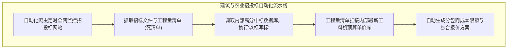

- **痛点一：招投标人工扒网低效与以标写标**：
  - 过去公司必须设立专职文员，每天在数十个省市级政府采购网、公共资源交易网之间逐个刷新，效率极其低下且容易漏标；
  - 现在的工程落地系统通过后台爬虫自动聚合招标文件；一旦判定符合资质，系统立即调取企业内部历年高分中标标书数据库，匹配对应规范要求执行“以标写标”，数小时内即可生成符合评审细则的投标文件初稿；
- **痛点二：工程量清单成本预算核算**：
  - 招标公告给出的工程量清单是固定的（死的清单），但内部成本是动态的；
  - 系统自动解析工程量清单中的每一个分部分项工程，自动关联企业内部积累的“人材机定额单价库”，瞬间推导出真实成本底线，为后续项目分包给下游施工队提供精准的成本限额。

### 9. 水印相机+语音驱动现场日志：“人材机”实时排版，彻底终结周报滞后与财务报销脱节

工程现场最头疼的管理断层在项目现场日志，连麦嘉宾给出了极具穿透力的微创新落地解法。

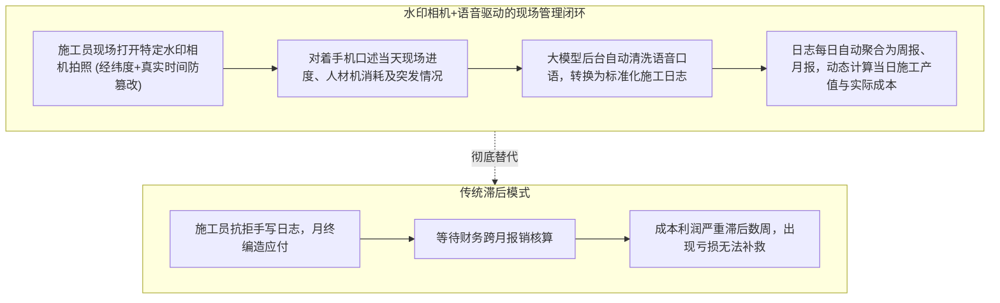

- **一线人员极其抗拒写日志**：
  - 现场项目经理天天跑工地，身心俱疲，极其讨厌在下班后坐在电脑前填写繁琐的纸质或表格施工日志。往往到了月底为了应付考核集中造假，导致日志失去监管价值；
- **水印相机与语音多模态融合**：
  - 结合特定水印相机自带的经纬度定位、真实授时与防篡改照片；
  - 施工员站在工地现场，直接按住录音口述：“今天 3 号楼浇筑混凝土 200 方，现场到了 12 名钢筋工、2 台泵车，下午下大雨停工 1 小时……”；
  - 后台多模态大模型自动识别语音，提取关键实体（人员、材料、机械“人材机”参数），自动排版填充进住建部门规范的标准施工日志模板中；
- **打破财务数据严重滞后的顽疾**：
  - 传统模式下，只有等项目施工完毕、所有发票送到财务处报销核算后，老板才知道这个工程到底是赚是赔，此时早已失去调整空间；
  - 通过每日实时的语音日志沉淀，系统在后台每天动态汇总生成周报、月报，实时绘制出项目当前的“实际发生费用 vs 计划产值曲线”，帮助管理层随时掌握现金流与利润毛刺。

### 10. 线上凭证库与非对称加密机制：前端与 Agent 调度严禁暴露明文 Token

在利用大模型调度多平台进行自动化操作（如自动视频发布、电商后台操作）时，账户凭证安全是技术红线。

- **明文授权的重大漏洞**：
  - 很多开发者在做工作流编排或前端应用时，让用户在网页输入框直接填写第三方平台的账号、密码或 API Token，并在数据库中明文保存；一旦前端遭到 XSS 注入或数据库被撞库，所有客户资产瞬间失窃；
- **线上凭证库（Credentials Vault）架构**：
  - 必须搭建独立的线上凭证管理服务；
  - 前端输入凭证时采用非对称加密（公钥在前端加密，私钥仅存在于隔离的安全硬件或微服务容器中）；
  - 当调度 Agent 执行任务时，Agent 本身只能获得短期有效的受限签名票据（Signed Token），接触不到任何真实密码或明文 API Key，确保在自动化执行与多代理协作中凭据零泄漏。

### 11. 白沟箱包厂 3000 元外贸独立站出单实录：阿里国际站巨亏数十万后的极轻破局

出海实战老兵李校长与 2002 年互联网老站长阿麦之间关于“外贸独立站”的交锋，揭示了当下实体制造企业出海的最真实图景。

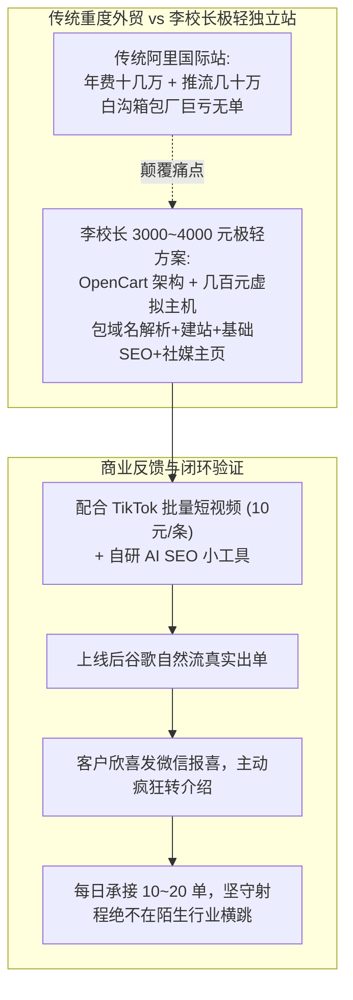

- **白沟箱包厂的血泪教训**：
  - 河北白沟是全国著名的箱包产业带，不仅自身供应链成熟，事实上义乌商贸城大量箱包货源都是由白沟工厂代工生产的；
  - 一位白沟箱包老板为了出海，开通阿里国际站外贸通，基础年费支付十几万元，平台直通车推流又花了数十万元，折腾整整一年却亏损惨重，连成本都没收回来；
- **李校长的 3000 元极轻破局方案**：
  - 针对中小工厂对重资产投放的心理阴影，李校长推出 3000~4000 元极轻独立站打包方案；
  - 技术选型坚决拒绝虚荣：采用谷歌搜索收录最好的三大开源电商架构之一（WordPress、Magento、OpenCart）；服务器坚决不买上万元的独立物理机，每年两三百块钱的合规轻量虚拟主机就完全足够承载，绝不“大炮打蚊子”；
  - 3000 元包干全部工作：域名购买与 DNS 解析、SSL 证书部署、商品批量上架、基础 SEO 规则埋设与海外社媒企业主页搭建；
- **真实出单与口碑核爆**：
  - 李校长分享真实近况：上个月交付的一家白沟客户，今天上午特意发来微信消息报喜：“校长，我后台出单了！”；
  - 该客户没有投入昂贵广告费，纯靠李校长自研的 AI SEO 小工具在谷歌自然抓取中排名上升出单；客户对技术一窍不通，但看到真金白银的订单立刻打消全部疑虑，主动在白沟当地的箱包企业微信群里疯狂引荐。

### 12. 阿麦老站长 vs 李校长商业激辩：500 块有人干，但 300 块付钱的也是衣食父母

直播间麦上两位老兵关于定价与客户态度的激烈争论，折射出一线商业环境的残酷现实。

- **阿麦的直白质疑**：
  - 2002 年就投身互联网的老站长阿麦直接开麦：“李校长，你收三四千块钱帮人做个网站，扣掉域名主机，信不信在咱们直播间喊一嗓子，500 块钱大把技术过硬的兄弟抢着接？这行太卷了！”；
- **李校长的商业防线**：
  - 商业的壁垒从来不是写代码建站的纯工时，而是**十年出海经验积累的排坑能力与客户信任度**；
  - 客户买的不是几行开源代码，而是“包办一切且能出单”的确定性结果；
- **阿麦的深情反思与经商金句**：
  - 阿麦随后认真强调了一句震撼全场的肺腑之言：“甭管 500 块还是 3000 块，今年、明年、后年，大环境再难，**哪怕是给 300 块钱的业务，今天我也必须认认真真去干！只要付了钱，客户就是咱们的衣食父母！**”。在存量搏杀时代，放下技术傲慢、踏实做好每一笔小钱的履约，是一人公司活下去的底线。

### 13. 守住业务射程的三句话原则：坚决拒绝 TikTok 店铺代运营等跨界诱惑

一人公司（OPC）要想保持高人效与稳定盈利，核心秘诀在于“极度克制”。

- **来自客户的致命诱惑**：
  - 很多独立站客户出单后，拉着李校长说：“校长你太神了，既然你懂海外，顺便把我们工厂的 TikTok 本地店铺、亚马逊店铺也代运营了吧，利润给你分三成！”；
- **李校长的绝对克制（坚决不接）**：
  - 跨境电商代运营涉及复杂的选品、跨国物流海外仓备货、多账号防关联、售后退货退款等无数泥潭，稍不留神就会将技术团队拖入泥潭亏掉全部本金；
  - 李校长坚决不接陌生业务，牢牢守住“独立站建站 + 矩阵引流工具”这一垂直射程；
- **三句话沟通原则**：
  - 一听客户诉求（明确是否在射程内）、二指业务断点（告诉他为什么之前亏钱）、三给极简解法（3000元一揽子包干）；
  - 每天稳定处理 10~20 个标准化单子，排期排满即往后顺延，绝不盲目招人膨胀团队。

### 14. 视频生成白模动作迁移模型陷阱：即梦与 2.0 特价版替代 2.5 官 K 的降本账本

在视频与多模态生成实操中，现场解答了创作者在使用顶级模型时频繁卡顿与成本高昂的暗坑。

- **即梦视频生成的卡点复盘**：
  - 一位连麦者诉苦：在快手抖音做动作迁移类短视频，整整折腾了一整天，花大价钱调用 Seedance 2.5 官方 Key，结果总是提示违规或生成动作严重崩坏；
- **白模迁移与原创生成的本质区别**：
  - 现场资深技术指导一针见血指出：你做的是已有角色的“动作迁移”或“白模贴皮”，根本不需要大模型具备顶级的首创发散能力；
  - 盲目调用昂贵且审核严苛的 2.5 旗舰模型不仅是在浪费资金，而且极其容易触发平台风控审核拦截；
- **特价版降本替代方案**：
  - 针对动作迁移场景，直接切换至 2.0 特价版模型或轻量级开源底模，生成速度提升数倍且 100% 能够顺利通过短视频平台的内容审核，单条视频渲染成本暴降 70% 以上。

---

## 卷三：工程架构治理、降本与安全防线

### 15. FDE 岗位本质祛魅：SaaS 现场实施工程师 + 行业解决方案架构师的复合体（售前占 50%）

针对全网炒作的 FDE（Forward Deployed Engineer，前线部署工程师）概念，现场一线从业者进行了深度祛魅。

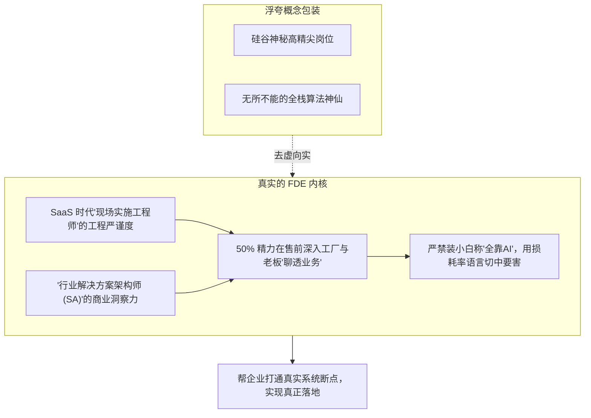

- **FDE 的真实画像**：
  - 二麦发言分享：大学学习计算机，毕业后做了多年一线企业级销售。事实证明，计算机底座加深厚销售经验的人才，是目前最合格的 FDE；
  - 纯技术人员往往迷恋算法性能指标，听不懂工厂老板在讲什么；纯销售又无法判断大模型的能力边界；
  - FDE 绝非抖音宣传的“学几个 Prompt 就能月入数万”，其本质就是 **SaaS 时代的现场实施工程师与行业解决方案架构师的复合体**；
- **售前沟通在 FDE 项目中占比高达 50%**：
  - 真正 50 万到上百万级别的大型企业订单，客户评估的首要指标永远是团队在该垂直行业的落地案例、交付背书与业务理解能力；
  - 在深夜与工厂老板坐下来沟通的一个半小时，能不能用对方行话（如材料损耗率、库存周转天数、账期回款风险）聊透业务，直接决定了项目的最终成败；
  - 严禁在客户面前故作谦虚声称“我其实不懂业务，全靠 AI 自动做”，实体老板最厌恶浮夸与不确定性。

### 16. 人类大脑“3~5 个 Session”极限瓶颈与 DeepSeek Super Agent Prototype 论文启示

在多任务 Agent 并行开发中，人类认知负荷的存在决定了工程架构的设计上限。

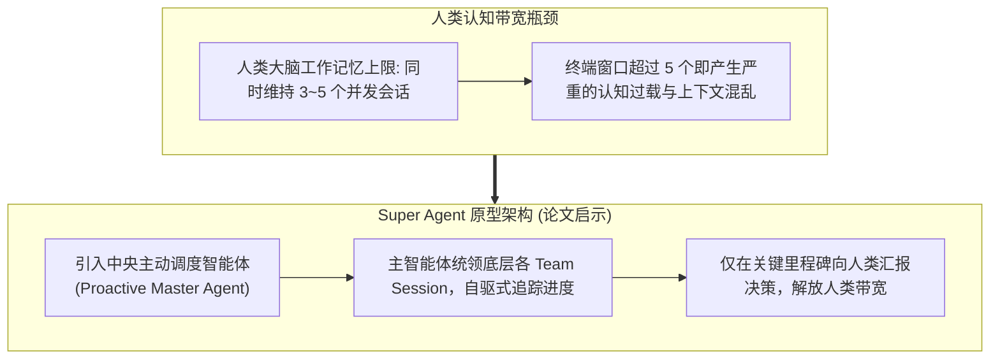

- **人类并发工作记忆极限**：
  - 麦上讨论了 DeepSeek 团队此前发表的论文《Super Agent Prototype》；
  - 在实际终端开发中，左侧打开 7~8 个命令行或 Agent 对话窗口时，人类坐在中间充当任务搬运工，大脑在几分钟内就会进入混乱疲倦状态。人脑的短期工作记忆最多只能精准掌控 **3 到 5 个 Session**；
- **主动式智能体（Proactive Agent）的调度范式**：
  - 不能让人沦为多 Agent 之间的手动日志搬运工；必须由单一的主控智能体（Master Agent）作为“项目主管”，下辖各个执行小队，自主负责子任务的状态流转，仅在关键方法验收与核心异常时向人类发起弹窗确认。

### 17. 多 Agent 协同防失控铁律：严禁放任 Agent 自由互聊自嗨，主从（Master-Worker）强 Schema 约束

现场技术专家分享了多智能体协作时惨痛的系统崩溃实录。

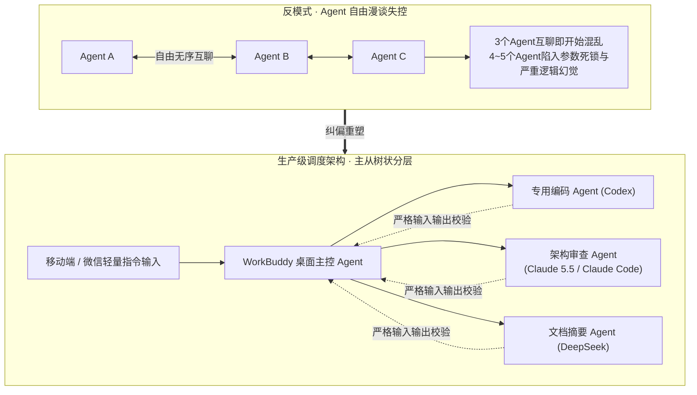

- **Agent 自由漫谈的灾难性实测**：
  - 很多开发者热衷于搭建开放式的“智能体群聊”，让 Codex、Claude Code、DeepSeek、Dola 等在群里自由对话、自我迭代；
  - 真实实测结果：**3 个 Agent 自由互聊就会开始偏离主题；4 到 5 个 Agent 进群，十分钟内系统就会陷入参数死锁、无限递归与互相推诿**，白白消耗数百万 Token 产出一堆代码垃圾；
- **生产级主从架构（Master-Worker）硬约束**：
  - 子智能体之间**物理级禁止横向私聊**；
  - 所有任务必须经由主控智能体严格按工作流向下派发；
  - 严禁放任模糊的自然语言交互，每一个子模块方法的调用，必须遵循严格的 JSON Schema 输入输出规范，经由规则校验网关（Validator）验证通过后方可流转至下一步。

### 18. 研发团队报销阶梯式降本法：千问 3.8 Flash 处理 80% 任务，月开销从 2000 元砍至 300 元

针对研发团队每月居高不下的大模型调用账单，现场分享了一套成效极其显著的“阶梯式调用管理法”。

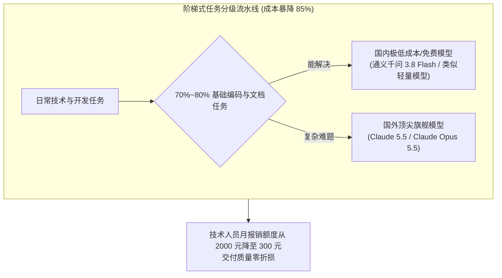

- **早期无节制调用的浪费**：
  - 企业早期给每位技术人员按月报销 2000 元大模型 API 额度。技术员由于没有成本压力，无论写一个简单排序算法、查一个错误日志还是翻译一段文本，一律使用最昂贵的国外顶级旗舰模型，导致每月报销频频超标；
- **推行三级阶梯强制路由**：
  - 强制规定开发环境执行路由分级：日常 80% 的基础 CRUD、代码注释、格式排版、单元测试，必须先使用国内极低成本的通义千问 3.8 Flash 或类似超轻量模型；
  - 只有当轻量模型在 2 轮内无法解决复杂算法设计、分布式系统架构重构与深度逻辑推理时，系统才允许提权调用 `Claude 5.5 (Claude Opus 5.5)` 等顶配旗舰模型；
- **单月单人开销从 2000 降至 300 元**：
  - 该制度推行首月，技术团队人均算力开销直接从 2000 元断崖式下降至 300 元以内，**成本降低 85%**，且最终交付的软件稳定性与工程质量毫无降低。

### 19. 中转站真实投毒劫持事故：恶意代码篡改客户端 DNS 服务器，定向域名劫持弹广告

连麦中曝光了一起触目惊心的第三方中转站接口投毒事件，为所有商业开发者敲响了警钟。

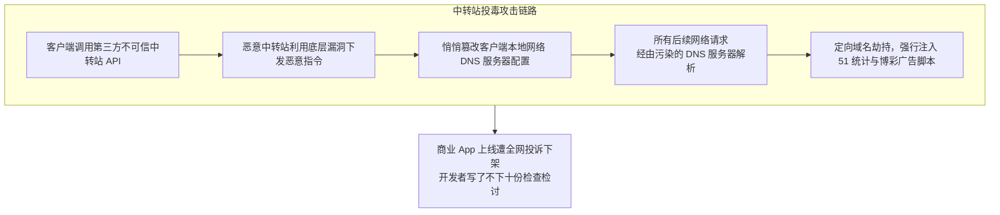

- **血淋淋的安卓客户端事故复盘**：
  - 一位开发者在开发商业级移动 App 时，为了省事省钱，接入了市面上某不知名的小团队中转站 API；
  - App 发布测试后，安卓端突然爆发大量恶性投诉：用户在打开特定界面时频繁弹出低俗博彩与诈骗广告；
  - 研发团队排查了整整三天，最终通过深度抓包与逆向分析发现：正是该第三方中转接口在返回数据中暗藏了恶意功能代码，利用客户端未严格做沙箱隔离的漏洞，**强行篡改了设备本地的 DNS 服务器地址**；
  - 本地 DNS 被污染后，客户端所有的正常域名解析均被劫持并重定向至黑客指定的代理节点，被强行插入了 51 统计和广告推广代码；
- **重大教训与安全底线**：
  - 开发者苦不堪言，因该起严重安全事故“向投资人与监管部门写了不下十份深刻检查”；
  - 商业级生产应用，严禁图便宜接入任何缺乏资质背书的第三方黑中转站。宁可直连官方正规 API，也绝不能将系统的网络命门交由黑灰产中转掌控。

### 20. 所谓“6.5 折 / 7 折”官 K 掺水套娃黑幕：火山 500 万年框才 85 折，低价掺水 50% 漏油路由曝光

直播间现场直接无情拆穿了市面上所谓“低价大模型官方 Key”的荒唐骗局。

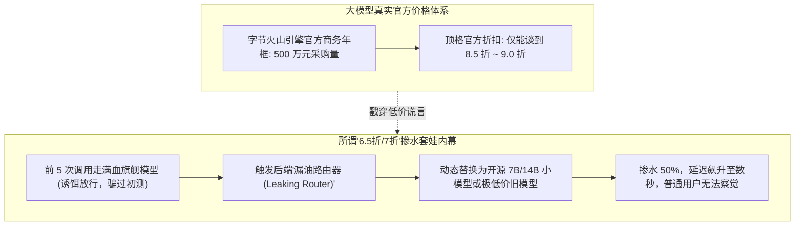

- **火山官方年框底牌曝光**：
  - 麦上有人宣称能搞到“Seedance 2.5 满血官 K 6.5 折到 7 折”；
  - 资深渠道老手当场打脸戳穿：字节火山引擎官方的大客户采购，即便签下每年 500 万元的巨额年框协议，官方给出的底线折扣也只能做到 85 折到 9 折；市场上叫卖 6.5 折的所谓渠道货，纯属无稽之谈；
- **“漏油路由器”掺水黑幕**：
  - 某些黑中转服务商在前 3~5 次调用时，确实给你走真正的满血模型，让你在本地测试时误以为是正品；
  - 一旦系统检测到你开始大批量刷调用，后端的“漏油路由器”立刻启动：悄悄将长上下文截断，把复杂的 Prompt 偷换路由给极其廉价的开源小模型或旧代模型，在整体输出中掺入至少 50% 的水分；
  - 用户只觉得模型偶尔有些变笨、响应变得极慢（经过了多达六层套娃中转），根本无法在技术上当场取证。

### 21. 企业查税补缴 175 万：专票缺失与中转站被规上企业一票否决

小作坊中转站在走向规模化时，面临的另一道生死高压线是财务税务合规。

- **杭州中转站三四天倒闭潮**：
  - 一位来自杭州的创业者坦言，自己和朋友做中转站倒号转售，折腾三四天就干不下去了。杭州本地的技术和电商信息极度通透，根本不存在所谓的信息差套利空间；
- **查税补税 175 万元的惨痛教训**：
  - 一家规模以上电商企业负责人连麦透露：上季度因税务抽查，因存在大量无票技术支出被勒令补缴了 175 万元税款与滞纳金；
  - 规上企业对大模型调用的第一硬性要求就是**必须能开具正规增值税专用发票（专票）**；而 99% 的个人中转站根本没有合规资质，连普通发票都开不出，直接在企业采购初筛环节被一票否决。

### 22. 平台围墙博弈与微信 Hook 红线：严禁在封闭生态强行逆向外挂

针对许多技术团队企图通过逆向技术外挂个人微信实现“AI 自动成交机器人”的想法，现场给出了严肃的法律与技术警告。

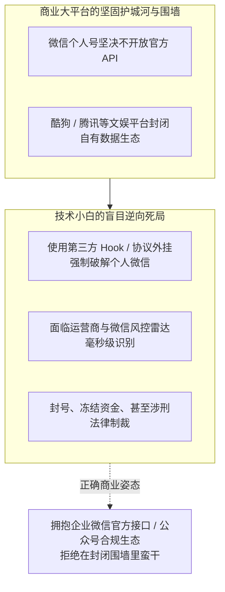

- **个人微信没有官方 API**：
  - 微信个人号从未对外开放过任何消息收发 API。市面上所有声称能接管个人微信聊天、朋友圈自动发布的工具，全部采用内存 Hook 注入或协议逆向外挂；
- **平台风控雷达毫秒级反制**：
  - 微信拥有极其灵敏的行为风控模型，对异地登录、高频非人工打字速度、批量发消息行为实施毫秒级检测。轻则封停账号数月、冻结零钱资产，重则触犯“提供侵入、非法控制计算机信息系统程序、工具罪”移送司法；
  - 真正做商业交付的团队，必须坚定站在官方合规通道（企业微信官方开放平台 API、微信客服接口），绝不将企业命运绑架在随时暴雷的灰产外挂上。

---

## 卷四：商业认知、心理学与实战工具箱

### 23. 知识付费的深层心理学拆解：29.9 元卖的是情绪按摩器，大客单价卖的是欲望与幻想

现场深度剖析了知识付费产品在大众心理学上的收割机制。

- **29.9 元买的是“即时心理按摩”**：
  - 很多人花 29.9 元买一套所谓“AI 神级提示词库”或“小白 AI 搞钱课”，买的根本不是知识本身；
  - 面对汹涌而来的 AI 变革浪潮，普通人内心充满了随时被时代淘汰的焦虑。花 29.9 元下单的那一瞬间，多巴胺分泌，内心产生了一种“我已经在学习前沿工具、我没有被时代抛下”的虚假满足感；这 29.9 元本质上就是购买了一支**情绪按摩器**，买回去后 90% 的人连第一节课都从未完整看完；
- **大额收费卖的是“暴富幻想”**：
  - 当客单价升至数千甚至数万元时，课程贩子售卖的就不再是焦虑缓解，而是勾动人性的贪婪与欲望——兜售“学会了就能不上班、一人躺赚百万”的虚假幻象；
  - 真实做落地交付的技术团队必须看清人性的弱点，坚决不靠虚无的空气课件割韭菜，把精力放在帮助实体企业解决真问题的交付上。

### 24. 凌晨 AI 图片售卖与防骗：100 元抖加测流与中小团队在巨头夹缝中的生存法则

在清晨破晓时分的连麦中，一位做 AI 图像生成并在快手、抖音尝试变现的草根创作者与主播展开了推心置腹的对话。

- **草根创作者的获客焦虑**：
  - 创作者每天用 AI 渲染大量精美图片发到快手和抖音，偶尔有人私信询问能否购买原图进行二次商业印刷或商用。创作者既想变现，又害怕在交易中遭遇网络骗子或者图片被白嫖盗用；
- **主播的破局点拨：主动拥抱曝光与测流**：
  - 不要把精力浪费在无休止的“防盗防御”上。只要图片发到公网，防盗成本无限高；
  - 真正管用的方法就是持续增加自身曝光量：善用平台的测流机制，尝试花 100 元投一次“抖加（Dou+）”测试吸量能力与转化效果；
- **大厂通吃时代的夹缝求生法则**：
  - 如今在外卖、团购、电商等主流大赛道，巨头与大资本已经将标准化业务完全吃透；
  - 个人创作者与小微团队必须像草本植物一样在巨头的岩石夹缝中生存：避开宏大的泛娱乐，去切入那些巨头看不上、但垂直群体有真实付费意愿的微小领域（如极小众的机械图纸拆解、特定地方风俗素材、专业考证插图），用有用管用的小招法稳步变现。

### 25. 落地实操自查表（16 大避坑维度）与三阶段行动 Checklist (Actionable Practice)

#### 25.1 企业 AI 商业化与工程交付 16 大避坑自检表

| 序号 | 核心自检维度 | 落地检测问题 | 预警避坑红线 |
| :---: | :--- | :--- | :--- |
| **01** | **出海网络** | 跨境环境是否配置了物理网卡隔离与独立海外住宅静态 IP？ | 严禁使用廉价共享机场节点，防止批量连带封号 |
| **02** | **Token 包装** | 产品是否将一分钱的底层模型包装为按次收费两元的垂直解决方案？ | 杜绝直接做微利甚至亏损的原始 API 倒卖生意 |
| **03** | **算力降本** | 前端界面是否引入了鼠标点选与 Diff 差异化去重传输？ | 严禁每次交互全量上传数万字上下文吞噬巨额利润 |
| **04** | **独立站定价** | 针对外贸工厂是否制定了 3000~4000 元极低决策门槛的一揽子建站方案？ | 避免在初期强推上万元重度定制吓跑中小外贸工厂 |
| **05** | **射程聚焦** | 一人公司（OPC）是否坚守最熟悉的垂直赛道，拒绝盲目跨界横跳？ | 严禁手握 AI 就自以为能跨界通吃，防范陌生行业泥潭 |
| **06** | **多Agent防乱** | 多智能体协作中是否严格执行主从调度（Master-Worker）架构？ | 严禁放任 3 个以上 Agent 在开放群聊中自由互聊自嗨 |
| **07** | **阶梯式调用** | 内部研发是否推行千问等低成本模型解决 80% 基础任务的分级机制？ | 杜绝技术人员无节制调用国外顶尖旗舰模型导致报销超标 |
| **08** | **接口安全** | 生产级客户端是否彻底摒弃无资质的第三方中转站，直连正规官方接口？ | 警惕中转站掺水造假与接口注入篡改 DNS 的重大安全事故 |
| **09** | **发票合规** | 企业级大模型支出是否具备正规增值税专用发票留痕？ | 避免采购开不出票的黑中转站，防范税务核查补税风险 |
| **10** | **生态红线** | 业务自动化是否坚决远离微信个人号逆向 Hook 外挂等灰产红线？ | 严禁使用 Hook 协议外挂，防范封号与法律合规制裁 |
| **11** | **以标写标** | 招投标中是否利用历史中标库与参数化工程清单实现自动化闭环？ | 杜绝手工低效扒网与脱离清单底价的盲目投标报价 |
| **12** | **现场日志** | 施工现场是否采用水印相机+语音识别自动排版生成符合规程的标准日志？ | 避免月底突击编造纸质日志，杜绝财务核算滞后导致的亏损风险 |
| **13** | **凭证隔离** | 平台自动化操作中是否引入了非对称加密的线上凭证库？ | 严禁在前端或 Agent 交互中以明文暴露第三方 API 密钥与账号密码 |
| **14** | **模型适配** | 动作迁移类短视频是否选用 2.0 特价版替代昂贵的 2.5 旗舰模型？ | 避免杀鸡用牛刀，防止因选用不当模型引发平台审核拦截与算力浪费 |
| **15** | **认知对齐** | 是否建立了客户层级准入机制，坚决拉黑既要又要还要的劣质客户？ | 杜绝试图“教育客户”，防范陷入无限期扯皮与回款死局 |
| **16** | **心理按摩** | 知识产品是否清晰区分“29.9元情绪安慰剂”与“高客单实体交付”的界限？ | 坚决不靠贩卖空气课件割韭菜，回归解决企业实际痛点的商业本质 |

#### 25.2 三阶段执行清单 (Actionable Practice)

##### 第一阶段：算力分级排查与接口安全加固（Day 1 ~ Day 7）

- [ ] **审查团队大模型调用账本**：统计技术人员日常 API 调用分布，将 80% 的代码排版、基础算法与简单摘要强制路由给通义千问 3.8 Flash 等轻量模型，将 `Claude 5.5 (Claude Opus 5.5)` 锁定在复杂系统重构与关键推理；
- [ ] **排查生产客户端依赖**：全面梳理所有外部客户端中调用的接口来源，坚决剔除任何不知名的个人中转站 API，配置独立线上凭证库与非对称加密，检测本地 DNS 与网络路由安全性；
- [ ] **建立税务专票合规台账**：核查大模型调用费用的发票合规性，确保每一笔算力采购均具备合规增值税专用发票。

##### 第二阶段：增量去重落地与垂直场景切入（Day 8 ~ Day 20）

- [ ] **上线前端 Diff 差分传输模块**：在已有 Web 或小程序中引入增量计算，仅针对用户修改的单元格或画层向模型发起增量请求，压降 80%~90% 的无效 Token 消耗；
- [ ] **打磨 3000 元极轻外贸独立站产品**：面向河北白沟、浙江义乌等产业带小微工厂，推出“开源轻量架构 + 基础 SEO + TikTok 矩阵引流”的一揽子出海方案，走通从极低决策建站到谷歌自然流出单的首笔闭环；
- [ ] **在工程现场试点水印相机语音日志**：将施工现场人员的口述语音与经纬度防篡改照片结合，跑通当日人材机施工日志自动排版生成，使管理层实时掌控施工进度。

##### 第三阶段：多智能体主从规范与口碑裂变复制（Day 21 ~ Day 30）

- [ ] **规范多 Agent 调度协议**：彻底禁止任何让 3 个以上 Agent 在开放群组中自由互聊的架构，确立单一桌面中控主 Agent，为所有子智能体定义严格的 JSON Schema 输入输出规则校验；
- [ ] **聚焦业务射程，坚决拒绝跨界诱惑**：坚守“三句话沟通原则”，严禁在跑通单个业务后盲目横跳到陌生重资产赛道，保持 OPC 高效人效；
- [ ] **沉淀标杆案例与口碑转介绍**：围绕首批成功出单或真实降本的企业客户挖掘深度客户见证，利用行业圈子自发裂变，保持每日稳健承接 10~20 单的健康交付节奏。
