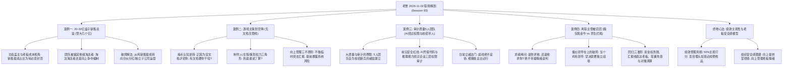

# 产品老曾·职场利益博弈、空降兵落地与被召回谈判实战全息案卷

> **直播来源**：B站《产品老曾》（现场录制编号：Session 93，文件标识：`latest-2026-11-02-laozeng-s01-db93`）  
> **直播时段**：2026年11月02日 21:00 至 23:05（录制时长：2 小时 05 分 55 秒）  
> **麦序人物与连麦主角**：老曾（前大厂产品总监/资深职场顾问）、元器件销售总监（年管大几个亿盘子）、游戏主策划（空降初创团队遭遇流程虚无）、企业审计/安全骨干（应对 AI 绕过权限漏洞与校招团队管理）、离职被召回中层主管（老板新盘子滋补养生电商烂尾欲挽回）及数百位弹幕打工人。  
> **底层核心命题**：透视职场权力重构、功高盖主后的收入封顶破局、空降管理者的管线搭建心法、非核心支撑部门（质量/审计）的威信确立，以及“前东家求我回去收拾烂摊子”时的冷血谈判筹码。

---

## 第一卷：核心骨干功高盖主、收入封顶与人员包袱博弈

### 1. 案例实况背景：电子元器件龙头企业销售总监的遭遇

* **连麦当事人画像**：
  * 该学员在一家年营收 20 亿至 30 亿元规模的电子元器件供应链企业任职 7 至 8 年，目前担任销售管理职务，统管一个完整的事业群，个人所管辖的业务线年销售额达数亿元人民币，属于公司绝对的业绩现金牛板块。
* **爆发的核心矛盾**：
  * **矛盾一：收入与提成被隐形封顶**。随着管辖盘子从早期的几千万元膨胀到数亿元，老板开始频繁修改提成考核方案，通过提高毛利考核指标、扣除研发分摊费用、设立上限天花板等手段，变相压低销售总监的综合到手收益；
  * **矛盾二：被迫接收其他部门淘汰的劣质人员**。公司高层将其他失败业务线被淘汰的人员（所谓“跨组插出来的失败者”）直接塞入该销售总监的团队，导致人效被大幅稀释，团队内部怨声载道；
  * **矛盾三：管理理念冲突引发排挤**。销售总监采取高压淘汰制（“我以身作则能做到，做不到的就滚蛋”），却被高管与老板批评为“缺乏大局观、团队管理粗暴、搞独立王国”，面临严重的信任危机与卸磨杀驴风险。

### 2. 老板视角的冷血账本：为什么老板一定要限制销售成本占比？

* **老曾透视老板的内心算盘**：
  * 销售人员最容易陷入的认知误区是：“单子全是我签回来的，钱全是我赚回来的，没有我公司早就倒闭了”。
  * **但在老板的综合财务资产负债表里**：
    * 公司的净利润等于销售额扣除**研发成本、设备折旧、货损报废、原材料物料价格上涨成本、海外关税、品牌营销费用及后台中立支撑成本**；
    * 销售团队只是整部庞大工业机器的最后一个出水龙头；如果销售人员的提成拿走过多，一旦外部原材料涨价或下游大客户账期拉长，整家工厂就会直接陷入失血休克；
    * 老板必须严防某一个销售总监把控了核心客户资源后“挟天子以令诸侯”，因此一定会通过掺沙子、塞人员、降提成来削弱其议价权。

### 3. 被塞劣质员工的应对之道：绝不情绪化搞人人对立

* **破局战术指引**：
  * 严禁在公开场合宣称“这帮人是别的组不要的垃圾”，这不仅会直接把这帮人推向对立面并成为中层打小报告的线人，更会激怒把他们塞进来的老板；
  * **“隔离冷处理 + 边界确立法”**：
    1. 给予新接收人员极其清晰、不可推诿的标准化量化 KPI（如必须独立开发多少个长尾小客户）；
    2. 将核心大客户与重点战略资源严格封闭在自身铁杆梯队手中，绝不让劣质人员接触核心线索；
    3. 到了季度末，用白纸黑字的客观业务数据和客户投诉记录作为证据，以“业务发展客观需要”为由，请 HR 按照正规流程出具转岗或劝退方案，把矛盾转化为公司制度与不合格员工的矛盾，切断对个人的攻击借口。

### 4. 销售天花板破局方案：从打工提成制转向“独立核算与合伙分红制”

* **终极突围路径**：
  * 当在原体系内的收入已经触顶且遭受猜忌时，单纯找老板吵架要提成是最低级的打法。
  * **高阶商业提议**：
    * 主动向老板提出**“设立独立销售子公司或独立合伙人事业部”**；
    * 明确约定该事业部自负盈亏，由销售总监团队出资一部分干股或承担经营兜底指标；
    * 老板退居为供应链与生产底座股东，享受稳定供货利润与股权分红，而销售总监成为真正的业务负责人，摆脱传统职场薪酬体系的束缚，将“功高盖主”的死局转化为“内部孵化合伙人”的新局。

---

## 第二卷：空降高管落地生存、虚无管线搭建与向上管理

### 5. 案例实况背景：游戏主策划空降初创团队遭遇“三无”困境

* **连麦当事人画像**：
  * 一位资深游戏主策划空降至一家中小型游戏研发团队。入职后他感到极其崩溃与迷茫：
  * 发现公司**没有规范的策划文档、没有标准的研发流程、没有协同管线，项目整体战略目标极其模糊**；
  * 团队架构极其特殊：对方既是制作人，又是主程序员；当事人空降作为策划，两头受气；
  * 在向项目制作人兼主程汇报时，由于项目临时遇到阻碍，反被老板痛骂：“为什么不提前说明？平常为什么不汇报进展？到了临时出问题才说？”当事人感到极度委屈，认为老板不讲道理、团队基础太差。

### 6. 老曾当头棒喝：认知逆转——“有文档有流程还要你来干啥？”

* **老曾现场无情开火**：
  * “就是因为没有策划，所以请你来的呀！他原来要是还有策划文档、还有策划流程、还有策划标准，要你干啥？他自己一个人干完了呀！你在说啥嘛？所以就是没有文档，所以需要你来呀！所以你去了就帮他们建文档，建流程，建管线，对不对？建立制作标准、策划流程和开发标准！”
  * 绝大多数企业招募高薪资深人员，正是因为**现状是一团乱麻、原有的人搞不定、流程全面缺失**！
  * 如果原有团队已经具备完善的 GDD 策划文档、严密的数值平衡模型、高度自动化的制作管线，老板雇个应届生就能跑通，根本不需要花费高薪挖你来！
  * 空降兵的唯一核心价值，就是**“下场把泥潭清理干净，把没有的文档补齐，把混乱的管线跑通”**。把企业的客观缺陷当作自己不能产出的借口，是职业化极度不成熟的表现。

### 7. 制作人、主程与策划的权力三角形：到底谁说了算？

* **深层博弈权力图谱**：
  * 老曾指出，该项目的根本死结在于**“角色权责严重错位”**：
    * 制作人本应负责定整体方向、拉资金、背商业化指标；
    * 主程序员负责技术底层架构与代码实现；
    * 策划负责把制作人的战略意图拆解为可玩的 Demo、核心玩法循环与版本迭代内容；
  * 但现在“对方一个人既是制作人又是主程”，策划变成了纯粹的夹缝打杂者；
  * **破局对话法则**：主策划必须找制作人做一次极其严肃的闭门长谈：“这个游戏的核心玩法与商业化设计，到底是以你的意志为准，还是由我全权主导？如果是你主导，我充当执行工具；如果是招我来主导，你必须向我让渡玩法决策权，技术主程按策划案排期实施，绝不能随时推翻既定案卷”。

### 8. 向上管理的“三不原则”与老板掌控感喂养

* **化解老板批评的汇报艺术**：
  * 老板发脾气的底层本质不是因为“事情出了问题”，而是因为**“问题是在最后一刻突然爆发的，剥夺了老板的掌控感与安全感”**；
  * **三不汇报铁律**：
    * **绝不做突击式汇报**：坏消息严禁压到临近节点才讲；一旦发现阻碍风险，即使只有 10% 苗头，也要在周例会或日常沟通中轻描淡写做前置吹风；
    * **绝不只带问题不带方案**：向上汇报问题时，必须永远附带“方案 A（成本低但耗时长）、方案 B（见效快但需追加资源）”供老板做选择题；
    * **绝不在情绪激动时辩解**：被批评时首要态度是接纳老板的情绪，承认信息同步延迟，随即立即将对话引向“针对当前阻碍我们下一步具体的补救动作与时间表”。

---

## 第三卷：审计与质量非核心部门向上破局与 AI 安全攻防

### 9. 案例实况背景：5人审计质量团队的困局（校招新兵与 AI 安全暗雷）

* **连麦当事人画像**：
  * 一位在企业内负责业务审计与大质量（QA/安全合规）管理的业务主管。其团队规模仅有 5 人，除他之外其余 4 人全部为刚入职不久的校招应届生。
* **双重严峻考验**：
  * **管理考验**：下属全是职场白纸，缺乏业务敏感度与审核经验，既不敢承担责任，也无法独立对抗业务部门的老油条；
  * **技术与业务暗雷**：企业近期开始尝试引入 AI 工具和智能体辅助办公。审计主管敏锐地发现：**大模型工具具备强大的代码生成与语义推理能力，极有可能绕过传统企业内部设立的权限审核边界，直接抓取并泄露涉密数据**，对企业合规和审计风控造成了巨大的潜在灾难。

### 10. AI 绕过企业传统三层权限审核的实战风控危机

* **老曾深度剖析企业权限体系瓦解风险**：
  * 传统大厂或中大型企业跨部门调阅资料时，依赖极其严密的三层权限审核体系：
    1. **第一层：身份核验**（确认是否为在职正式员工）；
    2. **第二层：行政审批**（确认是否有部门主管与目标业务负责人的白纸黑字审批流）；
    3. **第三层：环境与安全风险评估**（确认在何种终端、何种内网网络、有无水印监控环境下进行访问）；
  * **AI 工具打破规则的致命漏洞**：
    * 一旦在内网部署接入大模型或智能体，由于 AI 具备极强的自然语言推理与代码编写能力，一线员工可能无意中通过模糊提问或跨接口提示词注入，诱导 AI 直接绕过传统审批流读取非授权资料库，甚至将涉密财务与用户隐私整合输出；
  * **审计主管的立功切口**：审计部门必须在全公司尚未意识到此风险之前，**主动前置起草《企业级大模型与智能体调用安全风控审计红线白皮书》**，定义 AI 调用的准入范围、数据脱敏标准与拦截机制，一举在公司管理层确立无可撼动的专业安全防线。

### 11. 团队威信确立：带应届生新人的“日常一诺千金与底线立威”

* **新手管理者带人要诀**：
  * 威信绝不是靠拍桌子发脾气树立的，也不是靠下班请客吃饭拉拢来的。
  * **建立威信的两大基石**：
    * **言出必行（可预期性）**：承诺给新人的培训、资源、绩效打分，必须 100% 兑现，绝不画大饼；让下属明确知道你的行为准则是完全可预测、有章可循的；
    * **底线触犯必死（不可侵犯性）**：在关键合规原则、数据安全造假、无故旷工等核心原则问题上，一旦有人故意触碰底线，必须依据制度给予雷霆手段的严肃处罚甚至淘汰，绝不姑息。在细微处建立奖惩的确定性，一支年轻团队才能具备真正的执行力与战斗力。

---

## 第四卷：离职主管被召回谈判——收拾烂摊子的筹码与底牌

### 12. 案例实况背景：老业务箱包现金牛 vs 新业务滋补养生烂尾

* **连麦当事人画像**：
  * 一位此前离职的中层管理者，曾独立带过 15 人的综合团队（覆盖运营、售前、客服全链条）。
  * **真实业务底牌对比**：
    * **老业务（传统箱包电商）**：主营女士手提包、皮具电商，当事人在任期间每月稳定交付利润与销售额，是全公司名副其实的现金牛；
    * **新业务（新媒体滋补养生品）**：老板不满足于传统电商，盲目跟风开辟新媒体养生品赛道，并高薪挖来一位空降总监全面主导；
    * 当时在旁边观察，当事人明确指出该空降总监只会卖弄虚无概念、不懂落地投放与品控，不愿受其瞎指挥而果断离职；
    * 几个月后，新媒体养生电商果然全面暴雷崩盘，烧光资金且业绩惨不忍睹；老板现在通过微信频繁示好，暗示想让当事人回公司担任该空降总监手下的主管，协助收拾烂摊子。

### 13. 老曾灵魂拷问：“是谁求谁？当个鸡毛领导！”

* **老曾现场拍案痛骂**：
  * “当个鸡毛的、当个鸡毛的领导啊！就这种傻逼要他当什么领导啊？！你直接跟老板讲！”
  * “我问你一个核心问题：**是你求他要回去，还是他找你要你回去？！谁先找的谁？！**”
  * “箱包老业务你在的时候赚得盆满钵满，他找个草包搞养生品把钱全亏光了！现在他内部彻底无人可用、走投无路才来求你救火，你居然还在纠结‘回去要不要当这个傻逼的手下’？！”
  * 这种软弱心态是典型的打工人惯性思维；在商业丛林里，求人办事者必须付出最高代价，被求救火者享有绝对的开价特权！

### 14. 傻瓜领导在上的破局打法：索要绝对的“独立战壕与人权财权”

* **回去谈判的绝对底线清单**：
  * 如果那个无能的空降总监依然是直属上级，**坚决不回去，多给一倍薪水也绝不能去**！
  * **正确的谈判开价方式**：
    1. **组织架构物理隔离**：新媒体养生电商必须设立完全独立的二级事业部，当事人直接向老板一人汇报，与原总监完全平级，或者原总监彻底靠边站；
    2. **人权与编制自主权**：招什么人、开除什么人、客服与运营如何考核，全部由当事人全权决定，老板与行政不得干涉；
    3. **财权与预算兜底到账**：要求老板把未来半年的运营周转资金白纸黑字划拨到位，坚决杜绝“边干边看、口头画饼”。

### 15. 回归谈判三准则：资金到账、免责期对赌与白纸黑字清算机制

* **自保与变现的最高准则**：
  * **免责试错缓冲期**：明确约定烂摊子恢复期需要至少 3 至 6 个月，在此期间老板不得因短期波动强行干预战略打法；
  * **超额业绩阶梯对赌**：基础薪资必须在原有基础上涨幅 30%~50%，同时明确约定盘活后的利润阶梯分红（如实现扭亏为盈后抽取净利润的 15%~20% 作为团队专项奖金）；
  * **谈不拢立刻抽身**：如果老板在组织权限、独立汇报线上闪烁其词，说明老板只是想找一个廉价的替罪羊来分担其用错人的尴尬；当事人应立即终止接触，绝不在烂泥坑中二次下水。

---

## 终卷：职场终极绩效真相与老板安全感模型

### 16. 绩效管理的残酷真相：50% 是主观印象，埋头加班必成牺牲品

* **彻底打破学生思维**：
  * 许多职场人天真地以为：只要自己天天加班到深夜、老老实实完成本职工作、不给领导惹麻烦，到年底就一定能拿到 S 级绩效、拿到丰厚奖金和升职机会。
  * **现实世界的绩效打分模型**：
    * 任何一家企业的绩效考核，无论 KPI 或 OKR 表面设计得多客观，其**最终打分至少有 50% 甚至更大比例取决于直接主管与大老板的主观看法**；
    * 老板的主观印象来自哪里？来自你是否解决了老板最头疼的痛点、你是否在关键时刻承担了责任、你的存在是否让老板感到安心；
    * 一个只顾埋头拉车、从来不向上抬头看路、不主动同步工作亮点的员工，在老板眼里往往被归类为“缺乏野心、只配干螺丝钉杂活的低价值工具人”。在面临部门裁员或奖金分配时，往往最先被牺牲。

### 17. 组织安全感图谱：向上管理老板情绪与职场立足之本

* **职场升维终极心法**：
  * 所有的商业博弈与向上管理，归根结底是在做一件事：**向你的上级持续供应“确定性与安全感”**。
  * **卓越职场人的四大安全感供应法门**：
    1. **凡事有交代，件件有着落，事事有回音（闭环交付）**；
    2. **定期主动做预期管理，让老板永远清楚你的业务节奏与潜在风险预案（掌控感喂养）**；
    3. **在专业领域形成不可替代的一招鲜，成为老板在特定场景下唯一能信任的底牌（专业护城河）**；
    4. **剥离一切无谓的情绪内耗与道德包袱，用纯粹的商业 ROI 思维审视每一次升迁、调岗与跳槽决策（冷血理性）**。
