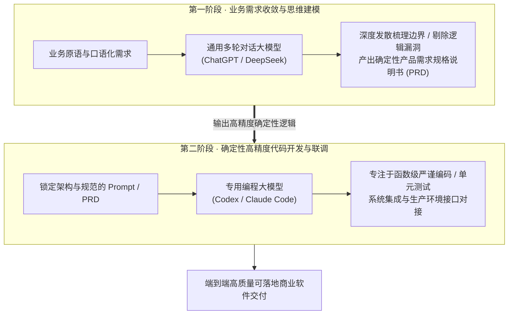
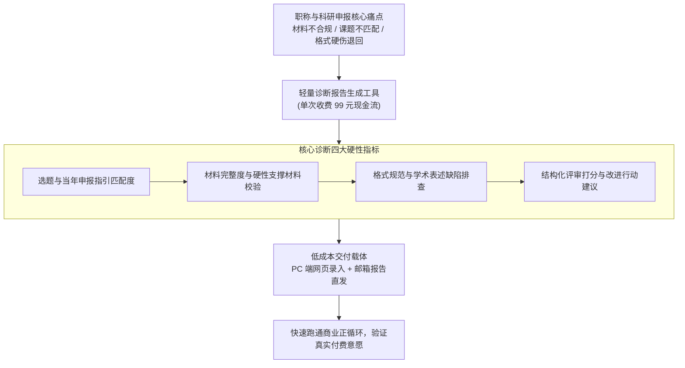
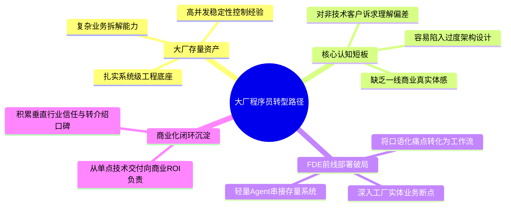
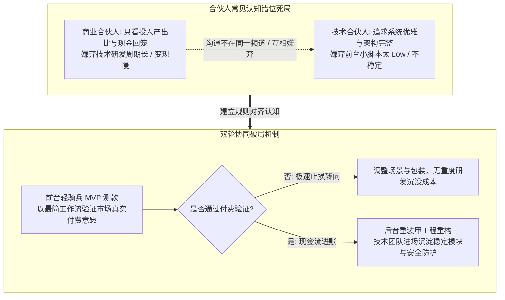
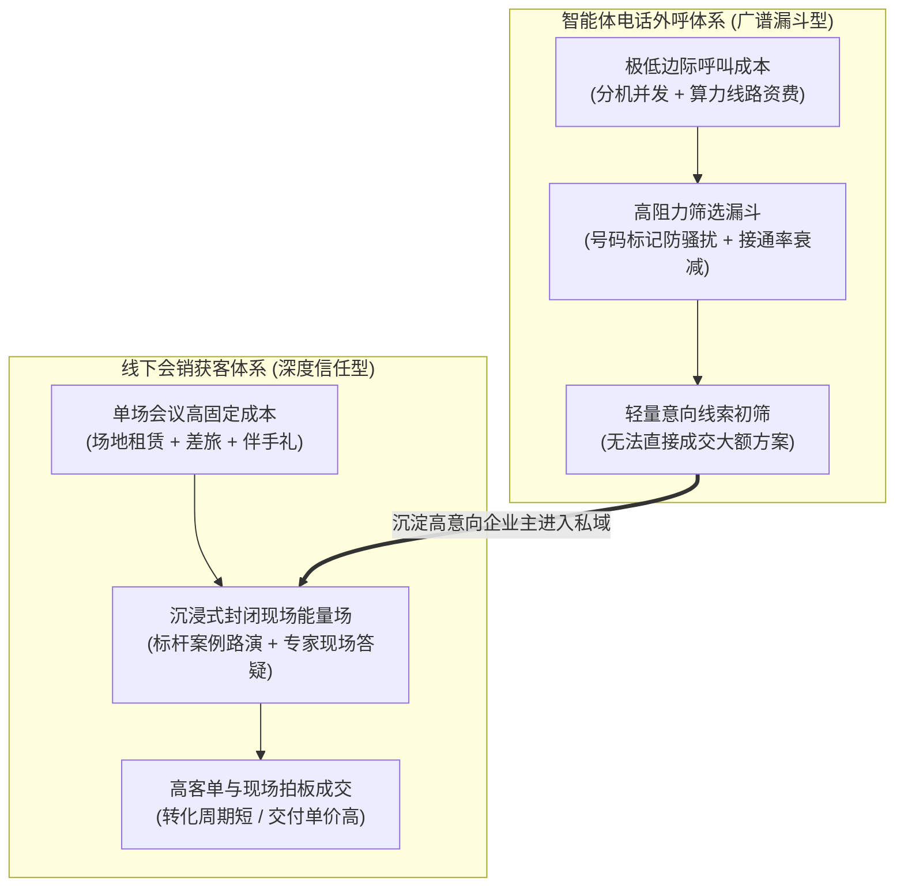

# 2026-11-03 · 第1场直播知识沉淀：大模型分工解耦机制、99元学术诊断变现、十年大厂程序员转型FDE与合伙人商业博弈

> **场次背景**：本次直播为历时 12.02 小时的跨夜深度交流（2026年11月03日晚21:15持续至11月04日清晨09:17），重点复盘了 AI 商业化交付与工程师破局的多项核心命题：在模型选型上确立了**“两阶段分工解耦机制（通用思维模型梳理需求架构 vs 专用编码模型落地函数，严禁让 Codex 单独承接需求沟通）”**；学员分享了针对职称与课题申报痛点打造的**“99元轻量学术评审诊断报告”**低成本验证闭环；针对**“10年资深大厂程序员面临技术栈孤岛与年龄焦虑”**，给出从单兵死士向 FDE 业务操盘手转型的路径指导；深入剖析了**技术合伙人与商业合伙人的认知鸿沟与利益拉扯**；以及**会销场景与智能体外呼获客成本与转化率的真实账本对比**。

---

## 1. 大模型工程落地选型：两阶段解耦与开发心法

在实战大模型应用与产品开发中，技术团队常常陷入“模型能力不行、无法做出想要产品”的认知误区。现场资深工程师通过真实踩坑经验，提出了关键的模型分工解耦心法。

### 1.1 核心盲区：严禁让编程专用模型独自承接业务需求沟通

- **Codex 等模型的思维惯性**：像 Codex 这类专门针对代码库微调的模型，其优势在于严格依据清晰的函数签名和指令编写高效代码，但在理解模糊、开放、跨领域的商业和业务需求时，思维缺乏活跃度与容错发散能力；
- **直接沟通引发的返工灾难**：如果开发者从第一分钟起就直接对 Codex 描述模糊需求，一旦模型理解偏离，生成数百行代码后不仅造成大量 Token 浪费，更会导致工程推倒重来，进而让开发者产生“大模型做不了复杂产品”的挫败错觉；
- **需求与编码物理级解耦**：必须确立第一阶段与通用模型（ChatGPT / DeepSeek）多轮反复碰撞，将所有不确定的业务流、异常处理和数据结构彻底敲定，再转入第二阶段由 Codex 专注落盘。

### 1.2 高成本用人与大模型提效的杠杆平衡

- **用人成本的真实账本**：在团队配置上，给核心骨干 40%~50% 的市场溢价高薪往往是最便宜的方案。平庸团队即使人手再多，在大模型交互逻辑与业务架构上反复踩坑，隐性消耗的时间和服务器成本远超薪资差额；
- **人机超级协同定位**：高水平开发者不再是键盘打字员，而是“架构设计师兼需求翻译官”。一个人通过合理的模型组合编排，可以跑出以往 3~5 人研发小组的代码吞吐量。

---

## 2. 垂直场景轻量工具变现：99 元学术诊断报告的 MVP 闭环

针对专业知识服务与轻量软件创业，现场学员分享了自己针对高校教师、医护人员及科研人员职称评审、学术报告申报痛点，所开发的自动化检测匹配工具。

### 2.1 拒绝好大喜功：先切“硬件匹配诊断”，暂缓“AI 润色”

- **避开高风险重度逻辑**：很多技术人一上手就想做“全自动一键改稿与润色”，但这不仅涉及严肃的学术伦理风险，且大模型极易产生学术造假幻觉，技术复杂度与纠错成本不可控；
- **抓准低门槛刚需**：将业务聚焦于“申报资格硬件匹配与格式规范诊断”。针对官方评审细则，提取硬性打分点，自动化生成详细的《申报材料初审体检报告》，并附带修改意见；
- **99 元单次定价策略**：对于申报人而言，职称评审一年仅一次，错过代价巨大；99 元的定价处于个人无须深思熟虑即可掏钱包的轻量决策区间，既覆盖了算力成本，又有效筛选出高净值严肃用户。

### 2.2 交付载体选择：立足用户习惯，避免重度开发

- **PC 端与邮件交付优势**：针对学术、科研与文职从业者，手机移动端并非其处理长文档材料的自然场景。系统采用 PC 端网页轻量上传，后台异步处理后直接发送结构化 PDF 报告至用户邮箱，大幅降低了移动端适配与即时通讯服务维护的高昂成本。

---

## 3. 资深大厂程序员自我救赎：从技术螺丝钉向 FDE 操盘手跃迁

一位工作 10 年的大厂程序员在连麦中表达了强烈的转型焦虑。薪资丰厚但深陷大厂技术体系与内卷，希望借助 AI 浪潮跳出“单兵死士”陷阱，探索独立发展之路。

### 3.1 平台型产品 (OPC) vs 前线部署工程师 (FDE) 抉择

- **技术新人的典型陷阱**：一出大厂就想做“通用 SaaS”或“平台型平台”，往往因为脱离真实营销获客体系，产品做出来后无人问津，耗尽积蓄；
- **FDE 是大厂技术人的天然跳板**：大厂程序员具备完备的工程素养和系统稳定性控制能力。将这套能力平移到外部实体企业，作为前线部署工程师（FDE），帮助中小制造、外贸、供应链企业落地具体 AI 工具，能够快速获得真实收入反馈，补齐商业谈判与客户认知短板。

### 3.2 告别“唯技术论”：商业现场不存在纯算法竞争

- **实体老板只认真实结果**：在工厂和传统企业现场，老板不在乎你用了 7B 还是 70B 模型，更不在乎架构是否优雅。能帮他把车间每天的纸质巡检单自动转为结构化台账，就是天大的战功；
- **技术人员转型心态**：必须放下技术傲慢，学会俯下身子倾听实体从业者的日常抱怨，在不完美甚至简陋的存量软硬件环境下编排能用的解决方案。

---

## 4. 技术合伙人 vs 商业合伙人：认知鸿沟与双轮协同法则

直播中多位创业者反馈，技术背景与商业背景合伙人搭档时，常常爆发激烈的战略内耗：一个追求快速变现卖货，一个追求底层长期稳定。

### 4.1 商业合伙人的底层逻辑：商业的本质是卖

- **天下武功唯快不破**：在商业竞争中，早期抢占客户心智与建立先入为主的壁垒至关重要。只要轻量小模型搭配规则能解决当下问题、客户愿意掏钱，这就是及格的商业闭环；
- **容忍初期的不完美**：早期 MVP（最小可行性产品）阶段，允许人工兜底与规则硬编码，严禁为了“自动化”而无限期拖延上线交付周期。

### 4.2 技术合伙人的核心守门员价值：防范中远期崩盘

- **技术债不可无限堆积**：当产品验证成功、客户体量激增时，技术合伙人必须迅速接管架构，对底层接口并发、数据安全、模型幻觉率进行标准化封装；
- **合伙人协作铁律**：商业合伙人负责**打猎开拓与现金流供血**，技术合伙人负责**防守守家与规模化复制**。双方应以“商业结果”为唯一裁判依据，杜绝在立项初期争论架构高下。

---

## 5. 获客模式实战拆解：会销体系 vs 智能体电话外呼成本账本

获客渠道是决定 AI 方案能否落地的命脉。现场围绕“高成本线下会销”与“低成本智能体电话外呼”展开了深度对比。

### 5.1 智能体电话外呼的优势与边界

- **规模化广谱触达**：智能体外呼能够以极低边际成本完成数万条目标企业名单的冷启动意向探测，在标准产品线索初筛上效率突出；
- **致命瓶颈**：实体高客单解决方案买单需要建立深度人际信任。AI 电话不可能直接谈妥几万至几十万元的企业定制大单，更面临严重的通信运营商封号与防骚扰拦截风险。

### 5.2 组合拳打法：智能体外呼漏斗 + 线下会销临门一脚

- **双层获客漏斗设计**：
  - 前端利用 AI 智能体电话与社媒私域进行**低成本大盘线索摸排**，筛选出有痛点、有预算的真实企业高管；
  - 后端将筛选出的高意向客户定向邀请至线下沙龙或垂直行业闭门会，通过面对面案例拆解、现场体验与专家信任背书，实现高客单方案的最终签约成交。

---

## 6. 落地实践工具箱：实战自检表与行动清单

### 6.1 AI 商业化与交付实战自检原则表

| 序号 | 核心自检维度 | 落地检测问题 | 预警避坑红线 |
| :---: | :--- | :--- | :--- |
| **01** | **需求解耦** | 复杂需求是否先由通用模型收敛出 PRD，再交给专用编码模型？ | 严禁直接向代码模型口述模糊大需求 |
| **02** | **MVP 定价** | 是否针对单点刚需设计了轻量低决策门槛的定价区间（如 99 元）？ | 避免初期强推高客单长账期重方案 |
| **03** | **交付载体** | 交付界面是否贴合垂直用户工作习惯（如办公 PC 端 + 邮箱）？ | 杜绝盲目投入全端 APP 开发 |
| **04** | **业务翻译** | 与传统企业主沟通时，是否将技术黑话转化为损耗率与账本语言？ | 严禁自称“纯靠 AI 自动做”的技术小白 |
| **05** | **合伙人协同** | 商业前台与技术后台是否确立了“先测款后重构”的分阶段契约？ | 严禁未获付费验证前进行过度工程设计 |
| **06** | **获客漏斗** | 智能体外呼是否仅作为初筛漏斗，配备了人工与私域沉淀承接？ | 严禁幻想纯靠电话机器人成交大客户 |
| **07** | **幻觉防线** | 专业严谨场景（如学术、法务）是否采取“先诊断后润色”策略？ | 杜绝直接让大模型代脑输出不可控结论 |
| **08** | **算力核算** | 单次调用大模型的 Token 成本是否在用户客单价的 15% 以内？ | 警惕长上下文多轮递归调用吞噬微薄利润 |
| **09** | **大厂转型** | 技术人员是否主动到现场蹲点，积累了真实业务断点解决案例？ | 警惕困在大厂中台架构经验中纸上谈兵 |
| **10** | **闭环验证** | 交付方案是否实现了客户当月看得到的人效提升或数据入库？ | 杜绝以“模型能力强大”替代业务实际成效 |

### 6.2 三阶段执行清单 (Actionable Practice)

#### 第一阶段：需求解耦与两阶段开发流水线搭建

- [ ] 针对待开发产品，搭建两阶段工作流：通用大模型（梳理业务逻辑与数据结构）+ 编码工具（函数落地与审查）；
- [ ] 确立 Prompt 规范，明确输出 JSON Schema 与边界约束，减少代码返工率。

#### 第二阶段：单点轻量工具与 99 元商业闭环落地

- [ ] 挖掘身边垂直人群的单点刚需材料审查痛点（如职称、申报、合同硬性审查）；
- [ ] 设计单次 99 元体检报告方案，采用最轻量的 PC 网页 + 邮箱投递交付，跑通首批 20 个付费用户。

#### 第三阶段：商业前台与技术后台双轮协同

- [ ] 与商业合伙人明确 MVP 测款标准：未达成预定订单量前，架构维持单体轻量；
- [ ] 订单规模突破拐点后，全面启动接口模块化沉淀、并发性能优化与企业级数据合规防护。
