# 2026-11-03 · 第1场直播：通宵12小时实战全景复盘——大模型两阶段解耦、高溢价用人与仲裁避坑、跨境KYC攻防、99元学术诊断变现、安卓防逆向与合伙人会销拿单法则

> **场次背景与全景导言**：本次直播为历时 12.02 小时的跨夜深度研讨（2026年11月03日晚21:15持续至11月04日清晨09:17，有效对话 2,450 段、逾 16 万字）。现场聚集了跨境大卖、北京传统企业主、大厂十年资深程序员、高校工具开发者、安卓独立开发者与一线商业操盘手（于总等），围绕用工治理、工程落地、安全攻防与商业化接单展开了多轮激烈交锋。整场直播穿透了大量行业深水区：从跨国分布式团队高溢价雇佣与劳动仲裁恶意避坑，到大模型工程落地中“ChatGPT/DeepSeek 需求收敛与 Codex 落地物理级解耦”；从海外出海平台的 Jumio KYC 三层身份认证与网络防关联，到 99 元学术申报诊断的 MVP 现金流闭环；从商业 APK 防逆向防白嫖攻防，到大厂程序员打破“唯技术论”、穿透商业本质“当场拿下三万五万企业单”的实战心法；以及商业合伙人与技术合伙人的分润死局和会销高客单获客账本。

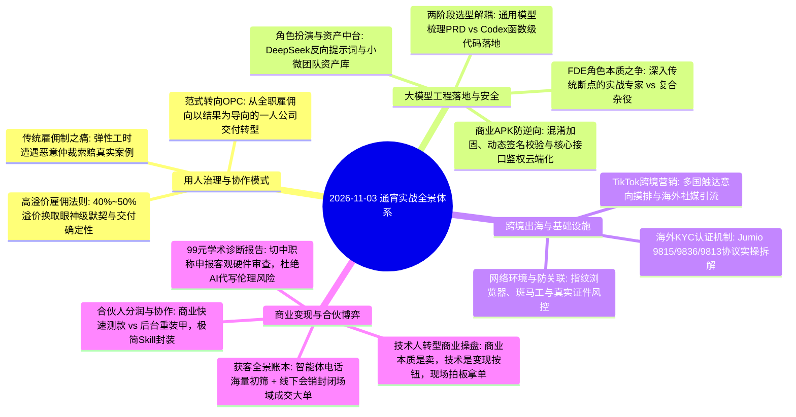

---

## 1. 用人成本与组织协作：高溢价雇佣法则 vs 雇佣制之痛与 OPC 交付转向

直播开场由跨境电商大卖张总与北京实体企业主王哥展开了关于“小微企业如何用人”的深度对话。双方在是否该给员工开高薪、名校光环的作用、以及现行劳动合规环境下小团队的生存路径上碰撞出极具启发的实战真知。

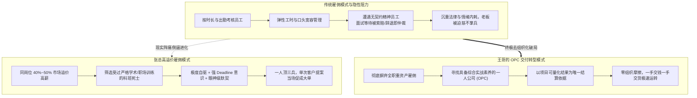

### 1.1 跨境大卖的用人账本：为什么 40%~50% 溢价高薪反而最便宜？

- **隐性成本远超名义薪资**：张总在跨境团队管理中指出，给员工开出低于市场均价的薪水，看似省下了账面开支，但后续引发的沟通反复、延期推诿、出差作息不齐等隐性损耗，往往直接拖垮一个季度的新项目；
- **名校科班背景的真正价值在于“契约与规则感”**：
  - 许多老板抱怨高学历员工心高气傲，但张总强调，受过正规高校与大厂严格训练的员工，其底层潜意识具备强大的“Deadline 约束力”；
  - 任务布置下去，给到具体截止时间（如次日上午 10:00），具备职业素养的员工哪怕熬夜也会如期交差，绝不会找“昨晚停电、朋友聚餐、网络不好”等杂七杂八的借口搪塞；
- **高薪买来“协同带宽”**：给核心骨干 40%~50% 甚至更高的薪水，不仅省去了日常微观管理的口舌，更让团队能在高压跨国环境下（时差、Zoom 远程协作）保持高频同频。

### 1.2 跨时区远程协作中的“眼神级默契”与大客户说服实战

- **亚马逊大卖客户登门谈判实录**：
  - 某次一家头部亚马逊大卖家到访，就复杂的海外店铺违规申诉与 TikTok 跨境获客方案进行深度考察；
  - 谈判中途对方突然抛出一个极其刁钻的底层规则问题。张总仅仅抬头看了身旁同事一眼，同事心领神会，没有任何废话，立即起身调出自己在后台沉淀的一整套分析模型与证据链，直接投屏到会议室大屏，将对方问得心服口服；
- **一锤定音拿下大单**：
  - 这次默契展示当场锁定了该客户的后续大额代运营与分销合作，对方甚至主动把货源交出共同分润；
  - 优秀的战友能在瞬息万变的商业谈判中成为老板的第二脑和最硬底牌，这种正向商业反馈绝非平庸团队堆砌人手所能企及。

### 1.3 北京老板的“农夫与蛇”之痛：弹性工时遭遇恶意仲裁的法律避坑教训

- **宽松人性化管理的残酷反噬**：
  - 北京的王总结合自身经历倾诉了创业小老板的心酸：原本崇尚“不打卡、弹性上下班、按计划交付”的扁平氛围，以为能换来员工的知恩图报；
  - 但现实中频繁上演“农夫与蛇”：有员工平时消极怠工，一旦因业绩不达标被约谈，便调取全部考勤与工时漏洞，直接向劳动仲裁部门索赔；
- **极端荒唐仲裁案例实录**：
  - 公司曾通知一位应聘者到公司面试，因当天按顺序面试，应聘者在会议室等候了约两个小时未被录取；
  - 随后该应聘者竟以“公司发了面试通知、进入了公司大门等候”为由发起仲裁，最终因程序举证瑕疵，公司被迫赔偿了整整一个月工资；
- **> ⚠️ 核心避坑（小团队用工底线）：**
  - 在当前法律环境下，严禁搞毫无制度留痕的“口头哥们义气”；
  - 只要招募全职员工，即便再小的工作室，也必须建立规范的面试登记、考勤打卡流水与绩效白纸黑字确认机制；
  - 古人讲“慈不掌兵”，商业的本质是契约而非慈善，对用工风险必须保持清醒防范。

### 1.4 从雇佣全职到采购 OPC：以结果交付为导向的商业合作新范式

- **老板心态的根本转移**：经历了雇佣制度的反复内耗后，王总明确表示，如今更倾向于将业务拆解，外包或合作给具备综合专业素质的 OPC（一人公司）；
- **OPC 合作的核心优势**：
  - 双方完全以商业合同与交付结果为唯一结算依据，不牵扯考勤、社保仲裁与情绪摩擦；
  - 能独立生存的 OPC 往往本身就是复合型高手，既懂业务痛点又能落地技术，不仅交付周期短，而且沟通效率极高。

---

## 2. 大模型工程落地选型：两阶段解耦与开发心法

在实操大模型应用与产品开发中，技术团队常常陷入“模型能力不行、无法做出想要产品”的认知误区。现场资深技术工程师（青叔等）通过真实踩坑经验，提出了关键的模型分工解耦心法。

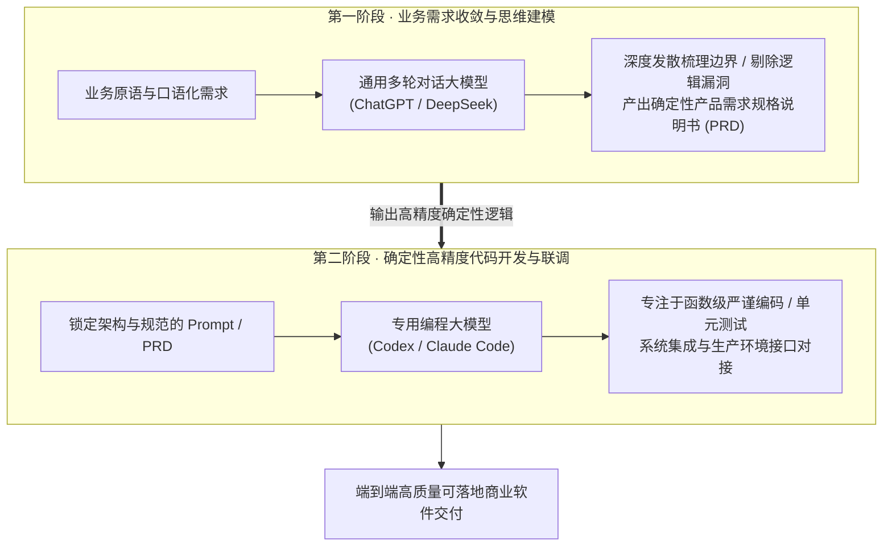

### 2.1 核心盲区：严禁让编程专用模型独自承接业务需求沟通

- **Codex 等模型的思维惯性**：
  - 像 Codex 这类专门针对代码库微调的模型，其绝对强项在于依据明确的输入输出签名、数据字典编写极其规范、高效的代码，甚至能达到 99% 以上的单函数准确率；
  - 但其致命短板在于：对模糊、发散、跨领域的商业业务诉求缺乏理解力，无法在开放语境中主动发现业务漏洞；
- **直接沟通引发的返工灾难**：
  - 如果开发者一上来就直接向 Codex 描述含糊的业务意图，模型会基于局部的代码上下文草率生成数百行看似工整但逻辑南辕北辙的代码；
  - 后续联调推倒重来，不仅消耗大量 Token 与时间成本，更会给开发者带来虚假挫败感，误以为“大模型无法承载复杂软件落地”；
- **需求与编码物理级解耦**：
  - 必须严格划分流水线：第一阶段强制使用通用思维模型（ChatGPT / DeepSeek）进行 10~20 轮拉扯碰撞，直到将全部业务异常流、数据流、边界枚举彻底理清并落为标准 PRD；
  - 第二阶段将 PRD 拆解为确定性任务，投喂给 Codex 专注落盘。

### 2.2 高成本用人与大模型提效的杠杆平衡

- **人机超级协同定位**：高水平开发者不再是键盘打字员，而是“架构设计师兼需求翻译官”。一个人通过合理的模型组合编排，可以跑出以往 3~5 人研发小组的代码吞吐量；
- **用人成本的真实账本**：在团队配置上，给核心骨干 40%~50% 的市场溢价高薪往往是最便宜的方案。平庸团队即使人手再多，在大模型交互逻辑与业务架构上反复踩坑，隐性消耗的时间和服务器成本远超薪资差额。

---

## 3. FDE 角色本质与工程边界之争：专家岗 vs 产品/研发合体杂役

直播间就当前爆火的 **FDE（Forward Deployed Engineer，前线部署工程师）** 展开了一场极其尖锐的观点交锋。

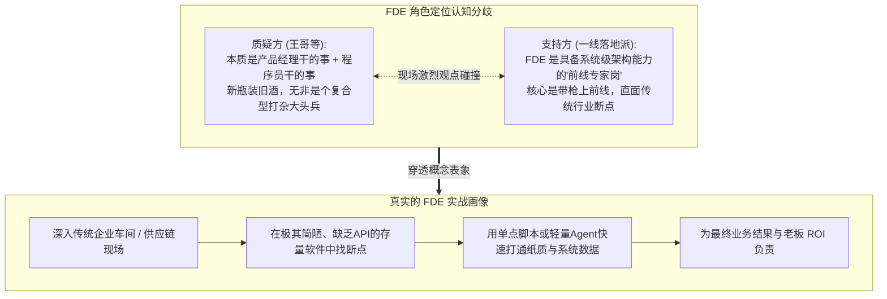

### 3.1 现场交锋焦点：FDE 到底是挂羊头卖狗肉，还是工业级落地专家？

- **质疑方的犀利发难**：
  - 王哥等管理层认为，市面上热炒的 FDE 本质上不过是把早期的“售前技术支持、实施顾问、产品经理和初级开发”打包合体，如果只是做做需求访谈写写小脚本，根本没必要造出如此高大上的专家岗位名词；
- **支持方的实战回击**：
  - 真正的 FDE 绝非廉价打杂工，而是在 Palantir 等顶尖企业中被验证过的“特种兵”；
  - 传统产品经理懂业务但不懂底层算法与接口吞吐上限，传统程序员懂代码却根本听不懂工厂车间调度员的方言黑话；
  - FDE 必须兼具**“将混乱业务原语秒级翻译为工程拓扑的能力”**与**“在不完美现场极速拉起可用系统的工程硬实力”**。

### 3.2 穿透岗位黑话：深入传统企业断点做“脏活累活”的交付底色

- **实体老板只看真实数据入库**：
  - 传统老板不在乎你用了多么前沿的架构或模型。能帮他把车间每天几百张手写巡检单、破损报表通过多模态 OCR 自动录入 ERP，就是无上功勋；
- **告别技术虚荣心**：
  - 转型 FDE 的核心门槛不在于算法深度，而在于能否脱下大厂光环，俯下身子钻进工厂、外贸仓库、医院科室去理解他们每天最厌恶的重复机械动作，用最轻量的工具组合（甚至只是几段 Python 脚本 + 企业微信机器人）把卡点解开。

---

## 4. 多模态角色扮演与个人数字资产中心架构

针对小团队及个人如何在大模型时代沉淀自己的“数字护城河”，现场学员探讨了基于 DeepSeek 的角色扮演开发实践，以及个人/小微团队的数据中台搭建路径。

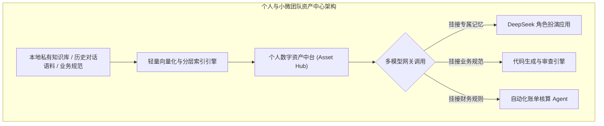

### 4.1 基于 DeepSeek 的角色扮演 APP 提示词编排与防破功约束

- **垂直角色扮演玩法**：
  - 现场有开发者分享正在测试一款基于 DeepSeek 底座的角色扮演 APP，面向小众娱乐与陪伴场景；
- **防破功与提示词工程**：
  - 核心痛点在于长多轮对话后模型容易“失忆”或“跳出角色变成 AI 助手”；
  - 实操技巧：在 System Prompt 中反向定义“禁语清单”（如严禁出现‘我是一个人工智能模型’、‘作为AI助手’），并采用少样本（Few-Shot）锁定特定口癖、情绪波动阈值与世界观背景；每次对话将核心人物小传与当前好感度数值作为隐式状态随上下文循环注入。

### 4.2 小微团队与独立开发者“个人资产中心与数据中台”搭建实战

- **拒绝每次从零 Prompt 调教**：
  - 许多人把大模型用成了“一次性打火机”，聊完即扔；
  - 正确打法是建立**个人/小微团队专属资产中心**：将日常积累的代码片段、行业专业词表、高频客户答疑话术、标杆合同模板沉淀为结构化资产库；
- **动态记忆挂接机制**：
  - 通过本地轻量数据库或向量网关，在发起不同任务时，让大模型自动检索资产库中与当前任务最相关的 3~5 条规则注入上下文，实现“越用越懂你、越用越稳定”的复利正循环。

---

## 5. 跨境出海基础设施：KYC 身份验证三层机制与网络防关联攻防

跨境出海是 AI 变现的重要阵地，但也是风控与合规水最深的领域。张总就海外各大电商与支付平台极其严苛的 **KYC（Know Your Customer，客户身份尽职调查）** 攻防机制进行了硬核拆解。

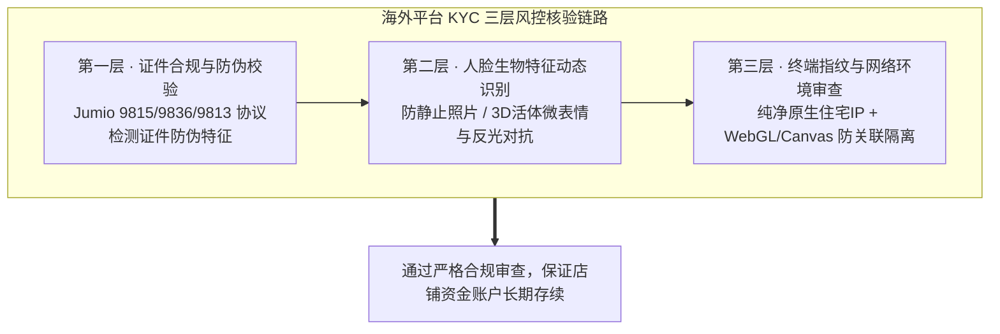

### 5.1 亚马逊与海外主流平台 KYC 认证机制（Jumio 协议深度拆解）

- **Jumio 9815、9836、9813 协议细节**：
  - 早期海外跨境巨头（如亚马逊、Stripe）普遍采购 Jumio 等专业合规供应商的核验链路；
  - 9815/9836/9813 对应不同安全等级的文档识别规范，能够毫秒级分析护照、驾照、企业营业执照的紫外反光、微缩印刷文字及全息防伪图层；
- **静态证件造假的绝路**：
  - 现场警告：任何试图用简单 AI 换脸或 PS 修改扫描件通过海外高级 KYC 的做法早已失效，系统内置算法能精准识别文件元数据篡改、噪点异常及图层拼接痕迹，一旦暴雷将导致整个企业主体永久封禁。

### 5.2 网络指纹环境隔离、美国斑马工与真实证件风控水深

- **网络环境与物理设备隔离**：
  - 仅仅搞定证件远远不够。海外风控引擎通过浏览器 WebGL 指纹、Canvas 渲染指纹、系统字体列表、网卡 MAC 地址以及 WebRTC 真实公网 IP 进行全维度画像；
  - 必须采用专业的独立环境隔离工具（如指纹浏览器）搭配海外纯净住宅原生 IP，杜绝多账号同环境操作；
- **美国本土斑马工与合法身份链**：
  - 涉及美国本土公司主体注册与银行账户开设，必须依赖完全合法合规的本土代理（如合规秘书公司、本土服务商）；
  - 严禁贪图便宜购买来路不明的虚假法人信息，任何资金通道的合规短板都会在提现大额美金时引发不可逆的冻结。

---

## 6. 垂直场景 99 元轻量变现闭环：高校与科研学术申报初审诊断工具

针对垂直工具创业与轻量软件变现，现场一位学员分享了自己针对高校教师、科研人员及医护人员课题申报痛点打造的轻量诊断报告工具。

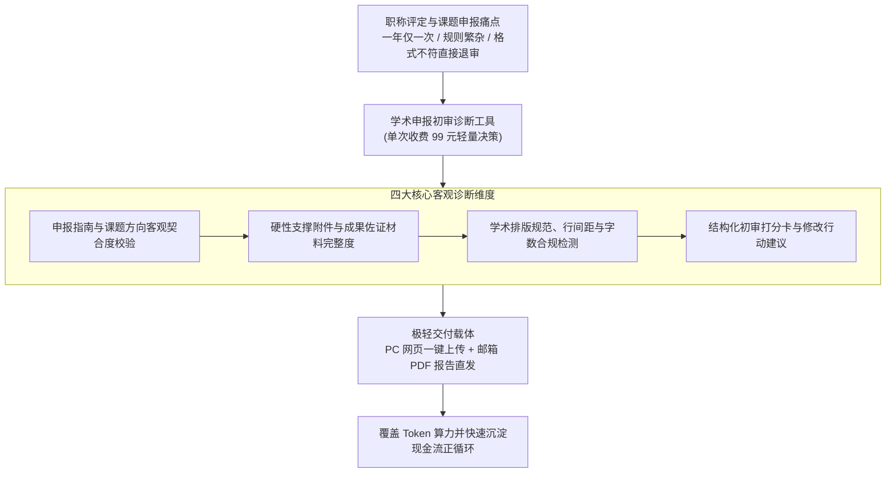

### 6.1 痛点切入：职称评定与课题申报的硬性退回风险

- **一年仅一次的沉重时间成本**：对于体制内高校讲师、三甲医院医护及科研所人员，职称申报具有极强的时间窗口属性。往往因为封面单位填写不规范、跨学科指南未对齐或缺少某项硬性附件，直接在形式初审阶段被一票否决，白白耽误整整一年；
- **人工初审资源极度匮乏**：申报人往往缺乏资深专家资源提前“挑刺”，而找专业机构咨询起步数千元，门槛极高。

### 6.2 拒绝好大喜功：严守“客观资质初审”，严禁涉足“AI代写润色”学术伦理红线

- **避开高风险重度逻辑**：
  - 很多技术开发者一上来就想做“AI 一键改论文、一键写标书”，但这极易引发严重的学术造假伦理争议和模型事实幻觉；
- **聚焦“硬件客观匹配初审”**：
  - 工具绝不替用户写内容，而是做**“申报体检医生”**；
  - 依据官方最新发布的指南红头文件，自动化检测：申报单位资质是否对口、课题分类代码是否准确、支撑成果是否在有效期内、排版格式是否合规，输出详实的《申报合规体检诊断报告》。

### 6.3 商业闭环设计：99 元极轻单次决策定价 + PC 网页上传 + 邮箱 PDF 异步直发

- **99 元定价的精妙心理**：
  - 面对关乎个人前途的严肃申报，几十元的定价让人怀疑专业度，数百元又需要犹豫批准；
  - 99 元处于“个人无须向上审批、零决策摩擦即可自掏腰包”的黄金区间；
- **PC 网页与邮箱交付的极简工程优势**：
  - 针对长文档和论文排版，用户绝不会在手机端折腾；
  - 采用极简 PC 端 Web 页面上传，后台多进程异步解析打分，完成后直接生成高颜值 PDF 报告自动发送至用户邮箱；
  - 彻底省去了移动端适配、复杂即时通讯服务器维护的高昂开销，单个用户 Token 成本控制在 5 元以内，毛利率超 90%。

---

## 7. 商业客户端安全攻防：安卓 APK 防逆向、防白嫖与模型接口保护

一位做独立客户端开发的学员连麦反馈：自己花心血开发的安卓端 AI 工具发布不久，便遭遇了恶意反编译破解，不仅客户端限制被绕过，后台 API Key 更遭盗刷。现场技术大拿就客户端安全展开了全面拆解。

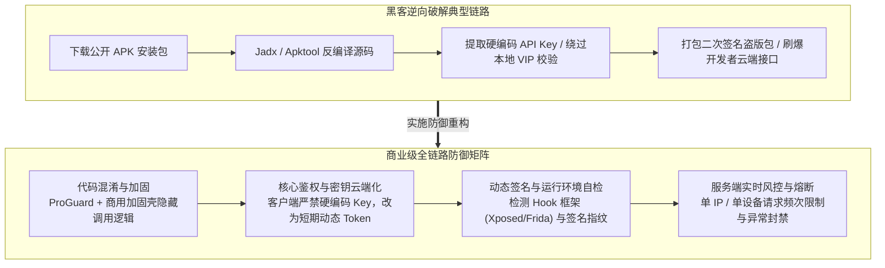

### 7.1 开发者痛点：单兵开发安卓端 AI 应用遭遇的反编译与接口盗刷

- **致命的客户端硬编码**：
  - 许多初学者将 OpenAI/DeepSeek 的 API Key 直接写在安卓代码的常量中，并在本地通过简单的 `if (isVip)` 判断是否允许调用；
  - 黑客使用公开的反编译工具（如 Jadx）只需 5 分钟就能把 API Key 剥离出来，甚至将代码中的判断直接改为 `true` 重打包，造成开发者巨大的资金损失与盗版蔓延。

### 7.2 客户端防御工程方案：代码混淆、动态签名校验与核心鉴权云端化

- **架构底线：客户端视为完全不可信环境**：
  - 严禁在客户端保留任何核心接口密钥或重要商业逻辑；
  - 必须搭建轻量云端业务代理中转服务（API Gateway），客户端通过用户鉴权换取有时效性的 Session Token，由云端代发大模型请求；
- **端侧加固三板斧**：
  - **基础混淆与加固**：强制开启 ProGuard 混淆类名与方法名，必要时接入商业级加固壳隐藏 Dex 文件；
  - **动态环境探测**：在 Native 层（C/C++）检测当前设备是否存在 Frida、Xposed 等动态注入工具，检测到 Root 或模拟器直接退出；
  - **签名指纹自校验**：运行时比对官方发布签名的 SHA-256 指纹，防止被篡改后二次打包分发。

### 7.3 算力监控与流控熔断机制

- **建立精细化配额账本**：在后台网关对每个注册设备与用户实施每分钟（RPM）和每天（TPD）的 Token 消耗上限；
- **异常突增熔断**：一旦发现某个设备在短时间内发起数百次异常长文本生成，系统自动触发人机验证滑块或实施临时封禁，将算力盗刷损失扼杀在萌芽状态。

---

## 8. 大模型业务打分体系与多维度场景评测机制

在模型选型与评测方面，现场探讨了如何跳出官方宣传跑分，建立贴合企业真实业务流的客观打分机制。

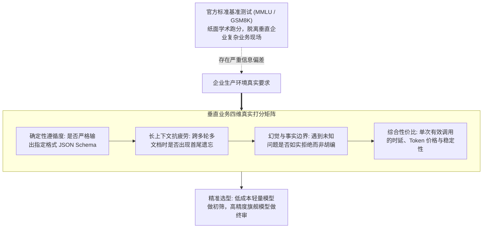

### 8.1 盲测基准的局限性：为什么纸面跑分不等于业务现场好用

- **学术刷榜与生产落地断层**：许多开源或商业模型在 MMLU、GSM8K 上跑分极高，但一旦放到企业客服、合同审查等特定业务现场，连基础的 JSON 格式要求都无法稳定保持；
- **企业评测的唯一标准是“业务通过率”**：现场技术人员强调，评测模型必须用企业历史上真实的 100 个边缘案例（Corner Cases）进行盲测，看哪个模型能把异常数据处理得最干净。

### 8.2 建立贴合垂直业务流的客观打分矩阵

- **格式确定性权重最高**：在自动化工作流中，格式吐错一次就会导致下游系统直接崩溃。模型能否 100% 遵守约束输出符合 Schema 的数据，必须占评测权重的 40% 以上；
- **幻觉边界与拒答能力**：在医疗、法律、财税领域，能够准确对不确定的条款说“资料未提及”的模型，远比胡编乱造“自信解答”的模型更有工程价值。

---

## 9. 跨境与私域营销实战：海外 TikTok 触达画像与本地化客户属性

在获客与内容出海板块，连麦嘉宾分享了通过短视频与海外社媒触达真实用户的实战体会。

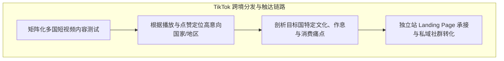

### 9.1 抖音海外版（TikTok）跨国分发与多国用户意向摸排漏斗

- **摸排受众分布是第一步**：视频发出去后，不能只看总播放量，必须在后台分析观众地域构成（例如东南亚、拉美还是中东）；不同国家的用户对同一款工具的付费意愿和客单价有天壤之别；
- **内容必须回归“人”的共情**：单纯搬运国内视频做伪原创在海外平台早已被降权。海外用户更青睐真诚分享个人生活、实际工作痛点与真实使用过程的纪实类内容。

### 9.2 本地实体客户人群属性刻画与方言/习惯适配

- **本土化接地气**：在服务本土中小企业时，切忌用大厂黑话包装方案；必须根据当地老板的生活作息（如喜欢下午茶喝茶谈事、习惯微信语音沟通等）设计交互模式，用当地人听得懂的利润和损耗语言切入。

---

## 10. 从纯技术死士向商业操盘手跃迁：大厂十年老兵的破局之道（于总实录）

直播后半段迎来重磅高潮，一线商业实战高手于总连麦，针对工作十年的大厂程序员转型困惑，倾囊相授了从“技术孤岛”跃迁至“商业操盘手”的破局法则。

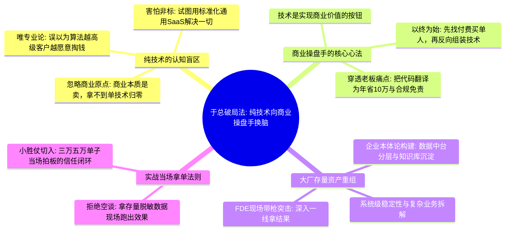

### 10.1 纯技术的死穴：商业现场不存在纯算法竞争，拿不到单一切归零

- **触目惊心的现场棒喝**：
  - 于总一针见血指出：技术人员最大的傲慢就是“总觉得自己技术比别人好，别人卖得好只是靠营销忽悠”；
  - 现实中，那些活得滋润、年入千万的团队，其底层技术往往简陋甚至粗糙；但他们能把客户伺候舒服、把卡点解决掉；
  - **拿不到订单，技术再牛也是负资产**，服务器断电那一刻你的代码一文不值。现场参与者直言：“在 AI 盛行的环境下，纯技术是极其吃亏的，因为工具平权让很多人可以弯道超车”。

### 10.2 真实工业现场的残酷现实：技术解决不了元老吵架与人际政治

- **五千万营收企业的真实死局**：
  - 于总以服务年营收 5,000 万以上企业的切身体会指出：年营收几百万的初创公司，搞几个技术小工具、智能体很容易糊弄过去；但真正深入规上企业，最难的永远是“人”；
  - “面对 100 到 300 人的企业，最难的点就是左元老跟右元老吵架的时候，大家一摔桌子不干，你用技术怎么解决？解决不了！老板这个时候绝不会愿意出面调解，他会说‘我花了钱请你来，你要帮我解决这个问题，这是你该搞定的！’如果搞不定人际阻力，几十万的单子当场泡汤”；
- **东莞五金制造厂的交付教训**：
  - 广东东莞的五金模具厂，老板每天看着车间工人流转；如果你进门跟老板说“我给你做个系统试跑 3 到 5 个月，可能帮你省 1 个人，收费 20 万到 30 万”，老板会当场觉得你在抢劫；
  - 必须从最直接的纸质损耗单、工单漏发切入，当周帮他把错漏率降下来，让老板在月初财务报表上看到多出来的真金白银，项目才能活下去。

### 10.3 建筑、酒店与房产尾盘的三大经典拆单模型

- **建筑工程业态“三步拆单法”**：
  - 现场建筑行业老兵拆解：“自动化 CAD 出图、自动识别图纸、自动做预算，这在工程上本来就是三件事！很多技术团队非要搞一个大而全的宏大系统，报价几十万、开发半年，企业根本顶不住”；
  - **实战打法**：必须把大系统彻底切碎！先把“自动识别图纸”和“自动计算预算”单独切出来卖，短期简单粗暴能用，让老板产生眼球效应；等客户拿到实惠追加预算，再去联调后端复杂的自动化 CAD 出图；
- **酒店业态全场景一年落地实操（抽 3%~5% 佣金）**：
  - 酒店 AI 改造链路极长：抓爆品获客 $\to$ 智能客服 $\to$ 对接酒店订房系统 $\to$ 手机智能客控 $\to$ 自动化调价与财报；
  - 团队整整干了一年多才把全链路业态丰富起来。如果一开始跟酒店老板要几十万开发费，根本谈不下来；团队采取**“单板块分别计价 + 销售端抽 3%~5% 佣金”**的方式，靠持续流水分润实现共赢；
- **开发商尾房清盘（按套提 2 个点）**：
  - 面对房产开发商甩尾房的急迫需求，无需纠结一套房子具体卖多少钱，直接与资方对赌：“把客户引流过来，成交一套直接给 2 个点提成”；技术团队利用 AI 智能体打外呼矩阵初筛、配合专属客服答疑，快速切走佣金现金流。

### 10.4 深圳财神案例：368 元带矿泉水“握手动作”与 398 元模板年入百万

- **深圳财神的“矿泉水智能体”打法**：
  - 深圳本土团队“财神”原本将一套高端智能体定价 3,000 元，产品甚至搭配了上市公司投资的定制矿泉水一起送；
  - 早期试图做“免费试用”，发现用户根本不珍惜且转化极差；随后果断调整为 **“368 元门槛费”**：“收 368 元直接拉统一大群，交付一套现成的基础智能客服并手把手教你怎么用”；
  - **368 元是极轻的“商业握手动作”**：一旦客户用起来觉得客服确实能接单，团队再顺理成章切入数万元的短视频矩阵获客代运营；
- **398 元标准化客服模板年入数百万元**：
  - 现场分享了另一位技术伙伴的案例：把一套成熟的智能客服工作流做成标准化模板，在私域圈子里按 398 元/年销售，同时支持同行贴牌转售；
  - 仅靠卖这套 398 元的极简模板，每年稳定躺赚几百万元，彻底跳出了为单一客户没日没夜定制开发的泥潭。

### 10.5 现场拿单心法：如何把三万、五万的中小企业订单当场谈妥

- **中小单子的核心逻辑是“快与低决策门槛”**：
  - 三万、五万的单子，老板一个人即可拍板，根本不用走漫长的招标流程；
  - 进门切忌带几十页 PPT 讲愿景；先找老板要 50 条真实的存量手工单据，中午在车上用自己的工作流调好，下午直接演示“录入后 3 秒自动生成结构化台账”；
  - 看到眼见为实的成效，当场把合同签下并收走预付款，这才是真正的落地战法。

---

## 11. 技术合伙人 vs 商业合伙人：认知撕裂、分润博弈与极简 Skill 封装

商业与技术合伙人搭档时的战略内耗与利益博弈，是本次直播引发广泛共鸣的另一大核心命题。

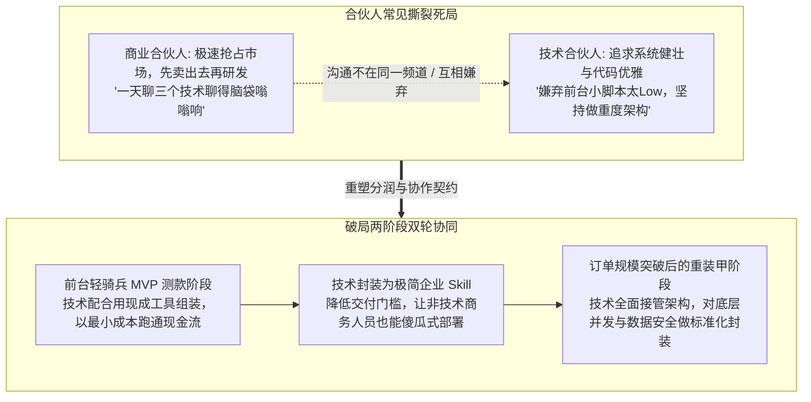

### 11.1 认知死局：商业合伙人嫌技术太慢，技术合伙人嫌前台太 Low

- **真实痛点倾诉**：
  - 商业合伙人现场抱怨：“一天聊三个技术合伙人，脑袋都聊得嗡嗡响，每个人都跟我大谈底层技术壁垒，却没人能告诉我下周能不能拿出一个东西去卖”；
  - 技术合伙人则委屈：“商业团队每天都在抓虚无缥缈的风口，前台功能天天变，刚写好的代码下周就不要了，完全是在浪费生命”。

### 11.2 分润机制博弈：拿 1 个点提成还是按销售分成？技术升级后的利益重置

- **切忌在立项初期争执股份大小**：
  - 双方应立足当下：在产品没有经过市场付费验证前，一切股份和架构都是纸上谈兵；
  - 采用**分阶段对赌与动态分润**：前期测款阶段，技术团队按轻量交付模块拿固定技术费或提点（如销售回款的一定比例）；当单品销量突破拐点、需要重度重构时，再正式确立深度股权与长期收益分成。

### 11.3 破局机制：前台轻骑兵测款 + 后台重装甲重构，将复杂工具封装为极简企业 Skill

- **极简 Skill 封装理念**：
  - 现场探讨了将复杂的底层逻辑（如知识库中台、自动化流）封装成“开箱即用小 Skill”的思路；
  - 企业客户不需要懂复杂的代码，只需像给手机装 APP 一样，在系统中输入关键参数，即可一键点亮特定功能；
  - 这种标准化封装极大降低了商业团队的售前演示难度，大幅缩短了成交链路。

---

## 12. 获客全景账本：线下会销现场能量场 vs 电话机器人外呼筛选

如何高效搞定客户，是决定商业成败的生命线。现场针对“高成本线下会销”与“低成本智能体外呼”展开了极其深刻的优劣势账本核算。

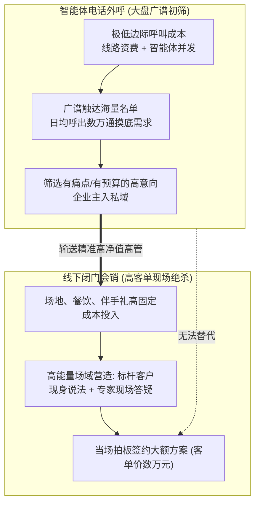

### 12.1 电话外呼智能体的优势与致命短板：低成本海量初筛与封号/信任墙

- **广谱探测优势显著**：智能体外呼能以人类坐席 1/10 的成本完成冷启动名单清洗，快速捞出有明确意向的潜在客户；
- **无法直接成交大单**：高客单价（几万至数十万）的 AI 数字化方案，本质是信任交易。没有任何企业主会通过一通冷冰冰的 AI 电话直接掏出几万元；加之通信运营商极其严苛的防骚扰封号机制，外呼只能作为最前端的引流漏斗。

### 12.2 线下会销的不可替代性：封闭场域、标杆路演与高客单当场拍板

- **为什么头部团队坚决做会销**：
  - 线下会销创造了一个封闭的“心理能量场”；
  - 当几十位同行业老板聚在一个会场，看着同行的标杆案例现场跑出真实利润，在从众心理与被时代淘汰的焦虑驱动下，现场逼单与拍板成交的成功率极高；
  - 这种强信任交付是任何线上网页、远程会议都无法比拟的。

### 12.3 组合拳获客全景漏斗

- **科学打法是前后结合**：
  - 前端利用短视频、社媒私域与 AI 电话进行**低成本高并发初筛**，将高意向企业主聚拢进私域；
  - 后端定期举办 30~50 人的精准线下闭门沙龙与会销，由专家和技术骨干现场解题，实现高客单解决方案的规模化收割。

---

## 13. 落地实践工具箱：实战自检原则表与三阶段执行清单

### 13.1 AI 商业化与交付实战 10 大避坑自检表

| 序号 | 核心自检维度 | 落地检测问题 | 预警避坑红线 |
| :---: | :--- | :--- | :--- |
| **01** | **需求解耦** | 复杂业务是否先用通用大模型收敛为确定性 PRD，再交给专用编码模型？ | 严禁直接向 Codex 等编程模型口述开放式业务需求 |
| **02** | **用工合规** | 团队弹性工作或外包协作时，考勤确认与交付验收单据是否白纸黑字留痕？ | 杜绝毫无制度留痕的口头哥们义气管理，防范仲裁索赔 |
| **03** | **MVP 定价** | 单点轻量工具是否设计了 99 元等个人无须向上审批的低决策门槛定价？ | 避免在初期强推重度高客单方案导致验证周期过长 |
| **04** | **学术伦理** | 专业严谨申报工具是否坚守“客观硬件指标初审”，彻底避开“AI代写代改”？ | 严禁涉足学术造假红线，防范不可控的事实幻觉风险 |
| **05** | **客户端安全** | 发布的商业 APK 是否剔除了全部硬编码 API Key 并引入动态混淆加固？ | 严禁在客户端直接调用大模型，核心鉴权必须云端代理化 |
| **06** | **风控隔离** | 开展跨境出海业务时，指纹环境、独立住宅 IP 与真实法人资料是否物理隔离？ | 杜绝侥幸心理使用虚假资料，防范平台跨账号关联封号 |
| **07** | **业务翻译** | 与传统实体企业主沟通时，是否将技术黑话转化为具体的损耗率与账本语言？ | 严禁自说自话展示技术优越感，把技术当成商业价值按钮 |
| **08** | **合伙契约** | 商业合伙人与技术合伙人是否明确了“先轻骑兵测款、后重装甲重构”的契约？ | 严禁未获市场付费验证前耗费重金进行过度架构设计 |
| **09** | **获客闭环** | 智能体外呼是否仅作为大盘初筛工具，配置了线下会销或人工私域临门一脚？ | 严禁幻想纯靠电话机器人成交大额企业级定制订单 |
| **10** | **交付实效** | 方案部署完成后，是否实现了客户在当月账面上看得到的降本人效与数据入库？ | 杜绝以“模型能力强大、算法先进”替代业务现场真实结果 |

### 13.2 三阶段执行清单 (Actionable Practice)

#### 第一阶段：需求解耦与用工安全规范（Day 1 ~ Day 7）

- [ ] 针对正在开发的项目，搭建两阶段工作流水线：第一阶段通过通用对话大模型多轮推演梳理出无逻辑漏洞的 PRD，第二阶段再分发给编程工具编写代码；
- [ ] 规范小团队内部用工或 OPC 协作协议，明确任务交付验收标准与 Deadline，完善面试与沟通留痕，防范恶意仲裁隐患。

#### 第二阶段：单点轻量变现与客户端安全加固（Day 8 ~ Day 20）

- [ ] 挖掘身边垂直人群的申报或审查痛点，设计 99 元低决策门槛的初审体检工具，跑通 PC 网页上传与邮箱 PDF 直发极简交付链路；
- [ ] 审查对外发布的客户端软件，将大模型 API Key 彻底迁移至云端中转网关，配置单设备调用频次限流，并开启代码混淆与动态签名防篡改校验。

#### 第三阶段：商业合伙双轮驱动与会销转化攻坚（Day 21 ~ Day 30）

- [ ] 与商业合伙人拉齐认知分工：前端以最简 MVP 快速切入市场测款，验证付费意愿并提供现金流血包；
- [ ] 搭建“智能体电话/社媒私域线索初筛 + 线下闭门沙龙/会销拍板签约”的复合获客漏斗，携带脱敏数据做现场跑通演示，拿下首批三万至五万的标杆企业订单。
