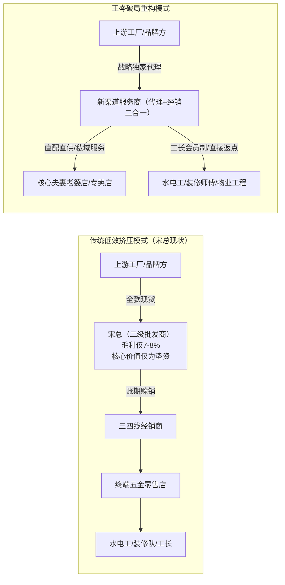
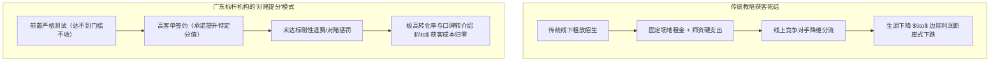
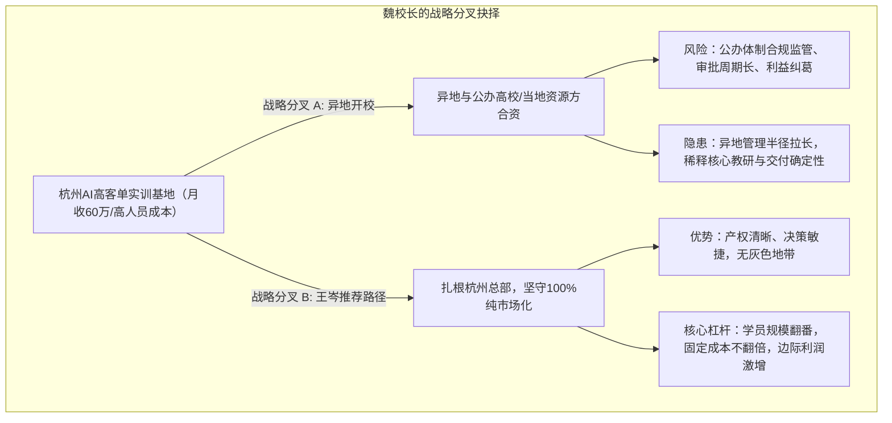
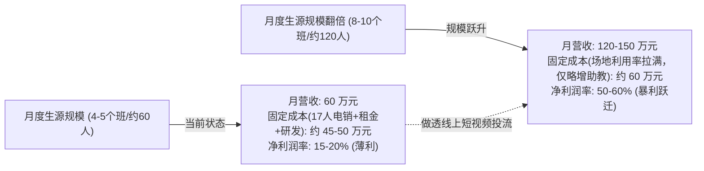

# 2026-11-03 · 王岑：消费供应链算账、五金中间商求生、餐饮大单品聚焦与高客单AI培训定力

> **场次说明**：本篇基于 2026-11-03 凌晨（录制时间：2026-11-03 00:11:22 至 01:12:47，录音时长 61.4 分钟，Session 95）王岑抖音直播《科技创新 + 消费智慧》完整 393 段 ASR 逐字稿全息蒸馏。全程无台本纯自然流连麦，直击真实商业世界中的产业链被挤压、教培内卷对赌、餐饮重资产供应链与门店模型失焦、高客单 AI 线下培训扩张决策等关键痛点。

---

## 核心商业全景导航

---

## 一、长三角五金耗材贸易商：地产下行期二级批发商的生死存亡与渠道重组

### 1. 客体画像与经营困局
- **连麦人**：宋总（苏州五金耗材贸易商，扎根长三角五金工具与长尾易耗品 6–7 年）。
- **行业痛点**：五金耗材深度捆绑传统房地产与建筑工程行业。伴随国内地产高周转周期画上句号，行业由增量高歌猛进转为存量博弈，营收增长严重疲软。
- **身位缺陷**：作为二级批发商，业务模式为“从品牌方/一级经销商拿货 $\to$ 垫资采购 $\to$ 加价 7–8 个点分销给下游三四线五金分销商”。自身不建工厂、不控生产，也不直接触达终端零售店面与工长。

### 2. 王岑商业诊断：垫资不是护城河，两头去中间化是必然

王岑在连麦中连环追问宋总两道基础问题，直接暴露出传统贸易商的致命盲区：
> **王岑**：“你在苏州、杭州，普通人去线下买五金件，终端零售是什么业态？是专卖店、混合店，还是夫妻老婆店？”  
> **宋总**：“都在五金市场里面……”  
> **王岑**：“错！市场太抽象了。这说明你平时根本不下终端！在终端买五金的真实用户是谁？谁每天高频买五金？”

### 3. 实战破局对策
1. **警惕“垫资”的假性壁垒**：整个商业社会的渠道效率在持续优化，工厂直通电商（M2C）或直通终端是不可逆趋势。二级贸易商如果不提供仓储周转、选品组货和深度客情，只靠 7–8% 的微薄毛利承担资金风险，坏账率一旦抬头就会全盘皆输。
2. **两极化求生法则**：
   - **向下走（代理+经销一体化）**：砍掉中间多层转手，自建 3–5 人的轻量地推团队，以地级市或区县为单位，直扎终端夫妻老婆店，成为其“全品类高频配送柜台”。手握 500 家终端小店的真实出货网络，上游大厂自然给账期、给独家代理权。
   - **直穿实际使用者**：五金件的真正高频决策者是水电工、泥瓦匠、物业维修工与包工头。建立本地师傅社群与专属报单码，把终端采购的隐形返利与服务做透，实现从“等客上门”到“主动抓牢客群”。

---

## 二、成人应试教培转型：行业卷向对赌退费，切勿跳入“金融引流”新火坑

### 1. 客体画像与经营困局
- **连麦人**：向总（重庆，深耕 30 岁+成人学历专升本、考研应试辅导 6–7 年）。
- **行业痛点**：行业陷入重度价格战与获客内卷；自身依赖传统线下渠道，未跑通线上公域矩阵；固定教室租金与全职教研工资居高不下，招生人数稍有滑坡，边际利润即被吞噬。
- **转型冲动**：萌生退意，计划跨界做“金融投顾前端引流”或找新赛道。

### 2. 王岑商业诊断：“卷”是成熟经济体的常态，逃避解不了获客病灶

> **王岑**：“人均 GDP 跨过万美元后，所有消费、娱乐、生活、教育行业都会进入存量极卷期。哪个行业不卷？卷不是退缩的理由！卷到最后拼的是交付确定性与获客效率。”

### 3. 避坑指南与破局实操
1. **严禁轻率跨界“金融投顾引流”**：
   - 金融衍生品与证券投资顾问属于国家强特许监管行业，前端引流极易踩中“非法荐股、非法经营、洗钱风控”等法律红线；
   - 跨行业并不意味着竞争变小，金融流量成本位列全行业之首，在不具备牌照资产与投研交付能力的前提下贸然进入，是“从一个熟悉泥潭跳进火海”。
2. **教培行业下半场的“交付对赌制”**：
   - 传统“交钱听课、考不过自负”的买卖模式已被用户抛弃；
   - 借鉴华南优秀机构做法：**收窄招生漏斗，做前置摸底考，只招有基本盘、能通过封闭集训提分 10–15 分的准合格学生，签订对赌提分协议**。交付结果越刚性，家长与学员支付意愿越强，形成抵御价格战的品质壁垒。
3. **补齐短视频公域漏斗**：必须让团队核心教师走向镜头，用真实试题拆解、考点通关技巧建立本地精准 IP，以极低线索成本对冲线下门店固定开销。

---

## 三、重资产餐饮供应链与商场冒菜：投行级现场心算与大单品战略聚焦

### 1. 客体画像与商业家底
- **连麦人**：李总（西安餐饮供应链老兵，创业 15 年）。
- **资产规模**：
  - 2009 年首创冒菜连锁品牌，2 年内狂开 3000 家店；
  - 2020 年买地自建 **20000 平方米自有食品供应链工厂**；
  - 现主营高端商场冒菜品牌，全国拥有 63 家加盟店，单店月流水 20–30 万元；
  - 历年打造过上百个餐饮细分品牌，累计开出数千家门店。

### 2. 王岑现场心算模型（投行级餐饮财务穿透）

连麦现场，王岑仅凭李总口述的“63 家商场店、单店月流水约 20 万、产品综合毛利率 65%”，在数秒内现场完成投行级心算拆解：

#### 核心财务测算公式台账
| 指标名称 | 计算公式与取值 | 测算结果 | 商业意义 |
| :--- | :--- | :--- | :--- |
| **终端年总 GMV** | $63 \text{ 家} \times 20 \text{ 万元/月} \times 12 \text{ 月}$ | $\approx 1.512 \text{ 亿元}$ | 衡量终端消费品牌在商场渠道的实际流水吞吐规模 |
| **门店食材采购总额** | $1.512 \text{ 亿元} \times (1 - 65\%)$ | $\approx 5292 \text{ 万元}$ | 确定加盟体系对食品加工厂的刚性原料吞吐量基准 |
| **供应链工厂出厂收入** | 采购总额 $\times 99\%$（加盟商强闭环直供率） | $\approx 5239 \text{ 万元}$ | 验证自有 2 万平食品工厂是否具备自我造血与产能消化能力 |
| **供应链毛利润** | $5239 \text{ 万元} \times [15\%, 20\%]$ | $\approx 786 \text{ 万} \sim 1048 \text{ 万元}$ | 剔除大宗食材原料成本后的工厂加工与组配毛利 |
| **工厂年净利润** | $5239 \text{ 万元} \times 10\%$（工业化标品标准净利率）| $\approx 524 \text{ 万元}$ | 支撑企业底层估值与持续研发的核心现金流基石 |

### 3. 王岑战略诊断：摆脱“品牌游击队”，聚焦大单品破局

> **王岑**：“你做了上百个品牌、打造过上千家店，但今天你为什么依然感到焦虑？因为你做的是**品牌游击队**，没有做成**具有资本复利价值的连锁常青树**！”

1. **多品牌是伪繁荣，资源被过度稀释**：频繁更迭品牌是低水平重复建设，每次都要重新设计 VI、打磨供应链、招募加盟商，无法在消费者心智中沉淀出类似“杨国福、张亮、夸父”级别的品类代名词。
2. **大工厂必须匹配极致大单品**：20000 平米自有工厂是稀缺的重资产武器。重资产工厂的命脉是“高周转、低 SKU、大批量规模生产”。必须从散乱菜品中提炼出 1–2 个核心爆品底料、标准化鲜卤或锁鲜预制件，以单挑大单品把工厂产能打满。
3. **打磨极简单店模型，走向快速下沉复制**：商场店租金与扣点昂贵，抗风险能力弱。应将冒菜模型迭代为“单店投资 30–50 万元、人工 3–4 人、面积 40–60 平米、8–12 个月回本”的高坪效快餐模型，以此作为招商放量的战略武器。

---

## 四、高客单 AI 线下就业培训：战略定力指南与组织边际成本法则

### 1. 客体画像与业务数据
- **连麦人**：魏校长（杭州某 AI 就业实训基地创始人，14 年 IT 职业教培老兵，曾经历北大青鸟、达内时代，巅峰期拥有 14 个校区、年营收 5–6 亿元）。
- **业务现状**（2025 年转型做 AI 就业培训）：
  - **产品结构**：面向成人的纯线下 3–4 个月全脱产实训，主打人工智能开发与数据统计（数统）就业班，承诺对赌毕业就业起薪在 1.4 万–1.5 万元/月；
  - **定价体系**：仅设两档高客单价——29800 元与 39800 元；
  - **营收与获客**：拥有 17 人全职电销团队，目前单月 C 端营收约 60 万元；
  - **高校合作拓展**：与安徽、湖北等 5 所公办本科院校二级学院合作，以“免费认知实训基地”导入学生，在杭州基地实训转化，客单价 39800 元的转化率极高。
- **核心决策纠结**：目前团队设立 6 大职能部门，人力开销重；是否该前往湖北、陕西等异地与当地高校或资源方合资设立分校，快速抢占地盘？

### 2. 王岑战略决策：维持现状，扎根杭州，拒绝体制内风险，做透市场化

现场连麦互动中，观众投票对“异地合资扩张”与“留守杭州深耕”呈五五开对立，王岑给出了极具穿透力且反共识的决断：

### 3. 边际成本递减法则（固定成本与盈利跃迁模型）

#### 王岑给魏校长的三条核心落地军规
1. **坚守市场化，审慎对待体制内公办高校关联运作**：
   - 公立本科院校的学籍、实习送生与商业培训挂钩具有极高的政策合规敏感性；
   - 商业培训机构的立身之本是“向市场要客户、靠交付拿结果”。过早把命脉系在高校二级学院的领导关系上，一旦面临人事更迭或政策整顿，业务将遭受毁灭性打击。
2. **警惕“伪固定成本过高”的错觉**：
   - 魏校长当前感觉人员成本重，根源不在于 17 人电销团队庞大，而在于**单兵产出与前端线索漏斗尚未吃饱**；
   - 教室租金、行政后勤与核心师资属于固定资产与沉没成本。当生源从每月 5 个班扩至 10 个班时，场地与师资无需翻倍投入，边际成本趋近于零，利润率将呈爆发式增长。
3. **高客单就业培训的增长飞轮**：
   - 核心护城河是“毕业薪资 1.4–1.5 万元”的真实兑现率；
   - 集中精锐力量把杭州单校区的就业数据做出全国标杆案例，再利用小红书与抖音将真实就业案例放大为公域流量漏斗，这是成本最低、确定性最高的增长飞轮。

---

## 五、王岑商业实战心法台账总结

| 商业维度 | 传统认知偏误 | 王岑穿透性底层法则 | 落地检验指标 |
| :--- | :--- | :--- | :--- |
| **渠道价值** | “我是中间批发商，我提供资金垫资就有存在理由。” | 垫资是产业链中最廉价且最危险的附庸，效率优化终将消灭纯二级垫资商。要么向上做独家绑定，要么向下直控夫妻老婆店与工长。 | 贸易商终端自控率、终端拜访频次、终端私域客户占比 |
| **行业竞争** | “这个行业太卷了，我想换一个不卷的蓝海行业。” | 成熟经济体不存在不卷的行业。卷的本质是效率淘汰。卷到深处做“对赌与确定性交付”，逃避只会掉入更危险的监管死穴。 | 履约对赌协议签订率、交付提分率、获客转化漏斗 |
| **餐饮扩张** | “我做了上百个品牌、千家门店，经验丰富能抗风险。” | 多品牌是战略不聚焦的遮羞布。重资产供应链必须服务于极致大单品，打磨轻资产、快回本的单店模型方能形成资本势能。 | 单店投资回收周期（<12个月）、主推大单品营收占比（>60%） |
| **教培扩张** | “杭州有了一定基础，应该赶紧去异地开分校、联合公立高校做大。” | 异地扩张会带来组织管控衰减与政策合规地雷。扎根总部做透市场化公域招募，通过规模翻倍摊薄固定成本，才是利润跃迁的正道。 | 校区工位与教室利用率、单兵电销月产出（>10万/人） |

---

## 六、数据校验与源资产凭证

- **源录音资产**：`抖音录制库/王岑/[2026-11-02 23-11-22][王岑][科技创新 + 消费智慧].aac`
- **采样参数**：24,000 Hz 单声道，总时长 3662.91 秒（61.4 分钟）
- **切片与 ASR 凭证**：7 个 600 秒切片，VibeVoice-ASR-7B 远端 GPU（H100）本地转录完成
- **有效发言段落数**：393 段，flags 校验 0 异常
- **中间资产目录**：`outputs/latest-2026-11-03-wangcen-s95/`
