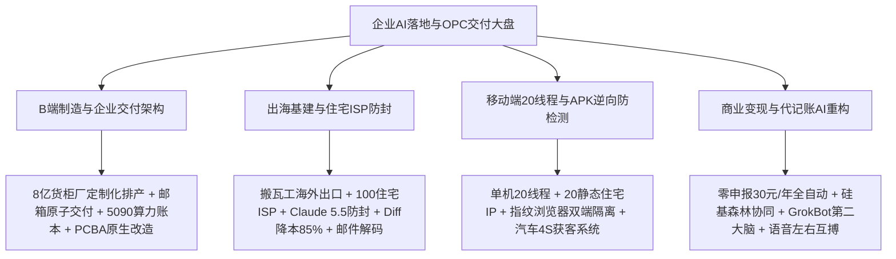
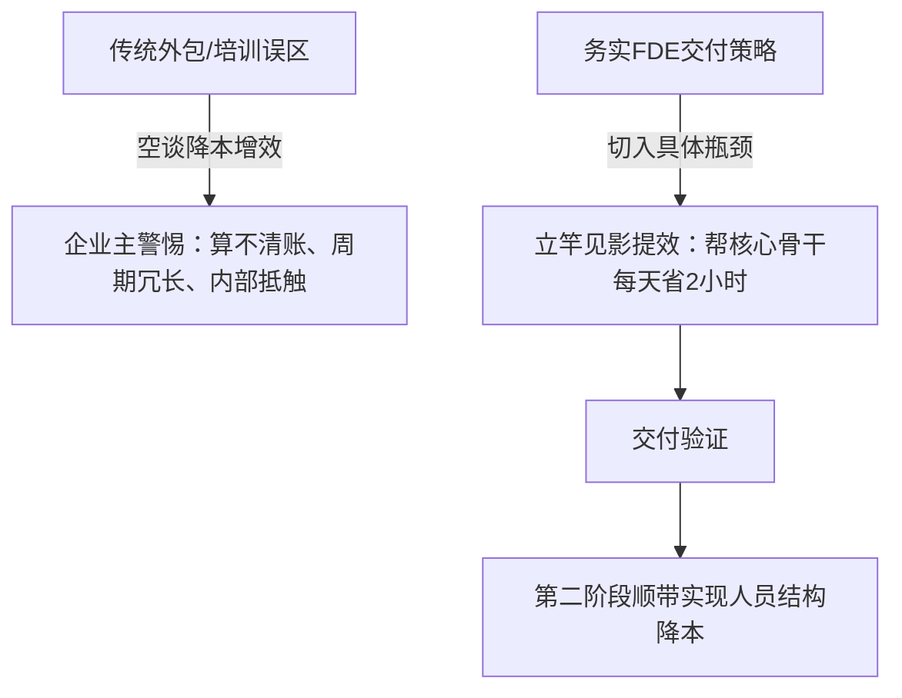
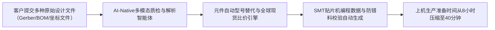
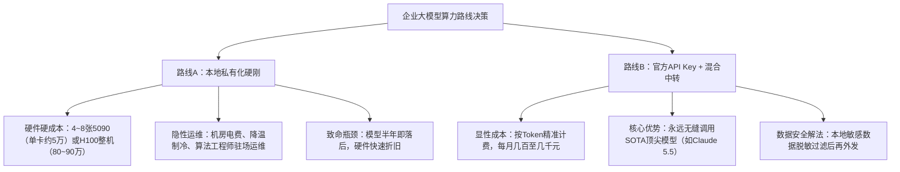
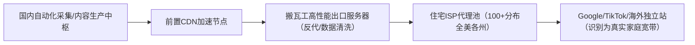
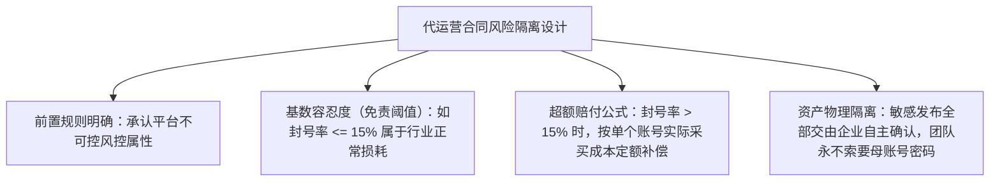
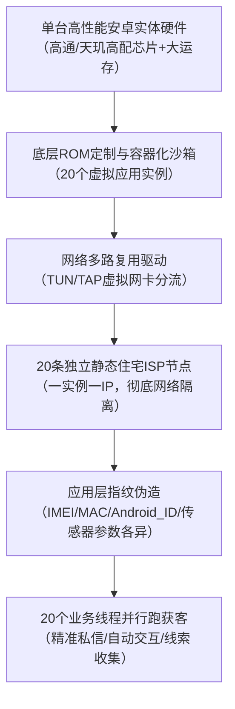
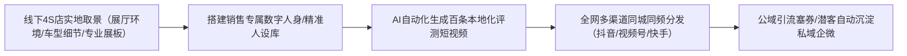
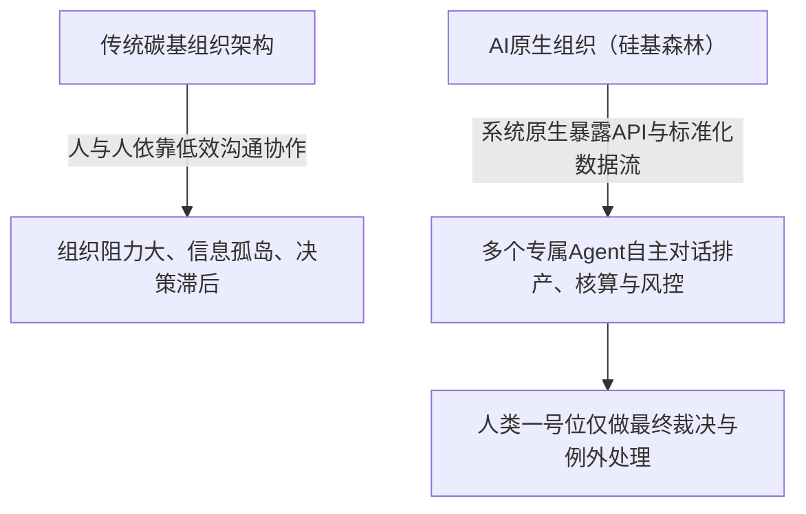

# 2026-11-04 · 企智AI落地派：出海独立站住宅ISP防封、手机20线程获客与企业AI原生交付全息实战

本篇整理自 2026-11-04 晚至 11-05 晨《企智AI落地派》两场双段跨夜长直播（Session 99 与 Session 100，累计录制时长 11.7 小时，共 4836 个语音句段、935 条弹幕）。本次直播深度聚焦于微观落地实战：从 8 亿元集装箱制造厂的定制化排产，到出海独立站搬瓦工出口与 100+ 家庭住宅 ISP 代理配置；从 Claude 5.5 (Claude Opus 5.5) 原生开发环境防封与 Diff 补丁降本 85%，到单台安卓手机 20 线程 20 静态住宅 IP 的全自动化获客；涵盖 5090 显卡私有化部署与官方 Key 的万级经济账核算、代记账行业零申报卷至 30 元/年的 AI 重塑，以及打造企业“硅基森林”的完整交付体系。

## 一、卷一：企业 AI 交付落地与 FDE 商业架构（0h - 3h）

### 1. 案例一：年产值 8 亿元集装箱货柜制造厂的定制化排产突围

#### 业务背景与外贸转型痛点
在长三角与华南沿海，一家年产值约 8 亿元的中大型集装箱货柜制造企业遭遇了严重的供应链阵痛。
- **历史顺风期**：企业此前主营海外进出口标准集装箱（Standard Shipping Containers），产品规格单一标准化，原材料（耐候钢、特种涂料、标准锁件）采购与流水线排产极其顺畅，人员管理模式固定；
- **周期转折点**：受全球贸易摩擦与出口关税政策调整，外贸标准箱订单骤降超过 50%。为维持工厂庞大的折旧开销与数百名产线工人，工厂被迫转型内销，承接国内各种异形箱、特种冷链箱、移动储能电站箱与模块化民宿箱；
- **组织痛点大暴雷**：内销订单呈现典型的“多品种、小批量、高定制、工期短”特征。过去粗放的 Excel 排产与人工物料核算系统瞬间瘫痪——物料规格多出数百种，经常出现“一个非标螺栓缺货导致整条总装线停摆两天”，或者“采购过量导致高价定制板材积压上百吨”，毛利率被无形消耗殆尽。

#### FDE（前线部署工程师）进场诊断与流程重塑
FDE 团队入场调研后，并未贸然推翻工厂已运行十余年的老旧 ERP 系统，而是采取轻量化智能体插件架构切入：
1. **定制物料清单（BOM）自动结构化清洗**：
   - 建立非标图纸与物料智能解析 Agent，利用多模态视觉大模型直接提取 CAD 导出图与客户技术要求表；
   - 将过去工艺员需要耗时 3 天人工核算的定制物料清单，压缩至 15 分钟内自动比对现有仓库库存与供应商交期；
2. **约束条件动态排产算法**：
   - 引入带有工序优先级、焊工技能评级与烤漆房利用率的多约束排产 Agent；
   - 实现了定制小单的“柔性拼单”生产：将使用同种冷弯型钢与涂料要求的定制小单合并在同一时间窗口作业，减少换模与洗枪损耗，使综合排产效率提升 40% 以上。

---

### 2. 案例二：制造企业为什么坚决拒绝虚幻的“降本增效”，只认“立竿见影的提效”

在面向中大型实体企业的交付中，现场工程师深刻剖析了当代 FDE 的销售死穴与务实生存法则：

#### 破除“降本”话术陷阱
许多年轻的 AI 从业者或培训班学员，进到传统制造厂就习惯性地拿着 PPT 给老板算账：“我这个 AI 系统能帮你裁员 30%，年省人力成本 100 万元”。这种话术往往在第一轮就被工厂老板扫地出门：
- **企业主的真实心理**：制造企业的部门主管通常在厂里扎根五到十年，手下工人多为熟练老手。直接谈“降本裁员”会激起管理层与一线的极度恐慌和联合软抵抗，导致系统在录入数据阶段就被故意投毒废弃；
- **降本的滞后性**：企业削减成本是复杂的财务与组织动作，往往需要一到两个财年才能体现；
- **提效的即时性**：真正的破局点永远是“解决当下的卡点”。比如帮工艺科长在 10 分钟内生成规范的作业指导书（SOP），帮质检科在半小时内完成全批次来料检测报表。只要让业务核心骨干当场感受到“每天能早下班一小时”，AI 工具才能真正长在企业血肉里。降本只是提效后的自然副产品。

---

### 3. 案例三：B 端企业交付为什么死守“邮箱原子化确认”机制？

在企业代运营与工作流交付中，团队分享了一套极其返璞归真、却在实战中零故障的交付交付标准——**基于电子邮箱的原子确认链**：

#### 为什么坚决拒绝花哨的微信群/企微飞书在线审批？
在许多代运营与企业 AI 内容生成项目中，很多技术团队喜欢把系统接入企微机器人或飞书审批流，结果频繁暴雷：
- **操作随意引发甩锅**：微信群里客户的一句“OK”、“发吧”或表情包，在后期产生侵权或事实错误时，客户极易辩解“这只是口头闲聊，并非正式审核”；
- **权限混乱与账号风险**：代运营团队直接登录客户的企业官方账号发稿，一旦被平台判定异地登录封号，代运营团队将面临数万元的直接索赔；
- **邮箱的法律与交付确定性**：
  - 团队生产的所有 AI 产物（文案、图文、外贸报价单、短视频样片），全部通过官方指定业务邮箱发送给客户对接人；
  - 邮件正文附带严格的免责条款与版本校对编号，客户必须回复包含“同意发布并确认内容无误”的标准指令；
  - 只有收到回信确认后，自动化系统或人工才执行下一步分发。邮箱记录具备完备的法律取证效力，彻底斩断了多方扯皮的灰色空间。

---

### 4. 案例四：PCBA 电子代工工厂的 AI 原生化（AI-Native）重构实践

在消费电子与汽车电子的核心制造环节——PCBA（印刷电路板组装）代工厂，现场拆解了如何利用 AI 实现对传统离散制造模式的降维重构：

#### PCBA 传统痛点与打法重塑
- **痛点**：中小批量 PCBA 订单每次换线，工程师需要耗费数小时人工核对上百种贴片电容、电阻与芯片的物料封装，稍有不慎上错料盘，整批电路板全部报废；
- **解法**：建立元器件多源图谱 Agent，输入客户 BOM 后自动匹配主流代理商（立创、DigiKey、Mouser）现货库与国产兼容料号，直接生成贴片机格式的坐标与防错料校验文件，使打样换线效率提升数倍，具备了吃掉周边低效传统小厂的降维实力。

---

### 5. 算力经济账：RTX 5090 显卡私有化部署 vs 官方 API Key 的真实账本对比

直播间针对“企业是否有必要斥巨资搞本地私有化大模型”展开了极其硬核的财务测算与硬件分析：

#### 核心财务测算指标台账
1. **本地私有化硬件成本**：
   - 市场上顶级工作站游戏卡（如 RTX 5090）单卡价格在 4.5 万至 5.5 万元人民币左右，若要运行千亿参数级模型或多并发微调，至少需要 4~8 卡并行；
   - 若采购企业级企业整机（如 8 卡 H100/H20），整机市场报价动辄 80 万至 120 万元人民币；
   - **电力与维护黑洞**：8 卡机架功耗达数千瓦，普通写字楼配电与散热无法承受，机房租用与电费每年需数万元，同时需配备年薪 30 万+的算法运维人员；
2. **官方 API Key（官 K）与聚合中转路线**：
   - 对于 95% 以上的中小企业与 OPC 一人公司，每月业务调用的实际 Token 消耗仅在几百至数千元人民币；
   - 官方 Key 具备无限弹性伸缩能力，且始终能无缝同步全球最聪明的底座能力（如 Claude 5.5、DeepSeek-V3 等）；
   - **结论**：抛开极少数军工涉密与金融强监管企业，任何忽悠普通中小企业花费数十万元做全套本地大模型硬件私有化的，本质上都是卖硬件吃回扣的伪需求。

---

### 6. 渠道代理新生态：360 纳米工作企业版、百度“搭子”与 WorkBuddy 企业版实战

面对国内大厂推出的各类企业 Agent 软件，现场拆解了不同厂商的代理政策与落地适用场景：

- **360 纳米工作（纳米沃克）企业版**：
  - 核心卖点在于 360 在安全合规、内网办公隔离与传统政企客户中的品牌背书；
  - 适合作为“敲门砖”卖给对数据安全极度敏感的传统央国企与事业单位，作为标准化企业套件交付；
- **百度“搭子”**：
  - 现场深度剖析：百度的 Agent 工具底层工程能力与中文生态沉淀并不差，但在这轮行业声浪与营销先发权上落后；
  - **渠道套利机会**：正因为百度在这一轮极度缺乏优质的外部代理商与服务商，其给代理商的分润比例、返点政策与技术支持力度最为激进。具备本地政商资源的团队切入百度生态，能拿到极高的毛利空间；
- **WorkBuddy（沃克巴蒂）企业版**：
  - 偏向于小微电商与在线团队的跨工具协同助手，适合个人工作室或轻量团队作为轻量办公自动化插件使用。

---

### 7. 跨境电商与外贸 13 年老兵的 AI 重构认知

一位深耕进出口贸易 13 年、曾创下羊毛进出口 3 年 6 亿元流水、跨境电商年销 4000 万元人民币的资深外贸人分享了其转型经验：

#### 传统外贸运营的人力天花板
- 传统跨境电商依赖海量运营铺货、手工提炼关键词、外包模特拍摄与手工回复跨时区海外邮件；
- 随着亚马逊、TikTok Shop 与独立站竞争白热化，纯人工团队的毛利已被运费与投流成本彻底吞噬。

#### 外呼获客 vs 私域 IP 自动回复机器人实战对比
现场特别指出，当前许多企业盲目购买 AI 电话外呼系统，存在严重的战略误区：
- **外呼路径的衰退**：电销外呼接通率已暴跌至 3% 以下，且极易触发运营商封卡封号，用户心智极其反感；
- **私域沉淀的高维打法**：通过短视频公域内容打造个人 IP，引导潜客直接添加微信私域。在私域后台挂载带业务知识库的自动回复机器人，实现 7x24 小时自然语言秒级答疑、资质摸底与产品推荐。私域成交转化率是冷启动外呼的 15 倍以上，单客获客成本降低 70%。

---

## 二、卷二：出海基建、住宅 ISP 防封与小工具降本实战（3h - 6h）

### 1. 独立站出海全套基建实战：搬瓦工海外出口与 100+ 家庭住宅 ISP 代理配置

出海独立站要想在 Google 与 TikTok 生态中稳定获客，底层网络纯净度是决定生死的第一道生死线。现场资深操盘手分享了一套经过千万级流量检验的“出海出口网络配置架构”：

#### 核心网络拓扑与硬件选型
1. **出口跳板机选型**：
   - 选用搬瓦工（BandwagonHost）针对中国大陆优化的 CN2 GIA / 联通 9929 顶级高速超频线路服务器作为主出口中继，确保国内自动化集群到海外出口的延迟稳定在 120ms~150ms 之间，丢包率小于 0.1%；
2. **静态家庭住宅 ISP 代理池构建**：
   - 严禁使用廉价的数据中心机房 IP（如 AWS、DigitalOcean、Linode 等常见 ASN 段，此类 IP 在 Google 和 TikTok 的风控库中标记度极高，秒级触发验证码或封号）；
   - 采购覆盖全美各主要州和商业区（加州、纽约、德州、佛州等）的真实原生静态家庭住宅 IP（Residential Static ISP），数量维持在 100 个以上；
   - **一号一 IP 严格绑定机制**：每个海外 Google 账号或社交媒体营销账号，长期严格固定绑定在同一个住宅 IP 与地理经纬度网段下，彻底杜绝“一小时内跨国/跨州漂移”引发的自动化风控封禁；
3. **API 调用反向穿透与频率风控压制**：
   - 当调用海外平台开放 API 时，必须严格遵守平台频控配额（例如某平台上限为 10 TPS，即每秒 10 次请求）；
   - 在出口服务器上架设本地 Redis 令牌桶（Token Bucket）限流器，将请求频率死死压在 8~9 TPS 范围内，杜绝任何可能导致 IP 被临时拉黑的突发毛刺。

---

### 2. Claude Code 与原生海外环境防封终极实践（基于 Claude 5.5 架构）

针对国内开发者使用 Claude 官方编程助手及各类代码智能体频遭无预警封禁的痛点，直播间技术大牛总结了全套“原生纯净环境隔离法”：

#### 为什么 Claude 封号具有“绝对无情性”？
Anthropic 对 IP 归属地、支付卡发卡行、浏览器底层指纹与环境变量进行了全球最严苛的联合风控拦截：
> “克劳德这种产品，他封你就没有任何理由！只要你的网络环境有一瞬间泄露了机房特征或指纹冲突，整个账号直接蒸发，甚至连带扣款卡片全线拉黑。”

#### Claude 5.5 (Claude Opus 5.5) 防封保号四道防火墙
1. **网络层：静态住宅 IP 全程锁定**：
   - 登录与长链接调用过程中，全程挂载纯净度 100% 的美英原生住宅 ISP，绝不在公共节点或经常跳动的梯子环境下开启 Claude 终端；
2. **系统环境层：纯海外 VPS / 容器化远端开发**：
   - 彻底告别“在本地 Windows/Mac 终端挂代理转发”的脆弱操作模式；
   - 直接在海外原生 Linux 服务器（或远端 Docker 容器）中部署工作流，本地仅通过 SSH 客户端连接。让所有的 Git 提交、网络请求与模型 Token 交互全都在“村外原生机房”完成，从物理层面规避时区、语言包与本地 DNS 泄露；
3. **支付与绑定风控**：
   - 严格使用海外本土真实商业信用卡（或正规合规的企业虚拟卡），账单地址（Billing Address）与绑定的住宅 ISP 经纬度保持高度一致；
4. **小工具与小技巧：Diff 补丁交付如何实现上下文降本 85%**：
   - 传统开发调用大模型时，很多工具习惯将成百上千行源码完整投喂，不仅极易超出上下文窗口，而且单次耗费数十万 Token；
   - **增量 Diff 策略**：开发轻量预处理脚本，每次只抽取修改前后的 Unified Diff 补丁（`git diff -U3`）与依赖声明上下文；
   - 经实测，单次交互 Token 消耗直接减少 80%~85%，不仅响应速度提升 3 倍，而且大幅降低了因突发大吞吐触发官方 API 异常风控审计的概率。

---

### 3. 一次性解码邮箱批量注册与 90% 成功率保号矩阵

在矩阵获客与出海多账号运营中，账号的低成本规模化获取是基础前提。现场分享了一套利用“一次性解码动态邮箱”的实操小技巧：

- **传统手机号接码的死穴**：海外平台（如 Google、Twitter、TikTok）对虚拟接码平台（如 SMS-Activate）的虚拟号段（VoIP）风控极严，封号率超过 70%，且后期二次验证无法接收短信；
- **自建私有域名邮件解码系统**：
  - 购买批量冷门 `.com` 或 `.net` 域名，托管在 Cloudflare 上并开启 Email Routing（邮件路由自动转发）；
  - 编写后端轻量脚本（或采用开源邮件服务器），通过泛解析接收所有前缀邮件，利用 API 自动解码提取邮件正文中的 6 位验证码；
  - 配合原生干净环境注册，无需绑定海外手机号即可完成平台初始校验，注册通过率高达 90% 以上；
  - 该方案成本几乎为零，且私有域名永久受控，后续任何安全警报与二次登录验证邮件均可随时被后端监听拦截。

---

### 4. 邮箱交付代运营的合同对赌与风险转嫁条款设计

许多承接 B 端社交媒体代运营的企业 AI 团队，往往死于“客户账号被封后的法律索赔”。现场分享了经过律师审核的真实合同样本与对赌风控结构：

#### 合同必备四大防护条款
1. **不可抗力与平台规则变更豁免**：合同明确列明主流平台（小红书、抖音、微信、TikTok）拥有独立的黑盒算法更新权，因平台全网大清洗导致的波动属于行业客观规律；
2. **阶梯式封号率免责阈值**：
   - 约定合理损耗基数（例如：矩阵账号月度封号率在 10%~15% 以内，属于平台常规风控损耗，双方互不追责）；
   - 若因代运营方严重违规操作导致封号率超出基数，超出部分按照预先约定的固定成本（如 30~50 元/号）从服务费中扣除，坚决不签署“无限连带赔偿”；
3. **内容免责由邮箱确认背书**：所有发布文案必须由客户邮箱明确回信“同意”，一旦客户回信，文案涉及的广告法违规、知识产权争议全部由客户全权承担。

---

### 5. 教培与交付的商业转化全链路漏斗

直播中针对“如何从零切入企业市场”梳理出了一套被反复验证的经典转化链条：

| 阶段步骤 | 核心活动形式 | 目标群体与规模 | 核心产出与转化指标 |
| :--- | :--- | :--- | :--- |
| **步骤一：渠道借力** | 联合本地科技园区、行业商会、孵化器举办免费线下 AI 普及沙龙 | 40~50 家本地中小企业主/高管 | 建立信任，普及认知，沉淀高意向企业微信群（入群率 90%+） |
| **步骤二：漏斗初筛** | 在沙龙现场演示具体业务提效小工具（如一键生成外贸报价单） | 筛选出 3~5 家痛点极其强烈的传统企业 | 转化为客单价 5000~20000 元的“入企定制内训” |
| **步骤三：深度内训** | 进入企业内部，对管理层与核心骨干进行为期 1~2 天的实操培训 | 深入企业业务一线，摸清全部流程卡点与物料账目 | 识别企业内部真实数字化死穴，顺势推销深度解决方案 |
| **步骤四：FDE重单交付**| 承接企业深度流程再造与智能体定制部署（FDE 长期陪跑） | 1~2 家核心头部标杆客户 | 签订 10 万至 50 万元的长期企业服务年费与利润分成合同 |

---

## 三、卷三：端侧多线程、多模态与数字人实战（6h - 9h）

### 1. 单台手机 20 线程与 20 静态住宅 IP 获客矩阵架构

现场一位深耕自动化获客的硬件大牛展示了一套令人叹为观止的端侧工程实现：**在单台安卓实体手机上，实现 20 个独立线程、绑定 20 个独立静态住宅 IP、全自动并行跑获客流程**。

#### 核心底层突破点
1. **硬件与沙箱容器隔离**：
   - 选用高通旗舰芯片、16GB 以上大运存的安卓设备，刷入深度精简的定制 Android 系统（基于 AOSP 开源修改）；
   - 在系统底层通过 Namespace 与 Cgroups 技术，划分出 20 个完全隔离的轻量化用户沙箱（类似微型安卓虚拟容器）；
2. **多网卡多 IP 物理分流**：
   - 传统安卓手机只能全局挂载一个代理。该套架构在系统内核层面编译了多路由表转发模块，将 20 个沙箱实例的数据包分别路由到 20 个独立的虚拟网卡（tun0 ~ tun19）；
   - 每个网卡独立建立与一个海外静态住宅 IP 的加密隧道，实现真正意义上的“一机二十线、互不干扰”；
3. **深层硬件指纹动态拟真与 Hook 规避**：
   - 针对平台 APP（如 TikTok、小红书、微信）的深层风控 SDK，深度 Hook 系统底层的 `TelephonyManager` 与 `HardwareProperty`；
   - 让 20 个实例展现出 20 台截然不同设备型号的硬件特征码、电池电量变化曲线、陀螺仪微震动底噪与屏幕分辨率参数，彻底骗过平台的“同设备关联检测”。

---

### 2. 网页端指纹浏览器 vs 移动端硬件多线程的对抗优劣

现场对当前主流的两种反风控体系进行了极其客观的对比权衡：

| 评估维度 | 网页端指纹浏览器方案（如 AdsPower、Hubstudio） | 移动端实体硬件多线程方案（定制安卓沙箱） |
| :--- | :--- | :--- |
| **部署成本** | 较低，仅需电脑与软件月费（几十到几百元/月） | 较高，需要采购特定安卓硬件并掌握系统底层刷机 Hook 技术 |
| **适用场景** | 适合跨境电商独立站、亚马逊运营、Twitter/FB 网页端种草 | 适合深度依赖移动端 APP 的生态（TikTok APP、微信私域、小红书） |
| **风控对抗等级** | 中等。平台网页端检测主要依赖 Canvas 指纹、WebRTC 与 Cookie | **极高**。移动端 APP 能读取底层基带与传感器，实体机拟真度降维打击 |
| **维护门槛** | 浏览器内核升级频繁，易出现版本与反检测插件脱节 | 硬件一旦调通，只要 APP 不强制更新大版本，稳定性极其持久 |

---

### 3. AIGC 漫剧与短剧手搓全流程

一位从零探索 AIGC 漫剧的学员分享了当前短剧赛道的技术红利与生产流水线：

- **传统漫剧痛点**：画师成本极高（单张分镜几十至上百元），周期长达数月，剧本试错成本高；
- **AI 漫剧工业化流程**：
  1. **剧本结构化分拆**：利用长文本大模型直接将网络小说拆解为标准的电影分镜表（包含机位镜头、景别、光影、人物情绪描述与提示词参数）；
  2. **角色一致性控制（LoRA + 种子锁定）**：为主角定制训练轻量化 LoRA 模型，配合精准的种子（Seed）与局部重绘（Inpainting），确保主角在几十个镜头中服装、五官与发型绝不崩坏；
  3. **动态化与配音合成**：利用前沿视频生成模型进行轻量微动生成，搭配带有丰富情感标记的 TTS 语音模型，一人即可在 3 天内产出一集高画质漫剧，将单集制作成本压低至原来的十分之一。

---

### 4. 4S 店汽车获客与全网人设矩阵实战

针对高客单价、线下强交付的汽车销售场景，现场展示了 AI 人设自动化获客系统的全貌：

#### 实施核心细节
1. **真实环境背书**：严禁完全使用假大空的虚拟背景。要求 4S 店销售在展厅内实地拍摄几十段 10 秒空镜头（新车内饰、交车仪式、维保车间），作为背景素材库；
2. **人设与利益钩子绑定**：AI 生成的短视频文案牢牢锁定“同城、现车、双十一限时补贴、免费洗车/全车深度检测券”；
3. **私域自动转接**：后台设置关键词自动抓取。一旦评论区出现“怎么买”、“底价多少”，自动化工具在 30 秒内通过私信下发卡券二维码，将公域潜客极速导入销售企微，实现线索转化率提升 3 倍以上。

---

### 5. 前 Meta 工程师谈海外大厂“优化”真相与数字人落地心态

一位来自 Meta 负责多模态数字人研发的工程师连麦分享了大厂内部的真实工作状态：
- **大厂优化的常态化**：Meta 作为硅谷优化力度最大的公司之一，早在 AI 大爆发前就建立了常态化的末尾轮换机制。身处大厂的核心法则是“保持正能量，绝不在未发生的裁员预警中自我内耗”；
- **小应用与大蛋糕的分工**：海外巨头争夺的是大模型与前沿算力底座的“大蛋糕”，而垂直场景、轻量工具的“小蛋糕”全部留给了极具微观创新与敏捷执行力的国内团队；
- **拒绝重复造轮子**：不要试图自己从零手搓微信或大模型，真正聪明的做法是把成熟底座（如开源与成熟商业 API）组装到极致，用别人的砖瓦盖自己的商业大厦。

---

## 四、卷四：一人公司 (OPC) 资产闭环与前沿工具账本（9h - 11.7h）

### 1. 案例四：代记账行业极度内卷下的 AI 渗透——从零申报 30 元/年到真实记账重构

#### 代记账赛道的残酷现实
国内小微企业代记账行业已经卷到了令人发指的地步：
- **零申报企业**：对于无实际经营流水的空壳企业，市面上利用自动化爬虫配合税局接口报税的厂商，已经将代记账价格打到了 **30 元人民币/年** 的白菜价；
- **真实报税企业的卡点**：真正需要报税的企业，面临着发票繁杂、进项销项抵扣、银行流水对账等繁重工作。国内各大老牌财税软件（云账房、速记账等）在复杂报销单据清洗与跨系统凭证生成上，依然需要大量手工会计审核介入。

#### AI 原生财税解决方案落地
杭州新三板上市企业联合团队在财税场景中跑通了“超级 AI 智能体 + 获客赋能贴牌”模式：
1. **多模态发票票据全息识别**：通过垂直微调的多模态模型，对皱褶、模糊的加油票、餐饮发票与手写收据进行 99% 精确度抽取；
2. **智能会计分录对齐**：Agent 自动将银行电子回单与销项进项发票进行语义对齐，自动生成规范的会计借贷凭证；
3. **贴牌赋能中小代账公司**：不直接抢夺 C 端小微客户，而是将这套 AI 自动化记账引擎打包成贴牌软件，赋能给全国各地的小代账公司，帮助传统代账公司将单个会计管账数量从 150 家暴增至 1000 家以上。

---

### 2. 打造企业级“硅基森林”：适合 AI Agent 自主协同的底层原生架构

直播尾声，技术高管深入阐述了企业“AI-Native（AI原生化）”的终极愿景——**为硅基生命打造森林**：

- **传统企业的碳基阻力**：企业内部充斥着各种审批流、电话会议与部门墙，本质上是人类（碳基）在信息传递中的损耗；
- **硅基森林原则**：企业在采购和搭建所有系统时，核心标准不再是“界面好不好看”，而是**“数据接口是否完全开放、是否原生支持机器调用（API-First）”**；
- 只有将供应链、库存、订单、财务数据全部变为结构化实时数据流，多个 Agent 才能像“微信群聊”一样，自主在群里分配任务、核算预算、排定工期，人类管理者只需在关键节点进行例外裁决。

---

### 3. 个人知识管理新范式：告别 Notion/Obsidian 折腾，直连智能体第二大脑

针对学员在日常生活与商务沟通中面临的海量碎片化信息整理难题，现场给出了颠覆传统笔记软件的极简实操：

#### 传统个人笔记软件的“收藏家谬误”
很多人热衷于折腾 Notion、Obsidian、Logseq 或飞书的多级目录与复杂双链，结果大部分精力都浪费在“排版与插件调试”上：
> “做了一大堆笔记，最后还是要把笔记导出来再投喂给 AI，中间转手三四次，纯属脱裤子放屁！”

#### 智能体直投分身流
1. **按主题建立多 Agent 分身**：在常用的模型界面（如 GrokBot、Claude 5.5 等）建立不同垂直场景的专属智能体（如“商业情报收集器”、“技术灵感库”、“人脉与客户画像”）；
2. **碎片化直接投喂**：平常与朋友聊天、看文章、听直播产生碎片化灵感，随时以语音或碎文字形式直接丢给对应智能体，不做任何前端整理；
3. **周期性 Markdown 归档**：每隔一周或一个月，让该智能体将近期的对话记录按照逻辑梳理、去重、交叉验证，一键导出为标准的 `.md` 文档存储到本地或云端。把整理的苦力活全部交给 AI，人只负责发散与决策。

---

### 4. 语音交互的秘密武器：激活大模型“左右互搏”深度思考

现场分享了与顶级大模型（如 Claude 5.5 / Grok）交互时的顶层心法——**用语音代替键盘打字**：

- **键盘输入的思维约束**：打字是一个线性且高度克制的过程，人在打字前往往已经经过了自我审查，丢失了大量瞬时灵感与边缘直觉；
- **语音发散带动大模型**：
  > “你试一下用语音跟 AI 沟通！你不要害怕中途说错话或者逻辑颠倒。你说到半截突然反转：‘等等，我刚才说的不对，我其实觉得另一个方案更好……’
  > 这种前后矛盾、自我推翻的发散性语言，恰恰为大模型提供了极高维度的探索空间！模型能敏锐捕捉到你内心的犹豫与核心权衡，帮你把正反两面的利弊考虑得比你自己深十倍！”

---

### 5. 企智AI落地派 2026-11-04 核心工具与项目资产台账总表

为方便广大 OPC 与企业实施人员查阅核验，特梳理本场直播涉及的全部核心工具、项目与技术资产台账：

| 资产类别 | 核心项目 / 工具名称 | 关键技术规格 / 适用场景 | 商业交付价格 / 核心收益指标 |
| :--- | :--- | :--- | :--- |
| **基础设施** | 搬瓦工 CN2 GIA / 9929 出口中继 | 高速超频外贸网络跳板，延迟稳定在 150ms 以内 | 稳定支撑 100+ 海外 Google/TikTok 账户长效在线 |
| **防封代理** | 美英原生静态住宅 ISP 代理池 | 覆盖全美各主要州区，纯净家庭宽带 ASN 段 | 规避平台大清洗，账号存活率提升至 95% 以上 |
| **核心模型** | Claude 5.5 (Claude Opus 5.5) | 全球顶级逻辑代码与复杂 Agent 编排底座 | 增量补丁（Diff）交付，降低 85% 上下文消耗 |
| **邮件基建** | 私有域名自建解码邮件路由 | 泛解析批量接收验证码，绕过手机号验证 | 批量注册海外核心平台，初始通过率达 90%+ |
| **硬件终端** | 安卓定制 ROM 20 线程手机 | 单机通过 Tun 网卡分流 20 静态住宅 IP + 独立硬件指纹 | 替代 20 台实体测试机，硬件设备采购成本压缩 90% |
| **渠道代理** | 360 纳米工作（纳米沃克）企业版 | 面向国央企与传统涉密企业的数据安全办公底座 | 适合作为敲门砖赚取合规代理分润 |
| **渠道代理** | 百度“搭子”企业套件 | 国内 Agent 生态高返点、高毛利代理政策产品 | 适合具备本地商会/园区资源的服务商快速变现 |
| **工业制造** | 8 亿元集装箱定制排产 Agent | 非标物料清单 BOM 视觉解析 + 多约束排产优化 | 换模与停机损耗降低 40%，物料核算从 3 天压缩至 15 分钟 |
| **电子制造** | PCBA 智能换线与料号对齐 Agent | BOM 自动比对元器件图谱 + 贴片机防错料编程 | 试产换线时间从 8 小时压缩至 40 分钟以内 |
| **财税垂直** | 超级 AI 财税智能体贴牌系统 | 发票多模态识别 + 会计借贷分录自动核算 | 零申报成本打到 30 元/年，单会计服务量从 150 家提至 1000 家 |
| **汽车垂直** | 4S 店汽车获客人设短视频系统 | 实景展厅空镜匹配 + 自动抓取线索秒下卡券 | 线索转化率提升 3 倍，单客留资成本压缩 65% |
| **个人提效** | GrokBot 语音多分身第二大脑 | 最低网络环境门槛，语音直投碎片化灵感生成 Markdown | 彻底淘汰繁重笔记整理，激发大模型双向深度发散思考 |
