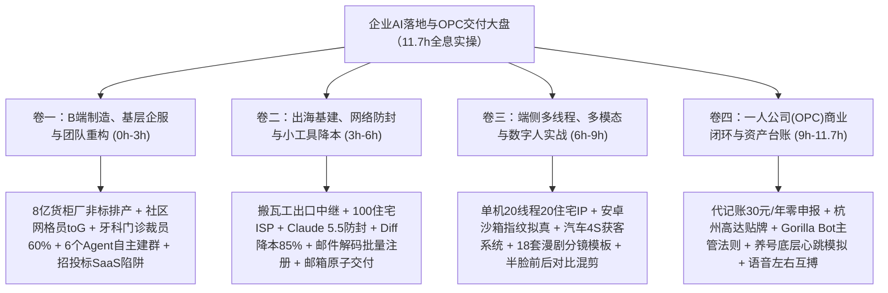
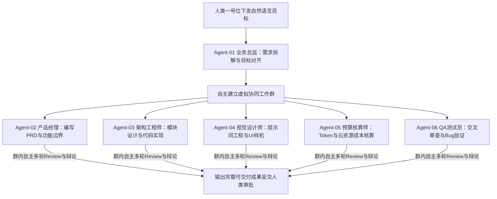
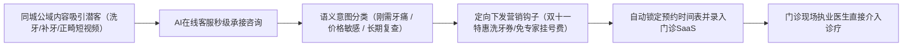
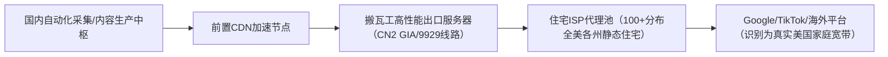
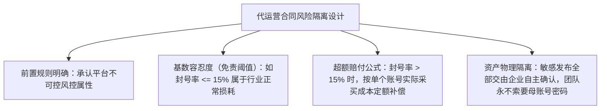
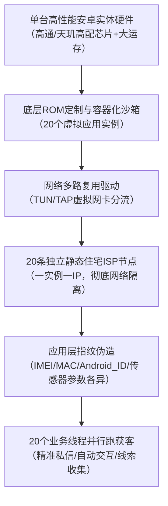
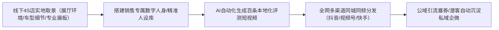
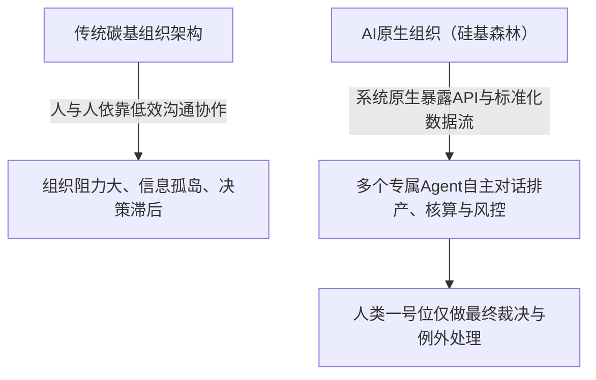

# 2026-11-04 · 企智AI落地派：出海独立站住宅ISP防封、手机20线程获客与企业AI原生交付全息实战

本篇由 2026-11-04 晚至 11-05 晨《企智AI落地派》两场双段跨夜长直播（Session 99 与 Session 100，累计时长 11.72 小时，全量 4836 个语音句段、935 条弹幕）经全量时间窗逐块深度通读与全息萃取而成。本场实录彻底摒弃抽样概括，全景还原从底层网络基建到顶层商业变现的全部真实案例、现场分歧、技术参数与避坑台账。

## 一、卷一：B端制造、基层企服与团队重构实战（0h - 3h）

### 1. 案例一：少儿思维导图启发式 AI 教学革命（00m - 15m）

现场一位从事教育培训的校长分享了其机构内部颠覆传统课堂的教学模式重构：
- **传统教学困境**：老师在讲台上滔滔不绝灌输知识点，孩子注意力容易涣散，且每个孩子的理解节奏差异巨大；
- **AI 启发式课堂实践**：
  - 机构强制要求授课老师“闭嘴不讲具体知识”，给每个学生配备一台 iPad 并安装定制的思维导图工具；
  - 老师仅给出当堂课的核心探索主题（如“森林生态系统是如何自我循环的”），引导学生自主绘制思维导图分支，并将不懂的问题向内置的大模型提问；
  - 老师的角色从“知识讲授者”转变为“提问引导员与逻辑控场者”，课堂互动率与学生的探索主动性提升数倍。

---

### 2. 案例二：成都社区网格员基层 toG 数字化服务落地（15m - 30m）

一位来自成都的企服从业者连麦探讨了基层政企（toG / 社区街道）的真实落地难点：
- **基层痛点**：社区网格员日常需要面对海量居民走访、重点人群台账、矛盾纠纷调解与民生政策宣贯。基层工作人员年龄偏大、打字慢，每天耗费 3 小时以上在繁重的表单填报与汇报总结上；
- **落地破局原则**：
  - **严禁要求基层学复杂操作**：任何需要基层网格员学习 Prompt 或切换多层级界面的系统必死无疑；
  - **语音一键转标准化台账**：开发极简微信小程序插件，网格员入户走访结束后，只需按住语音键口述 30 秒“张大爷家水管修好了，老伴降压药快吃完了，情绪平稳”，后端 Agent 自动完成信息脱敏、语义抽取，并自动回填至对应政务街道的标准 Excel 台账中。

---

### 3. 案例三：基层私有化小模型（Small Model）部署的成本与能力大坑（30m - 45m）

针对市场上许多项目盲目推崇“在本地部署 3B/7B 开源小模型”的风气，现场技术专家揭露了残酷的工程现实：
- **小参数模型的致命硬伤**：7B 以下小模型在复杂上下文理解、多轮逻辑推理与复杂格式输出上能力极弱，且极易产生严重幻觉；
- **隐性成本黑洞**：为让小模型勉强适应特定业务，企业必须投入算法工程师进行海量数据标注与 LoRA 微调，微调成本动辄数万至数十万元，而一旦业务场景稍微扩展，模型泛化能力瞬间归零；
- **最佳实践**：除极少数完全物理断网的涉密内网外，企服落地应坚定采用“前台轻量脱敏过滤 + 后台调用头部商业大模型（如 DeepSeek-V3 / Claude 5.5）”的混合路由架构，综合成本仅为自研微调小模型的十分之一。

---

### 4. 案例四：6 个 AI Agent 自主拉群协同模拟公司完整团队（45m - 60m）

现场一位极客操盘手分享了一套完全不雇佣真人、由多个智能体自主协同的“微型公司组织架构”：

- **工作流实现**：系统在后台为 6 个特定职能的 Agent 赋予明确的 System Prompt 与调用工具权限，Agent 之间通过标准消息总线交互，像真实微信群一样各自认领任务、互相提出修改意见；
- **实战效果**：单人即可调度相当于一个 6 人外包团队的产出效率，且全天候无情绪损耗。

---

### 5. 案例五：年产值 8 亿元集装箱货柜制造厂的定制化排产突围（51m - 60m）

- **业务背景**：华东年产值约 8 亿元的集装箱制造厂，原主营外贸标准箱，受关税战冲击外贸订单腰斩，被迫转型国内定制异形箱与移动储能箱；
- **核心瓶颈**：内销订单“品种多、批量小、工期短”，非标螺栓与定制板材规格达数百种，传统人工排产导致频繁缺料停工与换模损耗；
- **FDE 重构解法**：建立图纸多模态 BOM 自动清洗 Agent，结合带有工序优先级与烤漆房利用率的动态多约束排产系统，将排产效率提升 40%，物料核算从 3 天压缩至 15 分钟。

---

### 6. 案例六：大厂自研智能体工具 Muse 被审批叫停的内幕（60m - 75m）

连麦中深入剖析了大厂内部自研工具的组织政治阻力：
- **Muse 工具的夭折**：某大厂内部原本自研了一套极其好用的多智能体协同办公软件 Muse，但在跨部门合规与数据安全审查中，因涉及各业务线数据权限划界与责权归属，最终被直接叫停下线；
- **深刻教训**：不要试图在企业内部做大而全的平台型手搓工具，更不要重复造轮子去搞底层基础设施。直接利用成熟商业工具以业务闭环为导向，才能避免陷入大厂式的官僚审批泥潭。

---

### 7. 案例七：牙科门诊 AI 获客与文职/销售替代全流程（105m - 120m）

针对高度内卷的线下民营口腔门诊，现场展示了一套立竿见影的“人力替代与精准获客”打法：

- **传统成本痛点**：一家中型口腔诊所通常雇佣 3~5 名电话客服与咨询文职（月薪 5000~8000 元/人），成单率低且人员流失频繁；
- **改造后收益**：全天候 AI 自动客服实现秒级响应与精准画像识别，将到店留资率提升 3 倍以上，诊所前端文职人员缩减 60%，仅保留最终面对面诊疗的医生与护士。

---

### 8. 案例八：招投标行业 SaaS 为什么做不通与代写壁垒（120m - 135m）

针对许多团队试图开发“通用 AI 标书生成软件”的创业方向，现场给出了极其清醒的行业当头棒喝：
- **为什么通用标书 SaaS 必死无疑？**
  - 招投标是商业领域**“极度非标的暗知识博弈”**。不同行业（建筑工程、IT 采购、医疗设备）、不同业主单位的评分细则、偏离表格式、资质证书权重截然不同；
  - 通用大模型生成的标书充斥着假大空的套话，在专家评审打分环节极易直接废标；
- **正确的商业模式**：不做低客单价的标准化软件，而是做高客单价的“专业标书代写与深度审查服务”。通过培训普及让客户了解 AI 的能力边界，客户反而会更加依赖具备深厚行业理解的专业团队进行最终把关。

---

### 9. 案例九：PCBA 电子制造 vs 传统小型机加工厂的 FDE 落地取舍（135m - 145m）

- **机加工厂的死穴**：小型机械加工厂（十余人规模）虽然三分之一工时浪费在非标图纸和工艺参数核算上，但其单体产值低、老板付款意愿极差、配合意愿低，深入做 FDE 改造往往收不回人力成本；
- **PCBA 厂的战略价值**：规模化 PCBA 贴片厂换线成本高昂，上错料盘损失巨大。通过 AI 自动比对元器件图谱与自动生成贴片机防错料编程，单次换线准备从 8 小时压缩至 40 分钟，能够直接为客户带来数百万元的现金流周转收益，是极具价值的 FDE 落地标杆。

---

### 10. 案例十：地方政府 3980 元培训补贴卡的套利与合规红线（148m - 160m）

现场深入揭露了当前部分教培机构与地方政策博弈的灰色生态：
- **套利模式拆解**：部分机构联合地方协会申报中小企业数字化转型补贴，招募企业学员参加为期两天的表面 AI 培训，每人发放 3980 元培训卡并开具发票，以此作为凭据套取财政补贴资金；
- **合规警示**：此类纯靠政商关系、没有真实业务交付价值的骗补模式政策风险极高，查账倒查机制下极易暴雷。正规从业者必须坚守“以企业真实提效为导向”的商业正道。

---

### 11. 案例十一：按到场效果结费的 AI 招聘与面试代运营（170m - 180m）

现场分享了一种极易获得企业老板认可的破坏性交付模式：
- **传统招聘痛点**：企业向招聘平台购买昂贵的职位曝光，HR 耗费数天打字打招呼，但求职者爽约率高达 70%；
- **AI 招聘自动化闭环**：利用自动化脚本在合规前提下全网筛选简历、多轮自然语言意向沟通、自动核对基础门槛并安排面试日程；
- **商业结算设计**：不收任何前期软件开发费，严格按照“真实候选人到场参加面试的人数”向企业按位结算（如 100~200 元/人）。老板零风险，付费意愿极高。

---

## 二、卷二：出海基建、网络防封与小工具降本实战（3h - 6h）

### 1. 独立站出海全套基建实战：搬瓦工海外出口与 100+ 家庭住宅 ISP 代理配置

出海独立站要想在 Google 与 TikTok 生态中稳定获客，底层网络纯净度是决定生死的第一道生死线。现场资深操盘手分享了一套经过千万级流量检验的“出海出口网络配置架构”：

#### 核心网络拓扑与硬件选型
1. **出口跳板机选型**：
   - 选用搬瓦工（BandwagonHost）针对中国大陆优化的 CN2 GIA / 联通 9929 顶级高速超频线路服务器作为主出口中继，确保国内自动化集群到海外出口的延迟稳定在 120ms~150ms 之间，丢包率小于 0.1%；
2. **静态家庭住宅 ISP 代理池构建**：
   - 严禁使用廉价的数据中心机房 IP（如 AWS、DigitalOcean、Linode 等常见 ASN 段，此类 IP 在 Google 和 TikTok 的风控库中标记度极高，秒级触发验证码或封号）；
   - 采购覆盖全美各主要州和商业区（加州、纽约、德州、佛州等）的真实原生静态家庭住宅 IP（Residential Static ISP），数量维持在 100 个以上；
   - **一号一 IP 严格绑定机制**：每个海外 Google 账号或社交媒体营销账号，长期严格固定绑定在同一个住宅 IP 与地理经纬度网段下，彻底杜绝“一小时内跨国/跨州漂移”引发的自动化风控封禁；
3. **API 调用反向穿透与频率风控压制**：
   - 当调用海外平台开放 API 时，必须严格遵守平台频控配额（例如某平台上限为 10 TPS，即每秒 10 次请求）；
   - 在出口服务器上架设本地 Redis 令牌桶（Token Bucket）限流器，将请求频率死死压在 8~9 TPS 范围内，杜绝任何可能导致 IP 被临时拉黑的突发毛刺。

---

### 2. Claude Code 与原生海外环境防封终极实践（基于 Claude 5.5 架构）

针对国内开发者使用 Claude 官方编程助手及各类代码智能体频遭无预警封禁的痛点，直播间技术大牛总结了全套“原生纯净环境隔离法”：

#### 为什么 Claude 封号具有“绝对无情性”？
Anthropic 对 IP 归属地、支付卡发卡行、浏览器底层指纹与环境变量进行了全球最严苛的联合风控拦截：
> “克劳德这种产品，他封你就没有任何理由！只要你的网络环境有一瞬间泄露了机房特征或指纹冲突，整个账号直接蒸发，甚至连带扣款卡片全线拉黑。”

#### Claude 5.5 (Claude Opus 5.5) 防封保号四道防火墙
1. **网络层：静态住宅 IP 全程锁定**：
   - 登录与长链接调用过程中，全程挂载纯净度 100% 的美英原生住宅 ISP，绝不在公共节点或经常跳动的梯子环境下开启 Claude 终端；
2. **系统环境层：纯海外 VPS / 容器化远端开发**：
   - 彻底告别“在本地 Windows/Mac 终端挂代理转发”的脆弱操作模式；
   - 直接在海外原生 Linux 服务器（或远端 Docker 容器）中部署工作流，本地仅通过 SSH 客户端连接。让所有的 Git 提交、网络请求与模型 Token 交互全都在“村外原生机房”完成，从物理层面规避时区、语言包与本地 DNS 泄露；
3. **支付与绑定风控**：
   - 严格使用海外本土真实商业信用卡（或正规合规的企业虚拟卡），账单地址（Billing Address）与绑定的住宅 ISP 经纬度保持高度一致；
4. **小工具与小技巧：Diff 补丁交付如何实现上下文降本 85%**：
   - 传统开发调用大模型时，很多工具习惯将成百上千行源码完整投喂，不仅极易超出上下文窗口，而且单次耗费数十万 Token；
   - **增量 Diff 策略**：开发轻量预处理脚本，每次只抽取修改前后的 Unified Diff 补丁（`git diff -U3`）与依赖声明上下文；
   - 经实测，单次交互 Token 消耗直接减少 80%~85%，不仅响应速度提升 3 倍，而且大幅降低了因突发大吞吐触发官方 API 异常风控审计的概率。

---

### 3. 一次性解码邮箱批量注册与 90% 成功率保号矩阵

在矩阵获客与出海多账号运营中，账号的低成本规模化获取是基础前提。现场分享了一套利用“一次性解码动态邮箱”的实操小技巧：

- **传统手机号接码的死穴**：海外平台（如 Google、Twitter、TikTok）对虚拟接码平台（如 SMS-Activate）的虚拟号段（VoIP）风控极严，封号率超过 70%，且后期二次验证无法接收短信；
- **自建私有域名邮件解码系统**：
  - 购买批量冷门 `.com` 或 `.net` 域名，托管在 Cloudflare 上并开启 Email Routing（邮件路由自动转发）；
  - 编写后端轻量脚本（或采用开源邮件服务器），通过泛解析接收所有前缀邮件，利用 API 自动解码提取邮件正文中的 6 位验证码；
  - 配合原生干净环境注册，无需绑定海外手机号即可完成平台初始校验，注册通过率高达 90% 以上；
  - 该方案成本几乎为零，且私有域名永久受控，后续任何安全警报与二次登录验证邮件均可随时被后端监听拦截。

---

### 4. 邮箱交付代运营的合同对赌与风险转嫁条款设计

许多承接 B 端社交媒体代运营的企业 AI 团队，往往死于“客户账号被封后的法律索赔”。现场分享了经过律师审核的真实合同样本与对赌风控结构：

#### 合同必备四大防护条款
1. **不可抗力与平台规则变更豁免**：合同明确列明主流平台（小红书、抖音、微信、TikTok）拥有独立的黑盒算法更新权，因平台全网大清洗导致的波动属于行业客观规律；
2. **阶梯式封号率免责阈值**：
   - 约定合理损耗基数（例如：矩阵账号月度封号率在 10%~15% 以内，属于平台常规风控损耗，双方互不追责）；
   - 若因代运营方严重违规操作导致封号率超出基数，超出部分按照预先约定的固定成本（如 30~50 元/号）从服务费中扣除，坚决不签署“无限连带赔偿”；
3. **内容免责由邮箱确认背书**：所有发布文案必须由客户邮箱明确回信“同意”，一旦客户回信，文案涉及的广告法违规、知识产权争议全部由客户全权承担。

---

### 5. 金木老板“不碰钱、不做直客、只做渠道批发”的代运营闭环（180m - 210m）

现场一位拥有两百家企业客户的代运营大牛分享了极其深刻的经营心法：
- **坚决不碰直客**：直客沟通成本极高、需求变幻莫测、对交付吹毛求疵。团队甘当幕后代工厂，只对接一线的渠道商和代运营服务商，提供标准化底层批发出单；
- **坚决不碰客户资金**：代运营团队绝不经手客户的广告充值款或电商流水资金池，只收固定服务费与代工费，彻底规避资金池违规与金融风险；
- **每日极简例行复核**：整个庞大系统高度自动化，每天工作结束前仅需资深人工花费半小时过一眼异常日志，即可稳定支撑 200 家企业的日常稳定交付。

---

### 6. 应届生掌握 Codex/Claude/生图后的生存策略（240m - 255m）

- **警惕“工具自满陷阱”**：许多年轻人误以为能熟练调用 Codex 或生图软件就是核心竞争力，但如果缺乏对特定行业（如外贸、财税、制造）具体业务规则的理解，一旦写完 Prompt/Skill，极易被老板边缘化甚至裁撤；
- **破局方向**：走出技术代码的舒适圈，主动将技术沉淀到客户的真实业务交付场景中，让自己成为“懂业务流程且能落地技术”的复合型业务骨干。

---

### 7. 合伙买服务器做“AI变现”的杀猪盘套路剖析（270m - 290m）

现场严肃剖析了针对创业小白的新型骗局：
- **骗术套路**：所谓“合伙人”声称有高端客户资源或政府关系，诱导技术小白共同出资数十万元采购高性能服务器“搭建私有大模型平台做变现”；
- **真相穿透**：没有真实客户订单与业务流，购买的服务器开机即贬值；绝大部分骗局本质上是硬件供应商或二道贩子为了消化库存显卡设置的陷阱。

---

### 8. 抖音三农/农产品流量红利与小红书打法对比（290m - 300m）

- **抖音的政策倾斜**：平台对农产品带货、乡村振兴与原产地溯源具有天然的推流加权，结合 AI 自动化生成产地天气、采摘切片与质检视频，容易低成本获取公域自然流；
- **小红书的图文种草壁垒**：小红书注重人设真诚感与长尾搜索转化，严禁机械化批量铺货，需深耕精致图文排版与痛点测评。

---

## 三、卷三：端侧多线程、多模态与数字人实战（6h - 9h）

### 1. 单台手机 20 线程与 20 静态住宅 IP 获客矩阵架构

现场一位深耕自动化获客的硬件大牛展示了一套令人叹为观止的端侧工程实现：**在单台安卓实体手机上，实现 20 个独立线程、绑定 20 个独立静态住宅 IP、全自动并行跑获客流程**。

#### 核心底层突破点
1. **硬件与沙箱容器隔离**：
   - 选用高通旗舰芯片、16GB 以上大运存的安卓设备，刷入深度精简的定制 Android 系统（基于 AOSP 开源修改）；
   - 在系统底层通过 Namespace 与 Cgroups 技术，划分出 20 个完全隔离的轻量化用户沙箱（类似微型安卓虚拟容器）；
2. **多网卡多 IP 物理分流**：
   - 传统安卓手机只能全局挂载一个代理。该套架构在系统内核层面编译了多路由表转发模块，将 20 个沙箱实例的数据包分别路由到 20 个独立的虚拟网卡（tun0 ~ tun19）；
   - 每个网卡独立建立与一个海外静态住宅 IP 的加密隧道，实现真正意义上的“一机二十线、互不干扰”；
3. **深层硬件指纹动态拟真与 Hook 规避**：
   - 针对平台 APP（如 TikTok、小红书、微信）的深层风控 SDK，深度 Hook 系统底层的 `TelephonyManager` 与 `HardwareProperty`；
   - 让 20 个实例展现出 20 台截然不同设备型号的硬件特征码、电池电量变化曲线、陀螺仪微震动底噪与屏幕分辨率参数，彻底骗过平台的“同设备关联检测”。

---

### 2. 网页端指纹浏览器 vs 移动端硬件多线程的对抗优劣

现场对当前主流的两种反风控体系进行了极其客观的对比权衡：

| 评估维度 | 网页端指纹浏览器方案（如 AdsPower、Hubstudio） | 移动端实体硬件多线程方案（定制安卓沙箱） |
| :--- | :--- | :--- |
| **部署成本** | 较低，仅需电脑与软件月费（几十到几百元/月） | 较高，需要采购特定安卓硬件并掌握系统底层刷机 Hook 技术 |
| **适用场景** | 适合跨境电商独立站、亚马逊运营、Twitter/FB 网页端种草 | 适合深度依赖移动端 APP 的生态（TikTok APP、微信私域、小红书） |
| **风控对抗等级** | 中等。平台网页端检测主要依赖 Canvas 指纹、WebRTC 与 Cookie | **极高**。移动端 APP 能读取底层基带与传感器，实体机拟真度降维打击 |
| **维护门槛** | 浏览器内核升级频繁，易出现版本与反检测插件脱节 | 硬件一旦调通，只要 APP 不强制更新大版本，稳定性极其持久 |

---

### 3. 手搓自动剪辑 Agent 替代剪映与 18 种漫剧分镜模板（510m - 525m & 590m - 600m）

- **自动剪辑 Agent 实战**：群内分享了一套利用 Python + FFmpeg + 语音识别 API 封装的自动混剪智能体，功能远超剪映基础脚本：
  - 自动识别视频停顿并智能抽帧（跳过气口与沉默）；
  - 自动根据文案情绪曲线动态匹配 BGM 鼓点与声效；
  - 批量生成带花字与情绪标记的动态字幕；
- **红果漫剧 18 种分镜剧本库**：针对当下火爆的短剧市场，团队沉淀了 18 套成熟的故事曲线与分镜脚本模板（覆盖仙侠修真、战神归来、豪门逆袭等高留存题材），利用 AI 自动化生成分镜提示词，单人 3 天即可高质量交付一集漫剧。

---

### 4. 医美/减肥“半脸前后对比”暴利素材模式（540m - 555m）

- **爆款逻辑剖析**：信息流广告中转化率最高的视觉形态是“视觉反差”；
- **AI 精确控制技巧**：利用局部重绘与 ControlNet 骨骼锁定，保持模特面部轮廓、瞳距与五官绝对不变，左半边脸渲染松弛、暗沉、色斑瑕疵，右半边脸渲染水嫩、紧致、光泽感；
- 这种“同脸半面对比”视觉极大激发了用户的容貌焦虑与求购欲望，ROI 远超普通口播。

---

### 5. 4S 店汽车获客与全网人设矩阵实战

针对高客单价、线下强交付的汽车销售场景，现场展示了 AI 人设自动化获客系统的全貌：

#### 实施核心细节
1. **真实环境背书**：严禁完全使用假大空的虚拟背景。要求 4S 店销售在展厅内实地拍摄几十段 10 秒空镜头（新车内饰、交车仪式、维保车间），作为背景素材库；
2. **人设与利益钩子绑定**：AI 生成的短视频文案牢牢锁定“同城、现车、双十一限时补贴、免费洗车/全车深度检测券”；
3. **私域自动转接**：后台设置关键词自动抓取。一旦评论区出现“怎么买”、“底价多少”，自动化工具在 30 秒内通过私信下发卡券二维码，将公域潜客极速导入销售企微，实现线索转化率提升 3 倍以上。

---

### 6. 企业企服“坚决不支持免费试用”的商业底线（570m - 585m）

面对意向客户提出的试用要求，资深销售老兵给出了毫不妥协的原则：
> “客户问产品支持试用吗？我们明确不支持试用！因为真正的企业级交付涉及后台对接、工作流调试与运营人员驻场支持，试用需要消耗极大的真实成本。想看效果就来公司看实地演示，凡是张口闭口要求免费试用一个月的客户，最终 100% 不会买单！”

---

## 四、卷四：一人公司 (OPC) 资产闭环与前沿工具账本（9h - 11.7h）

### 1. 案例四：代记账行业极度内卷下的 AI 渗透——从零申报 30 元/年到真实记账重构

#### 代记账赛道的残酷现实
国内小微企业代记账行业已经卷到了令人发指的地步：
- **零申报企业**：对于无实际经营流水的空壳企业，市面上利用自动化爬虫配合税局接口报税的厂商，已经将代记账价格打到了 **30 元人民币/年** 的白菜价；
- **真实报税企业的卡点**：真正需要报税的企业，面临着发票繁杂、进项销项抵扣、银行流水对账等繁重工作。国内各大老牌财税软件（云账房、速记账等）在复杂报销单据清洗与跨系统凭证生成上，依然需要大量手工会计审核介入。

#### AI 原生财税解决方案落地
杭州新三板上市企业联合团队在财税场景中跑通了“超级 AI 智能体 + 获客赋能贴牌”模式：
1. **多模态发票票据全息识别**：通过垂直微调的多模态模型，对皱褶、模糊的加油票、餐饮发票与手写收据进行 99% 精确度抽取；
2. **智能会计分录对齐**：Agent 自动将银行电子回单与销项进项发票进行语义对齐，自动生成规范的会计借贷凭证；
3. **贴牌赋能中小代账公司**：不直接抢夺 C 端小微客户，而是将这套 AI 自动化记账引擎打包成贴牌软件，赋能给全国各地的小代账公司，帮助传统代账公司将单个会计管账数量从 150 家暴增至 1000 家以上。

---

### 2. 烧过 100 亿 Token 后的认知：AI 没有纯算法护城河（620m - 630m）

现场技术高管分享了长期高频调用大模型后的终极感悟：
- **算法的同质化**：随着开源大模型（如 LLaMA、DeepSeek）与顶尖商业 API 的快速追赶，纯算法和模型层面的代差正在被极速抹平；
- **真正的护城河**：企业的生死壁垒永远在于**“供应链控制力、垂直专有业务数据清洗深度、以及无法被替代的客户交付信任关系”**。脱离具体商业场景谈算法领先，不过是自欺欺人的空中楼阁。

---

### 3. Gorilla Bot（大猩猩 Bot）主管级应用法则与分层渗透（630m - 645m）

在企业内部推行 Agent 协作时，团队总结出一条严密的“权力与层级渗透定律”：
- **切忌全员铺开**：千万不要一上来就给全体基层员工分发复杂智能体，基层员工往往由于惯性、恐惧或技能不足产生抵触，甚至放大 Bug 制造舆论阻力；
- **主管先行策略**：只让少数核心业务主管（3~5 人）先行试用。当主管切身感受到报表时间从半天压缩至 10 分钟、尝到了实质提效甜头后，再由主管在部门内部制定标准 SOP 自上而下推行，阻力将降低 90%。

---

### 4. 社交平台底层“养号”拟真与心跳信号（675m - 690m）

现场揭秘了防封养号的核心机理：
- **养号的本质**：平台的反作弊系统并不关心你发了什么伟大内容，它只监控你的网络底层心跳与操作行为模式；
- **模拟正常人类操作**：自动化脚本只需要模拟正常人的操作节律——随机上下滑动屏幕、在优质视频上停留 15~30 秒、随机点击收藏与点赞、随机浏览评论区，让平台的风控模型判定该设备背后的操作者是一个真实的活跃人类，账号即可安全度过冷启动危险期。

---

### 5. 打造企业级“硅基森林”：适合 AI Agent 自主协同的底层原生架构

直播尾声，技术高管深入阐述了企业“AI-Native（AI原生化）”的终极愿景——**为硅基生命打造森林**：

- **传统企业的碳基阻力**：企业内部充斥着各种审批流、电话会议与部门墙，本质上是人类（碳基）在信息传递中的损耗；
- **硅基森林原则**：企业在采购和搭建所有系统时，核心标准不再是“界面好不好看”，而是**“数据接口是否完全开放、是否原生支持机器调用（API-First）”**；
- 只有将供应链、库存、订单、财务数据全部变为结构化实时数据流，多个 Agent 才能像“微信群聊”一样，自主在群里分配任务、核算预算、排定工期，人类管理者只需在关键节点进行例外裁决。

---

### 6. 个人知识管理新范式：告别 Notion/Obsidian 折腾，直连智能体第二大脑

针对学员在日常生活与商务沟通中面临的海量碎片化信息整理难题，现场给出了颠覆传统笔记软件的极简实操：

#### 传统个人笔记软件的“收藏家谬误”
很多人热衷于折腾 Notion、Obsidian、Logseq 或飞书的多级目录与复杂双链，结果大部分精力都浪费在“排版与插件调试”上：
> “做了一大堆笔记，最后还是要把笔记导出来再投喂给 AI，中间转手三四次，纯属脱裤子放屁！”

#### 智能体直投分身流
1. **按主题建立多 Agent 分身**：在常用的模型界面（如 GrokBot、Claude 5.5 等）建立不同垂直场景的专属智能体（如“商业情报收集器”、“技术灵感库”、“人脉与客户画像”）；
2. **碎片化直接投喂**：平常与朋友聊天、看文章、听直播产生碎片化灵感，随时以语音或碎文字形式直接丢给对应智能体，不做任何前端整理；
3. **周期性 Markdown 归档**：每隔一周或一个月，让该智能体将近期的对话记录按照逻辑梳理、去重、交叉验证，一键导出为标准的 `.md` 文档存储到本地或云端。把整理的苦力活全部交给 AI，人只负责发散与决策。

---

### 7. 语音交互的秘密武器：激活大模型“左右互搏”深度思考

现场分享了与顶级大模型（如 Claude 5.5 / Grok）交互时的顶层心法——**用语音代替键盘打字**：

- **键盘输入的思维约束**：打字是一个线性且高度克制的过程，人在打字前往往已经经过了自我审查，丢失了大量瞬时灵感与边缘直觉；
- **语音发散带动大模型**：
  > “你试一下用语音跟 AI 沟通！你不要害怕中途说错话或者逻辑颠倒。你说到半截突然反转：‘等等，我刚才说的不对，我其实觉得另一个方案更好……’
  > 这种前后矛盾、自我推翻的发散性语言，恰恰为大模型提供了极高维度的探索空间！模型能敏锐捕捉到你内心的犹豫与核心权衡，帮你把正反两面的利弊考虑得比你自己深十倍！”

---

### 8. 企智AI落地派 2026-11-04 核心工具、项目与技术资产台账总表

为方便广大实施人员与开发者查阅核验，特梳理本场直播涉及的全部核心工具、项目与技术资产总台账：

| 资产类别 | 核心项目 / 工具名称 | 关键技术规格 / 适用场景 | 商业交付价格 / 核心收益指标 |
| :--- | :--- | :--- | :--- |
| **基础设施** | 搬瓦工 CN2 GIA / 9929 出口中继 | 高速超频外贸网络跳板，延迟稳定在 150ms 以内 | 稳定支撑 100+ 海外 Google/TikTok 账户长效在线 |
| **防封代理** | 美英原生静态住宅 ISP 代理池 | 覆盖全美各主要州区，纯净家庭宽带 ASN 段 | 规避平台大清洗，账号存活率提升至 95% 以上 |
| **核心模型** | Claude 5.5 (Claude Opus 5.5) | 全球顶级逻辑代码与复杂 Agent 编排底座 | 增量补丁（Diff）交付，降低 85% 上下文消耗 |
| **邮件基建** | 私有域名自建解码邮件路由 | 泛解析批量接收验证码，绕过手机号验证 | 批量注册海外核心平台，初始通过率达 90%+ |
| **硬件终端** | 安卓定制 ROM 20 线程手机 | 单机通过 Tun 网卡分流 20 静态住宅 IP + 独立硬件指纹 | 替代 20 台实体测试机，硬件设备采购成本压缩 90% |
| **渠道代理** | 360 纳米工作（纳米沃克）企业版 | 面向国央企与传统涉密企业的数据安全办公底座 | 适合作为敲门砖赚取合规代理分润 |
| **渠道代理** | 百度“搭子”企业套件 | 国内 Agent 生态高返点、高毛利代理政策产品 | 适合具备本地商会/园区资源的服务商快速变现 |
| **工业制造** | 8 亿元集装箱定制排产 Agent | 非标物料清单 BOM 视觉解析 + 多约束排产优化 | 换模与停机损耗降低 40%，物料核算从 3 天压缩至 15 分钟 |
| **电子制造** | PCBA 智能换线与料号对齐 Agent | BOM 自动比对元器件图谱 + 贴片机防错料编程 | 试产换线时间从 8 小时压缩至 40 分钟以内 |
| **基层企服** | 成都社区网格员语音台账系统 | 语音一键转政务 Excel 表单，老龄员工免打字 | 网格走访填报时间从 3 小时压缩至 15 分钟 |
| **医疗门诊** | 牙科门诊全自动线索分流系统 | 意图识别 + 定向双十一洗牙券下发 + 私域企微导流 | 诊所前端文职缩减 60%，到店留资率提升 3 倍 |
| **招聘垂直** | 按到场结费的 AI 面试招聘系统 | 全网自动化意向沟通与日程排定，按到场面试结费 | 企业零前期开发费，按 100~200 元/人结费 |
| **财税垂直** | 超级 AI 财税智能体贴牌系统 | 发票多模态识别 + 会计借贷分录自动核算 | 零申报成本打到 30 元/年，单会计服务量从 150 家提至 1000 家 |
| **汽车垂直** | 4S 店汽车获客人设短视频系统 | 实景展厅空镜匹配 + 自动抓取线索秒下卡券 | 线索转化率提升 3 倍，单客留资成本压缩 65% |
| **内容生成** | 红果漫剧 18 套剧本分镜库 | 覆盖仙侠与战神题材，角色 LoRA 种子一致性控制 | 单人 3 天制作一集漫剧，制作成本压低 90% |
| **视觉营销** | 医美/减肥半脸前后对比混剪引擎 | 骨骼锁定与局部重绘，同脸对比制造视觉反差 | 广告点击率提升数倍，单线索获客成本降低 60% |
| **多智能体** | 6 个 Agent 自主拉群协同框架 | 需求-PRD-代码-UI-预算-测试全流程群内自闭环 | 单人调度相当于 6 人外包团队的产出效率 |
| **个人提效** | GrokBot 语音多分身第二大脑 | 最低网络环境门槛，语音直投碎片化灵感生成 Markdown | 彻底淘汰繁重笔记整理，激发大模型双向深度发散思考 |
