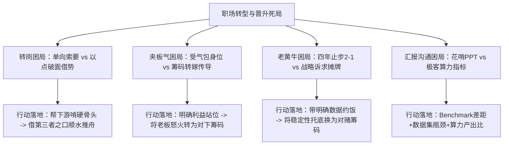
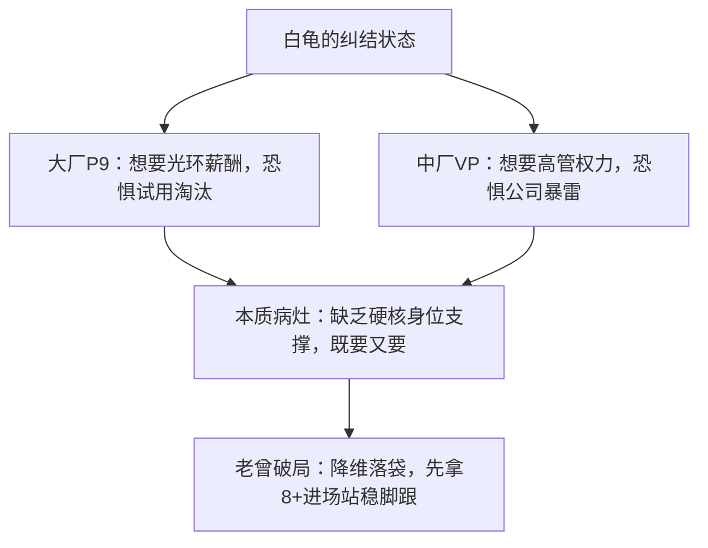
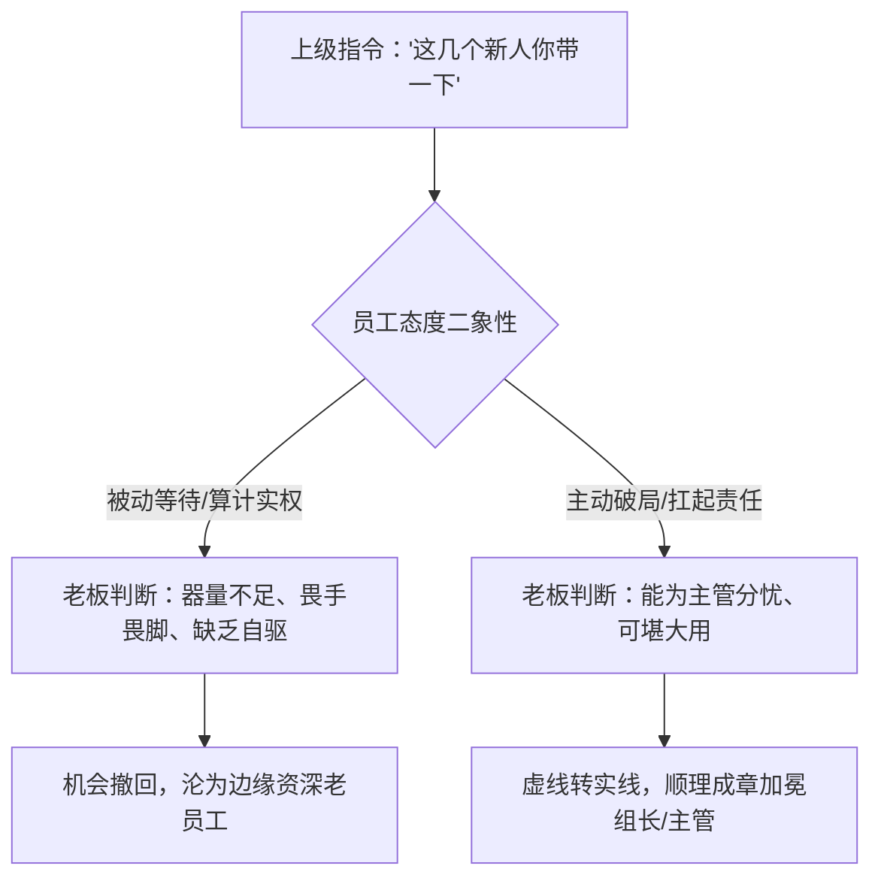
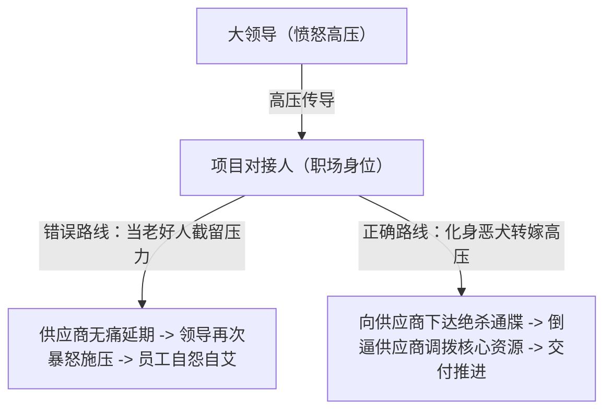
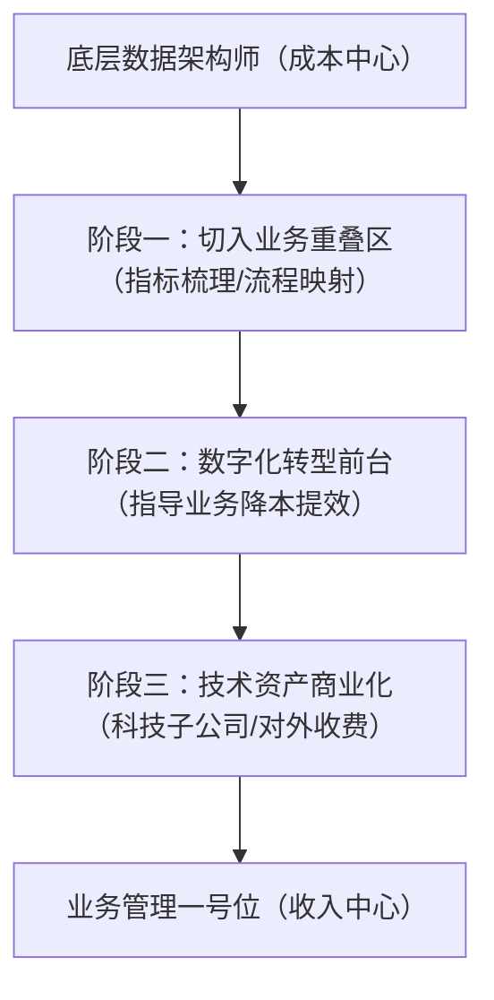

# 2026-11-04 · 产品老曾直播知识：转岗以点破面律、受气包身位认知与极客汇报哲学

本次连麦答疑聚焦于职场转型中的深层博弈：设计与技术骨干转向产品/业务时如何破除老板的“冷处理”与“求人陷阱”；面对强势供应商与情绪化领导时如何摆正“受气包”的真正身位；四年大厂止步二杠一背后隐藏的被动死士操作系统；以及在全员名校极客团队中如何用“算力就是爹”的极客逻辑进行汇报破局。



## 一、开篇立论：欲望、消解与职场身位

### 1. 学历光环与职场操作系统的代际断层

直播开场，老曾分享了清华大学博士生导师邀请他进校为博士生讲座的插曲。博士生作为传统象牙塔顶端的学术精英，在即将迈入工业界与商业公司时，普遍对“向上管理”、“团队博弈”、“转岗定级”与“AI转型落差”感到迷茫。

老曾指出，学术环境与商业职场遵循两套截然相反的运行系统：
- 学术评价机制依赖确定性的论文产出与自上而下的学术伦理，属于“顺流考核”；
- 商业职场则是资源争夺、模糊决策与权力平衡的角斗场。

许多博士毕业即进入中小企业挂帅 CTO 或期望空降大厂技术负责人，却因缺乏“职场身位认知”迅速陷入虚无。

### 2. 狐狸吃不到葡萄与“丧气鬼”的职场解构

针对直播间部分观众“去大厂没意思”、“创业没意思”、“赚一千万也没意思”的消极言论，老曾进行了极其辛辣的当头棒喝：

> “狐狸吃不到葡萄说葡萄酸，人家好歹还有吃葡萄的欲望，酸是因为够不着产生的情绪投射。最可怕的是什么都没干就先消解一切意义的丧气鬼——干大厂没意思，赚钱没意思，生活没意思。连欲望都没有了，整个人散发着负能量，谁敢给你资源？谁愿意带你入行？”

在商业职场中，大佬愿意提携、老板愿意授权的首要前提是你的**“高能量状态”**与**“明确的世俗欲望”**。一个连自己想要什么都不知道、凡事以无所谓掩盖无能的员工，在组织筛选机制中必然被第一批淘汰。

---

## 二、案例一：中厂副总裁想进大厂拿 P9，恐转正又怕小公司倒闭（白龟的事业局）

### 1. 案例背景与学员诉求

学员“白龟的事业局”在一家中型上市公司担任副总裁（VP），负责业务管理。随着行业周期下行与中小企业经营风险上升，他希望跳槽到互联网大厂谋求 P9（总监/资深技术专家）职级。但他陷入了极度焦虑的纠结：
- 去大厂拿 P9：担心大厂 KPI 极其严苛，政治博弈复杂，试用期无法转正或被淘汰；
- 留在中小企业或去 A/B 轮创业公司当高管：又担心资本寒冬中创业公司资金链断裂随时挂掉（此前已有踩坑经历）。

### 2. 老曾现场交锋与当头棒喝

老曾一针见血地指出了来访者看似全面理性、实则虚荣怯懦的底层心态：

> “我听你讲了两句就听明白了，你本质上就是对自己到底能不能配得上大厂 9 级极度不自信！你既想要大厂的平台光环和薪资背书，又怕大厂的试用期考核拿刀砍你；你既看不起中小公司的脆弱抗风险能力，又贪恋中小公司直接给的高管 title。这就是典型的贪心又怂！”



### 3. 底层博弈逻辑：中厂跳大厂的“降级折现率”

在真实的组织猎聘与人才定级中，中小公司的“VP”与大厂的“VP/P10”存在巨大的量级鸿沟：
- 中小公司的副总裁，其管辖幅度、现金流调度与战略容错率，通常仅相当于大厂成熟业务线的 P8（资深专家/高级经理）至 P8+（小总监）；
- 大厂对外部直接招聘的 P9 级高管，考核标准不仅是“业务胜任”，更是“自带体系与破局增量”，半年内无法立下战功极易成为政治替罪羊；
- 如果自身对胜任力心存疑虑，强行咬死 P9 入场，无异于将自己架在火山口。

### 4. 行动策略与底线思维

1. **卸下虚荣包袱，降级入局**：主动将目标定在“大厂 P8+ / 准 9”，将核心精力放在“平稳转正并熟悉大厂资源调度机制”；
2. **用增量战功换取内部晋升**：以中厂高管的务实执行力与全盘视角，在大厂内部打赢 1~2 场小胜仗，在团队内部自然完成从 P8+ 向 P9 的晋升跳跃。

---

## 三、案例二：博士毕业小公司当 CTO 陷入空心迷茫（Maria Sigman / 西格玛男人）

### 1. 案例背景与心理投射

学员“Maria Sigman”自称博士毕业 6 年，目前在一家小型科技公司挂名 CTO，年薪待遇尚可，工作节奏稳定，但对未来没有任何目标与动力，感到极度迷茫，不知该继续钻研还是跳槽。

### 2. 老曾现场交锋：高智商空心病与外部驱动力

老曾对其开出了极其清醒且接地气的“诊断单”：

> “你一个博士，花了五六年时间把最难的学术炼狱都走穿了，在小公司干个 CTO 有什么好迷茫的？你这就是一个人吃饱全家不饿，没有外部压力逼迫，典型的‘高智商空心病’！
> 不知道要什么，就赶紧去谈个恋爱，买个两万块的包，买个大钻戒去求婚！让你女朋友天天在后面抽你皮鞭，你就有挣钱发展的动力了！
> 如果你真想测一测自己的技术成色，别在小公司闭门造车，明天就把简历扔到市场上，去面一轮大厂的技术负责人。让市场上最挑剔的面试官抽你几巴掌，你就知道自己到底值几斤几两了！”

### 3. 底层认知穿透

许多技术精英在完成学历跃迁后，容易产生“目标枯竭感”：
- **象牙塔惯性**：习惯了导师指派课题与既定评价标准，一旦失去外部指挥棒，便丧失自我规划能力；
- **小公司舒适圈毒素**：在缺乏技术同行竞争的小微企业，名义上的“CTO”往往只承担了高级运维和外包管理的职责，长期远离核心技术主战场会导致技术敏锐度钝化；
- **破局唯一解**：打破自恋封闭系统，通过现实的物质责任（家庭、婚恋）建立外部刚性约束，同时通过外部市场残酷面试建立客观自我坐标。

---

## 四、案例三：新任上级招新人只说“你带一下”，犹豫要不要管（没关系）

### 1. 案例背景与模糊地带

学员“没关系”在团队中属于资深产品经理。最近部门换了一位新总监（+1），新总监到任后并未进行明确的业务规划宣贯，而是直接招聘了数名初级产品经理入职，并私下对他随口说了一句：“这几个人新来的，你先带一下”。

学员陷入反复猜疑：“领导没发邮件正式任命我为组长，也没承诺给我提拔加薪，他是不是只是拿我当免费工具人？我到底该不该主动去做规划和管理？”

### 2. 老曾当头棒喝：二象性状态下的冲阵法则

老曾对此种被动等待“黄袍加身”的心态进行了极其严厉的斥责：

> “你要是在线下坐在我面前问这种话，我一巴掌就打过去了！
> 老板把人招进来，专门走到你面前说‘你帮我带一下’，这潜台词已经直白得跟广播一样了！他干嘛不找别人带？他找你带，你就是这帮新人的 Mentor，就是未加冕的虚线组长！
> 组织里的很多晋升机会，在初期都处于‘量子二象性’状态——它既可能是转正晋升的跳板（A），也可能是试探你意愿与器量的试金石（B）。决定它是 A 还是 B 的，不是老板的主动施舍，而是你自己的第一步反应！
> 你如果把责任当场扛起来，带出成效，老板顺水推舟就把虚线画成实线；你天天坐在那守株待兔，算计‘你没给我实权我凭啥干’，老板一看你缩手缩脚，立马收回试探换别人！”



### 3. 管理学底层：领导者的试探与防守机制

老曾从管理层视角拆解了主管的真实处境：
- **主管的试错成本**：新官上任，主管如果贸然下发正式邮件任命某人为组长，一旦该员工管理能力不合格或意愿低下，主管将面临“撤换任命”的巨大组织政治风险；
- **模糊授权即低成本试探**：“你带一下”是管理者最典型的低成本试错策略——既测试了资深员工的主动性，又为自己保留了随时调整的退路；
- **职场铁律**：成熟职场人永远遵循**“先有事实管理，再有组织名分”**；凡是死守“不给名分绝不干活”的员工，永远等不来名分。

---

## 五、案例四（核心重磅连麦）：消费电子大厂 UX 设计想转产品经理，老板冷处理怎么办？（简单点）

### 1. 连麦学员档案与原话还原

- **学员化名**：简单点（音频 19:33 至 38:31 深度长连麦）
- **公司背景**：消费电子知名大厂，AI 办公类 Agent 产品线
- **团队编制**：产品与设计大团队负责人（1位大老板），下辖 6~7 名产品经理，仅有 2 名体验交互设计（UX/UI）
- **学员现状**：拥有 4 年交互设计经验，主导产品导向的体验设计。上周趁设计阶段性交付完毕、手头活较少，主动找大老板提议：“我想转做产品经理，能不能让我独立 Own 一块业务？”
- **老板反馈**：
  - 第一阶段：“转产品的想法是好的，但你得先把手上的设计资源盘清楚，确保设计交付没有缺口，我们接下来再聊。”
  - 学员动作：去摸排了 6~7 位产品经理手头的设计需求，自认为“工作量整体可控”，再次给老板汇报：“设计交付绝对能保住，我能不能兼着做一部分产品工作？”
  - 老板后续反应：**彻底泥沉大海，没有任何回应与实质授权。**

### 2. 老曾现场刺穿：谁求谁？与“实习生”的真实账本

老曾通过连续几组锋利的反问，瞬间剥开了学员的认知盲区：

> **老曾**：“你们一共才 2 个设计，管着 6~7 个产品经理对吧？那我问你，你跑去转产品了，剩下那一个设计扛得住吗？”
> 
> **简单点**：“可能有点吃力……但是现在活儿没那么多。”
> 
> **老曾**：“放屁！活儿再少，两个人干的活一个人干，风险就翻倍！老板凭什么为了成全你个人的职业理想，把整个团队的设计交付安全架在火上烤？
> 还有，老板之前跟你讲‘任何转过来的同学，刚开始都当实习生来培养’，你以为老板是在鼓励你从零做起啊？
> 他的潜台词是：**‘你是个零经验的产品小白，我不仅不能指望你干活，我还得专门派一个熟练产品经理手把手带你、帮你擦屁股，你占着产品编制却产出极低，你这是纯纯的负资产！’**
> 你转产品，是你在求老板，不是老板求你！老板要的是团队稳定运转，你却跑过去给老板出难题，老板不冷处理你冷处理谁？！”

```mermaid
flowchart TD
    A["学员认知误区"] --> B["我认为设计活少 -> 我能兼顾 -> 老板应该成全我"]
    C["老板现实算盘"] --> D["2人设计缺一不可 + 零经验产品需老手贴身带 + 徒增团队交付风险"]
    B vs C --> E["冲突结果：老板启动冷处理（不明确拒绝，但绝不推进）"]
```

### 3. 老曾实战打法：以点破面律与“借第三者之口顺水推舟”

老曾指出了绝大多数跨岗转型失败者的通病——**“自下而上单向索要”**。真正的跨部门/跨岗位转岗，必须运用**“以点破面借势法”**：


#### 实施四步走法则：
1. **寻找切入点（以点破面）**：在现有的 6~7 位产品经理中，挑出那个手头业务最重、交互流程最复杂、产品经理自身最吃力的模块；
2. **非正式进场（先做功后要权）**：利用自身资深 UX 的优势，不仅交付设计稿，还主动帮该产品经理把需求拆解、边界条件、Corner Case 和 PRD 框架全部理顺，让他尝到“有你协同效率翻倍”的实质甜头；
3. **完成利益同盟绑定**：让该产品经理形成对你业务能力的深度依赖，并在他遇到交付瓶颈时，由他主动在大老板面前发起诉求；
4. **第三者借势（顺水推舟）**：由合作的产品经理主动向大老板提出：“领导，这个模块简单点帮我梳理得极其透彻，这期迭代工作量巨大，能不能让简单点把这一块业务独立带起来，这样我的产出也能稳住。”
   - **大老板视角转变**：原本是“简单点个人想转岗的私欲”，变成了“骨干产品经理主动申请业务支援以确保大盘胜利”。大老板顺水推舟批准，既保全了组织面子，又化解了人员风险。

---

## 六、案例五：供应商能力差项目延期，领导天天拿我撒气怎么办？（R U E N S Y / 静时光）

### 1. 案例背景与夹板气困局

学员在一家项目型制造企业任职，负责对接外部供应商推进交付。由于外部供应商技术能力薄弱、管理混乱，导致项目节点连续延期两次。

大领导非常愤怒，开会时频频指责学员推进不力，将其当成情绪发泄口。学员深感委屈：“明明是供应商能力不行，又不是我的问题，领导一味拿我撒气，搞得我成了受气包。碰上这种情绪化领导到底怎么沟通？”

### 2. 老曾现场交锋：你是谁的人？你站哪边？

老曾对这种“委屈受害者心态”进行了极其深刻的阶级身位剖析：

> “领导不拿你撒气，拿谁撒气？你告诉我！
> 难道你指望你的大领导亲自跑到供应商办公室，拍着桌子跟供应商的小弟对骂吗？
> 领导跟供应商高层是偶尔在商务饭局上握手聊战略的，他们之间需要保持体面与退路！
> 你的岗位存在价值是什么？你就是那个被派去一线撕咬推进的恶人！
> 领导在办公室把你骂得狗血淋头，不是因为他精神失常，**他是希望你把你承受的巨大压力，连本带利传导到供应商的骨头缝里！**
> 结果倒好，你在供应商面前装老好人、和事佬，生怕得罪供应商；回头在老板面前又满脸委屈，怪老板情绪化！你到底是谁的人？你站在哪一边？！”



### 3. 破局战术话术：将高压转化为谈判绞索

学员不能充当压力的“缓冲垫”，而必须充当压力的“放大器与传导链”：

1. **卸下老好人面具，向供应商摊牌**：
   > “各位，我以前看在长期合作的情分上，一直在我们大领导面前帮你们斡旋、找借口。但是今天我把话挑明，我们大领导刚才直接在会上给我下了死命令——再延期一次，不仅我卷铺盖走人，你们公司的战略合作合同直接作废，全行业拉黑！
   > 我现在饭碗都不保了，我也顾不上跟你们客客气气了！从今天开始，你们项目经理每天早晚两次向我报进度，关键技术人员必须入驻现场，能干就干，不能干我现在就启动违约赔偿程序！”
2. **特殊垄断供应商的终极身位认知**：
   - 如果行业极其特殊，乙方属于行业寡头，话语权远高于甲方，连公司老板都对供应商毫无约束力：
   > “那你就把心态彻底放平！你的薪水里，本来就有一半是‘受气包岗位津贴’。在中间当受气包就是你这个岗位的全部经济价值。认清身位，照单全收，别去纠结什么情绪化，拿钱办事就是职业素养。”

---

## 七、案例六：数据架构师如何保持 Coding 并过渡到业务管理？（禽兽）

### 1. 案例背景与技术人的迷恋

学员在企业中担任数据架构师（Data Architect），平时仍保持着核心写代码、搞数据建模的习惯。他希望不丢掉底层编码能力，同时逐步走向业务管理岗位。

### 2. 老曾深度拆解：成本中心向收入中心跃迁的三步走

老曾指出，绝大多数技术人员转型业务管理的致命误区是**“用技术自嗨代替业务闭环”**：

> “你搞数据架构，天天在底层摆弄数据仓库、做清洗清洗（ETL）、调表结构，上层业务干什么你根本不知道，你凭什么转业务管理？业务部门只有一条定义：**能为公司赚钱的部门！**其他所有部门统统叫成本支持中心！”



#### 跃迁三步走战略：
- **第一步：寻找职能交集**：走出底层数据库机房，主动对接前台销售、供应链与运营，梳理“哪些指标是业务每天必看的”、“数据如何直接指导排产与转化”，将数据模型与业务流程紧密对齐；
- **第二步：主导业务提效试点**：以数据看板与自动化流程为抓手，深度介入某个具体业务模块的 0 到 1 数字化改造，直接背负该模块的业务考核指标；
- **第三步：商业化封装与科技子公司化**：将内部跑通的数据能力沉淀为行业通用产品，向上下游生态公司、供应链伙伴提供数据咨询服务并实际收款。一旦成本中心开始产生外部现金流，技术主管即可顺理成章成为独立“科技子公司”或新业务线的负责人。

---

## 八、案例七：上级失势被贬，要不要去“雪中送炭”押注他东山再起？

### 1. 职场小说幻觉：珍珠翡翠白玉汤的残酷真相

直播间有学员提问：“直属领导最近在权力博弈中失势，被明升暗降发配到边缘部门。我平时跟他关系不错，现在要不要主动走动示好，赌他未来东山再起提携我？”

老曾引用了民间典故“珍珠翡翠白玉汤”，道出了高层权力心理学的残酷真相：

> “朱元璋落魄当叫花子的时候，快饿死了，要饭喝了路人一碗烂菜叶烩破豆腐的汤，觉得是天底下最美味的‘珍珠翡翠白玉汤’。
> 等他当了皇帝，吃尽山珍海味，突然怀念起那碗汤，把当年做汤的叫花子召进皇宫。叫花子这次用了最好的新鲜豆腐、极品肉末煨出来，皇帝一尝大发雷霆，甚至想杀人！
> 为什么？因为当一个人落魄穷困时，你对他的‘雪中送炭’，在他发达登顶后，**每看你一眼，都是在提醒他当年曾经有多像一条狗！**
> 很多下属总幻想着‘滴水之恩涌泉相报’，在领导被踩在泥潭里时去给他送廉价的温暖。高管东山再起之后，最想从记忆里抹去的就是失势的那段屈辱岁月，而你这个知情人往往是他最先清理的障碍！”

### 2. 向上社交的本质法则

高层政治与职场向上社交绝非江湖义气：
- **大佬看的是你的能量与身位**：当你具备不可替代的利用价值，即便此前未曾谄媚，大佬起复时依然会调你为主力；
- **远离失势漩涡**：在组织人事大震荡期间，中层骨干的首要准则是“守住基本盘业务交付”，盲目站队或押注失势领导，极大概率在大鱼吃小鱼的内卷中陪葬。

---

## 九、案例八：被谈离职六轮又转岗，老板到底在算计什么？（玲玲）

### 1. 案例背景与拉锯战

学员玲玲在一家混改国企背景的物业公司工作。9月份起，公司老板指令 HR 与其约谈离职，前后拉锯长达六轮，始终因赔偿金方案谈不拢未能成行。国庆前后学员刚完成原岗位交接，公司却突然态度大变，不再提离职赔偿，反而提议将其调往另一个边缘岗位。

### 2. 老曾刺破职场潜规则：调虎离山与风险拆弹

老曾当场戳穿了学员“揣着明白装糊涂”的伪装：

> “一家正常公司辞退员工，三轮谈完封顶。能拉扯到六轮甚至八轮，说明什么？说明你们双方都拿着筹码在暗战！
> 公司不愿按法规足额给赔偿，而你手里攥着核心客户、关键账目、或者准备发起劳动仲裁/外部举报的核按钮！
> 公司怕你一出去立马引爆雷区，又给不起封口费，所以采用了最经典的**‘调虎离山防守术’**：
> 先利用转岗承诺，诱骗你把原岗位的核心权力、文档与权限全部交接出去；等你手里彻底没了人质与底牌，再把你晾在边缘岗位慢慢收拾。你居然还觉得老板是不是有病？”


### 3. 应对防御法则

- **权力即筹码**：在正式离职赔偿协议未盖章签署前，绝不无保留交出所有的工作线索与交接确认单；
- **锁定法定义务**：拒绝口头模糊转岗，要求公司下发盖章的正式调岗通知书；若涉及降薪或恶劣跨地点变更，直接作为公司单方违约证据提起仲裁。

---

## 十、案例九（重磅连麦/质问）：百度升职跳字节做性能给 2-1，四年没升职被转做“稳定性”（ZXY）

### 1. 连麦学员档案与自述

- **来电者**：ZXY（音频 84:41 至 89:00）
- **履历轨迹**：2020 年本科毕业加入百度，半年内获得升职；2022 年跳槽字节跳动做系统性能优化，定级 2-1；
- **现状困局**：从 2022 年至今（2026 年），整整四年原地踏步，依然是 2-1。2026 年初性能团队重组，被转岗做纯业务开发 5 个月，随后主管安排他负责“团队系统稳定性保障”，支持 40 人的研发大盘；
- **学员提问**：“老板安排我负责稳定性，是不是对我的技术很肯定？我还要多久才能升到 2-2 甚至大厂技术总监？”

### 2. 老曾现场暴怒：四年不升职的技术死士

老曾对其“沉浸在自我感动中”的被动状态爆发了全场最激烈的当头棒喝：

> “你 2022 年就是二杠一，到现在 2026 年了整整四年还是二杠一！就算在大厂排队论资排辈，轮也轮到你了！你怎么有脸坐在这做梦升总监？！
> 性能团队被拆了，你被塞去做业务开发；干了五个月又被扔去负责‘稳定性’，你还沾沾自喜觉得老板重视你技术？
> 我告诉你大厂研发的残酷潜规则：**业务往前冲立新功的项目，才是抢升职加薪的战略位；稳定性保障就是典型的擦屁股背锅位！**
> 系统一年不出事，那是大盘底子好，没人记得你的功劳；系统一旦崩了五分钟，全公司复盘抓你出来斩首示众！
> 你在公司混了四年，自己不去争取，天天在背后揣摩‘老板是94年的比我还小，我不好意思提’，非要我当着几千人的面骂你，你才肯醒吗？！”

```mermaid
flowchart TD
    A["大厂技术岗位真实生态"] --> B["功劳位：前台AI业务/增长新业务 -> 战略资源倾斜 -> 极速晋升通道"]
    A --> C["背锅位：底层稳定性/运维兜底 -> 平时不显山水 -> 出事连带斩首"]
    B vs C --> D["ZXY的错位幻想：把'边缘托底'误当成'核心器重'"]
```

### 3. 老曾行动指南：破除玻璃心与对赌谈判

1. **走出暗室，约老板吃顿透底饭**：
   > “老板，我来团队整整四年了，一直守在 2-1 的位置上。这次承接 40 人的系统稳定性托底，我深知责任重大。我今天想当面听您一句实话：我把稳定性指标压到几个 9、帮团队拦截多少次事故，下个半年度您能明确给我提名 2-2？”
2. **拒绝模糊承诺**：将“不可替代的托底劳作”转化为“白纸黑字的晋升对赌”，如果主管始终闪烁其词，说明该位置已被彻底定义为工具人，必须立即启动外部骑驴找马。

---

## 十一、案例十：贪心又怂的空想家陷阱（四种跨行路径的反思）

针对许多中年员工“既想转型高薪新赛道，又不愿舍弃过往沉没成本”的心态，老曾复盘了他此前与一位咨询者的真实交锋：

> “有个人跟我咨询，说自己陷入瓶颈，想知道市场上还有哪些非本行的成功路径。
> 我一口气给他讲了四种真实案例：有做跨境出海新流量的，有打通特定工业细分渠道的，有做私域垂直咨询的。
> 每讲完一个，我都问他：‘这个路径别人跑通了，你能干吗？’
> 他第一个说‘我做不了’；第二个说‘这个太难，要七八个资源条件我只有两个’；第三个说‘风险太大不保险’。讲到第四个，他彻底不吭声了。
> 我跟他说：**你不是不贪心，你是又贪心又怂！**
> 任何跨界打破壁垒的打法，都需要像个二十岁的新人一样，脱掉所有孔乙己的长衫，带着巨大的毅力和从零开始的决绝。
> 你既舍不得过去那点微薄的身段与经验，又害怕吃苦冒风险，还总想给自己留后路。我哪怕给你讲一千种暴富方法，对你又有什么用呢？”

**职场定律**：高能量的人吸引资源，低能量的人消耗机会。与其在幻想中把所有机会解构一遍，不如将精力死死钉在手头两三个看得见的突破口上。

---

## 十二、案例十一：跨地带虚线团队，每天第一个下班合适吗？（杰瑞米）

### 1. 案例背景与管理信号

学员杰瑞米所在的团队，直接主管（+1）在异地 Base，自己与几名初级员工在本地办公室办公。他在名义上是这几个本地员工的“虚线负责人”。学员提问：“既然加一不在同城，我每天干完活第一个收拾包下班，这合不合适？”

### 2. 老曾穿透：管理威信始于细节风向标

老曾给出了极其决绝的否定回答：

> “你觉得加一不在，天高皇帝远，你第一个走很潇洒是吧？
> 你在本地是唯一的虚线头头，你的一言一行就是整个办公室的风向标！
> 你每天第一个拎包走人，下属看到的是什么信号？**‘这地方是个草台班子，头儿都在混日子随时准备撤，我们干活拼命给谁看？’**
> 整个团队的军心瞬间就涣散了！等后续你需要压进度、追交付、要求大家加班攻坚的时候，谁听你的？
> 管理威信不是靠头衔砸出来的，而是在日常细枝末节中积累起来的。你如果想往上走当真正的业务管理者，就必须时刻保持‘场域主理人’的敬畏感。”

---

## 十三、案例十二：给千万级收入的领导汇报，是不是只能报喜不报忧？（忘了我八）

### 1. 案例背景与愚忠误区

学员在大型集团工作，分管业务线直接向年薪千万级的高级副总裁汇报。他秉持一种传统观念：“大领导平时日理万机，讨厌听繁杂琐碎的麻烦，是不是汇报时只讲成绩和进展（报喜），把卡点和潜在风险瞒下来自己消化（不报忧）？”

### 2. 老曾点穴：高层最痛恨被蒙在鼓里当傻子

老曾驳斥了这种极度危险的官僚恶习：

> “千万级收入的大领导，经历过的惊涛骇浪比你吃过的米还多！大领导最痛恨的不是坏消息，**最痛恨的是突如其来的‘惊喜’（暴雷）！**
> 你自以为懂事，报喜不报忧，把隐患藏在地毯下面。等事情彻底捂不住、在客户面前或董事会面前瞬间炸开的时候，大领导没有半点心理防线与公关预案，那时候你的下场就是被当场撕碎！
> 汇报的铁律永远是：
> 1. **坏消息提早讲**：有风险在苗头阶段就要给领导打预防针，建立客观预期；
> 2. **带着方案报忧**：讲困难的同时，必须摆出方案 A 与方案 B，明确各方案的利弊与成本；
> 3. **边界清晰地求助**：把‘我做了什么’、‘卡点在哪里’、‘需要领导协调哪位外部高管’讲得清清楚楚。
> 这才叫高情商汇报，不是给领导当弄臣！”

---

## 十四、案例十三：AI 初创团队评测负责人，如何向极客创始人与模型科学家汇报？（好大一朵金牡丹）

### 1. 案例背景与受众错位

学员在一家高精尖生成式 AI 初创企业担任模型评测负责人，直接向公司创始人和两位顶级大模型负责人（清北博士/顶尖科学家背景）汇报工作。他感到汇报极其吃力，不知道该用什么框架打动这帮技术大牛。

### 2. 老曾破局：算力就是爹，时间就是金钱

老曾指出了 AI 创业语境下的独特沟通语境：

> “你们是一个小而精的精英团队，团队成员全是一线技术极客！
> 千万收起大厂那套假大空、花里胡哨的 PPT 汇报套路！在大模型初创公司，**算力就是爹，时间就是金钱！**
> 大家熬夜训模型，最核心的成本就是 GPU 集群的租金在按秒烧钱！
> 汇报就抓三件事，有事说事，直接上硬核数据：
> 1. **Benchmark 核心差距**：我们的模型在垂直领域 benchmark 与行业 SOTA（如 Claude 5.5 / GPT）的真实分差在哪；
> 2. **Bad Case 的精准归因**：评测挂掉的测试集，究竟卡在多轮对话的 Long-Context 召回，还是复杂工具链 Tool-use 的 Json 解析；
> 3. **算力投入产出比**：我们烧了多少卡、跑了多少 epoch，评测指标究竟提升了 0.5% 还是原地打转，下周迭代方向在哪。
> 极客团队只尊重严密的数据与工程效率，直来直去就是最高情商！”

---

## 十五、案例十四：制造企业推进 AI 转型，公司强制内网加密只配千问办公（罗佳）

### 1. 传统企业落地 AI 的客观现实

学员在一家传统制造型大型企业负责推动内部 AI 试点。但公司出于数据安全与涉密管控要求，所有办公电脑强制安装安全加密软件，严禁访问外网主流 AI 接口，软件中心只批准安装了“通义千问办公”等少数内置插件。学员感到施展不开，认为环境恶劣无法做出成绩。

### 2. 老曾拆解：立足受限环境做真实提效

老曾指出，这恰恰是当前国内制造业与央国企转型的普遍常态：
- **不拿工具受限当挡箭牌**：企业级落地看重的是与业务流的贴合，而不是追求最新、最贵的模型；
- **寻找离线与轻量化突破口**：
  - 基于合规工具，深耕本地知识库问答与标准化工艺文档的格式清洗；
  - 聚焦制造车间最耗时的工序报表生成、设备维保手册检索；
  - 只要能帮一线员工每天节省半小时录单时间，就是实打实的管理政绩。

---

## 十六、产品老曾 2026-11-04 连麦实战自查 Checklist

为帮助职场人在转型、沟通与晋升中避坑，特提炼本场实操自查表：

| 评估维度 | 核心检验问题 | 达标信号 | 警惕红线 |
| :--- | :--- | :--- | :--- |
| **转岗博弈** | 你是否在未做业务贡献前单向要求老板成全？ | 帮下游产品啃下硬骨头，借下游之口申请转岗 | 孤立盘点设计工时，让老板觉得你在推卸责任 |
| **夹板气身位** | 面对供应商拖延，你是在当老好人还是在传导压力？ | 将老板怒火作为谈判砝码，向供应商下死命令 | 在供应商前装无辜，在领导前抱怨其情绪化 |
| **虚线管理** | 领导模糊授权时，你是主动破局还是计较名分？ | 抓住二象性状态主动扛事，用既成事实换任命 | 死守“不发正式邮件任命绝不多干一件事” |
| **大厂晋升** | 负责的业务属于立功的先锋队还是托底的背锅位？ | 锚定业务增长核心，与领导明确对赌量化指标 | 苦熬四年2-1，把“稳定性保障”误当核心器重 |
| **极客汇报** | 对接技术极客高管时，汇报内容是否脱离商业算力现实？ | 用 Benchmark 数据、卡点归因与算力转化比说话 | 堆砌 PPT 华丽辞藻，缺乏定量指标与工程归因 |
