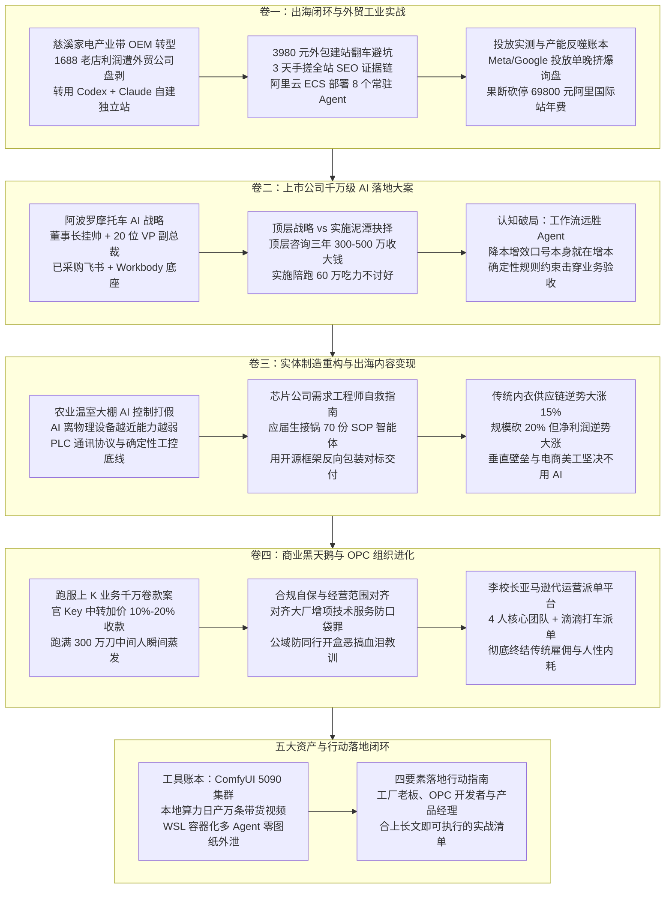

# 2026-11-05 · 第1场直播（企智AI落地派）



---

## 卷一：出海闭环与外贸工业实战（慈溪产业带与海外独立站）

### 1. 浙江慈溪家电产业带 OEM 工厂转型：从 1688 老店到 Codex + Claude 独立站全流程跑通

传统内贸制造业与外贸代工正面临前所未有的生死洗牌。在浙江慈溪观海卫镇——全国知名的小家电与电器配件产业集群，原材料、五金件与配套外壳在 20 分钟车程内就能全部进场。然而，身处产业带核心的代工厂却常年面临“订单不少、利润薄如刀片”的尴尬境地。

连麦嘉宾 Ella（艾拉 / Ella 见微）分享了家族 OEM 工厂的突围之路：
- **历史包袱与盈利困境**：工厂开设有 12 年之久的 1688 诚信通老店铺，以及年费 39,800 元、加上充值推广合计交了 69,800 元的阿里巴巴国际站店铺。由于缺乏专业外贸运营团队，订单常年被本地外贸进出口公司、中间货代层层盘剥转手，工厂仅能赚取微薄的加工费。
- **业务转型的心理转折**：2025 年下半年解散原有 100 多人的电商代运营公司后，Ella 回到家乡工厂重新梳理业务。国内电商在平台扣点、仅退款与恶性内卷下已无利润，而海外成熟市场的 B2B 定制需求依然旺盛。中国团队在精细化运营、页面视觉呈现与用户交互感知上的认知，对海外采购商而言属于跨代优势。
- **破局核心策略**：绕过所有吃差价的外贸公司与中间货代，利用 AI 工具链搭建自主品牌的海外独立站，直接面向欧美与拉美采购商获取 B2B 定制询盘，把定价权与毛利牢牢锁在工厂自己手中。

### 2. 3,980 元垃圾外包独立站避坑实录：3 天手搓全站 SEO 证据链与地图重构

在搭建独立站的初期，企业极易落入市面建站外包公司的低劣陷阱：
- **外包报价层层套路**：市面上建站报价从 688 元、3,980 元到 2~3 万元不等。688 元的仅仅给一个开源 CMS 的空白骨架，毫无实际价值；而所谓的“专业外包团队”收取 3,980 元后，交付出来的网站排版粗糙、设计审美掉线，与几百元的模板毫无二致。
- **亲自下场 3 天快速逆袭**：Ella 果断止损，装上 Codex 并配置大语言模型辅助编程，仅耗时 3 天便独自重构了全套独立站架构。
- **B2B 独立站的 SEO 证据链构建哲学**：
  - 传统买关键词上排名的时代已经终结，现代 Google 搜索引擎更青睐具有完整实体可信度与逻辑自洽的真实网站；
  - 工业品独立站绝不报价（每个客户的定制材质、公差、订单批量均不同，标明价格反而直接劝退真正的大采购商）；
  - 全站核心在于铺设完整的资质证据链：出示企业自有实验室检验报告、国际认证证书（如 CE、UL、RoHS）、检测报告 PDF 真实下载链接；
  - 放大产业带区位优势：在网站显要位置标注慈溪观海卫镇产业集群生态，说明“原材料 20 分钟进场配套能力”与宁波港/上海港海运通达能力，极大提升海外采购商对履约交付确定性的信任；
  - 隐恶扬善：严格隐藏工厂仅有 6 条生产线、占地面积有限的规模劣势，只突出技术参数一致性与打样响应速度。

### 3. 8GB 笔记本告急与阿里云 ECS 部署：8 个 7x24 小时常驻 Agent 的协同编排

本地设备算力不足是许多非技术出身创业者的第一道门槛：
- **设备瓶颈**：初期用于开发的日常办公笔记本仅有 8GB 内存，一旦开启多标签页与本地智能体环境便频繁死机卡顿，且家用网络与电源无法支持 7x24 小时不间断监听；
- **云端弹性上云架构**：果断摒弃对本地 PC 的依赖，在阿里云采购云服务器（ECS），将整个业务智能体环境直接迁移至云端；
- **8 个协同 Agent 闭关矩阵（耗时 1.5 个月全面跑顺）**：
  1. **市场情报 Agent**：持续扫描 Google 趋势、行业热度词与竞对独立站 sitemap 变动；
  2. **SEO 自动化 Agent**：根据每日采集的高频话题与长尾词，自动生成符合 Google 收录偏好的技术说明与产品动态；
  3. **产品知识库 Agent**：收录工厂十年积累的上百种配件规格、材质公差对照表与电子版产品参数；
  4. **内容排版 Agent**：负责技术文档与展示页的 HTML 语义化排版与结构化数据（Schema.org）标记；
  5. **海外社媒分发 Agent**：将技术案例与车间打样实拍分发至 Facebook、LinkedIn 与 YouTube 专页；
  6. **多语言询盘清洗 Agent**：全天候监听独立站表单与外贸邮箱，过滤垃圾邮件，对有效采购意向按需求规模打标分类；
  7. **打样核算 Agent**：结合原材料当天金属与塑料报价，自动输出工程打样初步工料单供外贸业务员审核；
  8. **店铺全生命周期监控 Agent**：监控全站服务器延迟、SSL 证书状态与蜘蛛抓取频次。

### 4. 广告投放（Meta / Google Ads）与产能反噬实战账本：单晚几百询盘被挤爆、果断砍停 69,800 元阿里国际站年费

当独立站技术底座打通后，投放与商业交付的真实拉扯随之而来：
- **冷启动买量策略**：新独立站缺乏自然权重，如果干等自然流需要半年以上。Ella 直接启动 Meta（Facebook）与 Google Search 关键词精准投放；
- **精准度迭代学费**：前期由于投放地域与受众标签粗放，曾出现过单晚涌入几百个无效询盘、业务员通宵接待却无一转化的局面。随后利用 Agent 深度清洗历史转化客户画像，收窄国家与行业标签，将资金集中于欧美高质量采购商；
- **产能瓶颈与幸福的烦恼**：随着精准询盘稳定导入，工厂内部仅有的 6 条产线和单名外贸业务人员的接待能力瞬间被挤爆。工厂还有未交付的国内老订单，根本承接不下额外涌入的海量外贸定制单；
- **果断砍停高额年费**：在确认独立站获客成本（CAC）与询盘质量远超传统 B2B 平台后，Ella 毅然将充值 69,800 元的阿里国际站推广彻底暂停，将全部精力回收至自身独立站自有资产的精细化运营中。

### 5. 模型实测体感对比：GPT/Codex 的严谨冗长 vs Claude 的利落实用

在长达数月的落地实践中，Ella 总结了当下主流大模型的真实使用体感：
- **GPT / Codex（偏重严谨学术与理论穷尽）**：
  - 优势在于逻辑极端严谨，结构推导滴水不漏；
  - 缺点是废话偏多、输出冗长，极度消耗 Token。“比如让它设计一个马桶，它会从使用者的坐姿角度、重力加速度、室内温湿度与水压管径反复推导五遍，生成一份宏大长篇的学术报告，最后做出来的产品依然可能冲不干净”；
- **Claude 系列（如 Claude 5.5 / Claude Opus 5.5，务实干练、直击交付要害）**：
  - 优势在于具备天然的工程直觉与高级审美，代码简洁有效，极少堆砌套话；
  - 对应同样的马桶设计场景，“Claude 的策略是直奔核心交付目标——直接建议在旁边配套放一把专用马桶刷解决边界问题”；
  - 在前端独立站 CSS 审美、色彩搭配与代码工程落地场景下，Claude 5.5 的综合体感与开发效率显著高于同类模型。

---

## 卷二：上市公司千万级 AI 落地大案深度复盘（阿波罗摩托车案卷）

### 6. 上市公司顶层设计与“AI 种子用户”：董事长挂帅、20 位 VP 副总裁的 AI Plus 改造全景

大型制造企业在面对 AI 变革时的打法与中小微企业完全不同。连麦嘉宾来福总深度复盘了当天在杭州现场对接的一家知名外贸摩托车上市公司（曾与张雪摩托深度合作）的真实案例：
- **企业底座现状**：
  - 该企业早在 2024 年就启动了集团级数字化与 AI 提效工程，已花费大几百万元采购“行动教育”等顶级咨询团队完成了未来三年（2027~2029年）的战略顶层规划：2027 年跑通全链路、2028 年全面复制方法论、2029 年形成数字化核心经营能力；
  - 集团内部信息化极为扎实：传统 ERP、MES、CRM、数据仓库（数仓）与基础知识库全部打通，内部财务系统做到每月 1 号准时出具全口径经营报表；
  - 采购了全套飞书底座与腾讯 Workbody 智能体平台；
- **最高层推动机制**：
  - 绝不由 IT 部门主导，而是由**董事长亲自挂帅带队**；
  - 从各业务核心部门抽调 20 位核心一把手（包括研发 VP、海外销售 VP、供应链 VP、财务总监等副总裁级别高管）作为第一批“AI 种子用户”，以业务目标倒逼组织升级；
- **核心诉求与边界红线**：
  - **红线一**：内部日常协同办公的简单场景由内部团队自行消化，不外包；
  - **红线二**：**严禁任何第三方闭源 Agent 平台（如影刀、时代智能等）接管系统**，拒绝任何数据向外泄露风险，要求完全基于自身 Workbody 或本地环境实施；
  - **硬性诉求**：90% 营收依赖海外跨境与外贸，急需外部高水平 FDE（前线部署工程师）或专家团队，专门辅导跨境电商出海增长、非结构化售后维修文档沉淀、研发海外多平台数据抓取等复杂高难度跨部门场景。

### 7. 实施方的商业抉择与生死边界：“只做选择，不做培养”，顶层咨询三年 300~500 万收大钱 vs 实施陪跑 60 万翻车泥潭

面对上市公司抛出的 60 万元实施辅导预算，来福总团队在当晚复盘后做出了极为耐人寻味的商业决策——**坚决拒绝亲自下场承接实施，转而将其推荐给生态伙伴**：
- **为什么顶层战略能收大钱？**
  - 来福总团队此前为雅戈尔（每年拿出净利润 5% 专款投入数字化）与飞鹤奶粉（通过柔性快反供应链年省 9% 物流成本）提供咨询服务；
  - 面对董事长只卖作战地图与顶层战略规划，单次报价一年 300 万元、三年 500 万元。高管认可战略价值，交付物清晰，回款快且利润率极高；
- **为什么 60 万元的实施陪跑是灾难泥潭？**
  - 上市公司 CEO 与董事长已将顶层战略买走，落到实施阶段时，要求服务商不仅代码能力高于其内部资深 IT，业务认知还要超越其深耕几十年的行业老业务员；
  - **缺乏可量化的客观验收标准**：智能体好用还是不好用、提效是 10% 还是 20%，全凭客户高管一张嘴主观评判。一旦业务指标出现市场波动，实施团队首当其冲沦为背锅侠；
  - 实施耗时漫长、需要派驻大量人员进驻车间陪跑调教，60 万元收入甚至无法覆盖高级架构师与工程师团队的差旅人力成本；
- **商战核心法则：“只做选择，不做培养”**：
  - 合伙人会议上的铁律：坚决不向认知未到位的客户推销概念，坚决不下场做保姆式培养；能理解顶层商业逻辑并愿为战略买单的才是客户，其余一概视为资源消耗陷阱。

### 8. “降本增效”认知陷阱大起底：讲降本往往在增本！Token 消耗与学习成本超过初级员工

针对市场上满天飞的“AI 降本增效”口号，多位老牌企业主与咨询专家在直播中予以无情戳破：
- **口号的悖论**：企业高喊降本增效的第一天起，账面上就已经在剧烈“增本”；
- **隐形成本三座大山**：
  1. **算力与 Token 账单黑洞**：未加约束的通用大模型调用极其昂贵，在多轮上下文迭代中，一个部门每日消耗的 API 费用与商业订阅费，往往直接超过一名初级文员的月薪；
  2. **组织学习与摩擦损耗**：强行推行未经磨合的智能体系统，员工抵触情绪蔓延，天天花大量工时调试提示词和应付格式错误，原有业务流被严重扰乱；
  3. **模型幻觉兜底成本**：在财务、关务与外贸合同等高精度场景下，AI 产生的一丁点幻觉一旦流入生产，造成的实际经济损失与违约赔偿动辄数十万元；
- **真实交付指标回归**：停止用虚无缥缈的降本去忽悠客户，真正的 AI 落地只能衡量确定的“业务增量”（如新增精准询盘数、特定商品周转提速天数、爆款标题生成耗时由 25 分钟降至 1 分钟）。

### 9. 李校长认知铁律：“Agent 不如工作流有用”——为什么确定性 Workflow 远胜发散式 Agent？

针对行业盲目崇拜“自主规划 Agent（智能代理）”的虚火，李校长（跨境电商十余年老兵、OPC 实践者）提出了极具穿透力的底层观点：
- **Agent 的天然缺陷**：自主 Agent 依赖大模型的动态思考与工具循环调度，过程具有随机性、耗时不可控，且无法给出 100% 的确定性结果；
- **确定性工作流（Workflow）的降维打击**：
  - 真正的商业落地，不需要模型自己去天马行空地思考“下一步该干什么”；
  - 以亚马逊 Listing 标题撰写为例：新手做 Agent，往往费尽心力去挂载上百篇营销资料做知识库检索，让 Agent 自主创作；而行业行家的做法是**直接把规则锁死在工作流的提示词约束中**——明确下达硬性指令：“直接按照 Google 搜索引擎最喜欢的收录层级结构（Brand + Core Keyword + Model + Feature + Use Scenario）生成标题”；
  - 行业最优经验早已收敛为固定公式，用确定性的管道约束（DAG 工作流）将输入、校验、转换、输出严格锁死，成本最低、速度最快且 0 幻觉。

---

## 卷三：实体制造业重构、工控打假与出海内容变现台账

### 10. 农业温室蔬菜水肥 AI 控制现场打假：AI 离物理设备越近能力越弱，PLC 与物理协议才是核心

直播间一位经营蔬菜水肥大棚的农业企业主提问：“如何开发一个 AI 大脑智能体，直接接管控制温室大棚的水肥滴灌调节、温度传感器与循环通风系统，大概需要多少钱？”

现场电信 CTO、工业硬件老兵与企智徐总当场进行了专业纠偏：
- **残酷的技术分界线**：**AI 离物理空间和生产设备越近，其实际应用能力越弱！**
- **工程难点与真实现状**：
  - 大棚温控、通风与水肥根本不需要任何大语言模型！温度超过 30 度开通风机、土壤湿度低于阈值开启滴灌水肥，属于自动化领域深耕数十年的成熟 PLC（可编程逻辑控制器）逻辑，写死规则只需要几百行工业梯形图代码；
  - 难点在于现场硬件传感器通信协议：不同厂家生产的温湿度计、PH 探针、水肥泵大多采用封闭或私有的 RS485、Modbus 协议，需要电气工程师一个个手搓打通物理通信协议，与软件层面的 AI Agent 毫无关系；
- **幻觉致命论**：工业与农业生产涉及活体生物与精密设备，一旦引入概率驱动的大模型，某次因 Token 上下文波动产生幻觉，误将阀门全开或断水数小时，整棚蔬菜将瞬间死绝，代价惨重。

### 11. 芯片公司刚入职 3 天需求工程师的“AI 焦虑甩锅”自救指南：无糖酸奶职场破局全案

连麦嘉宾“无糖酸奶”（某 170 人国产芯片半导体公司刚入职 3 天的需求工程师/产品经理）带来了一个令人啼笑皆非却极具普遍性的真实职场切片：
- **荒诞的职场困局**：直属开发经理丢来 70 多份内部 ERP/MES/财务/仓储 SOP 及操作文档，口头下达虚无缥缈的任务：“限期研究智能体系统，用开源技术给我们公司自己手搓一个专属 AI 智能体，不准用外面的云平台因为芯片数据涉密”；
- **多位大咖现场透视背后的组织政治**：
  - **老板的跟风焦虑**：芯片公司老板在外参加峰会，看到同行吹嘘自家上了 AI，产生莫名的同辈焦虑，想在社交场合炫耀“我们也有专属 Agent”；
  - **中层的压力转嫁**：开发经理自己也不懂如何落地，便将这个看似宏大实则无法落地的伪需求直接甩给新入职的试用期员工当“投石问路”的试金石；
- **专家现场支招“职场金蝉脱壳术”**：
  1. **认清技术现实**：任何 100 多人的中小团队都不可能自己手搓出一个超越开源 Claude Code 或 Codex 的 Agent 底座架构；
  2. **反向包装需求对标**：绝不自己死磕底层代码，打开 AI 工具，以业内标准平台（如 Workbody、Dify）为功能参考对标，输入公司背景，让 AI 自动生成一份《集团智能体架构规划与分阶段实施排期表（5~10天）》，明确列出“数据安全沙箱与权限边界”；
  3. **将幻觉包装还给领导**：把漂亮的架构文档和工作流图表打印汇报给开发经理，完成工作留痕与试用期答辩；随后建议公司按需采购标准私有化方案，彻底从技术死胡同中安全抽身。

### 12. 600 人制造基地工控数字化与人效防作弊法则：电信 CTO 老哥的一针见血拆解

某 600 人规模的传统制造基地基层主管（图图）计划购买腾讯 Workbody 席位，用于车间各班组纸质表单数据上报与知识沉淀，以备下周向集团总裁汇报。

现场深耕工业互联网的电信 CTO 随即给出了震耳发聩的实操警示：
- **人工填报的致命漏洞**：如果生产制造设备（如 MPC、注塑机、冲压机）没有加装硬件传感器进行自动化数据采集（数采），而单纯指望工人和班组长在手机或电脑工作台手工填报产能、工时与废料数，**其数据真实性趋近于零！**
- **车间政治造假潜规则**：车间各班组长之间存在天然的利益同盟。遇到不良率升高或设备停机，班组长互相串通修改填报数字轻而易举。手工录入的“数字化报表”不仅无法提升人效，反而会成为中层向下掩盖管理疏漏的合法掩体；
- **正道实施路径**：真正的制造数字化必须走“设备加装数采模块（直取转速、电流与脉冲计件）$\to$ 自动化汇总至本地数据库 $\to$ 环比良品率”；单纯做办公表单与文字通知，使用飞书多维表格即可搞定，绝无必要为 Workbody 支付高额席位费。

### 13. 普宁传统内衣供应链逆势增长奇迹：规模下滑 20%、净利润逆势提升 15% 的垂直供应链壁垒

在全网悲叹 2026 年是电商体感下滑最剧烈、消费断崖式下跌的一年时，来自广东普宁/揭阳的供应链老板蓝总分享了令人震撼的实体经营战绩：
- **逆势增长成绩单**：公司营业总额从高峰期的 5 亿元下滑至 2 亿多元（整体体量砍掉 20%），但**全年净利润却逆势暴增 15%**！
- **四年前的前瞻性战略断舍离**：
  - 4 年前敏锐洞察到 C 端流量成本见顶与仅退款风险，果断砍掉大部分直接面向消费者的天猫、抖音店铺（仅保留少量标杆直播间维持品牌声量），将 80% 核心产能全面转向为全国排名前 50 的知名服饰品牌（南极人、草本系列、各大头部新消费品牌）提供垂直供应链贴牌代工；
- **供应链极致成本控制权**：
  - 自建完整的织布、印染与成衣缝制全产业链。在行业下行期，自身对上游染料、纱线工厂拥有极强的议价权，将生产成本压缩至行业极限，从而在维持甚至小幅上调 B 端批发价的同时，赚取厚实的剪刀差利润；
- **重工开模的不可替代性**：
  - 一件女式内裤看似简单，背后有 12 道精细工序；而一件女士功能文胸背后包含多达 40 道复杂工序，光是肩带调节扣就有 1,000 多种规格；
  - 纺织印染是典型的重资产行业：染厂开一个染缸最少起染 8 匹布，冲压开裁一次就是 10 万件。年销几十亿的超级大品牌若想推出一款特定支数（如从 40 支升级到 50 支）的新品测试市场，绝不敢轻易自建产线（试错库存成本达数千万元），只能全量依赖蓝总这类拥有成熟低成本产线的专业供应链供货；
- **实体对 AI 的极度清醒认知**：
  - **电商美工坚决拒绝 AI 修图**：AI 生成的模特图和衣服质感虽然光鲜，但面料微观织物纹理、悬垂感、实际缝纫针脚细节及真实色差与实物相去甚远。服装电商若用 AI 美化图上架，买家收货后的退换货率会直接飙升至 70% 以上，把工厂彻底拖垮。美工团队至今坚持单场花费 3~5 万元聘请真实外模与摄影团队现场实拍。

### 14. 40 个抖音账号日发 75 条视频的自动化复刻账本：单日 400 元 Token 消耗 vs 1 元/条工业化复刻

连麦嘉宾根根玩 AI 详细披露了一套成熟的短视频全自动工业化流水线成本账本：
- **矩阵规模与日更量**：操盘 40 多个抖音矩阵账号，每个账号每日自动分发 75 条视频，全网日更视频规模达 3,000 条；
- **流水线工作流技术拆解**：
  1. 脚本爬取爆款视频，利用大模型按 2~5 秒间隔自动切分镜头分镜；
  2. 采用抽帧算法（首帧、中间关键帧、尾帧）提取动作与场景特征，喂给大模型提取对齐镜头结构的提示词与文案脚本；
  3. 自动替换核心材质、人物发色与背景要素，调用视频生成工作流批量渲染；
  4. 自动化脚本调用本地剪映工程，对齐音频、字幕与转场特效一键导出分发；
- **精准财务成本核算**：
  - 每天调用国外大模型及相关 API 的 Token 费用约为 400 元人民币；
  - 对应日均 3,000 条短视频生产，**单条视频全自动化生产综合成本仅约 0.13~1 元**；
- **商业反思与变现陷阱**：
  - 纯粹靠海量视频拉垃圾流量带货，由于退货率高、平台封号严重以及平台流量抽成过高，实际利润极为微薄；
  - 最大的变现通道反而是“教别人如何用 Codex 搭建这套工作流”，卖培训或轻量交付工具的毛利远超自己下场带货。

### 15. 硬件与算力重装备拆解：跨境博主孤狼 20~30 万 5090 集群日均万条视频工作流 vs 惠州设计工作室 Windows WSL+Docker 5 实例小龙虾本地隔离

在面对算力部署时，行业已经形成了两种极端而高效的本地工程流派：

#### 流派 A：重度本地工业化算力集群（跨境出海博主孤狼模式）
- **硬件配置**：自建专用小型机房，采购多台搭载最新专业级/消费旗舰显卡（RTX 5090，单卡 32GB 大显存）的服务器集群，前期硬件净投入达 20~30 万元；
- **系统与模型编排**：
  - 前端部署开源多模态大模型（如通义千问 Qwen-VL），负责全天候解析海外竞对爆款视频的画面语义与镜头运动轨迹；
  - 中间层采用 ComfyUI 构建高并发视频生成工作流，调度本地部署的轻量化视频模型（如 MiniMax 开源系列或快手可灵类工作流）；
  - 后端结合自动化脚本挂载剪映工程，实现日均产出 10,000 条高质量带货视频；
- **商业 ROI 逻辑**：如果这 10,000 条视频全部通过云端商用 API 跑 Token，单月账单将突破数十万元。20 多万元的本地服务器硬件在 2~3 个月内即可完全收回硬件投资，后续仅需承担基础电费，边际成本趋近于零。

#### 流派 B：小而美安全防泄密隔离架构（惠州工业设计全马哥模式）
- **核心诉求**：海外客户委托的工业产品参数、三维 CAD 图纸与研发工艺属于商业机密，客户合同明确禁止将任何图纸数据上传至未经审计的公有云（任何 SaaS 平台均被否决）；
- **三层沙箱架构实战**：
  1. **宿主层**：Windows 11 专业版环境，满足设计师运行常规工业建模软件需求；
  2. **中间层**：启用 Windows WSL 2 原生 Linux 子系统，彻底解决很多 AI 工具对 Windows 命令环境兼容性差的弊端；
  3. **容器层**：在 WSL 中启动 Docker，单机并发拉起 5~6 个独立的小龙虾（OpenClaw）容器环境，每个容器内独立编排 5~6 个多智能体协同运行；
- **本地小模型与数据打通**：AI 主机搭载高性能本地 GPU，本地部署轻量级文档解析与图像理解模型（仅需每天约 10 元基础电费及极少量云端 DeepSeek 推理 API 费用），完全在本地内网完成设计项目进度自动化管理、图纸规范核对与文档结构化，做到设计核心资产 100% 零泄露。

---

## 卷四：商业博弈、黑灰产跑路案与 OPC 组织进化论

### 16. 行业大地震：跑服上 K 业务新型中间人卷款千万跑路案（300 万刀 USDT 结算集体蒸发始末）

直播开场，大模型 API 中转资深从业者韩总（笔名“离谱”）爆出了近期在行业内引发剧烈恐慌的涉刑特大诈骗卷款跑路案：
- **上 K 业务的底层运作模式**：业内拥有大额官方 API Key（包括 AWS Bedrock、Anthropic、ChatGPT、Azure OpenAI、OpenRouter 等企业级 Key）的号主，将 Key 接入各大第三方中转聚合平台（俗称“台子”），平台下游客户调用消耗 Token，平台按使用量定期（每小时或按天）向号主结算费用；
- **新型串串中间人设局套路**：
  - 案发前数周，行业内突然冒出一批操着蹩脚英语、伪装成海外买家或新代理的中间人（串串）；
  - 这些人以高于市场行情 10%~20% 的高价向号主大额收 Key（例如原本市场价 3 元的额度，他们以 3.5 元溢价收购），并主动将 Key 挂载到行业几个信誉极佳、结算从未逾期过的老牌大台子上跑高并发流量；
- **致命的信任麻痹与信用垫资**：
  - 号主看到台子是行业知名老站，且前期小额结算完全正常，便彻底放松了警惕，默许了中间人充当二级甚至三级结算代理；
- **千万资金瞬间撤离蒸发**：
  - 在短短几天内，高并发跑服迅速刷出超过 **300 万美元（折合人民币 2,000 多万元）** 的真实调用量；
  - 大台子按正常周期将 300 多万美元的款项准时结算给了中间代理人账户；
  - 收到款项的瞬间，这批中间人将对接号主与台主的微信、Telegram 账号全部注销拉黑，人员集体蒸发人间；
- **洗钱与跨链追踪绝境**：
  - 全部结算均采用 USDT（泰达币）等加密货币支付；
  - 骗子在到账的第一时间利用去中心化混币器（Mixer）与跨链桥完成多层洗白与资产拆分，即使报警立案，公安与司法机关跨境冻结链上资产的成本极端高昂，追回概率极低；
- **行业避坑生存法则**：彻底斩断中间人转手链条，所有 API 与算力合作只认具备真实企业背书的直客，严禁任何基于口头交情的垫资与延期账期。

### 17. 法律空白与合规自保防线：对齐阿里腾讯经营范围增加“技术服务”，公域主播防同行开盒血泪教训

面对大模型 API 倒卖与技术转售中可能触碰的法律风险，徐总与韩总给出了严肃的合规自保建议：
- **行业判例与空白风险**：目前国内营业执照的工商经营范围中，尚无明确的“Token 销售”或“大模型算力点卡经营”科目。司法实务中已有部分二道贩子因私自倒卖未备案境外大模型镜像与 Token，被司法机关以“非法经营罪”兜底起诉；
- **合规包装防御策略**：
  - 严禁在合同中直接写明“销售 Token”或“大模型代理转售”；
  - **紧盯大厂经营范围对齐**：主动参照阿里、腾讯、百度等大厂云服务合同的标准文本，及时在企业工商执照上增项“信息系统集成服务”、“软件开发技术服务”、“企业数字化解决方案”等合规类目；
  - 所有交易必须走对公账户签署正规技术服务合同，开具足额技术服务发票，依法照章纳税，绝不给竞对或恶意举报留下把柄；
- **公域做大后的同行恶意开盒血泪史**：
  - 韩总首度披露了自己曾遭遇的长达 3 个月的网络暴力与人肉开盒恶战；
  - 当你在公域平台做出一定名气和流水后，招来的往往不是光明正大的商业竞争，而是同行甚至曾受过你恩惠的小弟从暗处发起的恶毒攻击；
  - 恶性手段包括：调用黑客库开盒个人及全家（父母、前妻、子女）大头照、身份证、开房记录、外卖收货地址与手机号；雇佣水军在各大微信群制造“诈骗集团”、“碰瓷国资委”的谣言；甚至有同行直接在微信群里悬赏发几千元红包，只要有人写黑帖抹黑就直接转账；
  - **给所有公域从业者的警示**：必须提前做好公私信息物理隔离与法务风控预案，坚守长期主义与过硬的服务交付质量；只要核心交付不翻车，恶性中伤终会力竭自灭。

### 18. 李校长的核心 OPC 商业帝国：“亚马逊低价代运营 + 滴滴打车式派单平台”商业闭环

作为一名坚定的 OPC（一人公司）主义践行者，李校长（斌哥）在直播中完整公布了他正在紧锣密鼓筹备的一项千万级商业大闭环：
- **市场大背景洞察**：全中国目前拥有 163 万家亚马逊跨境卖家，2026 年行业红利退潮，大量中小卖家面临严重的经营亏损，被迫大幅裁撤运营团队。在深圳招聘一个稍有经验的亚马逊运营，底薪至少在 8,000 元以上，中小卖家早已难以承受；
- **颠覆性的商业模型**：
  - 目标仅锁定全国卖家的 1%（约 1.6 万家店铺）；
  - **客单价降维打击**：传统代运营月费动辄上万元且抽成极高，李校长直接将代运营费击穿到底——**单店每月仅收取 3,000~4,000 元**（不到深圳一个全职运营半个月薪水），若能跑通 1.6 万家，月度流水将突破 5,000 万元；
- **平台化派单与滴滴打车模式**：
  - 坚决不走传统代运营雇佣上百号员工的老路，自己带 4 名绝对可靠的核心骨干，自研一套标准化跨境工作台；
  - 将店铺代运营拆解为几十个颗粒度极小的任务原子（如：商品图片微调、按 Google 结构撰写 Listing 标题、日常库存检查、物流派单）；
  - **能用 AI 跑的 100% 由内部工作流自动化消化；必须依赖人工介入的，全部做成“任务工单”，推送到前端滴滴打车式的派单系统中**；
  - 建立前端免费培训社群，专门招募并培养三四线城市的居家办公人员承接工单；承接人按规范交付一件便在系统内实时结算一次佣金；
  - 结合李校长早年收购并持有的正规劳务派遣资质，彻底打通税务合规与资金流闭环。

### 19. 雇佣关系的彻底终结：为什么坚决不招人、不用粉丝、不靠人情？三四线大专班干的“买工时”逻辑

在谈到团队管理时，李校长与现场多位老总达成了深度的共识：**“无数次试图挑战人性，最终无一例外全部败在人性上！”**
- **痛彻心扉的员工培养惨痛教训**：
  - 李校长曾将一名初级员工带在身边倾囊相授，给出的工资直接超出市场水平两倍；然而这名员工离职时却理直气壮地说：“斌哥，你给我发这么多钱，恰恰证明我在市场上就值这么多钱！你不过是买断了我的时间而已”；
  - 事实上，老板 10 分钟能解决的问题，普通员工可能需要耗费 2 个小时；当老板出于善意给其空间成长时，换来的往往是理所当然与懈怠摸鱼；
- **传统招工的三大死穴（必须坚决拉黑）**：
  1. **坚决不用熟人朋友推荐**：背负人情包袱，能力不行不能骂，业绩拉垮不好开，极易搞崩团队心态；
  2. **坚决不招自己的狂热粉丝**：粉丝往往盲目崇拜光环，以为进了公司就能轻松赚大钱，一旦面对枯燥繁重的实操细节，落差巨大，往往以反目成仇收场；
  3. **坚决不从大厂招高傲人才**：眼高手低，习惯了大厂充沛的螺丝钉资源，在初创团队中缺乏从 0 到 1 的抗压实操能力；
- **极其实用有效的选人用人模型（若必须全职）**：
  - **学历与画像筛选**：本科生不要（心浮气躁总想跳槽），中专生不要（基础素养欠缺），**只要大专刚毕业的应届生**；
  - **性格与履历锁定**：在三四线城市小地方长大、在大学里当过班干部。这类年轻人吃苦耐劳、踏实不浮躁，懂得人情世故与组织纪律，执行力极强；
- **OPC 的终极自洽**：进入 AI 时代，老板自身就是六边形战士。不再购买员工的摸鱼闲置时间，只通过系统购买明确结果交付的工时任务。

### 20. 行业商业哲学：徐总直播间三大底线与 5 亿级项目撮合生态

直播临近尾声，企智徐总对整个社群的商业契约与价值观做出了总结与倡议：
- **直播间撮合出的神话**：直播间曾成功撮合人脉、技术与资本，成功跑出一个首轮融资金额高达 5 亿元的标杆 AI 创业项目，展现了真实高价值信息连接的巨大威力；
- **直播间坚守的三大铁律红线**：
  1. **坚决封杀黑灰产与拉人头**：严打各类传销币、算力资金盘与无底线黑产，后台已永久拉黑清理 700 多名投机分子；
  2. **严禁割韭菜行为**：不论是几万粉丝的小博主，还是百万粉丝的大 V，只要敢在社群里兜售无价值劣质课程或恶意割韭菜，徐总一律当场开怼并踢出直播间；
  3. **坚守感恩与商业契约**：推崇“你先赚到钱、再反哺生态”的开放心态，但也坚决唾弃在社群内撮合接下数十万元大单后连一分钱活动基金都不愿支持的白嫖白眼狼；
- **长期主义的精神契约**：在充满不确定性与动荡的 AI 浪潮中，唯有相同的底层价值观、遵守契约精神与过硬的交付能力，才能让生态内的伙伴走得稳健而长远。

---

## 五大核心资产台账与落地实践行动清单

### 21. 核心项目与工具链台账

| 项目/工具名称 | 所属实体/操盘手 | 场景与架构角色 | 硬件/环境依赖 | 商业成本与定价 | 核心卡点与关键突破 |
| :--- | :--- | :--- | :--- | :--- | :--- |
| **小家电外贸独立站全案** | Ella 见微 (慈溪工厂) | B2B 英文独立站建站、SEO 证据链搭建、询盘全生命周期清洗 | 阿里云 ECS 云服务器 + 8 个常驻协作 Agent | 前期外包被坑 3,980 元；后自建云主机月费数十元 | 摒弃商品标价，转为全站展示实验室报告、国际认证与慈溪产业带 20 分钟配套履约力 |
| **阿波罗摩托车 AI 战略落地** | 上市外贸摩托车企 / 来福总团队 | 集团三年 AI Plus 战略实施辅导、研发与出海增长复杂场景攻坚 | 飞书底座 + 腾讯 Workbody 平台私有化部署 | 顶层规划 300~500 万元；二期实施辅导预算 60 万元起 | 严禁外包接入闭源 Agent；拒绝“降本增效”空头支票，聚焦确定性业务出海增量 |
| **亚马逊滴滴式代运营平台** | 李校长 (斌哥) | 亚马逊店铺原子任务自动化分解、AI 流水线处理与人工工单众包 | 自研工作台 + 正规劳务派遣资质体系 | 目标店铺 1.6 万家，代运营费 3,000~4,000 元/月/店 | 核心骨干仅 4 人；AI 消化 80% 基础任务，剩余人工任务派发三四线 OPC 兼职 |
| **出海日均万条视频工作流** | 跨境电商孤狼团队 | 电商带货视频自动切片、提示词逆向反推、ComfyUI 批量渲染 | 自建机房 + 多张 RTX 5090 (32G) 显卡集群 + Qwen-VL | 硬件一次性投入 20~30 万元；单日视频综合成本趋近于零 | 彻底摆脱云端商用 API 的 Token 账单剥削，2~3 个月通过节省的 API 费收回硬件投资 |
| **工业设计 WSL 容器化沙箱** | 惠州全马哥设计工作室 | 海外客户工业产品设计、CAD 图纸管理、多 Agent 本地编排 | Windows 11 专业版 + WSL 2 Linux + Docker (5~6 容器) | 单日综合电费与本地消耗仅 10 元左右 | 客户严禁图纸上公有云；利用 WSL 隔离小龙虾 (OpenClaw) 多容器，0 数据外泄 |
| **抖音矩阵日更 3,000 条工作流** | 根根玩 AI 团队 | 40 个账号日更 75 条自动化抽帧、分镜仿剪、全自动配乐配音 | Codex 自动化脚本 + 本地剪映工程批量导出 | 日消耗大模型 API 约 400 元，单条视频成本仅 0.13~1 元 | 纯带货因平台抽成与封号利润微薄，后转型为“教别人用 Codex 搭建流水线”高毛利变现 |
| **智能大棚蔬菜水肥控制系统** | 农业大棚企业主 | 试图用大模型控制大棚水肥配比、温湿度通风传感器联动 | 纯 PLC 自动化硬件 + 工业现场通信网关 (非大模型场景) | 硬件传感器及施工数万元 (若误上大模型将引发坏棚事故) | **打假**：AI 离物理设备越近能力越弱，工业现场必须依赖 100% 确定性 PLC 梯形图控制 |
| **传统内衣全产业链供应链** | 普宁/揭阳蓝总企业 | 全国排名前 50 头部品牌 OEM/ODM 贴牌供货、织布印染重资产 | 垂直自营织布厂、染整厂、成衣缝制产线 | 营业额 2.5 亿元，逆势实现净利润大增 15% | 坚决不用 AI 美化修图（防退货率飙升）；靠染缸一次 8 匹、一刀 10 万件重资产构筑排他壁垒 |

---

### 22. 商业财务与成本效益账本

```
┌─────────────────────────────────────────────────────────────────────────────┐
│                      企智 2026-11-05 直播核心商业财务账本                    │
├────────────────────────────────┬─────────────────────┬──────────────────────┤
│ 业务场景与项目形态             │ 收入/估值规模       │ 成本支出与实际毛利   │
├────────────────────────────────┼─────────────────────┼──────────────────────┤
│ 1. 慈溪外贸独立站全案 (OEM工厂)│ 避开中间商全额毛利  │ 砍掉 69,800 元平台年费│
│    - 原有 1688 + 国际站        │ 订单毛利提升 30%+   │ 自建主机月费数十元   │
│    - 自建 8 Agent 独立站       │ 询盘单晚过百接爆    │ Meta/Google 买量自控 │
├────────────────────────────────┼─────────────────────┼──────────────────────┤
│ 2. 上市公司 AI 战略咨询案      │ 顶层战略规划        │ 拒绝下场做 60 万实施 │
│    - 顶层三年架构规划          │ 300~500 万元/三年   │ 避免陷入差旅人力消耗 │
│    - 二期跨境出海实施辅导      │ 实施预算 60 万元起  │ 维持咨询 70%+ 高净利 │
├────────────────────────────────┼─────────────────────┼──────────────────────┤
│ 3. 亚马逊滴滴式代运营 (李校长) │ 目标 1.6 万家店铺   │ 团队除自身外仅 4 人  │
│    - 单店月费 3,000~4,000 元   │ 潜在流水 5,000 万/月│ 80% 任务 AI 消化     │
│    - 任务众包派单制            │ 颠覆传统万元代运营  │ 人工工单按件结算     │
├────────────────────────────────┼─────────────────────┼──────────────────────┤
│ 4. 本地 5090 集群带货 (孤狼)   │ 支撑跨境海量矩阵带货│ 硬件一次性 20~30 万元│
│    - 日均 10,000 条高质量视频  │ 日均出单数千单      │ 2~3 个月省下 API 费  │
│    - ComfyUI 本地轻量化模型    │ 极高抗风险能力      │ 单条视频边际成本为零 │
├────────────────────────────────┼─────────────────────┼──────────────────────┤
│ 5. 短视频矩阵全自动工业流水线  │ 日产 3,000 条短视频 │ 每日 API 费用 400 元 │
│    - 40 个抖音号日更 75 条     │ 带货佣金利润微薄    │ 单条视频仅 0.13~1 元 │
│    - 转型教学卖工具闭环        │ 卖课交付利润丰厚    │ 教学模式毛利 90%+    │
├────────────────────────────────┼─────────────────────┼──────────────────────┤
│ 6. 普宁传统内衣垂直供应链      │ 年销 2.5 亿元       │ 上游染整织布自控成本 │
│    - 规模砍 20% (由 5 亿降至 2.5)│ 砍掉内卷 C 端零售   │ 批发端单品适度提价   │
│    - 专注全国前 50 强 B 端供货 │ 净利润逆势大涨 15%  │ 坚持人工修图避退货   │
├────────────────────────────────┼─────────────────────┼──────────────────────┤
│ 7. 跑服上 K 业务中间人诈骗案   │ 中间人卷款 300 万刀 │ 号主千万级资产蒸发   │
│    - 溢价 10%~20% 垫资诱惑     │ (折合人民币 2,000万)│ 全部走 USDT 跨链混币 │
│    - 行业大台子结算后失联      │ 骗子集体销号人间蒸发│ 追回难度极大几乎为零 │
└────────────────────────────────┴─────────────────────┴──────────────────────┘
```

---

### 23. 四要素落地行动指南（Actionable Practice）

为了让读者在合上文章后能立即落地实操，结合当场直播核心经验提炼四要素行动清单：

#### 角色 A：外贸制造与产业带工厂主（对标慈溪 Ella 模式）
- **目标**：摆脱外贸公司与高额平台年费绑架，建立具备自主定价权的独立站资产。
- **输入**：工厂实验室真实检测报告、认证证书 PDF、车间打样参数表、产业带配套优势说明。
- **动作**：
  1. 坚决停止向低劣外包支付数千至数万元建站费，直接利用 Claude 5.5 + Codex 搭建静态语义化站点；
  2. 页面中禁止直接放置价格，重点布局 Google 喜欢的结构化数据与背书证据链（认证、实验室检测、观海卫 20 分钟零部件进场）；
  3. 采购阿里云/腾讯云基础 ECS，部署 7x24 小时运行的多 Agent 协同脚本，自动化处理海外采购询盘过滤；
  4. 开启 Meta 与 Google 关键词小额买量，依据转化率持续迭代地域标签，严防询盘过多造成车间产能反噬。
- **边界**：规模有限时严禁盲目扩充生产线；对于非标定制，必须经由人工核算打样成本后再由外贸业务员最终确认报价。

#### 角色 B：企业级 AI 咨询与 FDE 交付团队（对标来福总模式）
- **目标**：卡位高利润顶层战略咨询，规避吃力不讨好的保姆式实施翻车。
- **输入**：客户企业现有财务报表周期、信息化中台打通现状、核心高管对 AI Plus 的认同度。
- **动作**：
  1. 坚持“只做选择，不做培养”：只与董事长挂帅、有预算意识的头部企业沟通，明确输出三年 AI Plus 作战规划；
  2. 坚定拒绝空洞的“降本增效”口号，在合同中将交付指标严格收敛为可量化的单点业务增量；
  3. 遇到涉及复杂代码实施与跨部门陪跑的需求，果断将实施包给具备行业积累的垂直伙伴或推荐成熟私有化底座，自身维持轻资产咨询身位。
- **边界**：严禁在未锁死验收标准的前提下承接低价实施；严禁向客户兜售侵入其内部核心财务、人事未隔离公有云的不可控方案。

#### 角色 C：OPC 独立开发者与创业者（对标李校长模式）
- **目标**：打造轻资产高毛利的垂直细分领域代运营平台，摆脱传统雇佣内耗。
- **输入**：垂直电商或传统行业的刚需高频痛点（如亚马逊 Listing 撰写、店铺日常巡检）。
- **动作**：
  1. 树立“Workflow 远胜 Agent”思维：将行业最优解转化为确定性提示词与管道逻辑，锁死输出格式，杜绝发散幻觉；
  2. 打造极低门槛的客户订阅产品（如 3,000 元/月），通过极致性价比击穿传统代运营防线；
  3. 自身保持 2~4 人的极简核心团队，将必须人工介入的步骤拆解为原子任务，开发派单系统，众包给三四线城市的居家兼职人员按单结算。
- **边界**：严禁招聘熟人、粉丝与大厂高傲人员；全职员工只选踏实耐劳的大专应届生。

#### 角色 D：企业内部产品经理与 IT 骨干（对标无糖酸奶/图图模式）
- **目标**：面对中高层虚无缥缈的“AI 焦虑”指令，实现职场安全脱身与价值留痕。
- **输入**：公司现有 SOP 手册、各部门操作规程、竞对成熟 AI 工具的功能界面。
- **动作**：
  1. 绝不私自承担“手搓底层智能体底座”的不可完成任务；
  2. 利用外部成熟大模型，将公司现存文档自动提取为标准业务实体关系，反向输出《AI 智能化落地规划与数据安全隔离蓝皮书》；
  3. 识别伪需求：对于农业水肥温控、车间计件排产等强依赖物理现场的场景，明确提出“先上 PLC 与硬件数采通信，严禁直接对接概率大模型”的专业评估报告，牢牢守住技术底线。
- **边界**：在未取得正式数据安全脱密授权前，严禁将企业核心财务报表与高密商业图纸私自上传至任何外部公有云 AI 平台。
