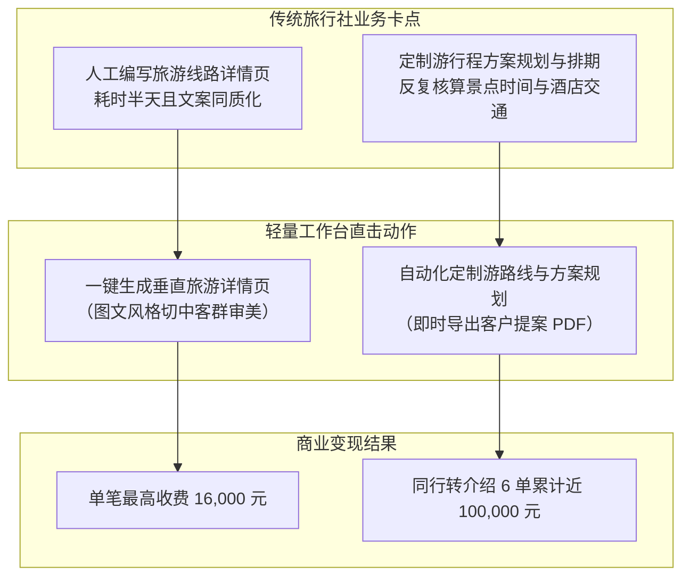
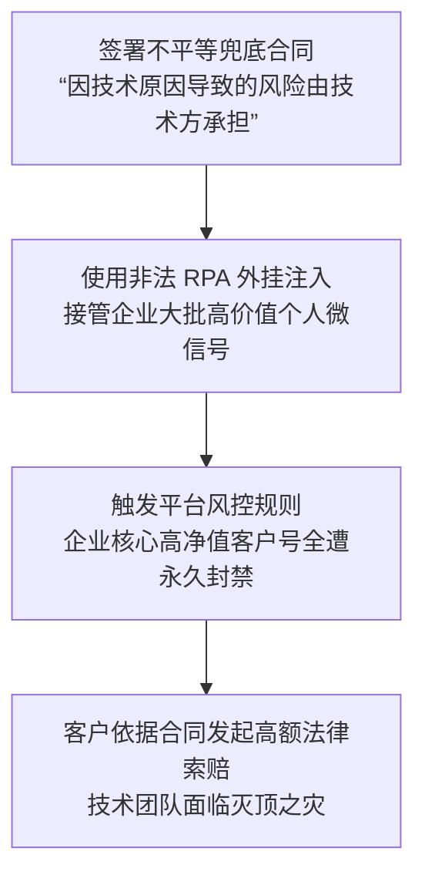
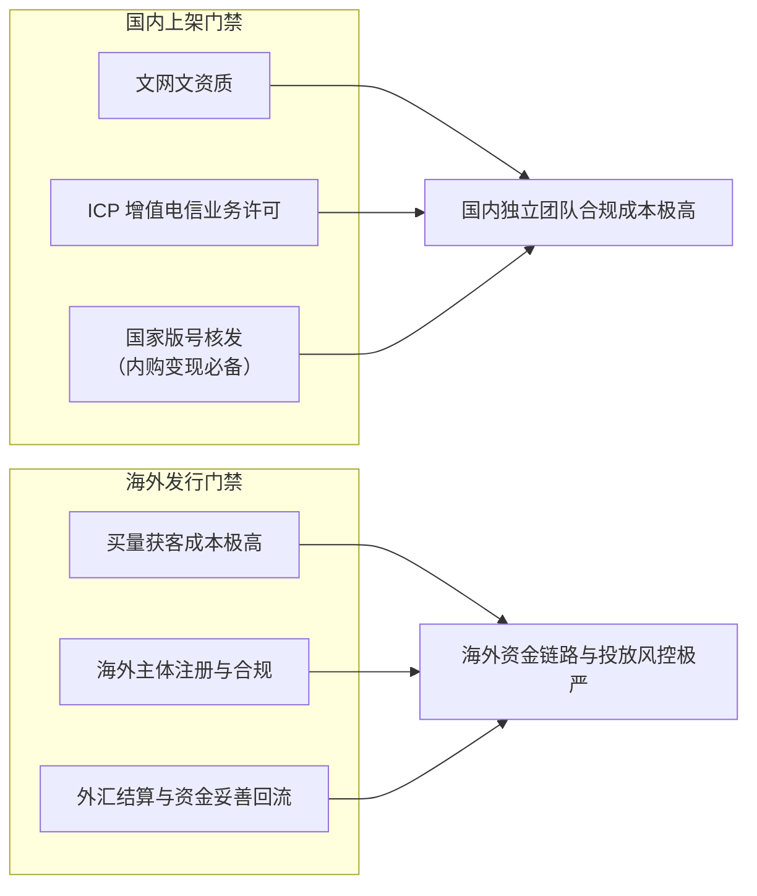

# 2026-11-06 · 第1场直播

> 本文全息记录 2026 年 11 月 6 日晚至次日清晨（连续 10.5 小时）《企智AI落地派》连麦核心实战讨论。覆盖旅游老兵 10 万元六单工作台拆解、东莞微信自动化封号索赔案、加群获客垂直穿透、商业 AI 吃 Token 差价真相、游戏出海资质壁垒、硬科技与 OPC 概念去伪、瑞幸式智能客服人机分流架构，以及产学研交付边界。

---

## 目录

- [一、 旅游行业老兵 10 万元工作台实战：直击核心痛点的垂直交付](#一-旅游行业老兵-10-万元工作台实战直击核心痛点的垂直交付)
- [二、 获客社群穿透论：为什么加 100 个 FDE 群不如加一个跨境群](#二-获客社群穿透论为什么加-100-个-fde-群不如加一个跨境群)
- [三、 东莞微信 RPA 自动化营销封号索赔惨案：交付风险与责任边界](#三-东莞微信-rpa-自动化营销封号索赔惨案交付风险与责任边界)
- [四、 商业 AI 软件生存真相：吃 Token 差价的微利陷阱](#四-商业-ai-软件生存真相吃-token-差价的微利陷阱)
- [五、 个人团队游戏 AI 与出海变现：资质、流量与资金链路深水区](#五-个人团队游戏-ai-与出海变现资质流量与资金链路深水区)
- [六、 硬科技与概念炒作的投资账本：方拓生物亏损注资 vs OPC 虚胖](#六-硬科技与概念炒作的投资账本方拓生物亏损注资-vs-opc-虚胖)
- [七、 生产级智能客服人机分流：瑞幸客服架构与 RAG 落地选型](#七-生产级智能客服人机分流瑞幸客服架构与-rag-落地选型)
- [八、 产学研合作与上市公司项目交付边界：嘉兴清华长三角研究院经验](#八-产学研合作与上市公司项目交付边界嘉兴清华长三角研究院经验)
- [九、 行动实践闭环（Actionable Practice）](#九-行动实践闭环actionable-practice)

---

## 一、 旅游行业老兵 10 万元工作台实战：直击核心痛点的垂直交付

直播连麦中，现场分享了一个极具代表性、打破“唯高深技术论”的真实中小企业交付案例。

### 1. 案例背景与开发者画像

开发者是一位在传统旅游行业深耕十余年的老兵，技术底子非常薄弱（连普通话表达都稍显结巴，自己在 Cursor/Web coding 里面搓工作台代码时，把前后端结构都搓得凌乱不堪）。然而，正是这个被许多专业程序员看起来“甚至连架构都谈不上”的轻量工作台，在短短两周内**连续卖给了 6 家同行旅行社，最高单笔收费 1.6 万元，累计创收近 10 万元**。

### 2. 为什么小老板愿意真金白银买单？

很多技术人总以为客户付费是因为底层接入了多么复杂的向量数据库、写了多么优雅的知识库架构或 RAG 工作流。但对每天在生死线上摸爬滚打的旅行社老板而言，他们完全看不懂也不关心背后的技术。该工作台能够让同行抢着掏钱的理由，极其精准地落在了两个刚需点上：

- **第一核心卖点：旅游线路详情页快速生成**。传统旅行社新上一条线路，运营人员要花费大半天在网上东拼西凑景点介绍、注意事项、费用包含与精美排版；该工具输入目的地、天数、目标客群（亲子、研学、银发夕阳红），即可一键输出符合排版审美的图文详情页；
- **第二核心卖点：旅游方案排期规划助手**。输入客户预算与核心诉求，直接秒级生成标准提案供销售直接发给终端游客。

### 3. 给技术交付者的底层启示

中小企业老板根本不需要你帮他重构全套 IT 架构，更不关心你用的是什么前沿框架。他们对软件的价值衡量尺度极其单一且直观：**“这个工具能不能帮我今天少招一个人？能不能帮我今天多出一份报价单？”** 

对于缺乏雄厚技术沉淀的独立开发者而言，**深耕自己熟悉的行业（行业纵深 > 通用技术）**，用 AI 解决行业内部最显性、最占时间的日常劳动，是最低成本也是最容易拿到正向现金流的交付捷径。

---

## 二、 获客社群穿透论：为什么加 100 个 FDE 群不如加一个跨境群

直播间围绕开发者获客中普遍存在的“同温层自嗨”现象展开了深刻剖析。

### 1. 普遍存在的无效动作：技术群里找客户

许多刚接触 AI 接单的工程师或 OPC 创业者，日常最热衷的事情是混迹在各大“AI 落地交流群”、“FDE 实践群”、“智能体研讨群”里，每天在群里讨论模型评测、提示词工程、微调参数。

但连麦嘉宾一针见血地指出：**“你在 FDE 群里能接到什么单？里面全都是跟你一样的技术人，全都在找客户、都在互相卷报价，一个真正的买方都没有！”**

### 2. 垂直人群穿透法则

真正的商业获客，必须打破同行圈子，潜入真正有支付能力、有生产痛点的产业社群：

- **去加阿里国际站运营群、亚马逊卖家群、出海独立站群**：这群人每天头疼的是商品主图合规、多语言 Listing 编写、海外客服时差与退货争议。他们是一个具备高度共性的群体，**只要你攻克并服务好其中一个商家的需求，这套解决方案就能零边际成本复制卖给群里的另外 50 家**；
- **去加工厂外贸接单群、地方家具建材商会群**：他们关心的是 CAD 图纸报价、外贸客户询盘催更、海外邮件润色。在这些群里，会使用 AI 工具生成高质量沟通话术的技术人，在传统制造业老板眼里就是不可多得的降本帮手。

---

## 三、 东莞微信 RPA 自动化营销封号索赔惨案：交付风险与责任边界

连麦中现场披露了去年下半年在东莞发生的一桩极为惊险的真实私域交付事故，给所有从事私域自动化、RPA 代运营的团队敲响了法律警钟。

### 1. 案情还原与合同致命死穴

东莞某技术服务团队为当地一家中大型制造零售企业承接私域自动化营销项目。为了帮客户提高私域加粉与多群运营人效，该团队采用了基于 RPA（机器人流程自动化）拦截个人微信客户端的方案。

最致命的漏洞出在双方签订的合同条款上：技术团队为了促成签约，在商务谈判中轻易妥协，签下了**“因技术实施原因所导致的企业资产损失与运营风险，均由技术开发方承担全额连带赔偿责任”**的免责兜底承诺。

### 2. 灾难发生：核心资产被封与高额索赔

项目上线没多久，腾讯微信官方启动新一轮外挂与脚本专项治理，企业用于承接上万高净值复购客户的数十个核心个人微信号在短时间内被系统判定异常，**全量永久封号**。

对于该企业而言，这些沉淀了数年私域资产的微信号是其核心命脉。客户直接根据合同中的“技术兜底条款”，向该技术团队发起了数十万元的高额损失索赔，导致该技术初创团队面临解体与法律官司。

### 3. 个人开发者与初创团队的“防御性交付”底线

- **严禁轻易签写无上限的“技术兜底”协议**：任何基于第三方公域/私域平台（微信、抖音、亚马逊、TikTok 等）的自动化工具，其协议规则与封禁策略随时可能动态调整。必须在合同中明确界定**“平台规则不可抗力变更免责”**与**“平台生态治理免责”**条款；
- **个人形式参与 vs 匆忙成立公司运作的风险评估**：如果是小团队早期摸索阶段，切忌在项目尚未跑通合规逻辑时，就急冲冲成立公司向 B 端大规模兜售未经授权的图文过桥工具或爬虫工具。一旦引发侵权、盗图、封号，公司法人和股东将直接面临复杂的财务审计与民事诉讼。

---

## 四、 商业 AI 软件生存真相：吃 Token 差价的微利陷阱

针对当前市面上层出不穷的 AI 套壳网站、工具型 APP 与 SaaS 产品，连麦嘉宾揭开了其底层的商业变现残酷真相。

### 1. “会员费”只是伪装，本质全在倒卖 Token

目前市场上 90% 以上由独立团队搭建的 AI 写作、AI 翻译、AI 图片工具，表面上宣称是按月/按年收取 99 元、199 元的 VIP 会员费，但在其底层财务账本上，**本质上就是一个倒卖上游大模型 Token 差价的二道贩子**。

- 上游公有云平台（或聚合转发通道）以每百万 Token 极低的价格批发；
- 套壳站通过前端界面和提示词包装，限制用户的单次上下文长度与调用频次，赚取中间那点微薄的 Token 计费差价。

### 2. 为什么靠会员模式很难做大？

- **用户流失率极高（续费断崖）**：绝大部分尝鲜用户在用完第一个月后便不再续费，因为开源工具和竞品层出不穷；
- **算力成本反噬**：一旦部分高频用户开始密集使用长上下文或复杂生图，套壳站收取的那点会员费瞬间被上游 API 账单击穿，甚至出现“用户用得越多、平台亏得越惨”的倒挂局面；
- **出路何在**：单纯倒卖 Token 差价没有商业护城河。AI 工具必须从“泛功能工具”转向“企业核心流程履约”，以**业务结果提成（如线索量、订单处理量）**而非以“模型调用次数”作为计费基准。

---

## 五、 个人团队游戏 AI 与出海变现：资质、流量与资金链路深水区

直播中有开发者提问：“目前一两个人的小团队，是否有可能完全借助 AI 研发一款商业游戏并在海内外变现？”现场嘉宾结合自身从业经历给出了客观且克制的冷思考。

### 1. 研发早已不是瓶颈，难在流量与供给过剩

在 Cursor、Claude 等代码生成工具以及 Midjourney 等美术素材工具的加持下，一两个人利用现成开源引擎（Godot、Unity 等）搓出一款玩法完整的休闲小游戏（如类似跳一跳、消消乐、爬塔卡牌），在工程层面已毫无难度。

**但“开发出来”与“卖得掉”完全是两码事**。现在的现状是全球游戏供给量呈几何级暴增，而各大平台的公域流量总量是有限的。当你上线一款简单的跳一跳小游戏时，应用市场上可能早有上千款同质化产品在打买量价格战。

### 2. 国内与海外的合规深水区

- **国内发行门槛**：游戏在中国大陆正规上架有着极其严格的资质牌照壁垒。纯免费广告变现尚需文网文与 ICP 备案；若要开启应用内购买（IAP）直入收费，则必须取得国家版号，这对于绝大多数个人 OPC 而言几乎是不可能跨越的高山；
- **海外发行门槛**：虽然在海外（Steam、Google Play、App Store）上架相对自由，但**海外买量成本极其昂贵**，若没有极佳的自然传播裂变属性，产品上架后基本沉入大海；同时，海外资金如何通过正规合规链路妥善结汇回国，亦需要耗费大量的通道与税务成本。

---

## 六、 硬科技与概念炒作的投资账本：方拓生物亏损注资 vs OPC 虚胖

连麦中对当前市场上泛滥的“一人公司（OPC）”、“FDE 全能顾问”等时髦概念进行了彻底脱水打假，并以苏州工业园区的生物医药产业投资账本进行了深刻对照。

### 1. 概念剥皮：OPC 与当年的个体户有何本质不同？

嘉宾犀利指出，今年“OPC”这个词被各路自媒体炒得火热，但剥开概念外衣，十年前在路边摆摊做贸易的“个体工商户”算不算 OPC？早些年接外包写代码的“自由职业者”算不算 OPC？大学生创业一人包揽美工、运营、客服算不算 OPC？

**如果只是一个人干活，却没有形成自身不可替代的行业壁垒与客户履约结果，换个时髦的英文缩写并不能让你的商业模式发生任何质变。**

### 2. 苏州生物医药产业账本：为什么方拓生物亏损几十个小目标依然源源不断获投？

在苏州工业园区等国家级高新区，以方拓生物等为代表的基因治疗与生物医药创新企业，每年研发投入亏损达数千万元乃至数亿元，但顶级产业资本依然排队注资。原因在于：
- 其研发成果是**经过严格临床试验与专利保护的硬科技资产**；
- 每一个分子结构、每一次临床数据推进，都是实打实推高商业估值的不可替代壁垒。

反观泛 AI 圈里部分自吹自擂的“OPC 估值神话”，既无核心代码知识产权，又无垂直行业数据，仅靠几个封装好的公共大模型 API 就妄图向资本要估值，在资本冰冻期就是自欺欺人的泡沫。

---

## 七、 生产级智能客服人机分流：瑞幸客服架构与 RAG 落地选型

智能客服是很多团队承接的第一单 AI 落地业务，但现场结合瑞幸咖啡等头部消费品牌的真实智能客服系统，剖析了企业落地中的核心工程准则。

### 1. 瑞幸客服的“人机分流”兜底原则

很多技术新手给客户推销 AI 客服时，总夸下海口“能 100% 取代人工客服”。但在真实消费场景中，这必然导致灾难性客诉。以瑞幸咖啡客服体系为例：

- **高频基础问题由 AI 拦截**：针对“优惠券怎么用”、“某家门店几点打烊”、“外送超时赔付规则”等具有唯一确定答案的问题，由大模型结合知识库在秒级完成精准回复与引导；
- **复杂边界与情绪问题秒切人工**：一旦用户输入包含“饮品异物”、“态度恶劣”、“投诉到食药监”、“退款未到账”等敏感词，或上下文交互超过 2 轮仍未解决问题时，系统必须**瞬间无缝流转至真人客服介入**，绝不允许模型在关键争议点上胡说八道或进行套路化车轮战。

### 2. RAG 知识库工程选型：别盲目迷信开源全家桶

在讨论中，有连麦观众提及 GitHub 上热门的 RAG Pro 等开源知识库框架。现场技术专家提醒：
- 开源 RAG 框架能让你在一小时内搭建起可交互的 Demo，但在企业真实私有化部署时，文本切块（Chunking）策略、多路召回（BM25 + 向量召回）重排（Rerank）、表格与扫描件 OCR 识别，才是决定回答准确率的生死线；
- 交付企业时，不要一味追求炫技部署大模型，**把企业内部的业务枚举字典梳理干净，比换什么 Embedding 模型的提效效果都要高出几倍**。

---

## 八、 产学研合作与上市公司项目交付边界：嘉兴清华长三角研究院经验

连麦后半段，有在体制内研究机构任职的资深专家分享了依托高校二级研究院（如嘉兴浙江清华长三角研究院平台）参与上市公司 AI 项目研发的实战心得。

### 1. 产学研协同的真实身位

在与上市公司或地方大型国企联合推进项目时，高校研究院的背景能够提供强有力的**学术背书与立项合规背书**；但落到具体执行层面，实体制造业和上市公司高管的决策逻辑是极其实用主义的：

- 他们不会因为你是名校背景就盲目买单；
- 他们更看重的是**知识产权归属（IP Ownership）、系统可维护性，以及出了故障后责任如何划定**。

### 2. 交付边界划分：系统算谁的？责任算谁的？

在为大中型企业或实体商家定制系统时，交付团队必须在项目前期明确界定：
- **知识产权与二次开发权**：是为企业做专属代码资产买断，还是提供 SaaS 化使用权；
- **故障与数据泄露追责界限**：当外部云厂商大模型 API 出现服务中断或宕机时，必须在 SLA（服务等级协议）中清晰界定技术方的维护响应时间与免责范围，切忌因技术傲慢做出超出自身能力边界的无限责任承诺。

---

## 九、 行动实践闭环（Actionable Practice）

基于整场直播中沉淀的实战经验，为各位从事 AI 接单交付与商业落地提供以下可立即落地的行动清单：

1. **退出无效纯技术社群，完成客群垂直迁移**：
   - 本周内梳理并退出那些只沉迷于模型测评与概念互吹的技术群，主动加入 3~5 个具有明确业务支付能力的垂直行业群（如外贸独立站、跨境电商、本地旅游、工业模具）；
2. **审查并修订现有商务合同中的“风险兜底条款”**：
   - 彻底排查以往合同中是否存在类似“因技术原因导致的一切损失由乙方承担”的致命承诺；立即补充“第三方平台政策变更、封禁等不可抗力免责声明”；
3. **将交付重心从“高大上架构”转向“显性降本单点”**：
   - 学习旅游老兵的工作台打法，在与客户沟通时，不再推销“全套智能体协同系统”，而是把能力聚焦在“秒级生成宣传详情页”、“10 秒导出客户报价单”等肉眼可见的业务产出上；
4. **为所有智能客服项目增加“人工兜底秒切机制”**：
   - 在任何面向终端客户的问答 Agent 中，严格配置敏感词触发器与会话轮次上限，确保在用户产生投诉情绪时能第一时间切换至人工介入，守住企业客户的声誉红线。

---

*知识库专栏分类：企智AI落地 · 发布前校订完成*
