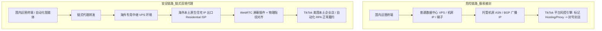
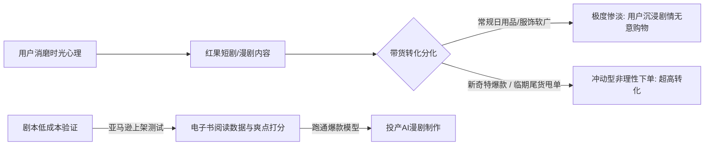
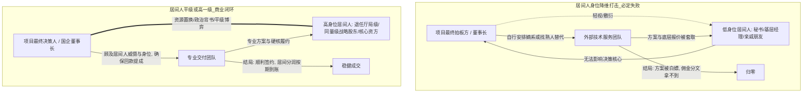
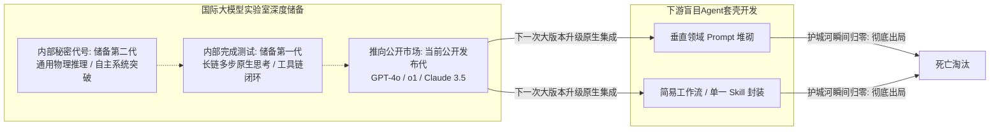
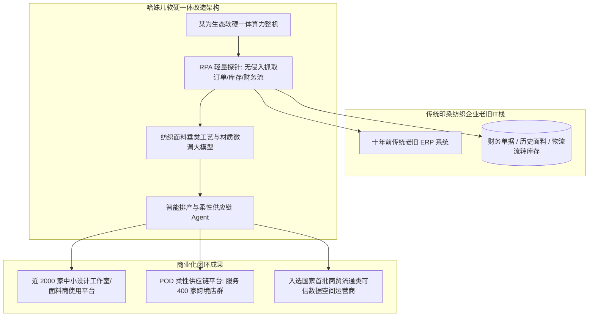
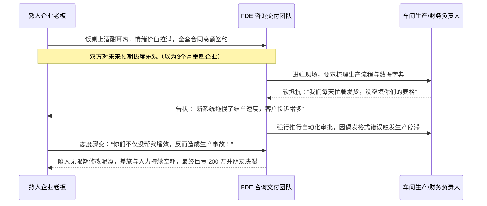
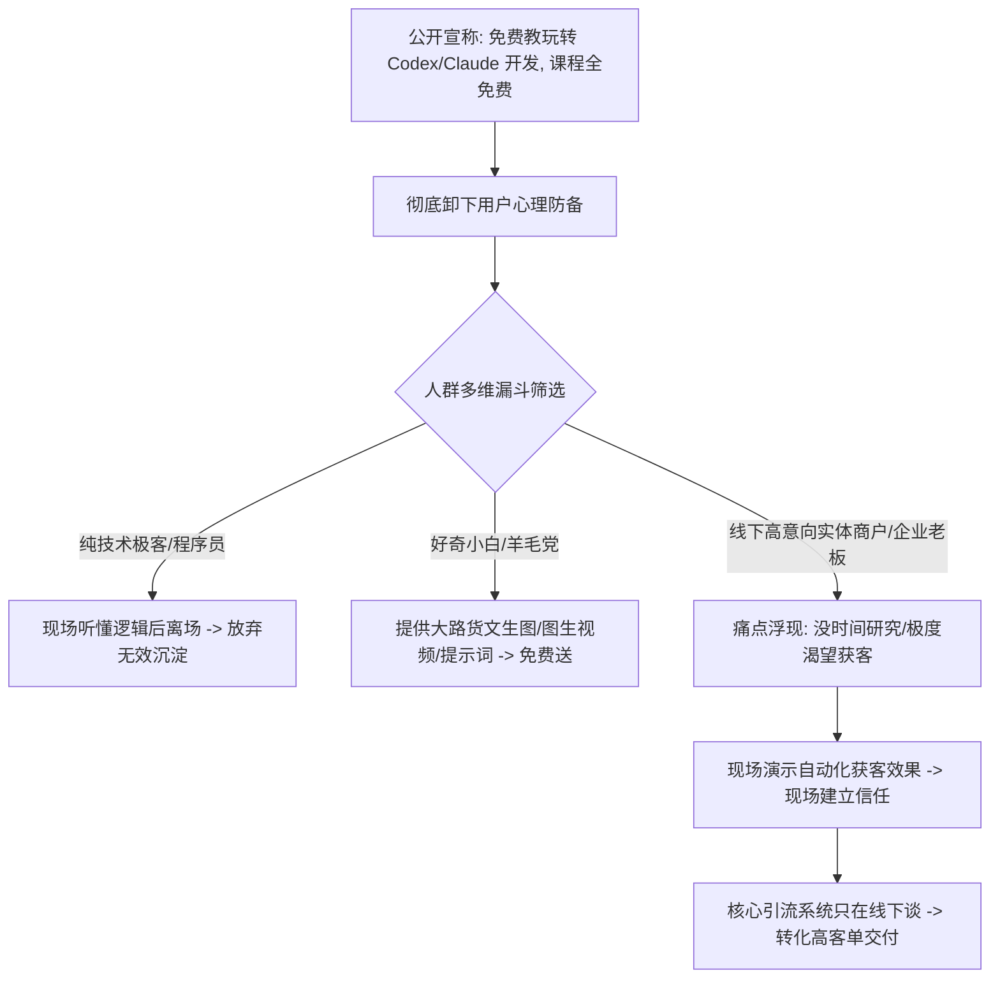
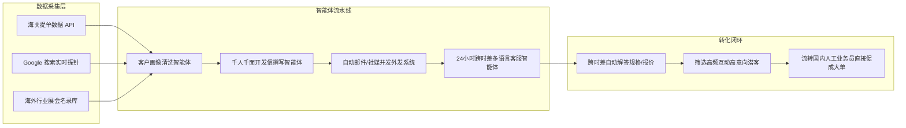
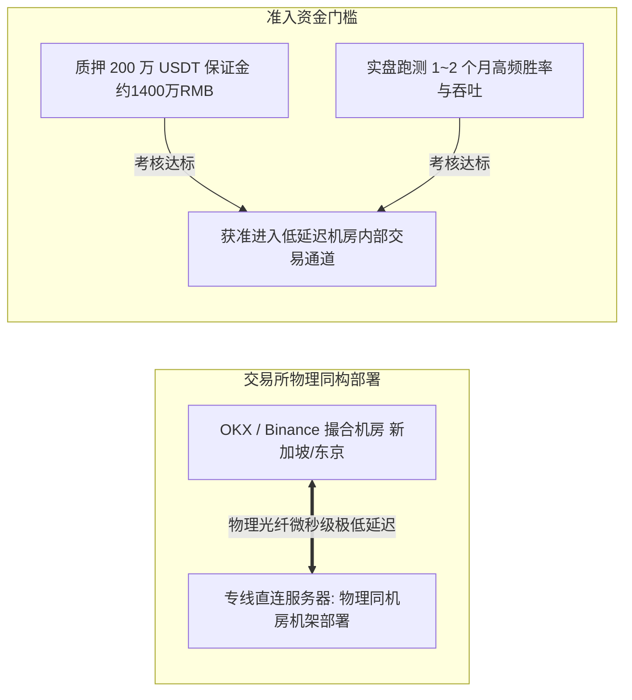

# 2026-11-07 · 企智AI落地派（Session 108 · 9小时通宵连麦全息还原）

> 本场直播为《企智AI落地派》连续 8 小时 57 分钟（3,521 行脱水事实文本）的通宵深度连麦实录。整场连麦跨越了深夜至清晨，汇聚了大厂技术老兵、具身智能算法核心、海外跨境卖家、南通纺织产业领军人、Meta 新加坡安全专家、全国算力硬件服务商以及一线野生 OPC 操盘手。
> 
> 全文彻底摒弃提纲式抽象概括，全景还原 23 个具备真金白银交易与实操对抗价值的独立案例单元，涵盖跨境底层网络伪装、法律大模型反向推演、短剧漫剧带货、老旧 ERP 的 RPA 逆推改造、VC 视角与一线现金流 OPC 的世纪大交锋、FDE 熟人首单亏损 200 万复盘、第二大脑与智能体团队重构、同城获客截流心理博弈、外贸全自动智能体链条，以及全国算力集群与量化交易的残酷真相。

---

## 目录索引

- [卷一 · 跨境底层攻防与专业级法律智能体：原生住宅出口、风控连坐与法典反向推演](#卷一--跨境底层攻防与专业级法律智能体原生住宅出口风控连坐与法典反向推演)
- [卷二 · 泛娱乐流量、黑产诈骗与微短剧漫剧带货新生态](#卷二--泛娱乐流量黑产诈骗与微短剧漫剧带货新生态)
- [卷三 · 高精尖产业专利大模型与端侧交互创新：量子超导知识产权与输入法重构](#卷三--高精尖产业专利大模型与端侧交互创新量子超导知识产权与输入法重构)
- [卷四 · 组织政治、居间人身位博弈与特工式入企实战](#卷四--组织政治居间人身位博弈与特工式入企实战)
- [卷五 · 头部具身大脑算力账本与物理 AI 路线分化](#卷五--头部具身大脑算力账本与物理-ai-路线分化)
- [卷六 · 世纪大辩论：VC精英打工心态 vs 野生OPC出海现金流对轰](#卷六--世纪大辩论vc精英打工心态-vs-野生opc出海现金流对轰)
- [卷七 · 区域园区招商现实与传统纺织 3000 万产值软硬一体落地](#卷七--区域园区招商现实与传统纺织-3000-万产值软硬一体落地)
- [卷八 · 大厂内部认知：Meta 新加坡专家拆解第二大脑与全球封号风暴](#卷八--大厂内部认知meta-新加坡专家拆解第二大脑与全球封号风暴)
- [卷九 · FDE 企业交付血泪账与单人陪跑致命陷阱](#卷九--fde-企业交付血泪账与单人陪跑致命陷阱)
- [卷十 · 获客截流兵法与心理博弈战：免费教 Codex 筛选精准客资实操](#卷十--获客截流兵法与心理博弈战免费教-codex-筛选精准客资实操)
- [卷十一 · B端外贸全自动开发信智能体与外包合作避坑指南](#卷十一--b端外贸全自动开发信智能体与外包合作避坑指南)
- [卷十二 · 全国算力集群格局与金融量化残酷真相](#卷十二--全国算力集群格局与金融量化残酷真相)
- [卷十三 · 企智落地核心资产台账与行动清单](#卷十三--企智落地核心资产台账与行动清单)

---

## 卷一 · 跨境底层攻防与专业级法律智能体：原生住宅出口、风控连坐与法典反向推演

### 1. 美区 TikTok 本土企业店风控与网络伪装底层架构（Jonah & 藏总连麦）

在跨境电商出海（尤其是美区 TikTok Shop 本土店）实操中，大量国内团队遭遇了批量封店与账号封禁。现场深入拆解了海外平台最核心的风控探测机制：

- **机房 IP（Hosting IP）秒死律**：TikTok、Amazon 等头部平台拥有庞大的 IP 威胁情报数据库（如 IP2Location、MaxMind）。任何来自机房、数据中心（如 AWS、DigitalOcean、Linode）的 IP 地址，其 ASN 属性直接标记为 Commercial/Hosting。一旦用于登录本土店铺或自动化发帖，立即触发高危风控拦截；
- **双境架构（链式中继 + 住宅出口）**：稳健的操作必须使用双层网络隔离。第一层为稳定的专线或中继服务器，第二层出口必须强行绑定为海外本土真实的家庭宽带住宅 IP（Residential IP，如 AT&T、Comcast 原生宽带出口）；
- **Bot 与店铺环境同构原则**：运行自动化任务的智能体（Bot）如果部署在云端服务器，而人工查看店铺却在另一个 IP，两者环境指纹冲突会瞬间导致关联封禁。自动化智能体必须部署在与店铺完全相同的物理指纹与住宅网络栈之下；
- **WebRTC 协议泄漏防范**：单纯的全局代理无法完全防御浏览器底层的 WebRTC 穿透探针，真实局域网内网 IP 或公网 IP 会通过 UDP 数据包直接绕过代理泄露给平台前端。必须在浏览器环境中安装并启用专用插件（如 `WebRTC Control`、`WebRTC Live`），强制切断一切未通过代理通道的 UDP 穿透探测。

### 2. 法律大模型微调与反向推演实战

在专业服务领域，通用大模型（如未精调的 GPT 或开源模型）在处理诉讼业务时常因合规腔、套话过多而完全无法辅助专业律师。连麦中分享了极度刁钻的垂直法律智能体构建方法：

- **角色设定：“极其专业狡猾的资深辩护律师 + 绝对忠诚当事人”**：如果仅给模型设定为“客观公正的法律顾问”，模型会输出大量模棱两可、中庸平衡的法条释义，没有任何实战进攻性。必须将其人格定义为“寻找程序瑕疵与证据漏洞的顶尖辩护人”，让其从底层逻辑上站在当事人单侧立场；
- **法律三位一体反向推演**：输入案件全部证据卷宗，将《中华人民共和国民法典》《中华人民共和国刑法》《中华人民共和国刑事诉讼法》的全部交叉条款注入上下文，指示智能体执行“反向穿刺”——假设自己是对方代理人或公诉人，推演对方可能发起的每一项指控漏洞，并在己方辩护词中提前设置逻辑陷阱；
- **刑事与行政法律术语的严苛界限**：普通人容易混淆“询问”与“讯问”，大模型在中文语境下也极易泛化。智能体必须建立强制语法校验字典：针对证人、被害人、行政相对人只能用“询问（Inquiry）”，针对犯罪嫌疑人、被告人必须用“讯问（Interrogation）”。一旦在文书中出现法律主体与动词错配，直接判定为不专业文书；
- **中英文混合调用与底层法系冲突**：在处理涉外涉港业务时，如果直接用英文 Prompt 调用中文法条，大模型容易调用英美普通法系（Common Law）的判例思维去解释大陆法系（Civil Law）的成文法法典，产生灾难性的法律混淆。必须物理隔离提示词与知识库，严格锁定大陆法系的成文法逻辑。

---

## 卷二 · 泛娱乐流量、黑产诈骗与微短剧漫剧带货新生态

### 1. 灰产黑话与福建假冒 TikTok 平台诈骗案

在探讨出海与跨境电商红利时，连麦嘉宾披露了真实地下黑产的血腥欺诈案例：

- **福建团队复刻高仿假冒 TikTok 平台**：诈骗团伙自行开发了一套与海外 TikTok 界面 100% 孪生的假冒海外电商平台，随后在国内外贸与电商圈疯狂招商，声称“美区 TikTok 官方绿色通道，入驻免审核、免保证金”；
- **诱导商户入驻与发货，卷款跑路**：大量不知情的中小商户入驻后，骗子在后台伪造海量海外虚拟订单。商户信以为真，按照虚假地址真实采购并发运了大量货物。当商户准备提现货款与利润时，平台以“跨境税金未结清、账户异常需交纳保证金”为由拒绝提现，最终资金盘整体崩盘，主犯卷款数千万元潜逃；
- **地下黑产冷酷生存法则**：“五年以下没有利润”——真正赚钱的黑灰产早已把刑事判罚年限折算入财务成本模型中，普通合法创业者盲目去市场上寻找所谓“偏门暴利出海捷径”，绝大多数只能成为地下操盘手屠宰的肥羊。

### 2. 平台分化与数字人无人直播的封禁红线

现场深入辩论了在抖音、快手、京东、美团开展数字人无人直播的技术攻防：

- **平台战略分化根源**：
  - **美团与京东**：在部分本地生活、到店团购与标准品类目中，对无人直播和数字人采取了相对默许和宽容的放水态度。根本原因在于这两大平台缺乏像抖快那样充沛的短视频公域内容流量，极度渴求低成本的开播时长来消耗商户券包；
  - **抖音与快手**：将未经官方授权的纯自动化无人数字人直播列为严打对象，算法不仅检测视频画面与音视频重复率，更通过多模态探针检测真人交互延迟、呼吸微动作与摄像头物理畸变；
- **社会就业与监管终极红线**：一旦主流内容平台全面开放无人数字人自动化带货，将直接在数月内摧毁数百万中底层真人主播、助播、场控的饭碗，引发严重的社会就业伦理失衡。因此，主流平台必然会将“纯自动化无人直播”限制在极小范围内，任何依靠此类技术套利的团队，资产随时面临归零风险。

### 3. 红果短剧、漫剧带货与爽文商业隐喻

随着字节跳动旗下“红果免费短剧”迅速崛起，电商带货逻辑正在发生剧烈重构：

- **红果电商与抖音电商的内部分立**：红果凭借免费短剧聚集了数千万下沉市场的沉浸式流量，平台内部正全力搭建属于红果自身的独立电商交易闭环；
- **带货品类生与死的严苛边界**：
  - **死穴**：在短剧漫剧中强行插播常规服饰、美妆或高客单价标准品，转化率极其低下。因为用户看短剧的核心诉求是“消磨时间与获取多巴胺爽感”，具有深思熟虑属性的商品根本卖不动；
  - **生路**：新奇特解压玩具、极低客单价的临期食品尾货、工业清仓甩单爆款。必须匹配剧情冲突，让用户在无需思考的极短决策窗口内产生冲动型非理性下单；
- **现代商业模式与历史爽文隐喻**：当前爆款短剧与漫剧的核心爽点，本质上是现代工业文明与商业套路的降维打击。例如“现代商业大佬/雷军穿越秦朝”，依靠流水线品控、期货合约、加盟代理和会员裂变机制，对古代手工作坊形成降维碾压，底层完全是在贩卖现代人对商业认知垄断的意淫快感；
- **亚马逊电子书低成本测剧本打法**：千万级短剧漫剧制作最大的风险是剧本扑街。聪明团队在立项前，先用 AI 将核心故事大纲扩写为中短篇网文，直接上架亚马逊 Kindle Direct Publishing（KDP）或其他海外轻阅读平台，以极低的分发成本测试各章节的完读率、跳出率与付费率，仅对跑通数据模型的剧本进行 AI 视频化与漫剧资产渲染。

---

## 卷三 · 高精尖产业专利大模型与端侧交互创新：量子超导知识产权与输入法重构

### 1. 量子超导与可控核聚变领域的专用 AI 专利大模型（初心总业务实战）

在一片唱衰大模型无法落地的声音中，初心总团队展示了一个在顶尖科研与产业资本深水区默默闷声发大财的纯技术闭环：

- **不做大路货散单专利申请**：传统代理机构帮小企业写普通外观专利、实用新型专利，单价仅几百到一千块，极度内卷且利润微薄；
- **切入天使轮到 A+ 轮高精尖硬科技企业**：该团队全公司不足 30 人，专注服务量子计算、高温超导、可控核聚变、商业航天等国家级前沿硬科技初创企业；
- **顶级资方生态背书获客**：高科技企业的早期投资机构（一线顶级 VC、国家母基金）在投后最担心的就是创始团队的技术遭遇国际竞对（如 IBM、Google、Lockheed Martin）的专利封锁或诉讼绞杀。资方直接将已投企业名单指派给初心总团队进行知识产权尽调；
- **产品形态与客单价**：
  - **核心交付物**：不是代写申请书，而是全域全球顶尖竞对专利壁垒排查分析、专利防御战壕构筑报告，以及企业技术路线白皮书；
  - **物理隔离硬件一体机**：硬科技企业对核心代码与配方外泄零容忍，绝不可能使用公网 API。团队以 **10 万 ~ 15 万元/台** 的价格交付预装专属微调专利大模型的软硬一体机，实现物理级断网本地化部署与私有化推演。

### 2. 小川输入法：端侧 AI 智能键盘的交互重塑

针对通用大模型 App 需要切换屏幕、打字输入繁琐的痛点，现场讨论了 iPhone 智能键盘（小川输入法）的端侧即时赋能模式：

- **告别切屏问答**：将模型推理能力前置并无缝嵌入到 iOS 原生键盘底层，在任何聊天软件（微信、WhatsApp、飞书）中直接调用；
- **即时恋爱话术与商务公关推荐**：键盘实时抓取当前对话框上文内容，识别沟通对象属性（客户、上级、伴侣），并在打字面板上方实时联想输出 3 个不同情商、不同语气的高段位回复选项，一键点击直接上屏发送；
- **Workerbot 企业协同与防员工飞单**：在 B 端企业销售管理场景中，类似键盘技术被用于监控外勤销售沟通合规性。所有沟通历史在本地端侧结构化提取沉淀入库，当销售离职时，所有客户偏好画像与商务进展完整留存在企业知识库中，彻底杜绝“员工离职带跑核心客户与聊天记录”的顽疾。

---

## 卷四 · 组织政治、居间人身位博弈与特工式入企实战

### 1. 商业居间人身位铁律：必须平级或高一级

在对接大型企业、政企工程或高校重大项目时，大量技术团队依赖“居间人（中间撮合人）”引荐，但往往落入白忙活一场的陷阱：

- **居间人低一级必被白嫖**：如果居间人只是目标企业老板的朋友、下属或者一般亲戚，这种居间人毫无话语权。技术团队提交的详尽方案、核心报价往往会被企业老板转头交给自己的亲信团队照抄复刻，技术方与居间人被直接一脚踢开；
- **居间人平级或高一级定律**：只有当居间人在体制内地位、社会资本或商业身位上**与项目方董事长平级，甚至高于董事长一级**（如退任厅级领导、核心母基金合伙人、上游独家原材料供应商）时，大单才能真正落地。企业老板顾及居间人的威慑力与后续巨大利益交换，绝不敢赖账或白嫖提成；
- **教育集团居间人血淋淋实操**：某教育集团数字化改造项目中，居间人因自身身位不够强硬，前期承诺的 20% 居间费在合同签订后被项目方以“财务审计合规”为由无限期推诿，最终不得不打折至 2% 甚至不了了之。

### 2. 特工式招聘入企：化解中层数字化防御的绝招

外部 FDE（前线部署工程师）或 AI 咨询顾问进驻传统中大型企业时，最强烈的抵制力量永远不是底层员工，而是**掌握既得利益的业务总监与部门中层**：

- **业务中层的防御逻辑**：外部数字化系统上线意味着部门流程透明化、寻租腐败空间被堵死、编制人头被裁撤。一旦系统出现任何微小瑕疵，中层会无限放大事故并向董事长告状，逼退外部顾问；
- **特工式招聘入企解法**：老练的操盘团队绝不以“外部高调颠覆者、AI 赋能顾问”的名义进驻。而是由企业老板发起一次定向社招，**将 FDE 核心骨干直接包装为内部正式招聘的业务经理或IT主管入职**；
- **以内部人身份推倒柏林墙**：以企业内部员工身份参与各部门例会，深入一线车间排查业务痛点，不谈高大上的 AI 概念，只以“帮部门总监写周报、帮部门排产抗锅”的亲和身位逐步推进工具替换，直至流程完全跑通并形成既定事实，彻底化解组织内部政治抗性。

---

## 卷五 · 头部具身大脑算力账本与物理 AI 路线分化

在连麦中段，来自国内最头部具身智能大脑公司的资深核心（知英）上麦，对当下被资本过度炒作的具身智能赛道泼下了一桶极其冷酷的冰水。

### 1. 顶级具身大脑算力底牌与 VLA 窘境

市场普遍以为头部具身智能企业拥有海量超级计算集群，现场披露的真实硬件账本令人瞠目结舌：

- **自研物理算力极其贫血**：国内最头部的具身大脑公司，其内部自持的顶级计算硬件**自有 NVIDIA H100 仅 200 余张，H200 仅 100 余台**。其余用于预训练的海量算力，绝大部分依赖极度昂贵且受出口管制的云端算力租赁；
- **VLA（Vision-Language-Action）路线推进艰难**：端到端的视觉-语言-动作模型在实际落地中卡点极重。由于缺乏真实世界高保真物理交互数据集，现阶段绝大多数国内外展示的机器人倒水、折衣服视频，本质上是大量人工遥操作（Teleoperation）采集的数据过拟合，离工业级稳定泛化仍差十万八千里；
- **世界模型（World Model）与因果架构分化**：清华教授团队提出 Physical AI 自我递进学习路线（RSI），而上海超进化等团队通过论文跟风商业化，迅速利用概念拿到数十亿估值；近期美国常春藤盟校教授提出的“基于因果关系的世界模型”细分路线亦狂揽近 1 亿美元融资，但整体技术仍处于极其初始的学术实验室阶段。

### 2. 国际头部实验室的“储备两代、发布一代”

知英披露了大模型上游巨头的战略节奏与对下游套壳团队的降维碾压：

- **下游垂直 Agent 的小白鼠宿命**：上游基座模型每一次原生迭代（如原生支持函数调用、原生支持屏幕感知、原生多步长思考），都会直接在眨眼间抹杀数万家下游初创团队耗时数月搭建的所谓垂直应用；
- **天价年薪背后的期权对赌真相**：
  - **核心硬件总监**：现金年薪 150 万 ~ 200 万元，外加 100 万 ~ 200 万股期权；
  - **早期核心研发**：通常持有千分之 0.5 到千分之一的期权份额。按公司 100 亿元估值计算，账面折算 1,000 万元，两百亿估值对应 2,000 万元；
  - **变现壁垒极高**：期权套现必须熬过极为严苛的 IPO 锁定期（如“3+3”甚至“3+5”年锁定期）。在当下高估值无序泡沫破灭、并购退路收窄的金融环境下，绝大多数账面千万富翁最终将面临资产无法变现的残酷现实。

---

## 卷六 · 世纪大辩论：VC精英打工心态 vs 野生OPC出海现金流对轰

本场连麦最激烈、最精彩、含金量最高的交锋，爆发在**代表大厂/VC视角的知英（三麦）**与**代表一线野生实战派的跨境 OPC 创业者（七麦/校长）**之间。这场长达近 1 小时的唇枪舌剑，彻底撕碎了 AI 创业的虚伪幻象。

### 1. 知英的 VC 视角说教：OPC 是小白鼠，必须做假账快速找接盘侠

知英站在大企业打工者与风险投资（VC）视角，对在场所有从事 Agent 开发与一人公司（OPC）的创业者进行全面唱衰：

- **“商业的本质是模仿，你们就是实验室的小白鼠”**：大模型基座正在飞速进化，从文本到视觉再到行为，所有降本增效、微盟式会员营销、电商引流的 Skill 迟早会被大模型原生吃掉；
- **给 OPC 开出的“资本退出毒药方”**：
  1. 抓住 3~6 个月的信息差，疯狂反向 PUA 竞品，宣称只有自己是专业的；
  2. 搭建电销、行销团队疯狂洗脑获客，不论价格多低先冲高营收报表；
  3. 用好看的数据生成商业计划书（BP），忽悠不懂 AI 的富豪或天使机构拿几千万融资；
  4. 最终在 1~2 年内将公司作价 1~2 亿元整体甩卖给腾讯等大厂或上市公司套现离场。
- **傲慢提问**：“你们做 OPC 的融过资吗？我手上如果不是因为疫情，3 个项目融了 6000 万！你们做 Agent 的有几个能融到钱？”

### 2. 野生 OPC 创业者的暴怒反击：“老子一个月净利 20 万，融个鸡毛资！”

面对知英高高在上的资本论调，一线出海实战创业者（七麦）直接当场爆粗开火，用最真实的财务报表给予了当头棒喝：

> “我听你讲话听得想吐！张口闭口‘你们我们’，好像你是个神仙，我们是个蝼蚁！你做过生意没有？你当过老板没有？你跑过市场当过销冠没有？你一毛钱一毛钱跟客户谈过订单没有？
> 
> 你讲的道理全部正确，就好比说‘一百年之后所有人都会死’，说了等于没说！你看到的都是做不下去的 loser！
> 
> 我启动出海 OPC 只有半年多，我就问你：**我两个人，一个月运营成本 1 万块，一个月净利润 15 万到 20 万，净利润率 80%！妥妥的纯现金流生意！我看见投资人我都要骂他一句屌毛——你凭什么来分我的钱？我有钱赚我融个鸡毛资！只有不赚钱的项目才整天想着融资！**”

### 3. 一线野生 OPC 出海业务账本彻底公开

七麦随后全面拆解了其支撑月入 15~20 万纯利润的业务流水架构：

| 业务维度 | 实操参数与落地事实 |
| :--- | :--- |
| **团队规模** | 2 人（极致轻资产，无多余冗员） |
| **月度总成本** | 10,000 元/月（含服务器、水电与基础工具开支） |
| **月度总营收** | 150,000 ~ 250,000 元/月 |
| **净利润** | 150,000 ~ 200,000 元/月（净利润率约 75% ~ 80%） |
| **私域流量矩阵** | 全网 5 个抖音垂直 IP，总粉丝量仅 3 万（极高粉单产） |
| **客单价跨度** | 最高单次交付 120,000 元（海外独立站与全套出海搭建），最低 300 元标准化服务 |
| **核心交付业务** | 帮国内跨境中小企业海外开店、过平台审核、搭建独立站、非标出海教培与自营出海工具 |
| **商业信条** | 不考虑 3 年后大模型会不会灭掉自己；只看下个月有没有饭吃；3 个月后市场变了就立刻重组产品，永远在一线灵活撕咬利润 |

### 4. 启智与校长的去魅定调

连麦主持人启智与校长对这场辩论进行了全面复盘：
- **网上身份自己给，必须彻底去魅**：很多人在大厂里挂着 VP、顾问光环，张口闭口几十亿估值、上千万期权，一旦离开大厂平台，连下个月 5000 块钱房租都挣不出来；
- **不做融资幻梦，尊重赚小钱的狠人**：创业不要被 VC 语境洗脑，能在存量死局中每个月靠真实交付赚到 10 万、20 万正向现金流的人，才是商业世界真正的中流砥柱。

---

## 卷七 · 区域园区招商现实与传统纺织 3000 万产值软硬一体落地

### 1. 南京 70 家 OPC 社区与园区招商真相（吕总 WONKS 咖啡）

来自南京雨花、玄武数据港的国企配套商吕总（WONKS 沃克咖啡负责人）分享了地方产业园区的政策落差：

- **园区招商的“免费算力与场地”噱头**：许多招商园区打出“场地免租、算力无限免费送”的口号吸引 AI 初创团队。实际上，算力免费绝非全开放 API 无限量刷，而是有极严苛的申报门槛、财政补贴审批流程以及指定的国产模型绑定限制；
- **南京 OPC 社区现状**：南京目前已挂牌成立了 64 到 70 个各类 OPC（一人公司）产业社区，但整体实际入驻率不足 15%~20%；
- **税务三权分立硬红线**：个人创办 OPC 在很多城市面临政策卡点——当地税务部门出于防范虚开与洗钱风险，**严格禁止法定代表人、财务负责人、企业监事三权合一为同一个人**，必须由三人分别担任。导致真正的“超级个体一人公司”在注册与合规建账时困难重重；
- **数交所数据上链与 RWA 幻象**：许多园区尝试推动咖啡消费数据、企业线下行为数据在数交所挂牌存证或做 RWA（真实世界资产上链），但在国内金融红线与法律监管下，绝大多数仍处于探索甚至炒概念阶段，无法直接产生现金流收益。

### 2. 南通传统纺织 3000 万产值软硬一体交付实战（哈妹儿连麦）

南通一家成立不到两年、今年年产值冲刺 **3,000 万元** 的纺织科技初创团队，分享了传统产业落地的极硬核经验：

- **绝不替换老旧 ERP，用 RPA 逆向渗透**：传统纺织企业几十年来积累的业务流、财务流、库存流全部深锁在老旧 ERP 中。推倒重来必死无疑。团队采用 RPA 技术逆向梳理其订单流、财务流与辅料流，在不修改老系统底层代码的前提下，外挂自研的垂类工艺模型；
- **POD（按需印刷柔性供应链）出海痛点：账号疯狂掉号**：
  - 团队服务了 **400 多个跨境电商店群**，峰值期日处理订单高达 **3,800 单**；
  - 过去严重依赖公网云端 AIGC 模型生成海量面料渲染图，频繁触发海外大模型风控导致账号大面积被封被踢；
  - **解法**：全面转向本地部署 ComfyUI 工作流，调优专有印花与面料节点，实现出图环境与账号隔离；
- **国家首批可信数据空间运营商**：团队代表纺织商贸流通赛道入选国家第一批可信数据空间运营商，并在贵阳数博会与华为联合展出，将原本孤岛化的面料工艺与交易数据沉淀为受控合规的高质量数据资产。

---

## 卷八 · 大厂内部认知：Meta 新加坡专家拆解第二大脑与全球封号风暴

在 Meta 新加坡从事网络安全与产品研发的专家狄龙（四麦），带来了来自海外最顶层工程实践的第一手独家信息。

### 1. 智能体团队搭建的致命陷阱：老板沦为人肉跑腿

狄龙分享了自己在 2026 年初尝试搭建全自动化 Agent 团队的惨痛教训：

- **自建虚幻的“全智能体公司”**：在本地搭建了 8 个独立的智能体角色，包括 CEO、幕僚长（Chief of Staff）、邮件管家、产品架构师、风控官，甚至还设计了一个“专门用来管理和修改其他 AI 的监工 AI”；
- **荒谬的工程下场**：实际运转数周后发现，系统完全无法自我协同。A 智能体生成的报告格式不符合 B 智能体输入规范，报错频出；原本为了解放自己，结果**自己沦为了全天候的“人肉跑腿员”**，不停地手动复制 A 的内容粘贴给 B，修复 C 的代码发给 D；
- **破局路径：SOP 规范与 LLM Wiki（第二大脑解耦）**：
  - 借鉴 Anthropic 前核心工程师开源的 LLM Wiki 架构，彻底废除各自为政的多智能体单体通讯；
  - **数据绝对本地化**：所有历史决策、记忆、个人偏好、业务 SOP 必须以纯文本与结构化 Markdown 形式沉淀在本地电脑硬盘中（第二大脑），与任何云端模型完全物理解耦；
  - **模型降级为纯计算管道**：本地第二大脑成为不可替代的核心资产，云端模型无论调用 Claude、ChatGPT 还是 Grok，仅作为无状态的逻辑推理工具——“谁便宜就调用谁，哪个封号就切到下一个”。

### 2. 全球大模型封号风暴内幕（Catherine Wu 跳槽效应）

- **Anthropic 核心风控主管跳槽 OpenAI**：连麦中独家披露，原在 Anthropic 负责封禁滥用账户与 Claude Code 风控策略的关键负责人 Catherine Wu 已正式加入 OpenAI；
- **封号浪潮不可逆转的经济账**：个人用户支付的 20 美元或 200 美元包月订阅，在重度并发调用与多 Agent 持续循环推理面前**巨额亏损**。大模型巨头绝不指望从个人用户身上赚取碎银几两，其战略目标是迫使高频消耗 Token 的开发者与团队迁移至高利润的企业级 API 或算力中心租赁；随着风控负责人到位，OpenAI 针对代充、跨区使用和自动化高频调用的无差别封禁将全面升级。

### 3. 未来个人的唯一护城河：“品味”与“公司重组”

- **代码与设计平权后的“品味（Taste）”**：当 AI 能在一秒钟内自动生成 100 套完整的 UI 设计稿或 100 个微服务模块代码时，“会写代码”和“会画图”的技能价值无限趋近于零。决定胜负的唯一核心是人类的**“品味”与判别力**——你必须在一秒钟内精准甄别出哪一套架构是优雅正确的，哪 99 套是工业垃圾；
- **流程重组（Company Restructuring）**：真正的 AI 赋能不是给 50 年前的旧工序挂一个 AI 补丁让员工少点几次鼠标，而是彻底打破部门编制，用端到端自动化重组整个业务交付链条。

---

## 卷九 · FDE 企业交付血泪账与单人陪跑致命陷阱

来自北京 400 人 FDE（前线部署工程师）大会现场的富贵老板，以及单月消耗 300 亿 Token 的技术老兵小白，对当下大热的 FDE 落地模式展开了深度解剖。

### 1. 熟人咨询首单净亏 200 万复盘：老板聊嗨了，交付痛死了

富贵老板分享了同行在 FDE 落地中血淋淋的 200 万亏损案例：

- **认知陷阱**：在饭桌上与企业老板沟通时极容易双方聊嗨。老板对 AI 抱有神话般的幻想，以为只要掏钱就能在一夜之间甩掉几十个冗余员工；
- **基层执行断层**：真正负责系统录入和日常操作的基层员工，感知到的只有被裁员的生存威胁。由于 AI 犯错没有惩罚机制（“员工干错了可以罚钱开除，AI 干错了老板只能继续充钱买算力”），基层会无限放大 AI 的幻觉漏洞，最终将外部交付团队生生拖死。

### 2. 致命禁忌：“千金之子，绝不单人做企业陪跑”

技术老兵小白计划离职后以个人身份承接企业 AI 陪跑服务，麦上老手给出了极其严肃的当头棒喝：

- **单人陪跑必沦为廉价人肉客服**：一旦个人以几千到一两万的年费承接企业的所谓“数字化陪跑”，企业上下会将你当成**终身免费保修工**。无论是打印机连不上、Excel 宏报错，还是员工不会用网页，都会在半夜直接微信轰炸；
- **正确姿势**：
  - **交付即结案**：做内训、做标准化轻量工作流搭建，培训完成验收交付，当场打款结清；
  - **要陪跑必须天价门槛**：除非企业愿意支付 **30 万 ~ 50 万元/年** 的顾问天价，否则个人绝不轻易签署长期陪跑协议。

### 3. Grokbot 移动端穿透与现场变现神操作

富贵老板现场演示了将 AI 深度融入出差日常的高段位玩法：

- **出差不带电脑，手机远程穿透**：出差完全无需背负厚重笔记本。家中本地电脑永不关机，本地部署 Grokbot 服务端。出差在外时直接通过手机语音口喷或打电话给主智能体，指令其直接操作家中电脑抓取微信历史聊天记录、提取特定人脉往来数据并自动整理回传；
- **现场教老板连飞书收 888 红包**：某老板在出差现场为无法用手机快速统一检索飞书企业文档而抓狂。富贵老板现场教其装配 Grokbot 智能体并一键挂载飞书开放接口，几分钟解决痛点，企业老板当场爽快发送 888 元现金红包，实现秒级情绪价值变现。

---

## 卷十 · 获客截流兵法与心理博弈战：免费教 Codex 筛选精准客资实操

来自河南的野生操盘手（四麦老哥）上麦分享了一套极其接地气、杀伤力巨大的客资捕获与报价心理战术。

### 1. 免费诱饵与漏斗筛选模型

- **免费策略的核心不是做慈善**：第一句话告诉客户“我完全不收学费”，客户会瞬间放下所有的戒备与防线，主动向你敞开其真实业务困境与预算；
- **大路货与核心机密的绝对割裂**：
  - **烂大街的资产随便送**：文生图、图生视频、提示词工程、基础小工具，客户想要就打包免费白送，因为网络上到处都是，没有任何溢价空间；
  - **最高机密：引流截流与同城获客系统**：关于短视频平台评论区截流、同城手机号采集与全自动获客脚本的底层代码和配置参数，在公开课上**绝不透露半个字**。谁问都回答“这属于高阶工程，仅限线下私密研讨”，以此牢牢锁死信息差。

### 2. 报价心理学与线下实体收定金实操

- **永远虚报一半价格**：面对大企业老板和有钱实体商户，报价切忌自卑。如果心里预期是收 1,000 元，**张口必须报 1,980 元甚至 2,980 元**。给对方留出充足的砍价空间；如果报得太低，老板反而会怀疑你的交付能力与专业度；
- **美业实体店获客成交实战**：面对美容美发连锁店老板，直接切入核心命脉：“我能通过同城截流脚本，让你每天稳定拿到 3,000 到 5,000 个本地精准手机号潜客”。老板询问报价，当场报价 1,000 元，对方还价到 880 元，操盘手当场要求“必须先付 500 元定金才开工”。定金不到账，绝不垫资烧自己的 Token；
- **外包合作防被抽干指南**：开发中小型应用时，**千万不要找正规的大中型软件外包公司**，外包公司的高额房租和销售提成会直接把你的银行卡掏空抽干；务必寻找刚刚从大厂离职、被裁员下岗的独立资深程序员，以项目提成合伙模式协作，几千到一万块即可高质量搞定全部定制逻辑。

### 3. 微信生态“AI小V”测试版入口与卡位

现场揭秘了微信正在灰度测试的“AI小V”最新接入通道：
- **入口触发机制**：无需花钱到海鲜市场买高价内测码（市面炒到 50~300 元不等）。使用微信“扫一扫”功能，对准任意物体拍照触发 AI 识别，界面下方若出现横杠及“AI 小V”微小图标，即代表当前微信号已命中灰度内测，点击即可直接激活；
- **商业化潜力**：微信小 V 将直接打通小程序端与微信支付链路，用户未来可直接与小 V 对话完成本地火锅店推荐、一键下单与免密扣款，构成了商家线上数字门店必须提前卡位的新基础设施。

---

## 卷十一 · B端外贸全自动开发信智能体与外包合作避坑指南

### 1. B端外贸智能体自动化全流程拆解（潍坊代理商 & 小鳄鱼）

山东潍坊的外贸代理商（穿越时空）上麦，详细剖析了当前在长三角极为畅销的 B 端外贸获客智能体链路：

- **市场售价与利润空间**：上海、杭州代理商对外报价在 **3 万 ~ 5 万元/套**。软件采用模块化打包，每一个功能智能体单卖 5,000 元，7~8 个智能体打包 3~5 万，在沿海外贸企业中极受欢迎；
- **全自动工作流逻辑**：
  1. 通过 API 自动获取海关提单与 Google 搜索的海外买家企业信息与采购负责人邮箱；
  2. 智能体根据买家历史采购品类，自动撰写极具针对性的多语言个性化开发信并批量发送；
  3. 利用时差优势，国内深夜（欧美工作时间）由 24 小时在线的 AI 客服自动接管询盘，解答交期、材质与报价；
  4. 最终将产生活跃交互的精准热线索同步给外贸业务员，大幅降低人工扫客成本。

### 2. 商业残酷现实：画饼合伙遭程序员当场拒绝

潍坊代理商在连麦中试图找麦上的量化与算法工程师（小鳄鱼）免费或极低成本合作研发这套系统，承诺“春节后正式推向市场，未来年底大额分红”，遭到工程师冷酷回击：

- **技术员不吃画饼那一套**：成熟的软件工程师与算法工程师只认确定性的月薪或高额前期预付款（月薪至少 2 万 ~ 3 万元，整套外贸系统自研成本至少在 30 万元左右）；
- **数据源 API 成本盲区**：很多非技术老板以为开发智能体只要改改界面。实际上该系统最核心的资产是海外海关数据源接口（单次采购年费高达数万至数十万），脱离了付费数据接口，上层智能体完全沦为空壳。

---

## 卷十二 · 全国算力集群格局与金融量化残酷真相

接近清晨时分，来自粤港澳大湾区（广东电信与韶关算力节点合作伙伴）的服务器硬件服务商马总上麦，带来了关于全国算力底座、跨境量化专线以及金融博弈的震撼内幕。

### 1. 全国八大数据节点与十大数据集群真实格局

市场常有人空谈“去偏远地区借廉价电费搞算力租赁发大财”，马总结合自身在新疆创业亏损的经历，给出了极其宏观的产业现实：

- **个人算力租赁在偏远省份的败局**：马总曾亲赴新疆投资算力中心，企图依靠低廉电价套利。但由于地处偏远、网络光纤传输延迟大、本地缺乏大型科技企业客户，开局短暂盈利后迅速陷入设备空置泥潭，最终在 2026 年初全面撤退；
- **国家战略版图不可逆**：中国算力版图已被“东数西算”八大数据中心节点与十大数据集群牢牢锁定（内蒙古、河北张家口、甘肃庆阳、粤港澳大湾区韶关、长三角江浙沪等）。大规模智算中心早已被中国电信、国家大数据集团与华为等国家级骨干力量垄断，民间小资本必须依附于集群生态做本地化组网、私有化运维与机柜增值服务，盲目自建机房无异于自杀。

### 2. 跨境极低延迟高频量化专线的千万级门槛

针对麦上小鳄鱼谈及的个人量化系统，马总披露了专业级机构高频量化的恐怖技术与资金壁垒：

- **物理机房同构与微秒级争夺**：两三年前潮汕资本出海在香港做加密货币高频撮合交易，马总直接对接 OKX 新加坡工程团队把服务器接入交易所机房。高频削头皮策略拼的不是指标有多准，而是谁的物理机箱离撮合服务器的距离近那几米光纤；
- **两百万 U 的准入门票**：接入交易所机房的门槛必须先质押 **200 万 USDT（折合近 1,400 万元人民币）**，且必须实盘在外部测试网跑满 1 到 2 个月的高吞吐压力测试，胜率与风控通过后方可开放内部直连网络。普通散户拿二手甚至三手延迟行情数据炒币炒股，亏损率注定高达 98% 以上。

### 3. 量化交易的心魔与深交所同学的人间悲剧

- **量化系统最大的缺陷是没有“刹车机制”**：程序员小鳄鱼坦承，自己自研的 A 股量化系统在七八月份行情大好时月收益翻倍，但在九十月份行情震荡时净值惨遭腰斩。根本原因在于量化模型过度依赖历史过拟合数据，缺乏根据宏观大盘局势主动“空仓关机”的刹车逻辑；
- **深交所老同学的悲剧人间蒸发**：马总回顾其大学同班同学，原在深交所从事核心数据业务，后辞职下场激进做高频量化与衍生品交易。因仓位管理失控、加注过猛遭遇市场反杀，连底裤全部亏光，最终负债累累与所有亲友同学彻底断联、人间蒸发。马总以此严肃告诫麦上所有人：**不论做企业还是做交易，永远不要梭哈，永远留足安全仓位，亏掉本金就再也爬不起来了**。

### 4. 南北商业文化碰撞：八加一酒局 vs 纯粹效率

马总深入对比了山东与广东的经商环境差异：
- **北方商业文化的重负**：在山东谈业务极度依赖“梁山结义”式的情感铺垫，连续喝两天两夜的“八加一”白酒，酒桌上主陪、副陪规矩繁琐，看似讲感情，实则极度消耗生命且决策效率低下；
- **南方商业文化的理性**：大湾区与深圳商人只关注两件事：**这套方案能不能帮我解决问题？双方各自拿到多少利润？** 没有感情也能因为利益闭环迅速签约，有了感情更需遵守契约分润；
- **给山东老牌企业家的锦囊**：马总劝解潍坊外贸老板：“不要一辈子死守在潍坊老家看财经新闻。人必须动起来，财运是流动出来的。去爬爬泰山，来广州深圳看看真正的技术市场，走出去心态变了，原本走不通的死局可能就柳暗花明了。”

---

## 卷十三 · 企智落地核心资产台账与行动清单

### 1. 本场连麦核心实战项目与工具台账

| 资产类型 | 项目 / 工具名称 | 核心实战价值与关键参数 |
| :--- | :--- | :--- |
| **网络防封** | 链式住宅代理 + WebRTC Control | 阻断 UDP 探针泄露，确保出口 IP 为海外真实本土家庭宽带，解决 TikTok 本土店封号死穴 |
| **专有模型** | 量子超导硬科技知识产权大模型 | 面向天使至 A+ 轮高科技企业，交付 10~15 万元物理隔离一体机，提供全球专利防御咨询 |
| **智能终端** | 小川输入法（端侧 AI 智能键盘） | 无需切屏在微信/飞书对话框直接触发大模型，实现即时翻译、公关回复与外勤客户数据资产沉淀 |
| **柔性制造** | 传统纺织老旧 ERP 智能化工作流 | 基于某为生态硬件，利用 RPA 无侵入抓取订单与库存，外挂面料工艺模型，支撑 3000 万年产值 |
| **工作流** | 本地化部署 ComfyUI 印花工作流 | 替代高频调用海外大模型，解决按需印刷（POD）跨境电商 400 个店群日均 3800 单封号痛点 |
| **架构方案** | LLM Wiki 第二大脑（数据绝对本地化） | 个人偏好与 SOP 沉淀为本地纯文本，模型仅作为无状态算力管道，彻底免疫大模型封号风暴 |
| **远程穿透** | Grokbot 移动端穿透宿主机工作流 | 手机端语音口喷远程唤醒家中电脑微信历史记录并自动结构化导出，随时随地变现高客单服务 |
| **外贸智能体** | 海关+Google 数据全自动开发信系统 | 对接海关与展会 API，全自动撰写发送千人千面开发信，并实现跨时差 24 小时自动回复询盘 |
| **上下文工程** | 树状索引实时冷热上下文压缩引擎 | 实时动态评估多轮对话冷热度，避免长会话溢出批量压缩带来的时延抖动与目标漂移 |

### 2. 避坑血泪防线（踩坑清单）

- [ ] **严禁个人无防护尝试美区 TikTok 自动化运营**：切勿使用任何机房数据中心（Hosting）IP 登录店铺，否则将遭遇平台算法秒封；
- [ ] **严禁个人开发者盲目承揽企业长期 AI 陪跑**：除非年费高达 30 万以上，否则个人陪跑必沦为 7x24 小时免费售后客服，心力交瘁且无法沉淀标准化资产；
- [ ] **严禁盲目迷信熟人关系推进 FDE 项目**：熟人老板在饭桌上极易聊嗨，一旦遭遇业务中层抵触与偶发生产停滞，将引发 200 万级亏损甚至朋友决裂；
- [ ] **严禁在未控死底层数据接口前自研垂直智能体**：开发 B 端外贸智能体的核心门槛是海关和展会的数据源采购年费，界面和 Prompt 没有任何技术壁垒；
- [ ] **严禁无刹车机制重仓做金融量化**：Transformer 大模型无法预测股票时序数据；过度依赖历史数据拟合的量化模型，在行情巨变时若无硬性空仓机制，净值必遭腰斩；
- [ ] **严禁通过大中型外包软件公司开发 AI 小项目**：外包公司的巨额商务成本会抽干初创资金，必须物色资深下岗或独立程序员按项目协作。

### 3. 即刻落地行动指南

1. **出海跨境环境重构**：全面自查跨境运营链路，部署双境链式代理并强制安装 WebRTC 屏蔽插件，确保每一个 Bot 与店铺运行在物理同构的原生住宅出口；
2. **知识资产与大模型物理解耦**：停止将全部个人与业务记忆直接托管在单一云端 AI 软件中，启动本地 Markdown 知识库沉淀（LLM Wiki），实现多模型自由无缝切换；
3. **企业 AI 方案话术降维**：与企业中层沟通时，坚决剔除“颠覆组织架构”、“AI 替代人工”等字眼，将产品包装为“为基层员工排产抗锅、提高人效的辅助工具”；
4. **客资获取机制改造**：借鉴“前端免费教 Codex、后端高价锁死引流系统”的筛选模式，以大路货提示词破冰建立信任，仅在私密场景转化高客单定制订单。

---

*知识库专栏分类：企智AI落地 · 发布前校订完成*
