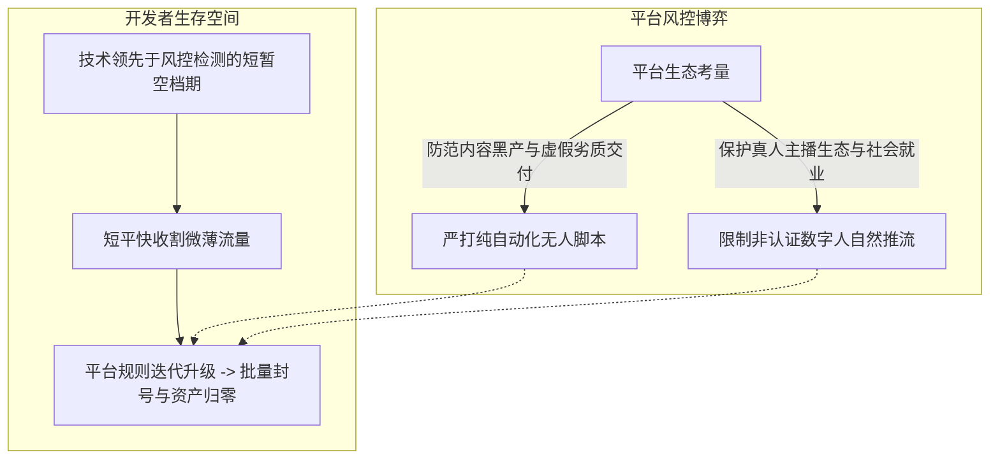
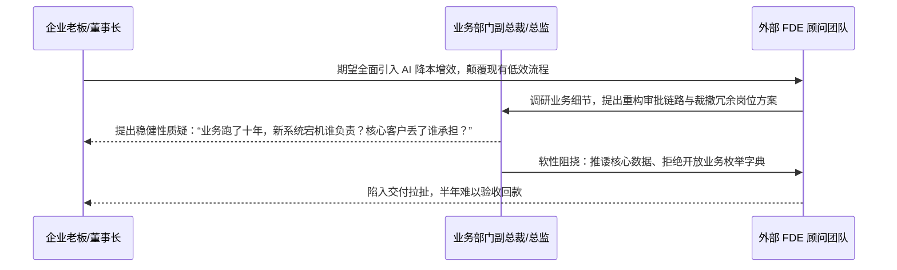
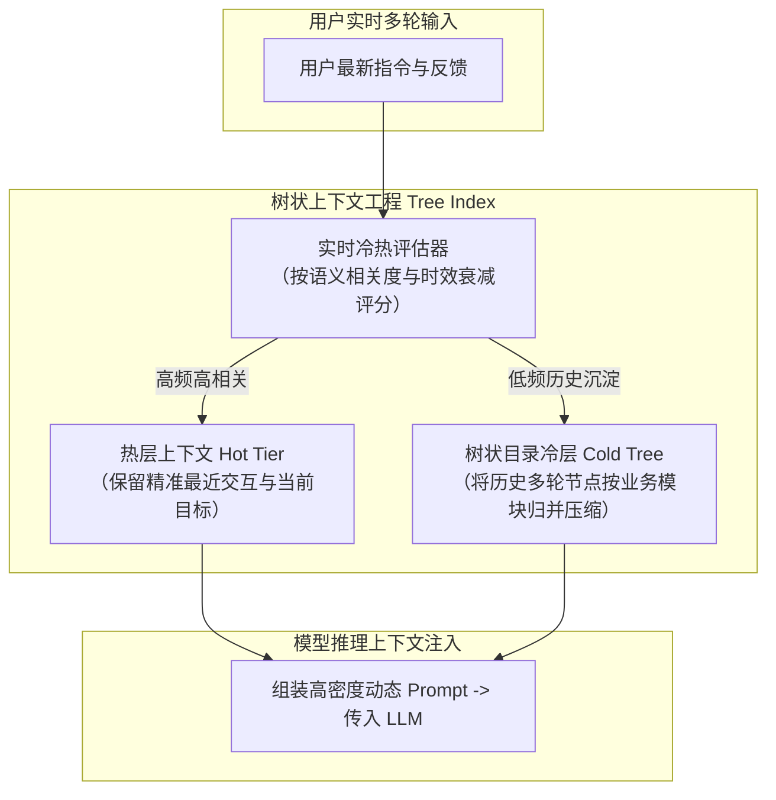

# 2026-11-07 · 第1场直播

> 本文全息记录 2026 年 11 月 7 日晚至次日清晨（连续 9 小时）《企智AI落地派》连麦核心实战讨论。覆盖数字人无人直播的平台攻防与风控死穴、华为前员工视角的全球化出海深水区、FDE 外部推行的组织政治阻力、头部具身大脑公司算力真实账本、树状索引实时冷热上下文工程实践，以及商业关系与人性博弈。

---

## 目录

- [一、 数字人无人直播的平台攻防：流量、风控与红利窗口期](#一-数字人无人直播的平台攻防流量风控与红利窗口期)
- [二、 华为老兵视角的全球化深水区：AI 盲目出海的认知误区](#二-华为老兵视角的全球化深水区ai-盲目出海的认知误区)
- [三、 FDE 企业内部推行的组织阻力：为什么外部顾问很难碰深水区](#三-fde-企业内部推行的组织阻力为什么外部顾问很难碰深水区)
- [四、 具身大脑与物理 AI 真实算力账本：自研卡量、VLA 卡点与大模型底牌](#四-具身大脑与物理-ai-真实算力账本自研卡量vla-卡点与大模型底牌)
- [五、 智能体上下文工程：树状索引与实时冷热滑动压缩实践](#五-智能体上下文工程树状索引与实时冷热滑动压缩实践)
- [六、 商业关系哲学：国内外商业的本质都是人性与身位](#六-商业关系哲学国内外商业的本质都是人性与身位)
- [七、 行动实践闭环（Actionable Practice）](#七-行动实践闭环actionable-practice)

---

## 一、 数字人无人直播的平台攻防：流量、风控与红利窗口期

直播中针对许多个人开发者和副业群体热衷的“数字人直播”、“无人直播带货”展开了深度技术与平台规则拆解。

### 1. 现状调研：平台规则分化与严打风向

连麦中有开发者分享其用直播伴侣跑通某短视频平台数字人直播的测试经验：虽然技术链路（驱动数字人形象、实时根据弹幕语音交互输出声音与动作）能够跑通，但**自然推流极度惨淡，且账号频繁面临封禁风险**。

- **抖音生态**：目前政策极其严格，严查未经官方报备和非正规认证的数字人脚本，封号力度极大；
- **快手生态**：流量分发倾斜度更低，中小团队缺乏买量预算很难获取正向投产比；
- **本地生活与外卖平台（如某团）**：在部分特定类目存在一定宽容度，但根本原因在于平台自身缺乏充沛的内容公域流量供给，商家的自然转化率极其有限。

### 2. 平台的底层逻辑：平台为什么不全量开放无人直播？

嘉宾从平台商业战略与社会治理维度进行了冷思考：
- **平台不会轻易交出核心利益**：如果无人直播真正能实现无成本高转化，平台自身拥有最充沛的技术储备与算力资源，完全可以自己批量下场搭建数字人矩阵，根本轮不到外部个人开发者分一杯羹；
- **社会就业与伦理监管红线**：一旦全网放开无人直播与数字人，将对上百万真人直播从业者和实体商户带来毁灭性冲击，监管层面绝不允许出现大面积冲击真人就业的失控局面。因此，**无人直播永远只能依靠技术比平台风控快半步的“短命空档期”套利，无法作为长期的商业护城河**。

---

## 二、 华为老兵视角的全球化深水区：AI 盲目出海的认知误区

在讨论“国内存量极度内卷，是否应该集体一窝蜂出海做 AI”时，一位在华为工作九年、经历过海外 ICT 无线通信黄金期与地缘风波的资深老兵现身说法。

### 1. 创业邀约十余次，为何全军覆没？

该嘉宾直言，自己出来工作九年，接受过不下十次各类创业合伙邀约，但**无一例外全部以失败告终**。核心症结在于大部分团队总是在技术风口来临时产生虚幻的乐观，以为靠一个新概念就能重构市场，却从未真正算透跨国商业落地的合规账。

### 2. 出海面临的三大隐性死穴

- **本地化认知脱节**：不同国家对 AI 技术的接受度、合规审查重点（如欧盟 AI 法案、各州隐私法案）截然不同。在国内看似行得通的功能（如人脸分析、数据爬取），在欧美市场一旦上线可能直接面临巨额监管罚单；
- **地缘政治与敏感实体绑定**：回顾华为海外战略变迁，从早期通信基建的顺风顺水，到后期因地缘敏感遭遇的全面围堵，说明任何涉及底层算力、数据跨境与核心软件的业务，在大国博弈背景下都会受到极度严苛的审查；
- **中小团队的出海陷阱**：国内开发者所谓的出海，多数只是把国内的套壳产品搬到海外应用市场；在缺乏本地线下销售渠道（GTM）、缺乏海外银行合规结算通道的情况下，往往沦为给海外广告投放平台打工。

---

## 三、 FDE 企业内部推行的组织阻力：为什么外部顾问很难碰深水区

针对当下炙手可热的 FDE（前线部署工程师）概念，现场从企业高管与中层博弈的角度，剖析了为什么外部团队很难直接进入中大型企业推进深度改造。

### 1. 组织政治视角的决策死锁

- **老板想做，但高管阻力极大**：大企业老板出于战略焦虑渴望引入 AI，但具体落实到业务总监身上时，自动化系统意味着部门人头的缩减、权力寻租空间的压缩以及潜在的业务宕机风险；
- **权责不对等**：一旦新系统上线出现错单、漏单，责任全由内部总监承担，但降本收益却归公司所有；因此中层管理者有极强的动机去软性抵制外部顾问。

### 2. 线下沙龙与社群交付的“虚假繁荣”

很多从事 AI 咨询与培训的团队热衷于在各大园区举办线下沙龙，现场气氛热烈、掌声不断，但会后几乎无法转化为真实的 B 端交付大单：
- **参会者多为学习者或同行**：真正拥有千万级预算、有权拍板企业流程改造的董事长或总经理，极少有时间坐在公开沙龙里听通用概念；
- **务实打法**：与其空谈大企业的全套流程重塑，不如帮中小企业解决一两个具体痛点（如销售录音质检、合同合规初筛），用轻量化切片拿到确定性现金流。

---

## 四、 具身大脑与物理 AI 真实算力账本：自研卡量、VLA 卡点与大模型底牌

连麦中一位来自国内最头部具身智能大脑公司的技术核心，披露了物理 AI（Physical AI）与通用大模型算力的底层实情。

### 1. “无大脑不具身”与算力冰山

具身智能正在经历从传统的机械控制向“大模型具身大脑”演进的范式转移，但国内在这一领域面临着残酷的算力现实：

- **自研算力储备极度吃紧**：国内顶级具身大脑公司的自有 NVIDIA H100 仅 200 余张，H200 仅 100 余台，其余海量训练算力几乎全部依赖高价云端租赁；
- **技术路线分化与推进艰难**：
  - **VLA（Vision-Language-Action）路线**：将视觉、语言与机械动作控制端到端联合训练；
  - **世界模型（World Model）路线**：通过模拟物理世界动态变化辅助决策；
  - 由于高质量物理交互数据匮乏与算力受限，大部分团队目前仍停留在 Demo 和学术论文验证阶段，离工业级稳定交付尚有漫长距离。

### 2. 国际头部大模型的“发布一代、储备两代”策略

讨论揭示了国际顶尖 AI 实验室（如 OpenAI、Google）的产品迭代哲学：

- **底牌未尽**：市面上公开发布的最新模型（如 GPT-4.5、o1），通常只是上游团队愿意向市场展示的成熟产品（约占其内部前沿探索的 20%~30%），更多具有压倒性能力的通用模型仍作为战略筹码储备在后方；
- **Agent 开发者的长期隐忧**：盲目依赖简单 Prompt 或表层套壳构建的“垂直 Agent”，一旦上游通用基座模型在下一代升级中原生集成了复杂推理与工具调用能力，垂直工具的应用价值将在瞬间被降维碾压。

---

## 五、 智能体上下文工程：树状索引与实时冷热滑动压缩实践

针对复杂长会话任务中普遍存在的“上下文混乱、记忆漂移与 Token 成本暴增”痛点，连麦嘉宾分享了基于树状索引（Tree Index）的工程化解决方案。

### 1. 传统滑动窗口与批量压缩的缺陷

目前主流代码助手或问答系统（如部分开源 Agent 框架）通常采用“缓存将满时触发批量压缩”或“直接截断最早消息”的简易方案：
- **批量压缩的问题**：触发压缩时存在明显的时延抖动，且过度压缩往往会丢失前文关键参数与约束条件；
- **简单截断的问题**：导致智能体“失忆”，无法保留数小时对话前的全局目标设定。

### 2. 树状索引实时冷热分层架构

- **实时语义打分**：不等到 Token 爆满，而是对每一轮产生的信息按照任务关联度与时效性进行实时动态评估；
- **树状目录映射**：借鉴文件系统目录树的思路，将多轮拉扯与不同分支议题归并为树状节点（节点仅保留核心结论、参数值与待办状态）；
- **动态抽取重组**：在发起新一轮模型调用前，按需将树状索引展开为高密度结构化上下文，以极小的 Token 开销彻底根治长对话幻觉。

---

## 六、 商业关系哲学：国内外商业的本质都是人性与身位

在长达数小时的商业讨论收尾阶段，现场沉淀出了一套穿透技术浮躁、直击商业底层的人性哲学。

### 1. 摒弃对海外商业环境的盲目美化

很多初涉商业的技术开发者总抱有幻想，以为国内讲人情世故、关系利益，而欧美海外商业就是纯粹的技术比拼与理性契约。嘉宾严肃指出：
- **全球商业的底层驱动力完全一致**：无论在硅谷还是在深圳，核心决策权永远掌握在利益共同体手中；
- 所谓“技术领先”，在没有建立信任背书与利益绑定之前，很难换来长期的采购订单；商业博弈的终极核心永远是**搞清对方决策者的身位、筹码与避险心理**。

### 2. 小微企业的生存第一定律

- **在无人关注时死磕现金流**：对于独立开发者与 OPC 而言，不要在早期沉迷于成立豪华公司、租赁高档办公室或到处参加创投路演；
- **做实每一个交付闭环**：通过帮身边真实的传统老板解决具体问题，哪怕一单只收几千块，把履约细节、售后支持和同行转介绍做深做透，才是熬过资本周期的唯一正解。

---

## 七、 行动实践闭环（Actionable Practice）

基于本场直播讨论，为技术开发者提供以下落地落地动作：

1. **果断停止纯依靠侥幸心理的无人直播脚本研发**：
   - 彻底认清大平台严控非认证自动化账号的合规铁律，不把核心商业模式押注在随时面临永久封禁的黑灰产灰度空档期；
2. **优化企业长文本与多轮对话的上下文工程**：
   - 尝试引入树状语义索引机制，替代粗暴的截断式滑动窗口；在智能体推理前对历史对话做结构化动态解耦，将长会话成本降低 40% 以上并杜绝失忆；
3. **在推进企业 AI 改造时，主动识别并安抚业务中层的避险心理**：
   - 与业务部门总监沟通时，切忌使用“全面颠覆现有流程”、“替代部门人力”等引发敌意的措辞；将方案包装为“辅助当前员工完成繁琐脏活累活的副驾驶”，争取内部推行阻力最小化；
4. **守住技术团队的基础算力与硬件现实底线**：
   - 明确通用基座大模型与垂直 Agent 的能力边界；不在基座模型尚未稳定的大语言通用推理上耗费资金重复造轮子，专注于垂直行业专属场景的业务数据沉淀与工程链路落地。

---

*知识库专栏分类：企智AI落地 · 发布前校订完成*
