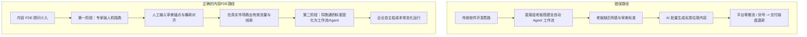
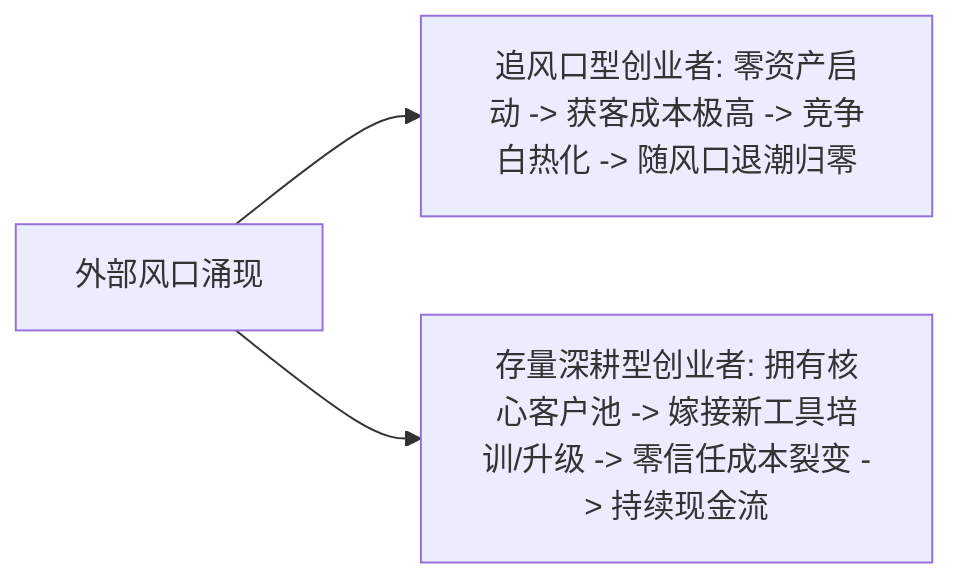
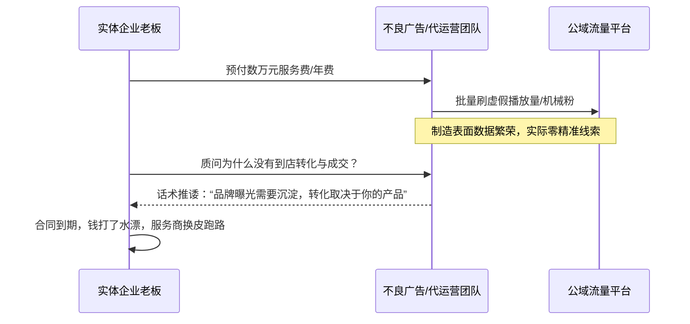
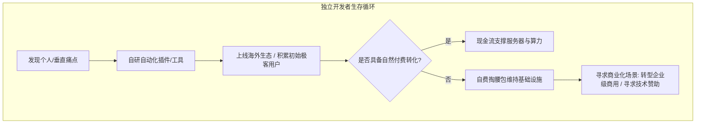

# 2026-11-07 · 刀文AI商业：内容FDE陪跑闭环、名声资产与存量盘活、跨国支付与垂直护城河

> 本文全息记录 2026 年 11 月 7 日《刀文AI商业》10 小时连麦实战。深度拆解内容领域 FDE 为什么必须先以人机陪跑跑通网感审美标准再固化为 Agent、罗永浩破产还债的名声资产与产品属性脱节规律、存量客户盘活与穿越风口的真实护城河、广告外包打水漂的履约防线，以及俄罗斯矿产跨境贸易支付与个人开发者工具造血的生存账本。

---

## 目录

- [一、 内容领域 FDE 的真身位：为什么单纯交付工具或 Agent 必死](#一-内容领域-fde-的真身位为什么单纯交付工具或-agent-必死)
- [二、 存量客户盘活论：穿越风口与商业启动的真正底牌](#二-存量客户盘活论穿越风口与商业启动的真正底牌)
- [三、 罗永浩破产还债深度剖析：名人资产与产品属性的脱节定律](#三-罗永浩破产还债深度剖析名人资产与产品属性的脱节定律)
- [四、 广告与代运营行业的“白忙活”陷阱：企业采购防坑与交付边界](#四-广告与代运营行业的白忙活陷阱企业采购防坑与交付边界)
- [五、 跨国贸易与特种支付闭环：俄罗斯矿产出海与银行本地通道](#五-跨国贸易与特种支付闭环俄罗斯矿产出海与银行本地通道)
- [六、 个人开发者工具变现实录：从 ChatGPT 插件到自费造血](#六-个人开发者工具变现实录从-chatgpt-插件到自费造血)
- [七、 商业行动清单（Actionable Practice）](#七-商业行动清单actionable-practice)

---

## 一、 内容领域 FDE 的真身位：为什么单纯交付工具或 Agent 必死

很多企业老板对 AI 的预期往往是“一键解决全网多矩阵分发”：给 AI 一段语音或文字，自动生成图文、短视频、公众号、小红书与抖音矩阵脚本并自动发布。然而，在实际交付中，这种纯软件交付几乎 100% 走向失败。

### 1. 实体老板的核心死穴：缺乏网感与审美标准

- **工具不是瓶颈**：现在的多模态与排版工具已经极其丰富，老板自己甚至都能摸索配置一套流水线；
- **标准才是壁垒**：传统企业老板最大的痛点在于**缺乏对社交平台受众情绪的感知（网感）与视觉审美能力**。AI 生成的内容，在技术逻辑上可能完美闭环，但放在公域平台上是完全没有消费欲望的工业废料；
- **如果由纯技术人员交付**：技术人员同样不具备爆款内容敏感度，直接把没有审美把控的自动化链路交给客户，投放到市场上毫无正向反馈，最终客户只会认为是“AI 没用”或者“系统欺骗”。

### 2. 内容 FDE 的两阶段交付法则

真正的 FDE（Forward Deployed Engineer，前线部署工程师）在内容商业化领域必须分两步走：

1. **第一阶段：专家网感与审美锚定（人机协同陪跑）**  
   FDE 必须亲自下场，带着工具与企业老板协同工作。以人的审美和网感作为“质检卡点”，对 AI 生成的文案、标题、封面和音色进行深度纠偏与微调，直到该内容在公域实际发布并拿到正向推流与留资线索；
2. **第二阶段：操作固化与 Agent 化**  
   当某类爆款模版和业务叙事节奏被市场验证有效后，FDE 再将这套经过实战检验的标准提炼为 Prompt 提示词链、结构化工作流与 Agent 编排，交给企业内部一线操作人员日常执行。此时 FDE 功成身退，客户对价值完全认可。

---

## 二、 存量客户盘活论：穿越风口与商业启动的真正底牌

连麦中深入剖析了商业模式中“追风口”与“守存量”的底层差异。许多创业者天天研究最新的 AI 风口，不断更换赛道，却始终挣扎在生死线上。

### 1. 为什么赚钱“比喝水还简单”？

- **拥有核心存量的人，风口只是变现乘数**：手头拥有 500 个高净值行业客户、或者几千家实体门店老板关系的经营者，任何一波 AI 或数字化技术革新到来，他们只需在既有信任关系上增加一个“AI 赋能赋工”或“实战陪跑沙龙”，就能立刻实现几十万的现金流启动，获客成本几乎为零；
- **缺乏存量的人，风口只是消耗本金的绞肉机**：没有任何存量资产的人，每一波新概念都必须从公域高成本买量、建立陌生信任，往往还没跑通闭环，风口红利期就已经关闭。

### 2. 实体企业的存量唤醒实操

- **免费沙龙切入**：对老客户不推销高额软件，而是举办线下免费小规模茶话会或技术交流沙龙；
- **轻量痛点切片**：展示同行如何用 AI 降本增效（如自动生成小红书图文、自动跟进私域线索），用微小而确定性的效果唤醒老客户需求；
- **以存量养研发**：利用老客户支付的稳定咨询费和维护费打磨标准化工具，再去开拓公域新客。

---

## 三、 罗永浩破产还债深度剖析：名人资产与产品属性的脱节定律

针对连麦中关于罗永浩还清巨额债务后再次创业做 AR/AI 关注度走低的现象，刀文从个人 IP 属性与商业价值转化进行了深度冷思考。

| 维度 | 名人属性（互联网明星） | 产品/技术属性（乔布斯式预期） |
| :--- | :--- | :--- |
| **公众预期** | 期待金句、相声、直播带货便宜买到好货 | 期待具有颠覆性工艺、系统生态与硬核技术突破的硬件产品 |
| **变现路径** | 直播带货、商业代言、公域流量分成、出场费 | 漫长研发周期、供应链重资金垫资、极高良品率与生态壁垒 |
| **还债逻辑** | 依靠顶级流量与名誉声望，在直播电商红利期实现数亿现金流闭环 | 依靠消费电子产品毛利还债在硬件破产后已被证明不可行 |
| **再创业卡点** | 公众只消费其“人设”与“语言”，对其推出的 AR 眼镜或 AI 软件并不买账 | 产品研发需要深厚工程底座，名声无法直接弥补技术与供应链短板 |

- **名誉是顶级变现杠杆，但不是万能研发工具**：罗永浩通过坚守还债赢得了极高的公众信誉，这种信誉让他在带货和商业合作中无往不利；
- **警惕商业属性错配**：创业者不能将自己在某一个领域的“流量知名度”，误判为自己在复杂软硬件交付领域的“产品统治力”。

---

## 四、 广告与代运营行业的“白忙活”陷阱：企业采购防坑与交付边界

连麦中嘉宾痛陈实体企业在采购外部广告、新媒体代运营与 AI 自动化获客服务时频繁遭遇的骗局与损失。

### 1. 行业三大经典割韭菜套路

1. **承诺高曝光，规避线索量**：合同中只约定几百万播放量或几十篇笔记发布，服务商通过低成本机刷或垃圾矩阵填充完成考核，企业得不到任何真实意向客户；
2. **拿钱不干活，拖延至死**：利用企业法务流程繁琐、异地维权成本高昂的弱点，收到首期款后敷衍了事，最终企业由于精力有限选择沉没放弃；
3. **工具差价倒买倒卖**：将开源或市面上几十元/月的公共 AI 工具包装为“独家自研企业引擎”，收取几万元高额定制费。

### 2. 企业防范准则与交付防火墙

- **分段验收与阶梯付款**：坚决拒绝大额全款买断，采用 3-3-4 阶段付款制（首付基础启动费、跑通闭环支付二期款、产生真实留资支付尾款）；
- **绑定有效业务指标**：不考核虚假播放量，以“有效私域添加量”或“业务人员实际接听的真实询盘”作为对账凭证；
- **掌握账号底层控制权**：所有矩阵账号主体与 API 授权必须归属于企业自身，严禁将企业核心数字资产托管在第三方不可控个人手中。

---

## 五、 跨国贸易与特种支付闭环：俄罗斯矿产出海与银行本地通道

连麦中有嘉宾分享了极具实操深度的俄罗斯矿产与物资跨境贸易真实案例，揭示了全球化出海的底层其实是**金融结算与合规通道**。

### 1. 跨境出海的真正瓶颈不在流量，而在支付与物流

- **泛流量出海没有壁垒**：许多团队在海外社交平台上做内容投流，看似流量很大，但一到结汇和收款环节全部卡死；
- **特种本地通道的不可替代性**：例如做俄罗斯矿产及大宗物资贸易，主流国际结算网络（如 SWIFT）受限，核心壁垒在于是否能打通直连俄联邦银行（Sberbank 等）的合规人民币/卢布结算通道；
- **顺带变现逻辑**：真正赚钱的跨国业务往往不是单纯做贸易撮合，而是依托既有的矿产实体与金融通道，顺带为上下游企业提供合规结汇与供应链代采服务。

---

## 六、 个人开发者工具变现实录：从 ChatGPT 插件到自费造血

连麦中技术开发者飞飞老师分享了自研 Web Monitor（网页监测与自动化工具）及接入 ChatGPT 插件生态的实战历程，展现了独立开发者的生存现状。

### 1. 独立工具变现的现实困境

- **个人用户付费意愿低**：针对个人用户的插件工具（如网页监测、自动提醒），用户虽然觉得好用，但月付 5~10 美元的转化率极低；
- **算力与服务器持续支出**：哪怕没有外部赞助，开发者每月仍需固定承担服务器、代理 IP 与 API 接口费用；
- **突围方向**：必须将工具从“极客尝鲜玩具”包装为“B 端刚需抓手”。例如，将单纯的网页监测升级为**竞品电商调价监控、行业招标信息自动聚合、或同城商户招牌变更采集**，直接卖给有获客和风控需求的企业，单客单价可瞬间拉升至数千元。

---

## 七、 商业行动清单（Actionable Practice）

| 序号 | 业务阶段 | 核心执行动作 | 关键考核指标 |
| :--- | :--- | :--- | :--- |
| **01** | **内容 FDE 启动** | 拒绝先上自动化系统；由顾问亲自介入人机协同，人工严把审美与网感关卡 | 跑出至少 1 条自然流量正向反馈并产出真实销售线索 |
| **02** | **流程固化落地** | 将人工跑通的标题结构、情绪钩子与画面排版拆解为标准化 Prompt 与工作流 | 形成内部无脑照做 SOP，交付企业一线执行人员独立运转 |
| **03** | **存量客户盘活** | 梳理既有 30~50 个老客户名单，策划 1 场免费轻量 AI 提效沙龙，展示真实改造成果 | 获得 3~5 家老客户的二次深度陪跑或定制开发意向 |
| **04** | **外包履约防线** | 采购外部推广或技术代运营时，合同必须剔除单纯曝光考核，严绑有效留资并采用阶段付款 | 杜绝大额一次性预付款，保证 100% 账号与资产掌控权 |
| **05** | **工具商用升级** | 独立开发者停止针对个人场景的小打小闹，将爬虫与监测工具封装为企业情报与商机采集系统 | 将客单价从 30 元/月个人版升级至 3,000 元/年企业级方案 |
