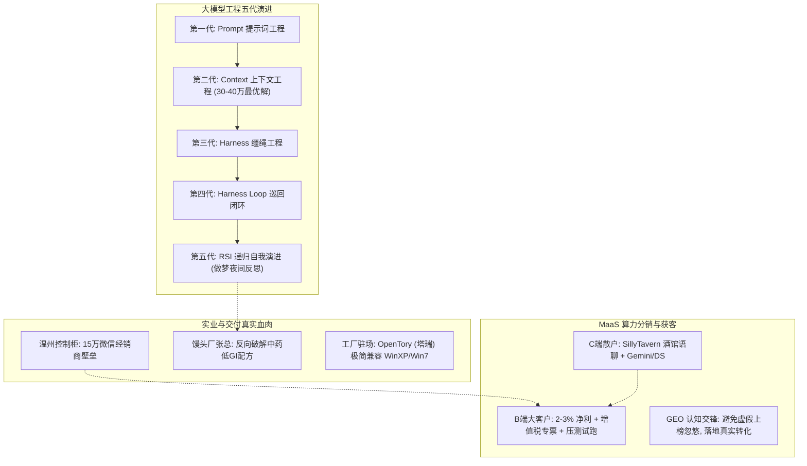
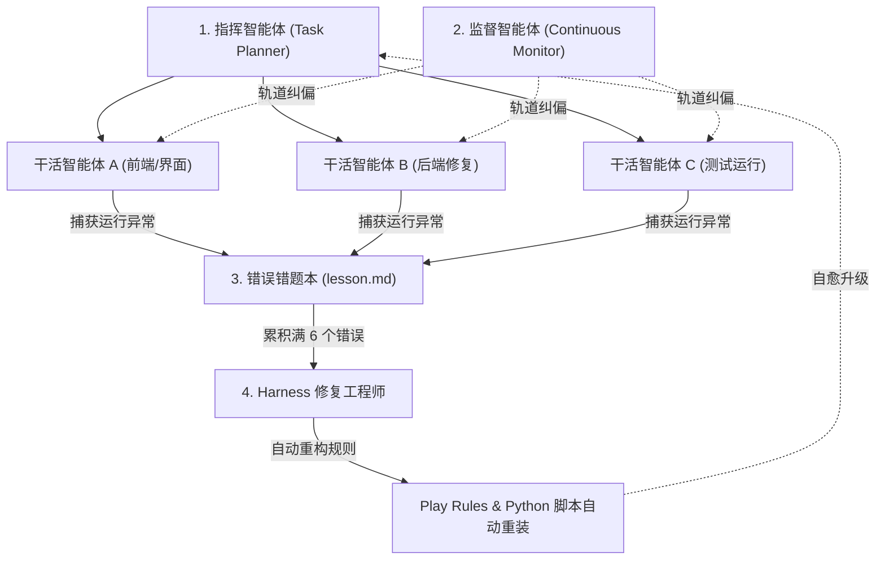
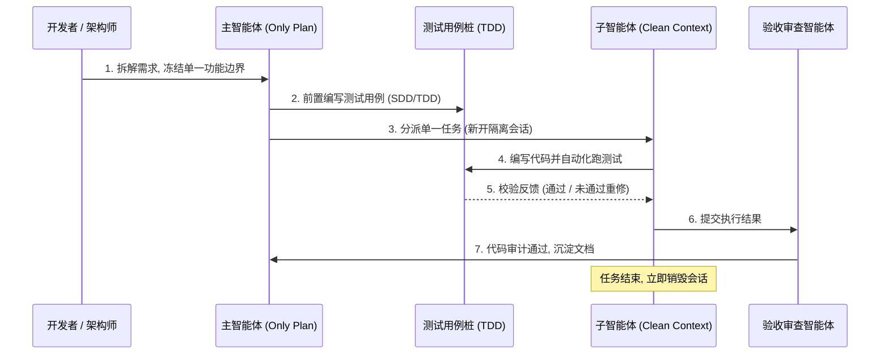

# 2026-11-08 · 企智AI落地派（Session 113 · OPC与FDE企业AI赋能全景交流）

> **录制场次**：Session 113 · 抖音《企智ai落地派-企业AI赋能ai智能体》  
> **直播主题**：《企智AI-OPC-FDE交流》  
> **录制时段**：2026-11-08 22:08:47 至 2026-11-09 07:33:45（总时长 8 小时 25 分钟，30,298 秒）  
> **对话核心**：老徐（企智AI）、李校长、十三少（少爷）、温州控制柜戴总、馒头工厂张总、三号麦资深算力服务商、七麦、Ella、图南总、清风等。  

---

## 核心认知全景图谱

---

## 卷一：AI 工程范式五代演化与 OPC 闭环系统

### 1.1 大模型工程的五代技术代际复盘
十三少（少爷）在连麦中结合 Anthropic 官方产品负责人 Lydia 与 OpenAI Tibo 的技术演进轨迹，系统梳理了 AI 应用层过去两年的五代工程迭代规律：

- **第一代（2024 年末）· Prompt Engineering（提示词工程）**：依靠长篇 System Prompt、Few-Shot 示例约束模型输出。该阶段持续了半年多，目前已退化为最底层的基建，无法解决复杂系统工程的稳定性。

- **第二代（2025 年初至夏季）· Context Engineering（上下文工程）**：各大厂商开始卷 100 万甚至数百万的 Long-Context。但十三少实测与官方建议指出，**盲目追求百万上下文是工程灾难**。系统如同汽车，机械复杂度越高，出错和跑偏概率呈几何级数增加。Anthropic 官方与实际压测均证实，将动态上下文控制在 **30 万至 40 万 Token（按 97% 压缩机制通常在 36 万至 38.4 万区间）是综合性能最优解**。不仅 Prompt Cache（缓存命中）达到极高效率，还能在长周期运行中使周/月 Token 消耗大幅下降，彻底避免模型记忆漂移与幻觉。

- **第三代（2025 年 6 月）· Harness Engineering（缰绳工程）**：单纯依靠 Prompt 无法约束智能体动作，必须在外部构建代码级别的“缰绳”（测试桩、门禁判定、执行权限沙箱），让大模型在预设的轨道内调用系统 API。

- **第四代（2025 年夏末）· Harness Loop（巡回循环工程）**：从单次缰绳约束演进为持续巡回循环调度。智能体之间建立动态流水线，自主进行任务派发、执行、环境验证与下一轮循环。

- **第五代（当前最新）· RSI（Recursive Self-Improvement，递归自我改进）与“做梦机制”（Dreaming / Nightly Reflection）**：系统在白天的自动化执行中记录每一次执行偏差与语法卡点，夜间脱机进入“做梦状态”，自主总结失败日志（Lessons Learned），并让专职工程智能体自动修改底层的 Python 运行脚本和 Play Rules（规则集），实现全自动自我递进修复。

### 1.2 一人成军：多 Agent 自我修复系统实战架构
十三少展示了其单人跑通的 18.6 万行代码自演进系统：

- **角色黄金配比**：系统由 **1 个总指挥智能体**（专门派发拆解任务）+ **1 个持续监督智能体**（实时检测其他智能体是否出轨跑偏）+ **3 个专职干活智能体** 构成，总数严格控制在 5 个左右。智能体过少（单 Agent）容易死锁，智能体过多（撒几十个）则会造成对话串线与上下文混乱。
- **磁盘失控与自主挂载清理守护进程**：在开发过程中，三个智能体同时运行 iOS 模拟器和测试，磁盘空间每小时增加十几 GB，十三少最初设立了 40GB 门禁。系统在自主递归执行中，为了防止由于模拟器残留导致任务中断，竟然自主在后台编写并挂载了一个 55GB 阈值监测脚本。当检测到空间告警时，自动触发深度清理模式，关闭超过 2 小时未用的 Worktree 与模拟器，将硬盘瞬间回退释放至 150GB 空闲，全程未依赖人工干预。
- **错题本驱动的闭环重构**：任何智能体执行报错，都会被即时捕获写入 `lesson` 错题本。每当积累满 6 个 lesson，系统触发全局中断，由专职 Harness 工程师通读错题本，重新改写基础规则与运行环境脚本，然后全自动重新装载。

### 1.3 多模型性格互补选型策略
在复杂的系统工程中，单一模型无法包打天下：

- **Claude 3.5 Sonnet**：顶层跨行业系统架构与 Fable 设计能力极强，但在长时间后端纠错时容易陷入过度冗长。
- **Astrid / 后端微调模型**：修复后端底层代码与接口死锁极其锐利，但存在致命的“过度防御心”。如果完全听从其安全告警，几乎每一行代码都要加套三层防御壳，导致项目永远无法如期交付。
- **RDom 4.0 / 高阶推理模型（中档推理开）**：极擅长系统级“图设计”（Graph Engineering）。把每一个移动变量、状态跳转与异常协调作为系统拓扑来设计，避免单点逻辑脱节。

---

## 卷二：传统实业破局实录：温州控制柜与馒头厂反向破解

### 2.1 温州制造业控制柜：15 万微信经销商的“护城河”与私域突围
连麦嘉宾戴总经营温州家族制造业控制柜厂，在全国制造业订单普遍收缩的背景下，工厂订单依旧饱满：

- **最土也是最硬的护城河**：戴总透露，早期工厂没有任何互联网思维，雇佣大量业务员打开高德地图，全中国地毯式搜索五金、机电与成套控制设备经销商，一个一个打电话拜访，每成功添加一个微信奖励业务员几块钱。十几年如一日，硬生生在微信（泡泡）生态中沉淀了 **15 万个具有真实采购需求的全国经销商资源**。这套庞大的私域网络构成了同类竞品难以逾越的壁垒。
- **被封号风险与数字化焦虑**：因为依赖个人微信，经常遭遇腾讯生态的风控封号，工厂试图投入巨资自建独立的 APP 或私域软件，把 15 万经销商全量迁移。
- **老徐当场泼冷水打直球**：老徐明确指出，传统工厂万万不可做“改变用户使用习惯”的重资产尝试。下游几万个个体分销商早已习惯微信沟通，强迫客户下载独立 APP 极其沉重，90% 会变成僵尸软件。正确的打法是在现有微信生态内利用轻量 RPA 或智能体辅助做报价与库存匹配，切忌为了所谓的“自主可控”推翻客户既有习惯。

### 2.2 馒头工厂张总实战：拒绝画蛇添足，用 AI 反向推演大厂配方
张总作为一线面食加工工厂老板，此前用 DeepSeek 成功调优出爆款油泼辣子配方。在本次连麦中，张总与老徐上演了一场企业落地核心认知的深度拉扯：

#### 避坑警示：坚决摒弃“为了 AI 而 AI”的花拳绣腿
张总受其他网课主播忽悠，打算在车间加装人脸/动作监控摄像头、给门店销售员佩戴 AI 录音卡、用 16 个问答搞虚拟董事会。老徐当头棒喝：
- **距离最短、路径最轻才是真交付**：销售员戴录音卡录音质量远不如智能手机或录音笔，多一道硬件工序就多十道管理成本；员工不用还要去监督，教育成本极其高昂。
- **不要给直线故意拐弯**：小企业落地 AI，能用手机语音直接解决的绝不买外设；能用最简提示词跑通的绝不大费周章搞复杂大中台。

#### 实战绝活：中老年抗性淀粉馒头与药食同源配方“反向工程”
某大健康品牌找张总代工一款宣称能控糖、延长吸收周期的功能性馒头（单品零售价极高），并自带中药粉料让其代工：
- **AI 穿透技术黑盒**：张总将对方口述的“分子链重组、抗性淀粉生成”等概念输入 DeepSeek，AI 迅速揭开对方技术底牌：本质是利用**桑叶提取物（含 1-脱氧野尻霉素 / DNJ 成分）**抑制小肠双糖水解酶，阻滞餐后葡萄糖生成。
- **国家药食同源合规目录筛选**：AI 检索国家卫健委发布的合规目录，从 106 种“药食同源”物品中精准锁定桑叶提取物，并将其与张总原有的儿童牛奶馒头、中老年苦荞、燕麦、青稞杂粮面复配。
- **谷朊粉（面筋蛋白）解决口感痛点**：全杂粮粉缺乏面筋弹性，口感粗糙“拉嗓子”。AI 建议按目数梯度添加高纯度谷朊粉（即食品工业洗淀粉洗出的植物蛋白面筋粉），在保证低 GI（升糖指数）特性的同时，极大恢复了馒头的松软与咀嚼韧性。张总不仅让患有糖尿病的母亲先试吃验证，样品口感更全面超越大厂代工原样，成本下降 60% 以上。
- **合规红线必须守死**：连麦嘉宾与老徐严肃提醒，食品安全大于天。药食同源成分必须严格在 106 种名录之内，上市前必须按年度向具有资质的第三方机构送检取得完整检测报告，严禁跨界宣传治疗功效。

---

## 卷三：多 Agent 协作开发大踩坑与 TDD 测试驱动防崩指南

某连麦开发者耗时三周开发一款包含 3D 展示、项目看板与智能体互通的超级客户端，由于开了十几个智能体同时写代码，导致项目全面失控：

### 3.1 导致项目崩溃的三大典型死穴
1. **主从职责严重缺失**：十几个智能体全部通读了庞大的全局 PRD，但没有划定明确边界。智能体基于概率生成，各写各的接口，导致一个简单的登录模块被写了 3 遍，后端 18 个模块中出现大量结构冲突与代码重复。
2. **动态篡改 Plan 与上下文撑爆**：开发者在开发中途不断变换想法，想到什么让 AI 加什么。主智能体不仅需要维护全局代码，还要频繁与子智能体长文本通讯，瞬间耗尽百万上下文窗口，最终引发幻觉。
3. **“拆东墙补西墙”式修复**：遇到 bug 时，开发者直接使用“用最快的方式立刻修好”的急躁提示词。AI 为了满足单点通过，不惜暴力破坏其他已有模块的全局约束，代码越改越乱，沦为彻底的“屎山”。

### 3.2 工业级多 Agent 开发的标准 SOP
资深开发者给出了标准化避坑指南：

1. **一主多从，主 Agent 唯一职责是 Plan**：一个项目工作区内，主 Agent 严禁直接编码，只负责拆解 Task 并生成标准化文档。
2. **一会话一模块，用完即弃**：子智能体在新开的独立 Clean 会话中执行单一功能，执行完毕后将产物和变更沉淀至 Markdown 文档，随后立即关闭会话，坚决不让历史垃圾污染主上下文。
3. **TDD（测试驱动开发）先行**：在 AI 时代，先写自动化测试用例，再让 AI 编写业务逻辑。以测试用例是否全绿作为唯一客观验收标准，彻底杜绝靠肉眼挑毛病的低效传统人工作业。

---

## 卷四：算力中转站与 MaaS 二道贩子真实账本

### 4.1 从“搭电线”到 Agent：国内 AI 工具链的演化史
三号麦资深算力专家为全场复盘了国内 AI 生态的演变过程：

- **2025 年末至 2026 年初 · 扣子（Coze）工作流时代**：全网狂热于“接电线”，大量从业者辞职全职搭建几百个节点的静态工作流。
- **2026 年春季 · Agent 觉醒与降维打击**：随着 OpenCloud、Claude Agent 以及各家模型原生 Tool Calling 的兴起，纯静态工作流被动态决策的 Agent 全面碾压，扣子模式迅速退潮。
- **国内工具链生态鄙视链**：
  - 专业开发者与大厂极客：认准 **Claude 3.5 Sonnet / Codex**，依赖 MCP 协议和全自动 Computer Use。
  - 国内政企与中小型民企：处在鄙视链底端的 **WorkBuddy** 反而一统天下。虽然其底层混元等模型在开发者眼里常被吐槽“输出一堆屎山”，但由于它原生打通了企鹅与微信生态、支持一键直接发布微信小程序，成了无数 FDE 入企交付、撬动客户预算的“破冰铲”。

### 4.2 算力分销（MaaS）实操：C 端散户 vs B 端大客户的残酷真相
三号麦与七麦系统揭开了算力转售的商业全貌：

| 维度 | C 端散户模式（SaaS/MaaS） | B 端企业大客户模式 |
| :--- | :--- | :--- |
| **典型画像** | 小红书女性玩家、个人开发者、轻度办公散户 | 漫剧/短剧制作团队、新媒体矩阵、生命科学研发 |
| **核心场景** | SillyTavern（酒馆）角色扮演语聊、批量洗稿 | 视频批量抽卡渲染、百万 Token 级长文本解析 |
| **主力模型** | Gemini 3.7 / Gemini 4（黑话“太子”）、DeepSeek | Kimi 3.1 Pro、火山私有化满血模型、DeepSeek 蒸馏版 |
| **启动成本** | 200~300 元/年 VPS 服务器，部署 One-API / New-API | 需成立企业、通过机房背调、具备垫资能力 |
| **资质门槛** | 个人即可入局，可通过 AFF 推广链接直接拿 5-10% 返佣 | **必须为一般纳税人，必须开具 6% 增值税专用发票** |
| **行业净利率** | **10% ~ 30%**（靠低买高卖赚信息差） | **仅 2% ~ 3%**（月流水 100 万净赚 2~3 万元） |

- **B 端 2-3 个点微利的真实博弈**：连麦小白天真以为卖算力能加 20% 的利润，三号麦当场击碎其幻想。企业级客户每月消耗算力上百万元，客户技术员对并发延时和官方单价极度敏感。上周五某火山大客户，同行仅仅是将整体报价“下压了 2 个点”，就直接撬走了价值数百万元的年框订单。
- **掺水与注水大揭秘**：市场上低劣中转站常用 7B/8B 廉价小模型套壳冒充大模型、或采用低比特非对称量化糊弄客户。鉴别真伪的唯一手段是：要么直采原厂官 Key（URL 直接解析至官方根域名，绝无假货但价格高昂）；要么找运营商（电信/移动）或火山直出的私有化满血机房，上机进行高并发 KTV 压测比对。

---

## 卷五：GEO 生成式引擎优化交锋与下沉县城落地真相

### 5.1 GEO（生成式引擎优化）的商业本质与对赌交锋
某青岛连麦者以 7000-8000 元/年的代理成本拿下了某 GEO 一级代理，拟定价 1.5 万元/年向中小微企业推销，宣称能让豆包、Kimi 等 AI 搜索全网强力推荐该公司：

- **老 SEO 人的技术揭底**：资深从业者一针见血指出，GEO 绝非什么神秘的新技术，其本质就是**“传统 SEO 内容外链 + 公关软文投放”的 AI 换壳包装**。在底层，通过接码平台买小号、利用 WorkBuddy 等工具批量生成行业问答并向各平台注水。
- **三一五“AI 投毒”后的大厂封杀**：今年央视关注“AI 投毒”后，各大大模型搜索索引均大幅提升了反垃圾和去重算法。任何宣称“100% 保证上榜、1 天见效”的都是彻头彻尾的割韭菜忽悠。
- **成熟老板绝不交智商税**：真正的 B 端老板极度务实，往往直接要求签“对赌协议”（达不到稳定上榜与明确曝光直接退款扣费）。若没有真本领，盲目推销只会迅速沦为口碑崩塌的一锤子买卖。
- **二手车真实盈利样本**：某二手车商每年实打实投入 10 余万元，持续在全网沉淀真实口碑与长尾内容，豆包和 DeepSeek 在回答本地购车咨询时自然将该车行作为正面案例推荐，带来了源源不断的真实精准获客线索。这依赖于长期正规的内容公关沉淀，绝非买一个套壳软件就能走捷径。

### 5.2 县城小商户 AI 落地的现实死穴
连麦者困惑于“四五线小县城没有写字楼，AI 到底能卖给谁”：
- **盲目扫楼扫街必死**：小县城没有大厂，小餐馆、小卖部老板连基础数字化都没有，跟他们推销 Agent 智能体或私有化大模型是对牛弹琴。
- **下沉市场唯一的硬通货**：县城唯一有付费意愿的场景是**“短视频同城引流与团购带货”**。直接封装开箱即用的“AI 自动剪辑生成短视频、自动批量分发带货文案”的傻瓜式标品，帮助实体店低成本拿到抖音/同城流量，才是唯一的生存之道。

---

## 落地工具项目台账与交付选型

| 工具 / 框架名称 | 定位与核心场景 | 优势特征 | 局限性与避坑警示 |
| :--- | :--- | :--- | :--- |
| **OpenTory（塔瑞）** | 极简开源 Agent（GitHub/Gitee 开源） | 源码仅数百 KB，**原生支持 WinXP / Win7 等老旧工业控制电脑**，是制造业驻场交付神器 | 功能精简，不具备高阶复杂 MCP 编排能力 |
| **WorkBuddy** | 腾讯生态可视化企业 AI IDE | 深度打通企鹅与微信生态，支持一键直接发布微信小程序，交付路径极短 | 底层多模态混元模型较弱，高阶工程容易产生冗余代码 |
| **Claude 3.5 Sonnet** | 全球顶级高阶编码与系统设计模型 | 架构设计、逻辑推理与 Fable 顶层抽象能力无可匹敌 | 官方价格居高不下；处理后端代码时容易过度防御导致无法收敛 |
| **DeepSeek (V3/R1)** | 高性价比国产全能开源基座 | 性价比极高，官 Key 折扣可谈至 3-4 折，中文推理与代码能力强劲 | 需月消耗数万元以上才能拿到极低批发折扣 |
| **SillyTavern（酒馆）** | C 端轻量级开源中转交互客户端 | 小红书女性垂类角扮演语聊首选，重度消耗算力流量 | 个人散户流动性高，依赖小众圈层维护 |
| **One-API / New-API** | 开源多渠道 API 聚合中转系统 | 部署成本极低（百元服务器即可），支持多级用户渠道与 AFF 返佣管理 | 需维护网络高可用性，缺乏高阶安全审计功能 |

---

## 课后行动实操清单（Actionable Practice）

1. **大模型工程上下文调优实操**：
   - 检查已有业务 Agent 的 Prompt 与上下文策略，将盲目堆叠的 100 万 Token 动态截断至 **30 万~40 万 Token** 最佳区间；
   - 验证 Prompt Cache 命中率，观察单次任务响应延迟与 Token 账单是否有明显收敛。
2. **多 Agent 开发门禁落地**：
   - 在开发新功能时，确立“主 Agent 仅做 Plan、子 Agent 单一会话开发、测试用例前置”的三层机制；
   - 在项目根目录建立统一的 `lesson.md` 错题本，每次报错强制记录根因与边界约束，每 5 次报错后重新精炼 Play Rules。
3. **实业数字化交付调研**：
   - 面向传统工厂驻场时，优先通过命令行核实车间机床控制机的系统版本（如遇到 WinXP/Win7，立即选用 OpenTory 替代重型现代客户端）；
   - 在推进传统实体门店业务时，杜绝向老板推销“AI 中台/录音卡”等重型硬件，直接围绕“同城短视频批量带货”或“微信生态内小程序”做最短路径交付。
