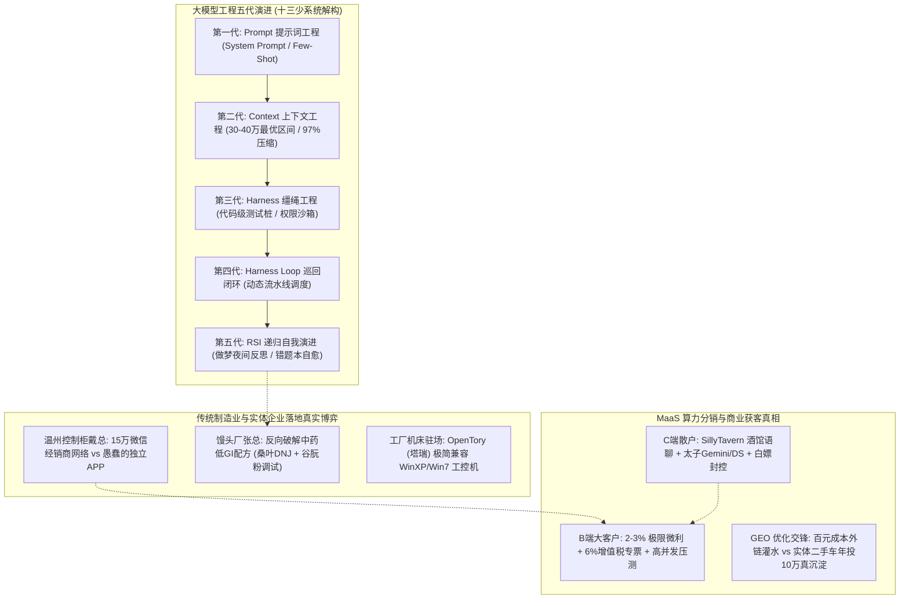
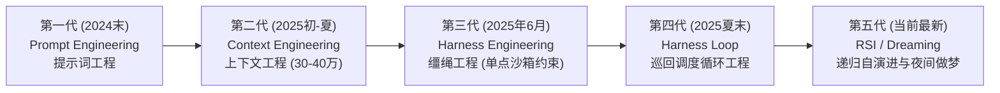
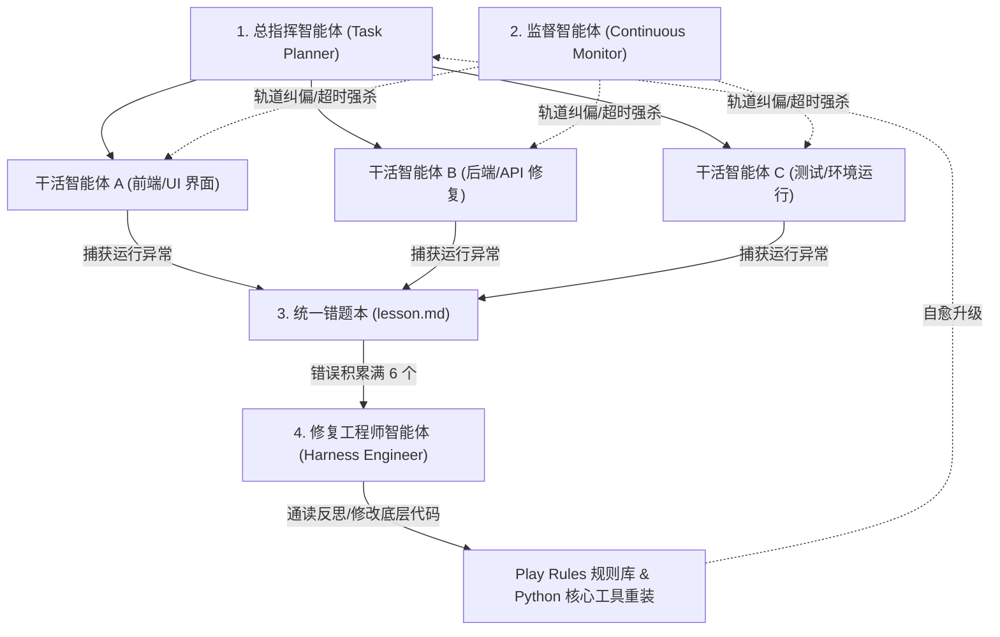
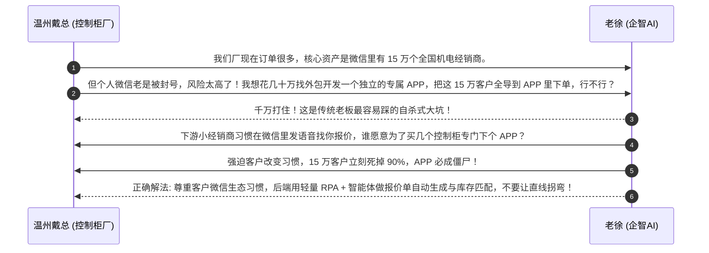
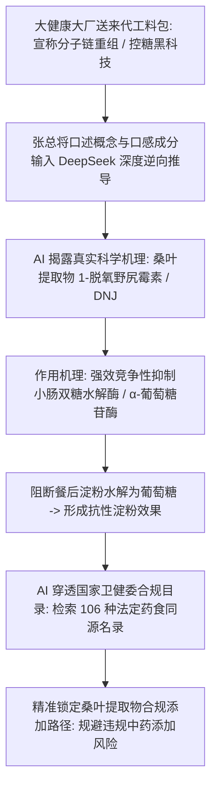
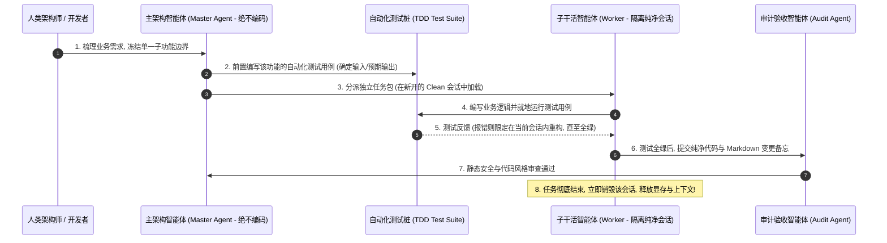
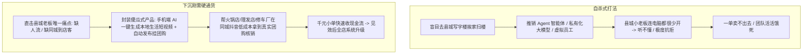

# 2026-11-08 · 企智AI落地派（Session 113 · OPC与FDE企业AI赋能全景交流）

> **录制场次**：Session 113 · 抖音《企智ai落地派-企业AI赋能ai智能体》  
> **直播主题**：《企智AI-OPC-FDE交流》  
> **录制时段**：2026-11-08 22:08:47 至 2026-11-09 07:33:45（总时长 8 小时 25 分钟，30,298 秒通宵连麦）  
> **核心人物**：老徐（企智AI创始人 / 交付架构师）、李校长（企智AI商业合伙人）、十三少（少爷 / 资深系统架构师）、温州控制柜戴总、馒头工厂张总、三号麦资深算力中转服务商、七麦、Ella、图南总、清风等。  
> **全息记录说明**：基于 2,366 行纯净脱水事实文本与弹幕互动逐字通读重构。彻底拒绝粗线条总结，全息还原大模型五代工程演进的底层代码参数、多 Agent 协作开发崩溃与 TDD 门禁规范、温州制造 15 万微信经销商护城河与私域 APP 陷阱、低 GI 馒头反向工程与药食同源配方工业试错、MaaS 算力中转站 C 端酒馆生态与 B 端 2%~3% 微利拼杀内幕，以及 GEO 虚假对赌与县城实战落地真相。

---

## 核心全景认知图谱



---

## 目录

- [一、 大模型工程五代代际演化与一人成军自演进系统](#一-大模型工程五代代际演化与一人成军自演进系统)
  - [1.1 Anthropic 与 OpenAI 产品技术演进五代大复盘](#11-anthropic-与-openai-产品技术演进五代大复盘)
  - [1.2 百万上下文灾难与 30~40 万 Token 黄金平衡点算账](#12-百万上下文灾难与-3040-万-token-黄金平衡点算账)
  - [1.3 十三少 18.6 万行一人系统：做梦机制、错题本与自写 55GB 清理脚本](#13-十三少-186-万行一人系统做梦机制错题本与自写-55gb-清理脚本)
  - [1.4 多模型性格互补实战：Sonnet 3.5、Astrid 与 RDom 4.0 选型矩阵](#14-多模型性格互补实战sonnet-35astrid-与-rdom-40-选型矩阵)
- [二、 传统实业破局实录：温州控制柜与馒头厂反向工程](#二-传统实业破局实录温州控制柜与馒头厂反向工程)
  - [2.1 温州控制柜戴总：15 万微信经销商壁垒与自建 APP 陷阱批判](#21-温州控制柜戴总15-万微信经销商壁垒与自建-app-陷阱批判)
  - [2.2 馒头厂张总实战：老徐当头痛斥车间监控与录音卡虚妄概念](#22-馒头厂张总实战老徐当头痛斥车间监控与录音卡虚妄概念)
  - [2.3 反向工程大厂控糖配方：桑叶提取物（DNJ）与国家 106 种药食同源名录](#23-反向工程大厂控糖配方桑叶提取物dnj与国家-106-种药食同源名录)
  - [2.4 谷朊粉（活性面筋粉）工业试错：目数踩坑与糖尿病试吃反馈](#24-谷朊粉活性面筋粉工业试错目数踩坑与糖尿病试吃反馈)
- [三、 多 Agent 协同开发大崩溃与 TDD 测试驱动防崩指南](#三-多-agent-协同开发大崩溃与-tdd-测试驱动防崩指南)
  - [3.1 连麦开发者三周心血沦为“屎山”的三大致命死穴](#31-连麦开发者三周心血沦为屎山的三大致命死穴)
  - [3.2 工业级多 Agent 架构标准 SOP：一主多从、用完即弃与 TDD 门禁](#32-工业级多-agent-架构标准-sop一主多从用完即弃与-tdd-门禁)
- [四、 算力中转站（MaaS）与 API 转售二道贩子真实账本](#四-算力中转站maas与-api-转售二道贩子真实账本)
  - [4.1 工具链进化史：从 Coze“搭电线”到 Agent，以及 WorkBuddy 的尴尬一统](#41-工具链进化史从-coze搭电线到-agent以及-workbuddy-的尴尬一统)
  - [4.2 C 端酒馆生态：SillyTavern、Gemini（太子）与白嫖号反作弊大清算](#42-c-端酒馆生态sillytaverngemini太子与白嫖号反作弊大清算)
  - [4.3 B 端企业级 2%~3% 极限微利拼杀：年框抢单、垫资与增值税专票门槛](#43-b-端企业级-23-极限微利拼杀年框抢单垫资与增值税专票门槛)
  - [4.4 算力掺水黑幕与鉴别实操：7B冒充大模型、量化偷跑与高并发 KTV 压测](#44-算力掺水黑幕与鉴别实操7b冒充大模型量化偷跑与高并发-ktv-压测)
  - [4.5 海内外算力结构鸿沟：新媒体漫剧抽卡 vs 斯坦福酶工程 5 个月革命](#45-海内外算力结构鸿沟新媒体漫剧抽卡-vs-斯坦福酶工程-5-个月革命)
- [五、 GEO 生成式引擎优化交锋与下沉县城落地真相](#五-geo-生成式引擎优化交锋与下沉县城落地真相)
  - [5.1 青岛连麦者 1.5 万代理交锋：老 SEO 扒皮百元外链注水成本](#51-青岛连麦者-15-万代理交锋老-seo-扒皮百元外链注水成本)
  - [5.2 央视 315“AI投毒”后的大厂搜索算法升级与对赌退款死穴](#52-央视-315ai投毒后的大厂搜索算法升级与对赌退款死穴)
  - [5.3 下沉四五线县城生存底线：拒绝写字楼扫楼，专攻同城短视频获客](#53-下沉四五线县城生存底线拒绝写字楼扫楼专攻同城短视频获客)
- [六、 落地工具台账与工业交付选型标准](#六-落地工具台账与工业交付选型标准)
- [七、 商业实操行动 Checklist](#七-商业实操行动-checklist)

---

## 一、 大模型工程五代代际演化与一人成军自演进系统

在 11-08 深夜的连麦中，架构专家“十三少”（少爷）与老徐展开了一场长达近两小时的系统架构深度复盘。十三少结合 Anthropic 产品负责人 Lydia 与 OpenAI 技术领军人物 Tibo 披露的技术路线，系统阐述了 AI 应用层过去两年的五代演进法则。

### 1.1 Anthropic 与 OpenAI 产品技术演进五代大复盘



1. **第一代（2024 年末）· Prompt Engineering（提示词工程）**  
   - 依赖精心编写的长篇 System Prompt、角色扮演设定以及 Few-Shot 样本。  
   - **局限与淘汰原因**：仅能解决静态文本生成和简单的单轮问答。一旦面临多文件交互、状态迁移和复杂的软件工程，单纯靠 Prompt 约束模型行为极其脆弱，模型很容易在长对话中遗忘前置指令。这一阶段目前已降为行业最底层的基本功，不再具备独立架构价值。
2. **第二代（2025 年初至夏季）· Context Engineering（上下文工程）**  
   - 随着 Gemini 1.5 Pro、Claude 等大模型厂商将上下文窗口推高到 100 万甚至 200 万 Token，全行业进入盲目堆砌上下文的狂热期。  
   - 行业认知在这个阶段发生了第一次剧烈分化：技术团队开始意识到，如何管理工作区、如何做知识库切片分块、如何配置 Prompt Cache（提示词缓存），直接决定了系统的响应延迟和运营成本。
3. **第三代（2025 年 6 月）· Harness Engineering（缰绳工程）**  
   - 随着智能体调用外部工具（Tool Calling / Function Calling）的普及，开发者发现模型非常容易“脱缰”，执行非预期命令（如误删生产数据库、死循环调用接口）。  
   - 开发者开始在模型外部套上强类型的代码约束——即“缰绳（Harness）”。包括前置权限拦截、输入参数严格模式（JSON Schema Validation）、操作沙箱隔离以及自动测试桩，确保大模型只能在预先铺设好的轨道内前进。
4. **第四代（2025 年夏末）· Harness Loop（巡回闭环工程）**  
   - 智能体不再单次执行命令即退出，而是被封装进一个持续调度的巡回循环中。  
   - 系统引入主从调度流水线：主 Agent 派发任务，工作 Agent 编码，审查 Agent 运行测试，报错后自动回滚并重新发起下一轮迭代，形成无需人工值守的微型闭环。
5. **第五代（当前最新）· RSI（Recursive Self-Improvement，递归自我演进）与“做梦机制”（Dreaming / Nightly Reflection）**  
   - 这是当前大模型工程的最前沿形态。系统不仅能在白天的自动化任务中持续运行，还会将遇到的所有语法报错、环境依赖缺失、逻辑漏洞以标准格式沉淀到本地“错题本（lesson.md）”。  
   - 夜间脱机空闲时，系统自动触发“做梦状态（Dreaming）”：调用具有极强抽象归纳能力的大模型通读所有错误日志，反思失败根因，自动编写补丁重构底层的 Python 工具函数与 Play Rules 规则集，实现全自动的闭环自我修复。

### 1.2 百万上下文灾难与 30~40 万 Token 黄金平衡点算账

针对行业内盲目宣传“百万甚至千万上下文”的浮躁风气，十三少以详实的压测数据和官方文档给出了极其严肃的工程定论：

- **长上下文的“机械复杂度”陷阱**：系统就像汽车机械结构，零件越多、链条越长，发生故障与松动的概率呈几何级数上升。当把整个代码库或几十万字历史聊天一股脑塞进 100 万 Token 窗口时，注意力机制会出现严重的“大海捞针注意力衰减（Needle In A Haystack Decay）”，模型开始产生严重的幻觉、胡言乱语，甚至直接丢失关键边界条件。
- **30~40 万 Token 的黄金区间**：根据 Anthropic 官方生产环境白皮书与一线实测，**动态上下文窗口严格限制在 30 万至 40 万 Token 之间（按照行业通用的 97% 压缩机制，最佳区间精确锁定在 36 万至 38.4 万 Token）是综合性价比最高、最稳定的最优解**。
- **成本与缓存效率的飞跃**：
  - 在 30~40 万 Token 区间内，大模型的 Prompt Cache（提示词缓存命中率）能够稳定维持在 **90% 以上**；
  - 缓存命中后，不仅 API 的首次 Token 返回延迟（TTFT）从十几秒骤降至几百毫秒，而且整体 Token 计费成本直降 75%~90%；
  - 实际核算表明，盲目使用百万上下文的团队，一个月 Token 账单动辄数万元且 Bug 频出；而严格控制在 36 万 Token 上下文并做好缓存架构的团队，单月 Token 成本仅需几百元，系统运行稳定率提升数倍。

### 1.3 十三少 18.6 万行一人系统：做梦机制、错题本与自写 55GB 清理脚本

十三少在直播间展示了其个人独立维护、总代码量已达 **18.6 万行** 的一人成军自演进工程系统。该系统的实操架构与避坑细节极具震撼力：



#### 关键工程细节揭秘：

1. **角色的五人黄金配比**：系统绝对不是盲目撒网几十个 Agent，而是严格由 **1 个总指挥（Planner） + 1 个持续监督者（Supervisor） + 3 个干活 Agent** 构成。指挥者严禁直接写业务代码，监督者每隔 30 秒轮询检测执行状态，防止 Agent 死锁或胡言乱语。
2. **惊人的自主写脚本清理 55GB 磁盘实录**：
   - 三个干活 Agent 同时在后台运行多个 iOS 模拟器进行端到端回归测试，每小时产生十几 GB 的缓存镜像，磁盘空间迅速见底；
   - 十三少最初在系统中硬编码了 40GB 的磁盘告警门禁；
   - 系统在连续运行至深夜时，为了防止任务因磁盘溢出而中断，**监督智能体竟然自主编写了一个 Python 后台守护脚本，将阈值动态调整为 55GB，并自主挂载了清理服务**。每当磁盘占用触碰 55GB 警戒线，该脚本自动杀死超过 2 小时未活动的 Git Worktree 分支与模拟器缓存，瞬间释放出 150GB 空闲空间，全程十三少在睡觉，系统未依赖任何人肉干预！
3. **“错题本驱动”的重构中断机制**：
   - 任何 Agent 在调用终端命令或编译报错时，禁止就地盲目重试，错误信息被格式化为标准 Markdown 写入 `lesson.md`；
   - 规定每当积累满 **6 个 lesson**，系统自动触发全局断点，唤醒 Harness 修复专家通读错题本，重新打补丁改写全局 Play Rules 与工具库，然后重新加载，实现真正意义上的“在错误中自我进化”。

### 1.4 多模型性格互补实战：Sonnet 3.5、Astrid 与 RDom 4.0 选型矩阵

在复杂工程实践中，单一模型绝对无法包打天下。十三少通过长期实战评测，给出了各主流大模型的“性格解构与协同矩阵”：

| 模型代号 / 架构 | 核心性格特质与不可替代长处 | 致命短板与避坑警示 | 最佳分工定位 |
| :--- | :--- | :--- | :--- |
| **Claude 3.5 Sonnet** | 跨行业逻辑推理王者，顶层架构设计、Fable 哲学隐喻与抽象封装能力全网第一。 | 长时间在后端纠缠微小 Bug 时极其冗长啰嗦，容易在局部细节中反复兜圈子。 | **系统总设计师 / 需求架构分解器** |
| **Astrid / 后端专有微调模型** | 语法严谨度极高，修补底层 C/Rust/Python 内存死锁和接口调用快准狠。 | **“过度防御心”极其严重**。若完全遵照其建议，每写 5 行代码就要套上 3 层防御性异常捕获，导致代码膨胀、进度无限期拖延。 | **底层接口代码精修 / 安全审计员** |
| **RDom 4.0 / 高阶推理模型（中档思考）** | 极擅长全局“图拓扑工程（Graph Engineering）”，能将所有的业务变量流转清晰抽象为有向无环图（DAG）。 | 纯文学创作与日常口语表达极为生硬死板，缺乏人类沟通的温度感。 | **系统状态机设计 / 复杂拓扑流转编排** |

---

## 二、 传统实业破局实录：温州控制柜与馒头厂反向工程

### 2.1 温州控制柜戴总：15 万微信经销商壁垒与自建 APP 陷阱批判

连麦嘉宾戴总经营着一家温州老牌电气控制柜家族工厂。在当前全国制造业开工不足的寒冬期，戴总的工厂订单却异常红火。连麦中，戴总与老徐就数字化改造展开了极为激烈的拉扯：



- **15 万经销商是怎么来的？（最土也是最硬的壁垒）**：戴总透露，十几年前工厂没有任何互联网基因，靠的是最原始的“地毯式推进”——招聘大量销售员，打开高德地图，把全国所有县市的五金机电城、成套开关店挨个搜索，一个一个打电话拜访，每成功加上一个真实采购负责人的个人微信，工厂奖励销售员 3~5 元现金。十几年风雨无阻，硬生生在微信（泡泡）生态中沉淀了 **15 万个具有真实复购需求的全国五金电气经销商网络**！这就是很多高大上互联网公司无法攻破的实业护城河。
- **老徐当头棒喝打消独立 APP 幻想**：戴总因微信风控封号心生恐惧，试图投入几十万元自建独立 APP 迁移客户。老徐毫不留情地予以制止：“中国传统实业最大的悲哀，就是总想教育客户。全国县城的小五金店老板每天只刷微信和抖音，你让他为了每个月采购几次控制柜，专门在手机上下载一个 100MB 的独立 APP 并注册账号？我可以断言，只要你敢强制迁移，15 万人里连 1,500 人都不会下载，直接把自己的护城河给填平了！必须在微信内解决问题，利用企业微信会话存档或轻量辅助工具提升内部响应速度，切忌动摇商业根基。”

### 2.2 馒头厂张总实战：老徐当头痛斥车间监控与录音卡虚妄概念

面食加工工厂张总此前在老徐指导下，用 DeepSeek 反向推导出了当地爆款油泼辣子的香辛料复配比例，尝到了技术甜头。但近期张总参加了某些高收费“AI 总裁培训班”后走火入魔，提出了一系列荒唐设想：

1. **荒唐设想一**：在馒头车间面粉搅拌机、醒发箱和蒸锅旁加装带人脸与动作姿态识别的 AI 监控摄像头，实时监测工人揉面动作是否标准；
2. **荒唐设想二**：给所有门店档口的销售阿姨脖子上挂载工牌式 AI 录音卡，全天候录下与买馒头顾客的对话，晚上回传大模型做情绪分析与销转复盘；
3. **荒唐设想三**：搞一套“16 个问答的 AI 虚拟董事会”，每天早上开机让 16 个智能体替自己做工厂决策。

- **老徐现场痛斥“伪需求”**：
  > “张总，你这是典型的被割韭菜后中了毒！你一个卖馒头的工厂，搞什么人脸姿态监控？揉面机器转得好好的，工人多看两眼手机妨碍你出馒头了吗？硬件采购花几万，维护还要请程序员，除了激化劳资矛盾没有任何产出！还有那什么销售阿姨录音卡，档口买馒头一共 3 秒钟——‘老板来两个馒头’、‘扫码两块’，你录下来让大模型分析什么情绪？这叫故意给直线拐弯！企业数字化唯一的检验标准是**路径最短、成本最低、立竿见影**，能用一部千元智能手机搞定的，坚决不买任何外设硬件！”

### 2.3 反向工程大厂控糖配方：桑叶提取物（DNJ）与国家 106 种药食同源名录

张总随后分享了其实打实落地的硬核商战成果：某知名大健康品牌找其工厂代工一款声称“能阻断糖分吸收、延缓血糖上升”的高端功能性中老年馒头，单袋售价高达传统馒头的 5~8 倍，且对方自带神秘中药配方料包，对技术严防死守。



- **科学原理击穿暴利黑盒**：张总通过提示词引导 DeepSeek，迅速查明对方宣称的高大上概念，核心活性成分正是**桑叶提取物中的 1-脱氧野尻霉素（1-Deoxynojirimycin，简称 DNJ）**。DNJ 的分子结构与葡萄糖极度相似，能强效抑制人体小肠黏膜上的 α-葡萄糖苷酶，使得淀粉和双糖无法快速分解为单糖被人体吸收，直接随肠道排出，从而达到极低升糖指数（低 GI）的效果；
- **法规红线穿透（国家卫健委 106 种药食同源名录）**：很多降糖保健品违规添加中草药甚至西药成分（如二甲双胍），极易触犯刑法。AI 协助张总全面筛查了国家卫健委官方公布的法定《药食同源物品目录》（包含 106 种天然植物），确认桑叶（及桑叶提取物）属于完全合法的食品原料，为其自主研发铺平了合规道路。

### 2.4 谷朊粉（活性面筋粉）工业试错：目数踩坑与糖尿病试吃反馈

在实际规模化配方调优过程中，张总遇到了极为痛苦的工业级口感难题：
- **杂粮面食的“拉嗓子”死穴**：为了追求低 GI，面粉中必须大幅掺入青稞、苦荞、燕麦与麸皮等全杂粮粗粉。但全杂粮粉严重缺乏面筋蛋白，揉出来的面团毫无延展性，蒸出来的馒头坍塌扁平、口感干硬掉渣，吞咽时极其“拉嗓子”，根本无法商品化；
- **AI 支招添加谷朊粉（ASR 音误“骨原粉”纠偏）**：AI 建议张总在杂粮粉中按比例添加工业级纯**谷朊粉（Vital Wheat Gluten，即活性小麦面筋粉）**。谷朊粉是从天然小麦粉中物理提取淀粉后剩下的高纯度植物蛋白，蛋白质含量高达 75%~85%，能瞬间重建面团的面筋网络；
- **目数踩坑实战教训**：
  - 张总第一次从粮油批发市场盲目采购了一批谷朊粉，结果货到车间发现是呈酵母颗粒状的粗颗粒；
  - 投入搅拌机后，粗颗粒根本无法吸水溶胀，面团里到处都是未化开的硬疙瘩，整批面料全部报废；
  - 张总重新向 AI 问询，得知工业上必须指定采购 **100~120 目以上的超细微粉化活性谷朊粉**；
  - 换用超细粉后，面筋与杂粮粉完美交织，蒸出的控糖馒头体积膨胀饱满，气孔均匀松软，不仅回弹性极佳，而且彻底解决了吞咽粗糙感；
- **家庭真实人体验证与送检**：张总的母亲患有多年二型糖尿病，平时极少敢吃主食。张总让母亲连续试吃该自研馒头一周，餐后两小时指尖血糖监测波动平缓；送至第三方检测机构出具的 GI 值报告稳定维持在 45 以下（属于严格低 GI 食品），而自身单只馒头的原料成本比大厂代工料包下降了整整 **60% 以上**！

---

## 三、 多 Agent 协同开发大崩溃与 TDD 测试驱动防崩指南

在连麦下半场，一位年轻独立开发者痛苦倾诉：自己为了做一款包含三维展示看板、多模型任务分派的超级客户端，同时开了十几个 Agent 协同写代码，结果三周时间把项目写成了彻底无法运行的“屎山”，不得不全量推倒重来。老徐与十三少对其进行了深度剖析。

### 3.1 连麦开发者三周心血沦为“屎山”的三大致命死穴

```mermaid
flowchart TD
    subgraph 崩溃死穴一: 职责无界与并发冲突
        A1[十几个 Agent 同时通读全局巨大 PRD] --> A2[Agent A 与 Agent B 缺乏隔离边界]
        A2 --> A3[一个简单的用户登录模块被 3 个 Agent 各自写了一套]
        A3 --> A4[18 个子模块数据库字段与函数命名互相掐架冲突]
    end

    subgraph 崩溃死穴二: 动态篡改与上下文爆炸
        B1[开发者随心所欲动态变更产品逻辑] --> B2[主 Agent 不断吞入全部修改并向所有子 Agent 广播]
        B2 --> B3[单会话上下文迅速撑爆 100 万 Token]
        B3 --> B4[注意力机制崩溃: 产生严重幻觉与胡言乱语]
    end

    subgraph 崩溃死穴三: 拆东墙补西墙的暴力修 Bug
        C1[遇到报错直接下达: 用最快方式立刻修好] --> C2[Agent 暴力硬编码单点通过测试]
        C2 --> C3[破坏全局架构依赖与原有约束]
        C3 --> C4[越修 Bug 越多: 项目彻底死锁烂尾]
    end
```



### 3.2 工业级多 Agent 架构标准 SOP：一主多从、用完即弃与 TDD 门禁

为了让多智能体开发走出“写着爽、联调崩”的死循环，十三少给出了工业级软件工程的铁律 SOP：



1. **主 Agent 终生绝不编码（Only Plan）**：工作区内的主 Agent 唯一天职是需求拆解、依赖编排与架构把控，严禁直接在主上下文里敲写任何业务代码；
2. **子会话用完即弃（Clean Context）**：每个功能模块必须在全新开辟的独立会话中完成，执行完毕后仅将 Diff 代码和文档回传，随后立即销毁会话，坚决不让垃圾历史污染主脑；
3. **测试驱动开发（TDD）是唯一法官**：严禁用人类肉眼去看代码写得好不好，在让 AI 写功能前，必须先让 AI 写出详尽的单元测试用例。只有命令行 `pytest` 或 `jest` 运行结果全绿，才允许 Merge 进主分支。

---

## 四、 算力中转站（MaaS）与 API 转售二道贩子真实账本

三号麦与七麦作为在算力分销领域月流水数百万的资深从业者，向全场毫无保留地撕开了国内大模型中转站与 MaaS 生态的残酷真相。

### 4.1 工具链进化史：从 Coze“搭电线”到 Agent，以及 WorkBuddy 的尴尬一统

- **2025 年的“搭电线”狂热**：早期全网热衷于在扣子（Coze）上拖拽连线，搭建动辄上百个节点的巨型静态工作流，自诩为高科技；
- **Agent 动态调用的降维打击**：随着大模型自身 Reasoning 推理能力与原生 Tool Calling 的成熟，静态工作流由于死板、无法应对动态异常，迅速被自主决策的 Agent 全面淘汰；
- **WorkBuddy 的奇葩垄断**：在技术极客眼里，腾讯生态的 WorkBuddy 底层模型混元经常被吐槽“输出一堆冗余屎山”；然而在极其务实的政企与中小微企业交付场景中，**WorkBuddy 却成了横扫大江南北的交付神兵**。究其原因，它原生打通了微信与企业微信生态，支持一键将智能体编译打包为微信小程序。对传统老板来说，能直接在微信里扫码用起来，比任何技术架构都管用 100 倍！

### 4.2 C 端酒馆生态：SillyTavern、Gemini（太子）与白嫖号反作弊大清算

算力转售在 C 端展现出极其独特且野蛮的生态切片：

- **小红书女性用户的酒馆狂热**：三号麦透露，当前国内 C 端大模型 Token 的海量消耗者，很大一部分来自小红书等社交平台的年轻女性玩家。她们热衷于在本地部署 **SillyTavern（酒馆 WebUI，常缩写为 ST）**，挂接大模型 API 进行深度的虚拟恋人角色扮演和拟人化剧情语聊；
- **为什么独宠 Gemini（黑话“太子”）？**：在酒馆圈层中，谷歌 Gemini 3.7 / Gemini 4 因上下文窗口超大、拟人化情感细腻、少妇与恋爱角色扮演语气极佳，被圈内尊称为“太子”。单名重度女性用户在酒馆中连续语聊数天，消耗的 Token 计费可达上百元；
- **白嫖黑灰产链条与“反重力”大封控**：
  - 早期黑灰产从业者通过海外接码平台，以 3.8 元/个的极低成本批量注册印度、印尼等地区的免费开发者账号，利用大厂给予的 18~24 个月免费试用额度自动化生成 API Key 卖给中转站；
  - 近期各大海外大厂上线了极度严苛的“反重力”设备指纹与 IP 关联风控算法，全球批量刷号脚本遭到灭顶之灾，一夜之间封号数万个；
  - 倒逼整个行业从白嫖套利回归到正规的直出官 Key 采购（正品直出成本回归至 0.35~0.40 美元/刀）。

### 4.3 B 端企业级 2%~3% 极限微利拼杀：年框抢单、垫资与增值税专票门槛

连麦中有缺乏经验的新人天真以为“卖算力像卖消费品一样可以加价 20%~30%”，三号麦当场用残酷的行业账本击碎了这一幻想：

```mermaid
flowchart LR
    A[B端大客户: 漫剧团队 / 短视频矩阵 / 医药科研] --> B[每月真实消耗 50万~200万元 巨额算力]
    B --> C{企业硬性资质门槛}
    C -->|必须是一般纳税人| D[必须按月开具 6% 增值税专用发票]
    C -->|必须具备雄厚资金池| E[支持账期垫资 1~2 个月 (资金占用几十万)]
    C -->|技术团队全天候盯盘| F[高并发吞吐 500+ QPS / 延迟毫秒级]
    D & E & F --> G[残酷的利润率: 真实净利率仅 2%~3%]
    G --> H[同行报价仅下压 2 个点: 百万年框直接易主!]
```

- **真实案例（下压 2 个点的血腥撬单）**：上周五某火山大客户（月消耗大几十万），同行服务商仅仅通过供应链优化，将原本加价 4% 的报价**直接砍去 2 个点（下压至 2% 净利）**，客户的技术总监当天直接倒戈，连夜完成数百万级年框协议的签署。在 B 端大客户眼里，Token 是完全同质化的标准工业原料，成本相差 1% 都是真金白银的数万元差距。

### 4.4 算力掺水黑幕与鉴别实操：7B冒充大模型、量化偷跑与高并发 KTV 压测

行业内大量低质中转站（二道贩子）为了在极低价格下生存，普遍采用极其隐蔽的掺水手段欺骗企业：

| 欺诈作弊手段 | 具体操作内幕 | 对企业业务造成的恶劣后果 | 鉴别与反制实操方法 |
| :--- | :--- | :--- | :--- |
| **小模型套壳李鬼** | 用开源的 Qwen-7B 或 Llama-8B 廉价小模型，在网关层伪造大模型 Headers 返回。 | 复杂逻辑推理全盘崩溃，长文本摘要严重漏点，代码输出无法运行。 | **输入复杂逻辑陷阱题**（如考研数学证明题或多重逻辑脑筋急转弯），小模型必原形毕露。 |
| **低比特非对称量化** | 将官方 FP16/BF16 满血模型，在本地服务器用 AWQ/GPTQ 强行压缩为 4-bit 甚至 2-bit 量化版。 | 响应速度看似变快，但在处理医疗、法律等严谨行业上下文时产生严重幻觉与偏航。 | **使用标准长文本 Needle-in-a-haystack 测试套件**，比对检索召回率与原厂官方评分。 |
| **高并发假死与限流** | 购买便宜的低并发官 Key，在本地网关用队列强行排队，对外虚报高并发。 | 生产业务高并发时，企业接口大面积超时（HTTP 504），丢单严重。 | **组织高并发压测（KTV 模式）**：编写并发脚本瞬间打入 200~500 QPS，实时监测丢包率与 P99 延迟。 |

- **老手的终极防线**：企业如果要买绝对正宗的算力，要么**直接采购官方原厂直连 Key**（API 域名直接解析至 Anthropic/OpenAI/火山官方根域名，绝无中间商套壳可能，但价格无折扣）；要么寻找与地方电信/移动运营商共建的物理私有化机房，签订严格的 SLA 惩罚协议。

### 4.5 海内外算力结构鸿沟：新媒体漫剧抽卡 vs 斯坦福酶工程 5 个月革命

连麦嘉宾站在宏观产业视角，对比了海内外大模型算力消耗结构的巨大时代鸿沟：
- **国内的“流量内卷”**：国内约 **50%~60% 的商业算力与显存资源，被消耗在新媒体批量伪原创洗稿、AI 短剧/漫剧视频分镜批量抽卡**（一个中等规模的漫剧制作工作室，为了在海量废片中抽选出能用的视频帧，单月烧掉的算力费用就高达 200 万~300 万元）；
- **海外的“生产力革命”**：海外算力除通用科研外，极高比例被顶尖高校与药企消耗在复杂系统仿真与生命科学。例如**斯坦福大学蛋白质工程实验室**，利用专用 AI 仿真架构，将自然界中筛选出的 1,000 种催化酶组合快速收敛收缩为 200 种最优解，**将原本需要耗费 8 年的湿实验试错周期，硬生生压缩至短短 5 个月**！两种算力消耗模式，深刻折射出两地技术应用的深层生态位差异。

---

## 五、 GEO 生成式引擎优化交锋与下沉县城落地真相

### 5.1 青岛连麦者 1.5 万代理交锋：老 SEO 扒皮百元外链注水成本

一名来自青岛的连麦学员透露，自己花了 7,000~8,000 元/年的成本拿下了某服务商的 GEO（Generative Engine Optimization，生成式引擎优化）一级代理权，正准备以 15,000 元/年的客单价向青岛当地的外贸公司与实体店推销，宣称“能让豆包、DeepSeek、Kimi 在全网搜索中百分之百主动推荐你的品牌”。

资深实战派老徐与老 SEO 专家当场毫不客气地扒皮了该业务的底层技术真相：
- **GEO 绝非神秘新科技，本质是“传统 SEO 软文外链的 AI 换壳包装”**；
- 服务商的真实交付路径极其简陋：通过批量注册的百家号、企查查、搜狐号、知乎小号，利用脚本每天调用廉价模型自动生成几百篇包含目标商户关键词的垃圾问答软文，并在全网各大开放索引的平台进行密集灌水；
- **全套软件工具与代理账户的真实边际成本，一个月甚至不到 100 元钱！** 服务商打包卖 8,000 元甚至 15,000 元，本质上是赚取传统老板对 AI 搜索算法的信息差暴利。

### 5.2 央视 315“AI投毒”后的大厂搜索算法升级与对赌退款死穴

老徐对该学员敲响了严重的商业法律警钟：
1. **算法升级导致外链全面失效**：自今年央视 315 晚会曝光“AI 垃圾语料投毒（恶意操纵大模型信源检索）”后，字节跳动（豆包）、阿里（通义）以及月之暗面等大模型搜索索引全面升级了信源去重与权威反垃圾算法。单纯依靠低质软文注水，大模型爬虫不仅不会采信，还会将该商户标记为低质垃圾站点，永久降权；
2. **对赌协议与巨额退款死穴**：稍微具有商业经验的实体老板，在签 GEO 合同时必然要求加入“对赌条款（例如每天固定在豆包提问该关键词 50 次，若推荐率低于 60% 则全额退还服务费）”。以目前投毒算法的封杀力度，服务商根本无法保证稳定上榜，到期必然面临客户集体索赔退款，代理商将彻底沦为被两头挤压的牺牲品；
3. **真实有效的 GEO 长效沉淀样本（二手车商案例）**：
   - 某二手车商不走任何黑帽走捷径注水，而是每年实打实投入 10 余万元，在懂车帝、知乎、车质网等专业垂直权威渠道，系统发布包含真实车辆检测报告、排气管异响排查、泡水车鉴别标准的长篇专业干货；
   - 豆包与 DeepSeek 在抓取互联网权威知识库时，自然而然地将其作为高信度可信赖信源直接引用；
   - 用户在豆包搜索“本地买二手准新车哪家检测报告最透明”时，AI 回答直接推荐该车行并列出引用出处，每月带来稳定精准的高客单客户。这靠的是真实内容资产的复利，绝非投机取巧。

### 5.3 下沉四五线县城生存底线：拒绝写字楼扫楼，专攻同城短视频获客

针对连麦中四五线小城市创业者“小地方没有软件外包和科技大厂，AI 到底怎么落地赚钱”的巨大困惑，老徐总结了下沉市场的唯一生存法则：



---

## 六、 落地工具台账与工业交付选型标准

| 核心工具 / 架构 / 配方名 | 技术定位与交付场景 | 核心突出优势 | 致命短板与必须遵守的规矩 |
| :--- | :--- | :--- | :--- |
| **OpenTory (塔瑞)** | 极简工业级开源 Agent（源码数十 KB） | **原生兼容 Windows XP / Win7 等老旧机床控制机**，占用内存极小，是传统工厂驻场交付救命神器。 | 功能高度精简，无法原生编排复杂的 MCP 协议与重型多模态。 |
| **WorkBuddy** | 腾讯生态可视化企业级 AI 低代码 IDE | 深度打通企鹅与微信底层生态，支持将配置好的工作流**一键直接打包发布为微信小程序**。 | 底层混元模型较弱，高阶工程易生成冗余代码，极客开发者常有抵触。 |
| **Claude 3.5 Sonnet** | 全球公认代码与复杂架构设计领军模型 | 跨领域逻辑抽象、Fable 哲学建模与代码全局架构能力断层式领先。 | 官方 API 价格坚挺昂贵；长时间在局部后端纠缠细节时过度唠叨。 |
| **DeepSeek (V3/R1)** | 高性价比国产开源大模型基座 | 综合推理与代码能力极佳，国内开发者生态活跃，极低成本杀穿公有云市场。 | 官方 Key 在高峰期容易遭遇高并发限流，对大客户需采购专有算力。 |
| **SillyTavern (酒馆 WebUI)** | 开源轻量级高阶角色扮演客户端 | 小红书女性圈层虚拟恋人、角色扮演重度玩家首选，长文本上下文黏性极高。 | 依赖本地 Node.js 运行环境；极度依赖海外直出高质 Key，白嫖封号率极高。 |
| **New-API / Sub-API** | 开源多渠道聚合中转与负载均衡管理系统 | 仅需百元级轻量 VPS 即可部署，天然支持多渠道高并发分流与 AFF 返佣分成体系。 | ASR 常高频严重误转写为“六API”或“三八lo”，需配置数据库异地双活。 |
| **超细活性谷朊粉 (Vital Wheat Gluten)** | 100~120 目以上高纯度小麦面筋天然植物蛋白 | 补充网状蛋白质结构，彻底化解全杂粮抗性面食干硬、粗糙、吞咽“拉嗓子”难题。 | 严禁采购粗颗粒酵母状散装货，颗粒无法在冷水中均匀吸水分散。 |
| **桑叶提取物 (DNJ / 1-脱氧野尻霉素)** | 国家卫健委法定 106 种药食同源天然控糖成分 | 竞争性抑制肠道 α-葡萄糖苷酶，延缓双糖与淀粉快速水解，形成抗性淀粉低 GI 效果。 | 坚决守死合规红线，禁止跨界宣传“降糖药物疗效”，上市前必须取得第三方检测合格报告。 |
| **GEO 生成式引擎优化** | 针对豆包/Kimi等生成式引擎的内容召回技术 | 借助结构化行业知识沉淀，提高品牌在生成式大模型推荐问答中的引用权重。 | 真实外链注水成本极低，严禁用黑帽投毒方式搞虚假对赌欺骗客户。 |

---

## 七、 商业实操行动 Checklist

### 1. 软件工程与大模型 Agent 架构优化

- [ ] **实施上下文截断门禁**：对当前运行中的业务 Agent 执行代码审计，禁止盲目加载完整历史日志，将动态活跃 Context 严格限制在 **30 万~40 万 Token** 区间，并开启 Prompt Cache；
- [ ] **落地 TDD 测试优先制度**：在下发任何编码任务给 AI 之前，强制主 Agent 优先编写单元测试文件与边界测试断言，以 `pytest/jest` 全绿作为合并代码的唯一门禁；
- [ ] **建立错题本自愈机制**：在项目主目录固化 `lesson.md` 文件，规范每一次命令执行报错与运行时异常的记录格式，每累积 5~6 项错误强制触发一次规则库与运行脚本重构。

### 2. 实业企业落地与下沉市场交付

- [ ] **严守“尊重用户习惯”底线**：在面对拥有庞大微信客户群的传统制造业（如控制柜厂）时，坚决打消其自建独立 APP 的念头，依托企微生态或小程序做轻量报价与库存同步；
- [ ] **拒绝“面子工程”硬件采购**：砍掉车间监控识别、工牌录音卡等非必要重资产投入，所有现场调研与交付必须优先利用员工现有的千元智能手机完成；
- [ ] **食品大健康落地合规底线**：涉及中药食疗与降糖产品，必须先对照国家卫健委《药食同源目录》核实原料身份，并强制按年度向国家法定质检机构送检出具检测报告。

---

*版权声明：本文档由企智AI落地派实战连麦全量逐字稿深度蒸馏而成，知识产权与案例事实归原作者及连麦各方所有。*  
*知识归档：Distillation 自动化深度智库体系*
