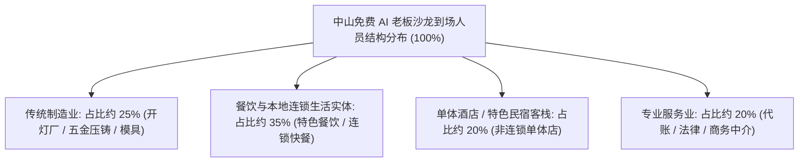
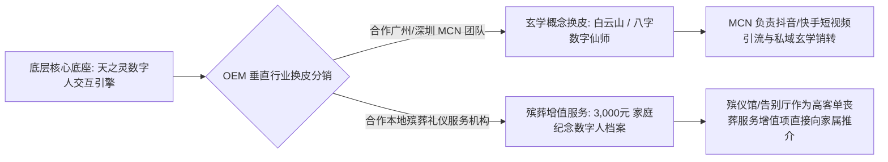

# 2026-11-08 · 刀文AI商业：6大园区免费沙龙漏斗、2万元入企交付门槛、酒店算账、“天之灵”玄学换皮与3000元殡葬增值

> 本文全息记录 2026 年 11 月 8 日《刀文AI商业》（连麦嘉宾：司马老师、刀文、蕾蕾AI、天之灵开发者等）9.3 小时长达 3,307 行脱水纯净对话的实战复盘。彻底拒绝空洞抽象概述，全息还原：司马老师自持 6 大产业园区盘活与免费沙龙现场“需求拉爆、老板疯狂加微信”的盛况；灯厂压铸厂占比 1/4 与单体酒店老板线上流量仅 30% 的现场算账；1,999元洗人 → 20,000元入企（20人团队硬门槛）→ 深度全案的三阶梯交付；拒绝 5,000~10,000 元中间段的定价哲学与外部合伙人招募；独立开发者“天之灵”离世亲人数字人小程序如何以 OEM 换皮对接深圳 MCN“白云山玄学”概念；殡葬业 3,000 元家庭版增值服务对两三万重硬件的降维打击；以及对标“追风”爆款 IP 摆脱低价课表演、立足产业中枢的反脆弱身位。

---

## 目录

- [一、 中山 6 大园区盘活与免费沙龙实战：现场需求拉爆与微信加爆全景](#一-中山-6-大园区盘活与免费沙龙实战现场需求拉爆与微信加爆全景)
  - [1. 真实资产底牌：自持 6 大园区，拒绝外接先紧着自己](#1-真实资产底牌自持-6-大园区拒绝外接先紧着自己)
  - [2. 到场老板画像解构：灯厂压铸占 1/4，大量餐饮与单体酒店实体](#2-到场老板画像解构灯厂压铸占-14大量餐饮与单体酒店实体)
  - [3. 单体酒店现场算账实操：线上流量仅 30%，如何用 AI 同城获客做增量](#3-单体酒店现场算账实操线上流量仅-30如何用-ai-同城获客做增量)
- [二、 20,000 元入企交付模型与三阶梯商业产品金字塔](#二-20000-元入企交付模型与三阶梯商业产品金字塔)
  - [1. 第一阶梯：1,999 元通用培训快速“洗人”，普及园区体感](#1-第一阶梯1999-元通用培训快速洗人普及园区体感)
  - [2. 第二阶梯：20,000 元两天入企交付，硬门槛必须 20 人以上](#2-第二阶梯20000-元两天入企交付硬门槛必须-20-人以上)
  - [3. 为什么坚决不做 5,000~10,000 元中间段？客单价与精力分润法则](#3-为什么坚决不做-500010000-元中间段客单价与精力分润法则)
  - [4. 第三阶梯：跑通 1~3 个月后，深度需求爆发引发大单交付](#4-第三阶梯跑通-13-个月后深度需求爆发引发大单交付)
- [三、 千元级垂直 OEM 换皮与冷门增值服务：玄学与殡葬真实账本](#三-千元级垂直-oem-换皮与冷门增值服务玄学与殡葬真实账本)
  - [1. 开发者“天之灵”：离世亲人数字人小程序的商业困局与生机](#1-开发者天之灵离世亲人数字人小程序的商业困局与生机)
  - [2. 深圳 MCN 的“白云山玄学换皮”：横向分销与容错空间哲学](#2-深圳-mcn-的白云山玄学换皮横向分销与容错空间哲学)
  - [3. 殡葬行业增值服务：3,000 元轻量家庭版对两三万笨重硬件的降维打击](#3-殡葬行业增值服务3000-元轻量家庭版对两三万笨重硬件的降维打击)
- [四、 摆脱低价课表演与流量焦虑：从“主播”跃迁为“产业方案中枢”](#四-摆脱低价课表演与流量焦虑从主播跃迁为产业方案中枢)
  - [1. 连麦者的迷茫：对标“追风”爆款 IP 为什么依然焦虑](#1-连麦者的迷茫对标追风爆款-ip-为什么依然焦虑)
  - [2. 刀文与司马破局：AI 本身附加值已超越传统行业 Know-How](#2-刀文与司马破局ai-本身附加值已超越传统行业-know-how)
  - [3. 建立强筛选逻辑：宁可不做，绝不坏了交付口碑](#3-建立强筛选逻辑宁可不做绝不坏了交付口碑)
- [五、 落地实操工具项目台账与交付核对表](#五-落地实操工具项目台账与交付核对表)

---

## 一、 中山 6 大园区盘活与免费沙龙实战：现场需求拉爆与微信加爆全景

### 1. 真实资产底牌：自持 6 大园区，拒绝外接先紧着自己

在连麦中，司马老师向连麦嘉宾“蕾蕾AI”详细复盘了其刚刚在广东中山成功举办的实战沙龙。外界以为司马只是租用场地办活动，司马现场透露了自己的真实资产底牌：

> **司马**：“蕾蕾老师，我最近有非常庞大的业务交付需求，你看看我们怎么深度绑定合作。我现在有三个核心板块：第一个是免费的老板沙龙。为什么我能常态化搞？因为我自己在中山有 **6 个产业园区**！昨天我刚做完一场，现场反响极其热烈，今天一大早就有好几个外部园区的负责人主动找过来想跟我合作搞沙龙。但我直接回绝了，我先不考虑他们，我必须先紧着我自己的 6 个园区全部盘活！”

- **沙龙现场的火爆场面**：司马在沙龙现场并没有急不可耐地上台强推高客单升单，但整个培训讲座把企业老板对 AI 的落地渴望彻底点燃。下课铃声一响，全场几十名传统企业老板蜂拥而上，把讲台围得水泄不通，疯狂添加司马的个人微信，现场添加了上百位具有强烈痛点的企业老板。

### 2. 到场老板画像解构：灯厂压铸占 1/4，大量餐饮与单体酒店实体

传统上认为中山是制造业重镇（灯饰、五金压铸、小家电），但司马通过沙龙门禁登记，穿透了到场老板的真实行业结构：



- **传统制造型老板（占比约 25%）**：多为灯具厂、压铸配件厂老板，普遍对复杂的 ERP/MES 改造持观望态度，最关心的是接单和外贸询盘；
- **实体生活与酒旅老板（占比高达 75%）**：做地方特色餐饮、商务酒店、单体客栈的老板成为主力军。这些老板手头现金流尚可，但面临着极其残酷的公域平台流量盘剥。

### 3. 单体酒店现场算账实操：线上流量仅 30%，如何用 AI 同城获客做增量

沙龙现场一位经营本地中端单体酒店的老板加了司马微信，现场倒苦水。司马当场为其算了一笔震撼性的“酒店流量与财务账”：

- **单体酒店的经营死穴**：
  - 该酒店拥有约 80~100 间客房，非连锁加盟品牌；
  - **线上 OTA 渠道（携程、美团、飞猪）订房仅占总房量的 30%**，且每笔订单要被 OTA 平台抽走高达 **15%~20%** 的高额佣金；
  - 另外 **70% 的客房依赖线下自然上门、老客户协议房与过路散客**。一到工作日或淡季，房间空置率急剧攀升；
- **AI 同城内容获客算账模型**：
  - 司马指出，千万不要跟酒店老板推销复杂的 Agent 或大模型底座，老板听不懂也不在乎；
  - **切入点极其聚焦**：利用小红书与抖音本地同城号，教酒店市场部员工使用 WorkBuddy 自动批量抓取周边 50 公里内商务宴请、周末自驾亲子游、考研考公房等长尾痛点，批量生成“客房实拍 + 隔音评测 + 免费停车 + 周边美食打卡”短视频与图文笔记；
  - **单房收益算账**：酒店单房日平均营收（RevPAR）只要通过同城公域引流每天多卖出 5 间房，或者每间房通过增值体验溢价 30 元，单月即可带来净增现金流上万元，而投入的 AI 工具与培训成本仅需数千元，投产比（ROI）立竿见影。

---

## 二、 20,000 元入企交付模型与三阶梯商业产品金字塔

针对很多技术团队“要么卖几百元低价课累死、要么推几十万大单碰壁”的通病，司马老师向蕾蕾AI系统输出了其经过精密核算的商业产品金字塔：

```mermaid
flowchart TD
    A[入口: 中山 6 大园区两周一次免费沙龙] -->|筛选出具有强烈焦虑的老板| B
    subgraph 第一阶梯: 快速普及与洗人
        B[第 1 阶梯: 1,999 元通用实操小班课] --> C[教老板/核心骨干上手 WorkBuddy 基础工作流]
        C --> D[客单价低 / 老板决策极快 / 建立基本信任]
    end
    subgraph 第二阶梯: 深度梳理与入企交付
        D -->|实操后发现业务无法打通| E[第 2 阶梯: 20,000 元入企交付 (严格门槛)]
        E --> F[2天驻企实地梳理: 业务流 + WorkBuddy 定制]
        F --> G[硬性门槛: 企业团队规模必须在 20 人以上!]
    end
    subgraph 第三阶梯: 全案改造与大单陪跑
        G -->|业务跑通 1~3 个月后产生系统级痛点| H[第 3 阶梯: 100,000 元起深度全案与持续陪跑]
        H --> I[深度绑定 / 定制企业专属垂直知识库与数字化中台]
    end
```

### 1. 第一阶梯：1,999 元通用培训快速“洗人”，普及园区体感

- **产品定位**：极轻量的 1~2 天周末实操集训营；
- **定价逻辑**：**¥1,999 元/人**。这个价格正好卡在中小企业老板可以不走繁琐报销、微信直接扫码个人转账的无痛区间；
- **核心目的**：绝对不指望靠 1,999 元发大财，核心目的是**“洗人”**。通过让企业老板和中层骨干亲手在电脑上跑通第一个写文案、做表格的 WorkBuddy 智能体，打破大模型神秘感，普及园区数字化体感。

### 2. 第二阶梯：20,000 元两天入企交付，硬门槛必须 20 人以上

在 1,999 元实操营结束后，老板通常会发现自身企业的具体业务非常繁琐，通用模板套不进去，顺理成章进入第二阶梯：

- **产品内容**：**2 天高强度入企梳理与轻量定制，全案收费严格卡死在 ¥20,000 元**；
- **交付内容**：
  - 第 1 天：梳理企业各个部门（销售、客服、行政、运营）的手工重复业务流，剔除冗余动作；
  - 第 2 天：用 WorkBuddy 搭建企业专属的报价智能体、客诉自动回复与日报生成，培训全员上线；
- **极其严苛的客户硬门槛（团队规模必须在 20 人以上）**：
  - 司马特别强调，**绝不接 20 人以下的小微作坊**！
  - 为什么？因为 3~5 个人的小作坊，老板自身就是业务员，没有流程分工，收 2 万块钱老板会天天盯着算细账，交付摩擦成本极其高昂；
  - 团队超过 20 人的企业，部门边界清晰，人力浪费明显。2 万元只相当于一个员工两个月的工资，老板掏钱痛快，改造效果容易量化呈现。

### 3. 为什么坚决不做 5,000~10,000 元中间段？客单价与精力分润法则

在连麦中，蕾蕾AI提出是否可以做 5,000~10,000 元的过渡性轻咨询产品，司马老师给出了极具穿透力的商业定位指导：

> **司马**：“坚决不做 5,000 块钱和 10,000 块钱的产品！对我来说这个客单价太低了，纯属鸡肋！收 5,000 块钱你同样要搭进去 1~2 天的时间，还要搭上路费和售后。第一单 1,999 元已经足够便宜、门槛足够低了，既然要入企，就必须做到 20,000 元！如果有外部合作伙伴（比如蕾蕾老师）想做 5,000~10,000 元的段位，我可以把客户导给你，你来做交付，按比例分润；但我们自己的核心品牌只做 20,000 元标准交付和后面的 10 万元大单！”

### 4. 第三阶梯：跑通 1~3 个月后，深度需求爆发引发大单交付

企业接受完 20,000 元的两天入企改造后，系统通常会稳定跑 1 到 3 个月。在此期间，企业老板会发现：
- 随着业务量激增，简单的桌面端智能体无法满足多仓库、跨门店的数据并发协同；
- 员工开始主动提出需要打通金蝶 ERP、需要自动化私域营销矩阵；
- 此时，企业主动寻求 **10 万元起步的全案定制与 3 个月陪跑交付**。整个销售过程没有一次是在“硬推销”，全靠客户痛点的自然递进与爆发。

---

## 三、 千元级垂直 OEM 换皮与冷门增值服务：玄学与殡葬真实账本

直播后半段连麦了一位极具探索精神的独立开发者，其主导的项目展现了 AI 落地在小众垂类赛道的惊人生存力。

### 1. 开发者“天之灵”：离世亲人数字人小程序的商业困局与生机

该开发者自研了一款名为“**天之灵**”的微信小程序：
- **核心场景**：家属上传已故亲人生前的照片、语音切片和性格生平资料，大模型驱动生成一个可以文字、语音实时交互的“数字亲人”；
- **商业困境**：虽然切中了大众对逝去亲人的深切哀思，但开发者个人缺乏强大的公域引流渠道，单靠自然搜索获客缓慢，面临商业变现困局。

### 2. 深圳 MCN 的“白云山玄学换皮”：横向分销与容错空间哲学

面对这一困境，开发者并未死磕单一品牌，而是采取了极其灵活的 **OEM 贴牌换皮与渠道分润策略**：



- **MCN 媒体人的玄学嗅觉**：深圳一位极具网感的 MCN 年轻操盘手主动找到开发者，提议将“天之灵”全套系统进行**换皮**，套用“白云山玄学大师”、“生辰数字护身符”等玄学概念，面向特定信仰群体进行短视频内容包装；
- **容错空间与分工身位**：开发者欣然接受 OEM 合作：“如果我自己去做玄学，我不懂里面的黑话，算账也算不清楚；但分出去给他们换皮运营，不仅扩大了接口调用量，还能帮我探明新的经营模式，何乐而不为？”

### 3. 殡葬行业增值服务：3,000 元轻量家庭版对两三万笨重硬件的降维打击

针对“天之灵”在严肃民生领域的变现，开发者打通了一条令人拍案叫绝的冷门渠道——**殡葬礼仪机构的轻量增值服务**：

| 交付维度 | 传统硬件厂商做法（自杀式） | 开发者“天之灵”打法（轻量暴利） |
| :--- | :--- | :--- |
| **产品形态** | 沉重的定制立式触摸一体机、全息投影舱 | **轻量化微信小程序 + 实体亚克力纪念卡（家庭版）** |
| **终端售价** | **¥20,000 ~ ¥30,000 元**（极其沉重，家属抗拒） | **¥3,000 元左右**（直接作为高规格丧葬套餐的增值项） |
| **渠道阻力** | 需殡仪馆提供大面积场地与高额电力维护，极难准入 | 殡葬礼仪师在主持完告别仪式后顺手推介，家属极易接受 |
| **履约成本** | 硬件运输、上门安装调试，售后故障率高 | 线上云端训练、家属手机端直接使用，零边际边际成本 |

- **第一性原理降维打击**：很多团队做智慧殡葬，一上来就研发两三万元的立式全息硬件，结果由于价格高昂、占用场地，在全国殡仪馆碰壁吃灰。而开发者将其做成 **3,000 元左右的轻量家庭版**，在亲人离世、情感最脆弱的告别节点作为告别仪式的暖心增值服务，利润由殡葬礼仪公司与技术方五五分成，迅速形成真实闭环。

---

## 四、 摆脱低价课表演与流量焦虑：从“主播”跃迁为“产业方案中枢”

### 1. 连麦者的迷茫：对标“追风”爆款 IP 为什么依然焦虑

连麦中有不少试图做抖音 AI 知识博主的学员诉苦：每天苦熬几个小时写脚本、模仿业内爆款“追风”等大号去拍短视频，但直播间只有几十个人，卖几百块钱的入门课累死累活，感到极度倦怠。

### 2. 刀文与司马破局：AI 本身附加值已超越传统行业 Know-How

司马老师与刀文给出了犀利的破局心法：

> **“在 AI 爆发的今天，AI 本身的连接与附加值，已经远远超过了几乎所有传统行业原有的 Know-How！你们最大的误区，是把自己当成了一个靠打赏、靠卖 99 元小黄车低价课的‘表演型主播’！”**

- **直播间的真正身位是“产业方案撮合中枢”**：
  - 直播间不需要几十万泛流量，几十个人足矣，关键是这几十个人里有没有身价千万的传统企业老板；
  - 刀文直言：“我的直播间根本不指望靠直播打赏或卖小课赚钱。直播间的作用是把认知拉满、把身位立住，吸引各行各业有资源的产业老板（如中山 6 个园区的物业、上麦的王哥、戴总）主动向我靠拢；我做的是大资源对接与标准化赋能！”

### 3. 建立强筛选逻辑：宁可不做，绝不坏了交付口碑

司马老师重申了其商业合作的铁律底线：
- **对乙方老师的强管控**：凡是参与 4S 店交付、入企 20,000 元交付的老师，必须经过面对面考核与标准化 SOP 培训；
- **商誉重于一切**：手上的 4,000 家汽车 4S 店资源与中山园区资源是立身之本。宁可订单烂在手里不接，也绝不随便推给没经验的半吊子，彻底杜绝砸牌子风险。

---

## 五、 落地实操工具项目台账与交付核对表

### 1. 核心工具与项目资产台账

| 工具 / 项目名称 | 业务属性与定位 | 核心优势 | 交付避坑要点 |
| :--- | :--- | :--- | :--- |
| **WorkBuddy** | 腾讯生态可视化企业 AI IDE | 原生打通微信生态，支持零代码拖拽与小程序一键生成，中小老板极易接受。 | 复杂后端逻辑易产生冗余代码，需资深工程师做外围缰绳约束。 |
| **天之灵小程序** | 离世亲人数字人纪念交互系统 | 情感切入点极深，支持高精度音色克隆与生平语料微调。 | 严禁走重型大硬件路线；坚决走 3,000 元轻量家庭版并与殡仪机构合作分成。 |
| **中山 6 大园区资产** | 实体产业赋能落地空间 | 自持空间零租金壁垒，每两周一场免费沙龙稳定拉动线下就餐与高客单获客。 | 严守客户门槛：入企培训严格限定企业规模在 20 人以上。 |
| **玄学 OEM 换皮** | 垂直 MCN 媒体分销模型 | 借助成熟短视频团队的网感打穿下沉圈层，技术方仅承担轻量 API 维护。 | 建立清晰的分润结算机制，法务端规避封建迷信违规词汇。 |

### 2. 商业实操核对清单（Checklist）

- [ ] **园区沙龙场景化算账**：面对酒旅、餐饮实体老板，绝不讲技术参数，直接拿出“单房 RevPAR 加价 30 元”或“同城短视频每天多卖 5 桌”的真实投产比算账模型；
- [ ] **守死 20,000 元入企价格线**：绝不打折降至 5,000~10,000 元，入驻前严格核查客户在职员工是否达到 20 人门槛；
- [ ] **离世数字人轻量化转型**：彻底放弃数万元的立式全息硬件，将产品收敛为 3,000 元轻量微信小程序 + 亚克力实体卡，绑定殡葬礼仪公司分成获客；
- [ ] **自媒体定位重塑**：停掉无意义的 99 元低价课叫卖，短视频与直播全部聚焦真实产业方案与踩坑实录，做高净值老板的强筛选漏斗。

---

*版权声明：本文档由企智AI落地派 / 刀文AI商业实操连麦逐字稿全量深度蒸馏而成，知识产权与案例事实归原作者及连麦各方所有。*  
*知识归档：Distillation 自动化深度智库体系*
