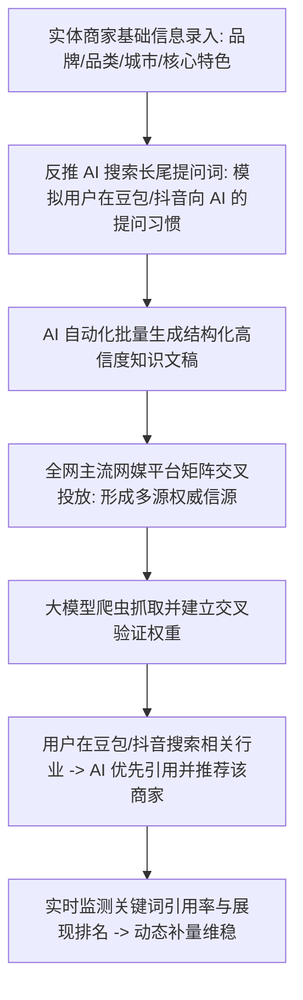
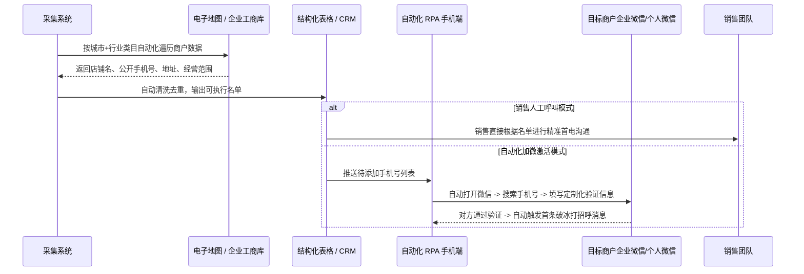
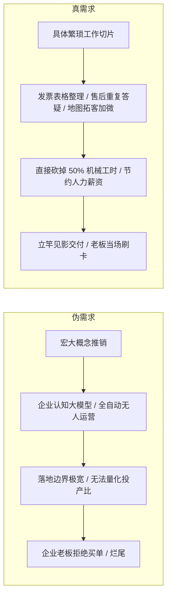
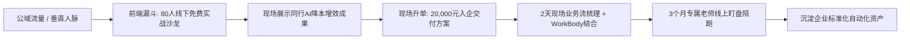
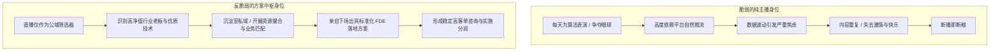

# 2026-11-08 · 刀文AI商业：GEO生成式引擎优化抢位、地图采集触达流转、同城实体赋能与千元级OEM代理

> 本文全息记录 2026 年 11 月 8 日《刀文AI商业》9.3 小时连麦实战。系统拆解面向豆包与抖音 AI 搜索的 GEO（Generative Engine Optimization）全套反推长尾词与多网媒交叉验证冲榜战法、全国商户地图数据自动采集与微信加好友流转闭环、企业 AI 赋能重在重复繁琐工作直接替代的身位哲学、千元级产品垂直 OEM 换皮与家庭离世亲人增值服务的冷门赛道，以及化解内容直播倦怠的反脆弱模式。

---

## 目录

- [一、 GEO（生成式引擎优化）战法：如何在 AI 搜索时代一周抢占同城第一](#一-geo生成式引擎优化战法如何在-ai-搜索时代一周抢占同城第一)
- [二、 地图商户数据自动采集与私域流转系统：从列表到自动加微](#二-地图商户数据自动采集与私域流转系统从列表到自动加微)
- [三、 企业 AI 赋能的本质身位：拒绝虚妄宏大叙事，专攻繁琐与重复劳动](#三-企业-ai-赋能的本质身位拒绝虚妄宏大叙事专攻繁琐与重复劳动)
- [四、 20,000元标准化“2天入企 + 3个月陪跑”交付模型](#四-20000元标准化2天入企--3个月陪跑交付模型)
- [五、 千元级产品垂直 OEM 与行业换皮：玄学与殡葬增值服务的冷门暴利](#五-千元级产品垂直-oem-与行业换皮玄学与殡葬增值服务的冷门暴利)
- [六、 直播流量倦怠与反脆弱身位：从“表演者”跃迁为“产业方案中枢”](#六-直播流量倦怠与反脆弱身位从表演者跃迁为产业方案中枢)
- [七、 商业行动清单（Actionable Practice）](#七-商业行动清单actionable-practice)

---

## 一、 GEO（生成式引擎优化）战法：如何在 AI 搜索时代一周抢占同城第一

随着抖音、豆包等平台大规模普及 AI 搜索（如抖音的“AI搜一搜”、豆包的推荐引用），传统的百度 SEO 已经全面失效。刀文在直播中详细拆解了当下极具杀伤力的 GEO（Generative Engine Optimization，生成式引擎优化）实操全链路。

### 1. 传统 SEO 与现代 GEO 的根本代差

| 维度 | 传统搜索引擎优化（SEO） | 生成式引擎优化（GEO） |
| :--- | :--- | :--- |
| **目标平台** | 百度、Google、360 等网页搜索引擎 | 豆包、抖音 AI 搜一搜、通义、Kimi 等大模型问答引擎 |
| **抓取机理** | 页面外链数量、TDK（Title/Desc/Keywords）密度 | 语料的结构化权威度、第三方网媒平台的**多源交叉验证** |
| **呈现形式** | 搜索结果蓝色超链接列表，需用户逐个点击挑选 | AI 总结式回答，直接输出推荐结论、理由及引用出处 |
| **落地见效** | 动辄 3~6 个月漫长权重积累 | 同城垂直类目（装修、美容、门诊）**7~10 天即可见效** |

### 2. 同城实体抢占第一的落地四步法

1. **第一步：反推提问习惯长尾词**  
   不要盲目堆砌“同城最好的装修公司”这种大词，而是通过提示词工程反推真实消费者问 AI 的长尾痛点，例如：“在某某市买了一套 120 平老旧小区想做极简风改造，哪家装修公司做水电隐蔽工程透明且无增项？”；
2. **第二步：生成高质量结构化证明文档**  
   AI 依照大模型喜好的知识结构（包括数据对比、避坑清单、真实地址与联系规范）撰写客观中立评测文，将目标商家作为典型优秀案例自然嵌入；
3. **第三步：全网主流网媒交叉投喂**  
   避开门槛极高的官媒，将内容批量投放至百家号、搜狐、网易、知乎、头条及垂直行业论坛。因为大模型生成推荐结论时，必须依赖至少 2~3 个独立信源的交叉印证，单一平台发帖无法生效；
4. **第四步：引用监测与动态维稳**  
   搭建自动化监测脚本，每天定期调用大模型 API 提问该长尾词，统计模型回答中是否出现该品牌名字及其引用链接位置，发现排名波动立即追加补充语料。

---

## 二、 地图商户数据自动采集与私域流转系统：从列表到自动加微

在实体 B2B 与同城商业拓客中，销售团队最耗费精力的是从各个平台寻找目标商户的电话与地址。刀文直播中演示了将数据采集与私域添加打通的自动化轻量系统。

### 1. 核心业务痛点化解

- **传统纯人工寻客成本高**：一个初级电销人员每天有 60% 的时间在地图上翻看地址、抄写手机号，真正有效通话时间不足 2 小时；
- **自动化采集不仅是表格**：采集完生成 Excel 表格只是半成品，系统支持将数据直连自动化辅助工具，实现“搜索号码-输入个性化验证语-加好友”的标准化流转；
- **合规与风控底线**：严禁采用粗暴爆破式连续添加。系统必须设置单设备每日安全阈值（如每天添加 15~20 人）、每次间隔 3~5 分钟随机休眠，确保运营账号安全稳定。

---

## 三、 企业 AI 赋能的本质身位：拒绝虚妄宏大叙事，专攻繁琐与重复劳动

连麦中多次出现技术人员试图向企业老板推销“企业级认知中枢”、“全局自主协同智能体”等高大上概念却屡屡碰壁的案例。刀文对此给出了犀利的技术商业定位：

### 1. 企业老板真正听得懂的语言

- **不是“AI 多厉害”，而是“帮我省几个人”**：实体老板不关心 Transformer 架构，只关心一个月能不能少招一个 5000 元工资的文员或美工；
- **从最具机械重复性的环节切入**：
  - 销售端：每天整理客户沟通录音、提炼跟进要点并填入表格；
  - 客服端：对 90% 的高频常见问题（如运费、地址、营业时间、营业资质）由本地知识库秒级秒回；
  - 运营端：每天将老板讲的一段语音自动转化成 5 篇排版精美的小红书图文。
- **让技术人员做“拆解辅助”，而不是“替代全盘业务”**。

### 2. 中山老牌代记账公司的生死劫：这不是同行乱价，而是技术代差

连麦中刀文剖析了前一日与一家中山老牌代记账机构老板的具体沟通，揭示了传统企服在 AI 面临的生存危机：
- **存量流失与新增断崖**：该机构在中山本地深耕多年，拥有几千家老牌存量企业客户。然而今年出现致命信号——**全年纯新增客户几乎彻底归零，存量老客户直接流失了 30%**；
- **老板的心智盲区**：该老板在直播间愤怒抱怨，认为是“市场上新冒出来的同行在恶意乱价打乱市场”。刀文当场指出：“人家不是在乱价，是你没有能力把成本做到人家那个程度！同行已经全面接通了自动化报税、OCR 票据秒级录入与 Agent 自动催账，综合成本比你低 80%，人家做到又便宜又好，你骂同行乱价只是在掩盖自己的技术落后”。

### 3. 酒店单房收益（RevPAR）加价 30 元算账法

针对服务酒店行业的 AI 创业者，刀文传授了极具杀伤力的价值锚定算账法：
- **不要给老板讲大模型架构**：酒店老板最核心的指标是单房日平均收益（RevPAR，Revenue Per Available Room），目前普遍在 280~300 元上下；
- **极简算账逻辑**：“如果你通过 AI 动态调价算法与多渠道智能客服，帮酒店每天每间房多卖 30 元，对于一家拥有 100 间客房的单体酒店而言：
  $$\text{单日纯利润增量} = 100 \times 30 = 3,000 \text{ 元}$$
  $$\text{单月纯利润增量} = 3,000 \times 30 = 90,000 \text{ 元}$$
  由于客房固定租金和折旧是锁定的，这 9 万元是**没有任何额外物理成本的净利润**！此时你拿着这 9 万元的确定性增量去找老板谈提成或收取 2 万元服务费，老板当场就能算清账目并痛快刷卡。”

---

## 四、 20,000元标准化“2天入企 + 3个月陪跑”交付模型

连麦中深入讨论了如何把非标的 AI 咨询转化为高客单、高利润的标准化产品。

### 1. 定价法则与阶梯防线

- **死守 20,000 元高客单底线**：刀文明确表示，客单价在 5,000 元或 10,000 元的低端单子坚决不碰，“因为客单价太低根本覆盖不了专家入企和后续三个月的交付成本，反而会引来挑剔且没有付费能力的伪客户”；
- **标准化阶梯报价**：
  - **基础套餐**：企业规模 20 人以内，统一收取 **20,000 元**（包含 2 天线下入企业务流梳理与 WorkBody 自动化结合，以及后续 3 个月专属老师线上盯盘陪跑）；
  - **超额阶梯加收**：企业团队超过 20 人，每增加 1 人固定加收 **1,000 元**；
- **80 人免费沙龙的升单漏斗**：刀文透露其在 21 号即将落地一场 80 人的线下企业家免费沙龙。其底层逻辑不是靠门票赚钱，而是把沙龙作为展示同行成果的高势能磁场，在现场直接转化 3~5 家意向企业购买 20,000 元入企方案，单场即可产生 6~10 万元确定性现金流。

### 2. 腾讯 6 万元企微官方代理与合规底线

连麦中有开发者试图通过 Hook 注入个人微信实现全自动发消息，刀文给出了严厉的风控警告：
- **个微 Hook 属于严重违规**：任何直接修改个人微信内存或破解协议的行为，面临的是腾讯极其严苛的封号与法务风险，企业客户不可能接受资产归零的灾难；
- **走官方合规通道**：宁可花费 **6 万元直接与腾讯签约成为官方服务商/代理**，拿下合规的企微官方开放接口与商户资质通道。下个月腾讯官方接口将进行重大迭代，正规军将通过官方合法接口全面收割黑灰产留下的市场空间。

### 3. 几百元高拍仪 + 垂直 Agent 颠覆数千元传统学习机

- **传统硬件溢价破灭**：过去学而思、好记星等传统学习机动辄售价 3,000~4,000 元，本质是在为渠道费和封闭内容库买单；
- **AI 时代的轻量解法**：现在只需一台几十元到两百元的高拍仪硬件或普通录音笔，连接家里既有的 iPad，背后挂载针对特定科目的作业批改与错题辅导 Agent，整体硬件成本控制在数百元以内，功能却远超传统学习机，直接将过去数万元的校外课外辅导班降维替代。

---

## 五、 千元级产品垂直 OEM 与行业换皮：玄学与殡葬增值服务的冷门暴利

在 AI 应用变现中，许多人看不上的“换皮”与“千元级标准化代理”，恰恰是现金流极其充沛的隐形金矿。

### 1. 行业垂直 OEM 代理机制

- **同一套底层底座，换不同行业外衣**：
  - 底层技术是一模一样的多模态 Agent 工作流（语音交互 + 虚拟形象 + 动态背景 + 本地专有知识库）；
  - **玄学行业**：换上八字命理、面相测算、星座塔罗的 UI 与话术库，直接按 98~298 元单次咨询收费，私域复购与客单极高；
  - **殡葬与纪念行业**：换上严肃温馨的家庭数字人纪念界面，作为殡葬服务机构的高附加值增值方案，在亲人离世时提供“留声留像”的数字纪念册，单次服务溢价可达 1000~3000 元；
- **千元级代理模式**：技术团队不直接做终端 C 端零售，而是向传统行业的区域代理商收取 1,000~5,000 元/年的 OEM 贴牌授权费，允许其打自己的品牌自主定价去招商，技术团队只赚取稳健的基础维护与 Token 差价。

---

## 六、 直播流量倦怠与反脆弱身位：从“表演者”跃迁为“产业方案中枢”

连麦中有不少从事内容直播与 AI 创业的嘉宾反映：播了几场之后，虽然数据提示“打败了 90% 的同行”，但自己越播越觉得无聊、身心疲惫，甚至产生了强烈的厌播情绪。

### 1. 为什么“打败了 90% 的人”依然赚不到钱还身心俱疲？

- **纯流量变现极其脆弱**：如果你在直播间里仅仅依靠观众打赏或售卖几十块钱的盗版网课，你的身位就是一个“被算法支配的数字劳工”，每天一睁眼就面临流量清零；
- **把直播间当成“业务匹配中枢”**：
  - 刀文的破局逻辑在于：**明确告诉观众，直播只是业务交流的窗口，不在直播间卖低端货**；
  - 直播的价值是把有强烈采购需求的企业老板、以及有技术实操能力的 FDE 工程师筛选出来，在私域进行精准匹配；
  - 主理人从台前的“表演者”，后撤为幕后的“首席业务架构师”。

---

## 七、 商业行动清单（Actionable Practice）

| 序号 | 业务模块 | 核心落地动作 | 周期与关键验证点 |
| :--- | :--- | :--- | :--- |
| **01** | **GEO 快速冲榜** | 选定同城特定品类（如美容门诊），反推 20 个大模型长尾提问词，生成结构化文章分发至 5 家主流网媒 | **7 天**，在豆包与抖音 AI 搜索中实现该词条 80% 以上首推率 |
| **02** | **商户采集流转** | 部署轻量地图爬虫，按目标城市类目导出 500 家商户手机号并进行合规加微 | 设定每天加微 15 人阈值，建立自动化第一句破冰话术 |
| **03** | **繁琐流程改造** | 进驻一家实体企业，只挑选 1 个重复耗时超 2 小时的岗位流程（如报价单汇总、开票单据整理）进行 AI 自动化替换 | **3 天内**跑通，为客户直接释放 1 名文员 50% 机械工时 |
| **04** | **垂直 OEM 贴牌** | 将标准 Agent 包装成玄学咨询或家庭纪念增值版，寻找 1 家线下婚庆、心理或服务机构合作分成 | 制定 980~1980 元轻量落地套餐，验证非标增值变现 |
| **05** | **直播身位调整** | 停止在直播间兜售低价课；将话术全面转向真实企业踩坑复盘，将高意向老板沉淀至微信咨询库 | 建立私域二阶段方案诊断标准，单客咨询启动门槛提升至 3,000 元以上 |
