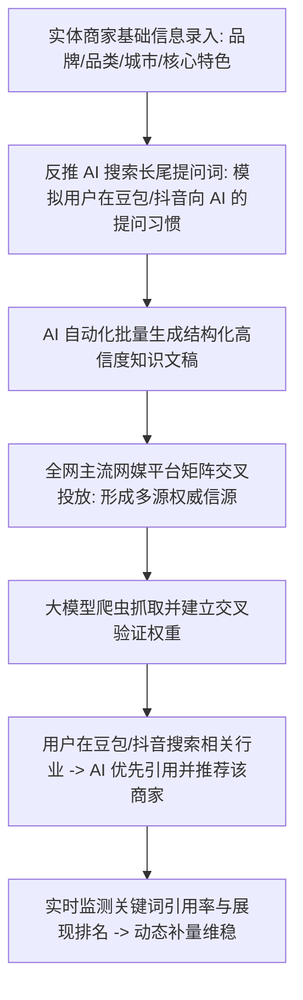
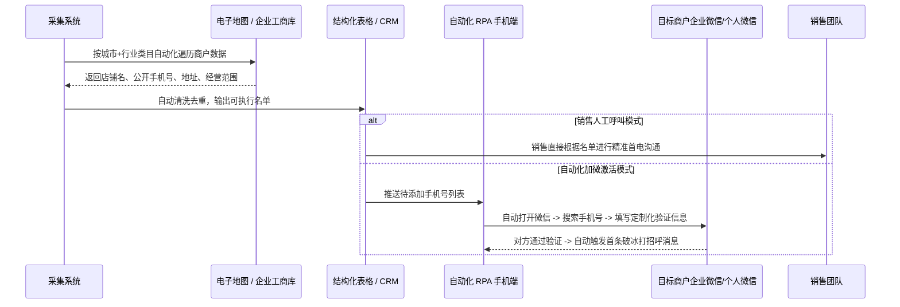
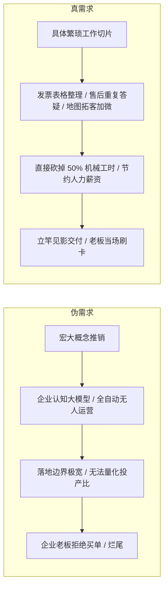
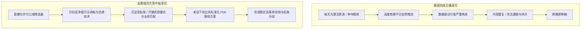

# 2026-11-08 · 刀文AI商业：GEO生成式引擎优化抢位、地图采集触达流转、同城实体赋能与千元级OEM代理

> 本文全息记录 2026 年 11 月 8 日《刀文AI商业》9.3 小时连麦实战。系统拆解面向豆包与抖音 AI 搜索的 GEO（Generative Engine Optimization）全套反推长尾词与多网媒交叉验证冲榜战法、全国商户地图数据自动采集与微信加好友流转闭环、企业 AI 赋能重在重复繁琐工作直接替代的身位哲学、千元级产品垂直 OEM 换皮与家庭离世亲人增值服务的冷门赛道，以及化解内容直播倦怠的反脆弱模式。

---

## 目录

- [一、 GEO（生成式引擎优化）战法：如何在 AI 搜索时代一周抢占同城第一](#一-geo生成式引擎优化战法如何在-ai-搜索时代一周抢占同城第一)
- [二、 地图商户数据自动采集与私域流转系统：从列表到自动加微](#二-地图商户数据自动采集与私域流转系统从列表到自动加微)
- [三、 企业 AI 赋能的本质身位：拒绝虚妄宏大叙事，专攻繁琐与重复劳动](#三-企业-ai-赋能的本质身位拒绝虚妄宏大叙事专攻繁琐与重复劳动)
- [四、 千元级产品垂直 OEM 与行业换皮：玄学与殡葬增值服务的冷门暴利](#四-千元级产品垂直-oem-与行业换皮玄学与殡葬增值服务的冷门暴利)
- [五、 直播流量倦怠与反脆弱身位：从“表演者”跃迁为“产业方案中枢”](#五-直播流量倦怠与反脆弱身位从表演者跃迁为产业方案中枢)
- [六、 商业行动清单（Actionable Practice）](#六-商业行动清单actionable-practice)

---

## 一、 GEO（生成式引擎优化）战法：如何在 AI 搜索时代一周抢占同城第一

随着抖音、豆包等平台大规模普及 AI 搜索（如抖音的“AI搜一搜”、豆包的推荐引用），传统的百度 SEO 已经全面失效。刀文在直播中详细拆解了当下极具杀伤力的 GEO（Generative Engine Optimization，生成式引擎优化）实操全链路。

### 1. 传统 SEO 与现代 GEO 的根本代差

| 维度 | 传统搜索引擎优化（SEO） | 生成式引擎优化（GEO） |
| :--- | :--- | :--- |
| **目标平台** | 百度、Google、360 等网页搜索引擎 | 豆包、抖音 AI 搜一搜、通义、Kimi 等大模型问答引擎 |
| **抓取机理** | 页面外链数量、TDK（Title/Desc/Keywords）密度 | 语料的结构化权威度、第三方网媒平台的**多源交叉验证** |
| **呈现形式** | 搜索结果蓝色超链接列表，需用户逐个点击挑选 | AI 总结式回答，直接输出推荐结论、理由及引用出处 |
| **落地见效** | 动辄 3~6 个月漫长权重积累 | 同城垂直类目（装修、美容、门诊）**7~10 天即可见效** |

### 2. 同城实体抢占第一的落地四步法

1. **第一步：反推提问习惯长尾词**  
   不要盲目堆砌“同城最好的装修公司”这种大词，而是通过提示词工程反推真实消费者问 AI 的长尾痛点，例如：“在某某市买了一套 120 平老旧小区想做极简风改造，哪家装修公司做水电隐蔽工程透明且无增项？”；
2. **第二步：生成高质量结构化证明文档**  
   AI 依照大模型喜好的知识结构（包括数据对比、避坑清单、真实地址与联系规范）撰写客观中立评测文，将目标商家作为典型优秀案例自然嵌入；
3. **第三步：全网主流网媒交叉投喂**  
   避开门槛极高的官媒，将内容批量投放至百家号、搜狐、网易、知乎、头条及垂直行业论坛。因为大模型生成推荐结论时，必须依赖至少 2~3 个独立信源的交叉印证，单一平台发帖无法生效；
4. **第四步：引用监测与动态维稳**  
   搭建自动化监测脚本，每天定期调用大模型 API 提问该长尾词，统计模型回答中是否出现该品牌名字及其引用链接位置，发现排名波动立即追加补充语料。

---

## 二、 地图商户数据自动采集与私域流转系统：从列表到自动加微

在实体 B2B 与同城商业拓客中，销售团队最耗费精力的是从各个平台寻找目标商户的电话与地址。刀文直播中演示了将数据采集与私域添加打通的自动化轻量系统。

### 1. 核心业务痛点化解

- **传统纯人工寻客成本高**：一个初级电销人员每天有 60% 的时间在地图上翻看地址、抄写手机号，真正有效通话时间不足 2 小时；
- **自动化采集不仅是表格**：采集完生成 Excel 表格只是半成品，系统支持将数据直连自动化辅助工具，实现“搜索号码-输入个性化验证语-加好友”的标准化流转；
- **合规与风控底线**：严禁采用粗暴爆破式连续添加。系统必须设置单设备每日安全阈值（如每天添加 15~20 人）、每次间隔 3~5 分钟随机休眠，确保运营账号安全稳定。

---

## 三、 企业 AI 赋能的本质身位：拒绝虚妄宏大叙事，专攻繁琐与重复劳动

连麦中多次出现技术人员试图向企业老板推销“企业级认知中枢”、“全局自主协同智能体”等高大上概念却屡屡碰壁的案例。刀文对此给出了犀利的技术商业定位：

### 1. 企业老板真正听得懂的语言

- **不是“AI 多厉害”，而是“帮我省几个人”**：实体老板不关心 Transformer 架构，只关心一个月能不能少招一个 5000 元工资的文员或美工；
- **从最具机械重复性的环节切入**：
  - 销售端：每天整理客户沟通录音、提炼跟进要点并填入表格；
  - 客服端：对 90% 的高频常见问题（如运费、地址、营业时间、营业资质）由本地知识库秒级秒回；
  - 运营端：每天将老板讲的一段语音自动转化成 5 篇排版精美的小红书图文。
- **让技术人员做“拆解辅助”，而不是“替代全盘业务”**。

---

## 四、 千元级产品垂直 OEM 与行业换皮：玄学与殡葬增值服务的冷门暴利

在 AI 应用变现中，许多人看不上的“换皮”与“千元级标准化代理”，恰恰是现金流极其充沛的隐形金矿。

### 1. 行业垂直 OEM 代理机制

- **同一套底层底座，换不同行业外衣**：
  - 底层技术是一模一样的多模态 Agent 工作流（语音交互 + 虚拟形象 + 动态背景 + 本地专有知识库）；
  - **玄学行业**：换上八字命理、面相测算、星座塔罗的 UI 与话术库，直接按 98~298 元单次咨询收费，私域复购与客单极高；
  - **殡葬与纪念行业**：换上严肃温馨的家庭数字人纪念界面，作为殡葬服务机构的高附加值增值方案，在亲人离世时提供“留声留像”的数字纪念册，单次服务溢价可达 1000~3000 元；
- **千元级代理模式**：技术团队不直接做终端 C 端零售，而是向传统行业的区域代理商收取 1,000~5,000 元/年的 OEM 贴牌授权费，允许其打自己的品牌自主定价去招商，技术团队只赚取稳健的基础维护与 Token 差价。

---

## 五、 直播流量倦怠与反脆弱身位：从“表演者”跃迁为“产业方案中枢”

连麦中有不少从事内容直播与 AI 创业的嘉宾反映：播了几场之后，虽然数据提示“打败了 90% 的同行”，但自己越播越觉得无聊、身心疲惫，甚至产生了强烈的厌播情绪。

### 1. 为什么“打败了 90% 的人”依然赚不到钱还身心俱疲？

- **纯流量变现极其脆弱**：如果你在直播间里仅仅依靠观众打赏或售卖几十块钱的盗版网课，你的身位就是一个“被算法支配的数字劳工”，每天一睁眼就面临流量清零；
- **把直播间当成“业务匹配中枢”**：
  - 刀文的破局逻辑在于：**明确告诉观众，直播只是业务交流的窗口，不在直播间卖低端货**；
  - 直播的价值是把有强烈采购需求的企业老板、以及有技术实操能力的 FDE 工程师筛选出来，在私域进行精准匹配；
  - 主理人从台前的“表演者”，后撤为幕后的“首席业务架构师”。

---

## 六、 商业行动清单（Actionable Practice）

| 序号 | 业务模块 | 核心落地动作 | 周期与关键验证点 |
| :--- | :--- | :--- | :--- |
| **01** | **GEO 快速冲榜** | 选定同城特定品类（如美容门诊），反推 20 个大模型长尾提问词，生成结构化文章分发至 5 家主流网媒 | **7 天**，在豆包与抖音 AI 搜索中实现该词条 80% 以上首推率 |
| **02** | **商户采集流转** | 部署轻量地图爬虫，按目标城市类目导出 500 家商户手机号并进行合规加微 | 设定每天加微 15 人阈值，建立自动化第一句破冰话术 |
| **03** | **繁琐流程改造** | 进驻一家实体企业，只挑选 1 个重复耗时超 2 小时的岗位流程（如报价单汇总、开票单据整理）进行 AI 自动化替换 | **3 天内**跑通，为客户直接释放 1 名文员 50% 机械工时 |
| **04** | **垂直 OEM 贴牌** | 将标准 Agent 包装成玄学咨询或家庭纪念增值版，寻找 1 家线下婚庆、心理或服务机构合作分成 | 制定 980~1980 元轻量落地套餐，验证非标增值变现 |
| **05** | **直播身位调整** | 停止在直播间兜售低价课；将话术全面转向真实企业踩坑复盘，将高意向老板沉淀至微信咨询库 | 建立私域二阶段方案诊断标准，单客咨询启动门槛提升至 3,000 元以上 |
