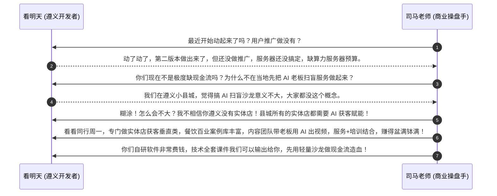
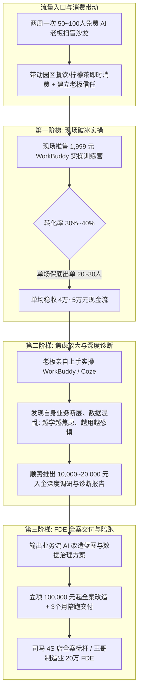
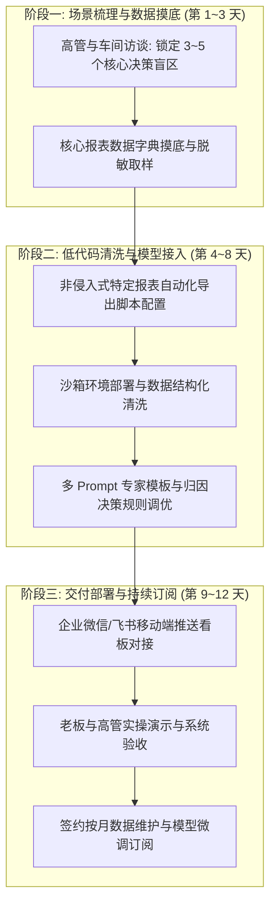
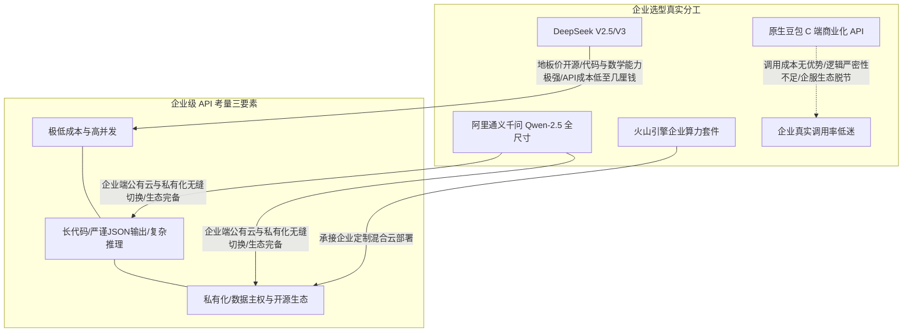
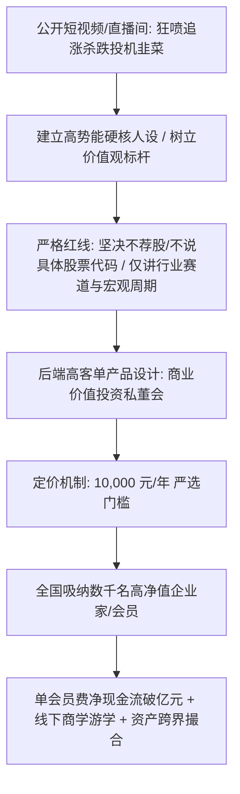
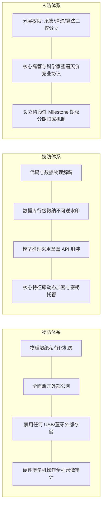

# 2026-11-09 · 刀文AI商业：园区沙龙三阶梯变现、20万制造业FDE交付、豆包入局GEO与医疗算力中台真相

> 本文全息记录 2026 年 11 月 9 日《刀文AI商业》（连麦嘉宾：司马老师、王哥、看明天、帅帅大大、飞行家、三麦等）1.83 小时全场连麦实战。基于 526 行纯净脱水事实文本与弹幕互动逐字精读重构，彻底摒弃空洞摘要，全息还原：贵州遵义下沉市场技术团队的现金流生存困境与司马老师的激烈交锋；中山园区空置率从 70% 打降至 35% 的“零场租沙龙 + 1,999元至10万元三阶梯变现模型”；司马自持 4,000 家 4S 店存量资产的标准化交付与外部老师筛选招募机制；操盘 1 亿~30 亿制造企业的咨询老兵王哥如何以“20 万元客单价、12 人天周期”切入非侵入式轻量 FDE 决策看板；豆包大模型“砸钱抢国民入口”背后的商业化 API 断层与字节“豆包运营”抢占同城本地生活 GEO 的战略意图；投顾老兵转型自媒体对标天花板“口罩哥”过亿私董会的“只做筛选、绝不教育”商业心法；以及累计投入 2.7 亿元的医疗基因与蛋白质 AI 仿真中台的 ODS/DWD 数据分层架构与防离职“人防物防技防”安全工程。

---

## 目录

- [一、 遵义县城小团队现金流生死局与中山园区“三阶梯”变现全案](#一-遵义县城小团队现金流生死局与中山园区三阶梯变现全案)
  - [1. 连麦拉扯实录：遵义看明天的自研软件陷阱与司马当头棒喝](#1-连麦拉扯实录遵义看明天的自研软件陷阱与司马当头棒喝)
  - [2. 中山创意园区盘活模型：空置率 70% 降至 35% 与零场租算账](#2-中山创意园区盘活模型空置率-70-降至-35-与零场租算账)
  - [3. “周一模式”下沉实体店赋能：餐饮百业获客团队的标准配置](#3-周一模式下沉实体店赋能餐饮百业获客团队的标准配置)
  - [4. “三阶梯”产品金字塔与现场销转心算（1999元 → 1~2万 → 10万）](#4-三阶梯产品金字塔与现场销转心算1999元--12万--10万)
- [二、 司马手握 4,000 家 4S 店存量资产：标准化交付与平台强筛选机制](#二-司马手握-4000-家-4s-店存量资产标准化交付与平台强筛选机制)
  - [1. 存量资产的幸福与烦恼：为什么只做 5 家就不亲自做了](#1-存量资产的幸福与烦恼为什么只做-5-家就不亲自做了)
  - [2. 2 天入企 + 3 个月陪跑（客单价 10 万元）的标准打法跑通](#2-2-天入企--3-个月陪跑客单价-10-万元的标准打法跑通)
  - [3. 直播间定位跃迁：拒绝表演带货，重塑为“产业方案与专家撮合中枢”](#3-直播间定位跃迁拒绝表演带货重塑为产业方案与专家撮合中枢)
- [三、 高价值制造企业 FDE 交付兵法：20 万元客单价与 12 人天轻量化奇迹](#三-高价值制造企业-fde-交付兵法20-万元客单价与-12-人天轻量化奇迹)
  - [1. 制造型企业数字化现状：数据孤岛与老板月底决策痛点](#1-制造型企业数字化现状数据孤岛与老板月底决策痛点)
  - [2. 为什么重型大中台必死：传统软件厂商烂尾教训](#2-为什么重型大中台必死传统软件厂商烂尾教训)
  - [3. 12 人天非侵入式交付排期表与利润率穿透](#3-12-人天非侵入式交付排期表与利润率穿透)
- [四、 大模型国民入口之争与企服断层：豆包“烧钱养用户” vs 真实 API 战场](#四-大模型国民入口之争与企服断层豆包烧钱养用户-vs-真实-api-战场)
  - [1. 豆包的战略定位：下沉市场渗透与老百姓小学生心智占领](#1-豆包的战略定位下沉市场渗透与老百姓小学生心智占领)
  - [2. B 端企业级 API 的残酷现实：DeepSeek 地板价与通义千问生态围剿](#2-b-端企业级-api-的残酷现实deepseek-地板价与通义千问生态围剿)
  - [3. 字节招聘“豆包运营”的真实底牌：GEO 搜索电商与美团高德之争](#3-字节招聘豆包运营的真实底牌geo-搜索电商与美团高德之争)
- [五、 自媒体势能打造与商业闭环：对标“口罩哥”与“只做筛选不教育”](#五-自媒体势能打造与商业闭环对标口罩哥与只做筛选不教育)
  - [1. 投顾老兵帅帅大大的迷茫：7年投顾与5年电商的价值投资之困](#1-投顾老兵帅帅大大的迷茫7年投顾与5年电商的价值投资之困)
  - [2. 司马破除道德洁癖：学习“口罩哥”过亿私董会的起号与收单闭环](#2-司马破除道德洁癖学习口罩哥过亿私董会的起号与收单闭环)
  - [3. 核心商业哲学：千万不要试图把想赚快钱的人教育成价值投资](#3-核心商业哲学千万不要试图把想赚快钱的人教育成价值投资)
- [六、 2.7 亿医疗大数据与蛋白质 AI 仿真中台架构（飞行家项目深度剖析）](#六-27-亿医疗大数据与蛋白质-ai-仿真中台架构飞行家项目深度剖析)
  - [1. 商业初心与项目全貌：2.7亿投入、1亿+实验仪器与300TB原始数据](#1-商业初心与项目全貌27亿投入1亿实验仪器与300tb原始数据)
  - [2. 产业链顶端卡位：只做数据端口，不做 FDA 临床与制药](#2-产业链顶端卡位只做数据端口不做-fda-临床与制药)
  - [3. 王哥现场架构指导：ODS 到 DWD 的数据清洗与百兆级特征压缩](#3-王哥现场架构指导ods-到-dwd-的数据清洗与百兆级特征压缩)
  - [4. 沙箱仿真运行机制：AlphaFold 蛋白质折叠预测与线下闭环验证](#4-沙箱仿真运行机制alphafold-蛋白质折叠预测与线下闭环验证)
  - [5. 防核心程序员连窝端：人防、物防、技防三合一工程防线](#5-防核心程序员连窝端人防物防技防三合一工程防线)
- [七、 北美 42 家电视台好莱坞 AI 脸带货项目剖析：商业闭环第一性原理](#七-北美-42-家电视台好莱坞-ai-脸带货项目剖析商业闭环第一性原理)
  - [1. 宏大故事背后的资源拼图：北美 42 台 300 栏目 + 明星 AI 脸 + 义乌供应链](#1-宏大故事背后的资源拼图北美-42-台-300-栏目--明星-ai-脸--义乌供应链)
  - [2. 司马与王哥现场直击命门：电视购物受众老化与退货率履约黑洞](#2-司马与王哥现场直击命门电视购物受众老化与退货率履约黑洞)
- [八、 落地工具台账与实操核对清单（Actionable Checklist）](#八-落地工具台账与实操核对清单actionable-checklist)

---

## 一、 遵义县城小团队现金流生死局与中山园区“三阶梯”变现全案

### 1. 连麦拉扯实录：遵义看明天的自研软件陷阱与司马当头棒喝

直播伊始，司马老师连麦了贵州遵义的独立技术开发者“看明天”。这段对话极其典型地反映了全国大量技术背景出身的创业团队，在经济下行与算力重资产压力下的典型认知误区。



- **现场原声还原**：
  > **司马**：“看明天，你最近开始动起来了没有？”  
  > **看明天**：“动了动了，我们现在第二个版本都出来了。但是还没做用户推广，我们服务器还没搞定……”  
  > **司马**：“我跟你探讨一个核心问题，你们现在极度缺现金流，为什么不在遵义当地先把 AI 老板扫盲的服务做起来？遵义身边的这些老板对 AI 的认知几乎是零对不对？你如果有能力在当地组织起一场 50 到 100 人的沙龙，你那个合伙老板不是有自己的现成场地吗？你知道我们中山是怎么跑出来的？”  
  > **看明天**：“我们之前也想过这样做，但觉得意义不是很大。因为我们是在遵义下面的小县城……”  
  > **司马**：“为什么不大？！而且正因为是县城，所有的实体店都需要你的赋能！我不相信你遵义没有实体店，你把客单价做低一点就行了！人家周一专门针对实体老板做 AI 获客垂直类，餐饮、百业案例全都有，带内容团队教老板出短视频，接受完培训直接全店做 AI 改造！你不要用程序员的视角自嗨，必须先用沙龙把现金流造血搞起来！”

### 2. 中山创意园区盘活模型：空置率 70% 降至 35% 与零场租算账

司马老师现场公布了其操盘广东中山某产业园区的真实运营账本与商业模式。在当前实体经济周期下，全国各地产业园区与政府众创空间面临极高空置率，资产持有方极其痛苦。

- **前期现状**：中山该园区因传统制造业退租，初始**空置率高达 70%**，物业面临巨大维护与折旧亏损，底商餐饮门可罗雀；
- **盘活手法（两周一次常态化沙龙）**：司马团队与园区物业达成“零场租”甚至物业补贴合作，以“AI 商业赋能基地”名义，每两周固定在园区报告厅举办一场 50~100 人的免费老板扫盲沙龙；
- **底商即时现金流拉动**：
  - 哪怕单场活动在现场没有卖出一门课，50~100 名到场的中小企业主中午必须就近聚餐（如刀文与司马当天带队聚餐），人均消费 50~100 元；
  - 会议全天高频订购奶茶、柠檬茶、茶点外卖，直接让濒临倒闭的园区餐饮底商恢复生机；
- **运营成效**：经过连续半年的常态化运营，该园区空置率从 **70% 骤降至 35%**，吸引了大量数字化、MCN 与技术团队入驻，成为当地政府工信部门树立的样板；
- **四五线城市同行复刻数据**：直播间连麦合作方在同级别四五线城市，联合地方政府工信局与商会资源承接园区沙龙，依托标准课件与实操案例，**仅耗时 3 个月净变现 90 余万元**。

### 3. “周一模式”下沉实体店赋能：餐饮百业获客团队的标准配置

针对县城实体店老板“既不懂技术、又急需客流”的痛点，司马详细剖析了连麦学员周一团队的打法：
1. **轻资产切入点（短视频获客垂直类）**：不跟县城老板谈复杂的 Agent 或私有化微调，只解决一个痛点——“如何在抖音/小红书用 AI 批量出探店视频并挂团购链接”；
2. **丰富的垂直行业案例库**：预先准备好餐饮（火锅、烧烤、烘焙）、美业（美甲、理发）、汽修、装修等百业的标准提示词与分镜模板；
3. **“服务 + 培训”小团队配置**：
   - 1 名讲师负责沙龙讲座与工具操作演示；
   - 2 名年轻内容手入驻门店，手把手带老板和店员拍摄基础空镜，用剪映/AI 工具合成爆款口播；
4. **两阶段收费递进**：
   - 前期低客单（数百元到 1,000 元）切入，让老板门店在抖音同城拿到真金白银的团购核销结果；
   - 见效后顺势推全店 AI 培训与自动化客服系统升级，客单价跃升至数万元。

### 4. “三阶梯”产品金字塔与现场销转心算（1999元 → 1~2万 → 10万）

司马老师结合实战经验，总结了一套针对中小微企业的阶梯式商业销转流水线，解决了“技术团队直接卖大单卖不动、卖低价课赚不到钱”的根本矛盾：



| 阶梯层级 | 产品名称 | 真实客单价 | 交付时长与内容 | 转化率与财务模型 | 客户心理与核心价值 |
| :--- | :--- | :--- | :--- | :--- | :--- |
| **第 1 阶梯** | WorkBuddy 基础实操营 | **¥1,999 元** | 1~2 天周末集训，实操提示词、本地知识库、自动写文案与剪辑 | 80~100 人沙龙现场转化 **30%~40%**，单场营收 **¥40,000~¥50,000** | **建立初步体感**：打破技术神秘感，让老板亲手看到 AI 替代基础文员的可能性。 |
| **第 2 阶梯** | 企业 AI 落地深度诊断 | **¥10,000~20,000 元** | 2~3 天驻企调研，访谈部门负责人，梳理核心业务流断点 | 沙龙学员中约 **10%~15%** 企业采购，单笔营收 **¥10,000~¥20,000** | **放大落地焦虑**：老板越学越发现内部数据散乱、员工抵触，产生“不请专业外脑必被淘汰”的强烈焦虑。 |
| **第 3 阶梯** | FDE 全案定制改造与陪跑 | **¥100,000 元起** | 3 个月驻场+远程陪跑，定制私域获客、知识库中台与自动化工作流 | 诊断企业中 **20%~30%** 转入大单交付，客单价 **¥100,000~¥200,000** | **终身绑定与成果负责**：如司马团队打造的全国 4S 店样板，提供全套标准流程与系统代运营。 |

---

## 二、 司马手握 4,000 家 4S 店存量资产：标准化交付与平台强筛选机制

### 1. 存量资产的幸福与烦恼：为什么只做 5 家就不亲自做了

在连麦中，连麦者“爸妈爸妈”质疑刀文与司马的商业定位过于笼统，司马老师直接公开了其手中的压箱底核心资产：

- **4,000 家 4S 店存量池**：司马在传统汽车经销商营销与培训领域深耕多年，手里积累了全国超过 **4,000 家汽车 4S 店** 的深度客情资源；
- **亲自交付的瓶颈**：第一期和第二期，司马团队亲自入企仅交付了 **5 家门店**。司马直言：“每一家都要我自己带着团队跑现场、驻店调研、手把手陪跑，就算我有三头六臂，一年能做多少家？做 20 家人就彻底废掉了！但手里还有几千家存量客户嗷嗷待哺，天天催着要上 AI”。

### 2. 2 天入企 + 3 个月陪跑（客单价 10 万元）的标准打法跑通

为了摆脱“作坊式亲自服务”的死循环，司马团队耗时数月，跑通了一套标准化交付样板：
- **交付配置**：**2 天高强度入企培训 + 3 个月线上标准化陪跑，收费坚定维持在 10 万元/店**；
- **2 天入企干什么**：不搞花拳绣腿，第一天给 4S 店总经理和市场/销售总监对齐 AI 获客模型；第二天直接带着一线销售顾问与网销团队，基于 Coze/WorkBuddy 搭建针对竞品车型对比、金融方案计算与小红书留资的专属智能体；
- **3 个月陪跑干什么**：每周复盘线索留资率、到店率与成交转化率，动态优化提示词与视频脚本；
- **次日亲自交付闭环**：司马透露次日（11-10）将亲自奔赴标杆客户现场完成最后一轮标准固化交付，为此白天彻底停播，全身心把操作手册 SOP 彻底定型。

### 3. 直播间定位跃迁：拒绝表演带货，重塑为“产业方案与专家撮合中枢”

司马老师与王哥深入复盘了当前抖音 AI 直播间的终极定位：

```mermaid
flowchart LR
    A[直播间前端: 刀文/司马公开连麦] --> B[建立高认知/真实踩坑/无滤镜行业壁垒]
    B --> C{强筛选与资源分流}
    C -->|存量 4S 店与中小型商户| D[输出 10万 4S 店标准，招募交付老师团队协同消化]
    C -->|大型上市公司与 1~30亿制造业| E[推介给王哥/魏翔等资深咨询专家对接 (分润协作)]
    C -->|下沉小微实体与县城商户| F[交由周一等获客工具团队对接]
    D & E & F --> G[平台强管控: 统一合同范本 / 交付标准质检 / 严防口碑砸牌]
```

- **严苛的准入门槛**：司马直言：“没见过面、没有验证过交付能力的人，我一个单子都不会推给你！我手上的单子根本做不完，宁愿放在那里睡大觉，也绝对不能推给不靠谱的人把口碑砸了。一旦一家 4S 店交付出问题，我这几年积累的商誉和直播间全完了！”；
- **做严密的渠道监管者**：合同由平台统一把控，交付设立 Milestone 里程碑节点与质保押金，确保合作专家按 SOP 执行，形成闭环。

---

## 三、 高价值制造企业 FDE 交付兵法：20 万元客单价与 12 人天轻量化奇迹

### 1. 制造型企业数字化现状：数据孤岛与老板月底决策痛点

连麦嘉宾王哥操盘过数十家年营收在 **1 亿至 30 亿元** 规模的中大型制造企业，深刻指出了中国传统制造业的信息化现状与真实病灶：
- **绝非“零信息化”**：年产值过亿的制造业，内部早已全面部署了金蝶、用友、SAP 等 ERP 软件，车间部署了 MES 和自动化工控机，仓库上线了 WMS；
- **核心痛点是“数据散乱、决策迟滞”**：
  - 各个系统由不同厂商在不同时期采购，底层数据库格式不互通，形成天然数据孤岛；
  - 老板每个月 5 号甚至 10 号才能拿到财务与生产汇总报表，等发现某条产线良品率连续两周下滑、某批原材料报废超标时，几十万上百万的损失已经造成；
  - 老板最想看的是实时动态：“今天各车间开工率如何？哪些工单存在异常停机？本周预计回款与供应商承兑汇票缺口多大？”——现有系统根本无法回答。

### 2. 为什么重型大中台必死：传统软件厂商烂尾教训

王哥犀利抨击了技术团队动辄推销“企业级数据大中台”、“全域认知大脑”的自杀式打法：
- 报价 200 万~500 万元，宣称打通企业所有底层数据库，重构业务流程；
- 实施周期长达 6~12 个月，涉及跨部门极大的政治博弈和人员抵触；
- 最终结果 90% 以上流产烂尾：中台还没搭完，车间主任换了，或者老板失去耐心直接拒付尾款。

### 3. 12 人天非侵入式交付排期表与利润率穿透

王哥团队独创了“**非侵入式轻量 FDE 交付模型**”：**平均客单价 20 万元，全流程严格控制在 12 人天之内完成**！



- **财务核算穿透**：
  - 投入人力：1 名资深业务咨询架构师（王哥级别）负责前后期 4 人天；1 名全栈数据/AI 工程师负责中期 8 人天，总计 **12 人天**；
  - 交付成本：工程师人力成本约 1.5 万~2 万元，差旅约 5,000 元，大模型 Token 与低代码工具消耗忽略不计；
  - **单案毛利空间高达 85%~90%**！且交付迅速、老板即时看到晨报推送，回款周期极短。

---

## 四、 大模型国民入口之争与企服断层：豆包“烧钱养用户” vs 真实 API 战场

### 1. 豆包的战略定位：下沉市场渗透与老百姓小学生心智占领

连麦中司马老师与王哥对国内大模型 C 端竞争格局进行了深度复盘：
- **字节跳动的流量闪电战**：依靠抖音全局信息流的狂轰滥炸和字节雄厚的资金储备，豆包在极短时间内渗透进国内三四线城市及下沉市场；
- **核心受众图谱**：老百姓查日常百科、小学生及家长搜题解题、写作文润色，人手一个豆包 App，成功抢占了中国移动互联网在大模型时代的国民级第一入口。

### 2. B 端企业级 API 的残酷现实：DeepSeek 地板价与通义千问生态围剿

然而，在 B 端产业落地与严肃开发者场景中，豆包面临着极其严峻的“商业化断层”：



- **真实开发者反馈**：在企业做生产级 Agent 或自动化工作流时，极少有团队选择直接购买昂贵且逻辑约束不够严格的原生豆包商用 API。大家更倾向于使用在代码与复杂推理领域性价比杀穿的 DeepSeek，或者兼顾企业私有化生态的通义千问系列。

### 3. 字节招聘“豆包运营”的真实底牌：GEO 搜索电商与美团高德之争

司马老师现场独家揭秘了字节跳动近期大量开设“**豆包运营**”岗位的深层战略意图：
- **不为卖 Token，只为做下一代货架**：字节高层深知单靠卖大模型 API 无法支撑万亿估值，必须将豆包的国民级流量引向实体商业交易；
- **GEO（生成式引擎优化）同城变现**：
  - 效仿当年高德地图由导航切入打车与团购，豆包正试图成为超级同城生活入口；
  - 当海量普通用户在豆包发问：“中山哪家私房菜环境好适合商务宴请？”或“遵义哪家修车厂换变速箱油透明？”，豆包运营团队的任务就是建立算法推荐规则与商家入驻体系，向本地生活与电商引流；
  - **实体企业必须提前布局 GEO**：谁先在全网建立结构化权威内容让豆包抓取，谁就能吃下未来 3 年 AI 搜索的第一波同城流量红利。

---

## 五、 自媒体势能打造与商业闭环：对标“口罩哥”与“只做筛选不教育”

### 1. 投顾老兵帅帅大大的迷茫：7年投顾与5年电商的价值投资之困

连麦嘉宾“帅帅大大”带来了极具代表性的行业转型困惑：
- **从业背景**：拥有 7~8 年持牌投资咨询（投顾）从业经历，见证了行业野蛮生长与乱象，因合规红线转型做电商 5~6 年；
- **投资理念成熟**：经过十几年磨砺，深刻践行长线价值投资，个人资金从 100 多万稳健滚存至 400~500 万元级别；主要持仓 A 股茅台（茅子）与港股腾讯（鹏子），年化收益稳定在 10%~15%，实现“无须盯盘、买定离手”；
- **自媒体碰壁心理**：想在抖音做自媒体分享价值投资，但发现平台上的散户全部渴望“明天买什么涨停、一周翻倍”，推崇价值投资的同行博主一个月才赚几万块钱；而某些宣扬短线暴富的博主（如对标博主“口罩哥”）争议极大，帅帅心存疑虑、迟迟不敢下场。

### 2. 司马破除道德洁癖：学习“口罩哥”过亿私董会的起号与收单闭环

司马老师直接打断并重重批评了帅帅的“道德洁癖”，给出了极具穿透力的商业模式拆解：



- **“口罩哥”商业全貌**：
  - 司马自 2020 年起连续追踪该博主 4 年，亲眼见证其从零起步到封顶的过程；
  - 视频内容极其激进：痛斥短线赌徒、撕扯行业黑幕，树立极高专业威信；
  - 严守法规：视频和直播中**绝不提及任何具体股票代码**（提及直接封号），只讲商业赛道逻辑与宏观周期认知；
  - 后端私董会转化：年费 **10,000 元/人**，全国收了几千名高净值企业老板会员，**光私董会会员费就累计变现超过 1 亿元**，客户排队拿钱求着进！

### 3. 核心商业哲学：千万不要试图把想赚快钱的人教育成价值投资

司马老师现场分享了关于其父亲的生动案例，并总结了自媒体的第一铁律：

> **“中国存量人口足够大！你永远不要试图把一个赌徒教育成价值投资者！教育一个人的认知成本无穷大！做自媒体的唯一使命，就是把你的价值观像旗帜一样插在山顶上，让同频的人自己爬上山找你！”**

- **司马父亲的真实样本**：司马父亲是一名普通人民教师，从 30 岁起就坚决只做价值投资，当年投万科，后来投阿里巴巴，再后来以 20 万元本金买入美团王兴（美村王元勋），不声不响滚到一两百万元。“我老爸就是典型的价值投资者，这样的人中国千千万万！你为什么要盯着那些想借钱炒股赚快钱的人？做自媒体只做筛选，绝不教育！”

---

## 六、 2.7 亿医疗大数据与蛋白质 AI 仿真中台架构（飞行家项目深度剖析）

### 1. 商业初心与项目全貌：2.7亿投入、1亿+实验仪器与300TB原始数据

连麦嘉宾“飞行家”（前银行分行行长，离职 10 年深耕生物医药与工业前沿）分享了其团队主导的超重型医疗科技资产：
- **资本投入规模**：前期已实打实完成投入 **1.7 亿元**，近期正在追加 **1 亿元** 资金；
- **重资产采购**：花费逾 **1 亿元全款采购** 了整套顶尖的肿瘤穿刺组织处理、质谱检测与基因测序仪器；
- **沉淀数据资产**：在本地私有集群沉淀了超过 **300TB** 的穿刺组织蛋白质与多肽高精质谱图谱；
- **真实临床奇迹**：利用团队的数据与合成药物方案，成功让一位从北京协和医院辗转而来的胰腺癌晚期转移（转移至肺部、骨骼）且无法行走的重症患者恢复正常生理指标，目前已可自行外出旅游；
- **迫切诉求**：寻求将 300TB 医疗数据与前沿 AI 大模型结合，搭建蛋白质折叠重排与多肽靶点预测的仿真平台。

### 2. 产业链顶端卡位：只做数据端口，不做 FDA 临床与制药

飞行家阐述了其极其清晰的商业卡位身位哲学：
- **医药产业链食物链层级**：
  - **最底层（制药厂）**：承担极高风险，一款新药动辄耗资数十亿美金、经历长达 8~10 年的三期临床与 FDA 审批，九死一生；
  - **中层（算法团队）**：技术迭代极快，今年流行的算法明年可能被更新的架构彻底淘汰颠覆；
  - **顶层（数据端口掌握者）**：拥有 300 多家医院源源不断送检的穿刺活检组织，掌握不可再生的核心真实世界生物数据，立于不败之地。

### 3. 王哥现场架构指导：ODS 到 DWD 的数据清洗与百兆级特征压缩

针对飞行家“想直接拿 300TB 原始数据去喂大模型”的不切实际想法，操盘过多项大型数据中台的王哥现场给出了极具实战指导意义的系统工程方案：

```mermaid
flowchart TD
    subgraph ODS 源数据层 (300TB 物理存储)
        A1[医院送检穿刺活检组织] --> A2[高分辨质谱仪 / 基因测序仪]
        A2 --> A3[超大体积原始图像 / 质谱原始信号波形 (300TB)]
    end

    subgraph 传统批处理引擎清洗层 (无须 AI 硬冲)
        A3 --> B1[传统生物信息学软件 / 自动化图像去噪]
        B1 --> B2[剔除背景冗余基线 / 提取细胞核及蛋白表达特征]
        B2 --> B3[特征向量化抽取与压缩]
    end

    subgraph DWD 明细层 (压缩至百兆级)
        B3 --> C1[单病例特征数据由数个G骤降至 100~300MB]
        C1 --> C2[建立结构化细胞标签 / 蛋白质序列图谱资产库]
    end

    subgraph 沙箱 AI 仿真与预测层 (专用大模型)
        C2 --> D1[与标准库比对: 常见蛋白 vs 变异蛋白分类]
        D1 --> D2[AlphaFold 演进架构: 蛋白质折叠预测与多肽重排]
        D2 --> D3[AI 给出置信度预测 (如 86% 成功率药方方案)]
        D3 --> D4[输出样品交由实验室实体测试 -> 测试结果反馈闭环调优]
    end
```

- **核心工程定论**：严禁用大模型去直接硬吃 300TB 原始质谱图像，那将面临天文数字般的算力浪费与显存爆炸。必须用成熟高效的传统生物软件在离线批处理集群中完成去噪，**将单个患者数据从数十 GB 极致压缩至 100~300MB 的纯特征向量**，再交由大模型做多肽组合与折叠预测。

### 4. 沙箱仿真运行机制：AlphaFold 蛋白质折叠预测与线下闭环验证

王哥深入拆解了 AI 在生物仿真中的真实业务逻辑：
1. **模式识别**：将患者穿刺样本的特征矩阵与标准图谱比对，1 秒识别属于已知蛋白还是未记录的突变蛋白；
2. **多肽重排与虚拟折叠**：AI 仿真引擎模拟多肽分子在三维空间中的空间构象折叠过程，输出数组高亲和力的靶向小分子或多肽候选结构；
3. **输出置信度评分**：模型输出预测报告（例如标明方案 A 具备 86% 的阻断成功率）；
4. **线下实验打样反馈**：将高置信度方案发送给合作实验室合成微量样品进行细胞活检测试，将湿实验数据重新回填中台，反向微调优化模型权重。

### 5. 防核心程序员连窝端：人防、物防、技防三合一工程防线

在对话中，飞行家认为“程序员拿了数据也没用，因为没有医院送检病人样本，做不成闭环”。王哥以极具震撼力的产业血泪教训当场反驳：**“一个顶尖程序员把你全套中台数据和预训练权重连窝端走，挂到暗网或卖给跨国巨头，你的 2.7 亿投资瞬间打水漂！”**

王哥系统梳理了必须立刻上马的“三防体系”：



- **跨国巨头的收购真相**：辉瑞、罗氏、默沙东等跨国制药巨头盯紧的就是这类真实世界质谱图谱。只要飞行家团队把数据资产管理好、特征压缩规范化，哪怕 AI 仿真进展缓慢，**单凭这 300TB 的稀缺精准数据本身，就足以支撑跨国巨头数亿美元的战略并购**。

---

## 七、 北美 42 家电视台好莱坞 AI 脸带货项目剖析：商业闭环第一性原理

### 1. 宏大故事背后的资源拼图：北美 42 台 300 栏目 + 明星 AI 脸 + 义乌供应链

连麦者“三麦”提出了一个极具好莱坞色彩的宏大出海设想：
- **媒介端**：拿下了北美 KSA 制作部旗下 42 个地方电视台、多达 300 个节目的全时段广告与电视购物运营权；
- **内容端**：已获得好莱坞多位知名明星的合法数字人 AI 脸授权，计划利用数字人技术生成好莱坞明星用流利英语向美国家庭主妇推荐商品的视频；
- **供应链端**：对接义乌 10 万级小商品制造供应链，试图以超低成本小商品借助明星光环在电视端爆单。

### 2. 司马与王哥现场直击命门：电视购物受众老化与退货率履约黑洞

司马老师与王哥未被宏大的光环所迷惑，当场用商业第一性原理拆穿了该项目的巨大财务陷阱：

| 维度 | 表面光鲜假象 | 真实商业残酷真相 |
| :--- | :--- | :--- |
| **受众人口学特征** | 42 个电视台覆盖千万级美国家庭 | 北美地方电视台观众严重**老龄化（平均年龄 65 岁以上）**，消费活力与购买欲极低。 |
| **购买转化路径** | 电视上看到好莱坞明星推荐立即购买 | 电视端无法像抖音小黄车一键点击下单，必须拨打 1-800 免费电话或扫描电视屏幕二维码，**转化损耗率超过 95%**。 |
| **物流履约与退货黑洞** | 义乌几块钱的小商品利润空间巨大 | 美国跨州本地物流履约（USPS/FedEx）单票成本极高；电视购物退货率高达 25%~35%，退货运费足以瞬间吃光所有毛利。 |
| **呼叫中心人力成本** | 依靠自动化智能体接听订购电话 | 老年群体极其抗拒机器对话，必须配置高昂的美国本土人工客服，极易造成严重失血。 |

- **破局第一要务**：绝对不能一次性将 42 个电视台全量铺开！必须挑选 1 个最容易下沉的二三线州单台，挑选 1 个客单价在 50~100 美元的高毛利刚需爆品，搭建单点沙盒闭环。唯有单台单月测出净正向现金流，该商业逻辑才具备成立的前提。

---

## 八、 落地工具台账与实操核对清单（Actionable Checklist）

### 1. 园区沙龙三阶梯变现执行清单

- [ ] **园区零场租谈判**：锁定空置率大于 40% 的创意园/孵化器，以“每两周导入 80~100 位老板现场就餐消费”为对价，换取免费活动多功能厅使用权；
- [ ] **扫盲内容去术语化**：沙龙 PPT 杜绝“Transformer、微调、Token”等技术词汇，100% 聚焦在“如何用 WorkBuddy 批量出文案”、“如何做小红书获客”；
- [ ] **1,999 元现场促单机制**：配备 2~3 名助教现场一对一指导支付，设置限额 20 人保单名额，保障单场保底回款 4 万~5 万元；
- [ ] **入企诊断转化埋点**：实操营第二天特意展示多系统互通的复杂案例，引发学员对自身业务无法自动化的焦虑，顺势承接 10,000~20,000 元入企诊断。

### 2. 制造业 12 人天极简 FDE 交付 Checklist

- [ ] **守住非侵入式底线**：严禁承诺修改企业 SAP/金蝶底层表结构，仅以只读账号定时导出指定分析报表；
- [ ] **决策指标极简化**：首期仅攻克 3 项老板核心指标（如“各车间昨日工单延误原因归因”、“本周供应商待付预警”）；
- [ ] **移动端看板交付**：将大模型分析结果封装为微信小程序或企业微信自建应用，老板手机端一键发问并即时语音播报；
- [ ] **严守 20 万定价**：制造企业年营收过亿者对几十万价格不敏感但对交付确定性极其敏感，严禁低价自贬身价。

### 3. 数据安全防泄露“三防”核查清单

- [ ] **物防**：中台服务器移入独立机房，封死主板所有 USB 口，拔掉外网网线，建立堡垒机跳板审计；
- [ ] **技防**：数据库所有敏感表强制注入基于行哈希的不可逆隐形水印；算法模型封装为独立 Docker 沙箱黑盒，开发人员仅能访问脱敏样本；
- [ ] **人防**：梳理核心开发与算法人员名单，签订包含 2 年全薪补偿与 10 倍违约赔偿金的严密竞业限制协议。

---

*版权声明：本文档由企智AI落地派 / 刀文AI商业实操连麦逐字稿全量深度蒸馏而成，知识产权与案例事实归原作者及连麦各方所有。*  
*知识归档：Distillation 自动化深度智库体系*
