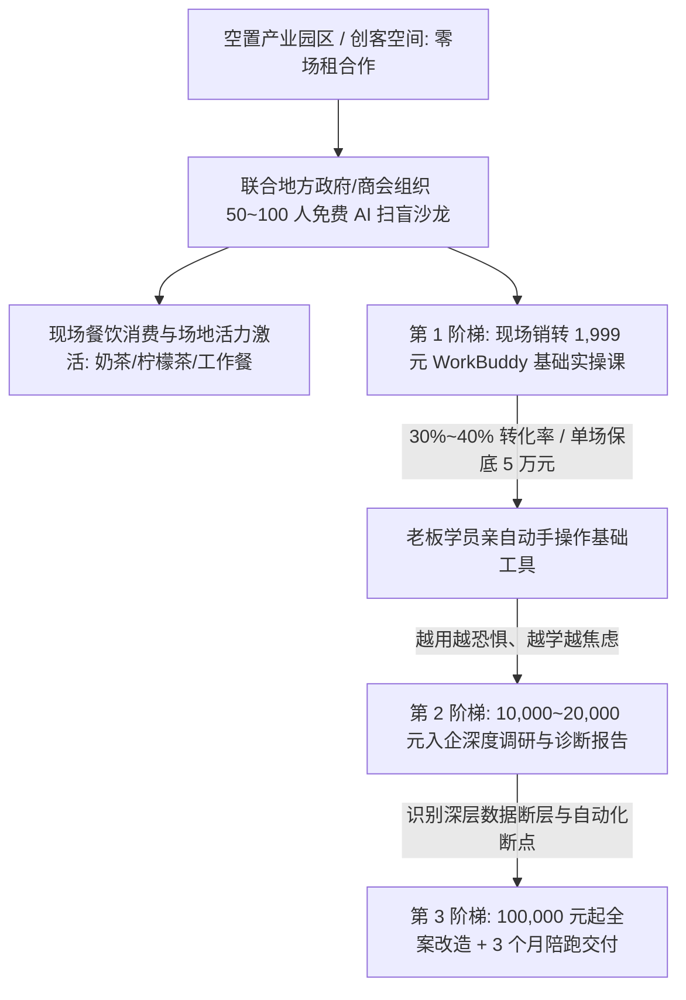
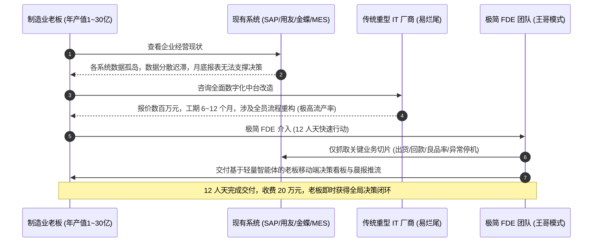
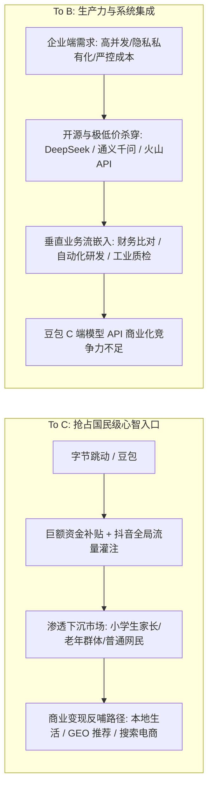
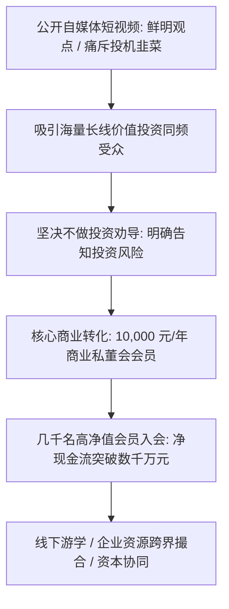
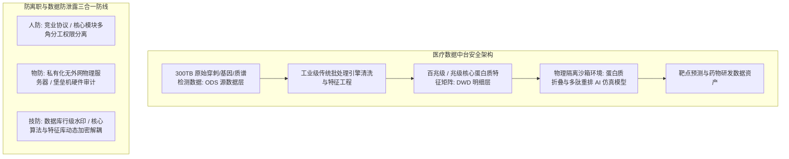
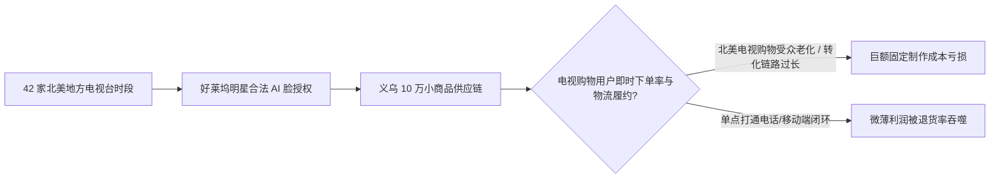

# 2026-11-09 · 刀文AI商业：园区沙龙三阶梯变现、20万制造业FDE交付、豆包入局GEO与医疗算力中台真相

> 本文全息记录 2026 年 11 月 9 日《刀文AI商业》（连麦嘉宾：司马老师、王哥、帅帅大大、飞行家、看明天等）连麦深度实战。全景拆解“空置园区盘活 + AI 老板沙龙三阶梯变现”闭环（1,999元销转课 → 1~2万元深度诊断 → 10万元全案陪跑）；解密操盘 1 亿~30 亿制造型企业传统咨询老兵如何以“20 万元客单价、12 人天周期”切入非侵入式 FDE 决策看板；深入剖析豆包大模型“烧钱争夺国民入口”与企业端 API 商业化断层的本质差距；揭秘抖音知识博主“口罩哥”过亿私董会的“筛选而非教育”商业心法；并由浅入深解析累计投入 2.7 亿元的医疗基因与蛋白质 AI 仿真中台的 ODS/DWD 数据分层架构与防离职安全工程。

---

## 目录

- [一、 空置园区盘活与“三阶梯”变现链路：从免费沙龙到 10 万全案](#一-空置园区盘活与三阶梯变现链路从免费沙龙到-10-万全案)
- [二、 高价值制造企业 FDE 交付：20 万元客单价与 12 人天极简兵法](#二-高价值制造企业-fde-交付20-万元客单价与-12-人天极简兵法)
- [三、 大模型入口之争与商业化断层：豆包“国民入口” vs 企服真实战场](#三-大模型入口之争与商业化断层豆包国民入口-vs-企服真实战场)
- [四、 自媒体势能打造与商业闭环：对标“口罩哥”与“只做筛选不教育”](#四-自媒体势能打造与商业闭环对标口罩哥与只做筛选不教育)
- [五、 2.7 亿医疗基因与蛋白质 AI 仿真中台：架构分层与安全防线](#五-27-亿医疗基因与蛋白质-ai-仿真中台架构分层与安全防线)
- [六、 北美电视台好莱坞 AI 脸带货项目剖析：商业闭环第一性原理](#六-北美电视台好莱坞-ai-脸带货项目剖析商业闭环第一性原理)
- [七、 商业行动清单与工具台账（Actionable Playbook）](#七-商业行动清单与工具台账actionable-playbook)

---

## 一、 空置园区盘活与“三阶梯”变现链路：从免费沙龙到 10 万全案

在当前宏观经济环境下，全国四五线及沿海城市大量产业园区面临极高空置率，地方政府与园区物业迫切需要导入人流与商业活力；与此同时，大量传统中小实体企业老板对 AI 焦虑又迷茫。司马老师在连麦中系统拆解了“场地盘活 + AI 扫盲沙龙 + 三阶梯交付”的成熟低风险变现飞轮。

### 1. 真实商业验证数据

- **中山园区盘活实战**：中山某工业创意园区前期空置率高达 **70%**。司马团队通过常态化（每两周一场）举办免费 AI 老板扫盲沙龙，半年内将园区空置率打降至 **35%**。即便沙龙现场零转化，单场活动引流来的数十名企业主中午聚集就餐、高频购买奶茶柠檬茶，立即为园区餐饮底商带来立竿见影的现金流。
- **四五线城市变现奇迹**：连麦学员周一及合作方在同级别四五线城市，联合当地政府工信部门与产业园区搞老板沙龙，依托成熟的标准化课件，**仅用 3 个月时间就实现了近 90 余万元的净现金变现**。
- **解决技术型团队现金流陷阱**：遵义独立开发者“看明天”团队苦熬自研 AI 软件第二版本，却卡在昂贵的服务器采购与算力成本上。司马直击痛点：“不要困在小县城的技术象牙塔里等待投资，下沉市场所有的实体店、餐饮店、批发商都需要 AI 获客赋能，先用轻量沙龙做现金流反哺自研软件”。

### 2. “三阶梯”产品金字塔设计

| 阶梯层级 | 产品形态 | 客单价 | 交付周期与形式 | 目标心态与核心价值 |
| :--- | :--- | :--- | :--- | :--- |
| **第 1 阶梯** | 免费沙龙现场销转课 | **¥1,999 元** | 1~2 天实操班，教老板使用 WorkBuddy、Coze 智能体与基础提示词 | **破除神秘感**：现场 80~100 人转化 30%~40%（单场营收 5 万），让老板体验到数字员工替身初步价值。 |
| **第 2 阶梯** | 入企深度调研与诊断 | **¥10,000~20,000 元** | 2~3 天入驻企业，访谈业务线，输出《AI 智能化改造诊断书》 | **放大焦虑与落地差距**：企业老板学完基础课后越用越焦虑，发现自身业务流数据无法接通，迫切需要专业外脑把脉。 |
| **第 3 阶梯** | FDE 全案改造与陪跑 | **¥100,000 元起** | 3 个月驻场+线上陪跑，定制垂类知识库、客服与获客全流程闭环 | **终身交付与深度绑定**：如司马团队打造的全国某品牌 4S 店全案标杆，提供全链路智能体与流量交付。 |

---

## 二、 高价值制造企业 FDE 交付：20 万元客单价与 12 人天极简兵法

技术出身的开发者往往陷入“给传统企业做大中台、重写系统”的巨大误区。连麦嘉宾王哥操盘过数十家营收在 **1 亿至 30 亿元** 规模的中大型制造企业，给出了令人震撼的交付哲学：**平均客单价 20 万元，交付周期仅需 12 人天**。

### 1. 为什么“重型 FDE”必死，而“轻型切片”暴利？

1. **制造业数字化现状真相**：年营收过亿的制造企业，内部几乎早已部署了 SAP、金蝶、用友或各类定制 ERP/MES。他们**缺的从来不是数据记录系统，而是数据变现为决策的能力**；
2. **老板的核心痛点只有 3~5 个核心指标**：企业主最痛苦的是每个月 5 号才能看到上个月的数据，或者销售、生产与库存数据打架。老板不在乎技术底层用什么大模型，只在乎每天早上 8 点手机上能否收到一条准确分析各车间良品率波动原因的决策推送；
3. **12 人天的交付边界控制**：
   - **前 3 天**：业务场景对齐与数据资产摸底（传统管理咨询专长）；
   - **中间 5 天**：利用低代码与成熟 API 将财务、生产系统的特定报表数据清洗导出，接入专用沙箱大模型进行语义解析与异常归因；
   - **后 4 天**：高管试运行与交付，将系统收敛为老板能一键发问的决策交互界面。

---

## 三、 大模型入口之争与商业化断层：豆包“国民入口” vs 企服真实战场

连麦中司马老师与技术专家针对当前大模型市场格局进行了深刻复盘，重点剖析了以“豆包”为代表的消费级入口与“通义千问 / DeepSeek / 火山引擎”为代表的 B 端企业级落地的残酷断层。

### 1. 深度洞察要点

- **豆包的真实战略**：豆包不计成本的烧钱抢入口，已经成为国内下沉市场和中小学生家长的国民级工具。但这种 C 端繁荣并不等同于技术商业化胜利。
- **B 端 API 的残酷现实**：在真实的企业级场景和极客开发者眼中，原生豆包 API 在处理复杂逻辑、系统长代码调用和结构化 JSON 约束上缺乏绝对优势。面对开源界 DeepSeek 的极低成本倾销、阿里通义千问全栈开源矩阵以及火山引擎自身的商业化算力套餐，纯模型层面的溢价空间正在快速归零。
- **豆包商业化新切口（GEO 与本地生活）**：字节目前正在密集招募测试“豆包运营”岗位，其核心意图并非单纯卖 Token，而是效仿当年的高德与美团，通过豆包向同城本地生活、实体探店与 GEO（生成式引擎优化）导流，形成大模型时代的超级流量分发货架。

---

## 四、 自媒体势能打造与商业闭环：对标“口罩哥”与“只做筛选不教育”

连麦观众“帅帅大大”是一位拥有 7~8 年股票投顾咨询经验、转型 5 年电商的硬核价值投资者，近期计划打造抖音投顾自媒体，却困惑于“抖音上大量宣扬短线暴富的假大空博主（如对标账号口罩哥）是否值得效仿”。司马老师给出了醍醐灌顶的商业点拨：

> **“做商业最忌讳道德洁癖。不要去评判别人的价值观，要看别人如何用产品链路在规则之内拿到结果。”**

### 1. 核心商业心法提炼

1. **“口罩哥”模式的本质：私董会与高客单圈子**  
   “口罩哥”在短视频中扮演痛斥追涨杀跌、普及认知的大师形象，其后端并不依赖提心吊胆的荐股分成，而是打造年费 **10,000 元/人** 的商业私董会。全国吸纳数千名企业家与高净值粉丝，单靠会员费即产生数千万元乃至上亿元稳定现金流，再通过线下商学与企业资源撮合赚取衍生收益。
2. **极其关键的“筛选逻辑 vs 教育逻辑”**  
   中国有 14 亿人口，做自媒体永远不要试图去教育一个赌徒转变成长线价值投资者，因为教育市场的成本无穷大。自媒体矩阵的唯一使命是**立起醒目的旗帜，只做受众的精准筛选**。

---

## 五、 2.7 亿医疗基因与蛋白质 AI 仿真中台：架构分层与安全防线

连麦嘉宾“飞行家”（前银行分行行长，离职 10 年深耕前沿科技）分享了其主导的重大前沿医疗项目：累计投入 **2.7 亿元**（前期 1.7 亿 + 追加 1 亿），购入逾 1 亿元专业穿刺与基因测序仪器，沉淀了超过 **300TB** 的穿刺组织蛋白质与多肽图谱数据，正准备引入 AI 大模型进行蛋白质折叠重排与药物仿真。

王哥针对该超重型技术资产，系统输出了工业级数据中台分层与防范核心技术人员流失的安全工程方案。

### 1. 架构分层化解算力与内存瓶颈

- **严禁全量原始数据硬冲大模型**：300TB 的质谱原始数据包含大量生物噪声与仪器冗余基线。王哥指出，绝对不能试图直接将 300T 灌入大模型，这在显存与算力上是无底洞；
- **分层处理（ODS → DWD）**：必须先通过传统高效生物信息学算法与统计工具，在离线集群完成去噪、特征提取与多肽片段标定，将 300TB 物理数据压缩沉淀为百兆级的结构化特征向量，再由专用深度学习/大模型（如 AlphaFold 类演进架构）进行定向预测仿真。

### 2. 人防、物防、技防：三合一防连窝端体系

对于高估值的重研发项目，初创期最致命的风险在于“核心技术合伙人或首席科学家跳槽带走全套代码与核心数据集”。王哥给出了严密的工程防御指南：
- **物防（环境物理隔离）**：数据中台部署在完全断开外网的私有化堡垒机集群内部，禁用任何 USB/蓝牙外接存储，出入机房有严密日志审计；
- **技防（解耦与动态水印）**：原始数据层、特征加工层与上层算法模型由不同小组独立维护，代码与训练集采用行级微纳水印；即便是核心开发人员也只能在沙箱内运行黑盒测试，无法完整导出明文数据集；
- **人防（期权绑定与竞业穿透）**：设立合理的阶段性 Milestone 期权归属机制，从法务与财务顶层设计消除核心成员“另起炉灶”的动机。

---

## 六、 北美电视台好莱坞 AI 脸带货项目剖析：商业闭环第一性原理

连麦中一位具备深厚出海资源的连麦者介绍了其运作中的宏大项目：拥有北美 KSA 制作部 42 个地方电视台、300 个节目的全时段运营权，并拿下了好莱坞知名明星的 AI 数字人肖像合法授权，计划对接义乌 10 万级小商品供应链，通过 AI 换脸明星在北美电视栏目全天候带货。

司马老师与王哥一针见血地点破了该项目最致命的痛点：

- **第一性原理：闭环检验胜过宏大资源**  
  电视台时段与明星授权只是“注意力放大器”，不是“购买决策催化剂”。美国地方电视台的核心观众严重老龄化，电视购物的退货率极高、呼叫中心客服与全美物流履约成本极其昂贵；
- **破局先决条件**：不要铺开 42 个台，必须先以单台、单档栏目、单一爆款（如具有高文化认同的特定生活工具）为测试沙盒，跑通“播放曝光 → 呼叫/扫码下单 → 本地仓履约配送 → 回款”正向现金流。如果单点测不出正向 ROI，规模扩张越快，失血速度越惊人。

---

## 七、 商业行动清单与工具台账（Actionable Playbook）

### 1. 实体与园区盘活落地清单

- [ ] **盘点身边闲置园区与创客空间**：寻找空置率高于 40% 的园区物业，以“免费导入老板人流与餐饮消费”为切入点，换取零场租甚至园区资金支持；
- [ ] **筹备首场 50 人 AI 扫盲沙龙**：讲授通俗易懂的 WorkBuddy 与小红书/抖音 AI 自动获客案例，坚决杜绝生涩技术术语；
- [ ] **设计 1,999 元阶梯转化包**：配置标准化交付课件与工具包，单场沙龙以 30% 转化率为目标建立初始现金流；
- [ ] **跟进 1~2 家样板入企诊断**：针对沙龙中反映最焦虑的老板，提出 10,000~20,000 元入企轻量诊断，输出业务流 AI 改造路线图。

### 2. 制造业轻量 FDE 交付 Checklist

- [ ] **拒绝重写中台，专攻决策盲区**：梳理生产副总与老板每天最想看但现有金蝶/SAP 查不到的 3 项经营指标（如工单异常停机工时）；
- [ ] **控制交付周期在 12 人天之内**：利用低代码工具与标准数据抽取 API 完成自动化报表生成与微信/飞书推送；
- [ ] **高客单锁定收益**：制造型企业服务报价坚定维持在 15~20 万元区间，用高价值回报抵御定制化边际成本。

---

*版权归属：企智AI落地派 / 刀文AI商业 实战连麦智库*  
*整理归档：Distillation 知识蒸馏自动化流水线*
