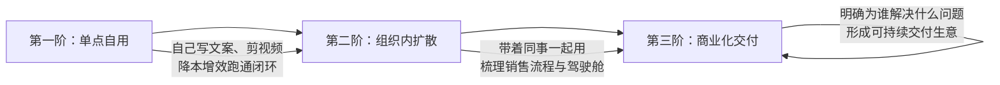

# 2026-11-10 · 刀文AI商业直播知识

## 1. 有企业需求、有流量，为什么还要找技术伙伴

刀文的公司在**广州**，近期重心主要在**中山做产业园区**。他每周组织线下沙龙：一边让实体企业老板带着真实业务需求过来，另一边邀请做 AI 产品与工具的技术团队现场演示。刀文自述擅长商业策划、直播与流量打法，但复杂工作流和重型智能体自身做不出来；因此直播连麦招募的核心目标，并非泛泛的“AI概念人才”，而是**能切实把企业老板眼前问题解决掉的技术落地团队**。

目前他的业务搭档已开始服务企业，主要交付内容包括：用 **WorkBuddy** 串联日常工作、整理前端销售与业务资料、搭建企业专属资料库，以及制作轻量的 **CEO 驾驶舱**。刀文坦言，这套交付与深入制造业流程的重度 **FDE（前线部署工程师）** 服务尚有明显差距，必须引入专业的数据清洗与技术团队协同作战。

双方的能力互补逻辑非常明确：
- **流量与场景端（刀文）**：手握企业老板真实痛点，能将客户直接引流至线下园区面对面沟通；
- **研发与交付端（技术伙伴）**：负责将具体功能跑通、稳定交付落地。

对于靠谱的产品或落地设想，刀文在现场开出的合作条件包括：**提供线下场地、团队支持、承担部分基础费用，并在自身圈子内协助冷启动推广**（当晚仅为框架性意向，未签署正式投资协议）。

> **线下协同边界**：刀文特别澄清，自己绝非仅在线上将双方拉个微信群做皮包撮合，而是坚持**“不线下深度见面就不开展合作”**。线下沙龙以免费为主，核心是搭建类似“小型广交会”的供需互信场；园区虽有选品会，但他强调自己并不包揽所有行业的选品。

---

## 2. 用过工具、做出程序、形成价值：AI落地的三层台阶

刀文回顾自己于 2023 年初借朋友账号接触 GPT，最初感受最深的是写文案与搜集资料的高效。对于当下的 AI 初学者，他主张**直接上手国内开箱即用的成熟工具**（如豆包相关工作台、腾讯 **WorkBuddy**），切忌把“必须精通所有底层代码”设为动手的先决条件。

针对“用 AI 制作轻量小程序/轻应用上线的成本”，他指出借助现代模型与低代码工具，纯技术开发门槛已接近零，**但人工调试与业务梳理依然是实在的刚性成本**。此外，搭建网页独立站更有利于将核心业务数据沉淀在自有体系内，避免完全受制于第三方平台闭环。

针对现场“没靠 AI 赚到钱就是新手”的争议，面对弹幕“如果只用于自己降本增效算不算价值”的反问，刀文随即修正并强化了能力进阶的路径：

- **第一阶（单点自用）**：自己用 AI 剪辑短视频、写脚本，实打实省下个人时间，本身就具备清晰价值；
- **第二阶（组织扩散）**：将自用跑通的成熟流程教给团队同事，尝试规范销售资料与管理看板；
- **第三阶（商业交付）**：做出 WorkBuddy 工作台仅证明掌握了工具用法；唯有明确**“到底替哪个客户省了哪笔钱、提升了哪项具体指标”**，才能演化为一门独立运转的生意。

---

## 3. 短视频工具的连麦争论：客户买的到底是什么？

一位软件创业者连麦展示其刚研发完成的短视频生成工具，计划面向各行业企业提供服务。该产品功能已基本跑通，但对外商业授权尚未开放，目前**零实际付费客户**，开发者自身也尚未运营起自媒体账号。

刀文现场连续切换三个真实角色发起压力测试：**“假设我是洗发水工厂老板、服装电商卖家、或是正在开播的带货主播，你的工具分别能帮我干什么？”**

双方现场的认知拉扯，揭示了技术开发者与实体买单方之间的典型鸿沟：

| 评估维度 | 开发者视角（技术与功能本位） | 实体企业主视角（刀文压力测试） |
| :--- | :--- | :--- |
| **产品定义** | 帮企业做垂直行业自媒体，组织行业信息，打造数字媒介矩阵 | 到底是能帮我**多卖货、招主播、还是带来精准进店流量**？ |
| **长效价值** | 直播消耗主播体力，生成的短视频内容留在账号能长效沉淀信息 | 客户买单不看代码多精妙，必须明确买来后哪项业务立刻变好 |
| **结果指标** | 产品多行业通用，可赋能各类企业生成内容 | 能否扛住“单条视频能否达到预期播放/转化”的商业结果拷问 |
| **诊断建议** | 坚持先完善全行业通用功能，再推向市场 | **先给别人的成熟产品做销售**，亲自摸清买家痛点再回来改代码 |

> **核心启示**：企业老板并无耐心倾听模型架构与底层算法。正如弹幕技术人员所感慨，向老板推行 AI 的第一准则不是普及技术原理，而是**用老板听得懂的业务白话，把能帮他解决的一件具体繁琐小事当场讲透**。

---

## 4. 流量要能动起来：静态联系人、样板示范与获客边界

针对“私域流量”概念，刀文直言反对将通讯录里沉睡的好友盲目计为资产。**没有互动、无法唤醒的名单只是静态死数据**；公域直播的核心职能是建立信任入口，后续能否产生真实复购与合作，取决于日常能否保持有价值的双向互动。

弹幕观众现场贡献了三组极具代表性的获客实战样本：

1. **过亿播放模板失效**：某从业者曾靠一套短视频获客模板实现数月流量破亿，但平台算法迭代后该套路全面失效——**历史模板的短暂爆发不等于可无限复制的长期资产**；
2. **自然流精准转化**：另一位坚持做垂直自然流内容，平均每发两条视频可精准沉淀 1 名意向客户（后端转化率与客单价尚待持续追踪）；
3. **免费样板换权威背书**：一位从业者为当地电商协会会长免费开发展厅 AI 语音智能体，主动放弃当期款项，以此打造标杆案例并换取向地方领导及行业协会展示的信用入口。

> **AI 获客的本质边界**：刀文指出，“AI 获客”并非人人适用的灵丹妙药。**本来就具备成熟获客与交付闭环的人，AI 能够成倍放大其产能；而原本就不知道把货卖给谁、不懂成交转化的团队，盲目采购获客软件绝不可能自动盘活业务**。

---

## 5. 三种变现路径实操复盘：培训、身边小需求、企业服务

刀文结合自身观察与同行操盘案例，系统拆解了当前 AI 商业化的三条主流变现路径：

| 变现路径 | 典型案例与实操打法 | 商业特征与关键财务/运营参数 |
| :--- | :--- | :--- |
| **① 入门轻培训** | **大众低价课**：剖析李一舟模式（几十元标准化录播课卖三年，依靠持续短视频+直播洗流量，拒绝私域与重交付，团队保持 2~3 人极简配置）。 **入企现场带教**：刀文团队面向企业员工现场教学 WorkBuddy/Codex 实操。 | **受众分层明显**：进阶者眼中的“浅显常识”，恰是海量小白亟需的刚需台阶。不把卖课当终局，而是作为筛选后续重度企业客户的前置漏斗。 |
| **② 熟人小需求** | **服装厂老板自研小工具**：服装厂主自用 WorkBuddy 缩短设计/看款/打版链路，随后封装卖给熟人同行。 **情感陪伴与场景化写真**：模拟逝者/离别对话；摄影师结合旅行故事定制婚纱 AI 场景。 | **小而美闭环**：服装小工具**月费约 59.9 元**，依靠同行口碑传播累计获利“大几十万”。功能虽不罕见，但精准贴合细分垂直痛点即可促成付费。 |
| **③ 实体企业服务** | **聚焦繁琐流程降本增效**：不空喊企业整体重塑，帮老板梳理资料库、提炼运营报表，直接对应业绩增长或工时削减。 | **拒绝盲目包揽**：能干的轻量环节自研快速交付，复杂的深水区环节拉拢专业外部技术团队协同作战。 |

---

## 6. 马鞍山 6 人软件公司的抉择：本地盘活 vs 异地外包

一位拥有十几年开发经验的来访者连麦求助：其在**安徽马鞍山拥有一家 6 人软件公司**，过去业务主要承接浙江、上海的外包项目（网站、轻量管理软件等）。由于部分外地项目回款困难与烂尾，正在权衡转型路径：**是深入承接本地企业 AI 定制，还是为本地中小商家制作年费两三千元的轻量工具箱？**

### 关键客观约束还原
- **客户结构与单价落差**：来访者澄清公司一直在本地运作，手头核心资产是**既有的老企业客户资源**而非街头小商家；过往同类开发单子**在本地约 5 万元，而在浙江可做到 15 万元**；
- **技术人员转型卡点**：团队虽然懂底层编码，但缺乏对细分行业真实运作流程的理解，进入 AI 服务后，业务调研、脏数据清洗与客户沟通的成本陡增；
- **全员组织配置失衡**：6 人团队中仅有来访者 1 人负责商务，其余 5 人均为研发，极易陷入“埋头改代码、无人跑市场”的被动局面。

### 刀文给出的破冰操盘建议
1. **不要一上来就推销几十万的重度 FDE**：直接带 2 名技术工程师拜访既有老企业客户，以**“两天 5,000 元”**的极低门槛切入，手把手协助老板与高管清洗沉淀资料库，用 WorkBuddy 解决内部繁琐沟通；
2. **以轻体验暴露真需求**：在现场带教中自然挖掘出企业深水区的业务堵点，再顺理成章承接后续 **2~3 万元** 的垂直智能体或定制工具；
3. **重构团队人员配比**：建议从 5 名研发中抽调人员，形成**“3 名技术守家 + 3 名人员做商务拓客”**，高频拜访老客户喝茶探需求，彻底打破纯技术思维的桎梏。

---

## 7. 5,000元体验包 vs 19,800元两场景交付：核心分歧深度对比

来访者以其正在洽谈的一家**本地拥有十几家门店的连锁餐饮企业**为例，展开了极具行业普适性的商业博弈讨论：
- **客户现状**：餐饮老板抱有强烈的 AI 焦虑，但全公司无一人接触过 WorkBuddy；历史经营数据混乱分散在老旧进销存系统中，清洗难度大；
- **来访者方案**：报价 **19,800 元** 为其深度梳理并交付两个核心业务场景；
- **客户顾虑**：餐饮老板算了长周期综合账——全公司 10 名核心员工开通 WorkBuddy 企业版，**仅软件年费订阅即超 2 万元**，叠加两万元定制费后决策犹豫不决。

两位操盘者在交付路径上的根本分歧拆解如下：

| 决策维度 | 刀文的“轻量破冰”路线 (两天 5,000 元) | 软件公司的“重度交付”路线 (19,800 元两场景) |
| :--- | :--- | :--- |
| **战略目标** | **先破冰进门**：消解老板焦虑，让核心团队先在日常中用起来 | **一次性解决深层问题**：深入清洗混乱进销存数据，完成场景闭环 |
| **软件订阅策略** | 坚决不让客户一开始承担全年订阅负担，从**免费版或开通单月试用**起步 | 要求老板全盘考虑全年订阅账目（10人企业版年费约2万+），决策门槛高 |
| **落地实施重点** | 2名工程师现场驻场 2 天，集中教老板和员工用 WorkBuddy+飞书提效 | 集中精力投入后端业务逻辑建模、API打通与数据清洗，开发周期长 |
| **商业闭环逻辑** | **低门槛体验 $\to$ 建立信任 $\to$ 发现深水区痛点 $\to$ 增购 2~3 万定制** | 传统软件外包交付模式，合同一旦签署即背负沉重的数据治理包袱 |
| **潜在风险考量** | 培训完后客户可能流失，若缺乏深层绑定难以转化为长效大单 | 客户若迟迟看不到立竿见影的反馈，容易对 19,800 元整体方案丧失耐心 |

> **博弈总结**：两者并非简单的价格高低之争，而是**“互联网流量思维的低门槛试错”**与**“传统软件工程的高规格交付”**的路线碰撞。短期培训无法自动抚平系统间的数据脏乱，而过度前置的高昂成本又会将客户拒之门外。

---

## 8. 纽约办公用品批发：低毛利标品背后的供应链与合规壁垒

一位在**美国纽约深耕办公用品与文具批发**多年的华人老板上麦交流。他既非弹幕猜测的跨境货代，也非追逐暴利的信息差炒家，而是扎根成熟实体的供应链操盘手。

1. **标品低毛利下的生存法则**：
   - 当地办公用品尺寸与规格高度标准化，中美差价极其透明，不存在暴利空间；
   - 核心竞争力在于多年沉淀的**本地小批发客户网络与集拼集运物流履约体系**：按周归集不同客户订单，分派给国内各细分优势工厂生产，整拼一个大柜海运至美，抵港后一周内高效分拨至各商家门头，极致压缩仓储与周转成本。
2. **品类扩张的合规红线**：
   - 针对现场提议引入国内低价毛绒玩具、公仔与二次元手办的建议，该老板明确回绝；
   - **风险底线**：欧美对儿童玩具的环保、阻燃、材质认证（如 CPC 认证）及外观侵权处罚极其严苛。**贸然跨入不熟悉的品类，微小的价差优势瞬间会被巨额合规罚款或滞港索赔彻底吞噬**。

---

## 9. 免费工具整合的下一步：先试跑，再做业务闭环

临近尾声，刀文透露正在归集由各路技术开发者提供的实用 AI 工具，计划近期打包向粉丝开放免费试用（定性为早期公测展示入口，非永久免费承诺）。

综合整场对话，无论是弹幕分享的 WorkBuddy 工作台、轻量小程序开发、几元钱的 AI 图片加工，还是成型的商户拓客软件，技术实现层面的差距正在光速收窄。**决定一个团队能否存活的终极拷问，始终聚焦于四项基本商业准则**：
1. **你的明确买家到底是谁？**（拒绝“全行业都能用”的虚无定位）；
2. **买下工具究竟能替他多赚哪笔钱、或省掉哪道工序？**；
3. **怎样设计极低门槛的破冰交付，让客户先上手跑起来？**；
4. **当平台规则与数据清洗的真实脏活出现时，谁来持续兜底维护？**

---

[下载 Helix Agent](https://github.com/dollarser/helix-agent/releases)
