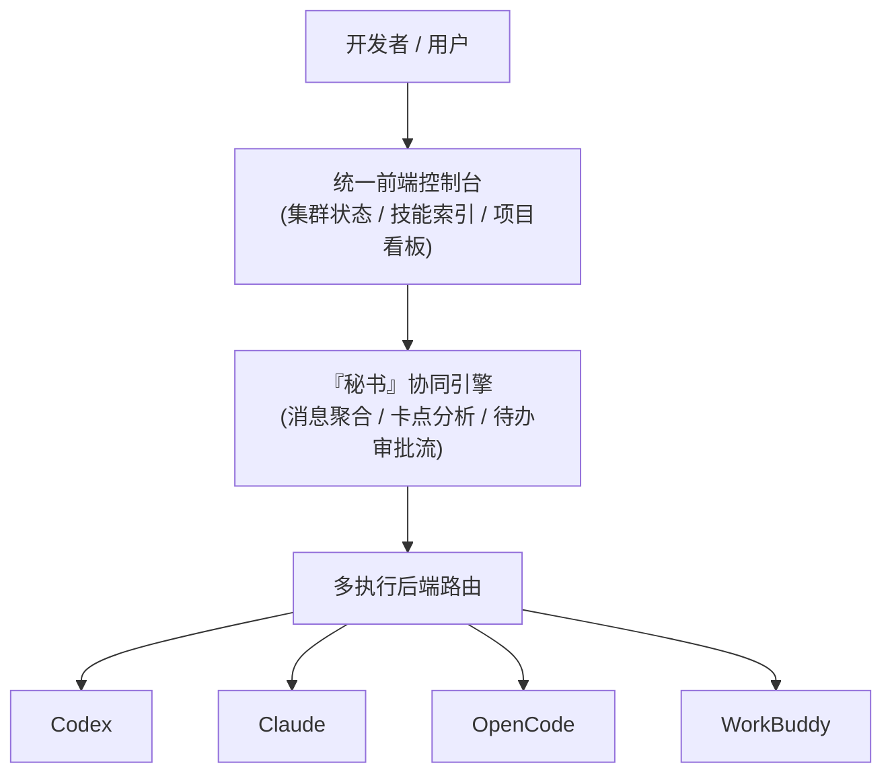
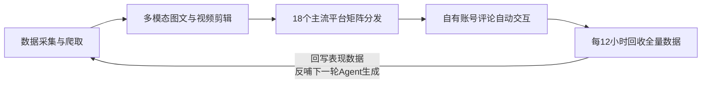
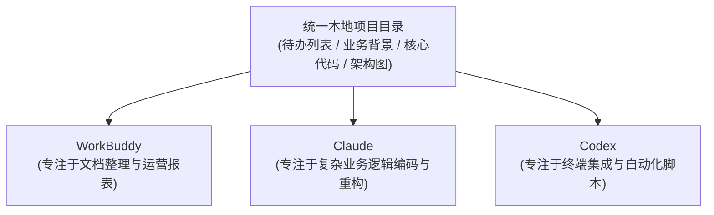

# 2026-11-10 · 直播片段知识

## 1. 从综艺现场的小工具开始学 AI 编程

一位做综艺后期的项目经理，先解决了自己日常工作里最痛的一个小麻烦：
- **痛点场景**：现场导演在录制时高速打字记录要点，但导出的文字没有时间标记；后期剪辑师拿到笔记后，根本无法与几十分钟甚至数小时的视频时钟对齐，翻找素材极其费时。
- **AI 辅助工具实现**：他通过 AI 编写了一个轻量自用小软件——导演打字做记录的同时，**工具自动打上精确的北京时间戳，并同步开启现场录音与语音转写**，最终导出一份严格对齐时钟轴的结构化记录。

他并非科班程序员，却已做出解决真实痛点的实用软件。针对后续是否需要“系统性从头学编程”，讨论给出了务实的工程原则：**沿着真实工作链路遇到问题再去补知识**。业务人员学 AI 编程的起点是“我手头需要输入什么、期望产出什么交付物”，而不是先把一门编程语言的语法树从头到尾背一遍。

> **边界提示**：自用小工具与商业级交付有着本质差异。单人自用可以容忍异常与手工重启；但若升级为多并发、团队协同与长期免维护的生产系统，仍需要经验丰富的专业程序员参与工程化兜底。

---

## 2. 社群的价值，在于能不能把互补的人连接起来

上海线下交流后的复盘共识是：线下聚会的核心指标绝非凑了多少人头，而是**现场遇到了什么认知层级的人，以及后续能否产生长效化学反应与业务互补**。

在实际协作网络中，不同角色天然存在互补需求：
- **技术极客**：懂模型调用与工作流编排，但缺乏具体行业的商业场景；
- **行业老兵**：手握真实企业客户与痛点，但缺乏把想法变成软件的工程能力；
- **商业讲师与商务**：擅长用白话表达、包装案例与做销售转化。

这也解释了直播间多次促成的合作范式：自己吃不下的项目，先把需求与约束清晰定义出来，再寻找对口行业的工程师；技术作者拿出可试跑的原型，行业服务商带具体业务数据现场打磨，拒绝仅仅停留在“我们都在搞 AI”的概念抱团上。

---

## 3. 号池服务的难点：先说清卖什么、谁需要，再谈价格优势

一位来自成都的创业者（早先从事出海广告业务）尝试切入编程模型资源中转服务。他在对话中提及号池、反代中转及“蒸馏”等词，但现场交流证实其并非底层模型研发团队。现场同行对其发起连续追问，直击商业定位核心：**你到底提供的是模型算力调用、外包编程交付、专属 Skill 定制，还是单纯的上游账号转售？**

在目标客户不明确的背景下，“手握低价一手资源”极难转化为稳定的买单理由。其自述前三次资源测试由于 **RPM（每分钟请求数）瓶颈或输出质量不稳定** 已被关停，当前第四版自测良好。

同行当场指出了号池中转业务的两大深层隐患：
1. **一对多共用账号的风控连带**：单体用户的异常请求或越狱提示词，极易触发上游风控封号，导致同号池的其他付费用户瞬间掉线；
2. **掺水与虚假消耗风险**：在模型调用链路中，上游供给方是否掺入低成本模型、真实调用量是否存在虚报，采购方必须通过高强度实测与严格验证才能甄别，不可轻信口头承诺。

---

## 4. 个人 Agent 统一终端：解决多工具分散派活的碎片化

针对当前开发者在多个 AI 工具间反复切换窗口、手动复制上下文的痛点，一位开发者展示了其接近完工的个人 Agent 统一控制台：

该架构的核心工程亮点在于**“执行操作与人工决策解耦”**：
- **后端执行层**：多套执行后端在各自沙箱内并发执行具体的代码生成、文档梳理或文件检索；
- **统一审批中心**：由“秘书”角色自动汇总各后端的关键节点输出，精准识别出需要人工介入判定的事项（如敏感操作、架构分歧），收拢至统一审批窗口由人一键确认。

> **阶段现状**：该终端当时处于开发收尾阶段，已支持多机路由与鉴权，但尚未展示大规模生产环境的部署验收数据，亦未形成正式付费交付。

---

## 5. 企业缺的可能不是大模型，而是员工桌面的那个轻量入口

一位专做 ToB 数字化能力底座的参与者提出了截然相反的诉求：其团队服务端已经具备智能文书生成、企业知识库、Agent 编排与模型统一管理等完备中台能力，能够灵活供上层业务调用；**当前最卡脖子的瓶颈，反而是缺乏一个轻巧部署在员工本地电脑上的桌面载体**。

- **纯服务端的局限**：只能回答问答式请求，无法无缝接管并监听员工在本地电脑上的日常软件操作；
- **重型助手的弊端**：盲目把全套重型开发框架打包推给普通员工，不仅学习成本极高，极易引发业务部门抵触。

因此，企业真实需要的不是功能最庞杂的“全能超级 Agent”，而是**高度精简、权限受控、界面符合办公直觉的开源桌面入口**。该开发者建议对其前端进行裁切，底层接入 **DSH** 极简底座与少数经过验证的核心后端（其自身已从最初 18 个后端缩减至 5~6 个核心组件），以轻量形态切入。

---

## 6. 极简底座、插件化与桌面习惯的协同设计

在将 Agent 推向企业办公桌面的过程中，多位操盘者总结了以下工程准则：
- **极简底座原则**：在 DSH 等框架中，果断剔除一切非必要插件，以“最小化可用模式”启动，后续再针对具体业务按需挂载插件；
- **区分实验原型与生产成品**：部分前沿的超级智能体（Superagent/Bot）在个人探索环境中表现惊艳，但直接推给普通岗位员工时常因复杂性导致崩溃；
- **尊重非技术人员的操作习惯**：技术开发人员偏爱高效的 CLI（命令行），但财务、人事、供应链等业务人员只能接受标准图形桌面与右键菜单，交付时必须顺应员工习惯；
- **内网与合规壁垒**：大型企业通常受限于内网隔离、信创采购标准与严格的审批流，模型部署必须兼顾私有化可用性与数据出境红线。

---

## 7. 单一垂直场景能磨深，整套业务系统不能只靠改界面

行业服务者强调，**围绕一个狭窄的高频痛点做到极致，是独立小团队撬动大客户的最佳切入点**。然而，一旦介入企业的整套业务流程改造，就必须直面错综复杂的历史服务关系与业务暗坑。

> **深水区现实**：企业老旧系统里某个看似反直觉、冗余的字段或审批节点，很可能是为了兼容另一段跨部门业务而故意留存的“历史补丁”。如果外部开发团队仅凭标准教科书模板强行“纠偏优化”，往往会导致原本能够平稳运行的上下游业务链条全面瘫痪。

这也是为何经验丰富的服务商倾向于先做轻量化培训与外围辅助，而不是一开始就冒进承诺重度 FDE 全流程改造。

---

## 8. 汽车质量文档比对：难点是跨系统关联，而非文档字数

在汽车制造领域的真实交付案例中，从前沿研发到车间工序涉及 **1,000 多份核心标准文档**，零散分布于各自封闭的旧系统中。单单一阶上层设计规范，就可能层层穿透关联至下游 **1,000~2,000 份工艺指导书与上百个混乱的 Excel 表格**，字段名口径不一且时常冲突。

> **核心质量发现**：在一次深度比对中，系统通过跨文档关系图谱发现了一个隐藏隐患——**某批次原本属于高配规格的高品质零部件，被误装到了低配车型上**。
> 
> *商业逻辑反转*：这并非把差零件装到了高配车（非传统意义上的质量缺陷），而是**直接导致了单车制造成本的莫名攀升与物料核算失真**。这种隐蔽错误若脱离了底层多表映射关系，仅靠通用大模型单轮阅读文本，根本无法察觉。

---

## 9. 软件支付对账：AI 能找出数字对不上，却无法解释为什么

在另一段电商支付结算的对账案例中，企业历史记账长期未正确计提支付网关扣点，账面数据客观存在偏差，但整套业务却已依惯性正常跑了一整年。

- **AI 的能力边界**：AI 能高效扫描并指出“借贷两端数据存在数额不一致”；
- **AI 无法解决的问题**：模型完全无法推断出当初记账人员为何要采取这种特殊折中口径。

这深刻揭示了数据治理的底层逻辑：**不能盲目将“数据库中已有的历史记录”等同于“真实合理的现行规则”，更不能允许模型为了拼凑逻辑自洽而凭空编造业务原因**。

---

## 10. 小团队突围大厂：依靠响应速度与极限定制

在连锁商场智能客服项目中，参与者透露大厂标准化 AI 产品原本只能拦截约 **60%~70%** 的泛化问题；本地服务团队深入结合商场实际活动规则与本地俚语精细化调优后，问题拦截率被提升至近 **90%**。

前大厂从业者拆解了大厂与小服务商的资源博弈本质：
- **大厂资源倾斜机制**：大厂按客户 ROI、战略价值与 KPI 排定优先级。超大型 KA 客户（如银行、央企）可享有专属团队驻场开发；而**年付十几万元的中型客户，即便发生严重客诉甚至层层上报，也难以获得底层定制资源**；
- **小团队生存空间**：小服务商的生存护城河不是宣称底层模型超越大厂，而是**更愿意扎根现场、深度理解细微规则、并提供即时响应的售后交付投入**。

---

## 11. 南京技术经理转型：先摸清自身边界再做培训

一位南京技术经理（曾有大厂架构背景、离职后骑行 318、随后在创业公司搭建 AI 中台）在商业 App 停摆后，重新规划个人商业路径：由于缺乏垂直制造业沉淀，他果断放弃重度 FDE 路线，转型切入**针对高校毕业生的 10 天实训营**与行业自媒体。

在原公司推动 AI 落地时，他总结出极具说服力的组织心理学经验：
- **研发团队**：起初对 AI 怀有强烈的被替代恐惧而消极抵抗；由管理层强制推动、工程师亲身体验到“原本繁重的工作确实被大幅分担”后，态度才转为主动接受；
- **非研发岗位**：无需空谈宏大概念，直接从岗位看得见的“几分钟自动出报表”小收益切入，引导其自发探索。

---

## 12. 制造与外贸团队的 FDE 实践：依托熟龄行业基本盘

惠州大亚湾的一支实战团队（核心成员分别拥有 **23 年制造业经验** 与 **20 年外贸资历**，招募了 2 名专属 FDE 工程师），坚定选择只围绕自身熟悉的制造与外贸客户展开业务。

- **行业跨界陷阱**：该团队在尝试涉足生物医药、精细化工等陌生领域时，因听不懂业务术语与审批流程，推进异常艰难；
- **供应链经验复用**：弹幕供应链老兵补充指出，熟悉 ERP 逻辑的人能够快速理清跨部门断点，即便现场操作人员消极配合，也能凭借既有经验倒推业务卡点。

---

## 13. 培训赛道的三种截然不同的商业闭环

当晚对话揭示了当前 AI 培训市场中定位迥异的三种实操路线：

| 培训路线 | 操盘主体与代表案例 | 核心目的与商业变现逻辑 |
| :--- | :--- | :--- |
| **① 就业与技能培训** | 南京技术经理（面向高校毕业生的 10 天实训；后续拟切入企业内训） | **直接以课程学费为收入**。放弃泛小白科普，转向用 WorkBuddy 自动化报表、合同风控等硬核案例吸引精准企业老板。 |
| **② 极客实战筛选营** | 免费 Codex 实战课（两天线下实战，自带电脑，现场做项目） | **课程完全免费，不靠学费赚钱**。核心目的是在动手实操中高压筛选出高自驱、懂业务的未来合伙人与交付工程师。 |
| **③ 获客型公开研讨会** | 惠州制造/外贸团队（联合地方科创中心、行业协会开展实操路演） | **前端免费或低价破冰，后端转化重度定制**。把公开课作为展现专业度的入口，核心承接后续的企业级 FDE 与系统部署。 |

---

## 14. 免费实操营的硬核筛人法：让学员带电脑现场做

免费 Codex 课程主讲人分享了其连办三期（人数分别为 20 余人、近 40 人、40 余人）的硬核筛选机制：
- **日程极度重实战**：第一天上午配置环境与基础操作，下午直接上手搭建专属知识库与实操案例；第二天直接针对自身业务做图片、视频或自动化脚本；
- **残酷淘汰机制**：**不带电脑不许入场，半天不参与实操直接劝退**。通过高强度的现场实践，快速把纯听热闹的“看客”过滤掉，沉淀出 50%~60% 真正能动手跑通链路的硬核骨干。

---

## 15. 商业课定价与国企采购的合规门槛

在企业内训领域，市场定价与准入门槛高度分层：
- **小微民企采购**：追求短平快，愿意支付数千元费用购买一次能让核心员工立刻提效的实操带教；
- **国企与大型机构采购**：极度看重讲师职称、专家库资质、教材合法合规性与严格的结算周期；
- **复购价值高于一次性买断**：单纯一次性交付往往陷入持续获客的泥潭，唯有深度融入客户日常运维，赚取后续持续服务与增购费用，才能形成正向飞轮。

---

## 16. 提效后的组织博弈：增员扩单还是缩编减员？

讨论直面了企业引入 AI 后的深层组织博弈：
- **薪酬落差引发敏感度**：在软件与科技企业中，普通研发薪资通常是普通运营/业务人员的 2~3 倍，管理层往往对研发端降本最为敏感；
- **降本并不等同于裁员**：在跨部门协同繁重（如 PMC 生产计划控制、跟单、报关）的企业中，AI 自动汇总将原来数天的对齐缩短至数分钟，优秀企业往往利用释放出来的产能去拓展更多市场订单，而非单纯缩减人手。

---

## 17. 9,800 元全链路定制：自媒体闭环里的数据回写

一位独立开发者分享了其耗时 **20 余天** 完成的一套客单价 **9,800 元** 的自媒体全自动定制系统。该系统绝非单纯调用单点生成，而是构建了完整的长效飞轮：

> **核心壁垒**：整个链路的灵魂在于**“数据回写反哺机制”**——发布并非流程终点，系统定期回收点赞、评论与播放数据，根据历史表现动态调整下一期的选题与文案风格。这种深度磨合与交付闭环，构成了 9,800 元报价的核心支撑。

---

## 18. 多样化软件定价阶梯与私域流量基础

该开发者系统披露了其旗下多款轻量级软件的定价与销售实况，揭示了不同产品形态的定价逻辑：

| 产品分类 | 产品功能定位 | 价格变迁与真实商业流水 |
| :--- | :--- | :--- |
| **自媒体全闭环定制** | 深度定制采集、制作、18 平台分发与回写闭环 | **9,800 元 / 单**（深度交付，周期约 20 余天） |
| **六平台社媒互动工具** | 多平台评论区监控与关键词自动互动软件 | 累计售出 **40 余份**（原价 **1,980 元**，随技术普及降至 **500 元**） |
| **电商自动化提效工具** | 针对电商卖家的日常繁琐流程提效脚本 | **个人售 500 元**（同行同类方案叫价 **8,000 元**）；依托 2 个微信约 2 万电商从业者私域，**单日交易额最高达 8 万元** |
| **同城 POI 地图线索工具** | 高德/百度/腾讯商户公开信息沉淀脚本 | 原价 **980 元**，目前降至 **200 元**（沉淀 30 万条本地商家线索） |

> **关键认知前提**：所谓“低价工具单日卖 8 万元”，本质上建立在其过去多年积累的 **2 万名垂直电商私域好友** 基础之上。脱离了私域信任池与精准买家，单凭低价软件本身绝不可能凭空创造流水。

---

## 19. 通用现成工具 vs 深度定制外包：买工具本质是在买时间

面对预算有限的初创客户，一种实用的商业策略浮出水面：
- **先买现成低价工具（如 500 元）验证需求**：让客户用极低门槛立刻解决眼前的效率卡点，本质是**用小钱买现成的时间**；
- **暴露深度痛点后再做增量定制**：在日常使用中逐渐沉淀出新需求后，再按需推进数千至上万元的定制开发，避免每次都从零造轮子，极大降低客户的决策门槛。

---

## 20. 通用框架开源与垂直业务闭环的插件化融合

在个人 Agent 控制台开发者（倾向开源底层框架）与自媒体工具作者（坚持闭源保密）之间，现场达成了**“底座开源 + 业务插件化”**的共生范式：
- **通用底座（开源）**：负责多后端接入、鉴权路由、界面展示与待办流转，避免行业重复造轮子；
- **业务插件（商业化）**：将具体的自媒体采集、洗稿、分发等深度变现能力封装为专有商业插件，实现生态与收益的共赢。

---

## 21. 复用开源仓库：搜索只是起点，调通和适配才是核心工作

多位开发者澄清了对 GitHub 开源项目的误解：在实际业务中，让 AI 检索相近仓库只是整个工作的最前置环节；真正的工程量在于**排查开源代码自带的 Bug、改造前后端适配客户现有流程、打通数据库与鉴权**。开源项目不能直接充当交付成品，调通与业务定制本身就是极高价值的研发投入。

---

## 22. Agent 积分交易市场的构想与现实边界

终端开发者设想构建一套让 Agent 注册身份、互换技能、上传下载能力的积分网络：
- **商业现实审查**：当被追问积分能否兑换法币时，开发者坦承目前仅为内部积分逻辑，尚未形成法币承兑闭环与商业变现通路；
- **沙箱安全底线**：弹幕尖锐指出，没有严格沙箱隔离的 Agent 运行环境极其危险，一旦发生高危误操作甚至系统格式化，将带来灾难性后果，绝不能以“执行方便”为由牺牲安全边界。

---

## 23. 地图商户线索：线索数量不等于购买意愿

围绕地图 POI 采集工具，现场梳理出关于“潜客线索”的底层逻辑：
- 沉淀了 **30 万条同城商户电话**，绝不等于拥有了 30 万笔潜在订单；
- 公开工商与地图数据极其杂乱，大量存在空号、错号及不对口类目；且未经意向筛选的电话盲打不仅转化率极低，还极易引发隐私骚扰投诉。**精准行业意向筛选与合法触达，远比单纯采集数量重要得多**。

---

## 24. 万字提示词原型设计 vs 生产环境验收

工具开发者分享其使用 Codex 的实践：将复杂的业务背景、实体约束与功能规范详细写成近万字的长 Prompt 交给模型，通常两三个小时即可生成可演示的原型 Demo。

但工程团队特别强调：**能出原型绝不等于交付完成**。Demo 往往只跑通了黄金路径，而应对真实网络超时、重试补偿、并发脏读与极端异常等工程细节，仍需要耗费数十天的人工打磨。

---

## 25. 本地硬件选型：云端调用无需盲目追求顶级显卡

针对“是否需要为 AI 专门采购顶级苹果笔记本或昂贵显卡”的困惑，资深同行给出了理性的硬件配置指南：
- **主要调用云端 API / Web 服务**：现有主流台式机（如 **4070 Super + 7800X3D**）性能已经严重过剩，完全无需额外追加预算；
- **重度本地多模型 / 本地大吞吐推理**：需要大显存（如 24G/48G 以上显存或大统一内存），但在商业探索早期，采用**云端按量付费租用算力**的 ROI 远高于一次性重资产采购。

---

## 26. “第二大脑”的核心在数据沉淀，而非硬件载体

许多用户误以为安装了 AI 就能自动打通生活与工作数据，但现实并非如此：
- Gemini、ChatGPT、Claude 各自的云端对话天然割裂，彼此无法直接感知上下文；
- **PC 与手机的角色定义**：PC 台式机或笔记本充当完整的运算环境、项目数据仓库与主力执行端；手机则充当出行状态下的轻量监控哨与即时指令输入通道，数据源头必须在本地形成规范统一的沉淀。

---

## 27. 多 AI 协同实战：统一项目目录与明确职责划分

一位多工具重度用户分享了其高效协同多个 AI 的工作流体系：

该模式的核心心法如下：
1. **建立共享上下文根目录**：将项目简介、API 协议、待办与核心约束集中存放在同一个本地目录中，各 AI 工具均基于此目录对话，消除重复交代背景的沟通成本；
2. **依模型长处分配角色**：不强求单个模型包揽全流程，而是让文档模型负责文书、编码能力强的模型负责代码、集成工具负责执行；
3. **任务实测胜过自我吹嘘**：直接让各模型针对同一具体测试用例做切片对比，用真实任务产出确定最终分工，将每个 AI 当作各有特长的人力协同伙伴。

---

[下载 Helix Agent](https://github.com/dollarser/helix-agent/releases)
