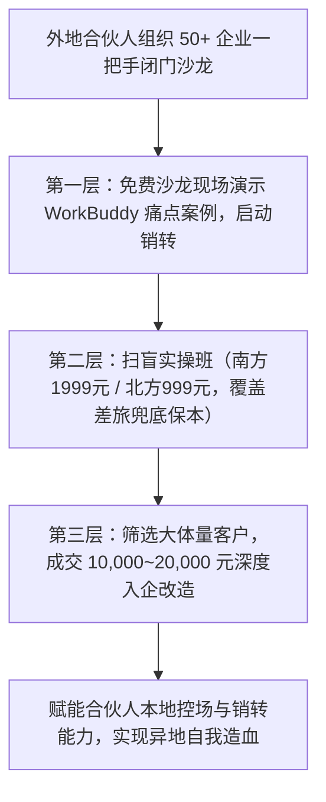

# 2026-11-11 · 刀文AI商业（晚场全景）：餐饮SaaS与WorkBuddy内训、医疗一体机长账期风险、汽车4S店70%报销与异地派师销转漏斗

本场晚间直播总长达 6.29 小时（由因网络瞬断 20 秒切分的 Session 124 与 Session 126 平滑合并而成），刀文与多位垂直行业操盘嘉宾深度拆解了企业 AI 落地的真实商业阻力与变现闭环：涵盖餐饮 AI 决策系统的现实阻力、加盟代理腾讯 WorkBuddy 做 150 款轻应用日常提效内训、医疗大模型工控一体机进医院的漫长账期风险与二次变现破局、企业培训坚决不碰科技园区的底层逻辑、外地派驻讲师的 50 人沙龙门槛与梯级销转漏斗、汽车 4S 店借势主机厂 70% 报销补贴实现“免费培训+投流变现”的三年实操真经，以及国内企业落地中本土工具对海外开发工具的全面替代。

---

## 一、餐饮大而全 SaaS 的现实阻力，与美团接口的客单价分析

连麦一开始，有从业者提出想为餐饮实体门店开发一套兼具软硬件的 AI 智能决策系统，通过大模型对接后台数据，为门店提供全流程经营诊断与营销定位。

刀文直接指出了中小餐饮门店的现实生存境况：国内大众餐饮高度内卷，中小单店在原材料采购和供应链上很难与大型品牌连锁抗衡，门店生存周期往往只有几个月到一年，单店老板根本没有预算去采购昂贵、复杂的数字化管理 SaaS。现场弹幕也直言：“现在餐饮，比不过大公司的供应链；自己干餐饮，和别人拼供应链太难了。”

连麦者提到可以通过美团开放平台的 API 接口，提取指定商圈内的人流总量、年龄结构分布以及人均客单价基础数据，结合大模型分析门店适合走高端、中端还是大众路线，并给出菜品结构建议。刀文分析认为，这类分析更偏向于前期的营销定位咨询；餐饮老板更在乎的是低成本且立竿见影的带客引流，如果把系统做成重资产、大而全的咨询管理软件，在下沉餐饮市场会面临极大的付费阻力。

---

## 二、加盟代理腾讯 WorkBuddy：用 Codex 反推框架，做 150 款日常轻应用

随后上麦的嘉宾分享了他正在推进的轻量应用变现路径：团队投入了 6 万元代理费加入腾讯 WorkBuddy 体系，面向企业与普通办公人群做推广。

他们的产品研发并没有走复杂的全栈代码开发路线：
1. **分工协作**：团队共有 3 个人，每人的目标是制作 50 个轻量应用模板，合计完成 150 个小应用；
2. **研发路径**：利用海外的代码辅助工具 Codex 或大语言模型讨论框架，快速反推逻辑并把界面 UI 美化，随后将这些应用打包、配置进腾讯 WorkBuddy 的运行环境中；
3. **日常应用场景**：这 150 个小应用全部针对企业员工每天要处理的琐碎事务，包括小红书图文排版、朋友圈日常营销文案生成、活动宣传海报一键产出等。

嘉宾表示，在开课培训时，直接向企业员工演示如何用 WorkBuddy 几秒钟生成一张精美的活动海报或日常营销朋友圈，能让缺乏技术背景的员工立刻看到使用价值。

---

## 三、传统企业内训需求井喷：基础极弱，必须极简轻交付

针对上述 WorkBuddy 代理案例，现场展开了关于 AI 企业内训到底该讲深还是讲浅的讨论。有人质疑为什么不去教更前沿、更高深的模型微调或复杂智能体开发，刀文与连麦嘉宾一致认为：高深技术面对的受众极其狭窄，且企业根本用不起来。

刀文指出，目前市场上传统企业的内部培训需求正在全面爆发，自己的培训日程已经排满。但这类培训要能顺利收费和交付，关键在于“极简”与“轻交付”：
- **员工数字技能断层**：传统企业的普通员工对翻墙使用海外大模型、编写结构化提示词接受度极低，很多员工连美图秀秀的基础功能都尚未熟练掌握；
- **傻瓜式操作才能跑通**：如果向员工讲高深提示词或复杂工作流，不仅交付极重，而且员工学不会、用不上；把工具降维成无须手写提示词、直接点击即可出图出文案的日常助手，企业老板才看得到提效成果，课程才能迅速批量交付。弹幕也生动反映了企业主的心态：“把模型租我，按月我付费就完了，懒得弄复杂技术。”

---

## 四、医疗与政企大模型一体机进医院：长账期风险与二次变现破局

在讨论软硬件落地时，有连麦者分享了他们面向医院机构交付大模型一体机的实战经验。团队将自研大模型和医疗质检、问答软件直接预装进定制工控机中，采取“只换不修、点两下鼠标即可运行”的傻瓜模式，向天津滨海、江苏等地的三甲医院和医疗机构推广。

刀文针对这种重度政企与医疗交付模式提出了严重的现金流预警：
1. **漫长账期与审批流程**：政企与公立医院有极其严格的立项、审计、招投标与付款节点，“签了合同绝不可能立刻打款”，回款账期往往长达数月乃至一年以上；
2. **初创团队垫资死穴**：硬件一体机需要预先采购设备、占用大量流动资金，若后续资金回笼拖延，初创团队极易被漫长的账期拖垮猝死；
3. **必须依赖二次变现**：刀文建议这类团队不能单靠等待设备回款，必须把沉淀的医疗大模型落地案例和技术经验转化为面向行业或同行的专项高客单培训，通过一年举行一两次封闭式培训或轻咨询，换取即时的现金流来对冲长期垫资的风险。现场弹幕也强调：“AI开源，做脏活的人才是核心，坐地收钱做不了的；会这些有什么用，你得运用和卖。”

---

## 五、企培受众定生死：坚决避开高科技园区，下沉实体才有真实信息差

在讨论培训渠道拓客时，有学员提出自己手头有现成的本地科技园区资源，园区内聚集了大量中小型科技公司与软件团队，询问是否可以合作进园区举办企业 AI 培训。

刀文与连麦专家当场打消了这种想法，并给出了非常尖锐的行业判断：
> “你找科技园区搞培训纯属找死！科技公司里的技术人员天天都在用 AI，人家代码库（codebase）和本地部署省算力用得比你还熟，你跑去教人家 WorkBuddy 这种日常办公工具，那叫关公门前耍大刀。人家不仅不会买单，还会觉得你在忽悠。”

做 AI 企业培训必须依靠**“行业信息差”**和**“落地执行差”**：
- **高度 AI 化的行业坚决不碰**：互联网公司、软件技术团队已经具备成熟的工具自研或调用能力，这类客群没有付费意愿；
- **传统实体才是真正蓝海**：传统制造业工厂、批发商贸企业、连锁服务门店等行业，员工数字化水平整体偏低，信息相对闭塞，但每天面临着大量发朋友圈、做营销海报、整理业务文档的琐碎负担；针对这些 10 到 20 人规模的中小实体做日常降本提效，才有真正坚挺的付费动力。

---

## 六、外地派师门槛与三层销转漏斗设计

针对想在异地与团队合作办学的从业者，现场详细公开了向外地派遣培训讲师的硬性准入规则与多层变现闭环：

### 1. 50 人以上老板沙龙的硬性门槛
- **规模底线**：当地合伙人必须协同当地商会、行业协会或产业协会，组织不少于 **50 位** 企业一把手或决策人参与闭门沙龙；
- **行业验真**：必须提前报备参会老板的具体行业与经营规模，确认具备真实的企服消费能力后，总部才会安排讲师出差。

### 2. 差旅保本与深度定制的梯级漏斗
讲师到达当地后，严格遵循标准化销转链路：
1. **第一层（免费老板沙龙）**：通过干货分享、现场演示 WorkBuddy 解决具体办公痛点的实例，完成高强度的现场销售转化（销转）；
2. **第二层（差旅兜底扫盲课）**：沙龙现场直接向老板或管理骨干转化入门课程——南方市场定价 **1,999 元**，东北及三四线城市定价 **999 元**（包含 2 天集中实操培训加 1 个月线上陪跑）。这笔收益直接用来覆盖讲师出差的高铁、住宿与差旅开销，确保跨城拓展绝不亏损；
3. **第三层（高客单深度入企）**：在扫盲班学员中，进一步筛选出业务体量大、有定制化工作流与流程重塑需求的企业，成交 **10,000 元至 20,000 元** 的深度入企改造服务；
4. **赋能本地销转能力**：整个商业链条中最难复制的是“现场销售转化（销转）”的能力。总部在异地落地时，核心动作是教会合伙人如何控场和做销转，当地团队掌握了销转能力，整个业务才能实现自我造血与规模化裂变。

---

## 七、汽车 4S 店落地实操：借势主机厂 70% 报销，用免费培训撬动月度十万投流

在深入探讨垂直行业落地时，连麦嘉宾详细拆解了团队深耕汽车 4S 店领域三年的经典操盘打法，揭示了汽车流通领域的供应链补贴内幕。

### 1. 行业潜规则壁垒高于技术参数
垂直行业的真实壁垒从来不是技术参数高低，而是对行业业务潜规则的深度浸润：
- 汽车 4S 店有极其独特的销售考核制度、主机厂返利规则、潜客线索跟进节奏以及销售顾问私下处理客户的习惯；
- 单纯懂技术的开发团队即使模型能力再强，如果不懂 4S 店这些底层的“小秘密”与考核痛点，做出来的系统根本无法在门店推行；只有在细分垂直赛道深扎数月、掌握不可替代的行业 know-how，才能构筑起技术无法轻易击穿的防护壁垒。

### 2. 洞察主机厂 70% 报销政策与逆向免费打法
汽车主机厂（如长安系、奇瑞等汽车品牌）为了推动终端门店的获客与品牌声量，每月都会向授权 4S 店划拨大笔新媒体短视频与直播投流专项补贴：
- **报销比例极高**：厂家报销比例通常高达 **70%**；
- **强制消耗考核**：主机厂对门店有硬性的月度预算消耗指标，花不完预算就会影响下个季度的厂家返利与评级。

团队采取了完全相反的降维打法：
- **驻场培训完全免费**：派专业讲师常驻 4S 店，帮门店搭建直播间、培训主播、指导短视频脚本与日常开播，一分钱培训费不收；
- **绑定投流代运营变现**：团队唯一收费的环节是承接 4S 店的主机厂投流运营业务。通过将区域内的多家 4S 店拼在一起，单月承接 **10 万元** 规模的投放体量，赚取投放代运营服务费和返点；
- 门店既免费得到了专业的直播和主播团队，又轻松完成了厂家的投流消耗任务并获得了有效到店线索，团队由此锁定了长达三年的稳定现金流。

### 3. 官方打卡式陪跑 vs 第三方经营闭环
- **官方陪跑的流程化弊端**：主机厂派驻的陪跑人员多是按部就班走流程，完成单点打卡式的规定动作，既不背负门店的集客留资指标，也不为实际进店与成交线索负责，往往导致门店应付差事；
- **第三方团队的经营闭环**：第三方操盘团队从一开始就以“整店经营闭环”和“真实到店成交”为生命线。企业客户对形式主义的打卡式赋能早已极其疲惫；谁能真正把线索洗出来、对老板的经营结果负责，谁就能牢牢掌握企业最核心的营销预算。

---

## 八、WorkBuddy 10万元入企交付模型，与本土化工具对海外 Codex 的替代

在企服定价与工具选型上，刀文拆解了他目前正在跑通的 WorkBuddy 高客单交付模型，并分析了国内外 AI 工具在企业级落地中的优劣转换。

### 1. 10 万元入企培训与陪跑结构
- **交付结构**：包含 2 天现场驻店重构企业内部业务流，以及后续 3 个月的持续答疑与陪跑服务；
- **业务聚焦**：只围绕 WorkBuddy 做工作流改造，不做任何其他分散的智能体，集中帮助存量优质企业客户把内部日常办公提效做扎实，帮助老客户在经营上甩开同行。

### 2. 本土微信生态与网络合规的决定性优势
- **海外工具的水土不服**：Codex、Claude 适合技术人员单打独斗，但在国内传统企业全员推广时，面临海外网络访问受限、数据合规审计风险，且无法打通企业最重要的日常沟通渠道——微信个人号（个微）；
- **本土工具的协同与监控优势**：腾讯 WorkBuddy 针对国内生态做了深度适配，不仅能合规连接微信沟通，更重要的是能够搭建起面向老板的统一监控看板与“驾驶舱”，让企业管理者每天能直观看到全体员工使用工具产出了什么、带来了什么业务结果；
- 刀文透露，由于海外工具在国内企业协同场景中用不上，自己此前订阅的 Codex 最高额度付费已全部取消，日常办公与企服交付已全面换用本土工作台。

---

## 九、市场唯二真需求：日常工作流改造与综合获客解决方案

直播全场最后，面对各种炫技式多智能体演示，刀文与嘉宾再次回到商业底层的付费逻辑，直言企业老板绝不会为概念性的通用智能体买单：
1. **警惕“跨界通用”骗局**：餐饮的本地生活逻辑与制造业工厂的订单交付逻辑完全不同，宣称用同一套通用智能体通吃所有行业的方案脱离了实际商业常识；
2. **唯二能规模化变现的刚需**：
   - **基于 WorkBuddy 的企业内部日常降本工作流改造**：帮老板梳理流程、培训员工、搭建监控看板；
   - **综合获客解决方案**：必须是包含工具、内容、运营服务以及持续陪跑的一揽子闭环方案，真正帮企业带来有效潜客线索与业绩转化。
