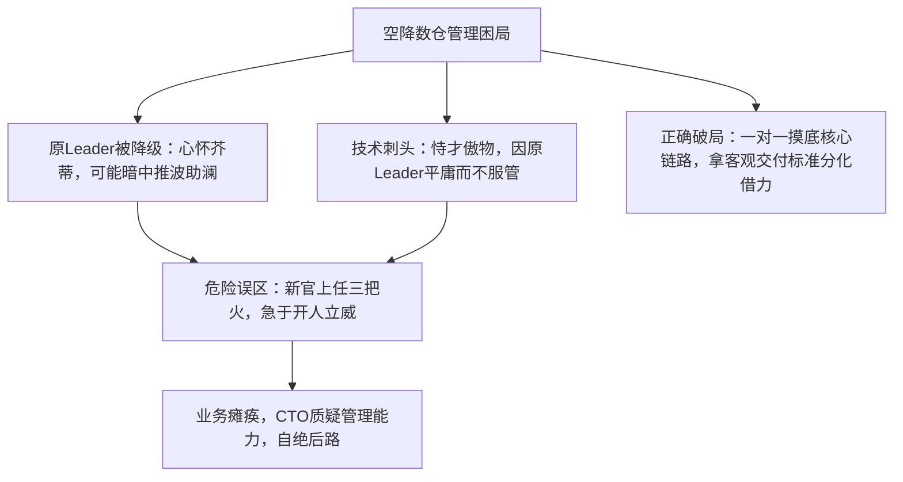
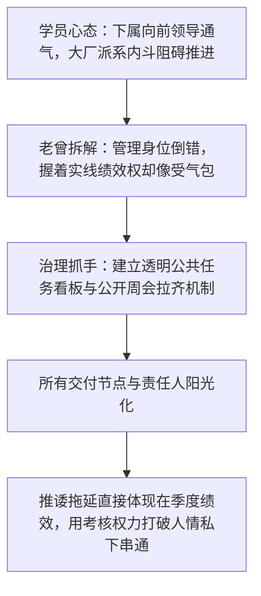
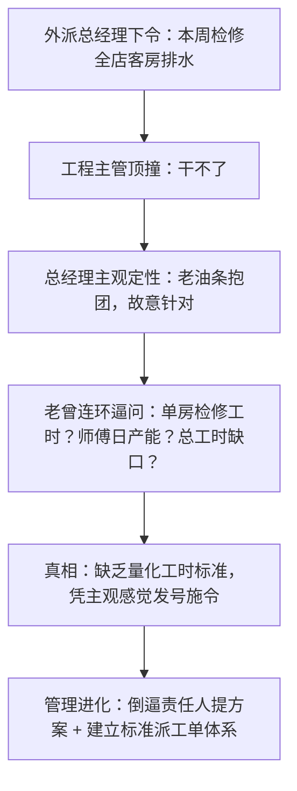
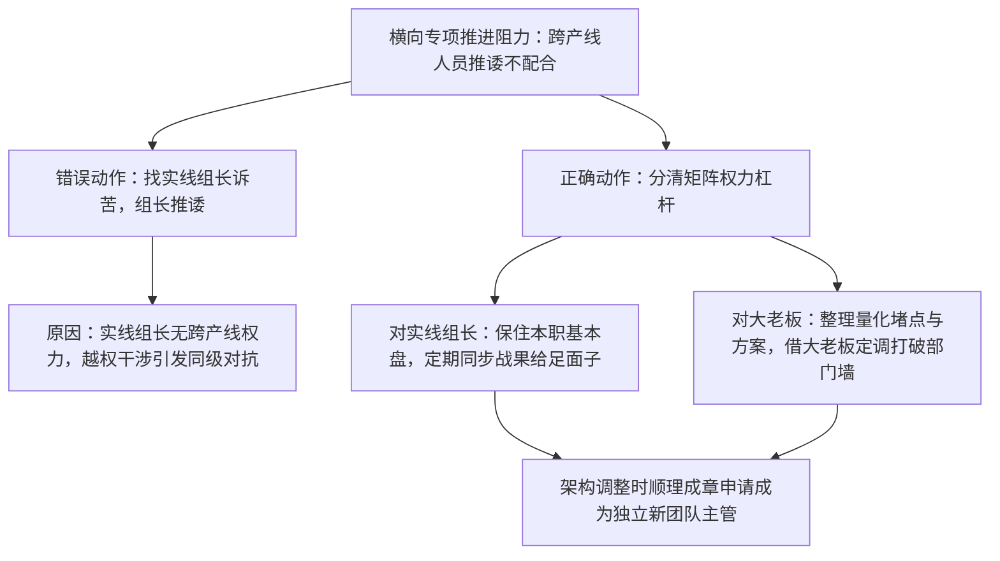

# 2026-11-11 · 产品老曾：数仓空降分化律、内部创业身位重塑与矩阵横向突围

本次连麦答疑聚焦于管理落地与身位博弈中的四个真实困局：技术人员空降研发团队面对原Leader降级与技术刺头时如何稳健立威；大厂内部创业团队从各业务线抽调成员后，Product Lead 如何破除虚妄的“派系斗争”脑补并用好实线绩效权；跨界担任酒店总经理面对老油条工程主管顶撞时，如何用量化工时标准代替情绪宣泄；以及芯片研发工程师牵头跨产线横向专项时，如何理清实线组长与大老板赞助人的权力杠杆顺势上位。

---

## 一、案例一：数仓团队组织架构升级，空降负责人如何应对降级原Leader与技术刺头

### 1. 案例背景与核心纠结

来访者海江是数据仓库（数仓）研发技术人员。某公司 CTO 计划推进组织架构升级，邀请他空降到数仓研发团队担任部门负责人。

该团队目前共有 6 个人，内部关系盘根错节：
- **原团队 Leader**：业务能力平平、威信不足，海江空降后，原 Leader 将被降级为普通研发；
- **技术刺头**：技术能力较强、恃才傲物，平时就不听原 Leader 管教；
- **来访者的顾虑**：空降之后，原 Leader 心怀芥蒂，技术刺头也极难服管。海江纠结空降后如果刺头继续不服管，能不能直接开掉立威，以及如何平稳落地。

### 2. 老曾现场拆解与管理盲区击穿

老曾直接喝止了海江“开人立威”的冲动念头，指出这是很多技术型管理者空降时最容易犯的致命错误：

> “你先别想着开人！团队一共就 6 个人，底层的业务逻辑、数仓链路和历史代码都在老人脑子里。刺头为什么成刺头？很大原因是因为原来的 Leader 技术不行压不住他。原 Leader 被降级，心里肯定有怨气，甚至巴不得刺头跳出来跟你干，自己在旁边看笑话。你一上来搞新官上任三把火把刺头开了，数仓生产作业要是瘫痪停摆，CTO 怎么看你？不仅立不了威，反而证明你没有管理复杂团队的驾驭能力！”

### 3. 稳健着陆策略：业务摸底、标准立威与分化制衡

老曾给出了空降接盘的三步破局法：
1. **绝不公开表态开人**：保持战略耐心，不制造人人自危的对抗情绪；
2. **快速一对一摸底底层依赖**：深入业务现场，理清数仓核心 ETL 作业、调度链路和高危故障点分别握在谁的手里；
3. **用客观交付标准分化借力**：
   - 拿出具体、有挑战性的业务攻坚指标，把任务公开交给刺头去打头阵；
   - 刺头若有真本事并按时按质交付，当众给予认可和激励，将其从“对抗者”转化为自己的“先锋官”；
   - 刺头若只是虚张声势导致生产事故，则在客观事实面前启动问责，此时再做人事调整，团队与上级才会完全信服。

---

## 二、案例二：大厂内部创业抽调团队，破除“派系宫斗”脑补与重塑实线身位

### 1. 案例背景与学员诉求

来访者“天凉好个秋”空降到一家互联网大厂的内部创新团队（负责支付与 crypto 结算业务），团队规模约 30 人。来访者的直属汇报对象是一位直接向 CEO 汇报的 C-level 高管（偏增长业务）。

来访者担任 Product Lead，管理 5 名产品经理与 UI/UE 设计师。团队成员全部是从大厂各个成熟老业务线抽调过来的老员工。

来访者向老曾大吐苦水，称大厂内部派系斗争严重，抽调过来的员工原条线领导之间本就有矛盾，下属心怀不满，私下里频频向原领导汇报通气、打小报告，导致项目推进举步维艰，感觉所有人都不想项目做成。

### 2. 老曾当头棒喝：破除受害者宫斗心态

老曾对这种动辄把管理困难归咎为“宫斗派系”的心态进行了极其辛辣的当头棒喝：

> “你别动不动就脑补什么宫斗大戏！一个几十人的大厂内部创业项目，从成熟业务线抽调边缘人员是全行业的通用常态，资源紧张也是客观规律。你最大的问题是**管理身位倒错**！你是他们的实线领导，这 5 个人的转正、季度绩效、年终奖评级全掌握在你手里。你手里握着最硬核的绩效生杀大权，却在害怕下属跟前领导私下嚼舌根？这就是典型的又贪心又软弱！”

### 3. 破局机制：任务阳光化与考核权力落地

针对抽调团队的治理，老曾开出了具体的管理药方：
1. **停止人情拉扯与私下揣测**：不在私下揣测谁是谁的人，也不在微信私聊中陷入无休止的情绪内耗；
2. **建立公开透明的项目看板与周会对齐机制**：
   - 将所有业务需求、开发交付节点、界面输出标准全部拆解并公布在公共看板上，责任精确到个人；
   - 每周在公开周会上逐项过进度，让每个人当众汇报交付结果；
3. **用实线考核权力定乾坤**：
   - 谁在公共场合拖延或推诿，白纸黑字记录在案；
   - 在季度绩效与评级中严格兑现奖惩，让真正干活的人拿高绩效，用硬核的制度倒逼下属把注意力转移到实际产出上。

---

## 三、案例三：酒店外派总经理面对老油条顶撞，工时量化是唯一管理防线

### 1. 案例背景与现场冲突

来访者 Maggie 是一家酒店管理公司外派的酒店总经理，全店共有 50 多名员工；Maggie 本人是商务销售背景出身。

她反映酒店工程部主管（手下管着 3~4 名本地维修师傅）是典型的老油条，在当地抱团，在例会上经常当面顶撞说“干不了”。比如要求本周把全店所有客房的排水系统全部重新检修一遍，工程主管当场冷冷回应“干不了”，Maggie 感到权威严重受挫，认为对方故意针对自己。

### 2. 老曾连环逼问：没有工时标准，凭什么说别人故意针对？

老曾没有顺着 Maggie 的抱怨去指责员工，而是展开了一场刀刀见血的连环专业逼问：

> - **老曾**：“你说全店排水检修工作量不大，你懂工程维修吗？检修一个客房的排水平均需要几分钟？”  
> - **Maggie**：“……这个我不太清楚。”  
> - **老曾**：“一个熟练师傅一天不吃不喝能排查几个房间？全酒店有多少间房？工程部一共 4 个人，扣除日常突发报修，每天能匀出几个工时做专项检修？你有工时标准吗？”  
> - **Maggie**：“没有标准。”  
> - **老曾**：“你连最基础的工时标准都没有，全凭你当销售的主观感觉拍脑袋下命令，别人根据实际人力说干不了，这不是极其合理吗？！你连别人需要干多久都算不出来，你有什么资格指责别人是‘故意不听话’？问题根本不在工程主管，在于你这个总经理完全不懂运营管理！”

### 3. 解除对抗的管理动作：倒逼方案与派工单体系

老曾教给 Maggie 一套不发脾气却能彻底掌控局面的专业方法：
1. **把皮球踢回给责任人**：
   - 当工程主管说“干不了”时，管理者不要情绪化发火，而要在例会上平静地追问：“按你们现在 4 个人的人手，如果要检修完这 100 间客房，你们按正常节奏需要几天？如果公司必须要求在本周五前完成，你们需要什么样的支援条件？请你今天下午五点前交一份排班排查方案给我。”
   - 将对抗转化为“让他拿方案说话”，把出题人与答题人的身位重新理顺；
2. **建立工程维修量化派工单**：
   - 规定所有客房检修必须填报标准工单（故障排查几分钟、配件更换几分钟）；
   - 用积累的客观数据建立单房检修基准工时库，让工作量考核完全建立在数据和事实之上，彻底终结主观拍脑袋带来的管理内耗。

---

## 四、案例四：半导体研发副工程师横向专项 PM 突围与向上管理

### 1. 案例背景与组织纠葛

来访者工作三到四年，在一家芯片设计公司（存储主控芯片领域）担任研发副工程师（RD 执行岗），主要负责其中一条产线的性能验证工作。

公司为了提升产品竞争力，大老板（+3级别高管）钦点她牵头搞一个横跨 4 条产线的“性能验证专项”，担任横向项目 PM（虚线管理其他各产线的性能测试人员）。

在推进过程中，她遇到了巨大的部门墙阻力：其他产线的工程师优先保自己产线的进度，对横向任务敷衍推诿。当她向自己的直接实线组长（+1主管）求助时，组长态度冷淡，甚至把她往外推：“你自己能解决就自己解决”。恰逢公司总部准备架构调整并增设独立的性能测试新部门，来访者陷入了迷茫：既不知道为什么组长不帮自己，也不知道该如何借机争取新职位。

### 2. 老曾博弈拆解：理清组织矩阵中的权力杠杆

老曾对半导体与大厂常见的“矩阵式专项”进行了深层的权力逻辑拆解：
1. **实线组长为什么把她往外推？**：
   - 组长并不是嫉妒或针对她，而是组长根本没有权力跨产线调动人手！
   - 组长如果替她出头去给其他产线施压，属于严重的“手伸得太长”，必然遭到同级主管的集体反弹。去找实线组长去解决跨产线阻力，是找错了权力杠杆；
2. **分清“日常衣食父母”与“项目赞助人（Sponsor）”**：
   - 实线组长是管你日常出勤、打卡和当期绩效打分的“衣食父母”；
   - 大老板则是钦点专项、拥有全公司战略资源的“项目赞助人”。

### 3. 横向专项 PM 的上位指南

老曾指出了从虚线 PM 跃升为实线部门负责人的具体路径：
- **稳住实线基本盘**：原产线的日常性能验证工作绝不能出差错，不给组长挑刺的借口；横向项目的阶段性进展定期向组长汇报，主动将部分成果算作“本小组对公司的战略贡献”，让组长感受到你的成长能为他长脸；
- **借大老板势能打破部门墙**：把各产线配合困难的问题整理成客观的数据差距与推进方案，直接在大老板主持的专项拉齐会上汇报，由大老板的高阶权威在会上统一定调、明确各产线配合指标；
- **顺势完成独立建制**：在公司架构调整的风口，拿着跨产线专项取得的扎实战果，正式向大老板发起述职，申请出任新设立的性能部门负责人，完成职业身位的关键跃迁。
