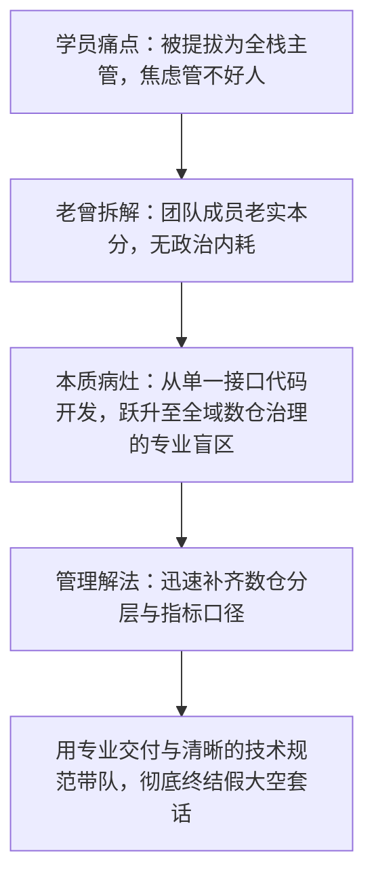
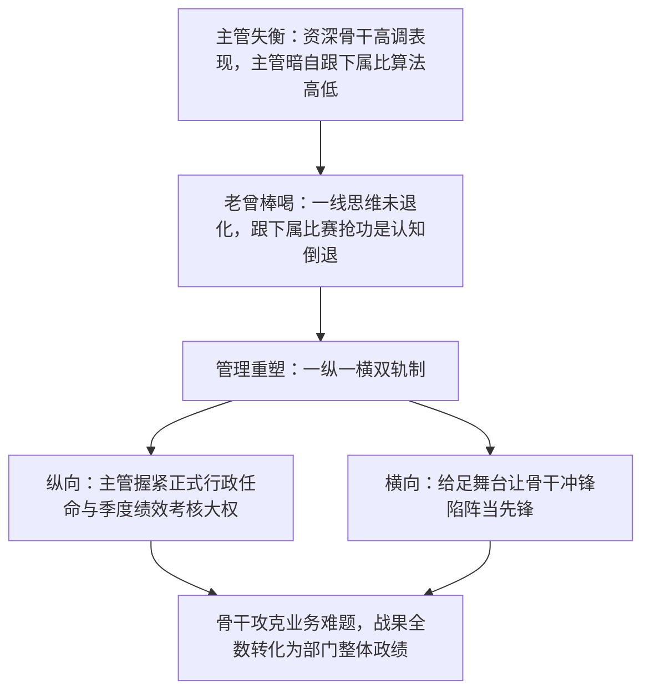

# 2026-11-11 · 产品老曾：研发伪管理焦虑击穿、绝不与下属比赛律与高调骨干借力术

这场深夜连麦答疑聚焦于技术研发骨干走上管理岗位后最普遍的两大心理障碍与认知盲区：初任全栈主管时把自身业务与专业深度不足误判为“管理能力薄弱”的伪管理焦虑；以及手握行政任命的技术 Leader 面对组内专业能力极强、高调显摆的“孔雀开屏”骨干时，因狭隘较劲引发的内耗与破局心法。

---

## 一、案例一：Java 工程师晋升全栈主管，击穿“伪管理焦虑”的业务真相

### 1. 案例背景与虚无焦虑

来访者是一位拥有四到五年 Java 后端研发经验的技术人员，在一家拥有众多线下连锁门店的中小型上市公司工作。

乘着公司推进 AI 转型与内部团队重组的契机，他被上级提拔为研发主管，开始带领一个 10 人规模的跨职能团队，下辖 Java 后端开发、前端、测试以及数据分析人员。该团队的核心业务是支撑全公司线下门店经营系统的稳定运行，并负责管理层日常查看的各项经营数据看板。

上级领导在提拔他时提出明确要求：“重整内部相对混乱的数据管理体系”。

连麦中，该学员显得极其焦虑，反复强调自己“性格内向、缺乏管理经验、不知道怎么管人”，希望老曾传授一套高深的团队管理话术。

### 2. 老曾现场拆解：下属本分老实，这根本不是管理问题！

老曾直接打断了他的宏观管理发问，用一连串具体的业务事实击穿了他的伪管理幻觉：

> “你先别聊管理了！你团队里一没有刺头，二没有老人抱团造反，大家都是拿死工资老实干活的程序员。你所谓的‘管理能力薄弱’纯属无病呻吟！  
> 领导让你去重整数据，核心是因为过去各部门的统计口径混乱、报表打架。你是个写 Java 业务接口出身的人，你懂数据开发吗？数仓底层的日志采集、ETL 链路、分层建模（ODS、DWD、DWS、ADS），你懂几层？各部门的业务指标字典和统计口径，你能统一吗？  
> 这根本不是管理问题，这是**纯业务与专业能力的断层**！你连业务的底层链路都没摸透，却天天想着用抽象的管理技巧去管人，完全是本末倒置。”

### 3. 技术主管的专业升级抓手

老曾给新晋技术主管指明了正确的精力投放方向：
1. **停止学习空洞的管人套话**：在团队没有恶性人际内斗的前提下，管理的核心就是“定目标、理流程、促交付”；
2. **打穿数据全生命周期的专业壁垒**：从单纯编写接口，跃升为理解数仓架构设计，亲自梳理业务日志、清洗规则与分层存储结构；
3. **区分不同受众的数据诉求**：管理层和老板看的是综合经营指标与“核心价值单”，业务一线看的是明细流水详表；主管只有把业务场景与技术实现吃透，才能在团队和业务部门面前建立真正的专业威信。

---

## 二、案例二：技术 Leader 面对“孔雀开屏”资深骨干，管理者的操作系统跃迁

### 1. 案例背景与失衡心态

来访者担任某核心算法与策略研发团队的纵向正式 Leader 已有一年半。

原算法小组长离职后留下岗位空缺，团队内一位资深算法工程师深度参与了关键项目攻坚，表现亮眼，在横向项目上担当主要负责人。该骨干专业能力过硬，但在日常工作中极其高调、喜欢在业务方和老板面前显摆（俗称“孔雀开屏”），甚至在关键项目决策上直接跳过主管向老板汇报。

来访者心态严重失衡：
- 既觉得对方职责边界不清、抢了自己的风头；
- 又在私下里暗暗跟对方较劲，总想证明自己的技术比对方更强、算法水平比对方更高；
- 陷入严重的嫉妒、戒备与精神内耗之中。

### 2. 老曾当头棒喝：一线员工才互相比拼，主管绝不与下属比赛！

老曾对这种“主管跟下属比专业”的幼稚心态进行了直击灵魂的当头棒喝：

> “你根本没有完成从一线员工到管理者的认知跃迁！你还活在过去一线工程师的操作系统里！  
> 一线员工为了争晋升名额、争年度绩效，才会互相比赛：比谁写的算法更核心、比谁的模型调得更好、比谁在老板面前露脸多。  
> 但**做管理的绝不跟自己的下属比赛**！在管理者眼里，下属的人力全都是你的成本，下属负责的项目全都是你的资产，下属立的所有战功全都是你这个部门的政绩！你跟一个一线员工抢什么风头、比什么技术高低？只要这个项目打赢了，最大的获益人永远是你这个正牌主管！”

### 3. 双轨制分工与借力心法

老曾为处理高调能人开出了清晰的管理架构方案：
1. **建立一纵一横的双轨运行机制**：
   - **纵向行政归属**：主管拥有公司正式任命和不可撼动的行政权威，牢牢掌控季度绩效打分权、调薪建议权与团队资源分配权；
   - **横向项目攻坚**：骨干既然能力强、有冲劲、想显摆，就放手让他担任重点攻坚项目的横向 Owner，把对外部门的沟通硬骨头全交给他去啃；
2. **用制度与考核收割管理红利**：
   - 骨干在前面冲锋陷阵打胜仗，不仅不要嫉妒，反而要当众表扬、给足排面；
   - 骨干在外攻坚越出色，老板对该研发部门的评价就越高，主管的管理盘子就越稳固；
3. **完成管理心智的彻底蜕变**：从“事必躬亲的超级工兵”，转变为“搭建舞台、调配资源、为结果负责的操盘手”。戒掉与下属争高下的狭隘虚荣，才算真正迈入了管理的大门。
