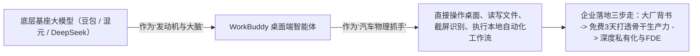

# 2026-11-12 · 企智AI落地派（跨夜全景）：工业2.5倍算力法则与FDE本质、漫剧440元财务账本、算力倒爷刑法红线与小智长连接壁垒

本场跨夜直播总长达 9.43 小时（由因网络断流瞬断 20 秒切分的 Session 131 与 Session 133 平滑全息熔接而成），全景贯通了从企业级顶层研发架构到底层一线野蛮变现的真实商业战场：上半夜深度剖析多智能体协同架构、工业制造企业私有化部署的 2.5 倍算力评估法则、WorkBuddy 与底层大模型的“汽车与发动机”分工隐喻，拆解中小企业“3天免费试用+打透骨干生产力”的三步走模型，并还原 Palantir FDE 的行业专家身位与国央企国产算力硬绑定；下半夜则直击下沉市场，全方位揭示山东临沂 91 分钟漫剧总成本仅 440 元的极限制造成本账本，深度曝光“超低折扣算力倒爷”海外盗刷羊毛池背后的 37 天刑事拘留法律风险与专票陷阱，透彻剖析小智 AI 语音硬件垄断背后的数十万常驻长连接与机房集群壁垒，并给出个人开发者（OPC）绕过国内电信牌照的出海合规路径与儿童智能硬件集中供电架构。

---

## 一、多智能体协同与研发辅助工具选型：Claude Code 的顶层架构优势

在探讨企业内部技术研发与智能体系统搭建时，现场技术嘉宾分享了目前在生产环境中运行的多智能体协同落地经验：

### 1. 三智能体协同分工架构
技术团队在实际业务服务器中部署了由三个专职智能体组成的微型集群：
- **主智能体（Supervisor Agent）**：负责意图识别、复杂上下文判定与任务拆解；
- **执行子智能体（Worker Agents）**：分别接入不同的专业知识库与工具链，在主智能体的统一调度下自主判定并协同处理具体业务逻辑；
- **Agent 信任前提**：企业对数字分身或 Agent 的信任，绝不能停留在花哨的对话界面，第一步必须确认 Agent 能否完整理解企业核心业务，并能在关键决策节点输出有确定性业务价值的内容。

### 2. Claude Code 与代码辅助工具的实战定位
针对当前流行的代码生成工具（Claude Code、Codex、Cursor 等），技术团队给出了明确的场景化分工：
- **顶层架构与系统设计首选 Claude Code**：Claude Code 在系统框架设计、模块边界划分以及协议接口规范输出上表现出极高的优雅性与全局掌控力；
- **分工配合策略**：由高级工程师借助 Claude Code 输出系统整体架构与核心骨架，再将具体的业务模块下发给初级模型或普通研发人员执行编写，能极大降低架构混乱风险。

---

## 二、工业制造私有化评估法则：5年图纸2.5倍算力基准与长程记忆工程瓶颈

在深入非标制造、机械工程与精密加工企业的实际交付时，郭总针对工业客户本地化部署算力配置这一核心难题，给出了经过反复验证的量化评估公式：

### 1. 工业现场 2.5 倍算力评估法则
企业客户在筹备私有化硬件采购时，往往面临不知道买多大显存服务器的困惑。郭总指出：
- **数据与业务量基准**：必须先调取企业**近 5 年的全部工程图纸存量**，测算出当前的日均图纸处理吞吐量，并结合未来业务发展预估增量；
- **2.5 倍安全冗余**：将前述总数据吞吐量**乘以 2.5 倍**，作为企业本地算力机显卡显存、并发通道与本地存储的最低采购基准线，以确保在生产峰值、多部门并发调用以及大模型长上下文解析时不出现显存溢出（OOM）或系统卡死。

### 2. 垂直领域的专有认知壁垒
通用大模型在精密加工、机械结构等高度非标的工业领域存在明显的“幻觉”与知识盲区。不同大模型在不同垂直细分工序上的理解深度大相径庭，企业的核心壁垒必须建立在自身多年沉淀的非公开专有工艺图纸与作业数据上。

### 3. RAG 向量检索易，长程记忆状态持久化难
郭总指出，当前企业搭建基础知识库的门槛已经极低，向量数据库（Vector DB）接入与文档切片 Embedding 都有成熟的开源与商业套件；但企业级工程落地的真正卡点在于：**复杂多轮长程对话中的状态持久化与记忆精准检索（Memory Retrieve）**。如何让 Agent 在跨越数周、涉及多个部门复杂工序的协作中不遗忘前序约定，是当前工业级 Agent 落地必须攻克的工程深水区。

---

## 三、智能体工具选型与认知分层：汽车与发动机隐喻，从 WorkBuddy 到 FDE

面对大量中小企业主对 AI 工具概念的混淆（如搞不清 WorkBuddy、豆包与 DeepSeek 之间的区别），现场嘉宾给出了极其生动的生态分工比喻，并提炼出了针对中小微企业的“三步走”落地转化策略。

### 1. 经典比喻：汽车与发动机的分工
- **WorkBuddy 是汽车与干活的机器人**：它提供了直接调用本地桌面、操作本地文件、截屏识别、读写办公软件并执行具体工作流的“物理抓手”；
- **豆包、混元与 DeepSeek 是发动机与思考大脑**：它们是底层提供语言理解、逻辑推理与方案生成的模型基座；
- 用户在使用 WorkBuddy 时，底层可以自由挂接混元、DeepSeek、GPT 等各种不同的大模型。把二者混为一谈属于根本性的认知错位。

### 2. 中小企业“三步走”降维落地路径
中小企业普遍存在“既焦虑想转型，又极度缺乏技术认知与充沛预算”的矛盾：
1. **第一步（借势大厂背书打消安全顾虑）**：中小企业老板最担心数据泄露与软件跑路。直接推腾讯 WorkBuddy 这类一线大厂官方产品，能瞬间化解信任阻力；
2. **第二步（免费陪跑 3 天，专攻骨干生产力）**：不搞全员大张旗鼓培训，挑选 2 到 3 名核心业务骨干（如小红书文案运营、财务算账、合同审核），为其免费部署陪跑 3 天。一旦骨干员工通过智能体省去了大半繁琐劳动、生产力成倍拉升，老板就会主动掏钱采购并推动全员应用；
3. **第三步（场景跑顺再推私有化与工作流改造）**：当企业的轻量场景完全走通、对数据安全有更高层级诉求时，再顺理成章地向企业定制工作流改造与 FDE 级私有化部署升级。

---

## 四、还原 Palantir 的 FDE 本质：行业专家身位与国央企国产算力强绑定

现场对企服行业近年来热议的“FDE（Forward Deployed Engineer，前线部署工程师）”概念进行了深度去伪存真。

### 1. 真正的 FDE 是“行业专家”而非码农
现场技术嘉宾直言：
> “如果我们真的还原到硅谷 Palantir 的 FDE 本质，真正的 FDE 绝对不只是会写后端的普通程序员！在大厂因为 AI 概念兴起裁员转型的程序员，绝大多数根本干不了真正的 FDE。工业企业真正需要的 FDE，是懂工业业务现场、懂工艺工序、懂客户痛点的行业专家。他是坐在工厂车间里帮客户把业务梳理清楚、并用技术将其翻译成工程系统的复合型人才。”

### 2. 国央企私有化必与国产算力芯片强绑定
在谈及不同客群的支付能力与交付条件时，嘉宾指出了国企与民企的重大分野：
- **民营中小企业**：首要考核的是投入产出比（ROI）与即时变现效果，轻量化、低成本的 SaaS 或桌面智能体是其主力选择；
- **大型工业与国央企**：具备极其充足的数字化预算与刚性的数据保密红线，是真正能承接高客单 FDE 私有化交付的客户群体；
- **国产算力适配红线**：国有企业的 FDE 级私有化项目，必须严格遵循信创规范，与国产算力芯片（如华为昇腾、寒武纪等生态）深度适配。如果硬件算力无法满足全国产化要求，国企在当前阶段绝不会大动干戈上马复杂项目。

---

## 五、两三百工位免费 OPC 空间：从个体单兵作战到“OPC联合舰队”拼单交付

一位在杭州/苏州拥有大型产业孵化基地的连麦嘉宾分享了其在线下探索的 OPC（One Person Company，一人公司）生态：
- **重资产空间赋能**：该基地提供了 **200 至 300 个工位** 的全免费物理办公空间，甚至为入驻的优质 AI 创业者提供免费住宿；
- **个体单兵短板的反思**：单个 OPC 或两三人的微型极客团队，虽然工具玩得极溜，但在面对大型企业的复杂招标与系统集成时，根本无法完成从商务、合规到多工序联调的全流程闭环；
- **构建“OPC 联合舰队”**：通过在线下物理空间的常态化集聚，将懂商会渠道的前端销售、懂工业工序的中端 FDE 顾问、以及懂底层算力与模型调优的技术极客紧密连接，以拼单协作的联合体形式共同承接企业大单，实现了从个体自嗨到商业实战的蜕变。

---

## 六、山东临沂漫剧实战财务模型：91分钟440元的下沉跑量解构

在当前 AI 生图与视频生成的落地热潮中，AI 漫剧（短剧）成为了消耗算力最大、参与人群最杂的赛道。现场嘉宾抛开文青对“画风质感”的高谈阔论，以山东临沂的一线案例，彻底揭开了下沉市场的真实生存账本。

### 1. 工地工头跨界与流水线打法
现场技术嘉宾分享了一个极具代表性的行业样本：
- **创始人背景**：隔壁做漫剧的老板原先是工地上带工人搬砖的包工头，毫无代码背景与影视编导经验；
- **生产组织形式**：租赁低租金场地，配置了几十台普通电脑，清一色采用市面上成熟的“一键成片”傻瓜化工具链，直接招募初级操作人员批量拼搭流水线；
- **下沉需求定位**：不参与主流视频平台的高端精品竞争，专门承接三四线城市及下沉私域的低质走量剧（“下沉剧”），只求剧情能看、画面连贯，完全不对光影质感做苛刻要求。

### 2. 91 分钟仅 440 元的极限制造成本核算
现场给出了一部完整 91 分钟漫剧的真实成本账单：
- **总制作成本**：**440 元人民币**，折合每分钟制作成本仅 **4.81 元**；
- **底层模型选型**：点名采用市场上极低单价的模型（如 H3 等下沉模型），算力成本压低至 **7 分钱/秒**；
- **行业分层对比**：
  - **S 级精品漫剧**：影视级团队制作，配乐、分镜、特写与特效精细打磨，每分钟制作成本在 **1,600 元以上**；
  - **中端及格线漫剧**：画面不穿帮、人物一致性基本达标，每分钟制作成本约 **500 元**；
  - **下沉走量漫剧**：每分钟成本几元至十几元，靠极端压缩的算力成本、傻瓜化工具与大批量交付跑通商业模式。
- **学员变现与轻资产盈利**：该工头老板跑通该套极低成本模型后，立刻通过招募学员收取学费，并让学员作为劳动力参与流水线交付，实现了轻资产高毛利回款。

---

## 七、算力倒爷生态与羊毛池深坑：官Key溯源与合规防线

随着生图模型（如 Stable Diffusion、可灵）与推理大模型（DeepSeek）的调用量激增，二级市场滋生了大量的“算力倒爷”。直播间对市面上泛滥的“超低折扣官方 Key”背后的灰产链条与刑法红线进行了严厉警示。

### 1. 村外羊毛池与 37 天刑事拘留风险
市面上许多报价低得离谱的 API 接口，背后根本不是大厂直签的正规折扣：
- **黑产本质**：黑灰产团伙利用海外被盗信用卡（CVV 盗刷）、虚假身份信息批量注册海外大厂的开发者试用账号（“村外羊毛池”），套取免费算力额度；
- **反代国内包装**：国内倒爷通过反向代理（Reverse Proxy）将海外羊毛 API 转译为国内可访问的 URL 和 Token，并以所谓的“独家超低折扣”向国内漫剧工作室、AI 开发者转售；
- **刑法打击风险**：现场老兵严肃告诫，此类行为涉嫌非法利用信息网络罪与掩饰、隐瞒犯罪所得罪。一旦源头立案侦办，中间层倒爷直接面临“37 天先进看守所拘留审查”的巨大刑事风险。

### 2. 企业采买与“官 Key”真伪核验链条
企服采购人员与正规工作室在采买大宗算力时，必须筑牢合规防线：
- **原厂对公账户直签**：真正的官方大宗采购（如千万级流水谈判），必须走原厂后台账号对公转账，或拥有原厂官方授权书与正式合同；
- **后台扣款记录与发票追溯**：必须能够登录原厂官方控制台，直接调取实际扣款流水与合法发票；
- **拒绝第三方反代**：凡是声称“SD 官 Key 73 折、独家渠道”，却只能提供私人反代域名、无法提供原厂官方控制台核验和进项发票的，一律判定为高风险灰产。

---

## 八、算力专票与财务常识：识破超低折扣虚开发票陷阱

针对部分中间商宣称“自建 DeepSeek 4.1 FaaS 算力低至 2 折，且能全额开具 6 个点增值税专用发票”的说辞，郭总与现场技术专家从物理成本与财税常识出发，进行了彻底戳穿。

### 1. 算力物理成本的底线法则
任何算力服务的提供，都受制于严苛的物理定律与硬性财务支出：
- **IDC 动力与带宽成本**：单台高端 GPU 服务器在高负荷运行下，每日消耗的电力度数与机房 PUE 成本是刚性的；
- **硬件折旧周期**：显卡硬件购置成本通常按 3 年折旧分摊至每小时；
- **常识悖论**：在电力、显卡折旧、机房带宽三大硬成本摆在面前的情况下，市场上所谓“自建 FaaS 算力 2 折”早已跌破边际物理成本，正规厂商绝不可能长期亏本供货。

### 2. 虚开专用发票的暴雷隐患
在财税合规层面上，“超低折扣 + 6个点增值税专票”是一个无法自圆其说的陷阱：
- 羊毛池与灰产反代本身没有合法的进项税源，根本无法开具真实合规的增值税专用发票；
- 倒爷开出的发票多通过空壳公司虚开或买票冲抵，一旦遭遇税务大数据比对稽查，采购企业不仅面临进项税额转出、滞纳金与重罚，更会直接影响企业征信与上市进程。

---

## 九、小智硬件高并发真相：长连接与机房算力的重资产护城河

在 AI 硬件（儿童玩具、桌面对话机器人）领域，许多初创团队陷入了“开源软件即可轻松自建后台”的认知误区。现场通过分析小智硬件生态，揭示了硬件背后的重资产并发壁垒。

### 1. 开源后端与商业授权的矛盾
许多硬件开发者抱怨，售价仅 100 元左右的低端语音机器人，小智平台要抽取 30 至 40 元的商用授权费，利润空间被严重挤压，因此萌生了“用小智开源代码自建服务器替换小智”的想法。

### 2. 数十万长连接与 GPU 并发的机房壁垒
现场技术老兵直截了当地指出了自建方案的技术盲区：
- **长连接与多线程压力**：AI 对话硬件不同于普通 Web 应用，终端设备需要与服务器保持 **全天候常驻长连接（WebSocket / 长轮询）**。当出货量达到几千、上万台时，CPU 线程数会迅速达到硬件物理上限并引发系统雪崩；
- **GPU 语音与模型推理并发**：实时语音对话涉及 ASR 转录、大模型推理与 TTS 合成的高并发串联，必须依赖高防多线 BGP 机房与数千张 GPU 算力集群进行调度优化；
- **小厂商的务实生存策略**：小智的真正护城河并非开源的前端协议，而是其背后重资产投入的全国分布式机房基建与高并发运维能力。中小硬件厂商早期切勿盲目自建机房，应老老实实借助成熟平台快速验证硬件渠道与市场销量。

---

## 十、OPC出海资质破局与智能硬件架构避坑

直播后半程探讨了个人开发者（One Person Company，一人公司）在国内软件商业化中遭遇的体制壁垒，以及智能积木硬件的结构优化设计。

### 1. 国内资质门槛与出海合规路径
- **国内上架与支付壁垒**：国内应用上线面临严格的 ICP 备案、增值电信业务经营许可证（EDI/ICP）以及微信商户号申请门槛，对缺乏实体注册资本与合规资质的单兵开发者构成实质性阻断；
- **苹果生态出海通道**：个人开发者优先将应用部署至海外苹果 App Store，通过海外预付卡（Prepaid Card）或礼品卡（Gift Card）完成开发者账号订阅与测试，借由苹果 IAP（应用内购买）实现全球收款，是绕过国内繁琐牌照审批的主流出路。

### 2. 儿童智能积木硬件供电与拓扑识别优化
针对连麦嘉宾提出的多模块儿童智能拼搭积木设计痛点，现场给出了结构层面的工程优化方案：
- **传统多电池痛点**：若在每个不规则拼搭积木内部塞入纽扣电池，不仅电池寿命极短（数十小时即耗尽）、更换极其繁琐，且存在儿童误吞电池的严重人身安全隐患；
- **底座集中供电与无源识别架构**：
  - **集中供电**：仅在主底座配置长效锂电池或外接电源，通过底座物理触点或磁吸无线供电为拼搭模块供电；
  - **无源识别**：各个积木本体仅内置被动元器件（如 RFID/NFC 芯片或不同阻值的精密电阻），底座通过检测回路阻抗变化或射频信号，实时识别拼搭位置与拓扑形态。该架构不仅彻底消除了单体电池维护问题，更使积木模块的单体 BOM 成本大幅下降超 70%。
